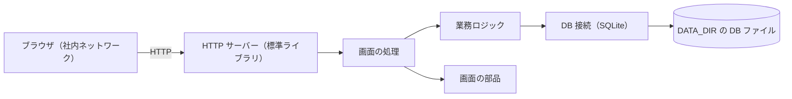
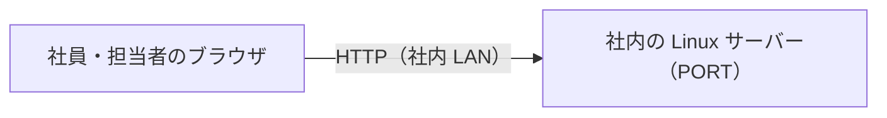
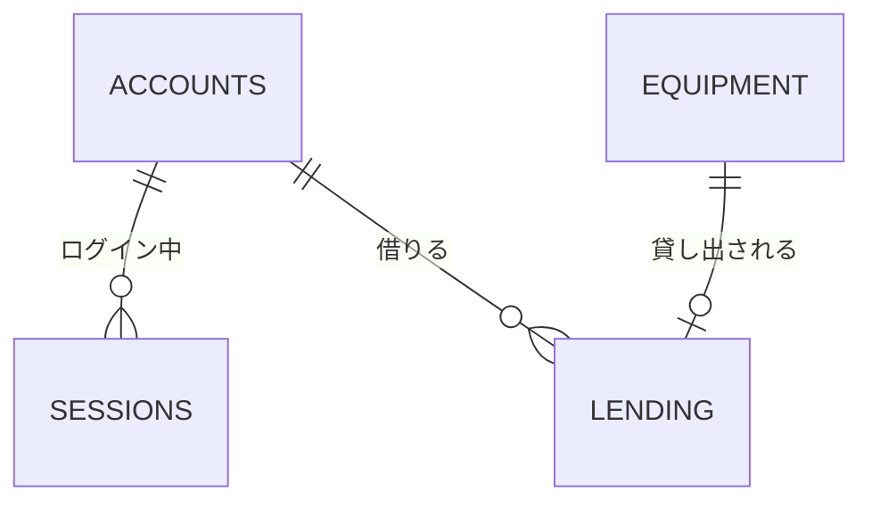
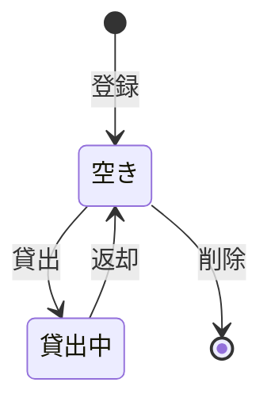
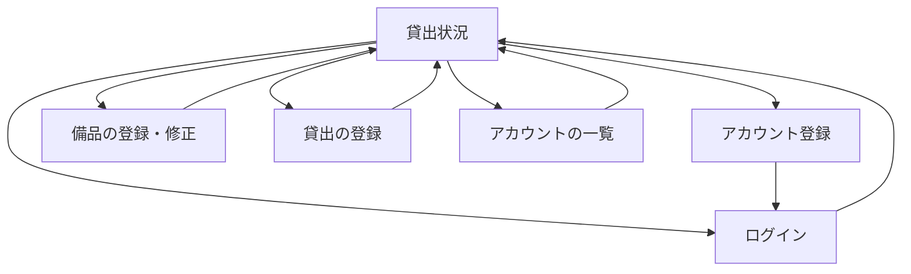
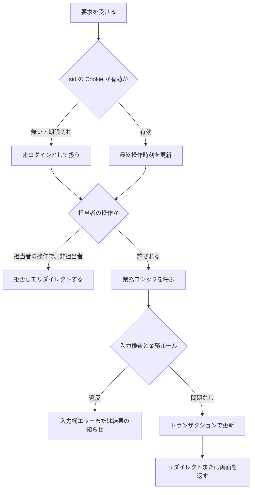
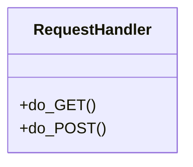

# 備品台帳・貸出状況システム 詳細設計書

## 1. 言語・フレームワーク・アーキテクチャの選定

判定日時: 2026-11-04。ユーザー承認: ANSWERS.md の固定回答により、推奨案の承認を与えられたものとして記録する（承認日 2026-11-04）。

### 1-1. 技術制約の要約

社内の Linux サーバーで `bash run.sh` により直接起動すること。コンテナは使わない。無償のものだけを使い、Python 3.12 と SQLite で足りること。既存コードは無い。利用者は 50 人まで、備品は数百件まで。

### 1-2. 判断軸

| 判断軸 | この案件で効く条件 | 該当 |
|---|---|---|
| 既存資産との整合 | 既存コードは無い | 該当しない |
| チームの技術 | 決まりは無い | 該当しない |
| 配備先 | Linux、コンテナ不要、ネットワークは社内のみ | 該当。直接起動できる構成にする |
| 認証と認可の境界 | パスワード認証、担当者と社員と未ログインの 3 ロール、ボタンと要求の両方 | 該当。認可は要求を受けた側で必ず検査する |
| 画面の規模 | 画面は 6 つ、遷移は単純 | 該当。サーバーで HTML を返す単純な構成にする |
| データの規模と構造 | 備品数百件、アカウント 50 件、同時更新あり | 該当。トランザクションの扱える DB が要る |
| 外部連携 | 無し | 該当しない |
| ライセンスとコスト | 無償のみ | 該当。有償・外部サービスを候補から外す |
| 保守性 | 長期の保守の要求は無い。依存を増やさない | 該当。外部パッケージを増やさない |

### 1-3. 候補の比較

| 層 | 候補 | 評価 | 出典 URL | 確認日 |
|---|---|---|---|---|
| 言語 | Python 3.12 | 2028 年 10 月まで保守（セキュリティ修正の段階）。依頼の制約（Python 3.12）に合う | https://devguide.python.org/versions.html 、https://endoflife.date/python | 2026-11-04 |
| 言語 | Python 3.13 | 依頼の制約は 3.12。3.13 は今回の要件に必要な機能が増えない | 未調査（比較対象として採らないため） | 2026-11-04 |
| Web | 標準ライブラリ（http.server） | 依存の導入が要らない。50 人程度なら十分。ルーティングとフォームは自前で書く | 公式: https://docs.python.org/3/library/http.server.html | 2026-11-04 |
| Web | Flask | 利用者の多い軽量フレームワーク。ただし保守者は最新版だけをサポートすると説明しており、導入に外部パッケージが要る | https://github.com/pallets/flask/discussions/5358 | 2026-11-04 |
| Web | Django | 機能は多いが、今回の 6 画面には大きすぎる | 未調査（規模の判断で採らないため） | 2026-11-04 |
| DB | SQLite（標準ライブラリ sqlite3） | 1 ファイルで動き、外部サーバーが要らない。WAL モードは読み取りと書き込みを並行でき、同時の書き込みは 1 つずつ直列になる。busy タイムアウトで待たせられる | 公式: https://www.sqlite.org/wal.html | 2026-11-04 |
| DB | PostgreSQL 等の DB サーバー | 同時更新には強いが、別のサーバーの導入と運用が要る。今回の規模には過剰 | 未調査（規模の判断で採らないため） | 2026-11-04 |
| パスワード | hashlib の PBKDF2-HMAC-SHA256（標準ライブラリ） | 追加の依存が要らない。反復回数を指定して時間をかけられる | 公式: https://docs.python.org/3/library/hashlib.html | 2026-11-04 |
| E2E | 標準ライブラリ unittest と urllib による HTTP 経由の試験 | ブラウザを導入しない。HTML の id・class・文言を直接確かめられる。JUnit XML は isdd-setup の標準ライブラリ実行器で出す | 公式: https://docs.python.org/3/library/unittest.html | 2026-11-04 |

### 1-4. 最終選定

- 言語: Python 3.12
- フレームワーク: 標準ライブラリの http.server（ThreadingHTTPServer と BaseHTTPRequestHandler）
- DB: SQLite（標準ライブラリ sqlite3）。WAL モード、busy タイムアウト 5 秒、書き込みのトランザクションは BEGIN IMMEDIATE で開始する
- 実行形態: サーバー（`bash run.sh` で直接起動。コンテナは使わない）

選定理由: 要件の規模（利用者 50 人、備品数百件、6 画面）では外部フレームワークや DB サーバーが要らない。依存を増やさないことで、社内サーバーでの導入手順が `bash setup.sh` だけで済む。

## 2. システム構成

### 2-1. コンポーネント一覧

| コンポーネント | 役割 | 配置 |
|---|---|---|
| HTTP サーバー | 画面の要求を受け、HTML を返す | app/web.py、app/__main__.py |
| 業務ロジック | アカウント、備品、貸出、セッションの処理 | app/accounts.py、app/equipment.py、app/lending.py、app/sessions.py |
| 入力検査 | 入力値の形式と桁数の検査 | app/validation.py |
| パスワード処理 | ハッシュの作成と照合 | app/security.py |
| DB 接続 | DB ファイルの接続、スキーマの作成、トランザクション | app/db.py |
| 画面の部品 | HTML の組み立てとエスケープ | app/templates.py |
| 設定 | 環境変数の読み込み | app/config.py |
| 起動スクリプト | 準備と起動 | setup.sh、run.sh |

### 2-2. システム全体構成図



### 2-3. 各コンポーネントの役割と機能

- HTTP サーバー: 環境変数 PORT で待ち受け、全インターフェースに bind する（社内ネットワークからの接続だけを想定し、インターネットには公開しない）。要求ごとにスレッドで処理する。
- 画面の処理: URL ごとに画面を返し、フォームの送信を受けて業務ロジックを呼ぶ。担当者だけの要求は、業務ロジックを呼ぶ前に担当者かどうかを検査する。
- 業務ロジック: 業務ルールを守り、DB のトランザクション内で更新する。
- 入力検査: 入力欄ごとに、社員番号・名前・パスワード・管理番号・備品名・貸出日を検査する。
- DB 接続: 接続ごとに WAL モードと外部キーを有効にし、書き込みは BEGIN IMMEDIATE で行う。

### 2-4. コンポーネント間インターフェースとデータフロー

- 画面の処理は、ブラウザからの要求（メソッド、パス、フォーム値、Cookie）を受け、業務ロジックの戻り値（成功、または業務エラーの種類）を HTML かリダイレクトにする。
- セッションの Cookie の名前は `sid`。値はランダムなトークン。属性は HttpOnly と SameSite=Lax。Secure は付けない（社内の HTTP で動かすため）。
- 操作の結果の知らせは、リダイレクトの前に `flash` という Cookie（種類と文言の番号。例: 「message:forbidden」）に入れ、次の GET で読んで消す。文言は番号から画面の部品が引く。

### 2-5. ネットワーク構成図

サーバーとブラウザの間は HTTP で通信する。構成図は次の 1 本だけ。



## 3. データ設計

### 3-1. データモデル

DB を使う。SQLite の 1 ファイル（DATA_DIR/isdd.sqlite3）に保存する。接続ごとに `PRAGMA journal_mode=WAL`、`PRAGMA foreign_keys=ON`、`PRAGMA busy_timeout=5000` を設定する。

- アカウント（DS-SC-ACCOUNTS）: employee_number TEXT 主キー（6 文字の数字だけを許す CHECK）、name TEXT NOT NULL（30 文字以内は画面の検査で行う）、password_hash TEXT NOT NULL、role TEXT NOT NULL（`manager` か `member` の CHECK）。
- 備品（DS-SC-EQUIPMENT）: id INTEGER 主キー（AUTOINCREMENT）、equipment_number TEXT NOT NULL UNIQUE、name TEXT NOT NULL、version INTEGER NOT NULL DEFAULT 1。
- 貸出（DS-SC-LENDING）: equipment_id INTEGER 主キー（備品の id を参照。1 つの備品に 1 件だけ）、employee_number TEXT NOT NULL（アカウントを参照）、lent_on TEXT NOT NULL（YYYY-MM-DD）。返却で行を削除する。履歴の表は作らない。
- セッション（DS-SC-SESSIONS）: token TEXT 主キー、employee_number TEXT NOT NULL（アカウントを参照）、last_seen INTEGER NOT NULL（UNIX 秒）。
- DB ファイル（DS-SC-DATABASE-FILE）: 保存先は DATA_DIR。無ければ作る。外部の DB とは接続しない。

リレーション図:



カラムと入力チェックの対応: 社員番号の 6 桁、名前の 30 文字、パスワードの 8 文字以上、管理番号の 20 文字と文字種、備品名の 50 文字、貸出日の形式と未来日の禁止は、画面の処理の前に入力検査（入力検査の各関数で行う）。DB の CHECK は社員番号の形式と役割の値だけを重ねて守る。

### 3-2. トランザクションと排他制御

| 操作 | トランザクションの範囲 | ロールバックの条件 | 排他制御 |
|---|---|---|---|
| アカウント登録（DS-FN-REGISTER-ACCOUNT） | 件数の数え、担当者の判定、登録（BEGIN IMMEDIATE） | 件数が 50 件以上、社員番号の重複（UNIQUE 違反） | 書き込みの直列化（BEGIN IMMEDIATE）。最初の 1 件を 2 人が同時に担当者にすることを防ぐ |
| 備品の登録・修正・削除（DS-FN-CREATE-EQUIPMENT、DS-FN-UPDATE-EQUIPMENT、DS-FN-DELETE-EQUIPMENT） | 版番号の検査と更新（削除は貸出の有無の確認を含む） | 版番号の不一致、管理番号の重複、貸出中の削除 | 楽観的排他制御（版番号）。書き込みは BEGIN IMMEDIATE |
| 貸出の登録（DS-FN-LEND-EQUIPMENT） | 備品の存在の確認、貸出の有無の確認、貸出行の追加 | 貸出中、備品が無い | 書き込みの直列化。貸出行の主キーで二重の貸出を防ぐ |
| 返却（DS-FN-RETURN-EQUIPMENT） | 貸出行の削除と件数の確認 | 件数が 0（既に返却） | 書き込みの直列化 |
| 担当者の付け外し（DS-FN-CHANGE-MANAGER-ROLE）、アカウント削除（DS-FN-DELETE-ACCOUNT） | 担当者の人数の数え、借りている件数の確認、更新または削除 | 担当者が 0 人になる、借りている社員の削除 | 書き込みの直列化。人数の数えと更新を同じトランザクションで行う |

### 3-3. 状態遷移

備品の状態は貸出行の有無で決まる（空き: 貸出行が無い、貸出中: 貸出行が有る）。状態を持つのは備品だけ。

| 遷移 | 状態の持ち方 | 遷移を行う処理 | 許されない遷移の扱い |
|---|---|---|---|
| 空き → 貸出中 | 貸出行を追加する | DS-FN-LEND-EQUIPMENT | 貸出中の備品への貸出は「この備品は既に貸出中です」を結果の知らせに出し、変更しない |
| 貸出中 → 空き | 貸出行を削除する | DS-FN-RETURN-EQUIPMENT | 空きの備品への返却は「この備品は既に返却されています」を結果の知らせに出し、変更しない |
| 貸出中 → 削除 | 不可 | DS-FN-DELETE-EQUIPMENT | 「この備品は貸出中のため削除できません。先に返却を処理してください」を画面全体のエラーに出す |



## 4. アーキテクチャ設計

### 4-1. 外部設計

利用者向けインターフェース（画面）。すべて GET と POST のフォームで動く。JavaScript は使わない。確認ダイアログは HTML のフォームの onsubmit に `window.confirm` を置いて出す。

| 画面（DS-IF） | URL | 利用者 | 主要要素 |
|---|---|---|---|
| DS-IF-LENDING-STATUS-SCREEN | `/` | 全員 | 一覧の表（tbody tr、data-equipment-number）、担当者の行の操作ボタン、ログイン・アカウント登録・ログアウトのリンクまたはボタン（担当者には「備品を登録」「アカウントの一覧」）、`.current-user`、`.message`、`.error` |
| DS-IF-REGISTER-ACCOUNT-SCREEN | `/accounts/register/` | 全員（未ログイン） | id_employee_number、id_name、id_password、「登録」ボタン |
| DS-IF-LOGIN-SCREEN | `/login/` | 全員（未ログイン） | id_employee_number、id_password、「ログイン」ボタン、`.error`、`.message` |
| DS-IF-EQUIPMENT-FORM-SCREEN | `/equipment/new/`、`/equipment/<id>/edit/` | 担当者 | id_equipment_number、id_name、「保存」ボタン、`.field-error`、`.error` |
| DS-IF-LENDING-FORM-SCREEN | `/equipment/<id>/lend/` | 担当者 | `.lending-equipment`、id_borrower（select）、id_lent_on、「登録」ボタン |
| DS-IF-ACCOUNT-LIST-SCREEN | `/accounts/` | 担当者 | 一覧の表（tbody tr、data-employee-number、3 列目に役割）、行の「担当者にする」「担当者から外す」「パスワード再設定」「削除」、再設定の行の input[name=new_password] と「確定」 |

画面遷移図:



インターフェース仕様（画面ごと。入力、出力、エラー）:

| 画面 | 入力と検査 | 出力 | エラー仕様 |
|---|---|---|---|
| 貸出状況（GET /） | なし | 全備品を管理番号の昇順（文字列の比較）で並べた一覧。空きか貸出中か、借りている社員の名前、貸出日 | 備品が 0 件なら「備品は登録されていません」を表の外に出す |
| アカウント登録（POST） | 社員番号は 6 桁の数字、名前は空でなく 30 文字以内、パスワードは 8 文字以上（入力検査の各関数で行う） | 成功時は `/login/` へのリダイレクトと「登録しました。ログインしてください」の flash | 入力欄ごとは `.field-error`。重複は id_employee_number の欄に「この社員番号は既に登録されています」。50 件に達していれば `.error` |
| ログイン（POST） | 社員番号とパスワード | 成功時は `/` へのリダイレクトとセッションの Cookie | 形式が悪い場合と照合に失敗した場合は、同じ `.error`「社員番号またはパスワードが違います」。入力した社員番号は残し、パスワードは残さない |
| 備品の登録（POST /equipment/new/） | 管理番号（英数字とハイフン、20 文字以内）、備品名（空でなく 50 文字以内） | 成功時は `/` へのリダイレクトと「備品を登録しました」 | 入力欄ごとに `.field-error`。管理番号の重複は id_equipment_number の欄に「この管理番号は既に使われています」。入力値は残す |
| 備品の修正（POST /equipment/<id>/edit/） | 登録と同じ。版番号（hidden）が必要 | 成功時は `/` へのリダイレクトと「備品を更新しました」 | 入力欄は登録と同じ。版番号の不一致は `.error`「他の担当者が先にこの備品を更新しました。貸出状況の画面から開き直してください」（入力値は残す）。備品が無い場合も同じ文言 |
| 備品の削除（POST /equipment/<id>/delete/） | 版番号（hidden） | 成功時は `/` と「備品を削除しました」 | 貸出中は `.error`「この備品は貸出中のため削除できません。先に返却を処理してください」。版番号の不一致または備品が無い場合は `.error`（修正と同じ文言） |
| 貸出の登録（GET と POST /equipment/<id>/lend/） | 借りる社員（必須。存在するアカウント）、貸出日（YYYY-MM-DD、必須、今日（日本時間）以前） | 成功時は `/` と「貸出を登録しました」。GET は `.lending-equipment` に「備品: 管理番号 備品名」 | 借りる社員が未選択は id_borrower の `.field-error`「借りる社員を選んでください」。貸出日の形式違いは id_lent_on の `.field-error`。未来の日付は「貸出日に未来の日付は入力できません」。貸出中は `/` へのリダイレクトと `.message`「この備品は既に貸出中です」。備品が無い場合は `.error` |
| 返却（POST /equipment/<id>/return/） | なし | 成功時は `/` と「返却を登録しました」 | 空きは `/` の `.message`「この備品は既に返却されています」。備品が無い場合は `.error` |
| アカウントの一覧（GET /accounts/、?reset=社員番号） | なし | 全アカウントを社員番号の昇順で一覧。`reset` が指す行にパスワードの入力欄と「確定」 | 担当者以外は DS-FN-REQUIRE-MANAGER の規則に従う |
| 担当者の付け外し・削除（POST /accounts/<社員番号>/role/、/accounts/<社員番号>/delete/） | 確認ダイアログで「はい」のときだけ送信 | 成功時は `/accounts/` と `.message` | 担当者が 0 人になる操作は `.error`「担当者が 1 人もいなくなるため、この操作はできません」。借りている社員の削除は `.error`「この社員は備品を借りているため削除できません。先に返却を処理してください」 |
| パスワードの再設定（POST /accounts/<社員番号>/password/） | input[name=new_password] は 8 文字以上 | 成功時は `/accounts/` と「パスワードを再設定しました」 | 行の入力欄に `.field-error`「パスワードは 8 文字以上で入力してください」 |

権限のない要求（DS-FN-REQUIRE-MANAGER）: 未ログインの要求は `/login/` へのリダイレクト（flash なし）。社員の要求は `/` へのリダイレクトと `.message`「この操作は担当者だけが行えます」。どちらも業務ロジックは呼ばず、記録を変えない。

#### 外部連携

外部連携は無い。

### 4-2. 内部設計

処理フロー（要求ごと）:



各処理の役割:

- 要求の処理（DS-CL-REQUEST-HANDLER）: 要求のパスとメソッドで振り分ける。Cookie の sid から現在のアカウントを得る（DS-FN-RESOLVE-SESSION）。担当者の操作は DS-FN-REQUIRE-MANAGER で検査してから、業務ロジックを呼ぶ。
- セッションの処理（DS-MD-SESSIONS）: ログイン時にトークンを作って保存し、各要求で最終操作時刻を見る。最終操作から SESSION_IDLE_TIMEOUT_SECONDS（既定 1800 秒）を超えていれば行を削除して未ログインとする。ログアウトでは行を削除する。
- 業務ロジック: 下の 5 章のとおり。
- 画面の部品（DS-MD-TEMPLATES）: 共通の枠（ヘッダー、`.current-user`、`.message`、`.error`）と、各画面の HTML を組み立てる。値はすべて HTML エスケープする。

## 5. クラス設計

### 5-1. クラス一覧

| クラス | 責務（1 文） | 所在 |
|---|---|---|
| DS-CL-REQUEST-HANDLER | HTTP の要求を受けて、画面の処理へ振り分け、応答を返す | app/web.py（BaseHTTPRequestHandler を継承） |

業務ロジックは関数で構成する（クラスは作らない）。

### 5-2. クラスの責務、主要属性、主要メソッド

DS-CL-REQUEST-HANDLER: 主要な属性は、設定（DS-MD-CONFIG の値）と DB ファイルのパス。主要なメソッドは、GET と POST の振り分け、現在のアカウントの取得、フラッシュの読み書き、各画面の処理。

### 5-3. クラス図



### 5-4. システム内メッセージ一覧

内部のメッセージは無い（関数呼び出しのみ）。業務エラーは、戻り値として「エラーの種類」と「入力欄」を返す。

## 6. エラーハンドリングとセキュリティ設計

### 6-1. エラーハンドリング

| 想定エラー | 利用者への見え方 | ログ | 扱い |
|---|---|---|---|
| 入力値の形式・桁数の違反 | 入力欄の `.field-error` | 出さない | 処理を止める。入力値は残す |
| 業務ルール違反（貸出中など） | `.message` または `.error` | 出さない | 変更せずに戻る |
| 版番号の不一致（同時更新） | `.error` | 出さない | 変更しない |
| 未ログインまたは権限不足 | ログイン画面へのリダイレクトまたは `.message` | 出さない | 業務ロジックを呼ばない |
| DB のロック待ちがタイムアウト | 500 の簡単なエラー画面 | 標準エラーに 1 行出す | 変更は行わない（トランザクションは巻き戻る） |
| 想定外の例外 | 500 の簡単なエラー画面 | 標準エラーに例外を出す | 変更は行わない |

ログは必要ないため、標準エラーへの出力以外のログは作らない（運用要件）。

### 6-2. 認証

方式: 社員番号とパスワード（SSO 無し）。パスワードは PBKDF2-HMAC-SHA256（反復 200000 回、16 バイトのソルト、ハッシュと一緒に保存。形式は `pbkdf2_sha256$回数$ソルト$ハッシュ`）。照合は比較時間が一定になる関数で行う。成功するとトークン（secrets.token_urlsafe(32)）を sessions に保存する。

### 6-3. 認可

| 操作 | 未ログイン | 社員 | 担当者 |
|---|---|---|---|
| 貸出状況の閲覧 | ○ | ○ | ○ |
| アカウント登録、ログイン | ○ | ○ | ○ |
| ログアウト | ○（何もしない） | ○ | ○ |
| 備品の登録・修正・削除、貸出、返却 | ×（ログインへ） | ×（拒否） | ○ |
| アカウントの一覧、担当者の付け外し、パスワード再設定、アカウント削除 | ×（ログインへ） | ×（拒否） | ○ |

ボタンの出し分けは、画面の処理が役割を見て行う。要求の拒否は業務ロジックを呼ぶ前に DS-FN-REQUIRE-MANAGER で行う。両方を行う。

### 6-4. 監査ログ

監査ログは無い（運用要件に無い）。

### 6-5. その他のセキュリティ対策

- 社内ネットワークからだけ接続する前提で、インターネットには公開しない（運用の決まり）。
- Cookie は HttpOnly と SameSite=Lax。SameSite により、他サイトからのフォーム送信では Cookie が送られず、CSRF の対策になる。CSRF トークンは使わない。
- HTML の値はすべて html.escape で出す。
- 社員番号とパスワードの失敗時は、どちらが違うかを示さない。

## 7. コード設計

### 7-1. ディレクトリ構成

```
run.sh
setup.sh
app/
  __main__.py
  config.py
  db.py
  security.py
  validation.py
  accounts.py
  equipment.py
  lending.py
  sessions.py
  web.py
  templates.py
tests/
  unit/
e2e/
```

### 7-2. ファイル一覧

| ファイル | 役割 | 含まれるクラス・関数 | 実現する設計 ID |
|---|---|---|---|
| app/__main__.py | 起動の入口。設定を読み、サーバーを立てる | main | DS-MD-MAIN、DS-FN-MAIN、DS-OP-SERVER-START |

起動スクリプト run.sh と setup.sh は運用の設計要素（DS-OP-SERVER-START）として扱い、ソースの対応表の対象にしない。
| app/config.py | 環境変数の読み込み | load_settings | DS-MD-CONFIG、DS-FN-LOAD-SETTINGS |
| app/db.py | DB 接続、スキーマ、トランザクション | open_connection、initialize_schema、immediate_transaction | DS-MD-DATABASE、DS-SC-DATABASE-FILE、DS-SC-ACCOUNTS、DS-SC-EQUIPMENT、DS-SC-LENDING、DS-SC-SESSIONS、DS-FN-OPEN-CONNECTION、DS-FN-INITIALIZE-SCHEMA |
| app/security.py | パスワードのハッシュと照合、トークン | hash_password、verify_password、new_session_token | DS-MD-SECURITY、DS-FN-HASH-PASSWORD、DS-FN-VERIFY-PASSWORD、DS-FN-NEW-SESSION-TOKEN |
| app/validation.py | 入力値の検査 | validate_employee_number、validate_name、validate_password、validate_equipment_number、validate_equipment_name、validate_lent_on | DS-MD-VALIDATION、DS-FN-VALIDATE-EMPLOYEE-NUMBER、DS-FN-VALIDATE-NAME、DS-FN-VALIDATE-PASSWORD、DS-FN-VALIDATE-EQUIPMENT-NUMBER、DS-FN-VALIDATE-EQUIPMENT-NAME、DS-FN-VALIDATE-LENT-ON |
| app/accounts.py | アカウントの登録、認証、一覧、役割、パスワード、削除 | register_account、authenticate_account、list_accounts、change_manager_role、reset_password、delete_account | DS-MD-ACCOUNTS、DS-FN-REGISTER-ACCOUNT、DS-FN-AUTHENTICATE-ACCOUNT、DS-FN-LIST-ACCOUNTS、DS-FN-CHANGE-MANAGER-ROLE、DS-FN-RESET-PASSWORD、DS-FN-DELETE-ACCOUNT |
| app/equipment.py | 備品の登録・修正・削除と版番号の検査 | create_equipment、update_equipment、delete_equipment、check_equipment_version | DS-MD-EQUIPMENT、DS-FN-CREATE-EQUIPMENT、DS-FN-UPDATE-EQUIPMENT、DS-FN-DELETE-EQUIPMENT、DS-FN-CHECK-EQUIPMENT-VERSION |
| app/lending.py | 貸出状況の一覧、貸出、返却 | list_lending_status、lend_equipment、return_equipment | DS-MD-LENDING、DS-FN-LIST-LENDING-STATUS、DS-FN-LEND-EQUIPMENT、DS-FN-RETURN-EQUIPMENT |
| app/sessions.py | セッションの作成、確認、削除 | create_session、resolve_session、delete_session | DS-MD-SESSIONS、DS-FN-CREATE-SESSION、DS-FN-RESOLVE-SESSION、DS-FN-DELETE-SESSION、DS-FN-REQUIRE-MANAGER |
| app/web.py | HTTP の振り分けと画面の処理 | RequestHandler（DS-CL-REQUEST-HANDLER）、REQUIRE の検査と flash の読み書き（DS-FN-REQUIRE-MANAGER は sessions.py）、DS-IF の各画面 | DS-MD-WEB、DS-CL-REQUEST-HANDLER、DS-IF-LENDING-STATUS-SCREEN、DS-IF-REGISTER-ACCOUNT-SCREEN、DS-IF-LOGIN-SCREEN、DS-IF-EQUIPMENT-FORM-SCREEN、DS-IF-LENDING-FORM-SCREEN、DS-IF-ACCOUNT-LIST-SCREEN |
| app/templates.py | HTML の組み立て | render_page | DS-MD-TEMPLATES、DS-FN-RENDER-PAGE |

依存の規則（第 7 章の表）:

| 依存元（ディレクトリ） | 依存してよい先 | 依存してはいけない先 | 理由 |
|---|---|---|---|
| app/（web.py 以外の業務モジュール） | app/db.py、app/security.py、app/validation.py、app/sessions.py（業務モジュール同士） | app/web.py、app/templates.py、http.server | 業務ロジックを HTTP と画面の部品から独立させるため |
| app/web.py、app/templates.py | app/ のすべてのモジュール | （制限なし） | 画面の処理は業務ロジックを呼ぶ側 |

対応表の粒度: function。ファイル単位の DS-MD と関数単位の DS-FN・DS-CL を対応表に書く（公開関数まで）。

### 7-3. コーディング規約

- 標準ライブラリだけを使う。外部パッケージを入れない。
- 関数に型注釈を付ける。例外は使わず、業務エラーは戻り値で返す。
- コードには要件 ID と設計 ID を書かない。設計 ID とコードの対応は `docs/trace_map.md` に記録する。

## 8. テスト設計

### 8-1. テストの種類と方針

- 単体テスト（tests/unit）: 入力検査、パスワードのハッシュと照合、セッションの期限、版番号の検査。`python3 -m unittest discover -s tests/unit` で実行する。
- 結合テスト: 業務ロジックと SQLite を一時 DB で組み合わせ、トランザクションと制約を確かめる。tests/unit に含める。
- E2E テスト（e2e）: 起動したサーバーに HTTP で要求を送り、HTML の id、class、文言を確かめる。RQ-TS 14 件を DS-TS 14 件で網羅する。
- 非機能の確認: DS-TS-RESPONSE-TIME（同時に 50 件の要求を送り、各応答が 3 秒以内）と DS-TS-CONCURRENT-USERS（50 アカウントのログインと操作が互いに失われない）。

### 8-2. E2E テストのシナリオ

| DS-ID | 目的 | 前提条件 | 手順 | 期待結果 |
|---|---|---|---|---|
| DS-TS-REGISTER-ACCOUNTS | RQ-TS-REGISTER-ACCOUNTS の確認 | DB が空 | 1 件目と 2 件目の登録、入力制限の 4 種、50 件の上限 | 役割と文言が契約どおり |
| DS-TS-LOGIN-LOGOUT | RQ-TS-LOGIN-LOGOUT の確認 | 2 件のアカウント | 失敗 2 種、成功、ログアウト | 失敗文言は同一、`.current-user` |
| DS-TS-IDLE-LOGOUT | RQ-TS-IDLE-LOGOUT の確認 | SESSION_IDLE_TIMEOUT_SECONDS=2 で起動 | ログイン後に 3 秒待つ | 未ログインの表示に戻る |
| DS-TS-VIEW-LENDING-STATUS | RQ-TS-VIEW-LENDING-STATUS の確認 | 備品 3 件、1 件貸出中 | 未ログインで `/` を開く | 昇順、空きと貸出中の表示、行の操作なし |
| DS-TS-EMPTY-EQUIPMENT-LIST | RQ-TS-EMPTY-EQUIPMENT-LIST の確認 | 備品 0 件 | `/` を開く | 「備品は登録されていません」 |
| DS-TS-CREATE-EQUIPMENT | RQ-TS-CREATE-EQUIPMENT の確認 | 担当者でログイン | 登録、文字種違い、桁超過、重複 | 行が増え、各エラーが入力欄に出る |
| DS-TS-UPDATE-EQUIPMENT | RQ-TS-UPDATE-EQUIPMENT の確認 | 担当者 A と B | A が修正画面を開く、B が先に保存、A が保存 | A は `.error`、記録は B の内容 |
| DS-TS-DELETE-EQUIPMENT | RQ-TS-DELETE-EQUIPMENT の確認 | 空き 1 件、貸出中 1 件 | 空きを削除、貸出中を削除 | 空きは消え、貸出中は `.error` |
| DS-TS-LEND-EQUIPMENT | RQ-TS-LEND-EQUIPMENT の確認 | 空き 1 件、社員 1 人 | 正常な貸出、未選択、未来日、貸出中への貸出 | 表示、入力欄エラー、`.message` |
| DS-TS-RETURN-EQUIPMENT | RQ-TS-RETURN-EQUIPMENT の確認 | 貸出中 1 件 | 返却、空きへの返却 | 空きに戻る、`.message` |
| DS-TS-MANAGE-MANAGER-ROLE | RQ-TS-MANAGE-MANAGER-ROLE の確認 | 担当者 1 人と社員 1 人 | 付与、解除、最後の解除 | 役割の変化、`.error` |
| DS-TS-RESET-PASSWORD | RQ-TS-RESET-PASSWORD の確認 | 社員 1 人 | 7 文字、8 文字で確定、新パスワードでログイン | 入力欄エラー、ログイン成功 |
| DS-TS-DELETE-ACCOUNT | RQ-TS-DELETE-ACCOUNT の確認 | 借りている社員 A と空の社員 B | A の削除、B の削除 | A は `.error`、B は消える |
| DS-TS-ACCESS-ENDS-ON-RESET-AND-DELETE | RQ-TS-ACCESS-ENDS-ON-RESET-AND-DELETE の確認 | 担当者 1 人、社員 A と B（借りていない）、空きの備品 1 件 | A のパスワードを再設定し古いパスワードでログインを試す。B を削除し B でログインを試す。貸出の登録の画面を開く | 再設定は「パスワードを再設定しました」。古いパスワードと削除した B のログインは「社員番号またはパスワードが違います」（`.error`）。借りる社員の選択肢に A は出て、B は出ない |
| DS-TS-RESTRICT-NON-MANAGER | RQ-TS-RESTRICT-NON-MANAGER の確認 | 社員 1 人 | 社員でトップを見る、備品登録を直接開く、POST を送る、未ログインで POST を送る | ボタンなし、`.message`、ログイン画面 |
| DS-TS-KEEP-LENDING-ON-UPDATE | RQ-TS-KEEP-LENDING-ON-UPDATE の確認 | 担当者でログイン。備品 1 件が社員に貸出中 | 備品の修正画面で備品名だけを変えて保存し、貸出状況を開く | 保存は成功。貸出状況で同じ備品が貸出中のまま、借りている社員の名前と貸出日が修正前と同じ |
| DS-TS-CONCURRENT-LEND-RETURN | RQ-TS-CONCURRENT-LEND-RETURN の確認 | 担当者 A と B。空きの備品 1 件と社員 1 人（貸出の確認）。貸出中の備品 1 件（返却の確認） | A と B が同じ空きの備品の貸出を同時に送る。続けて A と B が同じ貸出中の備品の返却を同時に送る | 貸出は一方が「貸出を登録しました」、他方が「この備品は既に貸出中です」。返却は一方が「返却を登録しました」、他方が「この備品は既に返却されています」。貸出状況は「空き」 |

### 8-3. E2E の実行手段

標準ライブラリの unittest と urllib（HTTP 経由）。ブラウザ自動化は使わない（導入の要らない構成にするため）。承認: ANSWERS.md の固定回答（ローカルで直接実行）により承認とみなす（2026-11-04）。

### 8-4. E2E の実行コマンドと運用

- 単体・結合: `python3 -m unittest discover -s tests/unit`
- E2E: `python3 scripts/isdd/unittest_junit.py -s e2e -o e2e/results/e2e.xml`。各テストは空の DATA_DIR と空きポートでアプリを別プロセスとして起動し、終わったら止めて DATA_DIR を消す（e2e/support.py の AppServer）。サーバーを手で起動しておく必要は無い。
- 出力先: e2e/results/（git 管理外）
- E2E テストが落ちたら修正と再実行を繰り返し、全件通過まで続ける。

## 9. 運用設計

### 9-1. 起動方式

サーバー（コンテナは使わない）。

- `bash setup.sh`: Python 3.12 以上と sqlite3 の読み込みを確かめ、結果を表示する。1 回だけ実行する。
- `bash run.sh`: 環境変数を既定値で補い、`python3 -m app` を起動する。

### 9-2. 初期化

DB スキーマは起動時に作る（無ければ作成、あれば何もしない）。初期ユーザーは無い。初回の担当者は、社員に URL を知らせる前に担当者がアカウント登録の画面で最初に登録する（DS-OP-INITIAL-SETUP）。

### 9-3. 設定値・環境変数

| 名前 | 用途 | 既定値 | 必須 |
|---|---|---|---|
| PORT | 待ち受けポート | 8000 | 不要 |
| DATA_DIR | DB の保存先 | ./data | 不要 |
| SESSION_IDLE_TIMEOUT_SECONDS | 自動ログアウトまでの秒数 | 1800 | 不要 |

秘密情報は無い（外部連携も無い）。

### 9-4. バックアップと復旧

バックアップは必要ないため、設計は行わない。

### 9-5. データ移行

既存の Excel は担当者が画面から手で入力する。取り込みの機能は作らない（DS-IF-EQUIPMENT-FORM-SCREEN の手入力で行う）。

### 9-6. 可用性

平日の日中に使い、夜間と休日は止めてよい。停止と起動は `run.sh` の再実行で行う。DB ファイルは DATA_DIR に残るため、起動し直せば状態は戻る。

### 9-7. 起動方法と操作説明

README.md に起動方法（setup.sh と run.sh）、環境変数、導入時の初期手順（最初の担当者の登録）を書く。

## 10. ログ・監視・アラート・障害対応設計

- ログ: ログの設計は必須ではないため、ログの種類と内容の記述は行わない（運用要件に従い、標準エラーへの例外出力のみ）。
- 監視・アラート: 監視・アラートの設計は必須ではないため、監視・アラートの内容と対応方法の記述は行わない。
- 障害対応: 想定する障害は次の 2 つ。
  - サーバーが止まった: 利用者は接続できない。担当者が run.sh を再実行する。DB ファイルは残る。
  - DB ファイルが壊れた: 担当者に連絡し、DATA_DIR を空にして再起動する（記録は失われる。バックアップが不要とされたため、この扱いを受け入れる）。

## 11. 要件と設計の対応表

| DS-ID | 対応要件ID |
|---|---|
| DS-MD-MAIN | RQ-OP-STARTUP-PROCEDURE, RQ-NF-INTERNAL-NETWORK-ACCESS |
| DS-MD-CONFIG | RQ-OP-STARTUP-PROCEDURE |
| DS-MD-DATABASE | RQ-DT-SQLITE-DATABASE, RQ-DT-INTERNAL-DATA-ONLY |
| DS-MD-SECURITY | RQ-NF-PASSWORD-AUTH |
| DS-MD-VALIDATION | RQ-FT-REGISTER-ACCOUNT, RQ-FT-CREATE-EQUIPMENT, RQ-FT-LEND-EQUIPMENT |
| DS-MD-ACCOUNTS | RQ-FT-REGISTER-ACCOUNT, RQ-FT-LOGIN, RQ-FT-LIST-ACCOUNTS, RQ-FT-CHANGE-MANAGER-ROLE, RQ-FT-RESET-PASSWORD, RQ-FT-DELETE-ACCOUNT |
| DS-MD-EQUIPMENT | RQ-FT-CREATE-EQUIPMENT, RQ-FT-UPDATE-EQUIPMENT, RQ-FT-DELETE-EQUIPMENT, RQ-FT-DETECT-CONCURRENT-UPDATE |
| DS-MD-LENDING | RQ-FT-VIEW-LENDING-STATUS, RQ-FT-LEND-EQUIPMENT, RQ-FT-RETURN-EQUIPMENT |
| DS-MD-SESSIONS | RQ-FT-LOGIN, RQ-FT-LOGOUT, RQ-FT-EXPIRE-IDLE-SESSION, RQ-FT-RESTRICT-MANAGER-OPERATIONS |
| DS-MD-WEB | RQ-FT-RESTRICT-MANAGER-OPERATIONS, RQ-UI-LENDING-STATUS-SCREEN, RQ-UI-REGISTER-ACCOUNT-SCREEN, RQ-UI-LOGIN-SCREEN, RQ-UI-EQUIPMENT-FORM-SCREEN, RQ-UI-LENDING-FORM-SCREEN, RQ-UI-ACCOUNT-LIST-SCREEN, RQ-NF-MIGRATION-MANUAL-ENTRY |
| DS-MD-TEMPLATES | RQ-UI-LENDING-STATUS-SCREEN, RQ-UI-REGISTER-ACCOUNT-SCREEN, RQ-UI-LOGIN-SCREEN, RQ-UI-EQUIPMENT-FORM-SCREEN, RQ-UI-LENDING-FORM-SCREEN, RQ-UI-ACCOUNT-LIST-SCREEN |
| DS-CL-REQUEST-HANDLER | RQ-FT-RESTRICT-MANAGER-OPERATIONS, RQ-FT-LOGIN, RQ-FT-LOGOUT |
| DS-FN-MAIN | RQ-OP-STARTUP-PROCEDURE, RQ-NF-INTERNAL-NETWORK-ACCESS |
| DS-FN-LOAD-SETTINGS | RQ-OP-STARTUP-PROCEDURE, RQ-FT-EXPIRE-IDLE-SESSION |
| DS-FN-OPEN-CONNECTION | RQ-DT-SQLITE-DATABASE, RQ-NF-CONCURRENT-USERS-50 |
| DS-FN-INITIALIZE-SCHEMA | RQ-DT-SQLITE-DATABASE, RQ-DT-NO-HISTORY-RETENTION |
| DS-FN-HASH-PASSWORD | RQ-NF-PASSWORD-AUTH |
| DS-FN-VERIFY-PASSWORD | RQ-NF-PASSWORD-AUTH, RQ-FT-RULE-LOGIN-FAILURE-GENERIC |
| DS-FN-NEW-SESSION-TOKEN | RQ-FT-LOGIN |
| DS-FN-VALIDATE-EMPLOYEE-NUMBER | RQ-FT-REGISTER-ACCOUNT |
| DS-FN-VALIDATE-NAME | RQ-FT-REGISTER-ACCOUNT |
| DS-FN-VALIDATE-PASSWORD | RQ-FT-REGISTER-ACCOUNT, RQ-FT-RESET-PASSWORD |
| DS-FN-VALIDATE-EQUIPMENT-NUMBER | RQ-FT-CREATE-EQUIPMENT, RQ-FT-UPDATE-EQUIPMENT, RQ-FT-RULE-EQUIPMENT-NUMBER-UNIQUE |
| DS-FN-VALIDATE-EQUIPMENT-NAME | RQ-FT-CREATE-EQUIPMENT, RQ-FT-UPDATE-EQUIPMENT |
| DS-FN-VALIDATE-LENT-ON | RQ-FT-LEND-EQUIPMENT, RQ-FT-RULE-FUTURE-LENT-DATE |
| DS-FN-REGISTER-ACCOUNT | RQ-FT-REGISTER-ACCOUNT, RQ-FT-RULE-FIRST-ACCOUNT-MANAGER, RQ-FT-RULE-ACCOUNT-LIMIT, RQ-DT-ACCOUNT-RECORD |
| DS-FN-AUTHENTICATE-ACCOUNT | RQ-FT-LOGIN, RQ-FT-RULE-LOGIN-FAILURE-GENERIC |
| DS-FN-LIST-ACCOUNTS | RQ-FT-LIST-ACCOUNTS |
| DS-FN-CHANGE-MANAGER-ROLE | RQ-FT-CHANGE-MANAGER-ROLE, RQ-FT-RULE-AT-LEAST-ONE-MANAGER |
| DS-FN-RESET-PASSWORD | RQ-FT-RESET-PASSWORD |
| DS-FN-DELETE-ACCOUNT | RQ-FT-DELETE-ACCOUNT, RQ-FT-RULE-NO-DELETE-BORROWED-ACCOUNT, RQ-FT-RULE-AT-LEAST-ONE-MANAGER |
| DS-FN-CREATE-EQUIPMENT | RQ-FT-CREATE-EQUIPMENT, RQ-FT-RULE-EQUIPMENT-NUMBER-UNIQUE, RQ-DT-EQUIPMENT-RECORD |
| DS-FN-UPDATE-EQUIPMENT | RQ-FT-UPDATE-EQUIPMENT, RQ-FT-RULE-EQUIPMENT-NUMBER-UNIQUE, RQ-FT-RULE-KEEP-LENDING-ON-UPDATE |
| DS-FN-DELETE-EQUIPMENT | RQ-FT-DELETE-EQUIPMENT, RQ-FT-RULE-NO-DELETE-LENT |
| DS-FN-CHECK-EQUIPMENT-VERSION | RQ-FT-DETECT-CONCURRENT-UPDATE, RQ-FT-RULE-CONCURRENT-UPDATE |
| DS-FN-LIST-LENDING-STATUS | RQ-FT-VIEW-LENDING-STATUS |
| DS-FN-LEND-EQUIPMENT | RQ-FT-LEND-EQUIPMENT, RQ-FT-RULE-LENDING-EXCLUSIVE, RQ-DT-LENDING-STATE-LEND, RQ-DT-LENDING-RECORD, RQ-FT-RULE-CONCURRENT-LEND-RETURN |
| DS-FN-RETURN-EQUIPMENT | RQ-FT-RETURN-EQUIPMENT, RQ-FT-RULE-RETURN-ONLY-LENT, RQ-DT-LENDING-STATE-RETURN, RQ-FT-RULE-CONCURRENT-LEND-RETURN |
| DS-FN-CREATE-SESSION | RQ-FT-LOGIN |
| DS-FN-RESOLVE-SESSION | RQ-FT-EXPIRE-IDLE-SESSION |
| DS-FN-DELETE-SESSION | RQ-FT-LOGOUT |
| DS-FN-REQUIRE-MANAGER | RQ-FT-RESTRICT-MANAGER-OPERATIONS |
| DS-FN-RENDER-PAGE | RQ-UI-LENDING-STATUS-SCREEN, RQ-UI-LOGIN-SCREEN |
| DS-SC-ACCOUNTS | RQ-DT-ACCOUNT-RECORD |
| DS-SC-EQUIPMENT | RQ-DT-EQUIPMENT-RECORD |
| DS-SC-LENDING | RQ-DT-LENDING-RECORD, RQ-DT-NO-HISTORY-RETENTION, RQ-DT-LENDING-STATE-LEND |
| DS-SC-SESSIONS | RQ-FT-LOGIN, RQ-FT-EXPIRE-IDLE-SESSION |
| DS-SC-DATABASE-FILE | RQ-DT-SQLITE-DATABASE, RQ-DT-INTERNAL-DATA-ONLY |
| DS-IF-LENDING-STATUS-SCREEN | RQ-UI-LENDING-STATUS-SCREEN, RQ-NF-RESPONSE-TIME-3S |
| DS-IF-REGISTER-ACCOUNT-SCREEN | RQ-UI-REGISTER-ACCOUNT-SCREEN |
| DS-IF-LOGIN-SCREEN | RQ-UI-LOGIN-SCREEN |
| DS-IF-EQUIPMENT-FORM-SCREEN | RQ-UI-EQUIPMENT-FORM-SCREEN, RQ-NF-MIGRATION-MANUAL-ENTRY |
| DS-IF-LENDING-FORM-SCREEN | RQ-UI-LENDING-FORM-SCREEN |
| DS-IF-ACCOUNT-LIST-SCREEN | RQ-UI-ACCOUNT-LIST-SCREEN |
| DS-OP-SERVER-START | RQ-OP-STARTUP-PROCEDURE, RQ-NF-AVAILABILITY-WEEKDAY-DAYTIME, RQ-NF-INTERNAL-NETWORK-ACCESS |
| DS-OP-INITIAL-SETUP | RQ-OP-FIRST-MANAGER-REGISTRATION |
| DS-TS-REGISTER-ACCOUNTS | RQ-TS-REGISTER-ACCOUNTS |
| DS-TS-LOGIN-LOGOUT | RQ-TS-LOGIN-LOGOUT |
| DS-TS-IDLE-LOGOUT | RQ-TS-IDLE-LOGOUT |
| DS-TS-VIEW-LENDING-STATUS | RQ-TS-VIEW-LENDING-STATUS |
| DS-TS-EMPTY-EQUIPMENT-LIST | RQ-TS-EMPTY-EQUIPMENT-LIST |
| DS-TS-CREATE-EQUIPMENT | RQ-TS-CREATE-EQUIPMENT |
| DS-TS-UPDATE-EQUIPMENT | RQ-TS-UPDATE-EQUIPMENT |
| DS-TS-DELETE-EQUIPMENT | RQ-TS-DELETE-EQUIPMENT |
| DS-TS-LEND-EQUIPMENT | RQ-TS-LEND-EQUIPMENT |
| DS-TS-RETURN-EQUIPMENT | RQ-TS-RETURN-EQUIPMENT |
| DS-TS-MANAGE-MANAGER-ROLE | RQ-TS-MANAGE-MANAGER-ROLE |
| DS-TS-RESET-PASSWORD | RQ-TS-RESET-PASSWORD |
| DS-TS-DELETE-ACCOUNT | RQ-TS-DELETE-ACCOUNT |
| DS-TS-ACCESS-ENDS-ON-RESET-AND-DELETE | RQ-TS-ACCESS-ENDS-ON-RESET-AND-DELETE |
| DS-TS-RESTRICT-NON-MANAGER | RQ-TS-RESTRICT-NON-MANAGER |
| DS-TS-KEEP-LENDING-ON-UPDATE | RQ-TS-KEEP-LENDING-ON-UPDATE |
| DS-TS-CONCURRENT-LEND-RETURN | RQ-TS-CONCURRENT-LEND-RETURN |
| DS-TS-RESPONSE-TIME | RQ-NF-RESPONSE-TIME-3S |
| DS-TS-CONCURRENT-USERS | RQ-NF-CONCURRENT-USERS-50 |

### 11-1. 除外要件

除外要件は無い。

### 11-2. 補足（対応の根拠）

業務ルールの要件は、それを守る関数（上の対応）で受ける。RQ-NF-AVAILABILITY-WEEKDAY-DAYTIME と RQ-NF-INTERNAL-NETWORK-ACCESS は DS-OP-SERVER-START（起動と配備）で受ける。
