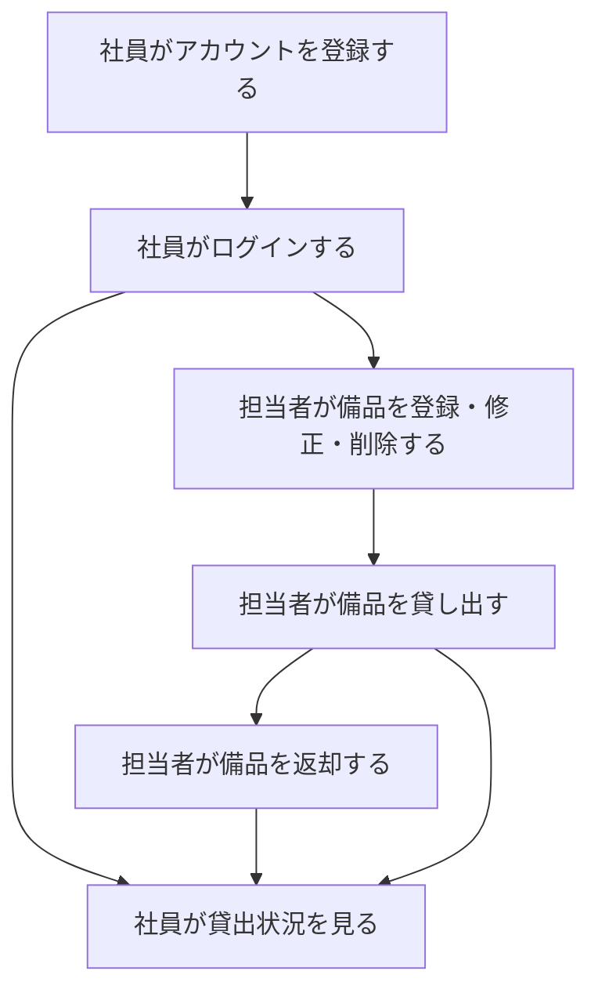
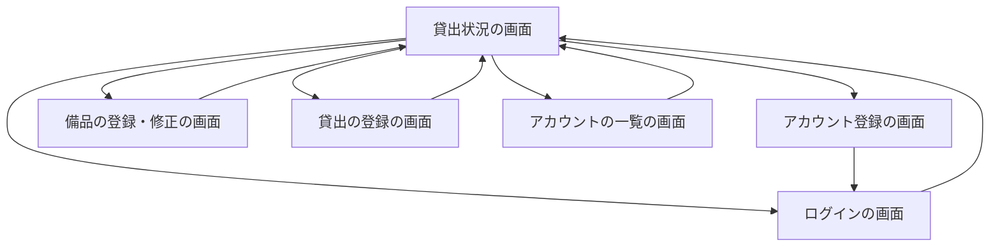
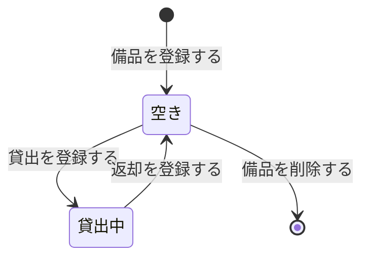
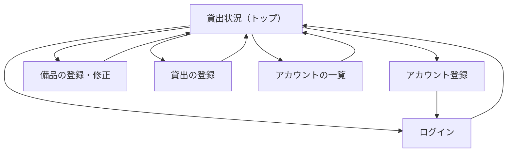

# 備品台帳・貸出状況システム 要件定義書

## 1. 目的・前提

### 1-0. システムの目的

会社の備品の台帳と貸出の記録を 1 つのアプリにまとめ、記録の食い違いと消失をなくす。社員が「どの備品を誰が借りているか」を担当者に問い合わせずに自分で確かめられるようにする。

### 1-0-1. 現状と問題の背景

管理用 Excel が複数あり、複数の人が別々に更新しているため、どれが最新か分からない。記録が食い違ったり消えたりしている。借りたい社員は、誰が借りているかを担当者に問い合わせ、担当者は 1 回 15 分かけて調べている。

### 1-0-2. 用語集

| 用語 | 業務上の意味 | 本案件での使用範囲 | 同義語/類義語 |
|---|---|---|---|
| 社員 | 会社の従業員。自分のアカウントでログインし、貸出状況を確かめる | アカウントを持つ一般の利用者 | 利用者 |
| 担当者 | 備品の登録・修正・削除と、貸出・返却を行う社員 | 社員のうち担当者の役割を持つ者。1 人以上必要 | 管理者 |
| 未ログインの利用者 | ログインしていない人。貸出状況だけを見られる | 貸出状況の画面だけを使う | ゲスト |
| 備品 | 会社が貸し出す物品 | 台帳に 1 件ずつ登録する | 物品 |
| 管理番号 | 備品を一意に識別する番号 | 半角の英数字とハイフン、20 文字以内 | 備品番号 |
| 貸出 | 担当者が、ある備品をある社員に貸し出して記録すること | 空きの備品に対してだけ行う | 貸し出し |
| 返却 | 貸し出した備品が戻ったことを担当者が記録すること | 貸出中の備品に対してだけ行う | 返し |
| 空き | 貸出の記録が無い備品の状態 | 貸出状況の表示 | 未貸出 |
| 貸出中 | 貸出の記録がある備品の状態 | 貸出状況の表示。借りている社員と貸出日を持つ | 貸出済み |

### 1-0-3. システムの形態

GUI（画面）。ブラウザで開く画面だけを提供する。Web API とバッチは提供しない。

## 1-1. 技術制約（前提として記録する。要件ではないため ID は付与しない）

| 制約項目 | 内容 | 出どころ（誰がいつ答えたか） |
|---|---|---|
| 既存コードベース | 無し（新規開発） | 依頼者（ヒアリング回答） |
| 配備先 | 社内の Linux サーバー。コンテナは使わず、`bash run.sh` で直接起動できること。社内ネットワークからだけ開く | 依頼者（ヒアリング回答と採点の契約） |
| チームの技術 | 決まりは無い。Python 3.12 と SQLite で足りること | 依頼者（ヒアリング回答） |
| ライセンスとコスト | 無償のものだけを使う。有償のソフトウェア・外部サービスは使わない | 依頼者（依頼文と採点の契約） |
| 性能と規模の目安 | 利用者 50 人まで（社員と担当者の合計）。備品は数百件まで。アカウントは 50 件まで | 依頼者（依頼文） |

## 2. 業務

### 2-0. 対象業務一覧

| RQ-BZ-ID | 業務名 | 業務の範囲 | 担当者 |
|---|---|---|---|
| `RQ-BZ-EQUIPMENT-LEDGER` | 備品台帳の管理 | 備品の登録・修正・削除。管理番号と備品名を記録する | 担当者 |
| `RQ-BZ-EQUIPMENT-LENDING` | 備品の貸出・返却と貸出状況の確認 | 担当者が貸出と返却を記録する。社員と未ログインの利用者が貸出状況を確認する | 担当者（貸出・返却）、社員と未ログインの利用者（確認） |
| `RQ-BZ-ACCOUNT-MANAGEMENT` | アカウントと担当者の管理 | 社員のアカウント登録、ログインとログアウト、担当者の付け外し、パスワードの再設定、アカウントの削除 | 社員（登録とログイン）、担当者（管理） |

業務フロー:

### 2-1. 業務の問題（あるべき姿と現状のギャップ）

業務ごとに、あるべき姿と現状とのギャップを問題として書く。問題は前提なので ID は付けない。

| 問題 | 対象業務（RQ-BZ） | あるべき姿 | 現状 | ギャップ（KPI） | 業務影響 |
|---|---|---|---|---|---|
| 備品の記録が複数の Excel に分かれ、食い違い・消失が起きる | `RQ-BZ-EQUIPMENT-LEDGER` | 備品の記録が 1 つだけあり、誰が更新しても食い違わず失われない | 管理用 Excel が複数あり、どれが最新か分からない。記録が食い違ったり消えたりしている | 件数の数値は不明（依頼者が計測していない）。記録の食い違いと消失が起きている | 誤った記録に基づく貸し借りの判断 |
| 貸出状況を、担当者に問い合わせないと分からない | `RQ-BZ-EQUIPMENT-LENDING` | 借りたい社員が、誰が借りているかを自分ですぐ分かる | 社員が担当者に問い合わせ、担当者が 1 回 15 分かけて調べている | 問い合わせ 1 件あたり 15 分の担当者の作業。件数は不明 | 担当者の作業時間の浪費と、社員の待ち時間 |
| 誰でも台帳を更新でき、更新者が分からない | `RQ-BZ-ACCOUNT-MANAGEMENT` | 台帳の更新は担当者だけが行い、誰が更新したかが分かる | 複数の人が別々の Excel を更新している | 件数は不明（依頼者が計測していない） | 記録の信頼性の低下 |

### 2-2. 業務課題一覧（必須）

| RQ-BK-ID | 業務課題（取り組むこと） | 解決する問題（2-1） | 解決後の状態（KPI の目標値） | 対象業務（RQ-BZ） |
|---|---|---|---|---|
| `RQ-BK-SINGLE-RECORD-STORE` | 備品と貸出の記録を 1 つのアプリにまとめ、同時に更新しても記録が失われないようにする | 備品の記録が複数の Excel に分かれ、食い違い・消失が起きる | 記録の保存先が 1 つになり、同時更新でも記録が失われない（目標: 記録の消失 0 件） | `RQ-BZ-EQUIPMENT-LEDGER`、`RQ-BZ-EQUIPMENT-LENDING` |
| `RQ-BK-SELF-SERVICE-LENDING-LOOKUP` | 社員が自分で貸出状況を確かめられるようにする | 貸出状況を、担当者に問い合わせないと分からない | 担当者への問い合わせが無くなる（目標: 問い合わせ対応 0 件。現状の 1 件 15 分） | `RQ-BZ-EQUIPMENT-LENDING`、`RQ-BZ-ACCOUNT-MANAGEMENT` |
| `RQ-BK-MANAGER-ONLY-LEDGER-EDIT` | 台帳の更新を担当者だけに限り、ログインで操作者を特定できるようにする | 誰でも台帳を更新でき、更新者が分からない | 更新は担当者だけが行い、ログインしていない人と社員が更新できない（目標: 社員と未ログインの利用者による更新 0 件） | `RQ-BZ-EQUIPMENT-LEDGER`、`RQ-BZ-ACCOUNT-MANAGEMENT` |

### 2-3. 見込み経営効果

| RQ-EF-ID | 効果の種類 | 内容 | 見込み（金額・時間などと算定根拠） | 対応業務課題ID（RQ-BK-*） |
|---|---|---|---|---|
| `RQ-EF-SOFT-SAVING-INQUIRY-TIME` | Soft Saving | 社員が貸出状況を自分で確かめられるようになり、担当者の問い合わせ対応が無くなる | 問い合わせ対応 1 回あたり 15 分の工数が無くなる。問い合わせの頻度は不明のため、月の合計は算定しない | `RQ-BK-SELF-SERVICE-LENDING-LOOKUP` |

## 3. 機能要件

### 3-0. 入力データと出力データ

- 人手入力: アカウント登録（社員番号、名前、パスワード）、ログイン（社員番号、パスワード）、備品の登録・修正（管理番号、備品名）、貸出の登録（借りる社員、貸出日）、担当者の付け外し、パスワードの再設定
- 外部連携の入力: 無し
- 出力データ: 画面の表示のみ（貸出状況の一覧、アカウントの一覧）

### 3-0-1. 利用フロー

全機能の利用フローを次の図に示す。

### 3-0-2. 画面遷移と業務フローの対応

業務フローの「社員がアカウントを登録する」は アカウント登録の画面、「社員がログインする」はログインの画面、「担当者が備品を登録・修正・削除する」は 備品の登録・修正の画面と貸出状況の画面の行の操作、「担当者が備品を貸し出す」「担当者が備品を返却する」は 貸出の登録の画面と貸出状況の画面の行の操作、「社員が貸出状況を見る」は 貸出状況の画面に対応する。

### 3-0-3. 機能一覧

業務課題から導き出し、必要な機能がすべて揃っていることを確認した。

| RQ-ID | カテゴリ | 機能名 | 対応業務課題ID（RQ-BK-*） | この機能が無いと何が困るか |
|---|---|---|---|---|
| `RQ-FT-REGISTER-ACCOUNT` | 共通（認証・認可・ログ） | アカウントを登録する（社員番号、名前、パスワード。最初の 1 件は担当者、2 件目以降は社員。利用者は 50 人まで） | `RQ-BK-SELF-SERVICE-LENDING-LOOKUP` | 社員が自分で貸出状況を見るためのアカウントを持てず、担当者の手作業が増える |
| `RQ-FT-LOGIN` | 共通（認証・認可・ログ） | 社員番号とパスワードでログインする | `RQ-BK-MANAGER-ONLY-LEDGER-EDIT` | 担当者だけが台帳を更新する仕組みが働かず、更新者も特定できない |
| `RQ-FT-LOGOUT` | 共通（認証・認可・ログ） | ログアウトする | `RQ-BK-MANAGER-ONLY-LEDGER-EDIT` | 共有の端末で、前の利用者の権限が残る |
| `RQ-FT-EXPIRE-IDLE-SESSION` | 共通（認証・認可・ログ） | 操作しないまま 30 分たったら自動でログアウトする | `RQ-BK-MANAGER-ONLY-LEDGER-EDIT` | 離席中に、ログイン中の担当者の権限で台帳を更新されてしまう |
| `RQ-FT-VIEW-LENDING-STATUS` | 業務機能 | 誰でも（ログインしなくても）、全備品の貸出状況を一覧で見る | `RQ-BK-SELF-SERVICE-LENDING-LOOKUP` | 社員が貸出状況を自分で確かめられず、担当者に問い合わせるしかない |
| `RQ-FT-CREATE-EQUIPMENT` | マスタ管理 | 担当者が備品を登録する（管理番号、備品名） | `RQ-BK-SINGLE-RECORD-STORE` | 備品の記録が台帳に入らず、貸出状況に出てこない |
| `RQ-FT-UPDATE-EQUIPMENT` | マスタ管理 | 担当者が備品の管理番号と備品名を修正する | `RQ-BK-SINGLE-RECORD-STORE` | 誤った管理番号や備品名を直せず、記録の食い違いが残る |
| `RQ-FT-DELETE-EQUIPMENT` | マスタ管理 | 担当者が備品を削除する。貸出中の備品は削除できない | `RQ-BK-SINGLE-RECORD-STORE` | 廃棄した備品が台帳に残り続ける |
| `RQ-FT-DETECT-CONCURRENT-UPDATE` | 業務機能 | 他の担当者が先に更新・削除した備品への操作を拒否し、開き直しを求める | `RQ-BK-SINGLE-RECORD-STORE` | 古い画面の内容で上書きされ、他の担当者の更新が失われる |
| `RQ-FT-LEND-EQUIPMENT` | 業務機能 | 担当者が空きの備品を社員に貸し出して記録する | `RQ-BK-SINGLE-RECORD-STORE` | 誰がどの備品を借りているかの記録が残らない |
| `RQ-FT-RETURN-EQUIPMENT` | 業務機能 | 担当者が貸出中の備品の返却を記録する | `RQ-BK-SINGLE-RECORD-STORE` | 返却された備品が貸出中のまま表示され続ける |
| `RQ-FT-LIST-ACCOUNTS` | 共通（認証・認可・ログ） | 担当者がアカウントの一覧を見る | `RQ-BK-MANAGER-ONLY-LEDGER-EDIT` | 担当者が誰が登録されているかを確かめられない |
| `RQ-FT-CHANGE-MANAGER-ROLE` | 共通（認証・認可・ログ） | 担当者が社員を担当者にし、担当者を社員に戻す。担当者が 1 人もいなくなる操作は拒否する | `RQ-BK-MANAGER-ONLY-LEDGER-EDIT` | 担当者が不在になり、台帳を更新できなくなる |
| `RQ-FT-RESET-PASSWORD` | 共通（認証・認可・ログ） | 担当者が社員のパスワードを再設定する | `RQ-BK-MANAGER-ONLY-LEDGER-EDIT` | パスワードを忘れた社員がログインできず、台帳の利用が止まる |
| `RQ-FT-DELETE-ACCOUNT` | 共通（認証・認可・ログ） | 担当者がアカウントを削除する。備品を借りている社員と、最後の担当者は削除できない | `RQ-BK-MANAGER-ONLY-LEDGER-EDIT` | 退職者のアカウントが残り続ける |
| `RQ-FT-RESTRICT-MANAGER-OPERATIONS` | 共通（認証・認可・ログ） | 備品の登録・修正・削除、貸出・返却、アカウントの管理は担当者だけができる。社員と未ログインの利用者には操作のボタンを出さず、操作の要求も受け付けない | `RQ-BK-MANAGER-ONLY-LEDGER-EDIT` | 社員や未ログインの利用者が台帳を更新でき、記録の信頼性が保てない |

### 3-1. 帳票・出力ファイル

帳票・出力ファイルは無い。貸出状況は画面の一覧だけで見る。

### 3-2. 業務ルール

| RQ-ID | ルール名 | 内容（条件と結果） | 違反時・エラー時の業務上の扱い | 対応業務課題ID（RQ-BK-*） |
|---|---|---|---|---|
| `RQ-FT-RULE-EQUIPMENT-NUMBER-UNIQUE` | 管理番号の重複禁止 | 管理番号は備品ごとに 1 つ。登録と修正のとき、他の備品と同じ管理番号は使えない | 「この管理番号は既に使われています」を入力欄に出し、登録・修正しない | `RQ-BK-SINGLE-RECORD-STORE` |
| `RQ-FT-RULE-LENDING-EXCLUSIVE` | 貸出中の備品は貸し出せない | 貸出中の備品に貸出を登録しようとしたら拒否する | 「この備品は既に貸出中です」を結果の知らせに出し、記録を変えない | `RQ-BK-SINGLE-RECORD-STORE` |
| `RQ-FT-RULE-RETURN-ONLY-LENT` | 空きの備品は返却できない | 空きの備品に返却を登録しようとしたら拒否する | 「この備品は既に返却されています」を結果の知らせに出し、記録を変えない | `RQ-BK-SINGLE-RECORD-STORE` |
| `RQ-FT-RULE-NO-DELETE-LENT` | 貸出中の備品は削除できない | 貸出中の備品の削除を拒否する | 「この備品は貸出中のため削除できません。先に返却を処理してください」を画面全体のエラーに出す | `RQ-BK-SINGLE-RECORD-STORE` |
| `RQ-FT-RULE-FUTURE-LENT-DATE` | 未来の貸出日は禁止 | 貸出日に今日（日本時間）より後の日付は入力できない。既定値は日本時間の今日 | 「貸出日に未来の日付は入力できません」を貸出日の入力欄に出す | `RQ-BK-SINGLE-RECORD-STORE` |
| `RQ-FT-RULE-NO-DELETE-BORROWED-ACCOUNT` | 備品を借りている社員は削除できない | 貸出中の備品を借りている社員のアカウント削除を拒否する | 「この社員は備品を借りているため削除できません。先に返却を処理してください」を画面全体のエラーに出す | `RQ-BK-MANAGER-ONLY-LEDGER-EDIT` |
| `RQ-FT-RULE-AT-LEAST-ONE-MANAGER` | 担当者は 1 人以上 | 担当者が 1 人もいなくなる操作（担当者から外す、最後の担当者の削除）を拒否する | 「担当者が 1 人もいなくなるため、この操作はできません」を画面全体のエラーに出す | `RQ-BK-MANAGER-ONLY-LEDGER-EDIT` |
| `RQ-FT-RULE-FIRST-ACCOUNT-MANAGER` | 最初のアカウントは担当者 | アカウントが 1 件も無いときに登録した人は担当者になり、2 件目以降は社員になる。同時に登録されても担当者は 1 人だけになる | 該当しない（登録は必ず成功する） | `RQ-BK-SELF-SERVICE-LENDING-LOOKUP` |
| `RQ-FT-RULE-ACCOUNT-LIMIT` | 利用者は 50 人まで | アカウントの件数が 50 件に達していたら、新しいアカウントの登録を拒否する | 画面全体のエラーに「利用者は 50 人までのため、登録できません」を出す（担当者に相談して不要なアカウントを削除する） | `RQ-BK-SELF-SERVICE-LENDING-LOOKUP` |
| `RQ-FT-RULE-CONCURRENT-UPDATE` | 同時更新の扱い | 備品の修正・削除は、画面を開いた後に他の担当者が更新・削除していたら拒否する | 「他の担当者が先にこの備品を更新しました。貸出状況の画面から開き直してください」を画面全体のエラーに出す | `RQ-BK-SINGLE-RECORD-STORE` |
| `RQ-FT-RULE-KEEP-LENDING-ON-UPDATE` | 備品の修正で貸出の記録を引き継ぐ | 備品の管理番号と備品名を修正しても、その備品の貸出の記録（借りる社員、貸出日）はそのまま残る。貸出中の備品は修正後も貸出中のままで、借りている社員と貸出日の表示は変わらない | 該当しない（修正で貸出の記録は変えない。変わったら不具合） | `RQ-BK-SINGLE-RECORD-STORE` |
| `RQ-FT-RULE-CONCURRENT-LEND-RETURN` | 同時の貸出と返却の扱い | 2 人の担当者がほぼ同時に同じ空きの備品の貸出を登録したら、先に処理された 1 件だけを記録し、後の方は記録しない。同じ貸出中の備品の返却を同時に登録したら、先の 1 件だけを処理し、後の方は記録を変えない | 後の貸出は「この備品は既に貸出中です」を結果の知らせに出す。後の返却は「この備品は既に返却されています」を結果の知らせに出す。どちらも記録は先の処理の結果のまま | `RQ-BK-SINGLE-RECORD-STORE` |
| `RQ-FT-RULE-LOGIN-FAILURE-GENERIC` | ログイン失敗の表示 | 社員番号かパスワードが違うときは、どちらが違うかを示さない | 「社員番号またはパスワードが違います」を画面全体のエラーに出す | `RQ-BK-MANAGER-ONLY-LEDGER-EDIT` |

### 3-3. 外部連携

外部連携は無い。

## 4. データ

### 4-1. データ要件一覧

| RQ-ID | 種別 | 内容 | 対応業務課題ID（RQ-BK-*） | この要件が無いと何が困るか |
|---|---|---|---|---|
| `RQ-DT-INTERNAL-DATA-ONLY` | 内部データ / 外部データの区別 | 扱うデータは備品、貸出、アカウントの 3 種類で、すべて内部データ。外部のデータベースとは接続しない | `RQ-BK-SINGLE-RECORD-STORE` | 外部の記録と食い違う別の正本が生まれる |
| `RQ-DT-NO-HISTORY-RETENTION` | データ保持期間 | 返却した貸出の記録は残さない。削除した備品とアカウントの記録も残さない。現在の状態だけを持つ | `RQ-BK-SINGLE-RECORD-STORE` | 依頼者が求めていない履歴の管理が生まれ、データが増え続ける（この要件は履歴を持たないことを明示する） |
| `RQ-DT-SQLITE-DATABASE` | 外部 DB の接続先と接続方法 | DB を使う。同時に更新されても記録が失われないよう、トランザクションで扱えるファイル型の DB（SQLite）を 1 ファイルで使う。DB は社内サーバーのデータ用フォルダに置く。初期件数は 0 件、想定件数は備品数百件、アカウント 50 件まで、年間増加は備品の登録数に依存し小さい。参照関係は貸出から備品とアカウントへの 1 段。検索と集計は一覧の表示だけ | `RQ-BK-SINGLE-RECORD-STORE` | 同時更新で記録が失われる（テキストファイルや複数の Excel では防げない） |

### 4-2. 業務エンティティとデータ項目

| RQ-ID | カテゴリ | 業務エンティティ名 | 対応業務課題ID（RQ-BK-*） | この業務エンティティが無いと何が困るか |
|---|---|---|---|---|
| `RQ-DT-EQUIPMENT-RECORD` | 業務エンティティ | 備品 | `RQ-BK-SINGLE-RECORD-STORE` | 管理する対象が無く、台帳を作れない |
| `RQ-DT-ACCOUNT-RECORD` | 業務エンティティ | アカウント | `RQ-BK-SELF-SERVICE-LENDING-LOOKUP` | 誰が操作し、誰が借りているかを識別できない |
| `RQ-DT-LENDING-RECORD` | 業務エンティティ | 貸出 | `RQ-BK-SINGLE-RECORD-STORE` | 誰がどの備品を借りているかの記録が無く、貸出状況を表示できない |

エンティティごとのデータ項目:

| エンティティ名 | 項目名 | 業務上の意味 | 必須 | 形式・桁 | 値の範囲・制約 | 例 |
|---|---|---|---|---|---|---|
| 備品 | 管理番号 | 備品を識別する番号 | 必須 | 半角の英数字とハイフン、20 文字以内 | 重複不可 | `EQ-0001` |
| 備品 | 備品名 | 備品の名前 | 必須 | 50 文字以内 | 空は不可 | ノートパソコン 14 インチ |
| 備品 | 版番号 | 修正の競合を見分けるための番号 | 必須（システムが付与） | 整数 | 修正のたびに 1 増える | 3 |
| アカウント | 社員番号 | 社員を識別する番号 | 必須 | 6 桁の数字 | 重複不可 | `123456` |
| アカウント | 名前 | 社員の名前 | 必須 | 30 文字以内 | 空は不可（空白だけも不可） | 山田 太郎 |
| アカウント | パスワード | ログインに使う合言葉 | 必須 | 8 文字以上 | 保存するのは暗号化した値だけ。平文は保存しない | （入力値は保存しない） |
| アカウント | 役割 | 担当者か社員か | 必須（システムが付与） | 担当者 / 社員 | 担当者は 1 人以上 | 社員 |
| 貸出 | 備品 | 貸し出した備品 | 必須 | 備品の識別子 | 1 つの備品に貸出の記録は 1 件まで（貸出中の備品だけが記録を持つ） | `EQ-0001` |
| 貸出 | 借りる社員 | 借りている社員 | 必須 | アカウントの社員番号 | 存在するアカウント | `123456` |
| 貸出 | 貸出日 | 貸し出した日 | 必須 | YYYY-MM-DD | 今日（日本時間）以前 | 2026-11-04 |

### 4-3. CRUD テーブル（必須）

| エンティティ名 | Create | Read（一覧） | Read（詳細） | 検索 | Update | Delete | 備考 |
|---|---|---|---|---|---|---|---|
| 備品 | ○ | ○ | △ | × | ○ | ○ | Read（詳細）は修正の画面で 1 件を開く操作（担当者）。Update と Delete は版番号による同時更新の検査を行う（トランザクション、排他制御: 楽観的）。Delete は貸出中の備品を拒否する操作も含むため、同じトランザクションで貸出の有無を見る 修正は貸出の行に触れない（貸出の行は備品の id で結ぶ）。貸出中の備品は修正後も貸出中のまま |
| アカウント | ○ | ○ | × | × | △ | ○ | Create は社員の自己登録（先着で最初の 1 件が担当者）。Update は役割の変更とパスワードの再設定。Delete は借りている社員と最後の担当者を拒否する。役割の変更と削除は同じトランザクションで担当者の人数を数える |
| 貸出 | ○ | ○（貸出状況の一覧に含める） | × | × | × | ○ | Create は貸出の登録、Delete は返却（返却の記録は残さない）。Create は備品の空きを確かめる操作を同じトランザクションで行う。Read（一覧）は備品の一覧の結合で得る 同時の Create と Delete は直列化し、先に処理された 1 件だけを記録・処理する |

凡例: ○ 必須の操作、△ 条件付きで必要な操作、× 対象外の操作。

### 4-4. 状態遷移

備品は状態を持つ。貸出の記録の有無で決まる。

| RQ-ID | エンティティ名 | 遷移前の状態 | きっかけ（操作・条件） | 遷移後の状態 | 対応業務課題ID（RQ-BK-*） |
|---|---|---|---|---|---|
| `RQ-DT-LENDING-STATE-LEND` | 備品 | 空き | 担当者が貸出を登録する（借りる社員と貸出日が有効） | 貸出中 | `RQ-BK-SINGLE-RECORD-STORE` |
| `RQ-DT-LENDING-STATE-RETURN` | 備品 | 貸出中 | 担当者が返却を登録する | 空き | `RQ-BK-SINGLE-RECORD-STORE` |

許されない遷移（貸出中からの貸出、空きからの返却、貸出中の備品の削除）は拒否し、状態を変えない（業務ルールの節に従う）。

### 4-5. 画面一覧

| RQ-ID | 画面名 | 対応する CRUD 操作（エンティティ名:操作種別） | 主な機能・目的 | 対応業務課題ID（RQ-BK-*） |
|---|---|---|---|---|
| `RQ-UI-LENDING-STATUS-SCREEN` | 貸出状況（トップ） | 備品:Read（一覧）、貸出:Read（一覧）。担当者は 備品:Update・Delete、貸出:Create・Delete の操作ボタンを使う | 全備品の管理番号、備品名、空きか貸出中か、借りている社員の名前、貸出日を一覧で見る。ログイン・アカウント登録への導線。担当者には「備品を登録」（備品の登録・修正の画面）と「アカウントの一覧」への導線 | `RQ-BK-SELF-SERVICE-LENDING-LOOKUP` |
| `RQ-UI-REGISTER-ACCOUNT-SCREEN` | アカウント登録 | アカウント:Create | 社員番号、名前、パスワードを入力して自分のアカウントを作る | `RQ-BK-SELF-SERVICE-LENDING-LOOKUP` |
| `RQ-UI-LOGIN-SCREEN` | ログイン | アカウント:Read（認証） | 社員番号とパスワードでログインする | `RQ-BK-MANAGER-ONLY-LEDGER-EDIT` |
| `RQ-UI-EQUIPMENT-FORM-SCREEN` | 備品の登録・修正 | 備品:Create、備品:Update | 管理番号と備品名を入力して保存する（新規と修正で同じ画面） | `RQ-BK-SINGLE-RECORD-STORE` |
| `RQ-UI-LENDING-FORM-SCREEN` | 貸出の登録 | 貸出:Create | 借りる社員と貸出日を選んで、備品を貸し出す | `RQ-BK-SINGLE-RECORD-STORE` |
| `RQ-UI-ACCOUNT-LIST-SCREEN` | アカウントの一覧 | アカウント:Read（一覧）、アカウント:Update、アカウント:Delete | 全アカウントの社員番号、名前、役割を一覧で見て、担当者の付け外し、パスワードの再設定、削除をする | `RQ-BK-MANAGER-ONLY-LEDGER-EDIT` |

画面遷移（4-5 の画面の関係）:

## 5. 非機能要件

| RQ-ID | カテゴリ | 非機能要件名 | 対応業務課題ID（RQ-BK-*） | この非機能要件が無いと何が困るか |
|---|---|---|---|---|
| `RQ-NF-INTERNAL-NETWORK-ACCESS` | 利用者・アクセス経路 | 利用者は社員と担当者（合わせて 50 人まで）。アクセスは社内ネットワークからだけ。インターネットには公開しない | `RQ-BK-SELF-SERVICE-LENDING-LOOKUP` | 社外から台帳の情報が見られてしまう |
| `RQ-NF-CONCURRENT-USERS-50` | 利用人数 | 50 人が同時に開いて使っても正しく動く | `RQ-BK-SINGLE-RECORD-STORE` | 利用者が増えると記録が失われる |
| `RQ-NF-RESPONSE-TIME-3S` | 性能 | 同時に開いても、操作してから表示が出るまで 3 秒以内 | `RQ-BK-SINGLE-RECORD-STORE` | 担当者の作業が止まり、社員が待たされる |
| `RQ-NF-PASSWORD-AUTH` | セキュリティ（認証方式） | 社員番号とパスワードで認証する。SSO は使わない。操作しないまま 30 分たったら自動でログアウトする | `RQ-BK-MANAGER-ONLY-LEDGER-EDIT` | 誰が操作したかを特定できない |
| `RQ-NF-AVAILABILITY-WEEKDAY-DAYTIME` | 可用性 | 平日の日中に使う。夜間と休日は止まってよい。障害から戻すまでの目標は次の平日の始業まで | `RQ-BK-SELF-SERVICE-LENDING-LOOKUP` | 夜間の停止を理由に、常時稼働の設計を求めて過剰になる（この要件で止めてよい時間を明示する） |
| `RQ-NF-MIGRATION-MANUAL-ENTRY` | 移行性 | 既存の Excel の内容は、担当者が画面から手で入力して移す。取り込みの機能は作らない | `RQ-BK-SINGLE-RECORD-STORE` | 取り込みの機能を作ってしまい、要らない作業が増える |

## 6. 運用要件

| RQ-ID | 種別 | 内容 | 対応業務課題ID（RQ-BK-*） | この要件が無いと何が困るか |
|---|---|---|---|---|
| `RQ-OP-FIRST-MANAGER-REGISTRATION` | 導入手順 | 社員に URL を知らせる前に、担当者が最初のアカウントを登録する。最初に登録した人が担当者になる | `RQ-BK-SELF-SERVICE-LENDING-LOOKUP` | 社員が先に登録して担当者が決まらず、台帳が更新できない |
| `RQ-OP-STARTUP-PROCEDURE` | 起動・設定 | 社内の Linux サーバーで、`bash setup.sh` を 1 回実行したあと、`bash run.sh` で起動する。待ち受けるポートは環境変数 PORT、データの保存先は環境変数 DATA_DIR、自動ログアウトまでの秒数は環境変数 SESSION_IDLE_TIMEOUT_SECONDS（既定 1800） | `RQ-BK-SINGLE-RECORD-STORE` | 配備の手順が決まらず、起動できない |

- ログ: ログは必要ないため、ログの内容と保存期間の記述は行わない。
- 監査ログ: 本番の要件としては要らない。
- 監視・アラート: 監視・アラートは必要ないため、監視・アラートの内容と対応方法の記述は行わない。
- バックアップと復旧: バックアップは必要ない。

## 7. テスト用利用シナリオ

全機能の利用フローを網羅するシナリオを作る。各シナリオが確かめる要件は「検証する要件ID」列に書く。

| RQ-ID | テスト目的 | 前提条件 | テスト手順 | 期待される結果 | 検証する要件ID | 対応業務課題ID（RQ-BK-*） |
|---|---|---|---|---|---|---|
| `RQ-TS-REGISTER-ACCOUNTS` | 最初の 1 件が担当者、2 件目以降が社員になり、入力の制限と重複、50 人の上限が働くことを確かめる | アカウントが 0 件（4 の手順だけは、事前に 50 件の状態を用意する） | 1. アカウント登録の画面で社員番号 123456 の人を登録する 2. 別の社員番号で登録する 3. 社員番号が 5 桁、名前が空、名前が 31 文字、パスワードが 7 文字、社員番号が重複、の各入力で登録する 4. アカウントが 50 件ある状態で、新しい社員番号で登録する | 1 件目は担当者、2 件目は社員。3 の各入力は指定の文言の入力欄エラーになり、入力値は消えない。4 は「利用者は 50 人までのため、登録できません」が `.error` に出る。成功時はログインの画面に「登録しました。ログインしてください」が出る | `RQ-FT-REGISTER-ACCOUNT`、`RQ-FT-RULE-FIRST-ACCOUNT-MANAGER`、`RQ-FT-RULE-ACCOUNT-LIMIT`、`RQ-UI-REGISTER-ACCOUNT-SCREEN` | `RQ-BK-SELF-SERVICE-LENDING-LOOKUP` |
| `RQ-TS-LOGIN-LOGOUT` | ログインとログアウトと、失敗時に理由を示さないことを確かめる | アカウントが 2 件（担当者と社員）ある | 1. 社員番号が違う、パスワードが違う、の 2 通りでログインする 2. 正しい社員番号とパスワードでログインする 3. ログアウトする | 2 通りの失敗はどちらも「社員番号またはパスワードが違います」。成功時は名前が `.current-user` に出る。ログアウト後は未ログインの表示に戻る | `RQ-FT-LOGIN`、`RQ-FT-LOGOUT`、`RQ-FT-RULE-LOGIN-FAILURE-GENERIC`、`RQ-UI-LOGIN-SCREEN` | `RQ-BK-MANAGER-ONLY-LEDGER-EDIT` |
| `RQ-TS-IDLE-LOGOUT` | 操作しないまま一定時間たつと、自動でログアウトすることを確かめる | SESSION_IDLE_TIMEOUT_SECONDS を短く設定して起動している。担当者でログイン中 | 1. ログインする 2. 設定した秒数より長く待つ 3. 貸出状況の画面を開く | 自動でログアウトされ、ログインしていない表示になる。担当者の操作は使えない | `RQ-FT-EXPIRE-IDLE-SESSION`、`RQ-NF-PASSWORD-AUTH` | `RQ-BK-MANAGER-ONLY-LEDGER-EDIT` |
| `RQ-TS-VIEW-LENDING-STATUS` | 未ログインの利用者も貸出状況を一覧で見られることを確かめる | 備品が 3 件あり、1 件は貸出中 | 1. ログインせずに貸出状況の画面を開く | 管理番号の昇順で 3 件が出る。貸出中の 1 件に借りている社員の名前と貸出日が出る。空きの 2 件は「空き」。行の操作ボタンは出ない | `RQ-FT-VIEW-LENDING-STATUS`、`RQ-UI-LENDING-STATUS-SCREEN` | `RQ-BK-SELF-SERVICE-LENDING-LOOKUP` |
| `RQ-TS-EMPTY-EQUIPMENT-LIST` | 備品が 0 件のときの表示を確かめる | 備品が 0 件 | 1. 貸出状況の画面を開く | 「備品は登録されていません」が出る | `RQ-UI-LENDING-STATUS-SCREEN` | `RQ-BK-SELF-SERVICE-LENDING-LOOKUP` |
| `RQ-TS-CREATE-EQUIPMENT` | 担当者が備品を登録し、入力の制限と重複が働くことを確かめる | 担当者でログイン中 | 1. 備品の登録の画面で管理番号 EQ-0001 と備品名を入力して保存する 2. 管理番号に日本語を入れて保存する 3. 管理番号が 21 文字、備品名が 51 文字、既存の管理番号の重複、の各入力で保存する | 1 で貸出状況に 1 件増え、空きと表示される。2、3 の入力はそれぞれの文言の入力欄エラーになり、入力値は消えない | `RQ-FT-CREATE-EQUIPMENT`、`RQ-FT-RULE-EQUIPMENT-NUMBER-UNIQUE`、`RQ-UI-EQUIPMENT-FORM-SCREEN` | `RQ-BK-SINGLE-RECORD-STORE` |
| `RQ-TS-UPDATE-EQUIPMENT` | 担当者が備品を修正でき、古い画面からの修正が拒否されることを確かめる | 担当者 A と B がそれぞれログイン中。備品が 1 件 | 1. A が修正の画面を開く 2. B が先に備品名を修正して保存する 3. A が管理番号を変えて保存する | 2 は成功する。3 は「他の担当者が先にこの備品を更新しました。貸出状況の画面から開き直してください」が `.error` に出て、A の入力は消えず、記録は B の内容のまま | `RQ-FT-UPDATE-EQUIPMENT`、`RQ-FT-DETECT-CONCURRENT-UPDATE`、`RQ-FT-RULE-CONCURRENT-UPDATE`、`RQ-UI-EQUIPMENT-FORM-SCREEN` | `RQ-BK-SINGLE-RECORD-STORE` |
| `RQ-TS-DELETE-EQUIPMENT` | 担当者が削除でき、貸出中の備品は削除できないことを確かめる | 備品が 2 件、1 件は貸出中 | 1. 空きの備品を削除の確認で「はい」にして削除する 2. 貸出中の備品を削除の確認で「はい」にする 3. 削除の確認で「いいえ」にする | 1 は一覧から消える。2 は「この備品は貸出中のため削除できません。先に返却を処理してください」が `.error` に出て残る。3 は何もしない | `RQ-FT-DELETE-EQUIPMENT`、`RQ-FT-RULE-NO-DELETE-LENT`、`RQ-UI-LENDING-STATUS-SCREEN` | `RQ-BK-SINGLE-RECORD-STORE` |
| `RQ-TS-LEND-EQUIPMENT` | 担当者が空きの備品を貸し出し、入力と貸出中の制限が働くことを確かめる | 担当者でログイン中。空きの備品が 1 件、社員が 1 人 | 1. 貸出の画面で借りる社員と貸出日を選んで登録する 2. 借りる社員を選ばずに登録する 3. 貸出日に明日の日付を入れて登録する 4. 貸出中の備品の貸出の画面を開く | 1 で貸出状況に借りている社員の名前と貸出日が出る。2 は「借りる社員を選んでください」、3 は「貸出日に未来の日付は入力できません」が入力欄に出る。4 は「この備品は既に貸出中です」が `.message` に出て、記録は変わらない。貸出の画面には `.lending-equipment` に「備品: 管理番号 備品名」が出る | `RQ-FT-LEND-EQUIPMENT`、`RQ-FT-RULE-LENDING-EXCLUSIVE`、`RQ-FT-RULE-FUTURE-LENT-DATE`、`RQ-UI-LENDING-FORM-SCREEN` | `RQ-BK-SINGLE-RECORD-STORE` |
| `RQ-TS-RETURN-EQUIPMENT` | 担当者が返却を記録し、空きの備品の返却が拒否されることを確かめる | 貸出中の備品が 1 件 | 1. 返却を確認で「はい」にする 2. 空きになった備品に返却を登録する | 1 で貸出状況が「空き」に戻り、借りている社員と貸出日の表示が消える。2 は「この備品は既に返却されています」が `.message` に出る | `RQ-FT-RETURN-EQUIPMENT`、`RQ-FT-RULE-RETURN-ONLY-LENT`、`RQ-DT-LENDING-STATE-RETURN` | `RQ-BK-SINGLE-RECORD-STORE` |
| `RQ-TS-MANAGE-MANAGER-ROLE` | 担当者の付け外しと、担当者が 1 人もいなくならない制限を確かめる | 担当者 1 人と社員 1 人 | 1. 社員を「担当者にする」を確認で「はい」にする 2. 担当者を「担当者から外す」を確認で「はい」にする 3. 最後に残った担当者を「担当者から外す」を確認で「はい」にする | 1 で社員の役割が「担当者」になる。2 で「社員」に戻る。3 は「担当者が 1 人もいなくなるため、この操作はできません」が `.error` に出て、役割は変わらない | `RQ-FT-CHANGE-MANAGER-ROLE`、`RQ-FT-RULE-AT-LEAST-ONE-MANAGER`、`RQ-FT-LIST-ACCOUNTS`、`RQ-UI-ACCOUNT-LIST-SCREEN` | `RQ-BK-MANAGER-ONLY-LEDGER-EDIT` |
| `RQ-TS-RESET-PASSWORD` | 担当者が社員のパスワードを再設定できることを確かめる | 社員が 1 人、担当者でログイン中 | 1. 社員の行で「パスワード再設定」を押す 2. 新しいパスワードに 7 文字を入れて「確定」を押す 3. 8 文字で「確定」を押し、社員が新しいパスワードでログインする | 2 は入力欄エラー「パスワードは 8 文字以上で入力してください」。3 は成功し、社員は新しいパスワードでログインできる | `RQ-FT-RESET-PASSWORD`、`RQ-UI-ACCOUNT-LIST-SCREEN` | `RQ-BK-MANAGER-ONLY-LEDGER-EDIT` |
| `RQ-TS-DELETE-ACCOUNT` | 担当者がアカウントを削除でき、借りている社員は削除できないことを確かめる | 社員 A が備品を借りている。社員 B は借りていない。担当者でログイン中 | 1. 社員 A の行で削除を確認で「はい」にする 2. 社員 B の行で削除を確認で「はい」にする | 1 は「この社員は備品を借りているため削除できません。先に返却を処理してください」が `.error` に出て残る。2 は一覧から消える | `RQ-FT-DELETE-ACCOUNT`、`RQ-FT-RULE-NO-DELETE-BORROWED-ACCOUNT`、`RQ-UI-ACCOUNT-LIST-SCREEN` | `RQ-BK-MANAGER-ONLY-LEDGER-EDIT` |
| `RQ-TS-ACCESS-ENDS-ON-RESET-AND-DELETE` | パスワードを再設定した後は古いパスワードでログインできず、削除したアカウントではログインできず、貸出の登録で選ぶ社員の一覧にも出ないことを確かめる | 担当者 1 人、社員 A と社員 B（どちらも借りていない）。備品が 1 件あり空き。担当者でログイン中 | 1. 社員 A の行で「パスワード再設定」を押し、新しいパスワードを入れて「確定」を押す 2. 社員 A の古いパスワードでログインを試す 3. 社員 B の行で削除を確認で「はい」にする 4. 社員 B の社員番号と、社員 B のパスワードでログインを試す 5. 備品の貸出の登録の画面を開く | 1 は「パスワードを再設定しました」が `.message` に出る。2 は「社員番号またはパスワードが違います」が `.error` に出て、ログインできない。3 は一覧から社員 B が消える。4 も同じ「社員番号またはパスワードが違います」。5 の借りる社員の選択肢に社員 A（「名前（社員番号）」）は出て、社員 B は出ない | `RQ-FT-RESET-PASSWORD`、`RQ-FT-DELETE-ACCOUNT`、`RQ-FT-RULE-LOGIN-FAILURE-GENERIC`、`RQ-UI-LENDING-FORM-SCREEN` | `RQ-BK-MANAGER-ONLY-LEDGER-EDIT` |
| `RQ-TS-RESTRICT-NON-MANAGER` | 社員と未ログインの利用者に操作のボタンが出ず、操作の要求も拒否されることを確かめる | 社員 1 人。未ログインの状態 | 1. 社員でログインして貸出状況を見る 2. 社員で備品の登録の画面を直接開く 3. 社員で貸出状況の画面に戻り、備品の登録へ要求を送る 4. 未ログインで同じ要求を送る | 1 で修正、削除、貸出、返却のボタンが出ない。2、3 は「この操作は担当者だけが行えます」が `.message` に出て、記録は変わらない。4 はログインの画面へ移る | `RQ-FT-RESTRICT-MANAGER-OPERATIONS`、`RQ-FT-RULE-LOGIN-FAILURE-GENERIC` | `RQ-BK-MANAGER-ONLY-LEDGER-EDIT` |
| `RQ-TS-KEEP-LENDING-ON-UPDATE` | 貸出中の備品を修正しても、貸出の記録が引き継がれることを確かめる | 担当者でログイン中。備品が 1 件あり、社員に貸出中 | 1. 備品の修正の画面を開く 2. 備品名だけを変えて保存する 3. 貸出状況の画面を開く | 2 は「備品を更新しました」が出る。3 で同じ備品が貸出中のままで、借りている社員の名前と貸出日が修正前と同じに出る | `RQ-FT-RULE-KEEP-LENDING-ON-UPDATE`、`RQ-FT-UPDATE-EQUIPMENT`、`RQ-UI-EQUIPMENT-FORM-SCREEN` | `RQ-BK-SINGLE-RECORD-STORE` |
| `RQ-TS-CONCURRENT-LEND-RETURN` | 2 人の担当者が同時に貸出と返却を登録したとき、先の 1 件だけが処理されることを確かめる | 担当者 A と B がそれぞれログイン中。空きの備品が 1 件と、社員が 1 人 | 1. A と B が同じ備品の貸出を同時に登録する 2. 貸出中の同じ備品の返却を A と B が同時に登録する | 1 は一方が「貸出を登録しました」、他方が「この備品は既に貸出中です」を `.message` に出し、記録は 1 件だけ。2 は一方が「返却を登録しました」、他方が「この備品は既に返却されています」を `.message` に出し、貸出状況は「空き」 | `RQ-FT-RULE-CONCURRENT-LEND-RETURN`、`RQ-FT-LEND-EQUIPMENT`、`RQ-FT-RETURN-EQUIPMENT` | `RQ-BK-SINGLE-RECORD-STORE` |
