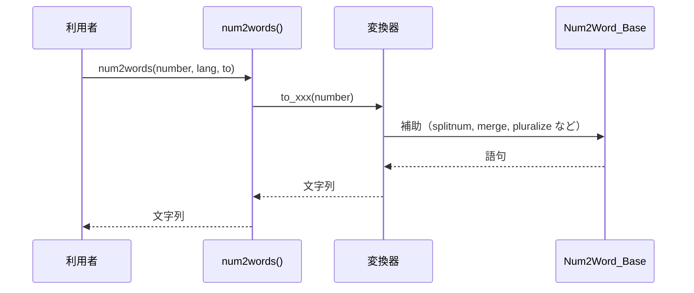

# 詳細設計書: num2words

作成日: 2026-11-04（既存コードの逆引き。設計 ID は既存コードの現状に対応する）

## 1. 言語・フレームワーク・アーキテクチャの選定

既存コードの技術をそのまま記録する（既存資産との整合が最優先のため、インターネット調査による選び直しは行わない）。ANSWERS.md の固定回答「技術選定: 既存のとおり」に従う。

| 項目 | 選定結果 | 根拠 |
|---|---|---|
| 言語 | Python（3.7〜3.12 を setup.py で宣言） | 既存コード |
| フレームワーク | なし（標準ライブラリのみ。decimal、math、collections、io） | 既存コード |
| DB 製品 | なし（DB は必須ではないため、DB 設計は行わない） | 要件定義書 4-1 |
| 実行形態 | ライブラリ（利用者のプロセス内で import して呼ぶ） | 要件定義書 1-1 |
| 判定日・承認 | 2026-11-04。承認は ANSWERS.md の固定回答により与えられたものとして記録 | ANSWERS.md |

## 2. システム構成

### コンポーネント一覧

| ファイル | 役割 |
|---|---|
| `num2words/__init__.py` | 公開 API num2words() と言語コードから変換器への対応表 |
| `num2words/base.py` | 基底クラス Num2Word_Base（共通の変換規則と通貨の組み立て） |
| `num2words/compat.py` | Python 2 と 3 の互換の補助 |
| `num2words/currency.py` | 通貨名の補助（prefix_currency）と通貨金額の分解（parse_currency_parts） |
| `num2words/lang_AM.py` | 言語 アルメニア語 の変換器 |
| `num2words/lang_AR.py` | 言語 アラビア語 の変換器 |
| `num2words/lang_AZ.py` | 言語 アゼルバイジャン語 の変換器 |
| `num2words/lang_BE.py` | 言語 ベラルーシ語 の変換器 |
| `num2words/lang_BN.py` | 言語 ベンガル語 の変換器 |
| `num2words/lang_CA.py` | 言語 カタルーニャ語 の変換器 |
| `num2words/lang_CE.py` | 言語 チェチェン語 の変換器 |
| `num2words/lang_CY.py` | 言語 ウェールズ語 の変換器 |
| `num2words/lang_CZ.py` | 言語 チェコ語 の変換器 |
| `num2words/lang_DE.py` | 言語 ドイツ語 の変換器 |
| `num2words/lang_DK.py` | 言語 デンマーク語 の変換器 |
| `num2words/lang_EN.py` | 言語 英語 の変換器 |
| `num2words/lang_EN_IN.py` | 言語 英語（インド） の変換器 |
| `num2words/lang_EN_NG.py` | 言語 英語（ナイジェリア） の変換器 |
| `num2words/lang_EO.py` | 言語 エスペラント語 の変換器 |
| `num2words/lang_ES.py` | 言語 スペイン語 の変換器 |
| `num2words/lang_ES_CO.py` | 言語 スペイン語（コロンビア） の変換器 |
| `num2words/lang_ES_CR.py` | 言語 スペイン語（コスタリカ） の変換器 |
| `num2words/lang_ES_GT.py` | 言語 スペイン語（グアテマラ） の変換器 |
| `num2words/lang_ES_NI.py` | 言語 スペイン語（ニカラグア） の変換器 |
| `num2words/lang_ES_VE.py` | 言語 スペイン語（ベネズエラ） の変換器 |
| `num2words/lang_EU.py` | 言語 lang_EU の変換器 |
| `num2words/lang_FA.py` | 言語 ペルシア語 の変換器 |
| `num2words/lang_FI.py` | 言語 フィンランド語 の変換器 |
| `num2words/lang_FR.py` | 言語 フランス語 の変換器 |
| `num2words/lang_FR_BE.py` | 言語 フランス語（ベルギー） の変換器 |
| `num2words/lang_FR_CH.py` | 言語 フランス語（スイス） の変換器 |
| `num2words/lang_FR_DZ.py` | 言語 フランス語（アルジェリア） の変換器 |
| `num2words/lang_HE.py` | 言語 ヘブライ語 の変換器 |
| `num2words/lang_HU.py` | 言語 ハンガリー語 の変換器 |
| `num2words/lang_ID.py` | 言語 インドネシア語 の変換器 |
| `num2words/lang_IS.py` | 言語 アイスランド語 の変換器 |
| `num2words/lang_IT.py` | 言語 イタリア語 の変換器 |
| `num2words/lang_JA.py` | 言語 日本語 の変換器 |
| `num2words/lang_KN.py` | 言語 カンナダ語 の変換器 |
| `num2words/lang_KO.py` | 言語 韓国語 の変換器 |
| `num2words/lang_KZ.py` | 言語 カザフ語 の変換器 |
| `num2words/lang_LT.py` | 言語 リトアニア語 の変換器 |
| `num2words/lang_LV.py` | 言語 ラトビア語 の変換器 |
| `num2words/lang_NL.py` | 言語 オランダ語 の変換器 |
| `num2words/lang_NO.py` | 言語 ノルウェー語 の変換器 |
| `num2words/lang_PL.py` | 言語 ポーランド語 の変換器 |
| `num2words/lang_PT.py` | 言語 ポルトガル語 の変換器 |
| `num2words/lang_PT_BR.py` | 言語 ポルトガル語（ブラジル） の変換器 |
| `num2words/lang_RO.py` | 言語 ルーマニア語 の変換器 |
| `num2words/lang_RU.py` | 言語 ロシア語 の変換器 |
| `num2words/lang_SK.py` | 言語 スロバキア語 の変換器 |
| `num2words/lang_SL.py` | 言語 スロベニア語 の変換器 |
| `num2words/lang_SR.py` | 言語 セルビア語 の変換器 |
| `num2words/lang_SV.py` | 言語 スウェーデン語 の変換器 |
| `num2words/lang_TE.py` | 言語 テルグ語 の変換器 |
| `num2words/lang_TET.py` | 言語 テトゥン語 の変換器 |
| `num2words/lang_TG.py` | 言語 タジク語 の変換器 |
| `num2words/lang_TH.py` | 言語 タイ語 の変換器 |
| `num2words/lang_TR.py` | 言語 トルコ語 の変換器 |
| `num2words/lang_UK.py` | 言語 ウクライナ語 の変換器 |
| `num2words/lang_VI.py` | 言語 ベトナム語 の変換器 |
| `num2words/utils.py` | 数字列の分割などの補助関数 |

### システム全体構成図

```mermaid
flowchart LR
    U[利用者のプログラム] --> P[num2words/__init__.py: num2words()]
    P --> C[言語の変換器 Num2Word_XX（lang_XX.py）]
    C --> B[Num2Word_Base（base.py）]
    C --> CU[currency.py: prefix_currency, parse_currency_parts]
    C --> UT[utils.py / compat.py]
```

### 各コンポーネントの役割と機能

- 公開 API（`__init__.py`）: 言語コードを変換器に対応づけ、変換種別のメソッドを呼ぶ。
- 変換器（`lang_XX.py`）: 言語ごとの語彙と規則。`Num2Word_Base` を継承して上書きする。
- 基底クラス（`base.py`）: 共通の規則（桁の分割、小数、序数の検証、通貨の組み立て）。
- 補助（`utils.py`・`compat.py`・`currency.py`）: 桁の分割、文字列化、通貨名の接頭辞、通貨金額の分解。

### コンポーネント間インターフェースとデータフロー

呼び出しは一方向（公開 API → 変換器 → 基底・補助）。外部との通信は無い。

ネットワーク構成図: ネットワーク越しの通信が無いため、ネットワーク構成図は書かない。

## 3. データ設計

### 3-1. データモデル

DB は必須ではないため、DB 設計は行わない。扱うデータは言語ごとの語彙（クラス属性として `DS-CL-*` の中で持つ）と、通貨の書式（`CURRENCY_FORMS`・`CURRENCY_ADJECTIVES` のクラス属性）だけで、保存しない。データ構造は独立した `DS-SC-*` として切り出さない。

### 3-2. トランザクションと排他制御

トランザクション・排他制御が要る操作は無い（状態を持たないため）。

### 3-3. 状態遷移

状態を持つエンティティは無い。

## 4. アーキテクチャ設計

### 4-1. 外部設計

利用者向けインターフェース（`DS-IF-*`）:

| DS-ID | 名称 | 内容 |
|---|---|---|
| `DS-IF-PUBLIC-API` | `num2words()` | Python の公開関数 |

インターフェース仕様（DS-IF-PUBLIC-API）:

| 項目 | 内容 |
|---|---|
| 入力 | `number`（int・float・Decimal・str）、`ordinal`（既定 False）、`lang`（既定 `en`）、`to`（既定 `cardinal`。`cardinal`・`ordinal`・`ordinal_num`・`year`・`currency`）、`**kwargs`（変換器に渡す。通貨は `currency`・`cents`・`separator`・`adjective`） |
| 入力チェック | `lang` は完全一致、無ければ先頭 2 文字で再判定（要件 RQ-FT-SELECT-LANGUAGE）。`to` は既知の値のみ（要件 RQ-FT-SELECT-LANGUAGE）。str は変換器の `str_to_number` で数値にする |
| 出力 | 読み上げ文字列（str） |
| エラー仕様 | 未対応の言語・変換種別は NotImplementedError。通貨コードが無い場合は NotImplementedError。数値の範囲外は OverflowError。型が合わないと TypeError（変換器の実装に従う）。いずれも呼び出し元へそのまま返す |

外部システム連携: 無い。外部 DB 連携: 無い。

### 4-2. 内部設計

```mermaid
flowchart TD
    A[num2words 呼び出し] --> B{lang が対応表にあるか}
    B -->|はい| C[変換器を取得]
    B -->|いいえ| D[先頭 2 文字で再判定]
    D --> E{対応表にあるか}
    E -->|いいえ| X[NotImplementedError]
    E -->|はい| C
    C --> F{number が str か}
    F -->|はい| G[str_to_number]
    F -->|いいえ| H[そのまま]
    G --> H
    H --> I{ordinal 指定または to=ordinal}
    I -->|はい| J[to=ordinal]
    I -->|いいえ| K{to が既知か}
    K -->|いいえ| X
    K -->|はい| L[to_{to} メソッドを呼ぶ]
    J --> L
```

各処理の役割: 上の流れは `num2words()`（`DS-FN-NUM2WORDS`）が行う。変換は変換器の `to_{to}` メソッドが行う。バッチは無い。

## 5. クラス設計

### 全クラス一覧と役割

| DS-ID | クラス | 責務（1 文） |
|---|---|---|
| `DS-CL-NUM2WORD-BASE` | `Num2Word_Base` | 言語変換器の共通規則（桁の分割、小数、序数の検証、通貨の組み立て）を持つ |
| `DS-CL-NUM2WORD-AM` | `Num2Word_AM` | アルメニア語の数値読み上げ規則を、基底クラスの規則に語彙と語順で上書きする |
| `DS-CL-NUM2WORD-AR` | `Num2Word_AR` | アラビア語の数値読み上げ規則を、基底クラスの規則に語彙と語順で上書きする |
| `DS-CL-NUM2WORD-AZ` | `Num2Word_AZ` | アゼルバイジャン語の数値読み上げ規則を、基底クラスの規則に語彙と語順で上書きする |
| `DS-CL-NUM2WORD-BE` | `Num2Word_BE` | ベラルーシ語の数値読み上げ規則を、基底クラスの規則に語彙と語順で上書きする |
| `DS-CL-NUMBERTOOLARGEERROR` | `NumberTooLargeError` | NumberTooLargeErrorの数値読み上げ規則を、基底クラスの規則に語彙と語順で上書きする |
| `DS-CL-NUM2WORD-BN` | `Num2Word_BN` | ベンガル語の数値読み上げ規則を、基底クラスの規則に語彙と語順で上書きする |
| `DS-CL-NUM2WORD-CA` | `Num2Word_CA` | カタルーニャ語の数値読み上げ規則を、基底クラスの規則に語彙と語順で上書きする |
| `DS-CL-NUM2WORD-CE` | `Num2Word_CE` | チェチェン語の数値読み上げ規則を、基底クラスの規則に語彙と語順で上書きする |
| `DS-CL-NUM2WORD-CY` | `Num2Word_CY` | ウェールズ語の数値読み上げ規則を、基底クラスの規則に語彙と語順で上書きする |
| `DS-CL-NUM2WORD-CZ` | `Num2Word_CZ` | チェコ語の数値読み上げ規則を、基底クラスの規則に語彙と語順で上書きする |
| `DS-CL-NUM2WORD-DE` | `Num2Word_DE` | ドイツ語の数値読み上げ規則を、基底クラスの規則に語彙と語順で上書きする |
| `DS-CL-NUM2WORD-DK` | `Num2Word_DK` | デンマーク語の数値読み上げ規則を、基底クラスの規則に語彙と語順で上書きする |
| `DS-CL-NUM2WORD-EN` | `Num2Word_EN` | 英語の数値読み上げ規則を、基底クラスの規則に語彙と語順で上書きする |
| `DS-CL-NUM2WORD-EN-IN` | `Num2Word_EN_IN` | 英語（インド）の数値読み上げ規則を、基底クラスの規則に語彙と語順で上書きする |
| `DS-CL-NUM2WORD-EN-NG` | `Num2Word_EN_NG` | 英語（ナイジェリア）の数値読み上げ規則を、基底クラスの規則に語彙と語順で上書きする |
| `DS-CL-NUM2WORD-EO` | `Num2Word_EO` | エスペラント語の数値読み上げ規則を、基底クラスの規則に語彙と語順で上書きする |
| `DS-CL-NUM2WORD-ES` | `Num2Word_ES` | スペイン語の数値読み上げ規則を、基底クラスの規則に語彙と語順で上書きする |
| `DS-CL-NUM2WORD-ES-CO` | `Num2Word_ES_CO` | スペイン語（コロンビア）の数値読み上げ規則を、基底クラスの規則に語彙と語順で上書きする |
| `DS-CL-NUM2WORD-ES-CR` | `Num2Word_ES_CR` | スペイン語（コスタリカ）の数値読み上げ規則を、基底クラスの規則に語彙と語順で上書きする |
| `DS-CL-NUM2WORD-ES-GT` | `Num2Word_ES_GT` | スペイン語（グアテマラ）の数値読み上げ規則を、基底クラスの規則に語彙と語順で上書きする |
| `DS-CL-NUM2WORD-ES-NI` | `Num2Word_ES_NI` | スペイン語（ニカラグア）の数値読み上げ規則を、基底クラスの規則に語彙と語順で上書きする |
| `DS-CL-NUM2WORD-ES-VE` | `Num2Word_ES_VE` | スペイン語（ベネズエラ）の数値読み上げ規則を、基底クラスの規則に語彙と語順で上書きする |
| `DS-CL-NUM2WORD-EU` | `Num2Word_EU` | Num2Word_EUの数値読み上げ規則を、基底クラスの規則に語彙と語順で上書きする |
| `DS-CL-NUM2WORD-FA` | `Num2Word_FA` | ペルシア語の数値読み上げ規則を、基底クラスの規則に語彙と語順で上書きする |
| `DS-CL-OPTIONS` | `Options` | Optionsの数値読み上げ規則を、基底クラスの規則に語彙と語順で上書きする |
| `DS-CL-NUM2WORD-FI` | `Num2Word_FI` | フィンランド語の数値読み上げ規則を、基底クラスの規則に語彙と語順で上書きする |
| `DS-CL-NUM2WORD-FR` | `Num2Word_FR` | フランス語の数値読み上げ規則を、基底クラスの規則に語彙と語順で上書きする |
| `DS-CL-NUM2WORD-FR-BE` | `Num2Word_FR_BE` | フランス語（ベルギー）の数値読み上げ規則を、基底クラスの規則に語彙と語順で上書きする |
| `DS-CL-NUM2WORD-FR-CH` | `Num2Word_FR_CH` | フランス語（スイス）の数値読み上げ規則を、基底クラスの規則に語彙と語順で上書きする |
| `DS-CL-NUM2WORD-FR-DZ` | `Num2Word_FR_DZ` | フランス語（アルジェリア）の数値読み上げ規則を、基底クラスの規則に語彙と語順で上書きする |
| `DS-CL-NUM2WORD-HE` | `Num2Word_HE` | ヘブライ語の数値読み上げ規則を、基底クラスの規則に語彙と語順で上書きする |
| `DS-CL-NUM2WORD-HU` | `Num2Word_HU` | ハンガリー語の数値読み上げ規則を、基底クラスの規則に語彙と語順で上書きする |
| `DS-CL-NUM2WORD-INDONESIAN` | `Num2Word_ID` | インドネシア語の数値読み上げ規則を、基底クラスの規則に語彙と語順で上書きする |
| `DS-CL-NUM2WORD-IS` | `Num2Word_IS` | アイスランド語の数値読み上げ規則を、基底クラスの規則に語彙と語順で上書きする |
| `DS-CL-NUM2WORD-IT` | `Num2Word_IT` | イタリア語の数値読み上げ規則を、基底クラスの規則に語彙と語順で上書きする |
| `DS-CL-NUM2WORD-JA` | `Num2Word_JA` | 日本語の数値読み上げ規則を、基底クラスの規則に語彙と語順で上書きする |
| `DS-CL-NUM2WORD-KN` | `Num2Word_KN` | カンナダ語の数値読み上げ規則を、基底クラスの規則に語彙と語順で上書きする |
| `DS-CL-NUM2WORD-KO` | `Num2Word_KO` | 韓国語の数値読み上げ規則を、基底クラスの規則に語彙と語順で上書きする |
| `DS-CL-NUM2WORD-KZ` | `Num2Word_KZ` | カザフ語の数値読み上げ規則を、基底クラスの規則に語彙と語順で上書きする |
| `DS-CL-NUM2WORD-LT` | `Num2Word_LT` | リトアニア語の数値読み上げ規則を、基底クラスの規則に語彙と語順で上書きする |
| `DS-CL-NUM2WORD-LV` | `Num2Word_LV` | ラトビア語の数値読み上げ規則を、基底クラスの規則に語彙と語順で上書きする |
| `DS-CL-NUM2WORD-NL` | `Num2Word_NL` | オランダ語の数値読み上げ規則を、基底クラスの規則に語彙と語順で上書きする |
| `DS-CL-NUM2WORD-NO` | `Num2Word_NO` | ノルウェー語の数値読み上げ規則を、基底クラスの規則に語彙と語順で上書きする |
| `DS-CL-NUM2WORD-PL` | `Num2Word_PL` | ポーランド語の数値読み上げ規則を、基底クラスの規則に語彙と語順で上書きする |
| `DS-CL-NUM2WORD-PT` | `Num2Word_PT` | ポルトガル語の数値読み上げ規則を、基底クラスの規則に語彙と語順で上書きする |
| `DS-CL-NUM2WORD-PT-BR` | `Num2Word_PT_BR` | ポルトガル語（ブラジル）の数値読み上げ規則を、基底クラスの規則に語彙と語順で上書きする |
| `DS-CL-NUM2WORD-RO` | `Num2Word_RO` | ルーマニア語の数値読み上げ規則を、基底クラスの規則に語彙と語順で上書きする |
| `DS-CL-NUM2WORD-RU` | `Num2Word_RU` | ロシア語の数値読み上げ規則を、基底クラスの規則に語彙と語順で上書きする |
| `DS-CL-NUM2WORD-SK` | `Num2Word_SK` | スロバキア語の数値読み上げ規則を、基底クラスの規則に語彙と語順で上書きする |
| `DS-CL-NUM2WORD-SL` | `Num2Word_SL` | スロベニア語の数値読み上げ規則を、基底クラスの規則に語彙と語順で上書きする |
| `DS-CL-NUM2WORD-SR` | `Num2Word_SR` | セルビア語の数値読み上げ規則を、基底クラスの規則に語彙と語順で上書きする |
| `DS-CL-NUM2WORD-SV` | `Num2Word_SV` | スウェーデン語の数値読み上げ規則を、基底クラスの規則に語彙と語順で上書きする |
| `DS-CL-NUM2WORD-TE` | `Num2Word_TE` | テルグ語の数値読み上げ規則を、基底クラスの規則に語彙と語順で上書きする |
| `DS-CL-NUM2WORD-TET` | `Num2Word_TET` | テトゥン語の数値読み上げ規則を、基底クラスの規則に語彙と語順で上書きする |
| `DS-CL-NUM2WORD-TG` | `Num2Word_TG` | タジク語の数値読み上げ規則を、基底クラスの規則に語彙と語順で上書きする |
| `DS-CL-NUM2WORD-TH` | `Num2Word_TH` | タイ語の数値読み上げ規則を、基底クラスの規則に語彙と語順で上書きする |
| `DS-CL-NUM2WORD-TR` | `Num2Word_TR` | トルコ語の数値読み上げ規則を、基底クラスの規則に語彙と語順で上書きする |
| `DS-CL-NUM2WORD-UK` | `Num2Word_UK` | ウクライナ語の数値読み上げ規則を、基底クラスの規則に語彙と語順で上書きする |
| `DS-CL-NUM2WORD-VI` | `Num2Word_VI` | ベトナム語の数値読み上げ規則を、基底クラスの規則に語彙と語順で上書きする |

クラス図: 60 の変換器はすべて `Num2Word_Base` を継承する（継承の向きは 1 段）。図にすると 61 クラスの星形になるため、図は書かず継承の関係だけをここに書く。

### 公開関数・メソッドの一覧（DS-FN）

各メソッドの役割は、名前と `Num2Word_Base` の定義による。言語固有の補助は、その言語の変換器の中だけにある。

| DS-ID | 修飾名 | 役割 |
|---|---|---|
| `DS-FN-NUM2WORDS` | `num2words/__init__.py::num2words` | 言語とクラスを選び、変換種別のメソッドを呼ぶ公開 API |
| `DS-FN-NUM2WORD-BASE-SET-NUMWORDS` | `num2words/base.py::Num2Word_Base.set_numwords` | 語彙表を組み立てる |
| `DS-FN-NUM2WORD-BASE-SET-HIGH-NUMWORDS` | `num2words/base.py::Num2Word_Base.set_high_numwords` | 大きな位の語彙を登録する |
| `DS-FN-NUM2WORD-BASE-SET-MID-NUMWORDS` | `num2words/base.py::Num2Word_Base.set_mid_numwords` | 中くらいの位の語彙を登録する |
| `DS-FN-NUM2WORD-BASE-SET-LOW-NUMWORDS` | `num2words/base.py::Num2Word_Base.set_low_numwords` | 小さな位の語彙を登録する |
| `DS-FN-NUM2WORD-BASE-SPLITNUM` | `num2words/base.py::Num2Word_Base.splitnum` | 数を位ごとの部分に分ける |
| `DS-FN-NUM2WORD-BASE-PARSE-MINUS` | `num2words/base.py::Num2Word_Base.parse_minus` | 言語固有の補助処理（parse_minus） |
| `DS-FN-NUM2WORD-BASE-STR-TO-NUMBER` | `num2words/base.py::Num2Word_Base.str_to_number` | 文字列を数値に変換する |
| `DS-FN-NUM2WORD-BASE-TO-CARDINAL` | `num2words/base.py::Num2Word_Base.to_cardinal` | 基数を読み上げ文字列にする |
| `DS-FN-NUM2WORD-BASE-FLOAT2TUPLE` | `num2words/base.py::Num2Word_Base.float2tuple` | 小数を整数部と小数部に分ける |
| `DS-FN-NUM2WORD-BASE-TO-CARDINAL-FLOAT` | `num2words/base.py::Num2Word_Base.to_cardinal_float` | 小数を読み上げ文字列にする |
| `DS-FN-NUM2WORD-BASE-MERGE` | `num2words/base.py::Num2Word_Base.merge` | 2 つの語句を言語の規則で結合する |
| `DS-FN-NUM2WORD-BASE-CLEAN` | `num2words/base.py::Num2Word_Base.clean` | 語句の列を整形する |
| `DS-FN-NUM2WORD-BASE-TITLE` | `num2words/base.py::Num2Word_Base.title` | 見出しの形式にする |
| `DS-FN-NUM2WORD-BASE-VERIFY-ORDINAL` | `num2words/base.py::Num2Word_Base.verify_ordinal` | 序数にできる値かを確かめる |
| `DS-FN-NUM2WORD-BASE-TO-ORDINAL` | `num2words/base.py::Num2Word_Base.to_ordinal` | 序数を読み上げ文字列にする |
| `DS-FN-NUM2WORD-BASE-TO-ORDINAL-NUM` | `num2words/base.py::Num2Word_Base.to_ordinal_num` | 序数の数字表記（数字と序数の接尾辞）を作る |
| `DS-FN-NUM2WORD-BASE-INFLECT` | `num2words/base.py::Num2Word_Base.inflect` | 語形を変化させる |
| `DS-FN-NUM2WORD-BASE-TO-SPLITNUM` | `num2words/base.py::Num2Word_Base.to_splitnum` | 数を位ごとに分けて読み上げる |
| `DS-FN-NUM2WORD-BASE-TO-YEAR` | `num2words/base.py::Num2Word_Base.to_year` | 年を読み上げ文字列にする |
| `DS-FN-NUM2WORD-BASE-PLURALIZE` | `num2words/base.py::Num2Word_Base.pluralize` | 数に応じて単数形または複数形を選ぶ |
| `DS-FN-NUM2WORD-BASE-TO-CURRENCY` | `num2words/base.py::Num2Word_Base.to_currency` | 通貨金額を読み上げ文字列にする |
| `DS-FN-NUM2WORD-BASE-SETUP` | `num2words/base.py::Num2Word_Base.setup` | 言語固有の語彙と設定を初期化する |
| `DS-FN-TO-S` | `num2words/compat.py::to_s` | 値を文字列にする（Python 2 と 3 の差を吸収する） |
| `DS-FN-PREFIX-CURRENCY` | `num2words/currency.py::prefix_currency` | 通貨名の各語に形容詞の接頭辞を付ける |
| `DS-FN-PARSE-CURRENCY-PARTS` | `num2words/currency.py::parse_currency_parts` | 通貨金額を整数部・セント部・符号に分解する |
| `DS-FN-NUM2WORD-AM-SET-HIGH-NUMWORDS` | `num2words/lang_AM.py::Num2Word_AM.set_high_numwords` | 大きな位の語彙を登録する |
| `DS-FN-NUM2WORD-AM-SETUP` | `num2words/lang_AM.py::Num2Word_AM.setup` | 言語固有の語彙と設定を初期化する |
| `DS-FN-NUM2WORD-AM-TO-CARDINAL` | `num2words/lang_AM.py::Num2Word_AM.to_cardinal` | 基数を読み上げ文字列にする |
| `DS-FN-NUM2WORD-AM-MERGE` | `num2words/lang_AM.py::Num2Word_AM.merge` | 2 つの語句を言語の規則で結合する |
| `DS-FN-NUM2WORD-AM-TO-ORDINAL` | `num2words/lang_AM.py::Num2Word_AM.to_ordinal` | 序数を読み上げ文字列にする |
| `DS-FN-NUM2WORD-AM-TO-ORDINAL-NUM` | `num2words/lang_AM.py::Num2Word_AM.to_ordinal_num` | 序数の数字表記（数字と序数の接尾辞）を作る |
| `DS-FN-NUM2WORD-AM-TO-CURRENCY` | `num2words/lang_AM.py::Num2Word_AM.to_currency` | 通貨金額を読み上げ文字列にする |
| `DS-FN-NUM2WORD-AM-TO-YEAR` | `num2words/lang_AM.py::Num2Word_AM.to_year` | 年を読み上げ文字列にする |
| `DS-FN-NUM2WORD-AR-NUMBER-TO-ARABIC` | `num2words/lang_AR.py::Num2Word_AR.number_to_arabic` | 言語固有の補助処理（number_to_arabic） |
| `DS-FN-NUM2WORD-AR-EXTRACT-INTEGER-AND-DECIMAL-PARTS` | `num2words/lang_AR.py::Num2Word_AR.extract_integer_and_decimal_parts` | 言語固有の補助処理（extract_integer_and_decimal_parts） |
| `DS-FN-NUM2WORD-AR-DECIMAL-VALUE` | `num2words/lang_AR.py::Num2Word_AR.decimal_value` | 言語固有の補助処理（decimal_value） |
| `DS-FN-NUM2WORD-AR-DIGIT-FEMININE-STATUS` | `num2words/lang_AR.py::Num2Word_AR.digit_feminine_status` | 言語固有の補助処理（digit_feminine_status） |
| `DS-FN-NUM2WORD-AR-PROCESS-ARABIC-GROUP` | `num2words/lang_AR.py::Num2Word_AR.process_arabic_group` | 言語固有の補助処理（process_arabic_group） |
| `DS-FN-NUM2WORD-AR-ABS` | `num2words/lang_AR.py::Num2Word_AR.abs` | 言語固有の補助処理（abs） |
| `DS-FN-NUM2WORD-AR-TO-STR` | `num2words/lang_AR.py::Num2Word_AR.to_str` | 値を文字列にする |
| `DS-FN-NUM2WORD-AR-CONVERT` | `num2words/lang_AR.py::Num2Word_AR.convert` | 言語固有の補助処理（convert） |
| `DS-FN-NUM2WORD-AR-CONVERT-TO-ARABIC` | `num2words/lang_AR.py::Num2Word_AR.convert_to_arabic` | 言語固有の補助処理（convert_to_arabic） |
| `DS-FN-NUM2WORD-AR-VALIDATE-NUMBER` | `num2words/lang_AR.py::Num2Word_AR.validate_number` | 言語固有の補助処理（validate_number） |
| `DS-FN-NUM2WORD-AR-SET-CURRENCY-PREFER` | `num2words/lang_AR.py::Num2Word_AR.set_currency_prefer` | 通貨に応じた語形の選び方を設定する |
| `DS-FN-NUM2WORD-AR-TO-CURRENCY` | `num2words/lang_AR.py::Num2Word_AR.to_currency` | 通貨金額を読み上げ文字列にする |
| `DS-FN-NUM2WORD-AR-TO-ORDINAL` | `num2words/lang_AR.py::Num2Word_AR.to_ordinal` | 序数を読み上げ文字列にする |
| `DS-FN-NUM2WORD-AR-TO-YEAR` | `num2words/lang_AR.py::Num2Word_AR.to_year` | 年を読み上げ文字列にする |
| `DS-FN-NUM2WORD-AR-TO-ORDINAL-NUM` | `num2words/lang_AR.py::Num2Word_AR.to_ordinal_num` | 序数の数字表記（数字と序数の接尾辞）を作る |
| `DS-FN-NUM2WORD-AR-TO-CARDINAL` | `num2words/lang_AR.py::Num2Word_AR.to_cardinal` | 基数を読み上げ文字列にする |
| `DS-FN-NUM2WORD-AZ-SETUP` | `num2words/lang_AZ.py::Num2Word_AZ.setup` | 言語固有の語彙と設定を初期化する |
| `DS-FN-NUM2WORD-AZ-TO-CARDINAL` | `num2words/lang_AZ.py::Num2Word_AZ.to_cardinal` | 基数を読み上げ文字列にする |
| `DS-FN-NUM2WORD-AZ-TO-ORDINAL` | `num2words/lang_AZ.py::Num2Word_AZ.to_ordinal` | 序数を読み上げ文字列にする |
| `DS-FN-NUM2WORD-AZ-TO-ORDINAL-NUM` | `num2words/lang_AZ.py::Num2Word_AZ.to_ordinal_num` | 序数の数字表記（数字と序数の接尾辞）を作る |
| `DS-FN-NUM2WORD-AZ-TO-YEAR` | `num2words/lang_AZ.py::Num2Word_AZ.to_year` | 年を読み上げ文字列にする |
| `DS-FN-NUM2WORD-AZ-PLURALIZE` | `num2words/lang_AZ.py::Num2Word_AZ.pluralize` | 数に応じて単数形または複数形を選ぶ |
| `DS-FN-NUM2WORD-AZ-INT-TO-WORD` | `num2words/lang_AZ.py::Num2Word_AZ.int_to_word` | 言語固有の補助処理（int_to_word） |
| `DS-FN-NUM2WORD-BE-SETUP` | `num2words/lang_BE.py::Num2Word_BE.setup` | 言語固有の語彙と設定を初期化する |
| `DS-FN-NUM2WORD-BE-TO-CARDINAL` | `num2words/lang_BE.py::Num2Word_BE.to_cardinal` | 基数を読み上げ文字列にする |
| `DS-FN-NUM2WORD-BE-PLURALIZE` | `num2words/lang_BE.py::Num2Word_BE.pluralize` | 数に応じて単数形または複数形を選ぶ |
| `DS-FN-NUM2WORD-BE-TO-ORDINAL` | `num2words/lang_BE.py::Num2Word_BE.to_ordinal` | 序数を読み上げ文字列にする |
| `DS-FN-NUM2WORD-BN-STR-TO-NUMBER` | `num2words/lang_BN.py::Num2Word_BN.str_to_number` | 文字列を数値に変換する |
| `DS-FN-NUM2WORD-BN-PARSE-NUMBER` | `num2words/lang_BN.py::Num2Word_BN.parse_number` | 言語固有の補助処理（parse_number） |
| `DS-FN-NUM2WORD-BN-PARSE-PAISA` | `num2words/lang_BN.py::Num2Word_BN.parse_paisa` | 言語固有の補助処理（parse_paisa） |
| `DS-FN-NUM2WORD-BN-TO-CURRENCY` | `num2words/lang_BN.py::Num2Word_BN.to_currency` | 通貨金額を読み上げ文字列にする |
| `DS-FN-NUM2WORD-BN-TO-CARDINAL` | `num2words/lang_BN.py::Num2Word_BN.to_cardinal` | 基数を読み上げ文字列にする |
| `DS-FN-NUM2WORD-BN-TO-ORDINAL` | `num2words/lang_BN.py::Num2Word_BN.to_ordinal` | 序数を読み上げ文字列にする |
| `DS-FN-NUM2WORD-BN-TO-ORDINAL-NUM` | `num2words/lang_BN.py::Num2Word_BN.to_ordinal_num` | 序数の数字表記（数字と序数の接尾辞）を作る |
| `DS-FN-NUM2WORD-BN-TO-YEAR` | `num2words/lang_BN.py::Num2Word_BN.to_year` | 年を読み上げ文字列にする |
| `DS-FN-NUM2WORD-CA-SETUP` | `num2words/lang_CA.py::Num2Word_CA.setup` | 言語固有の語彙と設定を初期化する |
| `DS-FN-NUM2WORD-CA-MERGE` | `num2words/lang_CA.py::Num2Word_CA.merge` | 2 つの語句を言語の規則で結合する |
| `DS-FN-NUM2WORD-CA-TO-ORDINAL` | `num2words/lang_CA.py::Num2Word_CA.to_ordinal` | 序数を読み上げ文字列にする |
| `DS-FN-NUM2WORD-CA-TO-ORDINAL-NUM` | `num2words/lang_CA.py::Num2Word_CA.to_ordinal_num` | 序数の数字表記（数字と序数の接尾辞）を作る |
| `DS-FN-NUM2WORD-CA-TO-CURRENCY` | `num2words/lang_CA.py::Num2Word_CA.to_currency` | 通貨金額を読み上げ文字列にする |
| `DS-FN-NUM2WORD-CE-SETUP` | `num2words/lang_CE.py::Num2Word_CE.setup` | 言語固有の語彙と設定を初期化する |
| `DS-FN-NUM2WORD-CE-TO-ORDINAL` | `num2words/lang_CE.py::Num2Word_CE.to_ordinal` | 序数を読み上げ文字列にする |
| `DS-FN-NUM2WORD-CE-TO-CARDINAL` | `num2words/lang_CE.py::Num2Word_CE.to_cardinal` | 基数を読み上げ文字列にする |
| `DS-FN-NUM2WORD-CE-TO-CURRENCY` | `num2words/lang_CE.py::Num2Word_CE.to_currency` | 通貨金額を読み上げ文字列にする |
| `DS-FN-NUM2WORD-CE-TO-ORDINAL-NUM` | `num2words/lang_CE.py::Num2Word_CE.to_ordinal_num` | 序数の数字表記（数字と序数の接尾辞）を作る |
| `DS-FN-NUM2WORD-CE-TO-YEAR` | `num2words/lang_CE.py::Num2Word_CE.to_year` | 年を読み上げ文字列にする |
| `DS-FN-NUM2WORD-CE-MAKECASE` | `num2words/lang_CE.py::Num2Word_CE.makecase` | 言語固有の補助処理（makecase） |
| `DS-FN-MAKESTRING` | `num2words/lang_CY.py::makestring` |  |
| `DS-FN-MUTATE` | `num2words/lang_CY.py::mutate` |  |
| `DS-FN-SOFTMUTATION` | `num2words/lang_CY.py::softmutation` |  |
| `DS-FN-ASPIRATEDMUTATION` | `num2words/lang_CY.py::aspiratedmutation` |  |
| `DS-FN-NUM2WORD-CY-FLOAT-TO-WORDS` | `num2words/lang_CY.py::Num2Word_CY.float_to_words` | 言語固有の補助処理（float_to_words） |
| `DS-FN-NUM2WORD-CY-HUNDRED-GROUP` | `num2words/lang_CY.py::Num2Word_CY.hundred_group` | 言語固有の補助処理（hundred_group） |
| `DS-FN-NUM2WORD-CY-TO-ORDINAL` | `num2words/lang_CY.py::Num2Word_CY.to_ordinal` | 序数を読み上げ文字列にする |
| `DS-FN-NUM2WORD-CY-TO-CARDINAL` | `num2words/lang_CY.py::Num2Word_CY.to_cardinal` | 基数を読み上げ文字列にする |
| `DS-FN-NUM2WORD-CY-TO-CURRENCY` | `num2words/lang_CY.py::Num2Word_CY.to_currency` | 通貨金額を読み上げ文字列にする |
| `DS-FN-NUM2WORD-CZ-SETUP` | `num2words/lang_CZ.py::Num2Word_CZ.setup` | 言語固有の語彙と設定を初期化する |
| `DS-FN-NUM2WORD-CZ-TO-CARDINAL` | `num2words/lang_CZ.py::Num2Word_CZ.to_cardinal` | 基数を読み上げ文字列にする |
| `DS-FN-NUM2WORD-CZ-PLURALIZE` | `num2words/lang_CZ.py::Num2Word_CZ.pluralize` | 数に応じて単数形または複数形を選ぶ |
| `DS-FN-NUM2WORD-CZ-TO-ORDINAL` | `num2words/lang_CZ.py::Num2Word_CZ.to_ordinal` | 序数を読み上げ文字列にする |
| `DS-FN-NUM2WORD-DE-SETUP` | `num2words/lang_DE.py::Num2Word_DE.setup` | 言語固有の語彙と設定を初期化する |
| `DS-FN-NUM2WORD-DE-MERGE` | `num2words/lang_DE.py::Num2Word_DE.merge` | 2 つの語句を言語の規則で結合する |
| `DS-FN-NUM2WORD-DE-TO-ORDINAL` | `num2words/lang_DE.py::Num2Word_DE.to_ordinal` | 序数を読み上げ文字列にする |
| `DS-FN-NUM2WORD-DE-TO-ORDINAL-NUM` | `num2words/lang_DE.py::Num2Word_DE.to_ordinal_num` | 序数の数字表記（数字と序数の接尾辞）を作る |
| `DS-FN-NUM2WORD-DE-TO-CURRENCY` | `num2words/lang_DE.py::Num2Word_DE.to_currency` | 通貨金額を読み上げ文字列にする |
| `DS-FN-NUM2WORD-DE-TO-YEAR` | `num2words/lang_DE.py::Num2Word_DE.to_year` | 年を読み上げ文字列にする |
| `DS-FN-NUM2WORD-DK-SETUP` | `num2words/lang_DK.py::Num2Word_DK.setup` | 言語固有の語彙と設定を初期化する |
| `DS-FN-NUM2WORD-DK-MERGE` | `num2words/lang_DK.py::Num2Word_DK.merge` | 2 つの語句を言語の規則で結合する |
| `DS-FN-NUM2WORD-DK-TO-ORDINAL` | `num2words/lang_DK.py::Num2Word_DK.to_ordinal` | 序数を読み上げ文字列にする |
| `DS-FN-NUM2WORD-DK-TO-ORDINAL-NUM` | `num2words/lang_DK.py::Num2Word_DK.to_ordinal_num` | 序数の数字表記（数字と序数の接尾辞）を作る |
| `DS-FN-NUM2WORD-DK-TO-CURRENCY` | `num2words/lang_DK.py::Num2Word_DK.to_currency` | 通貨金額を読み上げ文字列にする |
| `DS-FN-NUM2WORD-DK-TO-YEAR` | `num2words/lang_DK.py::Num2Word_DK.to_year` | 年を読み上げ文字列にする |
| `DS-FN-NUM2WORD-EN-SET-HIGH-NUMWORDS` | `num2words/lang_EN.py::Num2Word_EN.set_high_numwords` | 大きな位の語彙を登録する |
| `DS-FN-NUM2WORD-EN-SETUP` | `num2words/lang_EN.py::Num2Word_EN.setup` | 言語固有の語彙と設定を初期化する |
| `DS-FN-NUM2WORD-EN-MERGE` | `num2words/lang_EN.py::Num2Word_EN.merge` | 2 つの語句を言語の規則で結合する |
| `DS-FN-NUM2WORD-EN-TO-ORDINAL` | `num2words/lang_EN.py::Num2Word_EN.to_ordinal` | 序数を読み上げ文字列にする |
| `DS-FN-NUM2WORD-EN-TO-ORDINAL-NUM` | `num2words/lang_EN.py::Num2Word_EN.to_ordinal_num` | 序数の数字表記（数字と序数の接尾辞）を作る |
| `DS-FN-NUM2WORD-EN-TO-YEAR` | `num2words/lang_EN.py::Num2Word_EN.to_year` | 年を読み上げ文字列にする |
| `DS-FN-NUM2WORD-EN-IN-SET-HIGH-NUMWORDS` | `num2words/lang_EN_IN.py::Num2Word_EN_IN.set_high_numwords` | 大きな位の語彙を登録する |
| `DS-FN-NUM2WORD-EN-NG-TO-CURRENCY` | `num2words/lang_EN_NG.py::Num2Word_EN_NG.to_currency` | 通貨金額を読み上げ文字列にする |
| `DS-FN-NUM2WORD-EO-SET-HIGH-NUMWORDS` | `num2words/lang_EO.py::Num2Word_EO.set_high_numwords` | 大きな位の語彙を登録する |
| `DS-FN-NUM2WORD-EO-GEN-HIGH-NUMWORDS` | `num2words/lang_EO.py::Num2Word_EO.gen_high_numwords` | 言語固有の補助処理（gen_high_numwords） |
| `DS-FN-NUM2WORD-EO-SETUP` | `num2words/lang_EO.py::Num2Word_EO.setup` | 言語固有の語彙と設定を初期化する |
| `DS-FN-NUM2WORD-EO-MERGE` | `num2words/lang_EO.py::Num2Word_EO.merge` | 2 つの語句を言語の規則で結合する |
| `DS-FN-NUM2WORD-EO-TO-ORDINAL` | `num2words/lang_EO.py::Num2Word_EO.to_ordinal` | 序数を読み上げ文字列にする |
| `DS-FN-NUM2WORD-EO-TO-ORDINAL-NUM` | `num2words/lang_EO.py::Num2Word_EO.to_ordinal_num` | 序数の数字表記（数字と序数の接尾辞）を作る |
| `DS-FN-NUM2WORD-EO-TO-CURRENCY` | `num2words/lang_EO.py::Num2Word_EO.to_currency` | 通貨金額を読み上げ文字列にする |
| `DS-FN-NUM2WORD-EO-PLURALIZE` | `num2words/lang_EO.py::Num2Word_EO.pluralize` | 数に応じて単数形または複数形を選ぶ |
| `DS-FN-NUM2WORD-ES-SETUP` | `num2words/lang_ES.py::Num2Word_ES.setup` | 言語固有の語彙と設定を初期化する |
| `DS-FN-NUM2WORD-ES-MERGE` | `num2words/lang_ES.py::Num2Word_ES.merge` | 2 つの語句を言語の規則で結合する |
| `DS-FN-NUM2WORD-ES-TO-ORDINAL` | `num2words/lang_ES.py::Num2Word_ES.to_ordinal` | 序数を読み上げ文字列にする |
| `DS-FN-NUM2WORD-ES-TO-ORDINAL-NUM` | `num2words/lang_ES.py::Num2Word_ES.to_ordinal_num` | 序数の数字表記（数字と序数の接尾辞）を作る |
| `DS-FN-NUM2WORD-ES-TO-CURRENCY` | `num2words/lang_ES.py::Num2Word_ES.to_currency` | 通貨金額を読み上げ文字列にする |
| `DS-FN-NUM2WORD-ES-CO-TO-CURRENCY` | `num2words/lang_ES_CO.py::Num2Word_ES_CO.to_currency` | 通貨金額を読み上げ文字列にする |
| `DS-FN-NUM2WORD-ES-CR-TO-CURRENCY` | `num2words/lang_ES_CR.py::Num2Word_ES_CR.to_currency` | 通貨金額を読み上げ文字列にする |
| `DS-FN-NUM2WORD-ES-GT-TO-CURRENCY` | `num2words/lang_ES_GT.py::Num2Word_ES_GT.to_currency` | 通貨金額を読み上げ文字列にする |
| `DS-FN-NUM2WORD-ES-NI-TO-CURRENCY` | `num2words/lang_ES_NI.py::Num2Word_ES_NI.to_currency` | 通貨金額を読み上げ文字列にする |
| `DS-FN-NUM2WORD-ES-VE-TO-CURRENCY` | `num2words/lang_ES_VE.py::Num2Word_ES_VE.to_currency` | 通貨金額を読み上げ文字列にする |
| `DS-FN-NUM2WORD-EU-SET-HIGH-NUMWORDS` | `num2words/lang_EU.py::Num2Word_EU.set_high_numwords` | 大きな位の語彙を登録する |
| `DS-FN-NUM2WORD-EU-GEN-HIGH-NUMWORDS` | `num2words/lang_EU.py::Num2Word_EU.gen_high_numwords` | 言語固有の補助処理（gen_high_numwords） |
| `DS-FN-NUM2WORD-EU-PLURALIZE` | `num2words/lang_EU.py::Num2Word_EU.pluralize` | 数に応じて単数形または複数形を選ぶ |
| `DS-FN-NUM2WORD-EU-SETUP` | `num2words/lang_EU.py::Num2Word_EU.setup` | 言語固有の語彙と設定を初期化する |
| `DS-FN-NUM2WORD-FA-FLOAT2TUPLE` | `num2words/lang_FA.py::Num2Word_FA.float2tuple` | 小数を整数部と小数部に分ける |
| `DS-FN-NUM2WORD-FA-CARDINAL3` | `num2words/lang_FA.py::Num2Word_FA.cardinal3` | 言語固有の補助処理（cardinal3） |
| `DS-FN-NUM2WORD-FA-CARDINALPOS` | `num2words/lang_FA.py::Num2Word_FA.cardinalPos` | 言語固有の補助処理（cardinalPos） |
| `DS-FN-NUM2WORD-FA-FRACTIONAL` | `num2words/lang_FA.py::Num2Word_FA.fractional` | 言語固有の補助処理（fractional） |
| `DS-FN-NUM2WORD-FA-TO-CURRENCY` | `num2words/lang_FA.py::Num2Word_FA.to_currency` | 通貨金額を読み上げ文字列にする |
| `DS-FN-NUM2WORD-FA-TO-ORDINAL` | `num2words/lang_FA.py::Num2Word_FA.to_ordinal` | 序数を読み上げ文字列にする |
| `DS-FN-NUM2WORD-FA-TO-YEAR` | `num2words/lang_FA.py::Num2Word_FA.to_year` | 年を読み上げ文字列にする |
| `DS-FN-NUM2WORD-FA-TO-ORDINAL-NUM` | `num2words/lang_FA.py::Num2Word_FA.to_ordinal_num` | 序数の数字表記（数字と序数の接尾辞）を作る |
| `DS-FN-NUM2WORD-FA-TO-CARDINAL` | `num2words/lang_FA.py::Num2Word_FA.to_cardinal` | 基数を読み上げ文字列にする |
| `DS-FN-INFLECT` | `num2words/lang_FI.py::inflect` |  |
| `DS-FN-OPTIONS-VARIATION` | `num2words/lang_FI.py::Options.variation` | 言語固有の補助処理（variation） |
| `DS-FN-NUM2WORD-FI-SET-NUMWORDS` | `num2words/lang_FI.py::Num2Word_FI.set_numwords` | 語彙表を組み立てる |
| `DS-FN-NUM2WORD-FI-SET-HIGH-NUMWORDS` | `num2words/lang_FI.py::Num2Word_FI.set_high_numwords` | 大きな位の語彙を登録する |
| `DS-FN-NUM2WORD-FI-SET-MID-NUMWORDS` | `num2words/lang_FI.py::Num2Word_FI.set_mid_numwords` | 中くらいの位の語彙を登録する |
| `DS-FN-NUM2WORD-FI-SET-LOW-NUMWORDS` | `num2words/lang_FI.py::Num2Word_FI.set_low_numwords` | 小さな位の語彙を登録する |
| `DS-FN-NUM2WORD-FI-SETUP` | `num2words/lang_FI.py::Num2Word_FI.setup` | 言語固有の語彙と設定を初期化する |
| `DS-FN-NUM2WORD-FI-MERGE` | `num2words/lang_FI.py::Num2Word_FI.merge` | 2 つの語句を言語の規則で結合する |
| `DS-FN-NUM2WORD-FI-TO-CARDINAL` | `num2words/lang_FI.py::Num2Word_FI.to_cardinal` | 基数を読み上げ文字列にする |
| `DS-FN-NUM2WORD-FI-TO-ORDINAL` | `num2words/lang_FI.py::Num2Word_FI.to_ordinal` | 序数を読み上げ文字列にする |
| `DS-FN-NUM2WORD-FI-TO-ORDINAL-NUM` | `num2words/lang_FI.py::Num2Word_FI.to_ordinal_num` | 序数の数字表記（数字と序数の接尾辞）を作る |
| `DS-FN-NUM2WORD-FI-TO-YEAR` | `num2words/lang_FI.py::Num2Word_FI.to_year` | 年を読み上げ文字列にする |
| `DS-FN-NUM2WORD-FI-TO-CURRENCY` | `num2words/lang_FI.py::Num2Word_FI.to_currency` | 通貨金額を読み上げ文字列にする |
| `DS-FN-NUM2WORD-FI-SPLITNUM` | `num2words/lang_FI.py::Num2Word_FI.splitnum` | 数を位ごとの部分に分ける |
| `DS-FN-NUM2WORD-FI-CLEAN` | `num2words/lang_FI.py::Num2Word_FI.clean` | 語句の列を整形する |
| `DS-FN-NUM2WORD-FR-SETUP` | `num2words/lang_FR.py::Num2Word_FR.setup` | 言語固有の語彙と設定を初期化する |
| `DS-FN-NUM2WORD-FR-MERGE` | `num2words/lang_FR.py::Num2Word_FR.merge` | 2 つの語句を言語の規則で結合する |
| `DS-FN-NUM2WORD-FR-TO-ORDINAL` | `num2words/lang_FR.py::Num2Word_FR.to_ordinal` | 序数を読み上げ文字列にする |
| `DS-FN-NUM2WORD-FR-TO-ORDINAL-NUM` | `num2words/lang_FR.py::Num2Word_FR.to_ordinal_num` | 序数の数字表記（数字と序数の接尾辞）を作る |
| `DS-FN-NUM2WORD-FR-TO-CURRENCY` | `num2words/lang_FR.py::Num2Word_FR.to_currency` | 通貨金額を読み上げ文字列にする |
| `DS-FN-NUM2WORD-FR-BE-SETUP` | `num2words/lang_FR_BE.py::Num2Word_FR_BE.setup` | 言語固有の語彙と設定を初期化する |
| `DS-FN-NUM2WORD-FR-BE-MERGE` | `num2words/lang_FR_BE.py::Num2Word_FR_BE.merge` | 2 つの語句を言語の規則で結合する |
| `DS-FN-NUM2WORD-FR-CH-SETUP` | `num2words/lang_FR_CH.py::Num2Word_FR_CH.setup` | 言語固有の語彙と設定を初期化する |
| `DS-FN-NUM2WORD-FR-CH-MERGE` | `num2words/lang_FR_CH.py::Num2Word_FR_CH.merge` | 2 つの語句を言語の規則で結合する |
| `DS-FN-NUM2WORD-FR-DZ-TO-CURRENCY` | `num2words/lang_FR_DZ.py::Num2Word_FR_DZ.to_currency` | 通貨金額を読み上げ文字列にする |
| `DS-FN-CHUNK2WORD` | `num2words/lang_HE.py::chunk2word` |  |
| `DS-FN-INT2WORD` | `num2words/lang_HE.py::int2word` |  |
| `DS-FN-NUM2WORD-HE-SETUP` | `num2words/lang_HE.py::Num2Word_HE.setup` | 言語固有の語彙と設定を初期化する |
| `DS-FN-NUM2WORD-HE-TO-CARDINAL-FLOAT` | `num2words/lang_HE.py::Num2Word_HE.to_cardinal_float` | 小数を読み上げ文字列にする |
| `DS-FN-NUM2WORD-HE-TO-CARDINAL` | `num2words/lang_HE.py::Num2Word_HE.to_cardinal` | 基数を読み上げ文字列にする |
| `DS-FN-NUM2WORD-HE-TO-ORDINAL` | `num2words/lang_HE.py::Num2Word_HE.to_ordinal` | 序数を読み上げ文字列にする |
| `DS-FN-NUM2WORD-HE-PLURALIZE` | `num2words/lang_HE.py::Num2Word_HE.pluralize` | 数に応じて単数形または複数形を選ぶ |
| `DS-FN-NUM2WORD-HE-TO-CURRENCY` | `num2words/lang_HE.py::Num2Word_HE.to_currency` | 通貨金額を読み上げ文字列にする |
| `DS-FN-NUM2WORD-HU-SETUP` | `num2words/lang_HU.py::Num2Word_HU.setup` | 言語固有の語彙と設定を初期化する |
| `DS-FN-NUM2WORD-HU-TO-CARDINAL` | `num2words/lang_HU.py::Num2Word_HU.to_cardinal` | 基数を読み上げ文字列にする |
| `DS-FN-NUM2WORD-HU-TENS-TO-CARDINAL` | `num2words/lang_HU.py::Num2Word_HU.tens_to_cardinal` | 言語固有の補助処理（tens_to_cardinal） |
| `DS-FN-NUM2WORD-HU-HUNDREDS-TO-CARDINAL` | `num2words/lang_HU.py::Num2Word_HU.hundreds_to_cardinal` | 言語固有の補助処理（hundreds_to_cardinal） |
| `DS-FN-NUM2WORD-HU-THOUSANDS-TO-CARDINAL` | `num2words/lang_HU.py::Num2Word_HU.thousands_to_cardinal` | 言語固有の補助処理（thousands_to_cardinal） |
| `DS-FN-NUM2WORD-HU-BIG-NUMBER-TO-CARDINAL` | `num2words/lang_HU.py::Num2Word_HU.big_number_to_cardinal` | 言語固有の補助処理（big_number_to_cardinal） |
| `DS-FN-NUM2WORD-HU-TO-ORDINAL` | `num2words/lang_HU.py::Num2Word_HU.to_ordinal` | 序数を読み上げ文字列にする |
| `DS-FN-NUM2WORD-HU-TO-ORDINAL-NUM` | `num2words/lang_HU.py::Num2Word_HU.to_ordinal_num` | 序数の数字表記（数字と序数の接尾辞）を作る |
| `DS-FN-NUM2WORD-HU-TO-YEAR` | `num2words/lang_HU.py::Num2Word_HU.to_year` | 年を読み上げ文字列にする |
| `DS-FN-NUM2WORD-HU-TO-CURRENCY` | `num2words/lang_HU.py::Num2Word_HU.to_currency` | 通貨金額を読み上げ文字列にする |
| `DS-FN-NUM2WORD-HU-TO-CARDINAL-FLOAT` | `num2words/lang_HU.py::Num2Word_HU.to_cardinal_float` | 小数を読み上げ文字列にする |
| `DS-FN-NUM2WORD-INDONESIAN-SPLIT-BY-KOMA` | `num2words/lang_ID.py::Num2Word_ID.split_by_koma` | 言語固有の補助処理（split_by_koma） |
| `DS-FN-NUM2WORD-INDONESIAN-SPLIT-BY-3` | `num2words/lang_ID.py::Num2Word_ID.split_by_3` | 言語固有の補助処理（split_by_3） |
| `DS-FN-NUM2WORD-INDONESIAN-SPELL` | `num2words/lang_ID.py::Num2Word_ID.spell` | 言語固有の補助処理（spell） |
| `DS-FN-NUM2WORD-INDONESIAN-RATUS` | `num2words/lang_ID.py::Num2Word_ID.ratus` | 言語固有の補助処理（ratus） |
| `DS-FN-NUM2WORD-INDONESIAN-PULUH` | `num2words/lang_ID.py::Num2Word_ID.puluh` | 言語固有の補助処理（puluh） |
| `DS-FN-NUM2WORD-INDONESIAN-SPELL-FLOAT` | `num2words/lang_ID.py::Num2Word_ID.spell_float` | 言語固有の補助処理（spell_float） |
| `DS-FN-NUM2WORD-INDONESIAN-JOIN` | `num2words/lang_ID.py::Num2Word_ID.join` | 言語固有の補助処理（join） |
| `DS-FN-NUM2WORD-INDONESIAN-TO-CARDINAL` | `num2words/lang_ID.py::Num2Word_ID.to_cardinal` | 基数を読み上げ文字列にする |
| `DS-FN-NUM2WORD-INDONESIAN-TO-ORDINAL` | `num2words/lang_ID.py::Num2Word_ID.to_ordinal` | 序数を読み上げ文字列にする |
| `DS-FN-NUM2WORD-INDONESIAN-TO-ORDINAL-NUM` | `num2words/lang_ID.py::Num2Word_ID.to_ordinal_num` | 序数の数字表記（数字と序数の接尾辞）を作る |
| `DS-FN-NUM2WORD-INDONESIAN-TO-CURRENCY` | `num2words/lang_ID.py::Num2Word_ID.to_currency` | 通貨金額を読み上げ文字列にする |
| `DS-FN-NUM2WORD-INDONESIAN-TO-YEAR` | `num2words/lang_ID.py::Num2Word_ID.to_year` | 年を読み上げ文字列にする |
| `DS-FN-NUM2WORD-INDONESIAN-VERIFY-ORDINAL` | `num2words/lang_ID.py::Num2Word_ID.verify_ordinal` | 序数にできる値かを確かめる |
| `DS-FN-NUM2WORD-IS-SETUP` | `num2words/lang_IS.py::Num2Word_IS.setup` | 言語固有の語彙と設定を初期化する |
| `DS-FN-NUM2WORD-IS-PLURALIZE` | `num2words/lang_IS.py::Num2Word_IS.pluralize` | 数に応じて単数形または複数形を選ぶ |
| `DS-FN-NUM2WORD-IS-GENDERIZE` | `num2words/lang_IS.py::Num2Word_IS.genderize` | 言語固有の補助処理（genderize） |
| `DS-FN-NUM2WORD-IS-MERGE` | `num2words/lang_IS.py::Num2Word_IS.merge` | 2 つの語句を言語の規則で結合する |
| `DS-FN-NUM2WORD-IS-TO-ORDINAL` | `num2words/lang_IS.py::Num2Word_IS.to_ordinal` | 序数を読み上げ文字列にする |
| `DS-FN-NUM2WORD-IS-TO-ORDINAL-NUM` | `num2words/lang_IS.py::Num2Word_IS.to_ordinal_num` | 序数の数字表記（数字と序数の接尾辞）を作る |
| `DS-FN-NUM2WORD-IS-TO-YEAR` | `num2words/lang_IS.py::Num2Word_IS.to_year` | 年を読み上げ文字列にする |
| `DS-FN-NUM2WORD-IS-TO-CURRENCY` | `num2words/lang_IS.py::Num2Word_IS.to_currency` | 通貨金額を読み上げ文字列にする |
| `DS-FN-PHONETIC-CONTRACTION` | `num2words/lang_IT.py::phonetic_contraction` |  |
| `DS-FN-EXPONENT-LENGTH-TO-STRING` | `num2words/lang_IT.py::exponent_length_to_string` |  |
| `DS-FN-ACCENTUATE` | `num2words/lang_IT.py::accentuate` |  |
| `DS-FN-OMITT-IF-ZERO` | `num2words/lang_IT.py::omitt_if_zero` |  |
| `DS-FN-NUM2WORD-IT-SETUP` | `num2words/lang_IT.py::Num2Word_IT.setup` | 言語固有の語彙と設定を初期化する |
| `DS-FN-NUM2WORD-IT-FLOAT-TO-WORDS` | `num2words/lang_IT.py::Num2Word_IT.float_to_words` | 言語固有の補助処理（float_to_words） |
| `DS-FN-NUM2WORD-IT-TENS-TO-CARDINAL` | `num2words/lang_IT.py::Num2Word_IT.tens_to_cardinal` | 言語固有の補助処理（tens_to_cardinal） |
| `DS-FN-NUM2WORD-IT-HUNDREDS-TO-CARDINAL` | `num2words/lang_IT.py::Num2Word_IT.hundreds_to_cardinal` | 言語固有の補助処理（hundreds_to_cardinal） |
| `DS-FN-NUM2WORD-IT-THOUSANDS-TO-CARDINAL` | `num2words/lang_IT.py::Num2Word_IT.thousands_to_cardinal` | 言語固有の補助処理（thousands_to_cardinal） |
| `DS-FN-NUM2WORD-IT-BIG-NUMBER-TO-CARDINAL` | `num2words/lang_IT.py::Num2Word_IT.big_number_to_cardinal` | 言語固有の補助処理（big_number_to_cardinal） |
| `DS-FN-NUM2WORD-IT-TO-CARDINAL` | `num2words/lang_IT.py::Num2Word_IT.to_cardinal` | 基数を読み上げ文字列にする |
| `DS-FN-NUM2WORD-IT-TO-ORDINAL` | `num2words/lang_IT.py::Num2Word_IT.to_ordinal` | 序数を読み上げ文字列にする |
| `DS-FN-NUM2WORD-IT-TO-CURRENCY` | `num2words/lang_IT.py::Num2Word_IT.to_currency` | 通貨金額を読み上げ文字列にする |
| `DS-FN-SELECT-TEXT` | `num2words/lang_JA.py::select_text` |  |
| `DS-FN-RENDAKU-MERGE-PAIRS` | `num2words/lang_JA.py::rendaku_merge_pairs` |  |
| `DS-FN-NUM2WORD-JA-SET-HIGH-NUMWORDS` | `num2words/lang_JA.py::Num2Word_JA.set_high_numwords` | 大きな位の語彙を登録する |
| `DS-FN-NUM2WORD-JA-SETUP` | `num2words/lang_JA.py::Num2Word_JA.setup` | 言語固有の語彙と設定を初期化する |
| `DS-FN-NUM2WORD-JA-MERGE` | `num2words/lang_JA.py::Num2Word_JA.merge` | 2 つの語句を言語の規則で結合する |
| `DS-FN-NUM2WORD-JA-TO-ORDINAL` | `num2words/lang_JA.py::Num2Word_JA.to_ordinal` | 序数を読み上げ文字列にする |
| `DS-FN-NUM2WORD-JA-TO-ORDINAL-NUM` | `num2words/lang_JA.py::Num2Word_JA.to_ordinal_num` | 序数の数字表記（数字と序数の接尾辞）を作る |
| `DS-FN-NUM2WORD-JA-TO-YEAR` | `num2words/lang_JA.py::Num2Word_JA.to_year` | 年を読み上げ文字列にする |
| `DS-FN-NUM2WORD-JA-TO-CURRENCY` | `num2words/lang_JA.py::Num2Word_JA.to_currency` | 通貨金額を読み上げ文字列にする |
| `DS-FN-NUM2WORD-JA-SPLITNUM` | `num2words/lang_JA.py::Num2Word_JA.splitnum` | 数を位ごとの部分に分ける |
| `DS-FN-NUM2WORD-JA-TO-CARDINAL` | `num2words/lang_JA.py::Num2Word_JA.to_cardinal` | 基数を読み上げ文字列にする |
| `DS-FN-NUM2WORD-JA-TO-CARDINAL-FLOAT` | `num2words/lang_JA.py::Num2Word_JA.to_cardinal_float` | 小数を読み上げ文字列にする |
| `DS-FN-NUM2WORD-KN-SET-HIGH-NUMWORDS` | `num2words/lang_KN.py::Num2Word_KN.set_high_numwords` | 大きな位の語彙を登録する |
| `DS-FN-NUM2WORD-KN-SETUP` | `num2words/lang_KN.py::Num2Word_KN.setup` | 言語固有の語彙と設定を初期化する |
| `DS-FN-NUM2WORD-KN-MERGE` | `num2words/lang_KN.py::Num2Word_KN.merge` | 2 つの語句を言語の規則で結合する |
| `DS-FN-NUM2WORD-KN-TO-ORDINAL-NUM` | `num2words/lang_KN.py::Num2Word_KN.to_ordinal_num` | 序数の数字表記（数字と序数の接尾辞）を作る |
| `DS-FN-NUM2WORD-KN-TO-ORDINAL` | `num2words/lang_KN.py::Num2Word_KN.to_ordinal` | 序数を読み上げ文字列にする |
| `DS-FN-NUM2WORD-KO-SET-HIGH-NUMWORDS` | `num2words/lang_KO.py::Num2Word_KO.set_high_numwords` | 大きな位の語彙を登録する |
| `DS-FN-NUM2WORD-KO-SETUP` | `num2words/lang_KO.py::Num2Word_KO.setup` | 言語固有の語彙と設定を初期化する |
| `DS-FN-NUM2WORD-KO-MERGE` | `num2words/lang_KO.py::Num2Word_KO.merge` | 2 つの語句を言語の規則で結合する |
| `DS-FN-NUM2WORD-KO-TO-ORDINAL` | `num2words/lang_KO.py::Num2Word_KO.to_ordinal` | 序数を読み上げ文字列にする |
| `DS-FN-NUM2WORD-KO-TO-ORDINAL-NUM` | `num2words/lang_KO.py::Num2Word_KO.to_ordinal_num` | 序数の数字表記（数字と序数の接尾辞）を作る |
| `DS-FN-NUM2WORD-KO-TO-YEAR` | `num2words/lang_KO.py::Num2Word_KO.to_year` | 年を読み上げ文字列にする |
| `DS-FN-NUM2WORD-KO-TO-CURRENCY` | `num2words/lang_KO.py::Num2Word_KO.to_currency` | 通貨金額を読み上げ文字列にする |
| `DS-FN-NUM2WORD-KZ-SETUP` | `num2words/lang_KZ.py::Num2Word_KZ.setup` | 言語固有の語彙と設定を初期化する |
| `DS-FN-NUM2WORD-KZ-TO-CARDINAL` | `num2words/lang_KZ.py::Num2Word_KZ.to_cardinal` | 基数を読み上げ文字列にする |
| `DS-FN-NUM2WORD-KZ-PLURALIZE` | `num2words/lang_KZ.py::Num2Word_KZ.pluralize` | 数に応じて単数形または複数形を選ぶ |
| `DS-FN-NUM2WORD-KZ-TO-ORDINAL` | `num2words/lang_KZ.py::Num2Word_KZ.to_ordinal` | 序数を読み上げ文字列にする |
| `DS-FN-NUM2WORD-LT-SETUP` | `num2words/lang_LT.py::Num2Word_LT.setup` | 言語固有の語彙と設定を初期化する |
| `DS-FN-NUM2WORD-LT-PLURALIZE` | `num2words/lang_LT.py::Num2Word_LT.pluralize` | 数に応じて単数形または複数形を選ぶ |
| `DS-FN-NUM2WORD-LT-TO-CARDINAL` | `num2words/lang_LT.py::Num2Word_LT.to_cardinal` | 基数を読み上げ文字列にする |
| `DS-FN-NUM2WORD-LT-TO-ORDINAL` | `num2words/lang_LT.py::Num2Word_LT.to_ordinal` | 序数を読み上げ文字列にする |
| `DS-FN-NUM2WORD-LV-SETUP` | `num2words/lang_LV.py::Num2Word_LV.setup` | 言語固有の語彙と設定を初期化する |
| `DS-FN-NUM2WORD-LV-TO-CARDINAL` | `num2words/lang_LV.py::Num2Word_LV.to_cardinal` | 基数を読み上げ文字列にする |
| `DS-FN-NUM2WORD-LV-PLURALIZE` | `num2words/lang_LV.py::Num2Word_LV.pluralize` | 数に応じて単数形または複数形を選ぶ |
| `DS-FN-NUM2WORD-LV-TO-ORDINAL` | `num2words/lang_LV.py::Num2Word_LV.to_ordinal` | 序数を読み上げ文字列にする |
| `DS-FN-NUM2WORD-NL-SETUP` | `num2words/lang_NL.py::Num2Word_NL.setup` | 言語固有の語彙と設定を初期化する |
| `DS-FN-NUM2WORD-NL-MERGE` | `num2words/lang_NL.py::Num2Word_NL.merge` | 2 つの語句を言語の規則で結合する |
| `DS-FN-NUM2WORD-NL-TO-ORDINAL` | `num2words/lang_NL.py::Num2Word_NL.to_ordinal` | 序数を読み上げ文字列にする |
| `DS-FN-NUM2WORD-NL-TO-ORDINAL-NUM` | `num2words/lang_NL.py::Num2Word_NL.to_ordinal_num` | 序数の数字表記（数字と序数の接尾辞）を作る |
| `DS-FN-NUM2WORD-NL-PLURALIZE` | `num2words/lang_NL.py::Num2Word_NL.pluralize` | 数に応じて単数形または複数形を選ぶ |
| `DS-FN-NUM2WORD-NL-TO-YEAR` | `num2words/lang_NL.py::Num2Word_NL.to_year` | 年を読み上げ文字列にする |
| `DS-FN-NUM2WORD-NO-SET-HIGH-NUMWORDS` | `num2words/lang_NO.py::Num2Word_NO.set_high_numwords` | 大きな位の語彙を登録する |
| `DS-FN-NUM2WORD-NO-SETUP` | `num2words/lang_NO.py::Num2Word_NO.setup` | 言語固有の語彙と設定を初期化する |
| `DS-FN-NUM2WORD-NO-MERGE` | `num2words/lang_NO.py::Num2Word_NO.merge` | 2 つの語句を言語の規則で結合する |
| `DS-FN-NUM2WORD-NO-TO-ORDINAL` | `num2words/lang_NO.py::Num2Word_NO.to_ordinal` | 序数を読み上げ文字列にする |
| `DS-FN-NUM2WORD-NO-TO-ORDINAL-NUM` | `num2words/lang_NO.py::Num2Word_NO.to_ordinal_num` | 序数の数字表記（数字と序数の接尾辞）を作る |
| `DS-FN-NUM2WORD-NO-TO-YEAR` | `num2words/lang_NO.py::Num2Word_NO.to_year` | 年を読み上げ文字列にする |
| `DS-FN-NUM2WORD-NO-TO-CURRENCY` | `num2words/lang_NO.py::Num2Word_NO.to_currency` | 通貨金額を読み上げ文字列にする |
| `DS-FN-NUM2WORD-PL-SETUP` | `num2words/lang_PL.py::Num2Word_PL.setup` | 言語固有の語彙と設定を初期化する |
| `DS-FN-NUM2WORD-PL-TO-CARDINAL` | `num2words/lang_PL.py::Num2Word_PL.to_cardinal` | 基数を読み上げ文字列にする |
| `DS-FN-NUM2WORD-PL-PLURALIZE` | `num2words/lang_PL.py::Num2Word_PL.pluralize` | 数に応じて単数形または複数形を選ぶ |
| `DS-FN-NUM2WORD-PL-LAST-FRAGMENT-TO-ORDINAL` | `num2words/lang_PL.py::Num2Word_PL.last_fragment_to_ordinal` | 末尾の語句を序数の形にする |
| `DS-FN-NUM2WORD-PL-TO-ORDINAL` | `num2words/lang_PL.py::Num2Word_PL.to_ordinal` | 序数を読み上げ文字列にする |
| `DS-FN-NUM2WORD-PT-SETUP` | `num2words/lang_PT.py::Num2Word_PT.setup` | 言語固有の語彙と設定を初期化する |
| `DS-FN-NUM2WORD-PT-MERGE` | `num2words/lang_PT.py::Num2Word_PT.merge` | 2 つの語句を言語の規則で結合する |
| `DS-FN-NUM2WORD-PT-TO-CARDINAL` | `num2words/lang_PT.py::Num2Word_PT.to_cardinal` | 基数を読み上げ文字列にする |
| `DS-FN-NUM2WORD-PT-TO-ORDINAL` | `num2words/lang_PT.py::Num2Word_PT.to_ordinal` | 序数を読み上げ文字列にする |
| `DS-FN-NUM2WORD-PT-TO-ORDINAL-NUM` | `num2words/lang_PT.py::Num2Word_PT.to_ordinal_num` | 序数の数字表記（数字と序数の接尾辞）を作る |
| `DS-FN-NUM2WORD-PT-TO-YEAR` | `num2words/lang_PT.py::Num2Word_PT.to_year` | 年を読み上げ文字列にする |
| `DS-FN-NUM2WORD-PT-TO-CURRENCY` | `num2words/lang_PT.py::Num2Word_PT.to_currency` | 通貨金額を読み上げ文字列にする |
| `DS-FN-NUM2WORD-PT-BR-SET-HIGH-NUMWORDS` | `num2words/lang_PT_BR.py::Num2Word_PT_BR.set_high_numwords` | 大きな位の語彙を登録する |
| `DS-FN-NUM2WORD-PT-BR-SETUP` | `num2words/lang_PT_BR.py::Num2Word_PT_BR.setup` | 言語固有の語彙と設定を初期化する |
| `DS-FN-NUM2WORD-PT-BR-MERGE` | `num2words/lang_PT_BR.py::Num2Word_PT_BR.merge` | 2 つの語句を言語の規則で結合する |
| `DS-FN-NUM2WORD-PT-BR-TO-CARDINAL` | `num2words/lang_PT_BR.py::Num2Word_PT_BR.to_cardinal` | 基数を読み上げ文字列にする |
| `DS-FN-NUM2WORD-PT-BR-TO-CURRENCY` | `num2words/lang_PT_BR.py::Num2Word_PT_BR.to_currency` | 通貨金額を読み上げ文字列にする |
| `DS-FN-NUM2WORD-RO-SETUP` | `num2words/lang_RO.py::Num2Word_RO.setup` | 言語固有の語彙と設定を初期化する |
| `DS-FN-NUM2WORD-RO-MERGE` | `num2words/lang_RO.py::Num2Word_RO.merge` | 2 つの語句を言語の規則で結合する |
| `DS-FN-NUM2WORD-RO-TO-ORDINAL` | `num2words/lang_RO.py::Num2Word_RO.to_ordinal` | 序数を読み上げ文字列にする |
| `DS-FN-NUM2WORD-RO-TO-ORDINAL-NUM` | `num2words/lang_RO.py::Num2Word_RO.to_ordinal_num` | 序数の数字表記（数字と序数の接尾辞）を作る |
| `DS-FN-NUM2WORD-RO-PLURALIZE` | `num2words/lang_RO.py::Num2Word_RO.pluralize` | 数に応じて単数形または複数形を選ぶ |
| `DS-FN-NUM2WORD-RO-INFLECT` | `num2words/lang_RO.py::Num2Word_RO.inflect` | 語形を変化させる |
| `DS-FN-NUM2WORD-RO-TO-CURRENCY` | `num2words/lang_RO.py::Num2Word_RO.to_currency` | 通貨金額を読み上げ文字列にする |
| `DS-FN-NUM2WORD-RO-TO-YEAR` | `num2words/lang_RO.py::Num2Word_RO.to_year` | 年を読み上げ文字列にする |
| `DS-FN-GET-NUM-ELEMENT` | `num2words/lang_RU.py::get_num_element` |  |
| `DS-FN-CASE-CLASSIFIER-ELEMENT` | `num2words/lang_RU.py::case_classifier_element` |  |
| `DS-FN-GET-CASES` | `num2words/lang_RU.py::get_cases` |  |
| `DS-FN-GET-ORD-CLASSIFIER` | `num2words/lang_RU.py::get_ord_classifier` |  |
| `DS-FN-GET-THOUSANDS-ELEMENTS` | `num2words/lang_RU.py::get_thousands_elements` |  |
| `DS-FN-NUM2WORD-RU-SETUP` | `num2words/lang_RU.py::Num2Word_RU.setup` | 言語固有の語彙と設定を初期化する |
| `DS-FN-NUM2WORD-RU-TO-CARDINAL` | `num2words/lang_RU.py::Num2Word_RU.to_cardinal` | 基数を読み上げ文字列にする |
| `DS-FN-NUM2WORD-RU-PLURALIZE` | `num2words/lang_RU.py::Num2Word_RU.pluralize` | 数に応じて単数形または複数形を選ぶ |
| `DS-FN-NUM2WORD-RU-TO-ORDINAL` | `num2words/lang_RU.py::Num2Word_RU.to_ordinal` | 序数を読み上げ文字列にする |
| `DS-FN-NUM2WORD-SK-SETUP` | `num2words/lang_SK.py::Num2Word_SK.setup` | 言語固有の語彙と設定を初期化する |
| `DS-FN-NUM2WORD-SK-TO-CARDINAL` | `num2words/lang_SK.py::Num2Word_SK.to_cardinal` | 基数を読み上げ文字列にする |
| `DS-FN-NUM2WORD-SK-PLURALIZE` | `num2words/lang_SK.py::Num2Word_SK.pluralize` | 数に応じて単数形または複数形を選ぶ |
| `DS-FN-NUM2WORD-SK-TO-ORDINAL` | `num2words/lang_SK.py::Num2Word_SK.to_ordinal` | 序数を読み上げ文字列にする |
| `DS-FN-NUM2WORD-SL-SETUP` | `num2words/lang_SL.py::Num2Word_SL.setup` | 言語固有の語彙と設定を初期化する |
| `DS-FN-NUM2WORD-SL-MERGE` | `num2words/lang_SL.py::Num2Word_SL.merge` | 2 つの語句を言語の規則で結合する |
| `DS-FN-NUM2WORD-SL-TO-ORDINAL` | `num2words/lang_SL.py::Num2Word_SL.to_ordinal` | 序数を読み上げ文字列にする |
| `DS-FN-NUM2WORD-SL-TO-ORDINAL-NUM` | `num2words/lang_SL.py::Num2Word_SL.to_ordinal_num` | 序数の数字表記（数字と序数の接尾辞）を作る |
| `DS-FN-NUM2WORD-SL-TO-CURRENCY` | `num2words/lang_SL.py::Num2Word_SL.to_currency` | 通貨金額を読み上げ文字列にする |
| `DS-FN-NUM2WORD-SL-TO-YEAR` | `num2words/lang_SL.py::Num2Word_SL.to_year` | 年を読み上げ文字列にする |
| `DS-FN-NUM2WORD-SR-SETUP` | `num2words/lang_SR.py::Num2Word_SR.setup` | 言語固有の語彙と設定を初期化する |
| `DS-FN-NUM2WORD-SR-TO-CARDINAL` | `num2words/lang_SR.py::Num2Word_SR.to_cardinal` | 基数を読み上げ文字列にする |
| `DS-FN-NUM2WORD-SR-PLURALIZE` | `num2words/lang_SR.py::Num2Word_SR.pluralize` | 数に応じて単数形または複数形を選ぶ |
| `DS-FN-NUM2WORD-SR-TO-ORDINAL` | `num2words/lang_SR.py::Num2Word_SR.to_ordinal` | 序数を読み上げ文字列にする |
| `DS-FN-NUM2WORD-SR-TO-CURRENCY` | `num2words/lang_SR.py::Num2Word_SR.to_currency` | 通貨金額を読み上げ文字列にする |
| `DS-FN-NUM2WORD-SV-SET-HIGH-NUMWORDS` | `num2words/lang_SV.py::Num2Word_SV.set_high_numwords` | 大きな位の語彙を登録する |
| `DS-FN-NUM2WORD-SV-SETUP` | `num2words/lang_SV.py::Num2Word_SV.setup` | 言語固有の語彙と設定を初期化する |
| `DS-FN-NUM2WORD-SV-MERGE` | `num2words/lang_SV.py::Num2Word_SV.merge` | 2 つの語句を言語の規則で結合する |
| `DS-FN-NUM2WORD-SV-TO-ORDINAL` | `num2words/lang_SV.py::Num2Word_SV.to_ordinal` | 序数を読み上げ文字列にする |
| `DS-FN-NUM2WORD-SV-TO-ORDINAL-NUM` | `num2words/lang_SV.py::Num2Word_SV.to_ordinal_num` | 序数の数字表記（数字と序数の接尾辞）を作る |
| `DS-FN-NUM2WORD-SV-TO-YEAR` | `num2words/lang_SV.py::Num2Word_SV.to_year` | 年を読み上げ文字列にする |
| `DS-FN-NUM2WORD-SV-TO-CURRENCY` | `num2words/lang_SV.py::Num2Word_SV.to_currency` | 通貨金額を読み上げ文字列にする |
| `DS-FN-NUM2WORD-TE-SET-HIGH-NUMWORDS` | `num2words/lang_TE.py::Num2Word_TE.set_high_numwords` | 大きな位の語彙を登録する |
| `DS-FN-NUM2WORD-TE-SETUP` | `num2words/lang_TE.py::Num2Word_TE.setup` | 言語固有の語彙と設定を初期化する |
| `DS-FN-NUM2WORD-TE-MERGE` | `num2words/lang_TE.py::Num2Word_TE.merge` | 2 つの語句を言語の規則で結合する |
| `DS-FN-NUM2WORD-TE-TO-ORDINAL-NUM` | `num2words/lang_TE.py::Num2Word_TE.to_ordinal_num` | 序数の数字表記（数字と序数の接尾辞）を作る |
| `DS-FN-NUM2WORD-TE-TO-ORDINAL` | `num2words/lang_TE.py::Num2Word_TE.to_ordinal` | 序数を読み上げ文字列にする |
| `DS-FN-NUM2WORD-TET-SETUP` | `num2words/lang_TET.py::Num2Word_TET.setup` | 言語固有の語彙と設定を初期化する |
| `DS-FN-NUM2WORD-TET-MERGE` | `num2words/lang_TET.py::Num2Word_TET.merge` | 2 つの語句を言語の規則で結合する |
| `DS-FN-NUM2WORD-TET-HO-RESULT` | `num2words/lang_TET.py::Num2Word_TET.ho_result` | 言語固有の補助処理（ho_result） |
| `DS-FN-NUM2WORD-TET-REMOVE-HO` | `num2words/lang_TET.py::Num2Word_TET.remove_ho` | 言語固有の補助処理（remove_ho） |
| `DS-FN-NUM2WORD-TET-TO-CARDINAL` | `num2words/lang_TET.py::Num2Word_TET.to_cardinal` | 基数を読み上げ文字列にする |
| `DS-FN-NUM2WORD-TET-TO-ORDINAL` | `num2words/lang_TET.py::Num2Word_TET.to_ordinal` | 序数を読み上げ文字列にする |
| `DS-FN-NUM2WORD-TET-TO-ORDINAL-NUM` | `num2words/lang_TET.py::Num2Word_TET.to_ordinal_num` | 序数の数字表記（数字と序数の接尾辞）を作る |
| `DS-FN-NUM2WORD-TET-TO-YEAR` | `num2words/lang_TET.py::Num2Word_TET.to_year` | 年を読み上げ文字列にする |
| `DS-FN-NUM2WORD-TET-TO-CURRENCY` | `num2words/lang_TET.py::Num2Word_TET.to_currency` | 通貨金額を読み上げ文字列にする |
| `DS-FN-NUM2WORD-TG-SET-HIGH-NUMWORDS` | `num2words/lang_TG.py::Num2Word_TG.set_high_numwords` | 大きな位の語彙を登録する |
| `DS-FN-NUM2WORD-TG-SETUP` | `num2words/lang_TG.py::Num2Word_TG.setup` | 言語固有の語彙と設定を初期化する |
| `DS-FN-NUM2WORD-TG-TO-CARDINAL` | `num2words/lang_TG.py::Num2Word_TG.to_cardinal` | 基数を読み上げ文字列にする |
| `DS-FN-NUM2WORD-TG-MERGE` | `num2words/lang_TG.py::Num2Word_TG.merge` | 2 つの語句を言語の規則で結合する |
| `DS-FN-NUM2WORD-TG-TO-ORDINAL` | `num2words/lang_TG.py::Num2Word_TG.to_ordinal` | 序数を読み上げ文字列にする |
| `DS-FN-NUM2WORD-TG-TO-ORDINAL-NUM` | `num2words/lang_TG.py::Num2Word_TG.to_ordinal_num` | 序数の数字表記（数字と序数の接尾辞）を作る |
| `DS-FN-NUM2WORD-TH-SETUP` | `num2words/lang_TH.py::Num2Word_TH.setup` | 言語固有の語彙と設定を初期化する |
| `DS-FN-NUM2WORD-TH-SET-HIGH-NUMWORDS` | `num2words/lang_TH.py::Num2Word_TH.set_high_numwords` | 大きな位の語彙を登録する |
| `DS-FN-NUM2WORD-TH-SET-MID-NUMWORDS` | `num2words/lang_TH.py::Num2Word_TH.set_mid_numwords` | 中くらいの位の語彙を登録する |
| `DS-FN-NUM2WORD-TH-SPLITNUM` | `num2words/lang_TH.py::Num2Word_TH.splitnum` | 数を位ごとの部分に分ける |
| `DS-FN-NUM2WORD-TH-SPLIT-SIX` | `num2words/lang_TH.py::Num2Word_TH.split_six` | 言語固有の補助処理（split_six） |
| `DS-FN-NUM2WORD-TH-ADD-TEXT-MILLION` | `num2words/lang_TH.py::Num2Word_TH.add_text_million` | 言語固有の補助処理（add_text_million） |
| `DS-FN-NUM2WORD-TH-ROUND-2-DECIMAL` | `num2words/lang_TH.py::Num2Word_TH.round_2_decimal` | 小数を小数点以下 2 桁に丸める |
| `DS-FN-NUM2WORD-TH-LEFT-NUM-TO-TEXT` | `num2words/lang_TH.py::Num2Word_TH.left_num_to_text` | 言語固有の補助処理（left_num_to_text） |
| `DS-FN-NUM2WORD-TH-TO-CARDINAL` | `num2words/lang_TH.py::Num2Word_TH.to_cardinal` | 基数を読み上げ文字列にする |
| `DS-FN-NUM2WORD-TH-TO-ORDINAL` | `num2words/lang_TH.py::Num2Word_TH.to_ordinal` | 序数を読み上げ文字列にする |
| `DS-FN-NUM2WORD-TH-TO-CURRENCY` | `num2words/lang_TH.py::Num2Word_TH.to_currency` | 通貨金額を読み上げ文字列にする |
| `DS-FN-NUM2WORD-TR-TO-CARDINAL` | `num2words/lang_TR.py::Num2Word_TR.to_cardinal` | 基数を読み上げ文字列にする |
| `DS-FN-NUM2WORD-TR-TO-CARDINAL-FLOAT` | `num2words/lang_TR.py::Num2Word_TR.to_cardinal_float` | 小数を読み上げ文字列にする |
| `DS-FN-NUM2WORD-TR-VERIFY-CARDINAL` | `num2words/lang_TR.py::Num2Word_TR.verify_cardinal` | 言語固有の補助処理（verify_cardinal） |
| `DS-FN-NUM2WORD-TR-VERIFY-ORDINAL` | `num2words/lang_TR.py::Num2Word_TR.verify_ordinal` | 序数にできる値かを確かめる |
| `DS-FN-NUM2WORD-TR-TO-ORDINAL` | `num2words/lang_TR.py::Num2Word_TR.to_ordinal` | 序数を読み上げ文字列にする |
| `DS-FN-NUM2WORD-TR-TO-ORDINAL-NUM` | `num2words/lang_TR.py::Num2Word_TR.to_ordinal_num` | 序数の数字表記（数字と序数の接尾辞）を作る |
| `DS-FN-NUM2WORD-TR-TO-SPLITNUM` | `num2words/lang_TR.py::Num2Word_TR.to_splitnum` | 数を位ごとに分けて読み上げる |
| `DS-FN-NUM2WORD-TR-TO-CURRENCY` | `num2words/lang_TR.py::Num2Word_TR.to_currency` | 通貨金額を読み上げ文字列にする |
| `DS-FN-NUM2WORD-UK-SETUP` | `num2words/lang_UK.py::Num2Word_UK.setup` | 言語固有の語彙と設定を初期化する |
| `DS-FN-NUM2WORD-UK-TO-CARDINAL` | `num2words/lang_UK.py::Num2Word_UK.to_cardinal` | 基数を読み上げ文字列にする |
| `DS-FN-NUM2WORD-UK-PLURALIZE` | `num2words/lang_UK.py::Num2Word_UK.pluralize` | 数に応じて単数形または複数形を選ぶ |
| `DS-FN-NUM2WORD-UK-LAST-FRAGMENT-TO-ORDINAL` | `num2words/lang_UK.py::Num2Word_UK.last_fragment_to_ordinal` | 末尾の語句を序数の形にする |
| `DS-FN-NUM2WORD-UK-TO-ORDINAL` | `num2words/lang_UK.py::Num2Word_UK.to_ordinal` | 序数を読み上げ文字列にする |
| `DS-FN-NUM2WORD-VI-VIETNAM-NUMBER` | `num2words/lang_VI.py::Num2Word_VI.vietnam_number` | 言語固有の補助処理（vietnam_number） |
| `DS-FN-NUM2WORD-VI-NUMBER-TO-TEXT` | `num2words/lang_VI.py::Num2Word_VI.number_to_text` | 言語固有の補助処理（number_to_text） |
| `DS-FN-NUM2WORD-VI-TO-CARDINAL` | `num2words/lang_VI.py::Num2Word_VI.to_cardinal` | 基数を読み上げ文字列にする |
| `DS-FN-NUM2WORD-VI-TO-ORDINAL` | `num2words/lang_VI.py::Num2Word_VI.to_ordinal` | 序数を読み上げ文字列にする |
| `DS-FN-SPLITBYX` | `num2words/utils.py::splitbyx` | 数字列を x 桁ごとに分ける |
| `DS-FN-GET-DIGITS` | `num2words/utils.py::get_digits` | 3 桁の数の各桁を下の位から取り出す |

### システム内メッセージ一覧と役割

公開 API → 変換器のメソッド（`to_cardinal`・`to_ordinal`・`to_ordinal_num`・`to_year`・`to_currency`）。変換器 → 基底クラスの補助（`splitnum`・`merge`・`pluralize`・`float2tuple` など）。

メッセージフロー図:



## 6. エラーハンドリングとセキュリティ設計

### エラーハンドリング

| 想定エラー | 扱い | 利用者への見え方 | ログ | 処理 |
|---|---|---|---|---|
| 未対応の言語 | 言語コードを先頭 2 文字で再判定し、それでも無ければ失敗 | NotImplementedError | 無し | 中止 |
| 未対応の変換種別（to） | 既知の値以外は失敗 | NotImplementedError | 無し | 中止 |
| 未対応の通貨コード | 変換器の CURRENCY_FORMS に無い | NotImplementedError（基底の to_currency） | 無し | 中止 |
| 数値の範囲外 | 基底の verify で判定 | OverflowError | 無し | 中止 |
| 型の不一致 | 変換器の検証 | TypeError | 無し | 中止 |
| 通貨金額として読めない文字列 | `Decimal` の変換例外をそのまま返す（parse_currency_parts） | decimal.InvalidOperation | 無し | 中止 |

### 認証

認証は無い。

### 認可

認可は無い。

### 監査ログ

監査ログは無い。

### その他のセキュリティ対策

要件定義書の非機能要件に対応するものは無い（外部入力を受け取らず、保存もしない）。

## 7. コード設計

### ディレクトリ構成

```
num2words/          パッケージ本体（公開 API、基底、補助、言語の変換器）
  lang_XX.py        言語ごとの変換器（60 ファイル）
tests/              既存の単体テスト（変更しない）
```

### ファイル一覧（役割と実現する設計 ID）

| DS-ID | ファイル | 役割 | 実現する設計 ID |
|---|---|---|---|
| DS-MD-PACKAGE-INIT | `num2words/__init__.py` | 公開 API num2words() と言語コードから変換器への対応表 | DS-FN-NUM2WORDS, DS-IF-PUBLIC-API |
| DS-MD-BASE | `num2words/base.py` | 基底クラス Num2Word_Base（共通の変換規則と通貨の組み立て） | DS-CL-NUM2WORD-BASE, DS-FN-NUM2WORD-BASE-SET-NUMWORDS, DS-FN-NUM2WORD-BASE-SET-HIGH-NUMWORDS, DS-FN-NUM2WORD-BASE-SET-MID-NUMWORDS, DS-FN-NUM2WORD-BASE-SET-LOW-NUMWORDS, DS-FN-NUM2WORD-BASE-SPLITNUM, DS-FN-NUM2WORD-BASE-PARSE-MINUS, DS-FN-NUM2WORD-BASE-STR-TO-NUMBER, DS-FN-NUM2WORD-BASE-TO-CARDINAL, DS-FN-NUM2WORD-BASE-FLOAT2TUPLE, DS-FN-NUM2WORD-BASE-TO-CARDINAL-FLOAT, DS-FN-NUM2WORD-BASE-MERGE, DS-FN-NUM2WORD-BASE-CLEAN, DS-FN-NUM2WORD-BASE-TITLE, DS-FN-NUM2WORD-BASE-VERIFY-ORDINAL, DS-FN-NUM2WORD-BASE-TO-ORDINAL, DS-FN-NUM2WORD-BASE-TO-ORDINAL-NUM, DS-FN-NUM2WORD-BASE-INFLECT, DS-FN-NUM2WORD-BASE-TO-SPLITNUM, DS-FN-NUM2WORD-BASE-TO-YEAR, DS-FN-NUM2WORD-BASE-PLURALIZE, DS-FN-NUM2WORD-BASE-TO-CURRENCY, DS-FN-NUM2WORD-BASE-SETUP |
| DS-MD-COMPAT | `num2words/compat.py` | Python 2 と 3 の互換の補助 | DS-FN-TO-S |
| DS-MD-CURRENCY | `num2words/currency.py` | 通貨名の補助（prefix_currency）と通貨金額の分解（parse_currency_parts） | DS-FN-PREFIX-CURRENCY, DS-FN-PARSE-CURRENCY-PARTS |
| DS-MD-LANG-AM | `num2words/lang_AM.py` | 言語 アルメニア語 の変換器 | DS-CL-NUM2WORD-AM, DS-FN-NUM2WORD-AM-SET-HIGH-NUMWORDS, DS-FN-NUM2WORD-AM-SETUP, DS-FN-NUM2WORD-AM-TO-CARDINAL, DS-FN-NUM2WORD-AM-MERGE, DS-FN-NUM2WORD-AM-TO-ORDINAL, DS-FN-NUM2WORD-AM-TO-ORDINAL-NUM, DS-FN-NUM2WORD-AM-TO-CURRENCY, DS-FN-NUM2WORD-AM-TO-YEAR |
| DS-MD-LANG-AR | `num2words/lang_AR.py` | 言語 アラビア語 の変換器 | DS-CL-NUM2WORD-AR, DS-FN-NUM2WORD-AR-NUMBER-TO-ARABIC, DS-FN-NUM2WORD-AR-EXTRACT-INTEGER-AND-DECIMAL-PARTS, DS-FN-NUM2WORD-AR-DECIMAL-VALUE, DS-FN-NUM2WORD-AR-DIGIT-FEMININE-STATUS, DS-FN-NUM2WORD-AR-PROCESS-ARABIC-GROUP, DS-FN-NUM2WORD-AR-ABS, DS-FN-NUM2WORD-AR-TO-STR, DS-FN-NUM2WORD-AR-CONVERT, DS-FN-NUM2WORD-AR-CONVERT-TO-ARABIC, DS-FN-NUM2WORD-AR-VALIDATE-NUMBER, DS-FN-NUM2WORD-AR-SET-CURRENCY-PREFER, DS-FN-NUM2WORD-AR-TO-CURRENCY, DS-FN-NUM2WORD-AR-TO-ORDINAL, DS-FN-NUM2WORD-AR-TO-YEAR, DS-FN-NUM2WORD-AR-TO-ORDINAL-NUM, DS-FN-NUM2WORD-AR-TO-CARDINAL |
| DS-MD-LANG-AZ | `num2words/lang_AZ.py` | 言語 アゼルバイジャン語 の変換器 | DS-CL-NUM2WORD-AZ, DS-FN-NUM2WORD-AZ-SETUP, DS-FN-NUM2WORD-AZ-TO-CARDINAL, DS-FN-NUM2WORD-AZ-TO-ORDINAL, DS-FN-NUM2WORD-AZ-TO-ORDINAL-NUM, DS-FN-NUM2WORD-AZ-TO-YEAR, DS-FN-NUM2WORD-AZ-PLURALIZE, DS-FN-NUM2WORD-AZ-INT-TO-WORD |
| DS-MD-LANG-BE | `num2words/lang_BE.py` | 言語 ベラルーシ語 の変換器 | DS-CL-NUM2WORD-BE, DS-FN-NUM2WORD-BE-SETUP, DS-FN-NUM2WORD-BE-TO-CARDINAL, DS-FN-NUM2WORD-BE-PLURALIZE, DS-FN-NUM2WORD-BE-TO-ORDINAL |
| DS-MD-LANG-BN | `num2words/lang_BN.py` | 言語 ベンガル語 の変換器 | DS-CL-NUMBERTOOLARGEERROR, DS-CL-NUM2WORD-BN, DS-FN-NUM2WORD-BN-STR-TO-NUMBER, DS-FN-NUM2WORD-BN-PARSE-NUMBER, DS-FN-NUM2WORD-BN-PARSE-PAISA, DS-FN-NUM2WORD-BN-TO-CURRENCY, DS-FN-NUM2WORD-BN-TO-CARDINAL, DS-FN-NUM2WORD-BN-TO-ORDINAL, DS-FN-NUM2WORD-BN-TO-ORDINAL-NUM, DS-FN-NUM2WORD-BN-TO-YEAR |
| DS-MD-LANG-CA | `num2words/lang_CA.py` | 言語 カタルーニャ語 の変換器 | DS-CL-NUM2WORD-CA, DS-FN-NUM2WORD-CA-SETUP, DS-FN-NUM2WORD-CA-MERGE, DS-FN-NUM2WORD-CA-TO-ORDINAL, DS-FN-NUM2WORD-CA-TO-ORDINAL-NUM, DS-FN-NUM2WORD-CA-TO-CURRENCY |
| DS-MD-LANG-CE | `num2words/lang_CE.py` | 言語 チェチェン語 の変換器 | DS-CL-NUM2WORD-CE, DS-FN-NUM2WORD-CE-SETUP, DS-FN-NUM2WORD-CE-TO-ORDINAL, DS-FN-NUM2WORD-CE-TO-CARDINAL, DS-FN-NUM2WORD-CE-TO-CURRENCY, DS-FN-NUM2WORD-CE-TO-ORDINAL-NUM, DS-FN-NUM2WORD-CE-TO-YEAR, DS-FN-NUM2WORD-CE-MAKECASE |
| DS-MD-LANG-CY | `num2words/lang_CY.py` | 言語 ウェールズ語 の変換器 | DS-CL-NUM2WORD-CY, DS-FN-MAKESTRING, DS-FN-MUTATE, DS-FN-SOFTMUTATION, DS-FN-ASPIRATEDMUTATION, DS-FN-NUM2WORD-CY-FLOAT-TO-WORDS, DS-FN-NUM2WORD-CY-HUNDRED-GROUP, DS-FN-NUM2WORD-CY-TO-ORDINAL, DS-FN-NUM2WORD-CY-TO-CARDINAL, DS-FN-NUM2WORD-CY-TO-CURRENCY |
| DS-MD-LANG-CZ | `num2words/lang_CZ.py` | 言語 チェコ語 の変換器 | DS-CL-NUM2WORD-CZ, DS-FN-NUM2WORD-CZ-SETUP, DS-FN-NUM2WORD-CZ-TO-CARDINAL, DS-FN-NUM2WORD-CZ-PLURALIZE, DS-FN-NUM2WORD-CZ-TO-ORDINAL |
| DS-MD-LANG-DE | `num2words/lang_DE.py` | 言語 ドイツ語 の変換器 | DS-CL-NUM2WORD-DE, DS-FN-NUM2WORD-DE-SETUP, DS-FN-NUM2WORD-DE-MERGE, DS-FN-NUM2WORD-DE-TO-ORDINAL, DS-FN-NUM2WORD-DE-TO-ORDINAL-NUM, DS-FN-NUM2WORD-DE-TO-CURRENCY, DS-FN-NUM2WORD-DE-TO-YEAR |
| DS-MD-LANG-DK | `num2words/lang_DK.py` | 言語 デンマーク語 の変換器 | DS-CL-NUM2WORD-DK, DS-FN-NUM2WORD-DK-SETUP, DS-FN-NUM2WORD-DK-MERGE, DS-FN-NUM2WORD-DK-TO-ORDINAL, DS-FN-NUM2WORD-DK-TO-ORDINAL-NUM, DS-FN-NUM2WORD-DK-TO-CURRENCY, DS-FN-NUM2WORD-DK-TO-YEAR |
| DS-MD-LANG-EN | `num2words/lang_EN.py` | 言語 英語 の変換器 | DS-CL-NUM2WORD-EN, DS-FN-NUM2WORD-EN-SET-HIGH-NUMWORDS, DS-FN-NUM2WORD-EN-SETUP, DS-FN-NUM2WORD-EN-MERGE, DS-FN-NUM2WORD-EN-TO-ORDINAL, DS-FN-NUM2WORD-EN-TO-ORDINAL-NUM, DS-FN-NUM2WORD-EN-TO-YEAR |
| DS-MD-LANG-EN-IN | `num2words/lang_EN_IN.py` | 言語 英語（インド） の変換器 | DS-CL-NUM2WORD-EN-IN, DS-FN-NUM2WORD-EN-IN-SET-HIGH-NUMWORDS |
| DS-MD-LANG-EN-NG | `num2words/lang_EN_NG.py` | 言語 英語（ナイジェリア） の変換器 | DS-CL-NUM2WORD-EN-NG, DS-FN-NUM2WORD-EN-NG-TO-CURRENCY |
| DS-MD-LANG-EO | `num2words/lang_EO.py` | 言語 エスペラント語 の変換器 | DS-CL-NUM2WORD-EO, DS-FN-NUM2WORD-EO-SET-HIGH-NUMWORDS, DS-FN-NUM2WORD-EO-GEN-HIGH-NUMWORDS, DS-FN-NUM2WORD-EO-SETUP, DS-FN-NUM2WORD-EO-MERGE, DS-FN-NUM2WORD-EO-TO-ORDINAL, DS-FN-NUM2WORD-EO-TO-ORDINAL-NUM, DS-FN-NUM2WORD-EO-TO-CURRENCY, DS-FN-NUM2WORD-EO-PLURALIZE |
| DS-MD-LANG-ES | `num2words/lang_ES.py` | 言語 スペイン語 の変換器 | DS-CL-NUM2WORD-ES, DS-FN-NUM2WORD-ES-SETUP, DS-FN-NUM2WORD-ES-MERGE, DS-FN-NUM2WORD-ES-TO-ORDINAL, DS-FN-NUM2WORD-ES-TO-ORDINAL-NUM, DS-FN-NUM2WORD-ES-TO-CURRENCY |
| DS-MD-LANG-ES-CO | `num2words/lang_ES_CO.py` | 言語 スペイン語（コロンビア） の変換器 | DS-CL-NUM2WORD-ES-CO, DS-FN-NUM2WORD-ES-CO-TO-CURRENCY |
| DS-MD-LANG-ES-CR | `num2words/lang_ES_CR.py` | 言語 スペイン語（コスタリカ） の変換器 | DS-CL-NUM2WORD-ES-CR, DS-FN-NUM2WORD-ES-CR-TO-CURRENCY |
| DS-MD-LANG-ES-GT | `num2words/lang_ES_GT.py` | 言語 スペイン語（グアテマラ） の変換器 | DS-CL-NUM2WORD-ES-GT, DS-FN-NUM2WORD-ES-GT-TO-CURRENCY |
| DS-MD-LANG-ES-NI | `num2words/lang_ES_NI.py` | 言語 スペイン語（ニカラグア） の変換器 | DS-CL-NUM2WORD-ES-NI, DS-FN-NUM2WORD-ES-NI-TO-CURRENCY |
| DS-MD-LANG-ES-VE | `num2words/lang_ES_VE.py` | 言語 スペイン語（ベネズエラ） の変換器 | DS-CL-NUM2WORD-ES-VE, DS-FN-NUM2WORD-ES-VE-TO-CURRENCY |
| DS-MD-LANG-EU | `num2words/lang_EU.py` | 言語  の変換器 | DS-CL-NUM2WORD-EU, DS-FN-NUM2WORD-EU-SET-HIGH-NUMWORDS, DS-FN-NUM2WORD-EU-GEN-HIGH-NUMWORDS, DS-FN-NUM2WORD-EU-PLURALIZE, DS-FN-NUM2WORD-EU-SETUP |
| DS-MD-LANG-FA | `num2words/lang_FA.py` | 言語 ペルシア語 の変換器 | DS-CL-NUM2WORD-FA, DS-FN-NUM2WORD-FA-FLOAT2TUPLE, DS-FN-NUM2WORD-FA-CARDINAL3, DS-FN-NUM2WORD-FA-CARDINALPOS, DS-FN-NUM2WORD-FA-FRACTIONAL, DS-FN-NUM2WORD-FA-TO-CURRENCY, DS-FN-NUM2WORD-FA-TO-ORDINAL, DS-FN-NUM2WORD-FA-TO-YEAR, DS-FN-NUM2WORD-FA-TO-ORDINAL-NUM, DS-FN-NUM2WORD-FA-TO-CARDINAL |
| DS-MD-LANG-FI | `num2words/lang_FI.py` | 言語 フィンランド語 の変換器 | DS-CL-OPTIONS, DS-CL-NUM2WORD-FI, DS-FN-INFLECT, DS-FN-OPTIONS-VARIATION, DS-FN-NUM2WORD-FI-SET-NUMWORDS, DS-FN-NUM2WORD-FI-SET-HIGH-NUMWORDS, DS-FN-NUM2WORD-FI-SET-MID-NUMWORDS, DS-FN-NUM2WORD-FI-SET-LOW-NUMWORDS, DS-FN-NUM2WORD-FI-SETUP, DS-FN-NUM2WORD-FI-MERGE, DS-FN-NUM2WORD-FI-TO-CARDINAL, DS-FN-NUM2WORD-FI-TO-ORDINAL, DS-FN-NUM2WORD-FI-TO-ORDINAL-NUM, DS-FN-NUM2WORD-FI-TO-YEAR, DS-FN-NUM2WORD-FI-TO-CURRENCY, DS-FN-NUM2WORD-FI-SPLITNUM, DS-FN-NUM2WORD-FI-CLEAN |
| DS-MD-LANG-FR | `num2words/lang_FR.py` | 言語 フランス語 の変換器 | DS-CL-NUM2WORD-FR, DS-FN-NUM2WORD-FR-SETUP, DS-FN-NUM2WORD-FR-MERGE, DS-FN-NUM2WORD-FR-TO-ORDINAL, DS-FN-NUM2WORD-FR-TO-ORDINAL-NUM, DS-FN-NUM2WORD-FR-TO-CURRENCY |
| DS-MD-LANG-FR-BE | `num2words/lang_FR_BE.py` | 言語 フランス語（ベルギー） の変換器 | DS-CL-NUM2WORD-FR-BE, DS-FN-NUM2WORD-FR-BE-SETUP, DS-FN-NUM2WORD-FR-BE-MERGE |
| DS-MD-LANG-FR-CH | `num2words/lang_FR_CH.py` | 言語 フランス語（スイス） の変換器 | DS-CL-NUM2WORD-FR-CH, DS-FN-NUM2WORD-FR-CH-SETUP, DS-FN-NUM2WORD-FR-CH-MERGE |
| DS-MD-LANG-FR-DZ | `num2words/lang_FR_DZ.py` | 言語 フランス語（アルジェリア） の変換器 | DS-CL-NUM2WORD-FR-DZ, DS-FN-NUM2WORD-FR-DZ-TO-CURRENCY |
| DS-MD-LANG-HE | `num2words/lang_HE.py` | 言語 ヘブライ語 の変換器 | DS-CL-NUM2WORD-HE, DS-FN-CHUNK2WORD, DS-FN-INT2WORD, DS-FN-NUM2WORD-HE-SETUP, DS-FN-NUM2WORD-HE-TO-CARDINAL-FLOAT, DS-FN-NUM2WORD-HE-TO-CARDINAL, DS-FN-NUM2WORD-HE-TO-ORDINAL, DS-FN-NUM2WORD-HE-PLURALIZE, DS-FN-NUM2WORD-HE-TO-CURRENCY |
| DS-MD-LANG-HU | `num2words/lang_HU.py` | 言語 ハンガリー語 の変換器 | DS-CL-NUM2WORD-HU, DS-FN-NUM2WORD-HU-SETUP, DS-FN-NUM2WORD-HU-TO-CARDINAL, DS-FN-NUM2WORD-HU-TENS-TO-CARDINAL, DS-FN-NUM2WORD-HU-HUNDREDS-TO-CARDINAL, DS-FN-NUM2WORD-HU-THOUSANDS-TO-CARDINAL, DS-FN-NUM2WORD-HU-BIG-NUMBER-TO-CARDINAL, DS-FN-NUM2WORD-HU-TO-ORDINAL, DS-FN-NUM2WORD-HU-TO-ORDINAL-NUM, DS-FN-NUM2WORD-HU-TO-YEAR, DS-FN-NUM2WORD-HU-TO-CURRENCY, DS-FN-NUM2WORD-HU-TO-CARDINAL-FLOAT |
| DS-MD-LANG-INDONESIAN | `num2words/lang_ID.py` | 言語 インドネシア語 の変換器 | DS-CL-NUM2WORD-INDONESIAN, DS-FN-NUM2WORD-INDONESIAN-SPLIT-BY-KOMA, DS-FN-NUM2WORD-INDONESIAN-SPLIT-BY-3, DS-FN-NUM2WORD-INDONESIAN-SPELL, DS-FN-NUM2WORD-INDONESIAN-RATUS, DS-FN-NUM2WORD-INDONESIAN-PULUH, DS-FN-NUM2WORD-INDONESIAN-SPELL-FLOAT, DS-FN-NUM2WORD-INDONESIAN-JOIN, DS-FN-NUM2WORD-INDONESIAN-TO-CARDINAL, DS-FN-NUM2WORD-INDONESIAN-TO-ORDINAL, DS-FN-NUM2WORD-INDONESIAN-TO-ORDINAL-NUM, DS-FN-NUM2WORD-INDONESIAN-TO-CURRENCY, DS-FN-NUM2WORD-INDONESIAN-TO-YEAR, DS-FN-NUM2WORD-INDONESIAN-VERIFY-ORDINAL |
| DS-MD-LANG-IS | `num2words/lang_IS.py` | 言語 アイスランド語 の変換器 | DS-CL-NUM2WORD-IS, DS-FN-NUM2WORD-IS-SETUP, DS-FN-NUM2WORD-IS-PLURALIZE, DS-FN-NUM2WORD-IS-GENDERIZE, DS-FN-NUM2WORD-IS-MERGE, DS-FN-NUM2WORD-IS-TO-ORDINAL, DS-FN-NUM2WORD-IS-TO-ORDINAL-NUM, DS-FN-NUM2WORD-IS-TO-YEAR, DS-FN-NUM2WORD-IS-TO-CURRENCY |
| DS-MD-LANG-IT | `num2words/lang_IT.py` | 言語 イタリア語 の変換器 | DS-CL-NUM2WORD-IT, DS-FN-PHONETIC-CONTRACTION, DS-FN-EXPONENT-LENGTH-TO-STRING, DS-FN-ACCENTUATE, DS-FN-OMITT-IF-ZERO, DS-FN-NUM2WORD-IT-SETUP, DS-FN-NUM2WORD-IT-FLOAT-TO-WORDS, DS-FN-NUM2WORD-IT-TENS-TO-CARDINAL, DS-FN-NUM2WORD-IT-HUNDREDS-TO-CARDINAL, DS-FN-NUM2WORD-IT-THOUSANDS-TO-CARDINAL, DS-FN-NUM2WORD-IT-BIG-NUMBER-TO-CARDINAL, DS-FN-NUM2WORD-IT-TO-CARDINAL, DS-FN-NUM2WORD-IT-TO-ORDINAL, DS-FN-NUM2WORD-IT-TO-CURRENCY |
| DS-MD-LANG-JA | `num2words/lang_JA.py` | 言語 日本語 の変換器 | DS-CL-NUM2WORD-JA, DS-FN-SELECT-TEXT, DS-FN-RENDAKU-MERGE-PAIRS, DS-FN-NUM2WORD-JA-SET-HIGH-NUMWORDS, DS-FN-NUM2WORD-JA-SETUP, DS-FN-NUM2WORD-JA-MERGE, DS-FN-NUM2WORD-JA-TO-ORDINAL, DS-FN-NUM2WORD-JA-TO-ORDINAL-NUM, DS-FN-NUM2WORD-JA-TO-YEAR, DS-FN-NUM2WORD-JA-TO-CURRENCY, DS-FN-NUM2WORD-JA-SPLITNUM, DS-FN-NUM2WORD-JA-TO-CARDINAL, DS-FN-NUM2WORD-JA-TO-CARDINAL-FLOAT |
| DS-MD-LANG-KN | `num2words/lang_KN.py` | 言語 カンナダ語 の変換器 | DS-CL-NUM2WORD-KN, DS-FN-NUM2WORD-KN-SET-HIGH-NUMWORDS, DS-FN-NUM2WORD-KN-SETUP, DS-FN-NUM2WORD-KN-MERGE, DS-FN-NUM2WORD-KN-TO-ORDINAL-NUM, DS-FN-NUM2WORD-KN-TO-ORDINAL |
| DS-MD-LANG-KO | `num2words/lang_KO.py` | 言語 韓国語 の変換器 | DS-CL-NUM2WORD-KO, DS-FN-NUM2WORD-KO-SET-HIGH-NUMWORDS, DS-FN-NUM2WORD-KO-SETUP, DS-FN-NUM2WORD-KO-MERGE, DS-FN-NUM2WORD-KO-TO-ORDINAL, DS-FN-NUM2WORD-KO-TO-ORDINAL-NUM, DS-FN-NUM2WORD-KO-TO-YEAR, DS-FN-NUM2WORD-KO-TO-CURRENCY |
| DS-MD-LANG-KZ | `num2words/lang_KZ.py` | 言語 カザフ語 の変換器 | DS-CL-NUM2WORD-KZ, DS-FN-NUM2WORD-KZ-SETUP, DS-FN-NUM2WORD-KZ-TO-CARDINAL, DS-FN-NUM2WORD-KZ-PLURALIZE, DS-FN-NUM2WORD-KZ-TO-ORDINAL |
| DS-MD-LANG-LT | `num2words/lang_LT.py` | 言語 リトアニア語 の変換器 | DS-CL-NUM2WORD-LT, DS-FN-NUM2WORD-LT-SETUP, DS-FN-NUM2WORD-LT-PLURALIZE, DS-FN-NUM2WORD-LT-TO-CARDINAL, DS-FN-NUM2WORD-LT-TO-ORDINAL |
| DS-MD-LANG-LV | `num2words/lang_LV.py` | 言語 ラトビア語 の変換器 | DS-CL-NUM2WORD-LV, DS-FN-NUM2WORD-LV-SETUP, DS-FN-NUM2WORD-LV-TO-CARDINAL, DS-FN-NUM2WORD-LV-PLURALIZE, DS-FN-NUM2WORD-LV-TO-ORDINAL |
| DS-MD-LANG-NL | `num2words/lang_NL.py` | 言語 オランダ語 の変換器 | DS-CL-NUM2WORD-NL, DS-FN-NUM2WORD-NL-SETUP, DS-FN-NUM2WORD-NL-MERGE, DS-FN-NUM2WORD-NL-TO-ORDINAL, DS-FN-NUM2WORD-NL-TO-ORDINAL-NUM, DS-FN-NUM2WORD-NL-PLURALIZE, DS-FN-NUM2WORD-NL-TO-YEAR |
| DS-MD-LANG-NO | `num2words/lang_NO.py` | 言語 ノルウェー語 の変換器 | DS-CL-NUM2WORD-NO, DS-FN-NUM2WORD-NO-SET-HIGH-NUMWORDS, DS-FN-NUM2WORD-NO-SETUP, DS-FN-NUM2WORD-NO-MERGE, DS-FN-NUM2WORD-NO-TO-ORDINAL, DS-FN-NUM2WORD-NO-TO-ORDINAL-NUM, DS-FN-NUM2WORD-NO-TO-YEAR, DS-FN-NUM2WORD-NO-TO-CURRENCY |
| DS-MD-LANG-PL | `num2words/lang_PL.py` | 言語 ポーランド語 の変換器 | DS-CL-NUM2WORD-PL, DS-FN-NUM2WORD-PL-SETUP, DS-FN-NUM2WORD-PL-TO-CARDINAL, DS-FN-NUM2WORD-PL-PLURALIZE, DS-FN-NUM2WORD-PL-LAST-FRAGMENT-TO-ORDINAL, DS-FN-NUM2WORD-PL-TO-ORDINAL |
| DS-MD-LANG-PT | `num2words/lang_PT.py` | 言語 ポルトガル語 の変換器 | DS-CL-NUM2WORD-PT, DS-FN-NUM2WORD-PT-SETUP, DS-FN-NUM2WORD-PT-MERGE, DS-FN-NUM2WORD-PT-TO-CARDINAL, DS-FN-NUM2WORD-PT-TO-ORDINAL, DS-FN-NUM2WORD-PT-TO-ORDINAL-NUM, DS-FN-NUM2WORD-PT-TO-YEAR, DS-FN-NUM2WORD-PT-TO-CURRENCY |
| DS-MD-LANG-PT-BR | `num2words/lang_PT_BR.py` | 言語 ポルトガル語（ブラジル） の変換器 | DS-CL-NUM2WORD-PT-BR, DS-FN-NUM2WORD-PT-BR-SET-HIGH-NUMWORDS, DS-FN-NUM2WORD-PT-BR-SETUP, DS-FN-NUM2WORD-PT-BR-MERGE, DS-FN-NUM2WORD-PT-BR-TO-CARDINAL, DS-FN-NUM2WORD-PT-BR-TO-CURRENCY |
| DS-MD-LANG-RO | `num2words/lang_RO.py` | 言語 ルーマニア語 の変換器 | DS-CL-NUM2WORD-RO, DS-FN-NUM2WORD-RO-SETUP, DS-FN-NUM2WORD-RO-MERGE, DS-FN-NUM2WORD-RO-TO-ORDINAL, DS-FN-NUM2WORD-RO-TO-ORDINAL-NUM, DS-FN-NUM2WORD-RO-PLURALIZE, DS-FN-NUM2WORD-RO-INFLECT, DS-FN-NUM2WORD-RO-TO-CURRENCY, DS-FN-NUM2WORD-RO-TO-YEAR |
| DS-MD-LANG-RU | `num2words/lang_RU.py` | 言語 ロシア語 の変換器 | DS-CL-NUM2WORD-RU, DS-FN-GET-NUM-ELEMENT, DS-FN-CASE-CLASSIFIER-ELEMENT, DS-FN-GET-CASES, DS-FN-GET-ORD-CLASSIFIER, DS-FN-GET-THOUSANDS-ELEMENTS, DS-FN-NUM2WORD-RU-SETUP, DS-FN-NUM2WORD-RU-TO-CARDINAL, DS-FN-NUM2WORD-RU-PLURALIZE, DS-FN-NUM2WORD-RU-TO-ORDINAL |
| DS-MD-LANG-SK | `num2words/lang_SK.py` | 言語 スロバキア語 の変換器 | DS-CL-NUM2WORD-SK, DS-FN-NUM2WORD-SK-SETUP, DS-FN-NUM2WORD-SK-TO-CARDINAL, DS-FN-NUM2WORD-SK-PLURALIZE, DS-FN-NUM2WORD-SK-TO-ORDINAL |
| DS-MD-LANG-SL | `num2words/lang_SL.py` | 言語 スロベニア語 の変換器 | DS-CL-NUM2WORD-SL, DS-FN-NUM2WORD-SL-SETUP, DS-FN-NUM2WORD-SL-MERGE, DS-FN-NUM2WORD-SL-TO-ORDINAL, DS-FN-NUM2WORD-SL-TO-ORDINAL-NUM, DS-FN-NUM2WORD-SL-TO-CURRENCY, DS-FN-NUM2WORD-SL-TO-YEAR |
| DS-MD-LANG-SR | `num2words/lang_SR.py` | 言語 セルビア語 の変換器 | DS-CL-NUM2WORD-SR, DS-FN-NUM2WORD-SR-SETUP, DS-FN-NUM2WORD-SR-TO-CARDINAL, DS-FN-NUM2WORD-SR-PLURALIZE, DS-FN-NUM2WORD-SR-TO-ORDINAL, DS-FN-NUM2WORD-SR-TO-CURRENCY |
| DS-MD-LANG-SV | `num2words/lang_SV.py` | 言語 スウェーデン語 の変換器 | DS-CL-NUM2WORD-SV, DS-FN-NUM2WORD-SV-SET-HIGH-NUMWORDS, DS-FN-NUM2WORD-SV-SETUP, DS-FN-NUM2WORD-SV-MERGE, DS-FN-NUM2WORD-SV-TO-ORDINAL, DS-FN-NUM2WORD-SV-TO-ORDINAL-NUM, DS-FN-NUM2WORD-SV-TO-YEAR, DS-FN-NUM2WORD-SV-TO-CURRENCY |
| DS-MD-LANG-TE | `num2words/lang_TE.py` | 言語 テルグ語 の変換器 | DS-CL-NUM2WORD-TE, DS-FN-NUM2WORD-TE-SET-HIGH-NUMWORDS, DS-FN-NUM2WORD-TE-SETUP, DS-FN-NUM2WORD-TE-MERGE, DS-FN-NUM2WORD-TE-TO-ORDINAL-NUM, DS-FN-NUM2WORD-TE-TO-ORDINAL |
| DS-MD-LANG-TET | `num2words/lang_TET.py` | 言語 テトゥン語 の変換器 | DS-CL-NUM2WORD-TET, DS-FN-NUM2WORD-TET-SETUP, DS-FN-NUM2WORD-TET-MERGE, DS-FN-NUM2WORD-TET-HO-RESULT, DS-FN-NUM2WORD-TET-REMOVE-HO, DS-FN-NUM2WORD-TET-TO-CARDINAL, DS-FN-NUM2WORD-TET-TO-ORDINAL, DS-FN-NUM2WORD-TET-TO-ORDINAL-NUM, DS-FN-NUM2WORD-TET-TO-YEAR, DS-FN-NUM2WORD-TET-TO-CURRENCY |
| DS-MD-LANG-TG | `num2words/lang_TG.py` | 言語 タジク語 の変換器 | DS-CL-NUM2WORD-TG, DS-FN-NUM2WORD-TG-SET-HIGH-NUMWORDS, DS-FN-NUM2WORD-TG-SETUP, DS-FN-NUM2WORD-TG-TO-CARDINAL, DS-FN-NUM2WORD-TG-MERGE, DS-FN-NUM2WORD-TG-TO-ORDINAL, DS-FN-NUM2WORD-TG-TO-ORDINAL-NUM |
| DS-MD-LANG-TH | `num2words/lang_TH.py` | 言語 タイ語 の変換器 | DS-CL-NUM2WORD-TH, DS-FN-NUM2WORD-TH-SETUP, DS-FN-NUM2WORD-TH-SET-HIGH-NUMWORDS, DS-FN-NUM2WORD-TH-SET-MID-NUMWORDS, DS-FN-NUM2WORD-TH-SPLITNUM, DS-FN-NUM2WORD-TH-SPLIT-SIX, DS-FN-NUM2WORD-TH-ADD-TEXT-MILLION, DS-FN-NUM2WORD-TH-ROUND-2-DECIMAL, DS-FN-NUM2WORD-TH-LEFT-NUM-TO-TEXT, DS-FN-NUM2WORD-TH-TO-CARDINAL, DS-FN-NUM2WORD-TH-TO-ORDINAL, DS-FN-NUM2WORD-TH-TO-CURRENCY |
| DS-MD-LANG-TR | `num2words/lang_TR.py` | 言語 トルコ語 の変換器 | DS-CL-NUM2WORD-TR, DS-FN-NUM2WORD-TR-TO-CARDINAL, DS-FN-NUM2WORD-TR-TO-CARDINAL-FLOAT, DS-FN-NUM2WORD-TR-VERIFY-CARDINAL, DS-FN-NUM2WORD-TR-VERIFY-ORDINAL, DS-FN-NUM2WORD-TR-TO-ORDINAL, DS-FN-NUM2WORD-TR-TO-ORDINAL-NUM, DS-FN-NUM2WORD-TR-TO-SPLITNUM, DS-FN-NUM2WORD-TR-TO-CURRENCY |
| DS-MD-LANG-UK | `num2words/lang_UK.py` | 言語 ウクライナ語 の変換器 | DS-CL-NUM2WORD-UK, DS-FN-NUM2WORD-UK-SETUP, DS-FN-NUM2WORD-UK-TO-CARDINAL, DS-FN-NUM2WORD-UK-PLURALIZE, DS-FN-NUM2WORD-UK-LAST-FRAGMENT-TO-ORDINAL, DS-FN-NUM2WORD-UK-TO-ORDINAL |
| DS-MD-LANG-VI | `num2words/lang_VI.py` | 言語 ベトナム語 の変換器 | DS-CL-NUM2WORD-VI, DS-FN-NUM2WORD-VI-VIETNAM-NUMBER, DS-FN-NUM2WORD-VI-NUMBER-TO-TEXT, DS-FN-NUM2WORD-VI-TO-CARDINAL, DS-FN-NUM2WORD-VI-TO-ORDINAL |
| DS-MD-UTILS | `num2words/utils.py` | 数字列の分割などの補助関数 | DS-FN-SPLITBYX, DS-FN-GET-DIGITS |

### 依存の規則

依存の規則は無い（パッケージ内の依存は、変換器 → 基底・補助の一方向だけ）。

### コーディング規約

既存コードのとおり（flake8・isort の設定は `tox.ini`）。コードには要件 ID・設計 ID を書かない。設計 ID とコードの対応は `docs/trace_map.md` に書く。

## 8. テスト設計

### 8-1. テストの種類と方針

- 単体テスト: 既存の `tests/`（unittest 形式、約 60 ファイル）を使う。変更しない。
- 結合テスト: 既存テストで言語ごとの公開 API の呼び出しを確かめる。
- 総合テスト: 無し（ライブラリのため）。
- E2E: 公開 API（`num2words()`）を呼ぶ pytest（8-2〜8-4）。
- 単体・結合テストの実行コマンド: `python3 -m pytest tests`。
- 非機能要件を確かめるテストは無い（非機能要件の目標が無いため）。

### 8-2. E2E テストのシナリオ

| DS-ID | 目的 | 前提条件 | 手順 | 期待結果 |
|---|---|---|---|---|
| DS-TS-VERIFY-CARDINAL-READING | 基数の読み上げと公開 API の呼び出しを確かめる | num2words を import できる | 言語と整数・小数を指定して num2words() を呼ぶ | 既定の英語と指定言語の読み上げ文字列が期待値と一致する |
| DS-TS-VERIFY-ORDINAL-READING | 序数と序数の数字表記を確かめる | num2words を import できる | ordinal 指定と to=ordinal_num 指定で呼ぶ | 序数の読み上げと数字表記が期待値と一致する |
| DS-TS-VERIFY-YEAR-READING | 年の読み上げを確かめる | num2words を import できる | to=year で年を指定して呼ぶ | 年の読み上げが期待値と一致する |
| DS-TS-VERIFY-CURRENCY-READING | 通貨金額の読み上げを確かめる | num2words を import できる | to=currency で通貨コードと金額を指定して呼ぶ | 通貨金額の読み上げが期待値と一致する |
| DS-TS-VERIFY-LANGUAGE-SELECTION | 言語コードの選択と未対応の扱いを確かめる | num2words を import できる | 地域付きコード・言語コードのみ・未対応コードで呼ぶ | 地域付きは言語コードに丸めて変換し、未対応は NotImplementedError になる |
| DS-TS-VERIFY-PARSE-CURRENCY-PARTS | 通貨金額の分解の規則を確かめる | num2words を import できる | `parse_currency_parts` に、int（セント扱い・整数部扱い）、負の int、str、Decimal、float を渡す | 規則どおりの `(整数部, セント部, 符号)`。不正な str は decimal.InvalidOperation |

外部連携が無いためモードは設けない。

### 8-3. E2E の実行手段

ライブラリのため、公開関数を呼ぶ pytest のテストを `e2e/` に置く（Python 標準の pytest。既存の `tests/` は変更しない）。

### 8-4. E2E の実行コマンドと運用

- 実行コマンド: `python3 -m pytest e2e --junitxml=e2e/results/e2e.xml`
- 結果は JUnit XML で `e2e/results/` に出す（git 管理外）。
- テスト資産は `e2e/` に置く。各 `DS-TS-*` はテスト関数（`e2e/...::関数名`）に結ぶ。
- 外部連携が無いのでモックは作らない。
- 失敗したら修正と再実行を全件成功まで繰り返す。

## 9. 運用設計

- 起動方式: 利用者のプロジェクトにパッケージを入れて import する（コンテナ・サーバーは無い）。
- 初期化: DB スキーマも初期ユーザーも無いので、初期化は無い。
- 設定値・環境変数: 無い。
- バックアップと復旧: 不要（保存するデータが無い）。
- データ移行・可用性: 要件が無い。
- 起動方法と操作説明は README.rst に書く（既存の文書）。

## 10. ログ・監視・アラート・障害対応設計

- ログの設計は必須ではないため、ログの種類と内容の記述は行わない。
- 監視・アラートの設計は必須ではないため、監視・アラートの内容と対応方法の記述は行わない。
- 障害対応: 例外（NotImplementedError・OverflowError・TypeError）は呼び出し元に返す。ライブラリの中では握りつぶさない。利用者の呼び出し側で対処する。

## 11. 要件と設計の対応表

| DS-ID | 対応要件ID |
|---|---|
| `DS-MD-PACKAGE-INIT` | RQ-FT-CONVERT-CARDINAL, RQ-FT-CONVERT-CURRENCY, RQ-FT-CONVERT-ORDINAL, RQ-FT-CONVERT-ORDINAL-NUM, RQ-FT-CONVERT-YEAR, RQ-FT-SELECT-LANGUAGE, RQ-UI-PUBLIC-API |
| `DS-FN-NUM2WORDS` | RQ-FT-CONVERT-CARDINAL, RQ-FT-CONVERT-CURRENCY, RQ-FT-CONVERT-ORDINAL, RQ-FT-CONVERT-ORDINAL-NUM, RQ-FT-CONVERT-YEAR, RQ-FT-SELECT-LANGUAGE, RQ-UI-PUBLIC-API |
| `DS-MD-BASE` | RQ-FT-CONVERT-CARDINAL, RQ-FT-CONVERT-CURRENCY, RQ-FT-CONVERT-ORDINAL, RQ-FT-CONVERT-ORDINAL-NUM, RQ-FT-CONVERT-YEAR |
| `DS-CL-NUM2WORD-BASE` | RQ-FT-CONVERT-CARDINAL, RQ-FT-CONVERT-CURRENCY, RQ-FT-CONVERT-ORDINAL, RQ-FT-CONVERT-ORDINAL-NUM, RQ-FT-CONVERT-YEAR |
| `DS-FN-NUM2WORD-BASE-SET-NUMWORDS` | RQ-FT-CONVERT-CARDINAL |
| `DS-FN-NUM2WORD-BASE-SET-HIGH-NUMWORDS` | RQ-FT-CONVERT-CARDINAL |
| `DS-FN-NUM2WORD-BASE-SET-MID-NUMWORDS` | RQ-FT-CONVERT-CARDINAL |
| `DS-FN-NUM2WORD-BASE-SET-LOW-NUMWORDS` | RQ-FT-CONVERT-CARDINAL |
| `DS-FN-NUM2WORD-BASE-SPLITNUM` | RQ-FT-CONVERT-CARDINAL |
| `DS-FN-NUM2WORD-BASE-PARSE-MINUS` | RQ-FT-CONVERT-CARDINAL |
| `DS-FN-NUM2WORD-BASE-STR-TO-NUMBER` | RQ-FT-CONVERT-CARDINAL |
| `DS-FN-NUM2WORD-BASE-TO-CARDINAL` | RQ-FT-CONVERT-CARDINAL |
| `DS-FN-NUM2WORD-BASE-FLOAT2TUPLE` | RQ-FT-CONVERT-CARDINAL |
| `DS-FN-NUM2WORD-BASE-TO-CARDINAL-FLOAT` | RQ-FT-CONVERT-CARDINAL |
| `DS-FN-NUM2WORD-BASE-MERGE` | RQ-FT-CONVERT-CARDINAL |
| `DS-FN-NUM2WORD-BASE-CLEAN` | RQ-FT-CONVERT-CARDINAL |
| `DS-FN-NUM2WORD-BASE-TITLE` | RQ-FT-CONVERT-CARDINAL |
| `DS-FN-NUM2WORD-BASE-VERIFY-ORDINAL` | RQ-FT-CONVERT-ORDINAL |
| `DS-FN-NUM2WORD-BASE-TO-ORDINAL` | RQ-FT-CONVERT-ORDINAL |
| `DS-FN-NUM2WORD-BASE-TO-ORDINAL-NUM` | RQ-FT-CONVERT-ORDINAL-NUM |
| `DS-FN-NUM2WORD-BASE-INFLECT` | RQ-FT-CONVERT-CARDINAL |
| `DS-FN-NUM2WORD-BASE-TO-SPLITNUM` | RQ-FT-CONVERT-CARDINAL |
| `DS-FN-NUM2WORD-BASE-TO-YEAR` | RQ-FT-CONVERT-YEAR |
| `DS-FN-NUM2WORD-BASE-PLURALIZE` | RQ-FT-CONVERT-CARDINAL |
| `DS-FN-NUM2WORD-BASE-TO-CURRENCY` | RQ-FT-CONVERT-CURRENCY |
| `DS-FN-NUM2WORD-BASE-SETUP` | RQ-FT-CONVERT-CARDINAL |
| `DS-MD-COMPAT` | RQ-FT-CONVERT-CARDINAL |
| `DS-FN-TO-S` | RQ-FT-CONVERT-CARDINAL |
| `DS-MD-CURRENCY` | RQ-FT-CONVERT-CURRENCY, RQ-FT-PARSE-CURRENCY-PARTS |
| `DS-FN-PREFIX-CURRENCY` | RQ-FT-CONVERT-CURRENCY |
| `DS-FN-PARSE-CURRENCY-PARTS` | RQ-FT-PARSE-CURRENCY-PARTS |
| `DS-MD-LANG-AM` | RQ-FT-CONVERT-CARDINAL, RQ-FT-CONVERT-CURRENCY, RQ-FT-CONVERT-ORDINAL, RQ-FT-CONVERT-ORDINAL-NUM, RQ-FT-CONVERT-YEAR |
| `DS-CL-NUM2WORD-AM` | RQ-FT-CONVERT-CARDINAL, RQ-FT-CONVERT-CURRENCY, RQ-FT-CONVERT-ORDINAL, RQ-FT-CONVERT-ORDINAL-NUM, RQ-FT-CONVERT-YEAR |
| `DS-FN-NUM2WORD-AM-SET-HIGH-NUMWORDS` | RQ-FT-CONVERT-CARDINAL |
| `DS-FN-NUM2WORD-AM-SETUP` | RQ-FT-CONVERT-CARDINAL |
| `DS-FN-NUM2WORD-AM-TO-CARDINAL` | RQ-FT-CONVERT-CARDINAL |
| `DS-FN-NUM2WORD-AM-MERGE` | RQ-FT-CONVERT-CARDINAL |
| `DS-FN-NUM2WORD-AM-TO-ORDINAL` | RQ-FT-CONVERT-ORDINAL |
| `DS-FN-NUM2WORD-AM-TO-ORDINAL-NUM` | RQ-FT-CONVERT-ORDINAL-NUM |
| `DS-FN-NUM2WORD-AM-TO-CURRENCY` | RQ-FT-CONVERT-CURRENCY |
| `DS-FN-NUM2WORD-AM-TO-YEAR` | RQ-FT-CONVERT-YEAR |
| `DS-MD-LANG-AR` | RQ-FT-CONVERT-CARDINAL, RQ-FT-CONVERT-CURRENCY, RQ-FT-CONVERT-ORDINAL, RQ-FT-CONVERT-ORDINAL-NUM, RQ-FT-CONVERT-YEAR |
| `DS-CL-NUM2WORD-AR` | RQ-FT-CONVERT-CARDINAL, RQ-FT-CONVERT-CURRENCY, RQ-FT-CONVERT-ORDINAL, RQ-FT-CONVERT-ORDINAL-NUM, RQ-FT-CONVERT-YEAR |
| `DS-FN-NUM2WORD-AR-NUMBER-TO-ARABIC` | RQ-FT-CONVERT-CARDINAL |
| `DS-FN-NUM2WORD-AR-EXTRACT-INTEGER-AND-DECIMAL-PARTS` | RQ-FT-CONVERT-CARDINAL |
| `DS-FN-NUM2WORD-AR-DECIMAL-VALUE` | RQ-FT-CONVERT-CARDINAL |
| `DS-FN-NUM2WORD-AR-DIGIT-FEMININE-STATUS` | RQ-FT-CONVERT-CARDINAL |
| `DS-FN-NUM2WORD-AR-PROCESS-ARABIC-GROUP` | RQ-FT-CONVERT-CARDINAL |
| `DS-FN-NUM2WORD-AR-ABS` | RQ-FT-CONVERT-CARDINAL |
| `DS-FN-NUM2WORD-AR-TO-STR` | RQ-FT-CONVERT-CARDINAL |
| `DS-FN-NUM2WORD-AR-CONVERT` | RQ-FT-CONVERT-CARDINAL |
| `DS-FN-NUM2WORD-AR-CONVERT-TO-ARABIC` | RQ-FT-CONVERT-CARDINAL |
| `DS-FN-NUM2WORD-AR-VALIDATE-NUMBER` | RQ-FT-CONVERT-CARDINAL |
| `DS-FN-NUM2WORD-AR-SET-CURRENCY-PREFER` | RQ-FT-CONVERT-CURRENCY |
| `DS-FN-NUM2WORD-AR-TO-CURRENCY` | RQ-FT-CONVERT-CURRENCY |
| `DS-FN-NUM2WORD-AR-TO-ORDINAL` | RQ-FT-CONVERT-ORDINAL |
| `DS-FN-NUM2WORD-AR-TO-YEAR` | RQ-FT-CONVERT-YEAR |
| `DS-FN-NUM2WORD-AR-TO-ORDINAL-NUM` | RQ-FT-CONVERT-ORDINAL-NUM |
| `DS-FN-NUM2WORD-AR-TO-CARDINAL` | RQ-FT-CONVERT-CARDINAL |
| `DS-MD-LANG-AZ` | RQ-FT-CONVERT-CARDINAL, RQ-FT-CONVERT-ORDINAL, RQ-FT-CONVERT-ORDINAL-NUM, RQ-FT-CONVERT-YEAR |
| `DS-CL-NUM2WORD-AZ` | RQ-FT-CONVERT-CARDINAL, RQ-FT-CONVERT-ORDINAL, RQ-FT-CONVERT-ORDINAL-NUM, RQ-FT-CONVERT-YEAR |
| `DS-FN-NUM2WORD-AZ-SETUP` | RQ-FT-CONVERT-CARDINAL |
| `DS-FN-NUM2WORD-AZ-TO-CARDINAL` | RQ-FT-CONVERT-CARDINAL |
| `DS-FN-NUM2WORD-AZ-TO-ORDINAL` | RQ-FT-CONVERT-ORDINAL |
| `DS-FN-NUM2WORD-AZ-TO-ORDINAL-NUM` | RQ-FT-CONVERT-ORDINAL-NUM |
| `DS-FN-NUM2WORD-AZ-TO-YEAR` | RQ-FT-CONVERT-YEAR |
| `DS-FN-NUM2WORD-AZ-PLURALIZE` | RQ-FT-CONVERT-CARDINAL |
| `DS-FN-NUM2WORD-AZ-INT-TO-WORD` | RQ-FT-CONVERT-CARDINAL |
| `DS-MD-LANG-BE` | RQ-FT-CONVERT-CARDINAL, RQ-FT-CONVERT-ORDINAL |
| `DS-CL-NUM2WORD-BE` | RQ-FT-CONVERT-CARDINAL, RQ-FT-CONVERT-ORDINAL |
| `DS-FN-NUM2WORD-BE-SETUP` | RQ-FT-CONVERT-CARDINAL |
| `DS-FN-NUM2WORD-BE-TO-CARDINAL` | RQ-FT-CONVERT-CARDINAL |
| `DS-FN-NUM2WORD-BE-PLURALIZE` | RQ-FT-CONVERT-CARDINAL |
| `DS-FN-NUM2WORD-BE-TO-ORDINAL` | RQ-FT-CONVERT-ORDINAL |
| `DS-MD-LANG-BN` | RQ-FT-CONVERT-CARDINAL, RQ-FT-CONVERT-CURRENCY, RQ-FT-CONVERT-ORDINAL, RQ-FT-CONVERT-ORDINAL-NUM, RQ-FT-CONVERT-YEAR |
| `DS-CL-NUMBERTOOLARGEERROR` | RQ-FT-CONVERT-CARDINAL |
| `DS-CL-NUM2WORD-BN` | RQ-FT-CONVERT-CARDINAL, RQ-FT-CONVERT-CURRENCY, RQ-FT-CONVERT-ORDINAL, RQ-FT-CONVERT-ORDINAL-NUM, RQ-FT-CONVERT-YEAR |
| `DS-FN-NUM2WORD-BN-STR-TO-NUMBER` | RQ-FT-CONVERT-CARDINAL |
| `DS-FN-NUM2WORD-BN-PARSE-NUMBER` | RQ-FT-CONVERT-CARDINAL |
| `DS-FN-NUM2WORD-BN-PARSE-PAISA` | RQ-FT-CONVERT-CARDINAL |
| `DS-FN-NUM2WORD-BN-TO-CURRENCY` | RQ-FT-CONVERT-CURRENCY |
| `DS-FN-NUM2WORD-BN-TO-CARDINAL` | RQ-FT-CONVERT-CARDINAL |
| `DS-FN-NUM2WORD-BN-TO-ORDINAL` | RQ-FT-CONVERT-ORDINAL |
| `DS-FN-NUM2WORD-BN-TO-ORDINAL-NUM` | RQ-FT-CONVERT-ORDINAL-NUM |
| `DS-FN-NUM2WORD-BN-TO-YEAR` | RQ-FT-CONVERT-YEAR |
| `DS-MD-LANG-CA` | RQ-FT-CONVERT-CARDINAL, RQ-FT-CONVERT-CURRENCY, RQ-FT-CONVERT-ORDINAL, RQ-FT-CONVERT-ORDINAL-NUM |
| `DS-CL-NUM2WORD-CA` | RQ-FT-CONVERT-CARDINAL, RQ-FT-CONVERT-CURRENCY, RQ-FT-CONVERT-ORDINAL, RQ-FT-CONVERT-ORDINAL-NUM |
| `DS-FN-NUM2WORD-CA-SETUP` | RQ-FT-CONVERT-CARDINAL |
| `DS-FN-NUM2WORD-CA-MERGE` | RQ-FT-CONVERT-CARDINAL |
| `DS-FN-NUM2WORD-CA-TO-ORDINAL` | RQ-FT-CONVERT-ORDINAL |
| `DS-FN-NUM2WORD-CA-TO-ORDINAL-NUM` | RQ-FT-CONVERT-ORDINAL-NUM |
| `DS-FN-NUM2WORD-CA-TO-CURRENCY` | RQ-FT-CONVERT-CURRENCY |
| `DS-MD-LANG-CE` | RQ-FT-CONVERT-CARDINAL, RQ-FT-CONVERT-CURRENCY, RQ-FT-CONVERT-ORDINAL, RQ-FT-CONVERT-ORDINAL-NUM, RQ-FT-CONVERT-YEAR |
| `DS-CL-NUM2WORD-CE` | RQ-FT-CONVERT-CARDINAL, RQ-FT-CONVERT-CURRENCY, RQ-FT-CONVERT-ORDINAL, RQ-FT-CONVERT-ORDINAL-NUM, RQ-FT-CONVERT-YEAR |
| `DS-FN-NUM2WORD-CE-SETUP` | RQ-FT-CONVERT-CARDINAL |
| `DS-FN-NUM2WORD-CE-TO-ORDINAL` | RQ-FT-CONVERT-ORDINAL |
| `DS-FN-NUM2WORD-CE-TO-CARDINAL` | RQ-FT-CONVERT-CARDINAL |
| `DS-FN-NUM2WORD-CE-TO-CURRENCY` | RQ-FT-CONVERT-CURRENCY |
| `DS-FN-NUM2WORD-CE-TO-ORDINAL-NUM` | RQ-FT-CONVERT-ORDINAL-NUM |
| `DS-FN-NUM2WORD-CE-TO-YEAR` | RQ-FT-CONVERT-YEAR |
| `DS-FN-NUM2WORD-CE-MAKECASE` | RQ-FT-CONVERT-CARDINAL |
| `DS-MD-LANG-CY` | RQ-FT-CONVERT-CARDINAL, RQ-FT-CONVERT-CURRENCY, RQ-FT-CONVERT-ORDINAL |
| `DS-FN-MAKESTRING` | RQ-FT-CONVERT-CARDINAL |
| `DS-FN-MUTATE` | RQ-FT-CONVERT-CARDINAL |
| `DS-FN-SOFTMUTATION` | RQ-FT-CONVERT-CARDINAL |
| `DS-FN-ASPIRATEDMUTATION` | RQ-FT-CONVERT-CARDINAL |
| `DS-CL-NUM2WORD-CY` | RQ-FT-CONVERT-CARDINAL, RQ-FT-CONVERT-CURRENCY, RQ-FT-CONVERT-ORDINAL |
| `DS-FN-NUM2WORD-CY-FLOAT-TO-WORDS` | RQ-FT-CONVERT-CARDINAL |
| `DS-FN-NUM2WORD-CY-HUNDRED-GROUP` | RQ-FT-CONVERT-CARDINAL |
| `DS-FN-NUM2WORD-CY-TO-ORDINAL` | RQ-FT-CONVERT-ORDINAL |
| `DS-FN-NUM2WORD-CY-TO-CARDINAL` | RQ-FT-CONVERT-CARDINAL |
| `DS-FN-NUM2WORD-CY-TO-CURRENCY` | RQ-FT-CONVERT-CURRENCY |
| `DS-MD-LANG-CZ` | RQ-FT-CONVERT-CARDINAL, RQ-FT-CONVERT-ORDINAL |
| `DS-CL-NUM2WORD-CZ` | RQ-FT-CONVERT-CARDINAL, RQ-FT-CONVERT-ORDINAL |
| `DS-FN-NUM2WORD-CZ-SETUP` | RQ-FT-CONVERT-CARDINAL |
| `DS-FN-NUM2WORD-CZ-TO-CARDINAL` | RQ-FT-CONVERT-CARDINAL |
| `DS-FN-NUM2WORD-CZ-PLURALIZE` | RQ-FT-CONVERT-CARDINAL |
| `DS-FN-NUM2WORD-CZ-TO-ORDINAL` | RQ-FT-CONVERT-ORDINAL |
| `DS-MD-LANG-DE` | RQ-FT-CONVERT-CARDINAL, RQ-FT-CONVERT-CURRENCY, RQ-FT-CONVERT-ORDINAL, RQ-FT-CONVERT-ORDINAL-NUM, RQ-FT-CONVERT-YEAR |
| `DS-CL-NUM2WORD-DE` | RQ-FT-CONVERT-CARDINAL, RQ-FT-CONVERT-CURRENCY, RQ-FT-CONVERT-ORDINAL, RQ-FT-CONVERT-ORDINAL-NUM, RQ-FT-CONVERT-YEAR |
| `DS-FN-NUM2WORD-DE-SETUP` | RQ-FT-CONVERT-CARDINAL |
| `DS-FN-NUM2WORD-DE-MERGE` | RQ-FT-CONVERT-CARDINAL |
| `DS-FN-NUM2WORD-DE-TO-ORDINAL` | RQ-FT-CONVERT-ORDINAL |
| `DS-FN-NUM2WORD-DE-TO-ORDINAL-NUM` | RQ-FT-CONVERT-ORDINAL-NUM |
| `DS-FN-NUM2WORD-DE-TO-CURRENCY` | RQ-FT-CONVERT-CURRENCY |
| `DS-FN-NUM2WORD-DE-TO-YEAR` | RQ-FT-CONVERT-YEAR |
| `DS-MD-LANG-DK` | RQ-FT-CONVERT-CARDINAL, RQ-FT-CONVERT-CURRENCY, RQ-FT-CONVERT-ORDINAL, RQ-FT-CONVERT-ORDINAL-NUM, RQ-FT-CONVERT-YEAR |
| `DS-CL-NUM2WORD-DK` | RQ-FT-CONVERT-CARDINAL, RQ-FT-CONVERT-CURRENCY, RQ-FT-CONVERT-ORDINAL, RQ-FT-CONVERT-ORDINAL-NUM, RQ-FT-CONVERT-YEAR |
| `DS-FN-NUM2WORD-DK-SETUP` | RQ-FT-CONVERT-CARDINAL |
| `DS-FN-NUM2WORD-DK-MERGE` | RQ-FT-CONVERT-CARDINAL |
| `DS-FN-NUM2WORD-DK-TO-ORDINAL` | RQ-FT-CONVERT-ORDINAL |
| `DS-FN-NUM2WORD-DK-TO-ORDINAL-NUM` | RQ-FT-CONVERT-ORDINAL-NUM |
| `DS-FN-NUM2WORD-DK-TO-CURRENCY` | RQ-FT-CONVERT-CURRENCY |
| `DS-FN-NUM2WORD-DK-TO-YEAR` | RQ-FT-CONVERT-YEAR |
| `DS-MD-LANG-EN` | RQ-FT-CONVERT-CARDINAL, RQ-FT-CONVERT-ORDINAL, RQ-FT-CONVERT-ORDINAL-NUM, RQ-FT-CONVERT-YEAR |
| `DS-CL-NUM2WORD-EN` | RQ-FT-CONVERT-CARDINAL, RQ-FT-CONVERT-ORDINAL, RQ-FT-CONVERT-ORDINAL-NUM, RQ-FT-CONVERT-YEAR |
| `DS-FN-NUM2WORD-EN-SET-HIGH-NUMWORDS` | RQ-FT-CONVERT-CARDINAL |
| `DS-FN-NUM2WORD-EN-SETUP` | RQ-FT-CONVERT-CARDINAL |
| `DS-FN-NUM2WORD-EN-MERGE` | RQ-FT-CONVERT-CARDINAL |
| `DS-FN-NUM2WORD-EN-TO-ORDINAL` | RQ-FT-CONVERT-ORDINAL |
| `DS-FN-NUM2WORD-EN-TO-ORDINAL-NUM` | RQ-FT-CONVERT-ORDINAL-NUM |
| `DS-FN-NUM2WORD-EN-TO-YEAR` | RQ-FT-CONVERT-YEAR |
| `DS-MD-LANG-EN-IN` | RQ-FT-CONVERT-CARDINAL |
| `DS-CL-NUM2WORD-EN-IN` | RQ-FT-CONVERT-CARDINAL |
| `DS-FN-NUM2WORD-EN-IN-SET-HIGH-NUMWORDS` | RQ-FT-CONVERT-CARDINAL |
| `DS-MD-LANG-EN-NG` | RQ-FT-CONVERT-CURRENCY |
| `DS-CL-NUM2WORD-EN-NG` | RQ-FT-CONVERT-CURRENCY |
| `DS-FN-NUM2WORD-EN-NG-TO-CURRENCY` | RQ-FT-CONVERT-CURRENCY |
| `DS-MD-LANG-EO` | RQ-FT-CONVERT-CARDINAL, RQ-FT-CONVERT-CURRENCY, RQ-FT-CONVERT-ORDINAL, RQ-FT-CONVERT-ORDINAL-NUM |
| `DS-CL-NUM2WORD-EO` | RQ-FT-CONVERT-CARDINAL, RQ-FT-CONVERT-CURRENCY, RQ-FT-CONVERT-ORDINAL, RQ-FT-CONVERT-ORDINAL-NUM |
| `DS-FN-NUM2WORD-EO-SET-HIGH-NUMWORDS` | RQ-FT-CONVERT-CARDINAL |
| `DS-FN-NUM2WORD-EO-GEN-HIGH-NUMWORDS` | RQ-FT-CONVERT-CARDINAL |
| `DS-FN-NUM2WORD-EO-SETUP` | RQ-FT-CONVERT-CARDINAL |
| `DS-FN-NUM2WORD-EO-MERGE` | RQ-FT-CONVERT-CARDINAL |
| `DS-FN-NUM2WORD-EO-TO-ORDINAL` | RQ-FT-CONVERT-ORDINAL |
| `DS-FN-NUM2WORD-EO-TO-ORDINAL-NUM` | RQ-FT-CONVERT-ORDINAL-NUM |
| `DS-FN-NUM2WORD-EO-TO-CURRENCY` | RQ-FT-CONVERT-CURRENCY |
| `DS-FN-NUM2WORD-EO-PLURALIZE` | RQ-FT-CONVERT-CARDINAL |
| `DS-MD-LANG-ES` | RQ-FT-CONVERT-CARDINAL, RQ-FT-CONVERT-CURRENCY, RQ-FT-CONVERT-ORDINAL, RQ-FT-CONVERT-ORDINAL-NUM |
| `DS-CL-NUM2WORD-ES` | RQ-FT-CONVERT-CARDINAL, RQ-FT-CONVERT-CURRENCY, RQ-FT-CONVERT-ORDINAL, RQ-FT-CONVERT-ORDINAL-NUM |
| `DS-FN-NUM2WORD-ES-SETUP` | RQ-FT-CONVERT-CARDINAL |
| `DS-FN-NUM2WORD-ES-MERGE` | RQ-FT-CONVERT-CARDINAL |
| `DS-FN-NUM2WORD-ES-TO-ORDINAL` | RQ-FT-CONVERT-ORDINAL |
| `DS-FN-NUM2WORD-ES-TO-ORDINAL-NUM` | RQ-FT-CONVERT-ORDINAL-NUM |
| `DS-FN-NUM2WORD-ES-TO-CURRENCY` | RQ-FT-CONVERT-CURRENCY |
| `DS-MD-LANG-ES-CO` | RQ-FT-CONVERT-CURRENCY |
| `DS-CL-NUM2WORD-ES-CO` | RQ-FT-CONVERT-CURRENCY |
| `DS-FN-NUM2WORD-ES-CO-TO-CURRENCY` | RQ-FT-CONVERT-CURRENCY |
| `DS-MD-LANG-ES-CR` | RQ-FT-CONVERT-CURRENCY |
| `DS-CL-NUM2WORD-ES-CR` | RQ-FT-CONVERT-CURRENCY |
| `DS-FN-NUM2WORD-ES-CR-TO-CURRENCY` | RQ-FT-CONVERT-CURRENCY |
| `DS-MD-LANG-ES-GT` | RQ-FT-CONVERT-CURRENCY |
| `DS-CL-NUM2WORD-ES-GT` | RQ-FT-CONVERT-CURRENCY |
| `DS-FN-NUM2WORD-ES-GT-TO-CURRENCY` | RQ-FT-CONVERT-CURRENCY |
| `DS-MD-LANG-ES-NI` | RQ-FT-CONVERT-CURRENCY |
| `DS-CL-NUM2WORD-ES-NI` | RQ-FT-CONVERT-CURRENCY |
| `DS-FN-NUM2WORD-ES-NI-TO-CURRENCY` | RQ-FT-CONVERT-CURRENCY |
| `DS-MD-LANG-ES-VE` | RQ-FT-CONVERT-CURRENCY |
| `DS-CL-NUM2WORD-ES-VE` | RQ-FT-CONVERT-CURRENCY |
| `DS-FN-NUM2WORD-ES-VE-TO-CURRENCY` | RQ-FT-CONVERT-CURRENCY |
| `DS-MD-LANG-EU` | RQ-FT-CONVERT-CARDINAL |
| `DS-CL-NUM2WORD-EU` | RQ-FT-CONVERT-CARDINAL |
| `DS-FN-NUM2WORD-EU-SET-HIGH-NUMWORDS` | RQ-FT-CONVERT-CARDINAL |
| `DS-FN-NUM2WORD-EU-GEN-HIGH-NUMWORDS` | RQ-FT-CONVERT-CARDINAL |
| `DS-FN-NUM2WORD-EU-PLURALIZE` | RQ-FT-CONVERT-CARDINAL |
| `DS-FN-NUM2WORD-EU-SETUP` | RQ-FT-CONVERT-CARDINAL |
| `DS-MD-LANG-FA` | RQ-FT-CONVERT-CARDINAL, RQ-FT-CONVERT-CURRENCY, RQ-FT-CONVERT-ORDINAL, RQ-FT-CONVERT-ORDINAL-NUM, RQ-FT-CONVERT-YEAR |
| `DS-CL-NUM2WORD-FA` | RQ-FT-CONVERT-CARDINAL, RQ-FT-CONVERT-CURRENCY, RQ-FT-CONVERT-ORDINAL, RQ-FT-CONVERT-ORDINAL-NUM, RQ-FT-CONVERT-YEAR |
| `DS-FN-NUM2WORD-FA-FLOAT2TUPLE` | RQ-FT-CONVERT-CARDINAL |
| `DS-FN-NUM2WORD-FA-CARDINAL3` | RQ-FT-CONVERT-CARDINAL |
| `DS-FN-NUM2WORD-FA-CARDINALPOS` | RQ-FT-CONVERT-CARDINAL |
| `DS-FN-NUM2WORD-FA-FRACTIONAL` | RQ-FT-CONVERT-CARDINAL |
| `DS-FN-NUM2WORD-FA-TO-CURRENCY` | RQ-FT-CONVERT-CURRENCY |
| `DS-FN-NUM2WORD-FA-TO-ORDINAL` | RQ-FT-CONVERT-ORDINAL |
| `DS-FN-NUM2WORD-FA-TO-YEAR` | RQ-FT-CONVERT-YEAR |
| `DS-FN-NUM2WORD-FA-TO-ORDINAL-NUM` | RQ-FT-CONVERT-ORDINAL-NUM |
| `DS-FN-NUM2WORD-FA-TO-CARDINAL` | RQ-FT-CONVERT-CARDINAL |
| `DS-MD-LANG-FI` | RQ-FT-CONVERT-CARDINAL, RQ-FT-CONVERT-CURRENCY, RQ-FT-CONVERT-ORDINAL, RQ-FT-CONVERT-ORDINAL-NUM, RQ-FT-CONVERT-YEAR |
| `DS-FN-INFLECT` | RQ-FT-CONVERT-CARDINAL |
| `DS-CL-OPTIONS` | RQ-FT-CONVERT-CARDINAL |
| `DS-FN-OPTIONS-VARIATION` | RQ-FT-CONVERT-CARDINAL |
| `DS-CL-NUM2WORD-FI` | RQ-FT-CONVERT-CARDINAL, RQ-FT-CONVERT-CURRENCY, RQ-FT-CONVERT-ORDINAL, RQ-FT-CONVERT-ORDINAL-NUM, RQ-FT-CONVERT-YEAR |
| `DS-FN-NUM2WORD-FI-SET-NUMWORDS` | RQ-FT-CONVERT-CARDINAL |
| `DS-FN-NUM2WORD-FI-SET-HIGH-NUMWORDS` | RQ-FT-CONVERT-CARDINAL |
| `DS-FN-NUM2WORD-FI-SET-MID-NUMWORDS` | RQ-FT-CONVERT-CARDINAL |
| `DS-FN-NUM2WORD-FI-SET-LOW-NUMWORDS` | RQ-FT-CONVERT-CARDINAL |
| `DS-FN-NUM2WORD-FI-SETUP` | RQ-FT-CONVERT-CARDINAL |
| `DS-FN-NUM2WORD-FI-MERGE` | RQ-FT-CONVERT-CARDINAL |
| `DS-FN-NUM2WORD-FI-TO-CARDINAL` | RQ-FT-CONVERT-CARDINAL |
| `DS-FN-NUM2WORD-FI-TO-ORDINAL` | RQ-FT-CONVERT-ORDINAL |
| `DS-FN-NUM2WORD-FI-TO-ORDINAL-NUM` | RQ-FT-CONVERT-ORDINAL-NUM |
| `DS-FN-NUM2WORD-FI-TO-YEAR` | RQ-FT-CONVERT-YEAR |
| `DS-FN-NUM2WORD-FI-TO-CURRENCY` | RQ-FT-CONVERT-CURRENCY |
| `DS-FN-NUM2WORD-FI-SPLITNUM` | RQ-FT-CONVERT-CARDINAL |
| `DS-FN-NUM2WORD-FI-CLEAN` | RQ-FT-CONVERT-CARDINAL |
| `DS-MD-LANG-FR` | RQ-FT-CONVERT-CARDINAL, RQ-FT-CONVERT-CURRENCY, RQ-FT-CONVERT-ORDINAL, RQ-FT-CONVERT-ORDINAL-NUM |
| `DS-CL-NUM2WORD-FR` | RQ-FT-CONVERT-CARDINAL, RQ-FT-CONVERT-CURRENCY, RQ-FT-CONVERT-ORDINAL, RQ-FT-CONVERT-ORDINAL-NUM |
| `DS-FN-NUM2WORD-FR-SETUP` | RQ-FT-CONVERT-CARDINAL |
| `DS-FN-NUM2WORD-FR-MERGE` | RQ-FT-CONVERT-CARDINAL |
| `DS-FN-NUM2WORD-FR-TO-ORDINAL` | RQ-FT-CONVERT-ORDINAL |
| `DS-FN-NUM2WORD-FR-TO-ORDINAL-NUM` | RQ-FT-CONVERT-ORDINAL-NUM |
| `DS-FN-NUM2WORD-FR-TO-CURRENCY` | RQ-FT-CONVERT-CURRENCY |
| `DS-MD-LANG-FR-BE` | RQ-FT-CONVERT-CARDINAL |
| `DS-CL-NUM2WORD-FR-BE` | RQ-FT-CONVERT-CARDINAL |
| `DS-FN-NUM2WORD-FR-BE-SETUP` | RQ-FT-CONVERT-CARDINAL |
| `DS-FN-NUM2WORD-FR-BE-MERGE` | RQ-FT-CONVERT-CARDINAL |
| `DS-MD-LANG-FR-CH` | RQ-FT-CONVERT-CARDINAL |
| `DS-CL-NUM2WORD-FR-CH` | RQ-FT-CONVERT-CARDINAL |
| `DS-FN-NUM2WORD-FR-CH-SETUP` | RQ-FT-CONVERT-CARDINAL |
| `DS-FN-NUM2WORD-FR-CH-MERGE` | RQ-FT-CONVERT-CARDINAL |
| `DS-MD-LANG-FR-DZ` | RQ-FT-CONVERT-CURRENCY |
| `DS-CL-NUM2WORD-FR-DZ` | RQ-FT-CONVERT-CURRENCY |
| `DS-FN-NUM2WORD-FR-DZ-TO-CURRENCY` | RQ-FT-CONVERT-CURRENCY |
| `DS-MD-LANG-HE` | RQ-FT-CONVERT-CARDINAL, RQ-FT-CONVERT-CURRENCY, RQ-FT-CONVERT-ORDINAL |
| `DS-FN-CHUNK2WORD` | RQ-FT-CONVERT-CARDINAL |
| `DS-FN-INT2WORD` | RQ-FT-CONVERT-CARDINAL |
| `DS-CL-NUM2WORD-HE` | RQ-FT-CONVERT-CARDINAL, RQ-FT-CONVERT-CURRENCY, RQ-FT-CONVERT-ORDINAL |
| `DS-FN-NUM2WORD-HE-SETUP` | RQ-FT-CONVERT-CARDINAL |
| `DS-FN-NUM2WORD-HE-TO-CARDINAL-FLOAT` | RQ-FT-CONVERT-CARDINAL |
| `DS-FN-NUM2WORD-HE-TO-CARDINAL` | RQ-FT-CONVERT-CARDINAL |
| `DS-FN-NUM2WORD-HE-TO-ORDINAL` | RQ-FT-CONVERT-ORDINAL |
| `DS-FN-NUM2WORD-HE-PLURALIZE` | RQ-FT-CONVERT-CARDINAL |
| `DS-FN-NUM2WORD-HE-TO-CURRENCY` | RQ-FT-CONVERT-CURRENCY |
| `DS-MD-LANG-HU` | RQ-FT-CONVERT-CARDINAL, RQ-FT-CONVERT-CURRENCY, RQ-FT-CONVERT-ORDINAL, RQ-FT-CONVERT-ORDINAL-NUM, RQ-FT-CONVERT-YEAR |
| `DS-CL-NUM2WORD-HU` | RQ-FT-CONVERT-CARDINAL, RQ-FT-CONVERT-CURRENCY, RQ-FT-CONVERT-ORDINAL, RQ-FT-CONVERT-ORDINAL-NUM, RQ-FT-CONVERT-YEAR |
| `DS-FN-NUM2WORD-HU-SETUP` | RQ-FT-CONVERT-CARDINAL |
| `DS-FN-NUM2WORD-HU-TO-CARDINAL` | RQ-FT-CONVERT-CARDINAL |
| `DS-FN-NUM2WORD-HU-TENS-TO-CARDINAL` | RQ-FT-CONVERT-CARDINAL |
| `DS-FN-NUM2WORD-HU-HUNDREDS-TO-CARDINAL` | RQ-FT-CONVERT-CARDINAL |
| `DS-FN-NUM2WORD-HU-THOUSANDS-TO-CARDINAL` | RQ-FT-CONVERT-CARDINAL |
| `DS-FN-NUM2WORD-HU-BIG-NUMBER-TO-CARDINAL` | RQ-FT-CONVERT-CARDINAL |
| `DS-FN-NUM2WORD-HU-TO-ORDINAL` | RQ-FT-CONVERT-ORDINAL |
| `DS-FN-NUM2WORD-HU-TO-ORDINAL-NUM` | RQ-FT-CONVERT-ORDINAL-NUM |
| `DS-FN-NUM2WORD-HU-TO-YEAR` | RQ-FT-CONVERT-YEAR |
| `DS-FN-NUM2WORD-HU-TO-CURRENCY` | RQ-FT-CONVERT-CURRENCY |
| `DS-FN-NUM2WORD-HU-TO-CARDINAL-FLOAT` | RQ-FT-CONVERT-CARDINAL |
| `DS-MD-LANG-INDONESIAN` | RQ-FT-CONVERT-CARDINAL, RQ-FT-CONVERT-CURRENCY, RQ-FT-CONVERT-ORDINAL, RQ-FT-CONVERT-ORDINAL-NUM, RQ-FT-CONVERT-YEAR |
| `DS-CL-NUM2WORD-INDONESIAN` | RQ-FT-CONVERT-CARDINAL, RQ-FT-CONVERT-CURRENCY, RQ-FT-CONVERT-ORDINAL, RQ-FT-CONVERT-ORDINAL-NUM, RQ-FT-CONVERT-YEAR |
| `DS-FN-NUM2WORD-INDONESIAN-SPLIT-BY-KOMA` | RQ-FT-CONVERT-CARDINAL |
| `DS-FN-NUM2WORD-INDONESIAN-SPLIT-BY-3` | RQ-FT-CONVERT-CARDINAL |
| `DS-FN-NUM2WORD-INDONESIAN-SPELL` | RQ-FT-CONVERT-CARDINAL |
| `DS-FN-NUM2WORD-INDONESIAN-RATUS` | RQ-FT-CONVERT-CARDINAL |
| `DS-FN-NUM2WORD-INDONESIAN-PULUH` | RQ-FT-CONVERT-CARDINAL |
| `DS-FN-NUM2WORD-INDONESIAN-SPELL-FLOAT` | RQ-FT-CONVERT-CARDINAL |
| `DS-FN-NUM2WORD-INDONESIAN-JOIN` | RQ-FT-CONVERT-CARDINAL |
| `DS-FN-NUM2WORD-INDONESIAN-TO-CARDINAL` | RQ-FT-CONVERT-CARDINAL |
| `DS-FN-NUM2WORD-INDONESIAN-TO-ORDINAL` | RQ-FT-CONVERT-ORDINAL |
| `DS-FN-NUM2WORD-INDONESIAN-TO-ORDINAL-NUM` | RQ-FT-CONVERT-ORDINAL-NUM |
| `DS-FN-NUM2WORD-INDONESIAN-TO-CURRENCY` | RQ-FT-CONVERT-CURRENCY |
| `DS-FN-NUM2WORD-INDONESIAN-TO-YEAR` | RQ-FT-CONVERT-YEAR |
| `DS-FN-NUM2WORD-INDONESIAN-VERIFY-ORDINAL` | RQ-FT-CONVERT-ORDINAL |
| `DS-MD-LANG-IS` | RQ-FT-CONVERT-CARDINAL, RQ-FT-CONVERT-CURRENCY, RQ-FT-CONVERT-ORDINAL, RQ-FT-CONVERT-ORDINAL-NUM, RQ-FT-CONVERT-YEAR |
| `DS-CL-NUM2WORD-IS` | RQ-FT-CONVERT-CARDINAL, RQ-FT-CONVERT-CURRENCY, RQ-FT-CONVERT-ORDINAL, RQ-FT-CONVERT-ORDINAL-NUM, RQ-FT-CONVERT-YEAR |
| `DS-FN-NUM2WORD-IS-SETUP` | RQ-FT-CONVERT-CARDINAL |
| `DS-FN-NUM2WORD-IS-PLURALIZE` | RQ-FT-CONVERT-CARDINAL |
| `DS-FN-NUM2WORD-IS-GENDERIZE` | RQ-FT-CONVERT-CARDINAL |
| `DS-FN-NUM2WORD-IS-MERGE` | RQ-FT-CONVERT-CARDINAL |
| `DS-FN-NUM2WORD-IS-TO-ORDINAL` | RQ-FT-CONVERT-ORDINAL |
| `DS-FN-NUM2WORD-IS-TO-ORDINAL-NUM` | RQ-FT-CONVERT-ORDINAL-NUM |
| `DS-FN-NUM2WORD-IS-TO-YEAR` | RQ-FT-CONVERT-YEAR |
| `DS-FN-NUM2WORD-IS-TO-CURRENCY` | RQ-FT-CONVERT-CURRENCY |
| `DS-MD-LANG-IT` | RQ-FT-CONVERT-CARDINAL, RQ-FT-CONVERT-CURRENCY, RQ-FT-CONVERT-ORDINAL |
| `DS-FN-PHONETIC-CONTRACTION` | RQ-FT-CONVERT-CARDINAL |
| `DS-FN-EXPONENT-LENGTH-TO-STRING` | RQ-FT-CONVERT-CARDINAL |
| `DS-FN-ACCENTUATE` | RQ-FT-CONVERT-CARDINAL |
| `DS-FN-OMITT-IF-ZERO` | RQ-FT-CONVERT-CARDINAL |
| `DS-CL-NUM2WORD-IT` | RQ-FT-CONVERT-CARDINAL, RQ-FT-CONVERT-CURRENCY, RQ-FT-CONVERT-ORDINAL |
| `DS-FN-NUM2WORD-IT-SETUP` | RQ-FT-CONVERT-CARDINAL |
| `DS-FN-NUM2WORD-IT-FLOAT-TO-WORDS` | RQ-FT-CONVERT-CARDINAL |
| `DS-FN-NUM2WORD-IT-TENS-TO-CARDINAL` | RQ-FT-CONVERT-CARDINAL |
| `DS-FN-NUM2WORD-IT-HUNDREDS-TO-CARDINAL` | RQ-FT-CONVERT-CARDINAL |
| `DS-FN-NUM2WORD-IT-THOUSANDS-TO-CARDINAL` | RQ-FT-CONVERT-CARDINAL |
| `DS-FN-NUM2WORD-IT-BIG-NUMBER-TO-CARDINAL` | RQ-FT-CONVERT-CARDINAL |
| `DS-FN-NUM2WORD-IT-TO-CARDINAL` | RQ-FT-CONVERT-CARDINAL |
| `DS-FN-NUM2WORD-IT-TO-ORDINAL` | RQ-FT-CONVERT-ORDINAL |
| `DS-FN-NUM2WORD-IT-TO-CURRENCY` | RQ-FT-CONVERT-CURRENCY |
| `DS-MD-LANG-JA` | RQ-FT-CONVERT-CARDINAL, RQ-FT-CONVERT-CURRENCY, RQ-FT-CONVERT-ORDINAL, RQ-FT-CONVERT-ORDINAL-NUM, RQ-FT-CONVERT-YEAR |
| `DS-FN-SELECT-TEXT` | RQ-FT-CONVERT-CARDINAL |
| `DS-FN-RENDAKU-MERGE-PAIRS` | RQ-FT-CONVERT-CARDINAL |
| `DS-CL-NUM2WORD-JA` | RQ-FT-CONVERT-CARDINAL, RQ-FT-CONVERT-CURRENCY, RQ-FT-CONVERT-ORDINAL, RQ-FT-CONVERT-ORDINAL-NUM, RQ-FT-CONVERT-YEAR |
| `DS-FN-NUM2WORD-JA-SET-HIGH-NUMWORDS` | RQ-FT-CONVERT-CARDINAL |
| `DS-FN-NUM2WORD-JA-SETUP` | RQ-FT-CONVERT-CARDINAL |
| `DS-FN-NUM2WORD-JA-MERGE` | RQ-FT-CONVERT-CARDINAL |
| `DS-FN-NUM2WORD-JA-TO-ORDINAL` | RQ-FT-CONVERT-ORDINAL |
| `DS-FN-NUM2WORD-JA-TO-ORDINAL-NUM` | RQ-FT-CONVERT-ORDINAL-NUM |
| `DS-FN-NUM2WORD-JA-TO-YEAR` | RQ-FT-CONVERT-YEAR |
| `DS-FN-NUM2WORD-JA-TO-CURRENCY` | RQ-FT-CONVERT-CURRENCY |
| `DS-FN-NUM2WORD-JA-SPLITNUM` | RQ-FT-CONVERT-CARDINAL |
| `DS-FN-NUM2WORD-JA-TO-CARDINAL` | RQ-FT-CONVERT-CARDINAL |
| `DS-FN-NUM2WORD-JA-TO-CARDINAL-FLOAT` | RQ-FT-CONVERT-CARDINAL |
| `DS-MD-LANG-KN` | RQ-FT-CONVERT-CARDINAL, RQ-FT-CONVERT-ORDINAL, RQ-FT-CONVERT-ORDINAL-NUM |
| `DS-CL-NUM2WORD-KN` | RQ-FT-CONVERT-CARDINAL, RQ-FT-CONVERT-ORDINAL, RQ-FT-CONVERT-ORDINAL-NUM |
| `DS-FN-NUM2WORD-KN-SET-HIGH-NUMWORDS` | RQ-FT-CONVERT-CARDINAL |
| `DS-FN-NUM2WORD-KN-SETUP` | RQ-FT-CONVERT-CARDINAL |
| `DS-FN-NUM2WORD-KN-MERGE` | RQ-FT-CONVERT-CARDINAL |
| `DS-FN-NUM2WORD-KN-TO-ORDINAL-NUM` | RQ-FT-CONVERT-ORDINAL-NUM |
| `DS-FN-NUM2WORD-KN-TO-ORDINAL` | RQ-FT-CONVERT-ORDINAL |
| `DS-MD-LANG-KO` | RQ-FT-CONVERT-CARDINAL, RQ-FT-CONVERT-CURRENCY, RQ-FT-CONVERT-ORDINAL, RQ-FT-CONVERT-ORDINAL-NUM, RQ-FT-CONVERT-YEAR |
| `DS-CL-NUM2WORD-KO` | RQ-FT-CONVERT-CARDINAL, RQ-FT-CONVERT-CURRENCY, RQ-FT-CONVERT-ORDINAL, RQ-FT-CONVERT-ORDINAL-NUM, RQ-FT-CONVERT-YEAR |
| `DS-FN-NUM2WORD-KO-SET-HIGH-NUMWORDS` | RQ-FT-CONVERT-CARDINAL |
| `DS-FN-NUM2WORD-KO-SETUP` | RQ-FT-CONVERT-CARDINAL |
| `DS-FN-NUM2WORD-KO-MERGE` | RQ-FT-CONVERT-CARDINAL |
| `DS-FN-NUM2WORD-KO-TO-ORDINAL` | RQ-FT-CONVERT-ORDINAL |
| `DS-FN-NUM2WORD-KO-TO-ORDINAL-NUM` | RQ-FT-CONVERT-ORDINAL-NUM |
| `DS-FN-NUM2WORD-KO-TO-YEAR` | RQ-FT-CONVERT-YEAR |
| `DS-FN-NUM2WORD-KO-TO-CURRENCY` | RQ-FT-CONVERT-CURRENCY |
| `DS-MD-LANG-KZ` | RQ-FT-CONVERT-CARDINAL, RQ-FT-CONVERT-ORDINAL |
| `DS-CL-NUM2WORD-KZ` | RQ-FT-CONVERT-CARDINAL, RQ-FT-CONVERT-ORDINAL |
| `DS-FN-NUM2WORD-KZ-SETUP` | RQ-FT-CONVERT-CARDINAL |
| `DS-FN-NUM2WORD-KZ-TO-CARDINAL` | RQ-FT-CONVERT-CARDINAL |
| `DS-FN-NUM2WORD-KZ-PLURALIZE` | RQ-FT-CONVERT-CARDINAL |
| `DS-FN-NUM2WORD-KZ-TO-ORDINAL` | RQ-FT-CONVERT-ORDINAL |
| `DS-MD-LANG-LT` | RQ-FT-CONVERT-CARDINAL, RQ-FT-CONVERT-ORDINAL |
| `DS-CL-NUM2WORD-LT` | RQ-FT-CONVERT-CARDINAL, RQ-FT-CONVERT-ORDINAL |
| `DS-FN-NUM2WORD-LT-SETUP` | RQ-FT-CONVERT-CARDINAL |
| `DS-FN-NUM2WORD-LT-PLURALIZE` | RQ-FT-CONVERT-CARDINAL |
| `DS-FN-NUM2WORD-LT-TO-CARDINAL` | RQ-FT-CONVERT-CARDINAL |
| `DS-FN-NUM2WORD-LT-TO-ORDINAL` | RQ-FT-CONVERT-ORDINAL |
| `DS-MD-LANG-LV` | RQ-FT-CONVERT-CARDINAL, RQ-FT-CONVERT-ORDINAL |
| `DS-CL-NUM2WORD-LV` | RQ-FT-CONVERT-CARDINAL, RQ-FT-CONVERT-ORDINAL |
| `DS-FN-NUM2WORD-LV-SETUP` | RQ-FT-CONVERT-CARDINAL |
| `DS-FN-NUM2WORD-LV-TO-CARDINAL` | RQ-FT-CONVERT-CARDINAL |
| `DS-FN-NUM2WORD-LV-PLURALIZE` | RQ-FT-CONVERT-CARDINAL |
| `DS-FN-NUM2WORD-LV-TO-ORDINAL` | RQ-FT-CONVERT-ORDINAL |
| `DS-MD-LANG-NL` | RQ-FT-CONVERT-CARDINAL, RQ-FT-CONVERT-ORDINAL, RQ-FT-CONVERT-ORDINAL-NUM, RQ-FT-CONVERT-YEAR |
| `DS-CL-NUM2WORD-NL` | RQ-FT-CONVERT-CARDINAL, RQ-FT-CONVERT-ORDINAL, RQ-FT-CONVERT-ORDINAL-NUM, RQ-FT-CONVERT-YEAR |
| `DS-FN-NUM2WORD-NL-SETUP` | RQ-FT-CONVERT-CARDINAL |
| `DS-FN-NUM2WORD-NL-MERGE` | RQ-FT-CONVERT-CARDINAL |
| `DS-FN-NUM2WORD-NL-TO-ORDINAL` | RQ-FT-CONVERT-ORDINAL |
| `DS-FN-NUM2WORD-NL-TO-ORDINAL-NUM` | RQ-FT-CONVERT-ORDINAL-NUM |
| `DS-FN-NUM2WORD-NL-PLURALIZE` | RQ-FT-CONVERT-CARDINAL |
| `DS-FN-NUM2WORD-NL-TO-YEAR` | RQ-FT-CONVERT-YEAR |
| `DS-MD-LANG-NO` | RQ-FT-CONVERT-CARDINAL, RQ-FT-CONVERT-CURRENCY, RQ-FT-CONVERT-ORDINAL, RQ-FT-CONVERT-ORDINAL-NUM, RQ-FT-CONVERT-YEAR |
| `DS-CL-NUM2WORD-NO` | RQ-FT-CONVERT-CARDINAL, RQ-FT-CONVERT-CURRENCY, RQ-FT-CONVERT-ORDINAL, RQ-FT-CONVERT-ORDINAL-NUM, RQ-FT-CONVERT-YEAR |
| `DS-FN-NUM2WORD-NO-SET-HIGH-NUMWORDS` | RQ-FT-CONVERT-CARDINAL |
| `DS-FN-NUM2WORD-NO-SETUP` | RQ-FT-CONVERT-CARDINAL |
| `DS-FN-NUM2WORD-NO-MERGE` | RQ-FT-CONVERT-CARDINAL |
| `DS-FN-NUM2WORD-NO-TO-ORDINAL` | RQ-FT-CONVERT-ORDINAL |
| `DS-FN-NUM2WORD-NO-TO-ORDINAL-NUM` | RQ-FT-CONVERT-ORDINAL-NUM |
| `DS-FN-NUM2WORD-NO-TO-YEAR` | RQ-FT-CONVERT-YEAR |
| `DS-FN-NUM2WORD-NO-TO-CURRENCY` | RQ-FT-CONVERT-CURRENCY |
| `DS-MD-LANG-PL` | RQ-FT-CONVERT-CARDINAL, RQ-FT-CONVERT-ORDINAL |
| `DS-CL-NUM2WORD-PL` | RQ-FT-CONVERT-CARDINAL, RQ-FT-CONVERT-ORDINAL |
| `DS-FN-NUM2WORD-PL-SETUP` | RQ-FT-CONVERT-CARDINAL |
| `DS-FN-NUM2WORD-PL-TO-CARDINAL` | RQ-FT-CONVERT-CARDINAL |
| `DS-FN-NUM2WORD-PL-PLURALIZE` | RQ-FT-CONVERT-CARDINAL |
| `DS-FN-NUM2WORD-PL-LAST-FRAGMENT-TO-ORDINAL` | RQ-FT-CONVERT-ORDINAL |
| `DS-FN-NUM2WORD-PL-TO-ORDINAL` | RQ-FT-CONVERT-ORDINAL |
| `DS-MD-LANG-PT` | RQ-FT-CONVERT-CARDINAL, RQ-FT-CONVERT-CURRENCY, RQ-FT-CONVERT-ORDINAL, RQ-FT-CONVERT-ORDINAL-NUM, RQ-FT-CONVERT-YEAR |
| `DS-CL-NUM2WORD-PT` | RQ-FT-CONVERT-CARDINAL, RQ-FT-CONVERT-CURRENCY, RQ-FT-CONVERT-ORDINAL, RQ-FT-CONVERT-ORDINAL-NUM, RQ-FT-CONVERT-YEAR |
| `DS-FN-NUM2WORD-PT-SETUP` | RQ-FT-CONVERT-CARDINAL |
| `DS-FN-NUM2WORD-PT-MERGE` | RQ-FT-CONVERT-CARDINAL |
| `DS-FN-NUM2WORD-PT-TO-CARDINAL` | RQ-FT-CONVERT-CARDINAL |
| `DS-FN-NUM2WORD-PT-TO-ORDINAL` | RQ-FT-CONVERT-ORDINAL |
| `DS-FN-NUM2WORD-PT-TO-ORDINAL-NUM` | RQ-FT-CONVERT-ORDINAL-NUM |
| `DS-FN-NUM2WORD-PT-TO-YEAR` | RQ-FT-CONVERT-YEAR |
| `DS-FN-NUM2WORD-PT-TO-CURRENCY` | RQ-FT-CONVERT-CURRENCY |
| `DS-MD-LANG-PT-BR` | RQ-FT-CONVERT-CARDINAL, RQ-FT-CONVERT-CURRENCY |
| `DS-CL-NUM2WORD-PT-BR` | RQ-FT-CONVERT-CARDINAL, RQ-FT-CONVERT-CURRENCY |
| `DS-FN-NUM2WORD-PT-BR-SET-HIGH-NUMWORDS` | RQ-FT-CONVERT-CARDINAL |
| `DS-FN-NUM2WORD-PT-BR-SETUP` | RQ-FT-CONVERT-CARDINAL |
| `DS-FN-NUM2WORD-PT-BR-MERGE` | RQ-FT-CONVERT-CARDINAL |
| `DS-FN-NUM2WORD-PT-BR-TO-CARDINAL` | RQ-FT-CONVERT-CARDINAL |
| `DS-FN-NUM2WORD-PT-BR-TO-CURRENCY` | RQ-FT-CONVERT-CURRENCY |
| `DS-MD-LANG-RO` | RQ-FT-CONVERT-CARDINAL, RQ-FT-CONVERT-CURRENCY, RQ-FT-CONVERT-ORDINAL, RQ-FT-CONVERT-ORDINAL-NUM, RQ-FT-CONVERT-YEAR |
| `DS-CL-NUM2WORD-RO` | RQ-FT-CONVERT-CARDINAL, RQ-FT-CONVERT-CURRENCY, RQ-FT-CONVERT-ORDINAL, RQ-FT-CONVERT-ORDINAL-NUM, RQ-FT-CONVERT-YEAR |
| `DS-FN-NUM2WORD-RO-SETUP` | RQ-FT-CONVERT-CARDINAL |
| `DS-FN-NUM2WORD-RO-MERGE` | RQ-FT-CONVERT-CARDINAL |
| `DS-FN-NUM2WORD-RO-TO-ORDINAL` | RQ-FT-CONVERT-ORDINAL |
| `DS-FN-NUM2WORD-RO-TO-ORDINAL-NUM` | RQ-FT-CONVERT-ORDINAL-NUM |
| `DS-FN-NUM2WORD-RO-PLURALIZE` | RQ-FT-CONVERT-CARDINAL |
| `DS-FN-NUM2WORD-RO-INFLECT` | RQ-FT-CONVERT-CARDINAL |
| `DS-FN-NUM2WORD-RO-TO-CURRENCY` | RQ-FT-CONVERT-CURRENCY |
| `DS-FN-NUM2WORD-RO-TO-YEAR` | RQ-FT-CONVERT-YEAR |
| `DS-MD-LANG-RU` | RQ-FT-CONVERT-CARDINAL, RQ-FT-CONVERT-ORDINAL |
| `DS-FN-GET-NUM-ELEMENT` | RQ-FT-CONVERT-CARDINAL |
| `DS-FN-CASE-CLASSIFIER-ELEMENT` | RQ-FT-CONVERT-CARDINAL |
| `DS-FN-GET-CASES` | RQ-FT-CONVERT-CARDINAL |
| `DS-FN-GET-ORD-CLASSIFIER` | RQ-FT-CONVERT-CARDINAL |
| `DS-FN-GET-THOUSANDS-ELEMENTS` | RQ-FT-CONVERT-CARDINAL |
| `DS-CL-NUM2WORD-RU` | RQ-FT-CONVERT-CARDINAL, RQ-FT-CONVERT-ORDINAL |
| `DS-FN-NUM2WORD-RU-SETUP` | RQ-FT-CONVERT-CARDINAL |
| `DS-FN-NUM2WORD-RU-TO-CARDINAL` | RQ-FT-CONVERT-CARDINAL |
| `DS-FN-NUM2WORD-RU-PLURALIZE` | RQ-FT-CONVERT-CARDINAL |
| `DS-FN-NUM2WORD-RU-TO-ORDINAL` | RQ-FT-CONVERT-ORDINAL |
| `DS-MD-LANG-SK` | RQ-FT-CONVERT-CARDINAL, RQ-FT-CONVERT-ORDINAL |
| `DS-CL-NUM2WORD-SK` | RQ-FT-CONVERT-CARDINAL, RQ-FT-CONVERT-ORDINAL |
| `DS-FN-NUM2WORD-SK-SETUP` | RQ-FT-CONVERT-CARDINAL |
| `DS-FN-NUM2WORD-SK-TO-CARDINAL` | RQ-FT-CONVERT-CARDINAL |
| `DS-FN-NUM2WORD-SK-PLURALIZE` | RQ-FT-CONVERT-CARDINAL |
| `DS-FN-NUM2WORD-SK-TO-ORDINAL` | RQ-FT-CONVERT-ORDINAL |
| `DS-MD-LANG-SL` | RQ-FT-CONVERT-CARDINAL, RQ-FT-CONVERT-CURRENCY, RQ-FT-CONVERT-ORDINAL, RQ-FT-CONVERT-ORDINAL-NUM, RQ-FT-CONVERT-YEAR |
| `DS-CL-NUM2WORD-SL` | RQ-FT-CONVERT-CARDINAL, RQ-FT-CONVERT-CURRENCY, RQ-FT-CONVERT-ORDINAL, RQ-FT-CONVERT-ORDINAL-NUM, RQ-FT-CONVERT-YEAR |
| `DS-FN-NUM2WORD-SL-SETUP` | RQ-FT-CONVERT-CARDINAL |
| `DS-FN-NUM2WORD-SL-MERGE` | RQ-FT-CONVERT-CARDINAL |
| `DS-FN-NUM2WORD-SL-TO-ORDINAL` | RQ-FT-CONVERT-ORDINAL |
| `DS-FN-NUM2WORD-SL-TO-ORDINAL-NUM` | RQ-FT-CONVERT-ORDINAL-NUM |
| `DS-FN-NUM2WORD-SL-TO-CURRENCY` | RQ-FT-CONVERT-CURRENCY |
| `DS-FN-NUM2WORD-SL-TO-YEAR` | RQ-FT-CONVERT-YEAR |
| `DS-MD-LANG-SR` | RQ-FT-CONVERT-CARDINAL, RQ-FT-CONVERT-CURRENCY, RQ-FT-CONVERT-ORDINAL |
| `DS-CL-NUM2WORD-SR` | RQ-FT-CONVERT-CARDINAL, RQ-FT-CONVERT-CURRENCY, RQ-FT-CONVERT-ORDINAL |
| `DS-FN-NUM2WORD-SR-SETUP` | RQ-FT-CONVERT-CARDINAL |
| `DS-FN-NUM2WORD-SR-TO-CARDINAL` | RQ-FT-CONVERT-CARDINAL |
| `DS-FN-NUM2WORD-SR-PLURALIZE` | RQ-FT-CONVERT-CARDINAL |
| `DS-FN-NUM2WORD-SR-TO-ORDINAL` | RQ-FT-CONVERT-ORDINAL |
| `DS-FN-NUM2WORD-SR-TO-CURRENCY` | RQ-FT-CONVERT-CURRENCY |
| `DS-MD-LANG-SV` | RQ-FT-CONVERT-CARDINAL, RQ-FT-CONVERT-CURRENCY, RQ-FT-CONVERT-ORDINAL, RQ-FT-CONVERT-ORDINAL-NUM, RQ-FT-CONVERT-YEAR |
| `DS-CL-NUM2WORD-SV` | RQ-FT-CONVERT-CARDINAL, RQ-FT-CONVERT-CURRENCY, RQ-FT-CONVERT-ORDINAL, RQ-FT-CONVERT-ORDINAL-NUM, RQ-FT-CONVERT-YEAR |
| `DS-FN-NUM2WORD-SV-SET-HIGH-NUMWORDS` | RQ-FT-CONVERT-CARDINAL |
| `DS-FN-NUM2WORD-SV-SETUP` | RQ-FT-CONVERT-CARDINAL |
| `DS-FN-NUM2WORD-SV-MERGE` | RQ-FT-CONVERT-CARDINAL |
| `DS-FN-NUM2WORD-SV-TO-ORDINAL` | RQ-FT-CONVERT-ORDINAL |
| `DS-FN-NUM2WORD-SV-TO-ORDINAL-NUM` | RQ-FT-CONVERT-ORDINAL-NUM |
| `DS-FN-NUM2WORD-SV-TO-YEAR` | RQ-FT-CONVERT-YEAR |
| `DS-FN-NUM2WORD-SV-TO-CURRENCY` | RQ-FT-CONVERT-CURRENCY |
| `DS-MD-LANG-TE` | RQ-FT-CONVERT-CARDINAL, RQ-FT-CONVERT-ORDINAL, RQ-FT-CONVERT-ORDINAL-NUM |
| `DS-CL-NUM2WORD-TE` | RQ-FT-CONVERT-CARDINAL, RQ-FT-CONVERT-ORDINAL, RQ-FT-CONVERT-ORDINAL-NUM |
| `DS-FN-NUM2WORD-TE-SET-HIGH-NUMWORDS` | RQ-FT-CONVERT-CARDINAL |
| `DS-FN-NUM2WORD-TE-SETUP` | RQ-FT-CONVERT-CARDINAL |
| `DS-FN-NUM2WORD-TE-MERGE` | RQ-FT-CONVERT-CARDINAL |
| `DS-FN-NUM2WORD-TE-TO-ORDINAL-NUM` | RQ-FT-CONVERT-ORDINAL-NUM |
| `DS-FN-NUM2WORD-TE-TO-ORDINAL` | RQ-FT-CONVERT-ORDINAL |
| `DS-MD-LANG-TET` | RQ-FT-CONVERT-CARDINAL, RQ-FT-CONVERT-CURRENCY, RQ-FT-CONVERT-ORDINAL, RQ-FT-CONVERT-ORDINAL-NUM, RQ-FT-CONVERT-YEAR |
| `DS-CL-NUM2WORD-TET` | RQ-FT-CONVERT-CARDINAL, RQ-FT-CONVERT-CURRENCY, RQ-FT-CONVERT-ORDINAL, RQ-FT-CONVERT-ORDINAL-NUM, RQ-FT-CONVERT-YEAR |
| `DS-FN-NUM2WORD-TET-SETUP` | RQ-FT-CONVERT-CARDINAL |
| `DS-FN-NUM2WORD-TET-MERGE` | RQ-FT-CONVERT-CARDINAL |
| `DS-FN-NUM2WORD-TET-HO-RESULT` | RQ-FT-CONVERT-CARDINAL |
| `DS-FN-NUM2WORD-TET-REMOVE-HO` | RQ-FT-CONVERT-CARDINAL |
| `DS-FN-NUM2WORD-TET-TO-CARDINAL` | RQ-FT-CONVERT-CARDINAL |
| `DS-FN-NUM2WORD-TET-TO-ORDINAL` | RQ-FT-CONVERT-ORDINAL |
| `DS-FN-NUM2WORD-TET-TO-ORDINAL-NUM` | RQ-FT-CONVERT-ORDINAL-NUM |
| `DS-FN-NUM2WORD-TET-TO-YEAR` | RQ-FT-CONVERT-YEAR |
| `DS-FN-NUM2WORD-TET-TO-CURRENCY` | RQ-FT-CONVERT-CURRENCY |
| `DS-MD-LANG-TG` | RQ-FT-CONVERT-CARDINAL, RQ-FT-CONVERT-ORDINAL, RQ-FT-CONVERT-ORDINAL-NUM |
| `DS-CL-NUM2WORD-TG` | RQ-FT-CONVERT-CARDINAL, RQ-FT-CONVERT-ORDINAL, RQ-FT-CONVERT-ORDINAL-NUM |
| `DS-FN-NUM2WORD-TG-SET-HIGH-NUMWORDS` | RQ-FT-CONVERT-CARDINAL |
| `DS-FN-NUM2WORD-TG-SETUP` | RQ-FT-CONVERT-CARDINAL |
| `DS-FN-NUM2WORD-TG-TO-CARDINAL` | RQ-FT-CONVERT-CARDINAL |
| `DS-FN-NUM2WORD-TG-MERGE` | RQ-FT-CONVERT-CARDINAL |
| `DS-FN-NUM2WORD-TG-TO-ORDINAL` | RQ-FT-CONVERT-ORDINAL |
| `DS-FN-NUM2WORD-TG-TO-ORDINAL-NUM` | RQ-FT-CONVERT-ORDINAL-NUM |
| `DS-MD-LANG-TH` | RQ-FT-CONVERT-CARDINAL, RQ-FT-CONVERT-CURRENCY, RQ-FT-CONVERT-ORDINAL |
| `DS-CL-NUM2WORD-TH` | RQ-FT-CONVERT-CARDINAL, RQ-FT-CONVERT-CURRENCY, RQ-FT-CONVERT-ORDINAL |
| `DS-FN-NUM2WORD-TH-SETUP` | RQ-FT-CONVERT-CARDINAL |
| `DS-FN-NUM2WORD-TH-SET-HIGH-NUMWORDS` | RQ-FT-CONVERT-CARDINAL |
| `DS-FN-NUM2WORD-TH-SET-MID-NUMWORDS` | RQ-FT-CONVERT-CARDINAL |
| `DS-FN-NUM2WORD-TH-SPLITNUM` | RQ-FT-CONVERT-CARDINAL |
| `DS-FN-NUM2WORD-TH-SPLIT-SIX` | RQ-FT-CONVERT-CARDINAL |
| `DS-FN-NUM2WORD-TH-ADD-TEXT-MILLION` | RQ-FT-CONVERT-CARDINAL |
| `DS-FN-NUM2WORD-TH-ROUND-2-DECIMAL` | RQ-FT-CONVERT-CURRENCY |
| `DS-FN-NUM2WORD-TH-LEFT-NUM-TO-TEXT` | RQ-FT-CONVERT-CARDINAL |
| `DS-FN-NUM2WORD-TH-TO-CARDINAL` | RQ-FT-CONVERT-CARDINAL |
| `DS-FN-NUM2WORD-TH-TO-ORDINAL` | RQ-FT-CONVERT-ORDINAL |
| `DS-FN-NUM2WORD-TH-TO-CURRENCY` | RQ-FT-CONVERT-CURRENCY |
| `DS-MD-LANG-TR` | RQ-FT-CONVERT-CARDINAL, RQ-FT-CONVERT-CURRENCY, RQ-FT-CONVERT-ORDINAL, RQ-FT-CONVERT-ORDINAL-NUM |
| `DS-CL-NUM2WORD-TR` | RQ-FT-CONVERT-CARDINAL, RQ-FT-CONVERT-CURRENCY, RQ-FT-CONVERT-ORDINAL, RQ-FT-CONVERT-ORDINAL-NUM |
| `DS-FN-NUM2WORD-TR-TO-CARDINAL` | RQ-FT-CONVERT-CARDINAL |
| `DS-FN-NUM2WORD-TR-TO-CARDINAL-FLOAT` | RQ-FT-CONVERT-CARDINAL |
| `DS-FN-NUM2WORD-TR-VERIFY-CARDINAL` | RQ-FT-CONVERT-CARDINAL |
| `DS-FN-NUM2WORD-TR-VERIFY-ORDINAL` | RQ-FT-CONVERT-ORDINAL |
| `DS-FN-NUM2WORD-TR-TO-ORDINAL` | RQ-FT-CONVERT-ORDINAL |
| `DS-FN-NUM2WORD-TR-TO-ORDINAL-NUM` | RQ-FT-CONVERT-ORDINAL-NUM |
| `DS-FN-NUM2WORD-TR-TO-SPLITNUM` | RQ-FT-CONVERT-CARDINAL |
| `DS-FN-NUM2WORD-TR-TO-CURRENCY` | RQ-FT-CONVERT-CURRENCY |
| `DS-MD-LANG-UK` | RQ-FT-CONVERT-CARDINAL, RQ-FT-CONVERT-ORDINAL |
| `DS-CL-NUM2WORD-UK` | RQ-FT-CONVERT-CARDINAL, RQ-FT-CONVERT-ORDINAL |
| `DS-FN-NUM2WORD-UK-SETUP` | RQ-FT-CONVERT-CARDINAL |
| `DS-FN-NUM2WORD-UK-TO-CARDINAL` | RQ-FT-CONVERT-CARDINAL |
| `DS-FN-NUM2WORD-UK-PLURALIZE` | RQ-FT-CONVERT-CARDINAL |
| `DS-FN-NUM2WORD-UK-LAST-FRAGMENT-TO-ORDINAL` | RQ-FT-CONVERT-ORDINAL |
| `DS-FN-NUM2WORD-UK-TO-ORDINAL` | RQ-FT-CONVERT-ORDINAL |
| `DS-MD-LANG-VI` | RQ-FT-CONVERT-CARDINAL, RQ-FT-CONVERT-ORDINAL |
| `DS-CL-NUM2WORD-VI` | RQ-FT-CONVERT-CARDINAL, RQ-FT-CONVERT-ORDINAL |
| `DS-FN-NUM2WORD-VI-VIETNAM-NUMBER` | RQ-FT-CONVERT-CARDINAL |
| `DS-FN-NUM2WORD-VI-NUMBER-TO-TEXT` | RQ-FT-CONVERT-CARDINAL |
| `DS-FN-NUM2WORD-VI-TO-CARDINAL` | RQ-FT-CONVERT-CARDINAL |
| `DS-FN-NUM2WORD-VI-TO-ORDINAL` | RQ-FT-CONVERT-ORDINAL |
| `DS-MD-UTILS` | RQ-FT-CONVERT-CARDINAL |
| `DS-FN-SPLITBYX` | RQ-FT-CONVERT-CARDINAL |
| `DS-FN-GET-DIGITS` | RQ-FT-CONVERT-CARDINAL |
| `DS-IF-PUBLIC-API` | RQ-FT-SELECT-LANGUAGE, RQ-UI-PUBLIC-API |
| `DS-TS-VERIFY-CARDINAL-READING` | RQ-TS-VERIFY-CARDINAL-READING |
| `DS-TS-VERIFY-ORDINAL-READING` | RQ-TS-VERIFY-ORDINAL-READING |
| `DS-TS-VERIFY-YEAR-READING` | RQ-TS-VERIFY-YEAR-READING |
| `DS-TS-VERIFY-CURRENCY-READING` | RQ-TS-VERIFY-CURRENCY-READING |
| `DS-TS-VERIFY-LANGUAGE-SELECTION` | RQ-TS-VERIFY-LANGUAGE-SELECTION |
| `DS-TS-VERIFY-PARSE-CURRENCY-PARTS` | RQ-TS-VERIFY-PARSE-CURRENCY-PARTS |

### 11-1. 除外要件

除外要件は無い。

