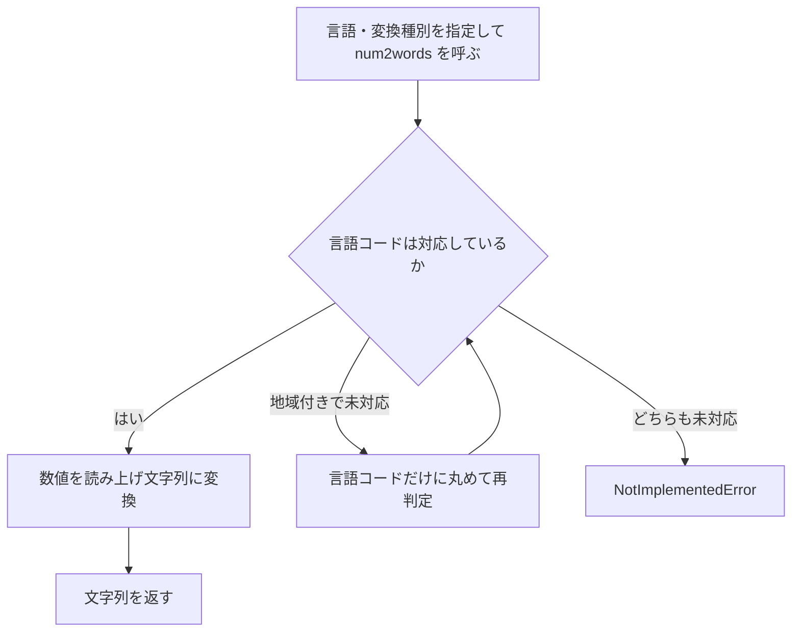

# 要件定義書: num2words

作成日: 2026-11-04（既存コードの逆引きで作成。変更の対象は `docs/active_change` の変更フローで扱う）

## 1. 目的・前提

### 目的

Python の数値（整数・小数・Decimal・文字列）を、各言語の読み上げ文字列（基数、序数、序数の数字表記、年、通貨金額）に変換する。利用者は Python プログラムから `num2words()` を呼ぶ。

### 用語集

| 用語 | 業務上の意味 | 本案件での使用範囲 | 同義語/類義語 |
|---|---|---|---|
| 基数 | 1, 2, 3 などの数の読み上げ（twenty-one など） | 全言語 | cardinal |
| 序数 | 1st, 2nd などの順序の読み上げ | 序数に対応する言語 | ordinal |
| 序数の数字表記 | 1st, 1º などの数字と序数の接尾辞 | 序数に対応する言語 | ordinal_num |
| 年 | 年を読み上げる形（nineteen eighty-four など） | 年に対応する言語 | year |
| 通貨 | 通貨コードと金額の読み上げ（dollars and cents など） | 通貨に対応する言語 | currency |
| 変換器 | 言語ごとのクラス（Num2Word_XX）の 1 つ | 全言語 | converter |

### システムの形態

ライブラリ（Python パッケージ `num2words`）。GUI・CUI・Web API・バッチは持たない。`bin/num2words` の CLI は別の入口であり、本書の対象は `num2words/` パッケージだけとする（既存コードのディレクトリ境界）。

### 1-1. 技術制約

| 制約項目 | 内容 | 出どころ（誰がいつ答えたか） |
|---|---|---|
| 既存コードベース | Python（setup.py の分類は 3.7〜3.12）。標準ライブラリの decimal を使用。CLI のみ docopt を使用（パッケージ外） | 既存コード（2026-11-04 の逆引き） |
| 配備先 | 利用者のプロジェクトへ組み込むライブラリ。サーバーやコンテナは持たない | 既存コード（setup.py） |
| チームの技術 | 既存コードに合わせて Python | ANSWERS.md（固定回答） |
| ライセンスとコスト | LGPL（COPYING）。有償ソフトは使わない | 既存コード（COPYING） |
| 性能と規模の目安 | 性能の目標は無い。利用人数の想定は無い | ANSWERS.md（固定回答） |

## 2. 業務

### 対象業務一覧

| RQ-BZ-ID | 業務名 | 業務の範囲 | 担当者 |
|---|---|---|---|
| RQ-BZ-NUMBER-WORDING | 数値の読み上げ | 数値を各言語の読み上げ文字列にして、利用者のプログラムの出力（帳票・画面・音声など）に使う | このライブラリを使う開発者 |

業務フロー:

```mermaid
flowchart LR
    A[開発者のプログラム] -->|数値・言語・変換種別| B[num2words()]
    B --> C[言語の変換器]
    C -->|読み上げ文字列| A
```

### 2-1. 業務の問題（あるべき姿と現状のギャップ）

| 問題 | 対象業務（RQ-BZ） | あるべき姿 | 現状 | ギャップ（KPI） | 業務影響 |
|---|---|---|---|---|---|
| 不明（既存システムのため、導入時の数値を聞き取れなかった） | RQ-BZ-NUMBER-WORDING | 不明 | 不明 | 不明 | 不明 |

### 2-2. 業務課題一覧

| RQ-BK-ID | 業務課題（取り組むこと） | 解決する問題（2-1） | 解決後の状態（KPI の目標値） | 対象業務（RQ-BZ） |
|---|---|---|---|---|
| RQ-BK-CARDINAL-WORDING | 数値を基数の読み上げ文字列にする | 2-1 の問題を聞き取れていないため、既存機能の提供を課題として置く | 現状の機能を維持する（既存システムのため数値目標は無い） | RQ-BZ-NUMBER-WORDING |
| RQ-BK-ORDINAL-WORDING | 序数の読み上げと数字表記を作る | 2-1 の問題を聞き取れていないため、既存機能の提供を課題として置く | 現状の機能を維持する（既存システムのため数値目標は無い） | RQ-BZ-NUMBER-WORDING |
| RQ-BK-YEAR-WORDING | 年を読み上げ文字列にする | 2-1 の問題を聞き取れていないため、既存機能の提供を課題として置く | 現状の機能を維持する（既存システムのため数値目標は無い） | RQ-BZ-NUMBER-WORDING |
| RQ-BK-CURRENCY-WORDING | 通貨金額を読み上げ文字列にする | 2-1 の問題を聞き取れていないため、既存機能の提供を課題として置く | 現状の機能を維持する（既存システムのため数値目標は無い） | RQ-BZ-NUMBER-WORDING |
| RQ-BK-LANGUAGE-SELECTION | 言語コードから変換器を選ぶ | 2-1 の問題を聞き取れていないため、既存機能の提供を課題として置く | 現状の機能を維持する（既存システムのため数値目標は無い） | RQ-BZ-NUMBER-WORDING |

### 2-3. 見込み経営効果

見込み経営効果は算定しない（既存システムの導入時の効果を聞き取れないため。もっともらしい数値は作らない）。RQ-EF は無い。

## 3. 機能要件

### 入力データと出力データ

入力: 数値（int、float、Decimal、文字列）、言語コード（既定 `en`）、変換種別（cardinal、ordinal、ordinal_num、year、currency）、通貨コード（currency のみ）。出力: 読み上げ文字列（str）。入力データは利用者のプログラムが渡し、外部からの取得はしない。

### 利用者の利用フロー



### 機能一覧

| RQ-ID | 機能名 | 内容 | この機能が無いと何が困るか | 対応業務課題ID（RQ-BK-*） |
|---|---|---|---|---|
| RQ-FT-SELECT-LANGUAGE | 言語の選択 | 言語コードから変換器を選ぶ。地域付きコードは言語コードに丸める。未対応の言語は NotImplementedError | 地域付きの言語を指定できない | RQ-BK-LANGUAGE-SELECTION |
| RQ-FT-CONVERT-CARDINAL | 基数の変換 | 整数・小数・Decimal・文字列を読み上げ文字列にする | 数値を言葉にできない | RQ-BK-CARDINAL-WORDING |
| RQ-FT-CONVERT-ORDINAL | 序数の変換 | 整数を序数の読み上げにする（負の数と小数は扱わない） | 序数の表記が作れない | RQ-BK-ORDINAL-WORDING |
| RQ-FT-CONVERT-ORDINAL-NUM | 序数の数字表記 | 整数に序数の接尾辞を付けた数字表記を作る | 数字表記の序数が作れない | RQ-BK-ORDINAL-WORDING |
| RQ-FT-CONVERT-YEAR | 年の変換 | 年を読み上げ文字列にする | 年の読み上げが作れない | RQ-BK-YEAR-WORDING |
| RQ-FT-CONVERT-CURRENCY | 通貨金額の変換 | 通貨コードと金額から、通貨の読み上げ文字列を作る | 金額の読み上げが作れない | RQ-BK-CURRENCY-WORDING |
| RQ-FT-PARSE-CURRENCY-PARTS | 通貨金額の分解 | 通貨金額を整数部・セント部・符号に分解する（整数はセント扱いまたは整数部扱い、文字列と Decimal は小数点以下 2 桁に四捨五入、float は文字列経由）。不正な文字列は decimal.InvalidOperation | 通貨金額の読み上げ（RQ-FT-CONVERT-CURRENCY）が動かない | RQ-BK-CURRENCY-WORDING |

### 3-1. 帳票・出力ファイル

帳票・出力ファイルは無い。出力は関数の戻り値（文字列）だけ。

### 3-1a. 画面・Web API（インターフェース）

| RQ-ID | 名称 | 用途 | 入力 | 出力 | 利用者 | 対応業務課題ID（RQ-BK-*） |
|---|---|---|---|---|---|---|
| RQ-UI-PUBLIC-API | num2words()（Python 関数） | 数値を読み上げ文字列にする | number, ordinal, lang, to, **kwargs | 読み上げ文字列（str）。未対応は NotImplementedError | 開発者 | RQ-BK-CARDINAL-WORDING, RQ-BK-LANGUAGE-SELECTION |

画面・Web API は無い（Python 関数の呼び出しだけ）。CLI は対象外。

### 3-2. 業務ルール

業務ルールは次の 1 つ（RQ-FT-PARSE-CURRENCY-PARTS の規則）。言語コードの丸め方と未対応時の扱いは RQ-FT-SELECT-LANGUAGE に書く。

| RQ-ID | ルール名 | 内容（条件と結果） | 違反時・エラー時の業務上の扱い | 対応業務課題ID（RQ-BK-*） |
|---|---|---|---|---|
| RQ-FT-PARSE-CURRENCY-PARTS | 通貨金額の分解の規則 | 整数（既定はセント扱い、`is_int_with_cents=False` は整数部扱い）は絶対値の 100 での商と余りを整数部・セント部とし、符号は値 < 0。文字列と Decimal（float は文字列経由）は小数点以下 2 桁に ROUND_HALF_UP で丸め、その後の値から整数部・セント部・符号を得る | 数値として読めない文字列は decimal.InvalidOperation を呼び出し元へ返す | RQ-BK-CURRENCY-WORDING |

### 3-3. 外部連携

外部連携は無い。

## 4. データ

### 4-1. データ要件一覧

データ要件は無い。変換は入力値から計算し、保持・保存・外部 DB を使わない。

### 4-2. 業務エンティティとデータ項目

業務エンティティは無い。

### 4-3. CRUD テーブル

CRUD の対象は無い（ライブラリは状態を保存しない）。

### 4-4. 状態遷移

状態を持つエンティティは無い。

### 4-5. 画面一覧

画面は無い。

## 5. 非機能要件

- 利用者の種別とアクセス経路: 開発者が同じプロセス内から Python で呼ぶ。アクセス経路の制限は無い。
- 性能: 目標は無い。
- 利用人数: 無い（ライブラリのため、同時接続の概念が無い）。
- 可用性: 要求は無い。
- 移行性: 移行は無い。
- セキュリティ: 認証・認可・暗号化の要求は無い。
- 対応する Python 版は 1-1 の既存の制約（3.7〜3.12）に従う。非機能要件の ID は付けない。

## 6. 運用要件

- ログ: ログは必要ないため、ログの内容と保存期間の記述は行わない。
- 監査ログ: 無い。
- 監視・アラート: 監視・アラートは必要ないため、監視・アラートの内容と対応方法の記述は行わない。
- バックアップと復旧: バックアップは必要ない（保存するデータが無い）。
- RQ-OP-* は無い。

## 7. テスト用利用シナリオ

| RQ-ID | テスト目的 | 前提条件 | テスト手順 | 期待される結果 | 検証する要件ID | 対応業務課題ID（RQ-BK-*） |
|---|---|---|---|---|---|---|
| RQ-TS-VERIFY-CARDINAL-READING | 基数の読み上げと公開 API の呼び出しを確かめる | num2words を import できる | 言語と整数・小数を指定して num2words() を呼ぶ | 既定の英語と指定言語の読み上げ文字列が期待値と一致する | RQ-FT-CONVERT-CARDINAL, RQ-UI-PUBLIC-API | RQ-BK-CARDINAL-WORDING |
| RQ-TS-VERIFY-ORDINAL-READING | 序数と序数の数字表記を確かめる | num2words を import できる | ordinal 指定と to=ordinal_num 指定で呼ぶ | 序数の読み上げと数字表記が期待値と一致する | RQ-FT-CONVERT-ORDINAL, RQ-FT-CONVERT-ORDINAL-NUM | RQ-BK-ORDINAL-WORDING |
| RQ-TS-VERIFY-YEAR-READING | 年の読み上げを確かめる | num2words を import できる | to=year で年を指定して呼ぶ | 年の読み上げが期待値と一致する | RQ-FT-CONVERT-YEAR | RQ-BK-YEAR-WORDING |
| RQ-TS-VERIFY-CURRENCY-READING | 通貨金額の読み上げを確かめる | num2words を import できる | to=currency で通貨コードと金額を指定して呼ぶ | 通貨金額の読み上げが期待値と一致する | RQ-FT-CONVERT-CURRENCY | RQ-BK-CURRENCY-WORDING |
| RQ-TS-VERIFY-LANGUAGE-SELECTION | 言語コードの選択と未対応の扱いを確かめる | num2words を import できる | 地域付きコード・言語コードのみ・未対応コードで呼ぶ | 地域付きは言語コードに丸めて変換し、未対応は NotImplementedError になる | RQ-FT-SELECT-LANGUAGE | RQ-BK-LANGUAGE-SELECTION |
| RQ-TS-VERIFY-PARSE-CURRENCY-PARTS | 通貨金額の分解の規則（セント扱い、符号、丸め、型ごとの扱い）を確かめる | num2words を import できる | `parse_currency_parts` に、整数（セント扱いと整数部扱い）、負の整数、文字列、Decimal、float を渡す | 各入力で `(整数部, セント部, 符号)` が規則どおりになり、不正な文字列は decimal.InvalidOperation を返す | RQ-FT-PARSE-CURRENCY-PARTS | RQ-BK-CURRENCY-WORDING |

すべての `RQ-FT`・`RQ-UI` は、いずれかのシナリオの「検証する要件ID」に現れる。

