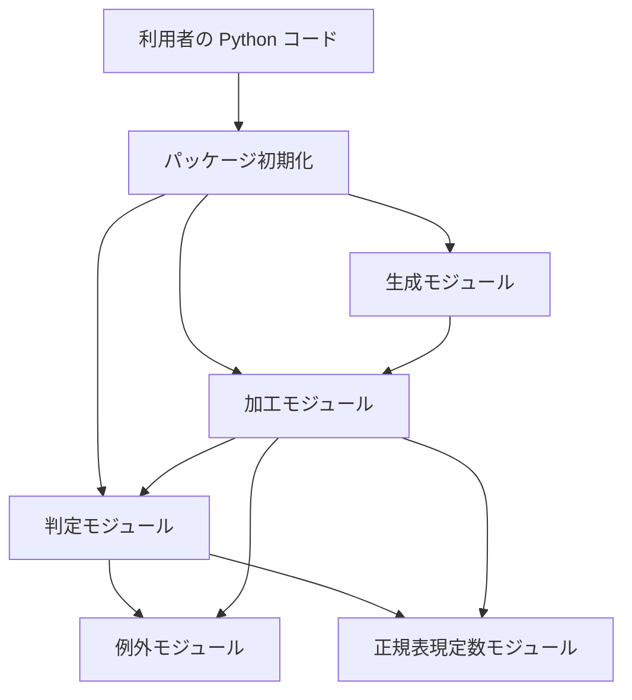
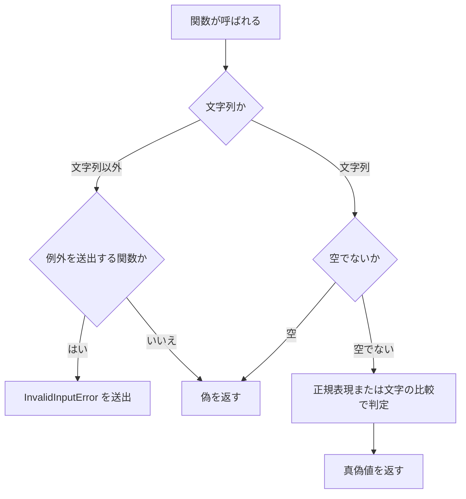
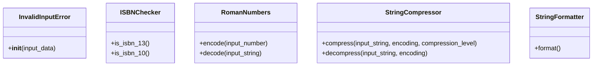

# 詳細設計書: python_string_utils

既存コード（`string_utils` パッケージ）から逆引きして作成し、変更 `.history/20261104-add-is-credit-card/` でクレジットカード番号の判定関数を追加した。

## 1. 言語・フレームワーク・アーキテクチャの選定

既存コードベースの技術をそのまま記録する。既存資産との整合を最優先の判断軸とし、選び直しとインターネット調査は行わない。

- 判定日時: 2026-11-04（逆引きによる記録）
- 技術制約の要約（要件定義書 1-1）: 既存コードは Python 3。標準ライブラリだけを使い、新しいライブラリは足さない。MIT ライセンス。目標の性能値は無い。
- 判断軸

| 判断軸 | 該当の有無と理由 |
|---|---|
| 既存資産との整合 | 有り。既存コードが Python 3 のパッケージで、そのまま記録する |
| チームの技術 | 特に無い（既存のとおり Python） |
| 配備先 | 利用者の Python 環境に入るライブラリ。OS の制約は無い |
| 認証と認可の境界 | 無い |
| 画面の規模 | 無い（画面は無い） |
| データの規模と構造 | 無い。永続化しないため DB は不要 |
| 外部連携 | 無い |
| ライセンスとコスト | MIT。有償部品は無い |
| 保守性 | 既存のとおり。標準ライブラリだけのため依存の保守は不要 |

- 最終選定結果

| 項目 | 選定結果 |
|---|---|
| 言語 | Python 3（`setup.py` の `python_requires` は 3.5 以上） |
| フレームワーク | 無し（標準ライブラリだけ） |
| DB 製品 | 無し（永続化しない） |
| 実行形態 | ライブラリ（パッケージとして配布し、他の Python コードから import する） |

- 選定理由: 既存コードの技術をそのまま使うため。要件定義書 1-1 の制約（既存コード、標準ライブラリだけ）と一致する。
- ユーザー承認の記録: 既存のとおりとする回答（ANSWERS.md、2026-11-04）。

## 2. システム構成

### コンポーネント一覧

| コンポーネント | 役割 | 対応する要件 |
|---|---|---|
| パッケージ初期化（`__init__`） | 3 つのモジュールの公開関数をパッケージ直下に出す | 利用者向けインターフェース |
| 判定モジュール（validation） | 文字列の形式・性質を判定する関数を提供する | 判定の機能 |
| 加工モジュール（manipulation） | 文字列を加工・変換する関数と、その内部処理クラスを提供する | 加工の機能 |
| 生成モジュール（generation） | UUID・乱数文字列・ローマ数字の連番を生成する関数を提供する | 生成の機能 |
| 例外モジュール（errors） | 型違反を表す例外クラスを提供する | 文字列以外の入力の扱い |
| 正規表現定数モジュール（_regex） | 判定・加工で使うパターン定数を持つ | 内部データ |

### システム全体構成図



### 各コンポーネントの役割と機能

- パッケージ初期化: 判定・加工・生成の 3 モジュールを `import *` で取り込み、利用者が `string_utils` から直接呼べるようにする。
- 判定モジュール: 判定関数の 24 個を持つ。内部に ISBN 検査クラスを持つ。
- 加工モジュール: 加工関数 14 個を持つ。内部に 4 つのクラス（ローマ数字、圧縮、整形）を持つ。判定モジュールの関数を使う。
- 生成モジュール: 生成関数 4 個を持つ。加工モジュールのローマ数字変換を使う。
- 例外モジュール: 型違反の例外クラスを 1 つ持つ。
- 正規表現定数モジュール: 判定と加工で使う正規表現の定数と、クレジットカード番号の型別パターンを持つ。

### コンポーネント間インターフェースとデータフロー

- 呼び出し元の値（文字列など）を公開関数に渡し、判定結果（真偽値）または加工結果（文字列・整数）を受け取る。
- 公開関数は内部で他のモジュールの関数を呼ぶが、外部のサービスや I/O は使わない。
- 状態は持たない。入力文字列は変更せず、新しい値を返す。

### ネットワーク構成図

ネットワーク越しの通信が無いため、ネットワーク構成図は書かない。

## 3. データ設計

### 3-1. データモデル

DB は必須ではないため、DB 設計は行わない。扱うデータは呼び出しの中の値だけである。

#### パターン定数（`DS-SC-REGEX-CONSTANTS`）

`_regex` モジュールに置く正規表現の定数。利用者は直接使わない。

| 定数の種類 | 内容 | 使う関数 |
|---|---|---|
| 数値パターン | 符号・整数部・小数部・指数部を表す | 数値判定 |
| URL パターン（URL 全体用と本文中の検索用） | スキーム・ホスト・パス等を表す | URL 判定、整形 |
| メールパターン（メールの本体と、引用符内の `@` 検出） | 頭部と末尾を表す | メール判定、整形 |
| 大文字・小文字の並びのパターン | キャメルケースとスネークケース（区切り `_` と `-`）の判定と置換 | ケース判定、ケース変換 |
| クレジットカードのパターン（型別の辞書） | VISA、MASTERCARD、AMERICAN_EXPRESS、DINERS_CLUB、DISCOVER、JCB の番号形式 | 判定関数 is_credit_card が使う |
| JSON の外枠パターン | 波括弧・角括弧で囲まれた形 | JSON 判定 |
| UUID パターン（ハイフンあり・なしの両方） | 16 進の桁数 | UUID 判定 |
| IPv4・IPv6 パターン | 形式の判定 | IP 判定 |
| 単語・HTML・空白・整形・余白・ロケールのパターン | 単語数、HTML タグ、空白、整形、行頭空白、ロケール名 | 単語数、HTML 判定・除去、整形、行頭空白除去 |

- 永続化は無い。

### 3-2. トランザクションと排他制御

トランザクション・排他制御が要る操作は無い。

### 3-3. 状態遷移

状態を持つエンティティは無い。

## 4. アーキテクチャ設計

### 4-1. 外部設計

#### 利用者向けインターフェース（`DS-IF-PUBLIC-API`）

Python の公開関数一式。`string_utils` を import して呼ぶ。`__all__` に載る関数が対象で、判定 24 個（`is_` 系と `contains_html`、`words_count`）、加工 14 個、生成 4 個を含む。個々の関数の仕様は 4-2 の表（関数ごとの DS-FN）に書く。

| 項目 | 内容 |
|---|---|
| 入力 | 関数ごとの引数（文字列、整数、真偽値、区切り文字、スキームのリスト）。型は関数の型注釈に従う |
| 入力のバリデーション | 判定系は文字列以外を偽として扱う関数と、`InvalidInputError` を送出する関数がある（4-2 の表に関数ごとに書く）。加工系は文字列以外に `InvalidInputError` を送出する。範囲外の数値は `ValueError` または `OverflowError` を送出する |
| 出力 | 真偽値（判定）、文字列（加工・生成）、整数（`words_count`、`roman_decode`）、生成器（`roman_range`） |
| エラー仕様 | `InvalidInputError`（`TypeError` の派生）: 文字列以外の入力（加工系、一部の判定系）。`ValueError`: 範囲外の値、空の入力（圧縮）、無効なローマ数字。`OverflowError`: 開始・終了・増分が両立しない `roman_range` の指定。利用者には例外として見える。ログ出力と再試行は無い |

#### 外部システム連携

外部システムとの連携は無い。

#### 外部 DB 連携

外部 DB との連携は無い。

### 4-2. 内部設計

#### 処理フロー（判定関数の共通処理）

判定関数の多くは、最初に「空でない文字列か」を確かめ、文字列でなければ偽を返す。そのうえで正規表現または文字の比較で判定する。`is_number`、`contains_html`、`words_count`、`is_isbn_*` は文字列以外で例外を送出する。



#### 処理フロー（ローマ数字の変換）

整数を 1〜3999 の範囲で確かめ、各桁を単位（I・X・C・M）と中間記号（V・L・D）の組に変換して、上の位から並べる。逆変換は右から読み、小さい記号が前にあれば引く。

#### 関数の一覧と仕様

| DS-ID | 関数・メソッド | 役割 | 入力のバリデーション | 出力 | エラー |
|---|---|---|---|---|---|
| `DS-FN-IS-STRING` | is_string | オブジェクトが文字列かを判定する | なし | 真偽値 | なし |
| `DS-FN-IS-FULL-STRING` | is_full_string | 空白以外の文字を含む文字列かを判定する | 文字列以外は偽 | 真偽値 | なし |
| `DS-FN-IS-NUMBER` | is_number | 符号・小数・指数を含む数値の形式かを判定する | 文字列以外は `InvalidInputError` | 真偽値 | `InvalidInputError` |
| `DS-FN-IS-INTEGER` | is_integer | 数値であり、小数点を含まないかを判定する | 数値判定に従う | 真偽値 | `InvalidInputError` |
| `DS-FN-IS-DECIMAL` | is_decimal | 数値であり、小数点を含むかを判定する | 数値判定に従う | 真偽値 | `InvalidInputError` |
| `DS-FN-IS-URL` | is_url | URL の形式かを判定し、許可するスキームで絞る | 文字列でない・空は偽 | 真偽値 | なし |
| `DS-FN-IS-EMAIL` | is_email | メールアドレスの形式かを判定する（長さ、先頭のドット、連続ドット、引用符の扱い） | 空・文字列でない・320 文字超・先頭がドットは偽 | 真偽値 | なし |
| `DS-FN-IS-CREDIT-CARD` | is_credit_card | 入力がクレジットカード番号の形式に合うかを判定する。カード種別を省略すると既知の 6 種のいずれかに合えば真、指定すると指定した種別の形式にだけ合うかを判定する | 空・空白だけ・文字列以外は偽を返す。カード種別が既知の 6 種に無いときは判定せず `KeyError` を送出する | 真偽値 | `KeyError`（未知のカード種別） |
| `DS-FN-IS-CAMEL-CASE` | is_camel_case | 英字と数字だけで、大文字と小文字を両方含み、数字で始まらないかを判定する | 空・文字列でない は偽 | 真偽値 | なし |
| `DS-FN-IS-SNAKE-CASE` | is_snake_case | 区切り文字を含むスネークケースかを判定する（区切りは `_` と `-`、他は動的パターン） | 空・文字列でない は偽 | 真偽値 | なし |
| `DS-FN-IS-JSON` | is_json | JSON のオブジェクトまたは配列として読めるかを判定する | 空・外枠の形式が合わない は偽 | 真偽値 | なし（解析の失敗は偽） |
| `DS-FN-IS-UUID` | is_uuid | UUID の形式かを判定する（`allow_hex` でハイフンなしも可） | 引数を文字列に変換して判定（文字列以外も受け付ける） | 真偽値 | なし |
| `DS-FN-IS-IP-V4` | is_ip_v4 | IPv4 の形式かを判定する（各区切りは 0〜255） | 空・形式外は偽 | 真偽値 | なし |
| `DS-FN-IS-IP-V6` | is_ip_v6 | IPv6 の形式かを判定する | 空は偽 | 真偽値 | なし |
| `DS-FN-IS-IP` | is_ip | IPv6 または IPv4 かを判定する | 各判定に従う | 真偽値 | なし |
| `DS-FN-IS-PALINDROME` | is_palindrome | 回文かを判定する（空白の無視と大文字小文字の無視を指定可） | 空・文字列でない は偽 | 真偽値 | なし |
| `DS-FN-IS-PANGRAM` | is_pangram | 英小文字 26 字をすべて含むかを判定する（空白は無視） | 空・文字列でない は偽 | 真偽値 | なし |
| `DS-FN-IS-ISOGRAM` | is_isogram | 同じ文字を含まないかを判定する | 空・文字列でない は偽 | 真偽値 | なし |
| `DS-FN-IS-SLUG` | is_slug | 指定の区切り文字で作られたスラッグの形式かを判定する | 空・文字列でない は偽 | 真偽値 | なし |
| `DS-FN-CONTAINS-HTML` | contains_html | HTML・XML のタグを含むかを判定する | 文字列以外は `InvalidInputError` | 真偽値 | `InvalidInputError` |
| `DS-FN-WORDS-COUNT` | words_count | 文字・数字の並びを単語として数える | 文字列以外は `InvalidInputError` | 整数 | `InvalidInputError` |
| `DS-FN-IS-ISBN-10` | is_isbn_10 | ISBN-10 の形式と検査数字かを判定する（`normalize` でハイフンを除く） | 文字列以外は `InvalidInputError`（検査クラスで行う） | 真偽値 | `InvalidInputError` |
| `DS-FN-IS-ISBN-13` | is_isbn_13 | ISBN-13 の形式と検査数字かを判定する | 同上 | 真偽値 | `InvalidInputError` |
| `DS-FN-IS-ISBN` | is_isbn | ISBN-10 または ISBN-13 かを判定する | 同上 | 真偽値 | `InvalidInputError` |
| `DS-FN-REVERSE` | reverse | 文字列を逆順にする | 文字列以外は `InvalidInputError` | 文字列 | `InvalidInputError` |
| `DS-FN-CAMEL-CASE-TO-SNAKE` | camel_case_to_snake | キャメルケースを区切り文字付きの小文字にする。キャメルケースでなければ入力をそのまま返す | 文字列以外は `InvalidInputError` | 文字列 | `InvalidInputError` |
| `DS-FN-SNAKE-CASE-TO-CAMEL` | snake_case_to_camel | スネークケースをキャメルケースにする（先頭の大文字化を指定可）。スネークケースでなければ入力をそのまま返す | 文字列以外は `InvalidInputError` | 文字列 | `InvalidInputError` |
| `DS-FN-SHUFFLE` | shuffle | 文字の並びをランダムに入れ替える（非暗号の乱数を使う） | 文字列以外は `InvalidInputError` | 文字列 | `InvalidInputError` |
| `DS-FN-STRIP-HTML` | strip_html | タグを除去する（タグの中身を残すかを指定可） | 文字列以外は `InvalidInputError` | 文字列 | `InvalidInputError` |
| `DS-FN-PRETTIFY` | prettify | 空白・記号・大文字化・所有格の整形を行い、メールと URL は変えない | 文字列以外は `InvalidInputError`（整形クラスの生成で行う） | 文字列 | `InvalidInputError` |
| `DS-FN-ASCIIFY` | asciify | Unicode を NFKD で分解し、ASCII 以外を除く | 文字列以外は `InvalidInputError` | 文字列 | `InvalidInputError` |
| `DS-FN-SLUGIFY` | slugify | 英数字以外を区切りに変え、区切りを重ならないようにし、ASCII 化する | 文字列以外は `InvalidInputError` | 文字列 | `InvalidInputError` |
| `DS-FN-BOOLEANIZE` | booleanize | 小文字化した文字列が true、1、yes、y のいずれかなら真とする | 文字列以外は `InvalidInputError` | 真偽値 | `InvalidInputError` |
| `DS-FN-STRIP-MARGIN` | strip_margin | 各行の先頭の改行以外の空白を除く | 文字列以外は `InvalidInputError` | 文字列 | `InvalidInputError` |
| `DS-FN-COMPRESS` | compress | 圧縮クラスの圧縮を呼ぶ | 圧縮クラスに従う | 文字列 | 圧縮クラスに従う |
| `DS-FN-DECOMPRESS` | decompress | 圧縮クラスの展開を呼ぶ | 展開クラスに従う | 文字列 | 展開クラスに従う |
| `DS-FN-ROMAN-ENCODE` | roman_encode | ローマ数字の変換クラスの変換を呼ぶ | 変換クラスに従う | 文字列 | 変換クラスに従う |
| `DS-FN-ROMAN-DECODE` | roman_decode | ローマ数字の逆変換クラスの変換を呼ぶ | 変換クラスに従う | 整数 | 変換クラスに従う |
| `DS-FN-UUID` | uuid | UUID v4 を生成し、16 進または標準の表記で返す | 引数は真偽値 | 文字列 | なし |
| `DS-FN-RANDOM-STRING` | random_string | 英字と数字から指定の長さの乱数文字列を作る（非暗号） | 整数でない・1 未満は `ValueError` | 文字列 | `ValueError` |
| `DS-FN-SECURE-RANDOM-HEX` | secure_random_hex | `os.urandom` で指定バイト数の乱数を作り、16 進文字列にする | 整数でない・1 未満は `ValueError` | 文字列（桁数は指定バイト数の 2 倍） | `ValueError` |
| `DS-FN-ROMAN-RANGE` | roman_range | 開始・終了・増分を確かめ、ローマ数字を順に返す生成器を作る | 整数でない・1〜3999 の範囲外は `ValueError`。指定が両立しない場合は `OverflowError` | 生成器（文字列） | `ValueError`、`OverflowError` |

### 4-2 補足: バッチ設計

バッチは無い。

## 5. クラス設計

| DS-ID | クラス（修飾名） | 責務（1 文） | 主要属性 | 主要メソッド |
|---|---|---|---|---|
| `DS-CL-INVALID-INPUT-ERROR` | InvalidInputError（errors） | 文字列以外の入力を表す例外を作る | なし | 生成時に受け取った値の型名を含むメッセージを作る |

- 内部クラス（名前が `_` で始まるクラス）は、利用者が直接使わず、呼び出し元の公開関数の行で仕様を示す。対応表の規則（内部の要素は載せない）に従い、DS-ID を付けない。内部クラスの処理は、4-2 の公開関数の行に書いた。
- 依存の向き: 加工モジュールは判定モジュールの判定関数に依存し、生成モジュールは加工モジュールのローマ数字変換に依存する。判定モジュールは加工モジュールに依存しない。

### クラス図



### システム内メッセージ一覧と役割

システム内メッセージ（非同期の通知）は無い。モジュール間は関数の呼び出しだけで連携する。

メッセージフロー図は書かない（関数の呼び出し関係は 2 の構成図で示した）。

## 6. エラーハンドリングとセキュリティ設計

### エラーハンドリング

| 想定エラー | 発生の条件 | 利用者への見え方 | ログ | 処理 |
|---|---|---|---|---|
| `InvalidInputError` | 加工系・一部の判定系に文字列以外を渡した | 例外（`TypeError` の派生） | なし | 中止 |
| `ValueError` | 範囲外の数値、空の入力、無効なローマ数字、不正な圧縮レベルや長さ | 例外 | なし | 中止 |
| `OverflowError` | `roman_range` の開始・終了・増分が両立しない | 例外 | なし | 中止 |
| `KeyError` | 判定関数のカード種別に既知の 6 種に無い名前を指定した | 例外（指定した名前を含む） | なし | 中止 |
| base64・zlib の例外 | 展開の対象が圧縮文字列でない | 例外 | なし | 中止 |

判定系（`is_` 系の多く）は例外を送出せず偽を返す。


### 認証

認証は無い。

### 認可

認可は無い。

### 監査ログ

無い。

### その他のセキュリティ対策

- 秘密値の生成には `secure_random_hex`（`os.urandom`）を使う。`random_string` と `shuffle` は標準の乱数（非暗号）を使い、秘密値の生成には使わない（利用者向けの説明に書く）。
- 外部入力を扱う経路が無い（ネットワーク・ファイルの入出力・外部プロセス無し）。

## 7. コード設計

### ソースコードのディレクトリ構成

```
string_utils/   パッケージ本体（モジュール 6 つ。テストは tests/ に置く）
```

### ファイルごとの役割と含まれる要素

| ファイル | 役割 | 含まれるクラス | 実現する設計 ID |
|---|---|---|---|
| `string_utils/__init__.py` | 公開関数をパッケージ直下に出す | なし | `DS-MD-STRING-UTILS-INIT` |
| `string_utils/_regex.py` | パターン定数を置く | なし | `DS-MD-REGEX-MODULE` |
| `string_utils/errors.py` | 型違反の例外 | InvalidInputError | `DS-MD-ERRORS-MODULE`、`DS-CL-INVALID-INPUT-ERROR` |
| `string_utils/validation.py` | 判定関数と ISBN 検査クラス（内部） | ISBNChecker（内部。DS-ID なし） | `DS-MD-VALIDATION-MODULE`、`DS-FN-IS-STRING`、`DS-FN-IS-FULL-STRING`、`DS-FN-IS-NUMBER`、`DS-FN-IS-INTEGER`、`DS-FN-IS-DECIMAL`、`DS-FN-IS-URL`、`DS-FN-IS-EMAIL`、`DS-FN-IS-CREDIT-CARD`、`DS-FN-IS-CAMEL-CASE`、`DS-FN-IS-SNAKE-CASE`、`DS-FN-IS-JSON`、`DS-FN-IS-UUID`、`DS-FN-IS-IP-V4`、`DS-FN-IS-IP-V6`、`DS-FN-IS-IP`、`DS-FN-IS-PALINDROME`、`DS-FN-IS-PANGRAM`、`DS-FN-IS-ISOGRAM`、`DS-FN-IS-SLUG`、`DS-FN-CONTAINS-HTML`、`DS-FN-WORDS-COUNT`、`DS-FN-IS-ISBN-10`、`DS-FN-IS-ISBN-13`、`DS-FN-IS-ISBN` |
| `string_utils/manipulation.py` | 加工関数と内部クラス（ローマ数字、圧縮、整形） | RomanNumbers、StringCompressor、StringFormatter（いずれも内部。DS-ID なし） | `DS-MD-MANIPULATION-MODULE`、`DS-FN-REVERSE`、`DS-FN-CAMEL-CASE-TO-SNAKE`、`DS-FN-SNAKE-CASE-TO-CAMEL`、`DS-FN-SHUFFLE`、`DS-FN-STRIP-HTML`、`DS-FN-PRETTIFY`、`DS-FN-ASCIIFY`、`DS-FN-SLUGIFY`、`DS-FN-BOOLEANIZE`、`DS-FN-STRIP-MARGIN`、`DS-FN-COMPRESS`、`DS-FN-DECOMPRESS`、`DS-FN-ROMAN-ENCODE`、`DS-FN-ROMAN-DECODE` |
| `string_utils/generation.py` | 生成関数 | なし | `DS-MD-GENERATION-MODULE`、`DS-FN-UUID`、`DS-FN-RANDOM-STRING`、`DS-FN-SECURE-RANDOM-HEX`、`DS-FN-ROMAN-RANGE` |

- テストファイル（`tests/` 配下）は、この表に含めない。

### 対応表の粒度

`function`。公開関数、クラス、内部クラスのメソッドまで対応表に載せる。

### 依存の規則

依存の規則は無い（単一パッケージ内の 3 モジュールの依存は、4 章の構成図のとおり。外部 API を呼ばないため、規則で制限する対象が無い）。

### コーディング規約

| 項目 | 規則 |
|---|---|
| 型注釈 | 公開関数の引数と戻り値に `typing` の型注釈を付ける |
| ドキュメント | 公開関数のドキュメントは reST 形式（`:param:`、`:type:`、`:return:`）で書く |
| 命名 | 関数は小文字のスネークケース。内部用のクラスは二重のアンダースコアで始める |
| 例外 | 型違反は `InvalidInputError`、値の範囲違反は `ValueError`、範囲の組み合わせ違反は `OverflowError` |
| 依存 | 標準ライブラリだけを使う |

## 8. テスト設計

### 8-1. テストの種類と方針

- 単体テスト: 既存の `tests/` の `unittest` テストケース（関数ごとに正常系・異常系）。既存の挙動を変えないことの確認に使う。
- 結合テスト: パッケージ直下の import と、モジュール間の関数呼び出し（生成が加工のローマ数字変換を使う、加工が判定を使う）は、E2E のシナリオで確かめる。
- 総合テスト: 無し（ライブラリであり、総合の対象となる運用は無い）。
- E2E テスト: 8-2 のシナリオを `e2e/` の pytest で確かめる。
- 単体テスト・結合テストの実行コマンド: `python3 -m pytest tests`
- 非機能要件の検証: `RQ-NF-STDLIB-ONLY` は `DS-TS-VERIFY-PACKAGE-DEPENDENCIES` で確かめる。

### 8-2. E2E テストのシナリオ

要件定義書のテスト用利用シナリオ（`RQ-TS-*`）を 100% 網羅する。外部連携は無いため、モードは設けない。

| DS-ID | 目的 | 前提条件 | 手順 | 期待結果 |
|---|---|---|---|---|
| `DS-TS-VERIFY-PUBLIC-API-IMPORT` | 公開関数がパッケージ直下から呼べ、文字列以外の扱いが正しいこと | パッケージが利用できる | `string_utils` を import し、`__all__` の関数を呼ぶ。文字列以外（`None`、数値、バイト列）を判定系と加工系に渡す | 関数が呼べる。判定系は偽、加工系は `InvalidInputError` |
| `DS-TS-VERIFY-VALIDATION-BASICS` | 基本の判定関数が正しく真偽を返すこと | パッケージが利用できる | 型、数値、URL、メール、JSON、UUID、IP の各判定に正しい値と誤った値を渡す | 正しい値は真、誤った値は偽 |
| `DS-TS-VERIFY-VALIDATION-TEXT` | 文章・識別子の判定関数が正しく真偽・数を返すこと | パッケージが利用できる | ケース、ISBN、回文、パングラム、アイソグラム、スラッグ、HTML、単語数の各判定に値を渡す | 正しい値は真、誤った値は偽。単語数は数 |
| `DS-TS-VERIFY-TEXT-TRANSFORM` | 加工関数が期待の文字列を返すこと | パッケージが利用できる | ケース変換、逆順、並べ替え、タグ除去、整形、ASCII 化、スラッグ化、真偽変換、行頭空白除去に入力を渡す | 期待する文字列。並べ替えは同じ文字の集まり |
| `DS-TS-VERIFY-COMPRESS-AND-ROMAN` | 圧縮・展開とローマ数字が正しいこと | パッケージが利用できる | 圧縮して展開する。整数をローマ数字にして戻す。連番を取り出す。範囲外を渡す | 展開で元に戻る。変換は正しく、範囲外は例外 |
| `DS-TS-VERIFY-GENERATION` | 生成関数が期待の形式の値を返すこと | パッケージが利用できる | UUID、乱数文字列、安全な 16 進を生成する。不正な長さを渡す | UUID 形式、指定長の英数字、指定バイトの 2 倍の 16 進。不正な長さは例外 |
| `DS-TS-VERIFY-PACKAGE-DEPENDENCIES` | 標準ライブラリだけで動くこと | ソースが利用できる | `setup.py` に `install_requires` が無いことと、各モジュールの import が標準ライブラリとパッケージ内だけであることを確かめる | 外部依存が無い |
| `DS-TS-VERIFY-CREDIT-CARD-CHECK` | クレジットカード番号の判定関数が、カード種別ごとの番号を正しく判定し、未知のカード種別で例外になること | パッケージが利用できる | 既知の 6 種それぞれの正しい番号と誤った番号を、種別なしと種別ありで判定する。空文字、空白だけ、文字列以外を渡す。未知のカード種別を指定する | 正しい番号は真、誤った番号は偽。空文字・空白・文字列以外は偽。未知のカード種別は `KeyError` |

### 8-3. E2E の実行手段

ライブラリであり、CLI・Web・GUI・バッチのいずれでもない。他の Python コードからの呼び出しを、pytest のテスト関数で実際に呼んで確かめる。

### 8-4. E2E の実行コマンドと運用

- 実行コマンド: `python3 -m pytest e2e --junitxml=e2e/results/e2e.xml`
- テスト資産は `e2e/` に置く。各 `DS-TS-*` は対応表の `DS-TS` の行でテスト関数に結ぶ。
- 結果は JUnit XML で `e2e/results/` に出す（git 管理外）。
- テストが失敗したら修正と再実行を繰り返し、全件成功まで続ける。

## 9. 運用設計

### 起動・初期化・設定（`DS-OP-PACKAGE-SETUP`）

- 起動方式: ライブラリ。`setup.py` で配布物（sdist と wheel）を作り（`build.sh` が `python setup.py sdist bdist_wheel` を実行する）、利用先の Python 環境に入れて `import` する。
- 初期化: 初期化は無い（初期ユーザーは無い）。
- 設定値・環境変数: 無い。
- 配布の対象は `MANIFEST` と `setup.py` の `packages`（`string_utils`）で決まる。
- バックアップ・データ移行・可用性: 無い（要件定義書 5・6 のとおり）。
- 起動方法と操作説明は README.md に書く。

## 10. ログ・監視・アラート・障害対応設計

- ログ: ログの設計は必須ではないため、ログの種類と内容の記述は行わない。
- 監視・アラート: 監視・アラートの設計は必須ではないため、監視・アラートの内容と対応方法の記述は行わない。
- 障害対応: ライブラリは例外を送出するだけで、再試行や通知は行わない。利用者は 6 章の例外で不具合に気づき、呼び出し元で対処する。

## 11. 要件と設計の対応表

| DS-ID | 対応要件ID |
|---|---|
| `DS-MD-STRING-UTILS-INIT` | `RQ-UI-PUBLIC-API` |
| `DS-MD-REGEX-MODULE` | `RQ-DT-STATELESS-FUNCTIONS` |
| `DS-MD-ERRORS-MODULE` | `RQ-FT-REJECT-NON-STRING-INPUT` |
| `DS-MD-VALIDATION-MODULE` | `RQ-FT-CHECK-CREDIT-CARD`、`RQ-FT-CHECK-STRING-TYPE`、`RQ-FT-CHECK-NUMBER-FORMAT`、`RQ-FT-CHECK-URL`、`RQ-FT-CHECK-EMAIL`、`RQ-FT-CHECK-CASE-FORMAT`、`RQ-FT-CHECK-JSON`、`RQ-FT-CHECK-UUID`、`RQ-FT-CHECK-IP-ADDRESS`、`RQ-FT-CHECK-ISBN`、`RQ-FT-CHECK-PALINDROME`、`RQ-FT-CHECK-PANGRAM`、`RQ-FT-CHECK-ISOGRAM`、`RQ-FT-CHECK-SLUG`、`RQ-FT-DETECT-HTML`、`RQ-FT-COUNT-WORDS` |
| `DS-MD-MANIPULATION-MODULE` | `RQ-FT-CONVERT-CASE`、`RQ-FT-REVERSE-STRING`、`RQ-FT-SHUFFLE-STRING`、`RQ-FT-STRIP-HTML`、`RQ-FT-PRETTIFY-STRING`、`RQ-FT-ASCIIFY-STRING`、`RQ-FT-SLUGIFY-STRING`、`RQ-FT-BOOLEANIZE-STRING`、`RQ-FT-STRIP-MARGIN`、`RQ-FT-COMPRESS-STRING`、`RQ-FT-ROMAN-NUMERAL` |
| `DS-MD-GENERATION-MODULE` | `RQ-FT-ROMAN-RANGE`、`RQ-FT-GENERATE-UUID`、`RQ-FT-GENERATE-RANDOM-STRING`、`RQ-FT-GENERATE-SECURE-HEX` |
| `DS-CL-INVALID-INPUT-ERROR` | `RQ-FT-REJECT-NON-STRING-INPUT` |
| `DS-FN-IS-STRING` | `RQ-FT-CHECK-STRING-TYPE` |
| `DS-FN-IS-FULL-STRING` | `RQ-FT-CHECK-STRING-TYPE` |
| `DS-FN-IS-NUMBER` | `RQ-FT-CHECK-NUMBER-FORMAT` |
| `DS-FN-IS-INTEGER` | `RQ-FT-CHECK-NUMBER-FORMAT` |
| `DS-FN-IS-DECIMAL` | `RQ-FT-CHECK-NUMBER-FORMAT` |
| `DS-FN-IS-URL` | `RQ-FT-CHECK-URL` |
| `DS-FN-IS-EMAIL` | `RQ-FT-CHECK-EMAIL` |
| `DS-FN-IS-CREDIT-CARD` | `RQ-FT-CHECK-CREDIT-CARD`、`RQ-FT-REJECT-UNKNOWN-CARD-TYPE` |
| `DS-FN-IS-CAMEL-CASE` | `RQ-FT-CHECK-CASE-FORMAT` |
| `DS-FN-IS-SNAKE-CASE` | `RQ-FT-CHECK-CASE-FORMAT` |
| `DS-FN-IS-JSON` | `RQ-FT-CHECK-JSON` |
| `DS-FN-IS-UUID` | `RQ-FT-CHECK-UUID` |
| `DS-FN-IS-IP-V4` | `RQ-FT-CHECK-IP-ADDRESS` |
| `DS-FN-IS-IP-V6` | `RQ-FT-CHECK-IP-ADDRESS` |
| `DS-FN-IS-IP` | `RQ-FT-CHECK-IP-ADDRESS` |
| `DS-FN-IS-PALINDROME` | `RQ-FT-CHECK-PALINDROME` |
| `DS-FN-IS-PANGRAM` | `RQ-FT-CHECK-PANGRAM` |
| `DS-FN-IS-ISOGRAM` | `RQ-FT-CHECK-ISOGRAM` |
| `DS-FN-IS-SLUG` | `RQ-FT-CHECK-SLUG` |
| `DS-FN-CONTAINS-HTML` | `RQ-FT-DETECT-HTML` |
| `DS-FN-WORDS-COUNT` | `RQ-FT-COUNT-WORDS` |
| `DS-FN-IS-ISBN-10` | `RQ-FT-CHECK-ISBN` |
| `DS-FN-IS-ISBN-13` | `RQ-FT-CHECK-ISBN` |
| `DS-FN-IS-ISBN` | `RQ-FT-CHECK-ISBN` |
| `DS-FN-REVERSE` | `RQ-FT-REVERSE-STRING` |
| `DS-FN-CAMEL-CASE-TO-SNAKE` | `RQ-FT-CONVERT-CASE` |
| `DS-FN-SNAKE-CASE-TO-CAMEL` | `RQ-FT-CONVERT-CASE` |
| `DS-FN-SHUFFLE` | `RQ-FT-SHUFFLE-STRING` |
| `DS-FN-STRIP-HTML` | `RQ-FT-STRIP-HTML` |
| `DS-FN-PRETTIFY` | `RQ-FT-PRETTIFY-STRING` |
| `DS-FN-ASCIIFY` | `RQ-FT-ASCIIFY-STRING` |
| `DS-FN-SLUGIFY` | `RQ-FT-SLUGIFY-STRING` |
| `DS-FN-BOOLEANIZE` | `RQ-FT-BOOLEANIZE-STRING` |
| `DS-FN-STRIP-MARGIN` | `RQ-FT-STRIP-MARGIN` |
| `DS-FN-COMPRESS` | `RQ-FT-COMPRESS-STRING` |
| `DS-FN-DECOMPRESS` | `RQ-FT-COMPRESS-STRING` |
| `DS-FN-ROMAN-ENCODE` | `RQ-FT-ROMAN-NUMERAL` |
| `DS-FN-ROMAN-DECODE` | `RQ-FT-ROMAN-NUMERAL` |
| `DS-FN-UUID` | `RQ-FT-GENERATE-UUID` |
| `DS-FN-RANDOM-STRING` | `RQ-FT-GENERATE-RANDOM-STRING` |
| `DS-FN-SECURE-RANDOM-HEX` | `RQ-FT-GENERATE-SECURE-HEX` |
| `DS-FN-ROMAN-RANGE` | `RQ-FT-ROMAN-RANGE` |
| `DS-IF-PUBLIC-API` | `RQ-UI-PUBLIC-API` |
| `DS-SC-REGEX-CONSTANTS` | `RQ-DT-STATELESS-FUNCTIONS` |
| `DS-OP-PACKAGE-SETUP` | `RQ-NF-STDLIB-ONLY` |
| `DS-TS-VERIFY-PUBLIC-API-IMPORT` | `RQ-TS-VERIFY-PUBLIC-API-IMPORT` |
| `DS-TS-VERIFY-VALIDATION-BASICS` | `RQ-TS-VERIFY-VALIDATION-BASICS` |
| `DS-TS-VERIFY-VALIDATION-TEXT` | `RQ-TS-VERIFY-VALIDATION-TEXT` |
| `DS-TS-VERIFY-TEXT-TRANSFORM` | `RQ-TS-VERIFY-TEXT-TRANSFORM` |
| `DS-TS-VERIFY-COMPRESS-AND-ROMAN` | `RQ-TS-VERIFY-COMPRESS-AND-ROMAN` |
| `DS-TS-VERIFY-GENERATION` | `RQ-TS-VERIFY-GENERATION` |
| `DS-TS-VERIFY-PACKAGE-DEPENDENCIES` | `RQ-TS-VERIFY-PACKAGE-DEPENDENCIES` |
| `DS-TS-VERIFY-CREDIT-CARD-CHECK` | `RQ-TS-VERIFY-CREDIT-CARD-CHECK` |

### 11-1. 除外要件

除外要件は無い。
