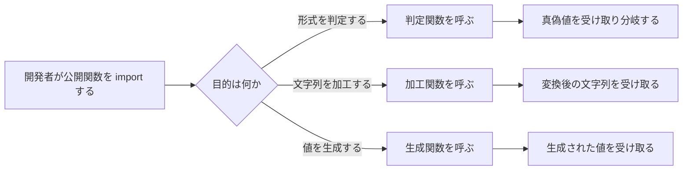

# 要件定義書: python_string_utils

既存コード（`string_utils` パッケージ）から逆引きして作成し、変更 `.history/20261104-add-is-credit-card/` でクレジットカード番号の判定関数を追加した。

## 1. 目的・前提

### 1-0. システムの目的

Python の標準ライブラリだけで動く文字列ユーティリティを提供する。開発者が、文字列の形式判定（メールアドレス、URL、数値、UUID、IP アドレス、ISBN など）、文字列の加工・変換（ケース変換、スラッグ化、整形、圧縮、ローマ数字変換）、文字列や値の生成（UUID、乱数文字列、ローマ数字の連番）を、自分で実装せずに呼び出せるようにする。

### 用語集

| 用語 | 業務上の意味 | 本案件での使用範囲 | 同義語/類義語 |
|---|---|---|---|
| 公開関数 | 利用者が `string_utils` から import して呼ぶ関数 | パッケージの `__all__` に載る関数 | API |
| 判定関数 | 入力が条件を満たすかを真偽値で返す関数 | `is_` で始まる公開関数 | バリデーター |
| 加工関数 | 入力文字列を変換した文字列を返す関数 | 判定関数以外の文字列を返す公開関数 | 変換関数 |
| 型違反 | 文字列以外の値を渡すこと | 公開関数全体 | - |
| 全角・半角（正規化） | ISBN のハイフンを除いて桁を扱うこと | ISBN 判定の `normalize` 引数 | - |
| ローマ数字 | I, V, X, L, C, D, M で表す 1〜3999 の数 | ローマ数字の変換と連番 | Roman numeral |

### システムの形態

Python ライブラリ。GUI（画面）、CUI（コマンド）、Web API（他のシステムに機能を提供する）、バッチのいずれでもなく、他の Python コードから `import` して関数を呼ぶ形で使う。

### 1-1. 技術制約（前提。ID は付与しない）

| 制約項目 | 内容 | 出どころ（誰がいつ答えたか） |
|---|---|---|
| 既存コードベース | Python 3（`setup.py` の `python_requires` は `>=3.5`）。標準ライブラリだけを使う（`base64`、`binascii`、`json`、`os`、`random`、`re`、`string`、`typing`、`unicodedata`、`uuid`、`zlib`） | 既存コード（`setup.py`、各モジュールの import）。回答: 既存のとおり（ANSWERS.md） |
| 配備先 | 利用者の Python 環境に `import` して使う。OS の制約は無い（`setup.py` の Operating System Independent） | `setup.py` の classifiers。回答: 既存のとおり（ANSWERS.md） |
| チームの技術 | 特に無い（既存のとおり Python） | 回答（ANSWERS.md） |
| ライセンスとコスト | MIT ライセンス。新しいライブラリは足さない | `setup.py`。回答: 既存のとおり（ANSWERS.md） |
| 性能と規模の目安 | 目標は無い | 回答（ANSWERS.md） |

## 2. 業務

### 対象業務一覧

| RQ-BZ-ID | 業務名 | 業務の範囲 | 担当者 |
|---|---|---|---|
| `RQ-BZ-STRING-UTILITY` | 文字列ユーティリティの利用 | Python 開発者が、文字列の判定・加工・生成を公開関数で行う | Python 開発者（このライブラリの利用者） |

業務フロー（mermaid）:

### 2-1. 業務の問題（あるべき姿と現状のギャップ）

既存システムの逆引きのため、導入時の数値は聞き取れなかった。

| 問題 | 対象業務（RQ-BZ） | あるべき姿 | 現状 | ギャップ（KPI） | 業務影響 |
|---|---|---|---|---|---|
| 文字列の形式判定や加工を、開発者が個別に実装して誤りが入る | `RQ-BZ-STRING-UTILITY` | 形式判定と加工が、検証済みの共通部品で一貫して行われる | 公開関数が提供されている | 不明（既存システムのため、導入時の数値を聞き取れなかった） | 実装の誤りが混入しうる |

### 2-2. 業務課題一覧（必須）

| RQ-BK-ID | 業務課題（取り組むこと） | 解決する問題（2-1） | 解決後の状態（KPI の目標値） | 対象業務（RQ-BZ） |
|---|---|---|---|---|
| `RQ-BK-VALIDATE-STRING-FORMAT` | 文字列の形式を判定する公開関数を提供する | 形式判定を個別に実装して誤りが入る | 目標値は無い（現状の機能を維持する） | `RQ-BZ-STRING-UTILITY` |
| `RQ-BK-TRANSFORM-STRING` | 文字列を加工・変換する公開関数を提供する | 加工を個別に実装して誤りが入る | 目標値は無い（現状の機能を維持する） | `RQ-BZ-STRING-UTILITY` |
| `RQ-BK-GENERATE-STRING-VALUE` | UUID・乱数文字列・ローマ数字の連番などを生成する公開関数を提供する | 生成を個別に実装して誤りが入る | 目標値は無い（現状の機能を維持する） | `RQ-BZ-STRING-UTILITY` |

### 2-3. 見込み経営効果

見込み経営効果は算定しない（既存のライブラリであり、導入時の効果を聞き取れなかったため）。

## 3. 機能要件

### 入力データと出力データ

- 入力: 呼び出し元が渡す Python の値（主に `str`。判定系は文字列以外も受け付けるものがある）
- 出力: 真偽値、文字列、整数、生成器（`roman_range`）

### 利用者向けインターフェース（公開関数）

利用者は `string_utils` を import し、公開関数を呼ぶ。

| RQ-ID | 対象 | 形式 | 内容 | 対応業務課題ID（RQ-BK-*） |
|---|---|---|---|---|
| `RQ-UI-PUBLIC-API` | 公開関数の一式 | Python の関数呼び出し（`from string_utils import ...`） | `__all__` に載る公開関数を、パッケージ直下から呼べること | `RQ-BK-VALIDATE-STRING-FORMAT`、`RQ-BK-TRANSFORM-STRING`、`RQ-BK-GENERATE-STRING-VALUE` |

### 3-1. 帳票・出力ファイル

帳票・出力ファイルは無い。

### 3-2. 業務ルール

| RQ-ID | ルール名 | 内容（条件と結果） | 違反時・エラー時の業務上の扱い | 対応業務課題ID（RQ-BK-*） |
|---|---|---|---|---|
| `RQ-FT-REJECT-NON-STRING-INPUT` | 文字列以外の入力の扱い | 加工系と一部の判定系は、文字列以外を受け取ると `InvalidInputError`（`TypeError` の派生）を送出する。空文字や空白だけの入力は、判定系では偽を返す。空文字の圧縮は `ValueError` を送出する。ただし判定系の多くは文字列以外に対して偽を返す | 利用者は例外で型違反を知る。判定系は例外にせず偽を返す | `RQ-BK-VALIDATE-STRING-FORMAT`、`RQ-BK-TRANSFORM-STRING` |
| `RQ-FT-REJECT-UNKNOWN-CARD-TYPE` | 未知のカード種別の扱い | カード種別を指定したとき、その種別が既知の 6 種（VISA、MASTERCARD、AMERICAN_EXPRESS、DINERS_CLUB、DISCOVER、JCB）に無ければ `KeyError` を送出する | 利用者は例外で誤った種別指定を知る。判定結果は返さない | `RQ-BK-VALIDATE-STRING-FORMAT` |

### 機能一覧

| RQ-ID | カテゴリ | 機能名 | 対応業務課題ID（RQ-BK-*） | この機能が無いと何が困るか |
|---|---|---|---|---|
| `RQ-FT-CHECK-STRING-TYPE` | 判定 | 文字列型・空でない文字列の判定 | `RQ-BK-VALIDATE-STRING-FORMAT` | 他の判定の前提（型と空の確認）を毎回書くことになる |
| `RQ-FT-CHECK-NUMBER-FORMAT` | 判定 | 数値・整数・小数の判定 | `RQ-BK-VALIDATE-STRING-FORMAT` | 数値形式の判定を個別に書くことになる |
| `RQ-FT-CHECK-URL` | 判定 | URL の判定（許可するスキームの指定を含む） | `RQ-BK-VALIDATE-STRING-FORMAT` | URL の形式判定を個別に書くことになる |
| `RQ-FT-CHECK-EMAIL` | 判定 | メールアドレスの判定（RFC 3696 の範囲） | `RQ-BK-VALIDATE-STRING-FORMAT` | メールアドレスの判定を個別に書くことになる |
| `RQ-FT-CHECK-CREDIT-CARD` | 判定 | クレジットカード番号の形式判定（カード種別の指定を任意で可） | `RQ-BK-VALIDATE-STRING-FORMAT` | クレジットカード番号の形式判定を個別に書くことになり、カード種別ごとの番号の桁と先頭の規則を利用者が誤るおそれがある |
| `RQ-FT-CHECK-CASE-FORMAT` | 判定 | キャメルケース・スネークケースの判定 | `RQ-BK-VALIDATE-STRING-FORMAT` | 命名規則の検査を個別に書くことになる |
| `RQ-FT-CHECK-JSON` | 判定 | JSON（オブジェクトまたは配列）の判定 | `RQ-BK-VALIDATE-STRING-FORMAT` | JSON の判定を個別に書くことになる |
| `RQ-FT-CHECK-UUID` | 判定 | UUID の判定（ハイフンなし形式を許可する指定を含む） | `RQ-BK-VALIDATE-STRING-FORMAT` | UUID の判定を個別に書くことになる |
| `RQ-FT-CHECK-IP-ADDRESS` | 判定 | IPv4・IPv6・両方の IP アドレスの判定 | `RQ-BK-VALIDATE-STRING-FORMAT` | IP アドレスの判定を個別に書くことになる |
| `RQ-FT-CHECK-ISBN` | 判定 | ISBN-10・ISBN-13・ISBN（両方）の判定 | `RQ-BK-VALIDATE-STRING-FORMAT` | 書籍番号のチェックデジットを個別に計算することになる |
| `RQ-FT-CHECK-PALINDROME` | 判定 | 回文の判定（空白・大小文字を無視する指定を含む） | `RQ-BK-VALIDATE-STRING-FORMAT` | 回文の判定を個別に書くことになる |
| `RQ-FT-CHECK-PANGRAM` | 判定 | 英小文字 26 字をすべて含むかの判定 | `RQ-BK-VALIDATE-STRING-FORMAT` | 判定を個別に書くことになる |
| `RQ-FT-CHECK-ISOGRAM` | 判定 | 同じ文字を含まないかの判定 | `RQ-BK-VALIDATE-STRING-FORMAT` | 判定を個別に書くことになる |
| `RQ-FT-CHECK-SLUG` | 判定 | スラッグ形式（区切り文字を指定可）の判定 | `RQ-BK-VALIDATE-STRING-FORMAT` | スラッグ形式の判定を個別に書くことになる |
| `RQ-FT-DETECT-HTML` | 判定 | HTML・XML タグを含むかの判定 | `RQ-BK-VALIDATE-STRING-FORMAT` | 不要なタグの検出を個別に書くことになる |
| `RQ-FT-COUNT-WORDS` | 判定 | 単語数の数え上げ（句読点を区切りとみなす） | `RQ-BK-VALIDATE-STRING-FORMAT` | 単語数の計算を個別に書くことになる |
| `RQ-FT-CONVERT-CASE` | 加工 | キャメルケースとスネークケースの相互変換 | `RQ-BK-TRANSFORM-STRING` | 命名規則の変換を個別に書くことになる |
| `RQ-FT-REVERSE-STRING` | 加工 | 文字列の逆順化 | `RQ-BK-TRANSFORM-STRING` | 逆順化を個別に書くことになる |
| `RQ-FT-SHUFFLE-STRING` | 加工 | 文字の並びをランダムに入れ替える | `RQ-BK-TRANSFORM-STRING` | 文字の並べ替えを個別に書くことになる |
| `RQ-FT-STRIP-HTML` | 加工 | HTML・XML タグの除去（中身の残し方を指定可） | `RQ-BK-TRANSFORM-STRING` | タグの除去を個別に書くことになる |
| `RQ-FT-PRETTIFY-STRING` | 加工 | 空白・記号・大文字化などの整形（メールと URL を保護する） | `RQ-BK-TRANSFORM-STRING` | 文章の整形を個別に書くことになる |
| `RQ-FT-ASCIIFY-STRING` | 加工 | 非 ASCII 文字を ASCII 相当に変換し、変換できない文字は除く | `RQ-BK-TRANSFORM-STRING` | 文字の正規化を個別に書くことになる |
| `RQ-FT-SLUGIFY-STRING` | 加工 | 文字列を URL 用のスラッグにする（区切り文字を指定可） | `RQ-BK-TRANSFORM-STRING` | スラッグ化を個別に書くことになる |
| `RQ-FT-BOOLEANIZE-STRING` | 加工 | 文字列を真偽値に変換する（true、1、yes、y を真とする） | `RQ-BK-TRANSFORM-STRING` | 設定値の真偽変換を個別に書くことになる |
| `RQ-FT-STRIP-MARGIN` | 加工 | 各行の先頭の空白の除去 | `RQ-BK-TRANSFORM-STRING` | 複数行文字列の整形を個別に書くことになる |
| `RQ-FT-COMPRESS-STRING` | 加工 | 文字列の圧縮（zlib と URL 安全な base64）と展開 | `RQ-BK-TRANSFORM-STRING` | URL に載せられる圧縮文字列を個別に作ることになる |
| `RQ-FT-ROMAN-NUMERAL` | 加工 | 整数とローマ数字の相互変換（1〜3999） | `RQ-BK-TRANSFORM-STRING` | ローマ数字の変換を個別に書くことになる |
| `RQ-FT-ROMAN-RANGE` | 生成 | 開始・終了・増分を指定したローマ数字の列の生成 | `RQ-BK-GENERATE-STRING-VALUE` | ローマ数字の連番を個別に書くことになる |
| `RQ-FT-GENERATE-UUID` | 生成 | UUID（v4）の生成（16 進表記を選べる） | `RQ-BK-GENERATE-STRING-VALUE` | UUID の生成を個別に書くことになる |
| `RQ-FT-GENERATE-RANDOM-STRING` | 生成 | 英字と数字からなる乱数文字列の生成（非暗号） | `RQ-BK-GENERATE-STRING-VALUE` | 乱数文字列の生成を個別に書くことになる |
| `RQ-FT-GENERATE-SECURE-HEX` | 生成 | 暗号学的に安全な乱数の 16 進文字列の生成（`os.urandom` を使う） | `RQ-BK-GENERATE-STRING-VALUE` | 秘密値の生成を個別に書くことになり、安全性を誤るおそれがある |

### 3-3. 外部連携

外部連携は無い。

## 4. データ

### 4-1. データ要件一覧

| RQ-ID | 種別 | 内容 | 対応業務課題ID（RQ-BK-*） | この要件が無いと何が困るか |
|---|---|---|---|---|
| `RQ-DT-STATELESS-FUNCTIONS` | 内部データ | 公開関数は状態を持たず、入力の文字列を変更しない。扱うデータは呼び出しの中だけの値で、永続化しない。パターン定数（正規表現）はモジュールの定数として持つ | `RQ-BK-VALIDATE-STRING-FORMAT`、`RQ-BK-TRANSFORM-STRING`、`RQ-BK-GENERATE-STRING-VALUE` | 呼び出し順によって結果が変わり、利用者が結果を予測できなくなる |

- データ保持期間: 保持しない。
- 外部 DB: 無い。DB は必要ない（永続化するデータが無い）。

### 4-2. 業務エンティティとデータ項目

業務エンティティは無い。扱うのは、呼び出し元が渡す文字列と、関数が返す値だけである。

| RQ-ID | カテゴリ | 業務エンティティ名 | 対応業務課題ID（RQ-BK-*） | この業務エンティティが無いと何が困るか |
|---|---|---|---|---|
| - | - | 業務エンティティは無い | - | - |

### 4-3. CRUD テーブル（必須）

| エンティティ名 | Create | Read（一覧） | Read（詳細） | 検索 | Update | Delete | 備考 |
|---|---|---|---|---|---|---|---|
| 文字列値（呼び出しの入力と戻り値。永続化しない） | △ | × | ○ | × | × | × | 生成系の戻り値として作られる（△）。判定・加工の入力として読まれる（○）。元の値は変更されない。永続化しないため一覧・検索・更新・削除は無い |

### 4-4. 状態遷移

状態を持つエンティティは無い。

### 4-5. 画面一覧（GUI の場合のみ）

画面は無い。

## 5. 非機能要件

| RQ-ID | カテゴリ | 非機能要件名 | 対応業務課題ID（RQ-BK-*） | この非機能要件が無いと何が困るか |
|---|---|---|---|---|
| `RQ-NF-STDLIB-ONLY` | 依存 | 外部パッケージに依存せず、Python の標準ライブラリだけで動く | `RQ-BK-VALIDATE-STRING-FORMAT`、`RQ-BK-TRANSFORM-STRING`、`RQ-BK-GENERATE-STRING-VALUE` | 利用者の環境に追加のパッケージが要り、導入の手間と依存の衝突が増える |

- 利用者の種別: Python 開発者。アクセス経路は Python の `import` のみで、ネットワーク経由の利用は無い。
- 性能（応答時間の目標値）: 目標値は無い（既存のとおり）。
- 利用人数（同時接続数）: 該当しない（ライブラリ）。
- 可用性: 要求は無い。
- 移行性: 移行は無い。
- セキュリティ
  - 認証方式: 認証は無い。
  - 権限制御: 認可は無い。
  - 監査ログ: 無い。
  - 乱数: `secure_random_hex` は `os.urandom` を使う。`random_string` と `shuffle` は `random` を使い、暗号用途には使わない（利用者向けの説明に従う）。

## 6. 運用要件

- ログ: ログは必要ないため、ログの内容と保存期間の記述は行わない。
- 監査ログ: 要らない。
- 監視・アラート: 監視・アラートは必要ないため、監視・アラートの内容と対応方法の記述は行わない。
- バックアップと復旧: バックアップは必要ない。

RQ-OP は無い。

## 7. テスト用利用シナリオ

| RQ-ID | テスト目的 | 前提条件 | テスト手順 | 期待される結果 | 検証する要件ID | 対応業務課題ID（RQ-BK-*） |
|---|---|---|---|---|---|---|
| `RQ-TS-VERIFY-PUBLIC-API-IMPORT` | 公開関数がパッケージ直下から呼べ、文字列以外の入力の扱いが正しいこと | パッケージがインストールされている | `string_utils` を import し、`__all__` の各関数を呼ぶ。文字列以外（`None`、数値、バイト列）を判定系と加工系に渡す | 関数が呼べる。判定系は偽を返し、加工系は `InvalidInputError` を送出する | `RQ-UI-PUBLIC-API`、`RQ-FT-REJECT-NON-STRING-INPUT` | `RQ-BK-VALIDATE-STRING-FORMAT`、`RQ-BK-TRANSFORM-STRING` |
| `RQ-TS-VERIFY-VALIDATION-BASICS` | 基本的な判定関数が正しく真偽を返すこと | パッケージがインストールされている | 文字列型、数値、URL、メール、JSON、UUID、IP アドレスの各判定に、正しい値と誤った値を渡す | 正しい値は真、誤った値は偽を返す | `RQ-FT-CHECK-STRING-TYPE`、`RQ-FT-CHECK-NUMBER-FORMAT`、`RQ-FT-CHECK-URL`、`RQ-FT-CHECK-EMAIL`、`RQ-FT-CHECK-JSON`、`RQ-FT-CHECK-UUID`、`RQ-FT-CHECK-IP-ADDRESS` | `RQ-BK-VALIDATE-STRING-FORMAT` |
| `RQ-TS-VERIFY-VALIDATION-TEXT` | 文章や識別子を対象とする判定関数が正しく真偽を返すこと | パッケージがインストールされている | ケース形式、ISBN、回文、パングラム、アイソグラム、スラッグ、HTML タグ、単語数の各判定に、正しい値と誤った値を渡す | 正しい値は真（単語数は数）、誤った値は偽を返す | `RQ-FT-CHECK-CASE-FORMAT`、`RQ-FT-CHECK-ISBN`、`RQ-FT-CHECK-PALINDROME`、`RQ-FT-CHECK-PANGRAM`、`RQ-FT-CHECK-ISOGRAM`、`RQ-FT-CHECK-SLUG`、`RQ-FT-DETECT-HTML`、`RQ-FT-COUNT-WORDS` | `RQ-BK-VALIDATE-STRING-FORMAT` |
| `RQ-TS-VERIFY-TEXT-TRANSFORM` | 加工関数が期待どおりの文字列を返すこと | パッケージがインストールされている | ケース変換、逆順化、並べ替え、タグ除去、整形、ASCII 化、スラッグ化、真偽変換、行頭空白除去の各関数に入力を渡す | 期待する文字列が返る（並べ替えは同じ文字の集まりであること） | `RQ-FT-CONVERT-CASE`、`RQ-FT-REVERSE-STRING`、`RQ-FT-SHUFFLE-STRING`、`RQ-FT-STRIP-HTML`、`RQ-FT-PRETTIFY-STRING`、`RQ-FT-ASCIIFY-STRING`、`RQ-FT-SLUGIFY-STRING`、`RQ-FT-BOOLEANIZE-STRING`、`RQ-FT-STRIP-MARGIN` | `RQ-BK-TRANSFORM-STRING` |
| `RQ-TS-VERIFY-COMPRESS-AND-ROMAN` | 圧縮・展開と、ローマ数字の変換・連番が正しいこと | パッケージがインストールされている | 文字列を圧縮して展開する。整数をローマ数字にし、戻す。開始・終了・増分を指定して連番を取り出す。範囲外の値を渡す | 展開すると元の文字列に戻る。ローマ数字は正しく変換され、範囲外は例外になる | `RQ-FT-COMPRESS-STRING`、`RQ-FT-ROMAN-NUMERAL`、`RQ-FT-ROMAN-RANGE` | `RQ-BK-TRANSFORM-STRING`、`RQ-BK-GENERATE-STRING-VALUE` |
| `RQ-TS-VERIFY-GENERATION` | 生成関数が期待の形式の値を返すこと | パッケージがインストールされている | UUID、乱数文字列、安全な 16 進文字列を生成する。不正な長さを渡す | UUID は UUID 形式、乱数文字列は指定の長さの英数字、16 進は指定バイト数の 2 倍の長さになる。不正な長さは例外になる | `RQ-FT-GENERATE-UUID`、`RQ-FT-GENERATE-RANDOM-STRING`、`RQ-FT-GENERATE-SECURE-HEX` | `RQ-BK-GENERATE-STRING-VALUE` |
| `RQ-TS-VERIFY-PACKAGE-DEPENDENCIES` | 標準ライブラリだけで動くこと | パッケージのソースがある | パッケージの `setup.py` に外部依存（`install_requires`）が無いことと、各モジュールの import が標準ライブラリとパッケージ内だけであることを確かめる | 外部依存は無い | `RQ-NF-STDLIB-ONLY` | `RQ-BK-VALIDATE-STRING-FORMAT`、`RQ-BK-TRANSFORM-STRING`、`RQ-BK-GENERATE-STRING-VALUE` |
| `RQ-TS-VERIFY-CREDIT-CARD-CHECK` | クレジットカード番号の判定関数が、カード種別ごとの正しい番号を真、誤った番号を偽と判定し、未知のカード種別で例外になること | パッケージが利用できる | 既知の 6 種それぞれの正しい番号と誤った番号を、種別なしと種別ありで判定する。空文字、空白だけ、文字列以外を渡す。未知のカード種別を指定する | 正しい番号は真、誤った番号は偽。空文字・空白・文字列以外は偽。未知のカード種別は `KeyError` | `RQ-FT-CHECK-CREDIT-CARD`、`RQ-FT-REJECT-UNKNOWN-CARD-TYPE` | `RQ-BK-VALIDATE-STRING-FORMAT` |

- 業務ルール（3-2）: `RQ-FT-REJECT-NON-STRING-INPUT` を `RQ-TS-VERIFY-PUBLIC-API-IMPORT` で確かめる。
- 状態遷移: 無い。権限制御: 無い。監査ログ: 無い。同時更新: 無い。
- 全機能（機能一覧の `RQ-FT`）は、「検証する要件ID」列のいずれかのシナリオに現れる。
