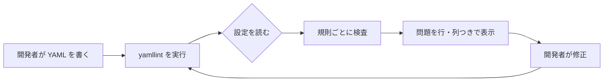
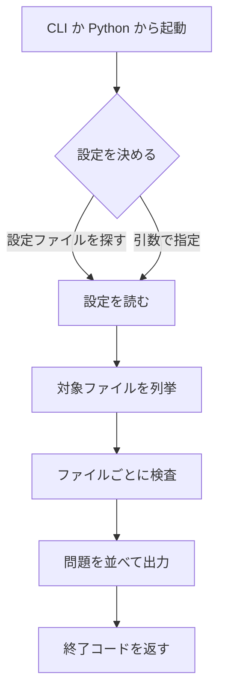

# 要件定義書（yamllint・逆引き）

既存の yamllint（Python パッケージ `yamllint/`）のコードから逆引きして書き起こした要件定義書。コードの現状を記録する。

---

## 1. 目的・前提

### 目的

YAML ファイルの書式（インデント、空白、空行、コメント、値の表記、キーの重複と順序など）を規則ごとに検査し、規則違反を行と列の位置つきで報告する。開発者が手元で実行する CLI と、他のツールから呼び出す Python ライブラリの両方で使える。

### 用語集

| 用語 | 業務上の意味 | 本案件での使用範囲 | 同義語/類義語 |
|---|---|---|---|
| 規則（rule） | 1 つの書式のチェック。`indentation` や `line-length` など | 検査の単位 | ルール |
| 設定（config） | 有効にする規則と、規則ごとの値を書いた YAML。`yamllint` の設定ファイル | 検査の動作を決める | 設定ファイル |
| 問題（problem） | 規則違反または構文エラーの 1 件。行・列・説明・規則名を持つ | 検査結果の単位 | 指摘、違反 |
| 構文エラー | YAML として読めない記述。規則違反とは別に報告する | 検査結果に含める | syntax error |
| ディレクティブ | コメント `# yamllint disable` などで、検査の一部を無効にする指定 | 検査範囲の制御 | 無効化コメント |
| トークン | YAML パーサーが切り出す最小の字句（キー、値、区切りなど） | 規則の検査対象 | token |
| 行（line） | 元のテキストの 1 行 | 行単位の規則の検査対象 | line |

### システムの形態

- CUI: コマンド `yamllint`（`yamllint.cli:run`）
- ライブラリ: `yamllint.linter.run` と `yamllint.config.YamlLintConfig` を他のプログラムから呼ぶ公開 API

GUI、Web API、バッチ、帳票は無い。

---

### 1-1. 技術制約（前提として記録する。要件ではないため ID は付与しない）

| 制約項目 | 内容 | 出どころ（誰がいつ答えたか） |
|---|---|---|
| 既存コードベース | Python パッケージ。`pyproject.toml` で Python 3.8 以上、依存は PyYAML と pathspec | 既存コード（逆引き時点の pyproject.toml） |
| 配備先 | 開発者の PC と CI 上の Python 実行環境。コンテナやサーバーの配備は無い | 既存のコードと配布形態（PyPI パッケージ） |
| チームの技術 | Python。既存の依存（PyYAML、pathspec）以外の新規依存は足さない | ANSWERS.md（計測 2 の固定回答） |
| ライセンスとコスト | GPL-3.0-or-later。有償部品は無い | pyproject.toml |
| 性能と規模の目安 | 性能の目標値は無い。1 ファイルを対象に動く | 既存コードに目標値の記述が無い |

---

## 2. 業務

### 対象業務一覧

| RQ-BZ-ID | 業務名 | 業務の範囲 | 担当者 |
|---|---|---|---|
| `RQ-BZ-YAML-LINT` | YAML 書式検査 | 設定ファイル・構成ファイルなどの YAML の書式を、規則に照らして検査し、違反を開発者に知らせる | 開発者、CI の保守担当 |

### 業務フロー

### 2-1. 業務の問題（あるべき姿と現状のギャップ）

| 問題 | 対象業務（RQ-BZ） | あるべき姿 | 現状 | ギャップ（KPI） | 業務影響 |
|---|---|---|---|---|---|
| YAML の書式がファイルごとにばらつき、読みにくい・設定の誤りに気づけない | YAML 書式検査 | 規定の書式に全ファイルが従っている | 既存システムのため、導入時の数値を聞き取れなかった | 不明（既存システムのため、導入時の数値を聞き取れなかった） | 不明（既存システムのため、導入時の数値を聞き取れなかった） |

### 2-2. 業務課題一覧（必須）

| RQ-BK-ID | 業務課題（取り組むこと） | 解決する問題（2-1） | 解決後の状態（KPI の目標値） | 対象業務（RQ-BZ） |
|---|---|---|---|---|
| `RQ-BK-ENFORCE-STYLE-RULES` | YAML の書式を規則ごとに機械的に検査する | ファイルごとの書式のばらつき | 規則で定めた書式違反が検査で全件報告される（現状の機能を維持する） | `RQ-BZ-YAML-LINT` |
| `RQ-BK-CONFIGURABLE-RULESET` | 規則の有効・無効と規則ごとの値を設定ファイルで決められるようにする | プロジェクトごとに異なる書式の方針 | 設定ファイルの内容どおりに検査が動く（現状の機能を維持する） | `RQ-BZ-YAML-LINT` |
| `RQ-BK-INDENTATION-CONSISTENCY` | インデント（字下げ）の幅と構造を一貫させる | 入れ子構造のずれ、過不足のインデント | インデントの違反が行と列つきで報告される（現状の機能を維持する） | `RQ-BZ-YAML-LINT` |
| `RQ-BK-SUPPORT-DIRECTIVES` | 例外的な箇所だけ、コメントで検査を無効にできるようにする | 規則を全体で無効にすると他の検査も失われる | ディレクティブの範囲だけ検査が止まる（現状の機能を維持する） | `RQ-BZ-YAML-LINT` |
| `RQ-BK-REPORT-PROBLEMS-CI` | 検出結果を開発者の端末と CI のログに、機械でも人でも読める形で出す | 結果の読み取りと、CI での合否判定 | 出力形式ごとに問題が出力され、終了コードで合否が分かる（現状の機能を維持する） | `RQ-BZ-YAML-LINT` |

- すべての機能を業務課題に結びつけた。どの業務課題にも機能が 1 つ以上ある。

### 2-3. 見込み経営効果

見込み経営効果は算定しない（既存システムの逆引きのため、導入時の効果の見積もりを聞き取れなかった）。

---

## 3. 機能要件

### 入力データと出力データ

- 入力: YAML の文字列または入力ストリーム、検査対象のファイル（CLI）、設定（YAML 形式。ファイルまたは文字列）
- 出力: 問題の一覧（行、列、説明、規則名、重大度）。CLI では標準出力に表示し、終了コードで結果を返す

### 利用フロー

### 形態ごとの仕様

| RQ-ID | 形態 | 名前と仕様 | 対応業務課題ID（RQ-BK-*） |
|---|---|---|---|
| `RQ-UI-CLI-COMMAND` | CUI | コマンド `yamllint`。引数は検査するファイルまたはディレクトリ（位置引数）、または `-` で標準入力。`-c` で設定ファイル、`-d` で設定の文字列（両方は同時に指定できない）、`--list-files` で対象ファイルの一覧だけを表示、`-f` で出力形式（parsable、standard、colored、github、auto）、`-s` で警告も失敗扱い、`--no-warnings` で警告を出さない、`-v` で版の表示。終了コードは、エラーがあれば 1、警告だけで `-s` 指定があれば 2、それ以外は 0。設定の読み込みに失敗したら標準エラーに出して終了コード 255 で終わる | `RQ-BK-REPORT-PROBLEMS-CI` |
| `RQ-UI-LIBRARY-API` | ライブラリ | `yamllint.linter.run(入力, 設定, ファイルパス)` が問題の生成器を返す。`yamllint.config.YamlLintConfig` が設定を読む | `RQ-BK-ENFORCE-STYLE-RULES` |

### 機能一覧

| RQ-ID | カテゴリ | 機能名 | 対応業務課題ID（RQ-BK-*） | この機能が無いと何が困るか |
|---|---|---|---|---|
| `RQ-FT-LINT-YAML-BUFFER` | 機能 | 文字列・ストリームの YAML を有効な規則で検査し、問題を行の順に返す | `RQ-BK-ENFORCE-STYLE-RULES` | 規則違反を 1 件も見つけられない |
| `RQ-FT-REPORT-SYNTAX-ERROR` | 機能 | YAML の構文エラーを検出し、規則違反と同じ形式で報告する | `RQ-BK-ENFORCE-STYLE-RULES` | 読めない YAML が黙って通る |
| `RQ-FT-DIRECTIVE-DISABLE` | 機能 | コメントのディレクティブで、ファイル全体・範囲・行ごとに規則を無効化・再有効化する | `RQ-BK-SUPPORT-DIRECTIVES` | 例外の箇所だけ検査を外せず、規則を丸ごと外すしかなくなる |
| `RQ-FT-CONFIG-LOAD` | 機能 | 設定の読み込み、規則値の検証、拡張（組み込み設定の継承）、無視パターン、対象ファイルの判定を行う | `RQ-BK-CONFIGURABLE-RULESET` | プロジェクトごとの書式方針を設定できない |
| `RQ-FT-CLI-LINT-FILES` | 機能 | CLI で指定したファイルとディレクトリを列挙して検査し、設定ファイルを探す | `RQ-BK-REPORT-PROBLEMS-CI` | 端末や CI から検査を起動できない |
| `RQ-FT-CLI-OUTPUT-FORMAT` | 機能 | 出力形式（standard、色つき、parsable、github）で問題を表示し、終了コードを決める | `RQ-BK-REPORT-PROBLEMS-CI` | CI や editor が結果を読めない |
| `RQ-FT-PARSE-TOKENS` | 機能 | YAML のトークン、コメント、行を位置順に取り出す | `RQ-BK-ENFORCE-STYLE-RULES` | 規則が検査対象を取り出せない |
| `RQ-FT-RULE-INDENTATION` | 機能 | インデントの幅（spaces）、シーケンスのインデント（indent-sequences）、複数行文字列（check-multi-line-strings）を検査する | `RQ-BK-INDENTATION-CONSISTENCY` | インデントの過不足を見つけられない |
| `RQ-FT-RULE-LINE-LAYOUT` | 機能 | 行の長さ、行末の空白、改行の種類、ファイル末尾の改行を検査する | `RQ-BK-ENFORCE-STYLE-RULES` | 行の見た目の揺れを検出できない |
| `RQ-FT-RULE-EMPTY-LINES` | 機能 | 連続する空行の数を検査する | `RQ-BK-ENFORCE-STYLE-RULES` | 空行の乱れを検出できない |
| `RQ-FT-RULE-SPACING` | 機能 | コロン、カンマ、ハイフン、波括弧・角括弧の前後の空白と、空の値を検査する | `RQ-BK-ENFORCE-STYLE-RULES` | 記号の周りの空白の揺れを検出できない |
| `RQ-FT-RULE-DOCUMENT-MARKERS` | 機能 | ドキュメント開始記号（`---`）と終了記号（`...`）の有無を検査する | `RQ-BK-ENFORCE-STYLE-RULES` | 文書の区切りの書き方が揃わない |
| `RQ-FT-RULE-COMMENTS` | 機能 | コメントの先頭空白と、コメントのインデントを検査する | `RQ-BK-ENFORCE-STYLE-RULES` | コメントの書式が揃わない |
| `RQ-FT-RULE-VALUES` | 機能 | 真偽値（truthy）、浮動小数点、8 進数、引用符の表記を検査する | `RQ-BK-ENFORCE-STYLE-RULES` | 値の表記が揃わず、YAML の型の解釈の違いを見逃す |
| `RQ-FT-RULE-KEYS` | 機能 | キーの重複、キーの順序、アンカーとエイリアスの宣言を検査する | `RQ-BK-ENFORCE-STYLE-RULES` | 同じキーの二重定義や未宣言のエイリアスを見逃す |

### 3-1. 帳票・出力ファイル

| RQ-ID | 帳票・出力名 | 形式（PDF / CSV / 標準出力など） | 出力項目 | 出力のきっかけ | 対応業務課題ID（RQ-BK-*） |
|---|---|---|---|---|---|
| `RQ-UI-PROBLEM-OUTPUT` | 問題の出力 | 標準出力（standard、standard-colored、parsable、github の 4 形式） | ファイル名、行、列、説明、規則名（形式により異なる） | 検査の後、問題が 1 件以上あるとき | `RQ-BK-REPORT-PROBLEMS-CI` |

### 3-2. 業務ルール

| RQ-ID | ルール名 | 内容（条件と結果） | 違反時・エラー時の業務上の扱い | 対応業務課題ID（RQ-BK-*） |
|---|---|---|---|---|
| `RQ-FT-CONFIG-VALIDATION` | 規則値の検証 | 規則ごとの値は、規則の定義（型・選択肢）に合うこと。合わない場合は設定エラーにする | 設定エラーとして利用者に理由を示し、検査を止める | `RQ-BK-CONFIGURABLE-RULESET` |

- 業務ルールは 1 件だけ。他の規則は、機能一覧の各規則の機能要件に書いた。

### 3-3. 外部連携

外部連携は無い。

---

## 4. データ

### 4-1. データ要件一覧

| RQ-ID | 種別 | 内容 | 対応業務課題ID（RQ-BK-*） | この要件が無いと何が困るか |
|---|---|---|---|---|
| `RQ-DT-RULE-CONFIG` | 内部データ | 設定は YAML 形式のファイル（既定の探索対象は設定ファイル。組み込みの 2 種類を拡張元に使える）として読む。保存しない。保持期間は無い（実行ごとに読み直す） | `RQ-BK-CONFIGURABLE-RULESET` | 規則の方針を変えられない |
| `RQ-DT-LINT-PROBLEM` | 内部データ | 検査結果の問題は、実行中にメモリ上に保持し、出力後に破棄する。永続化しない | `RQ-BK-REPORT-PROBLEMS-CI` | 結果を出力できない |

- DB は必要ない（永続データが無いため）。初期件数や増加率は該当しない。

### 4-2. 業務エンティティとデータ項目

| RQ-ID | カテゴリ | 業務エンティティ名 | 対応業務課題ID（RQ-BK-*） | この業務エンティティが無いと何が困るか |
|---|---|---|---|---|
| `RQ-DT-RULE-CONFIG` | データ | 規則設定（有効な規則と規則ごとの値、無視するパス、拡張元） | `RQ-BK-CONFIGURABLE-RULESET` | 規則の方針を変えられない |
| `RQ-DT-LINT-PROBLEM` | データ | 検査の問題（行、列、説明、規則名、重大度） | `RQ-BK-REPORT-PROBLEMS-CI` | 結果を表せない |

| エンティティ名 | 項目名 | 業務上の意味 | 必須 | 形式・桁 | 値の範囲・制約 | 例 |
|---|---|---|---|---|---|---|
| 規則設定 | rules | 規則 ID ごとの設定。値を書かなければ既定値 | 任意 | マッピング | 既知の規則 ID のみ。値の型は規則の定義に従う | `indentation: {spaces: 2}` |
| 規則設定 | ignore | 無視するパスのパターン | 任意 | 文字列または文字列の一覧 | gitignore 形式 | `build/` |
| 規則設定 | extends | 拡張元の組み込み設定名 | 任意 | 文字列 | `default` または `relaxed`、または設定ファイルのパス | `default` |
| 規則設定 | yaml-files | 検査対象とみなすファイルのパターン | 任意 | 文字列の一覧 | gitignore 形式 | `*.yaml` |
| 検査の問題 | line / column | 問題の位置（1 始まり） | 必須 | 整数 | 1 以上 | `3` |
| 検査の問題 | rule | 問題を検出した規則 ID | 任意 | 文字列 | 既知の規則 ID。構文エラーは空 | `indentation` |
| 検査の問題 | level | 重大度（warning または error） | 必須 | 文字列 | `warning` または `error` | `error` |

### 4-3. CRUD テーブル（必須）

| エンティティ名 | Create | Read（一覧） | Read（詳細） | 検索 | Update | Delete | 備考 |
|---|---|---|---|---|---|---|---|
| 規則設定 | × | ○ | ○ | × | × | × | 設定ファイルから読む。書き込みはしない。並行の書き換えは扱わない |
| 検査の問題 | ○ | ○ | ○ | × | × | × | 検査の実行で作り、出力で読む。永続化しない。トランザクションは無い |

### 4-4. 状態遷移

状態を持つエンティティは無い。

### 4-5. 画面一覧（GUI の場合のみ）

画面は無い。

---

## 5. 非機能要件

| RQ-ID | カテゴリ | 非機能要件名 | 対応業務課題ID（RQ-BK-*） | この非機能要件が無いと何が困るか |
|---|---|---|---|---|
| `RQ-NF-PYTHON-RUNTIME` | 移行性・実行環境 | Python 3.8 以上で動くこと（pyproject.toml の要件）。新規の依存（PyYAML と pathspec 以外）は足さない | `RQ-BK-ENFORCE-STYLE-RULES` | 利用者の環境で動かない |
| `RQ-NF-USER-ACCESS` | 利用者・アクセス経路 | 利用者は開発者と CI（一般公開の OSS パッケージ）。ローカルのファイルだけを読み、ネットワーク通信は行わない | `RQ-BK-REPORT-PROBLEMS-CI` | 利用者の範囲と、外部に出す情報の有無が分からない |

- 性能（応答時間の目標値）: 目標値は無い。
- 利用人数（同時接続数）: 該当しない（単独の実行形態）。
- 可用性: 可用性の要求は無い。
- 移行性: 移行は無い。
- セキュリティ（認証・権限・監査）: 認証、認可、監査証跡は無い。

---

## 6. 運用要件

- ログ: ログは必要ないため、ログの内容と保存期間の記述は行わない。
- 監査ログ: 監査ログは無い。
- 監視・アラート: 監視・アラートは必要ないため、監視・アラートの内容と対応方法の記述は行わない。
- バックアップと復旧: バックアップは必要ない（永続データが無いため）。
- 導入: 配布パッケージを Python の環境に入れて使う。

| RQ-ID | 種別 | 内容 | 対応業務課題ID（RQ-BK-*） | この要件が無いと何が困るか |
|---|---|---|---|---|
| `RQ-OP-PACKAGE-INSTALL` | 導入 | Python パッケージとして入れ、`yamllint` コマンドと `yamllint` パッケージを使えるようにする（pip で入れる） | `RQ-BK-ENFORCE-STYLE-RULES` | 利用者が使い始められない |
| `RQ-OP-CONFIG-LOOKUP` | 設定 | CLI は、`-c` と `-d` が無ければ次の順で設定を決める。(1) カレントディレクトリから親へ、`.yamllint`・`.yamllint.yaml`・`.yamllint.yml` を探す。(2) 環境変数 `YAMLLINT_CONFIG_FILE` の示すファイル、無ければ `XDG_CONFIG_HOME` の下の `yamllint/config`、無ければ `~/.config/yamllint/config`。(3) どれも無ければ組み込みの `default` 設定 | `RQ-BK-CONFIGURABLE-RULESET` | 設定ファイルを毎回指定することになる |

---

## 7. テスト用利用シナリオ

| RQ-ID | テスト目的 | 前提条件 | テスト手順 | 期待される結果 | 検証する要件ID | 対応業務課題ID（RQ-BK-*） |
|---|---|---|---|---|---|---|
| `RQ-TS-LINT-BUFFER-PROBLEMS` | ライブラリから文字列を検査し、問題が行・列順に返ること | 既定の設定で読み込んだ設定オブジェクトがある | 不正な書式の YAML 文字列を `linter.run` に渡し、返った問題を並べる | 規則違反が行・列つきで、行の順に返る | `RQ-FT-LINT-YAML-BUFFER`, `RQ-UI-LIBRARY-API` | `RQ-BK-ENFORCE-STYLE-RULES` |
| `RQ-TS-REPORT-SYNTAX-ERRORS` | 構文エラーが問題として報告されること | 読めない YAML の文字列 | 構文の壊れた文字列を検査する | 構文エラーが `syntax` の説明つきで 1 件報告される | `RQ-FT-REPORT-SYNTAX-ERROR` | `RQ-BK-ENFORCE-STYLE-RULES` |
| `RQ-TS-DIRECTIVES-DISABLE-RULES` | コメントのディレクティブで検査が止まり、再開すること | 規則違反を含む YAML | `disable`、`enable`、`disable-line`、`disable-file` のコメントを入れて検査する | ディレクティブの範囲の問題だけが消える | `RQ-FT-DIRECTIVE-DISABLE` | `RQ-BK-SUPPORT-DIRECTIVES` |
| `RQ-TS-LOAD-CONFIG` | 設定の読み込み、検証、拡張、無視パターンが動くこと | 設定の文字列、無効な規則値の設定 | 有効な設定を読み、規則値の誤りを読ませ、拡張と無視パターンを確かめる | 有効な設定は規則に反映され、誤った値は設定エラーになる | `RQ-FT-CONFIG-LOAD`, `RQ-FT-CONFIG-VALIDATION` | `RQ-BK-CONFIGURABLE-RULESET` |
| `RQ-TS-CLI-RUN-AND-EXIT` | CLI がファイルを検査し、出力形式と終了コードを返すこと | 違反を含むファイルと、違反の無いファイル | `yamllint` を各出力形式で実行する | 形式どおりに表示され、違反があれば終了コードが 1 になる | `RQ-FT-CLI-LINT-FILES`, `RQ-FT-CLI-OUTPUT-FORMAT`, `RQ-UI-CLI-COMMAND`, `RQ-UI-PROBLEM-OUTPUT` | `RQ-BK-REPORT-PROBLEMS-CI` |
| `RQ-TS-PARSE-TOKENS-AND-COMMENTS` | トークン、コメント、行が位置順に取り出されること | 複数行とコメントを含む YAML | パーサーの行・トークン・コメントの取り出しを呼ぶ | 位置の順に、欠けずに取り出される | `RQ-FT-PARSE-TOKENS` | `RQ-BK-ENFORCE-STYLE-RULES` |
| `RQ-TS-CHECK-INDENTATION` | インデントの違反が行と列つきで報告されること | `spaces` を指定した設定と、字下げの違う YAML | インデント規則を有効にして検査する | 期待と違うインデントが報告され、正しい書式では報告されない | `RQ-FT-RULE-INDENTATION` | `RQ-BK-INDENTATION-CONSISTENCY` |
| `RQ-TS-CHECK-LINE-LAYOUT` | 行の長さ、行末の空白、改行、空行の規則が違反を報告すること | 長い行、行末の空白、CRLF、連続する空行を含む YAML | 各規則を有効にして検査する | 各規則の違反だけが報告される | `RQ-FT-RULE-LINE-LAYOUT`, `RQ-FT-RULE-EMPTY-LINES` | `RQ-BK-ENFORCE-STYLE-RULES` |
| `RQ-TS-CHECK-SPACING` | 記号の周りの空白と空の値の規則が違反を報告すること | 記号の周りの空白が揃っていない YAML | 各規則を有効にして検査する | 違反の位置だけが報告される | `RQ-FT-RULE-SPACING` | `RQ-BK-ENFORCE-STYLE-RULES` |
| `RQ-TS-CHECK-DOCUMENT-MARKERS` | ドキュメント開始記号と終了記号の規則が違反を報告すること | 記号の有無が異なる YAML | 各規則を有効にして検査する | 要求と違う記号の有無が報告される | `RQ-FT-RULE-DOCUMENT-MARKERS` | `RQ-BK-ENFORCE-STYLE-RULES` |
| `RQ-TS-CHECK-COMMENTS` | コメントの規則が違反を報告すること | 先頭空白の無いコメント、不揃いなコメントのインデント | コメント規則を有効にして検査する | 違反が報告される | `RQ-FT-RULE-COMMENTS` | `RQ-BK-ENFORCE-STYLE-RULES` |
| `RQ-TS-CHECK-VALUES` | 値の表記の規則が違反を報告すること | 真偽値、浮動小数点、8 進数、引用符の表記が混在する YAML | 各規則を有効にして検査する | 規則に反する表記だけが報告される | `RQ-FT-RULE-VALUES` | `RQ-BK-ENFORCE-STYLE-RULES` |
| `RQ-TS-CHECK-KEYS` | キーの重複、順序、アンカーの規則が違反を報告すること | 重複キー、順序の乱れ、未宣言のエイリアス | 各規則を有効にして検査する | 違反が報告される | `RQ-FT-RULE-KEYS` | `RQ-BK-ENFORCE-STYLE-RULES` |

- すべての機能要件・出力要件（`RQ-FT-*`・`RQ-UI-*`）は、いずれかのシナリオの「検証する要件ID」に現れる。
- 業務ルールの違反（`RQ-FT-CONFIG-VALIDATION`）を確かめるシナリオを含む。
- 権限制御・状態遷移・同時更新・監査ログは無いため、それらのシナリオは無い。

---

## 9. 除外要件

除外要件は無い。
