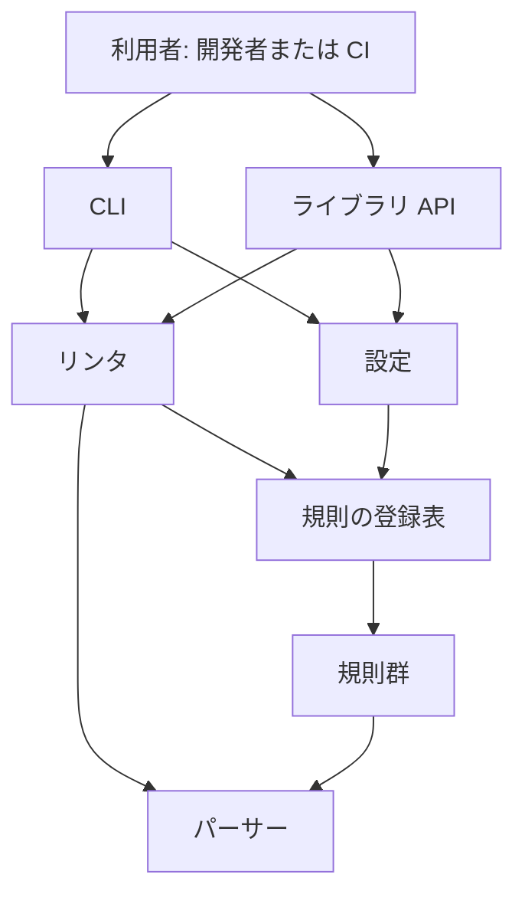
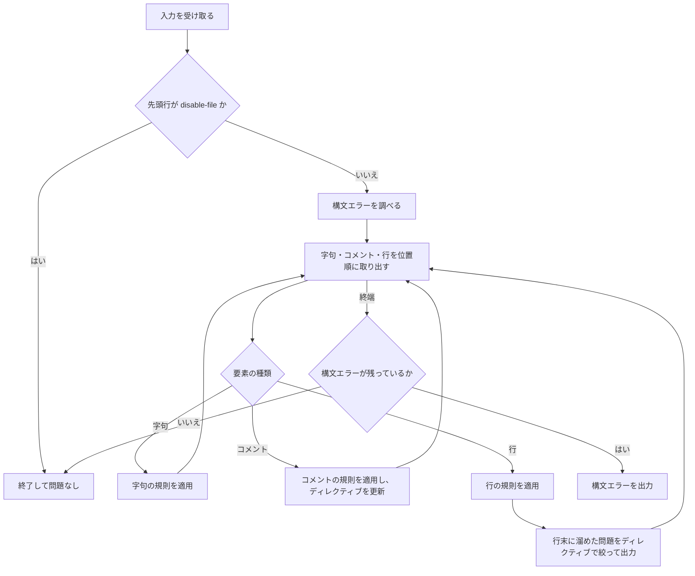
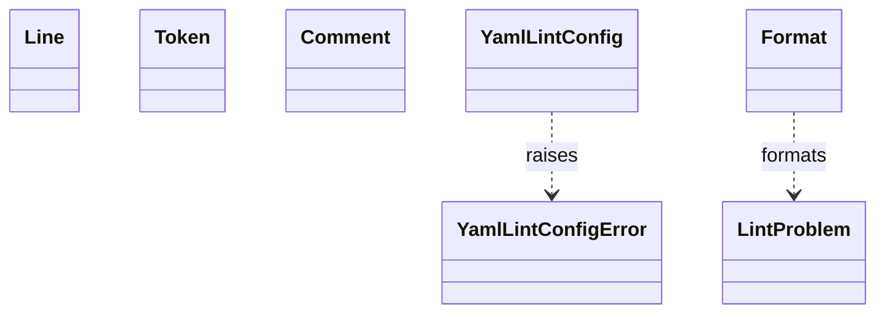

# 詳細設計書（yamllint・逆引き）

既存の yamllint（Python パッケージ `yamllint/`）の現状を記録した詳細設計書。要件定義書（`docs/requirements.md`）の要件を受ける。設計 ID とコードの対応は `docs/trace_map.md` に書き、要件との対応は第 11 章に書く。

---

## 1. 言語・フレームワーク・アーキテクチャの選定

### 選定の記録

- 判定日時: 逆引き時点（2026-11-04）
- 技術制約の要約: 既存コードベースの Python パッケージ。Python 3.8 以上。依存は PyYAML と pathspec。配備先は開発者の PC と CI。GPL-3.0-or-later（要件定義書 1-1）
- 判断軸: 既存資産との整合が最優先の判断軸。既存コードの技術をそのまま採る。インターネット調査による選び直しは行わない（既存資産の変更は、業務上の必須理由が無い限り行わない）
- 候補の比較: 候補は既存の技術のみ。比較表は省く（選定の対象が既存の技術に固定されているため）
- 最終選定結果: 言語 Python 3.8 以上、外部依存 PyYAML（YAML の字句解析）と pathspec（無視パターンの照合）、標準ライブラリの argparse と re、実行形態はライブラリ（CLI の console script `yamllint` を含む）、DB は使わない
- ユーザー承認の記録: 逆引きの承認は ANSWERS.md により与えられたものとして扱う（承認日 2026-11-04）

### 2-1 フロントエンドとバックエンド

分けない構成のため、該当しない。

---

## 2. システム構成

### コンポーネント一覧

| コンポーネント | 役割 | 主な設計要素 |
|---|---|---|
| CLI | 引数の解析、設定の決定、ファイルの列挙、問題の表示、終了コード | `yamllint/cli.py`、`yamllint/__main__.py` |
| 設定 | 設定の読み込み、解析、検証、拡張、無視パターン | `yamllint/config.py` |
| リンタ | 字句・コメント・行に規則を適用し、ディレクティブを処理し、構文エラーを報告する | `yamllint/linter.py` |
| パーサー | PyYAML の字句から、コメントと行を含む字句の列を作る | `yamllint/parser.py` |
| 規則群 | 規則ごとの検査。規則の登録表で ID から引く | `yamllint/rules/` |

### システム全体構成図

### コンポーネント間インターフェースとデータフロー

ファイルの内容（文字列）が、パーサー、リンタ、規則群へ順に渡り、問題（LintProblem）の列になって CLI かライブラリの利用者へ戻る。外部システムとの通信は無い。

### ネットワーク構成図

ネットワーク越しの通信が無いため、ネットワーク構成図は書かない。

---

## 3. データ設計

### 3-1. データモデル

DB は必須ではないため、DB 設計は行わない。永続化するデータは無い。扱うデータは次のとおり。

| DS-ID | 名前 | 扱うデータ | 形式・構造 | 要件の項目との対応 |
|---|---|---|---|---|
| DS-SC-RULE-CONFIG | 規則設定 | 有効な規則、規則ごとの値、無視パターン、対象ファイルのパターン、拡張元 | YAML 形式の設定ファイルまたは文字列を読んで作る。保存しない | 要件定義書 4-2 の規則設定の項目（rules、ignore、extends、yaml-files） |
| DS-SC-LINT-PROBLEM | 検査の問題 | 行、列、説明、規則名、重大度 | メモリ上のオブジェクト。出力後に破棄する | 要件定義書 4-2 の検査の問題の項目（line、column、rule、level） |

### 3-2. トランザクションと排他制御

トランザクション・排他制御が要る操作は無い（永続化が無いため）。

### 3-3. 状態遷移

状態を持つエンティティは無い。許されない遷移の扱いも無い。

---

## 4. アーキテクチャ設計

### 4-1. 外部設計

利用者向けインターフェースは 3 種類。

| DS-ID | インターフェース | 入力 | バリデーション | 出力 | エラー仕様 |
|---|---|---|---|---|---|
| DS-IF-CLI-COMMAND | コマンド `yamllint` | 位置引数のファイルまたはディレクトリ、`-` の標準入力、`-c`、`-d`、`--list-files`、`-f`、`-s`、`--no-warnings`、`-v` | 位置引数と `-` は同時に使えない。`-c` と `-d` は同時に使えない。`-f` は選択肢から選ぶ（引数解析の規則） | 問題を標準出力に表示する。終了コード 0、1、2 | 設定の誤りは標準エラーに出し終了コード 255。ファイルの読み込み失敗は標準エラーに出し終了コード 255 |
| DS-IF-PROBLEM-OUTPUT | 問題の出力形式 | 問題の列、ファイル名、形式、警告を出すか | 形式は parsable、standard、colored、github、auto のいずれか。auto は実行環境に合わせて standard か github を選ぶ | 1 問題につき 1 行。形式ごとの書式は `Format` の各メソッドによる | 出力の失敗は扱わない（標準出力への書き込みに任せる） |
| DS-IF-LIBRARY-API | ライブラリの公開入口 `linter.run` | 文字列、バイト列（UTF-8）、またはテキストストリーム、設定オブジェクト、ファイルパス（任意） | 文字列・バイト列・ストリーム以外は型エラー。ファイルパスが無視パターンに一致すれば空の結果 | 問題の生成器 | 設定の誤りは設定の読み込み時に設定エラー |

外部システム連携は無い。

### 4-2. 内部設計

処理フロー。

- 処理の役割: 字句・コメント・行の取り出しはパーサー、規則の適用と問題の絞り込みはリンタ、規則ごとの判定は規則群。
- バッチ設計: バッチは無い。

### 4-3. 字句の列とインデント規則の入口（変更で追加）

字句の列の作り方。PyYAML の字句解析器を入力のバッファから作り、字句を 1 つずつ取り出す。各字句について、その前の字句、次の字句、次の次の字句を一緒に渡す。字句と字句の間のコメントは、既存の字句間コメントの取り出しで得て、字句の直後に位置の順で渡す。字句解析が構文の誤りで止まったら、それ以降の字句は渡さず、構文エラーは別に報告する（リンタが構文エラーとして扱う）。

インデント規則の入口は、字句ごとに既存の内部の検査関数を呼び、違反の問題を生成器として返す。規則の状態は、呼び出し元の文脈に持つ。

---

## 5. クラス設計

各クラスの責務を 1 文で書く。

| DS-ID | 修飾名 | 責務（1 文） |
|---|---|---|
| `DS-CL-CLI-FORMAT` | `yamllint/cli.py::Format` | 問題の表示形式を並べたクラス（静的メソッドの集まり） |
| `DS-CL-CONFIG-YAML-LINT-CONFIG` | `yamllint/config.py::YamlLintConfig` | 規則設定（有効な規則、規則ごとの値、無視パターン、対象ファイルのパターン）を保持し、解析・検証する |
| `DS-CL-CONFIG-YAML-LINT-CONFIG-ERROR` | `yamllint/config.py::YamlLintConfigError` | 設定の誤りを表す例外 |
| `DS-CL-LINTER-LINT-PROBLEM` | `yamllint/linter.py::LintProblem` | 問題 1 件（行、列、説明、規則名、重大度）を表す |
| `DS-CL-PARSER-COMMENT` | `yamllint/parser.py::Comment` | コメント 1 件（行、列、位置、前後の字句）を表す |
| `DS-CL-PARSER-LINE` | `yamllint/parser.py::Line` | 元テキストの 1 行（行番号、開始位置、終了位置）を表す |
| `DS-CL-PARSER-TOKEN` | `yamllint/parser.py::Token` | 字句 1 つと、その前後の字句（前、次、次の次）を保持する |
| `DS-CL-RULE-INDENTATION-PARENT` | `yamllint/rules/indentation.py::Parent` | インデントの親（ブロックやフローの構造）の種類と期待するインデントを保持する |
| `DS-CL-RULE-KEY-DUPLICATES-PARENT` | `yamllint/rules/key_duplicates.py::Parent` | マッピングの親を表し、そのマッピングで現れたキーを保持する |
| `DS-CL-RULE-KEY-ORDERING-PARENT` | `yamllint/rules/key_ordering.py::Parent` | マッピングの親を表し、キー順の検査に必要な状態を保持する |

### クラス間の関係

システム内メッセージは、リンタが規則の `check` を呼び、規則が問題の列を返す形のみ。

---

## 6. エラーハンドリングとセキュリティ設計

### エラーハンドリング

| 想定エラー | 扱い（利用者への見え方） | ログ | 続行か中止か |
|---|---|---|---|
| 設定の誤り（構文、未知の規則、値の型・組み合わせの誤り） | 設定エラーの説明を標準エラーに出す | 無し | 中止（終了コード 255） |
| 入力ファイルを開けない | OS のエラーを標準エラーに出す | 無し | 中止（終了コード 255） |
| YAML の構文エラー | 問題 1 件（重大度 error）として出力する | 無し | 続行（他の問題も出す） |
| 規則の ID が無い | 値の誤りとして `ValueError` | 無し | 呼び出し元へ例外 |
| 規則違反 | 問題として出力し、重大度に応じて終了コード 1 か 2（`-s` 時）| 無し | 続行 |

### 認証

認証は無い。

### 認可

認可は無い。

### 監査ログ

監査ログは無い（要件定義書 6 に監査ログの要件が無いため）。

### その他のセキュリティ対策

ネットワーク通信をせず、ローカルのファイルと設定だけを読む（要件定義書 `RQ-NF-USER-ACCESS` に対応する設計）。

---

## 7. コード設計

### 7-1. ディレクトリ構成とファイル

- `yamllint/`（パッケージ本体）
  - `yamllint/rules/`（規則群と登録表、共通の補助）
  - `yamllint/conf/`（組み込みの設定 `default.yaml`、`relaxed.yaml`。コードではないため DS-MD を付けない）
- `tests/`（既存の単体テスト。isdd の E2E ではない）
- `e2e/`（E2E テスト。第 8 章）

| ファイル | 役割 | DS-ID（モジュール） | 実現する設計 ID |
|---|---|---|---|
| ファイル | 役割 | DS-ID（モジュール） | 実現する設計 ID |
|---|---|---|---|
| `yamllint/__init__.py` | パッケージの名前、版、説明の定数を定義する | `DS-MD-PACKAGE-INIT` | （なし） |
| `yamllint/__main__.py` | python -m yamllint で CLI を起動する | `DS-MD-MAIN` | （なし） |
| `yamllint/cli.py` | CLI。引数の解析、設定の決定、ファイルの列挙、問題の表示、終了コード | `DS-MD-CLI` | `DS-CL-CLI-FORMAT`, `DS-IF-CLI-COMMAND`, `DS-IF-PROBLEM-OUTPUT`, `DS-FN-CLI-FORMAT-GITHUB`, `DS-FN-CLI-FORMAT-PARSABLE`, `DS-FN-CLI-FORMAT-STANDARD`, `DS-FN-CLI-FORMAT-STANDARD-COLOR`, `DS-FN-CLI-FIND-FILES-RECURSIVELY`, `DS-FN-CLI-FIND-PROJECT-CONFIG-FILEPATH`, `DS-FN-CLI-RUN`, `DS-FN-CLI-SHOW-PROBLEMS`, `DS-FN-CLI-SUPPORTS-COLOR` |
| `yamllint/config.py` | 設定の読み込み、解析、検証、拡張、無視パターン、組み込み設定の場所 | `DS-MD-CONFIG` | `DS-CL-CONFIG-YAML-LINT-CONFIG`, `DS-CL-CONFIG-YAML-LINT-CONFIG-ERROR`, `DS-FN-CONFIG-YAML-LINT-CONFIG-ENABLED-RULES`, `DS-FN-CONFIG-YAML-LINT-CONFIG-EXTEND`, `DS-FN-CONFIG-YAML-LINT-CONFIG-IS-FILE-IGNORED`, `DS-FN-CONFIG-YAML-LINT-CONFIG-IS-YAML-FILE`, `DS-FN-CONFIG-YAML-LINT-CONFIG-PARSE`, `DS-FN-CONFIG-YAML-LINT-CONFIG-VALIDATE`, `DS-FN-CONFIG-GET-EXTENDED-CONFIG-FILE`, `DS-FN-CONFIG-VALIDATE-RULE-CONF` |
| `yamllint/linter.py` | ライブラリの検査の中心。規則の適用、ディレクティブ、構文エラーの報告 | `DS-MD-LINTER` | `DS-CL-LINTER-LINT-PROBLEM`, `DS-IF-LIBRARY-API`, `DS-FN-LINTER-LINT-PROBLEM-MESSAGE`, `DS-FN-LINTER-GET-COSMETIC-PROBLEMS`, `DS-FN-LINTER-GET-SYNTAX-ERROR`, `DS-FN-LINTER-RUN` |
| `yamllint/parser.py` | PyYAML のトークンからコメントと行を含む字句の列を作る | `DS-MD-PARSER` | `DS-CL-PARSER-COMMENT`, `DS-CL-PARSER-LINE`, `DS-CL-PARSER-TOKEN`, `DS-FN-PARSER-COMMENT-IS-INLINE`, `DS-FN-PARSER-LINE-CONTENT`, `DS-FN-PARSER-COMMENTS-BETWEEN-TOKENS`, `DS-FN-PARSER-LINE-GENERATOR`, `DS-FN-PARSER-TOKEN-OR-COMMENT-OR-LINE-GENERATOR`, `DS-FN-PARSER-TOKEN-OR-COMMENT-GENERATOR` |
| `yamllint/rules/__init__.py` | 規則 ID から規則モジュールを引く登録表 | `DS-MD-RULES-REGISTRY` | `DS-FN-RULES-REGISTRY-GET` |
| `yamllint/rules/anchors.py` | 規則の定義 | `DS-MD-RULE-ANCHORS` | `DS-FN-RULE-ANCHORS-CHECK` |
| `yamllint/rules/braces.py` | 規則の定義 | `DS-MD-RULE-BRACES` | `DS-FN-RULE-BRACES-CHECK` |
| `yamllint/rules/brackets.py` | 規則の定義 | `DS-MD-RULE-BRACKETS` | `DS-FN-RULE-BRACKETS-CHECK` |
| `yamllint/rules/colons.py` | 規則の定義 | `DS-MD-RULE-COLONS` | `DS-FN-RULE-COLONS-CHECK` |
| `yamllint/rules/commas.py` | 規則の定義 | `DS-MD-RULE-COMMAS` | `DS-FN-RULE-COMMAS-CHECK` |
| `yamllint/rules/comments.py` | 規則の定義 | `DS-MD-RULE-COMMENTS` | `DS-FN-RULE-COMMENTS-CHECK` |
| `yamllint/rules/comments_indentation.py` | 規則の定義 | `DS-MD-RULE-COMMENTS-INDENTATION` | `DS-FN-RULE-COMMENTS-INDENTATION-CHECK` |
| `yamllint/rules/common.py` | 規則が共通で使う空白・行・字句の補助関数 | `DS-MD-RULES-COMMON` | `DS-FN-RULES-COMMON-GET-LINE-INDENT`, `DS-FN-RULES-COMMON-GET-REAL-END-LINE`, `DS-FN-RULES-COMMON-IS-EXPLICIT-KEY`, `DS-FN-RULES-COMMON-SPACES-AFTER`, `DS-FN-RULES-COMMON-SPACES-BEFORE` |
| `yamllint/rules/document_end.py` | 規則の定義 | `DS-MD-RULE-DOCUMENT-END` | `DS-FN-RULE-DOCUMENT-END-CHECK` |
| `yamllint/rules/document_start.py` | 規則の定義 | `DS-MD-RULE-DOCUMENT-START` | `DS-FN-RULE-DOCUMENT-START-CHECK` |
| `yamllint/rules/empty_lines.py` | 規則の定義 | `DS-MD-RULE-EMPTY-LINES` | `DS-FN-RULE-EMPTY-LINES-CHECK` |
| `yamllint/rules/empty_values.py` | 規則の定義 | `DS-MD-RULE-EMPTY-VALUES` | `DS-FN-RULE-EMPTY-VALUES-CHECK` |
| `yamllint/rules/float_values.py` | 規則の定義 | `DS-MD-RULE-FLOAT-VALUES` | `DS-FN-RULE-FLOAT-VALUES-CHECK` |
| `yamllint/rules/hyphens.py` | 規則の定義 | `DS-MD-RULE-HYPHENS` | `DS-FN-RULE-HYPHENS-CHECK` |
| `yamllint/rules/indentation.py` | 規則の定義 | `DS-MD-RULE-INDENTATION` | `DS-CL-RULE-INDENTATION-PARENT`, `DS-FN-RULE-INDENTATION-CHECK-SCALAR-INDENTATION`, `DS-FN-RULE-INDENTATION-CHECK` |
| `yamllint/rules/key_duplicates.py` | 規則の定義 | `DS-MD-RULE-KEY-DUPLICATES` | `DS-CL-RULE-KEY-DUPLICATES-PARENT`, `DS-FN-RULE-KEY-DUPLICATES-CHECK` |
| `yamllint/rules/key_ordering.py` | 規則の定義 | `DS-MD-RULE-KEY-ORDERING` | `DS-CL-RULE-KEY-ORDERING-PARENT`, `DS-FN-RULE-KEY-ORDERING-CHECK` |
| `yamllint/rules/line_length.py` | 規則の定義 | `DS-MD-RULE-LINE-LENGTH` | `DS-FN-RULE-LINE-LENGTH-CHECK`, `DS-FN-RULE-LINE-LENGTH-CHECK-INLINE-MAPPING` |
| `yamllint/rules/new_line_at_end_of_file.py` | 規則の定義 | `DS-MD-RULE-NEW-LINE-AT-END-OF-FILE` | `DS-FN-RULE-NEW-LINE-AT-END-OF-FILE-CHECK` |
| `yamllint/rules/new_lines.py` | 規則の定義 | `DS-MD-RULE-NEW-LINES` | `DS-FN-RULE-NEW-LINES-CHECK` |
| `yamllint/rules/octal_values.py` | 規則の定義 | `DS-MD-RULE-OCTAL-VALUES` | `DS-FN-RULE-OCTAL-VALUES-CHECK` |
| `yamllint/rules/quoted_strings.py` | 規則の定義 | `DS-MD-RULE-QUOTED-STRINGS` | `DS-FN-RULE-QUOTED-STRINGS-VALIDATE`, `DS-FN-RULE-QUOTED-STRINGS-CHECK` |
| `yamllint/rules/trailing_spaces.py` | 規則の定義 | `DS-MD-RULE-TRAILING-SPACES` | `DS-FN-RULE-TRAILING-SPACES-CHECK` |
| `yamllint/rules/truthy.py` | 規則の定義 | `DS-MD-RULE-TRUTHY` | `DS-FN-RULE-TRUTHY-CHECK`, `DS-FN-RULE-TRUTHY-YAML-SPEC-VERSION-FOR-DOCUMENT` |

対応表の粒度: `function`（ファイル、クラス、公開関数、メソッドまで対応表に載せる）。既定の粒度を使う。

依存の規則: 無い（依存の規則は無い。規則群は登録表と共通の補助に依存し、共通の補助は問題の型に依存する。循環させないことは開発者の規律とする）。

コーディング規約: PEP 8 に従い、`.flake8` の設定（import の順序は pep8 形式）で検査する。

コードには要件 ID・設計 ID を書かない。設計 ID とコードの対応は `docs/trace_map.md` に記録する。

### 7-2. 公開関数とメソッドの設計

| 区分 | 内容 |
|---|---|
| 公開関数 | 下の表（DS-FN）。アンダースコア始まりの内部関数は設計に載せない |
| 規則の検査関数（`check`） | 各規則モジュールの `check` は、字句（`token`）・行（`line`）・コメント（`comment`）のいずれかの単位で呼ばれ、違反の問題を生成する |

| DS-ID | 修飾名 | 役割 |
|---|---|---|
| `DS-FN-CLI-FIND-FILES-RECURSIVELY` | `yamllint/cli.py::find_files_recursively` | 指定されたファイルとディレクトリから、YAML として検査し、無視されていないファイルを列挙する |
| `DS-FN-CLI-FIND-PROJECT-CONFIG-FILEPATH` | `yamllint/cli.py::find_project_config_filepath` | カレントディレクトリから親へ、既定名（.yamllint など）の設定ファイルを探す |
| `DS-FN-CLI-FORMAT-GITHUB` | `yamllint/cli.py::Format.github` | 問題を GitHub Actions のアノテーション形式の 1 行にする |
| `DS-FN-CLI-FORMAT-PARSABLE` | `yamllint/cli.py::Format.parsable` | 問題を「ファイル:行:列: [重大度] 説明」の 1 行の文字列にする |
| `DS-FN-CLI-FORMAT-STANDARD` | `yamllint/cli.py::Format.standard` | 問題を人が読む標準形式の 1 行にする（ファイル名を見出しとして付ける） |
| `DS-FN-CLI-FORMAT-STANDARD-COLOR` | `yamllint/cli.py::Format.standard_color` | 標準形式と同じ内容を、重大度ごとに色を付けて 1 行にする |
| `DS-FN-CLI-RUN` | `yamllint/cli.py::run` | CLI の入口。引数を解析し、設定を決め、ファイルを検査して終了コードで終了する |
| `DS-FN-CLI-SHOW-PROBLEMS` | `yamllint/cli.py::show_problems` | 問題を指定の形式で標準出力に表示し、表示した中で最大の重大度を返す |
| `DS-FN-CLI-SUPPORTS-COLOR` | `yamllint/cli.py::supports_color` | 標準出力が色つきの表示に対応するかを判定する |
| `DS-FN-CONFIG-GET-EXTENDED-CONFIG-FILE` | `yamllint/config.py::get_extended_config_file` | 組み込みの設定名（default、relaxed）から設定ファイルのパスを返す |
| `DS-FN-CONFIG-VALIDATE-RULE-CONF` | `yamllint/config.py::validate_rule_conf` | 1 つの規則の設定値を、規則の型定義と規則の VALIDATE に照らして検証する |
| `DS-FN-CONFIG-YAML-LINT-CONFIG-ENABLED-RULES` | `yamllint/config.py::YamlLintConfig.enabled_rules` | 指定パスに対して有効な規則のモジュールの一覧を返す |
| `DS-FN-CONFIG-YAML-LINT-CONFIG-EXTEND` | `yamllint/config.py::YamlLintConfig.extend` | 拡張元の設定を取り込み、自分の設定に無い規則値を既定として補う |
| `DS-FN-CONFIG-YAML-LINT-CONFIG-IS-FILE-IGNORED` | `yamllint/config.py::YamlLintConfig.is_file_ignored` | 指定パスが無視パターンに一致するかを返す |
| `DS-FN-CONFIG-YAML-LINT-CONFIG-IS-YAML-FILE` | `yamllint/config.py::YamlLintConfig.is_yaml_file` | 指定パスが検査対象の YAML ファイルのパターンに一致するかを返す |
| `DS-FN-CONFIG-YAML-LINT-CONFIG-PARSE` | `yamllint/config.py::YamlLintConfig.parse` | 設定の YAML 文字列を解析し、規則の有効・無効と値を反映する |
| `DS-FN-CONFIG-YAML-LINT-CONFIG-VALIDATE` | `yamllint/config.py::YamlLintConfig.validate` | 取り込んだ設定の全体を検証し、誤りがあれば設定エラーにする |
| `DS-FN-LINTER-GET-COSMETIC-PROBLEMS` | `yamllint/linter.py::get_cosmetic_problems` | 有効な規則を字句・コメント・行の順に適用して問題を生成し、ディレクティブで抑止された問題を除く |
| `DS-FN-LINTER-GET-SYNTAX-ERROR` | `yamllint/linter.py::get_syntax_error` | YAML の構文エラーを問題 1 件にして返す（構文が正しければ None） |
| `DS-FN-LINTER-LINT-PROBLEM-MESSAGE` | `yamllint/linter.py::LintProblem.message` | 説明と規則名を合わせた利用者向けの文字列を返す |
| `DS-FN-LINTER-RUN` | `yamllint/linter.py::run` | ライブラリの入口。文字列、バイト列（UTF-8）またはストリームを検査し、問題の生成器を返す。無視されるファイルは空 |
| `DS-FN-PARSER-COMMENT-IS-INLINE` | `yamllint/parser.py::Comment.is_inline` | コメントが値と同じ行にある行内コメントかを返す |
| `DS-FN-PARSER-COMMENTS-BETWEEN-TOKENS` | `yamllint/parser.py::comments_between_tokens` | 2 つの字句の間にあるコメントを順に生成する |
| `DS-FN-PARSER-LINE-CONTENT` | `yamllint/parser.py::Line.content` | 行の本文を返す |
| `DS-FN-PARSER-LINE-GENERATOR` | `yamllint/parser.py::line_generator` | バッファを行単位の Line の生成器にする |
| `DS-FN-PARSER-TOKEN-OR-COMMENT-GENERATOR` | `yamllint/parser.py::token_or_comment_generator` | 入力のバッファから字句を前後の字句つきで順に生成し、字句の間のコメントも生成する |
| `DS-FN-PARSER-TOKEN-OR-COMMENT-OR-LINE-GENERATOR` | `yamllint/parser.py::token_or_comment_or_line_generator` | 字句・コメント・行を行番号の順に混ぜて生成する |
| `DS-FN-RULE-ANCHORS-CHECK` | `yamllint/rules/anchors.py::check` | 規則「anchors」の検査。規則の定義に従い、字句・行・コメントを検査して違反を問題として返す |
| `DS-FN-RULE-BRACES-CHECK` | `yamllint/rules/braces.py::check` | 規則「braces」の検査。規則の定義に従い、字句・行・コメントを検査して違反を問題として返す |
| `DS-FN-RULE-BRACKETS-CHECK` | `yamllint/rules/brackets.py::check` | 規則「brackets」の検査。規則の定義に従い、字句・行・コメントを検査して違反を問題として返す |
| `DS-FN-RULE-COLONS-CHECK` | `yamllint/rules/colons.py::check` | 規則「colons」の検査。規則の定義に従い、字句・行・コメントを検査して違反を問題として返す |
| `DS-FN-RULE-COMMAS-CHECK` | `yamllint/rules/commas.py::check` | 規則「commas」の検査。規則の定義に従い、字句・行・コメントを検査して違反を問題として返す |
| `DS-FN-RULE-COMMENTS-CHECK` | `yamllint/rules/comments.py::check` | 規則「comments」の検査。規則の定義に従い、字句・行・コメントを検査して違反を問題として返す |
| `DS-FN-RULE-COMMENTS-INDENTATION-CHECK` | `yamllint/rules/comments_indentation.py::check` | 規則「comments_indentation」の検査。規則の定義に従い、字句・行・コメントを検査して違反を問題として返す |
| `DS-FN-RULE-DOCUMENT-END-CHECK` | `yamllint/rules/document_end.py::check` | 規則「document_end」の検査。規則の定義に従い、字句・行・コメントを検査して違反を問題として返す |
| `DS-FN-RULE-DOCUMENT-START-CHECK` | `yamllint/rules/document_start.py::check` | 規則「document_start」の検査。規則の定義に従い、字句・行・コメントを検査して違反を問題として返す |
| `DS-FN-RULE-EMPTY-LINES-CHECK` | `yamllint/rules/empty_lines.py::check` | 規則「empty_lines」の検査。規則の定義に従い、字句・行・コメントを検査して違反を問題として返す |
| `DS-FN-RULE-EMPTY-VALUES-CHECK` | `yamllint/rules/empty_values.py::check` | 規則「empty_values」の検査。規則の定義に従い、字句・行・コメントを検査して違反を問題として返す |
| `DS-FN-RULE-FLOAT-VALUES-CHECK` | `yamllint/rules/float_values.py::check` | 規則「float_values」の検査。規則の定義に従い、字句・行・コメントを検査して違反を問題として返す |
| `DS-FN-RULE-HYPHENS-CHECK` | `yamllint/rules/hyphens.py::check` | 規則「hyphens」の検査。規則の定義に従い、字句・行・コメントを検査して違反を問題として返す |
| `DS-FN-RULE-INDENTATION-CHECK` | `yamllint/rules/indentation.py::check` | インデント規則の入口。字句ごとに既存の内部の検査関数を呼び、違反の問題を生成する |
| `DS-FN-RULE-INDENTATION-CHECK-SCALAR-INDENTATION` | `yamllint/rules/indentation.py::check_scalar_indentation` | 複数行のスカラー（引用符や複数行文字列）の継続行の字下げを、期待値と照合する |
| `DS-FN-RULE-KEY-DUPLICATES-CHECK` | `yamllint/rules/key_duplicates.py::check` | 規則「key_duplicates」の検査。規則の定義に従い、字句・行・コメントを検査して違反を問題として返す |
| `DS-FN-RULE-KEY-ORDERING-CHECK` | `yamllint/rules/key_ordering.py::check` | 規則「key_ordering」の検査。規則の定義に従い、字句・行・コメントを検査して違反を問題として返す |
| `DS-FN-RULE-LINE-LENGTH-CHECK` | `yamllint/rules/line_length.py::check` | 規則「line_length」の検査。規則の定義に従い、字句・行・コメントを検査して違反を問題として返す |
| `DS-FN-RULE-LINE-LENGTH-CHECK-INLINE-MAPPING` | `yamllint/rules/line_length.py::check_inline_mapping` | 行が空白を含むインラインのマッピングかを判定する（長さの例外判定に使う） |
| `DS-FN-RULE-NEW-LINE-AT-END-OF-FILE-CHECK` | `yamllint/rules/new_line_at_end_of_file.py::check` | 規則「new_line_at_end_of_file」の検査。規則の定義に従い、字句・行・コメントを検査して違反を問題として返す |
| `DS-FN-RULE-NEW-LINES-CHECK` | `yamllint/rules/new_lines.py::check` | 規則「new_lines」の検査。規則の定義に従い、字句・行・コメントを検査して違反を問題として返す |
| `DS-FN-RULE-OCTAL-VALUES-CHECK` | `yamllint/rules/octal_values.py::check` | 規則「octal_values」の検査。規則の定義に従い、字句・行・コメントを検査して違反を問題として返す |
| `DS-FN-RULE-QUOTED-STRINGS-CHECK` | `yamllint/rules/quoted_strings.py::check` | 規則「quoted_strings」の検査。規則の定義に従い、字句・行・コメントを検査して違反を問題として返す |
| `DS-FN-RULE-QUOTED-STRINGS-VALIDATE` | `yamllint/rules/quoted_strings.py::VALIDATE` | quoted-strings の設定値の組み合わせを検証し、誤りの説明を返す（問題が無ければ None） |
| `DS-FN-RULE-TRAILING-SPACES-CHECK` | `yamllint/rules/trailing_spaces.py::check` | 規則「trailing_spaces」の検査。規則の定義に従い、字句・行・コメントを検査して違反を問題として返す |
| `DS-FN-RULE-TRUTHY-CHECK` | `yamllint/rules/truthy.py::check` | 規則「truthy」の検査。規則の定義に従い、字句・行・コメントを検査して違反を問題として返す |
| `DS-FN-RULE-TRUTHY-YAML-SPEC-VERSION-FOR-DOCUMENT` | `yamllint/rules/truthy.py::yaml_spec_version_for_document` | 文書の YAML 仕様版（既定は 1.1）を返す |
| `DS-FN-RULES-COMMON-GET-LINE-INDENT` | `yamllint/rules/common.py::get_line_indent` | 字句が始まる行の先頭の空白の数を返す |
| `DS-FN-RULES-COMMON-GET-REAL-END-LINE` | `yamllint/rules/common.py::get_real_end_line` | 字句が実際に終わる行の番号を返す（スカラーは次の行まで伸びることがある） |
| `DS-FN-RULES-COMMON-IS-EXPLICIT-KEY` | `yamllint/rules/common.py::is_explicit_key` | 字句が明示キー（? で始まるキー）かを返す |
| `DS-FN-RULES-COMMON-SPACES-AFTER` | `yamllint/rules/common.py::spaces_after` | 字句の直後の空白数を min と max で照合し、違反なら問題を返す |
| `DS-FN-RULES-COMMON-SPACES-BEFORE` | `yamllint/rules/common.py::spaces_before` | 字句の直前の空白数を min と max で照合し、違反なら問題を返す |
| `DS-FN-RULES-REGISTRY-GET` | `yamllint/rules/__init__.py::get` | 規則 ID から規則モジュールを返す。無い ID は ValueError |

### 7-3. インターフェース（DS-IF）

| DS-ID | 修飾名 | 役割 |
|---|---|---|
| `DS-IF-CLI-COMMAND` | `yamllint/cli.py::run` | コマンド yamllint の入口（引数の仕様） |
| `DS-IF-LIBRARY-API` | `yamllint/linter.py::run` | ライブラリの公開入口 linter.run |
| `DS-IF-PROBLEM-OUTPUT` | `yamllint/cli.py::show_problems` | 問題の出力形式（standard、colored、parsable、github） |

---

## 8. テスト設計

### 8-1. テストの種類と方針

- 単体テスト: `tests/` の既存テスト（規則ごとの test_*.py、CLI、設定、リンタ、パーサー）。実行コマンドは `python3 -m pytest tests`。
- 結合・総合テスト: 単体テストの中の `test_module.py` と `test_spec_examples.py` で、CLI と規則の組み合わせを確かめる。
- E2E テスト: 公開関数（CLI の入口と `linter.run`）を呼ぶ pytest のテストを `e2e/` に置く（第 8-2 のシナリオ）。
- 非機能要件の検証: 性能の目標は無いため、性能のテストは無い。Python のバージョン（RQ-NF-PYTHON-RUNTIME）は、`pyproject.toml` の要件を満たす実行環境で単体テストが通ることで確かめる。

### 8-2. E2E テストのシナリオ

要件定義書第 7 章のテスト用利用シナリオ（`RQ-TS-*`）を、この表の `DS-TS-*` 13 件で網羅する。

| DS-ID | 目的 | 前提条件 | 手順 | 期待結果 |
|---|---|---|---|---|
| `DS-TS-LINT-BUFFER-PROBLEMS` | 文字列の検査が問題を行・列順に返すこと | 既定の設定の設定オブジェクトがある | 不正な書式の文字列を `linter.run` に渡し、返った問題を並べる | 行の順に、規則違反が行・列つきで返る |
| `DS-TS-REPORT-SYNTAX-ERRORS` | 構文エラーが問題として報告されること | 読めない YAML の文字列 | 構文の壊れた文字列を検査する | 構文エラーが 1 件、説明つきで報告される |
| `DS-TS-DIRECTIVES-DISABLE-RULES` | ディレクティブの範囲だけ検査が止まること | 規則違反を含む YAML | disable、enable、disable-line、disable-file のコメントを入れて検査する | ディレクティブの範囲の問題だけが消える |
| `DS-TS-LOAD-CONFIG` | 設定の読み込み、検証、拡張、無視パターンが動くこと | 有効な設定の文字列と、規則値の誤った設定 | 有効な設定を読み、誤りを読ませ、拡張と無視パターンを確かめる | 有効な設定は反映され、誤りは設定エラーになる |
| `DS-TS-CLI-RUN-AND-EXIT` | CLI がファイルを検査し、出力形式と終了コードを返すこと | 違反を含むファイルと違反の無いファイル | コマンドを各出力形式と `-s` の有無で実行する | 形式どおりに表示され、エラーがあれば終了コードは 1 |
| `DS-TS-PARSE-TOKENS-AND-COMMENTS` | トークン、コメント、行が位置順に取り出されること | 複数行とコメントを含む YAML | パーサーの行・字句・コメントの取り出しを呼ぶ | 位置の順に欠けなく取り出される |
| `DS-TS-CHECK-INDENTATION` | インデントの違反が行と列つきで報告されること | `spaces` を指定した設定と、字下げの違う YAML | インデント規則を有効にして検査する | 期待と違う字下げだけが報告される |
| `DS-TS-CHECK-LINE-LAYOUT` | 行の長さ、行末の空白、改行、空行の規則が違反を報告すること | 長い行、行末の空白、CRLF、連続する空行を含む YAML | 各規則を有効にして検査する | 各規則の違反だけが報告される |
| `DS-TS-CHECK-SPACING` | 記号の周りの空白と空の値の規則が違反を報告すること | 記号の周りの空白が揃っていない YAML | 各規則を有効にして検査する | 違反の位置だけが報告される |
| `DS-TS-CHECK-DOCUMENT-MARKERS` | ドキュメント開始記号と終了記号の規則が違反を報告すること | 記号の有無が異なる YAML | 各規則を有効にして検査する | 要求と違う記号の有無が報告される |
| `DS-TS-CHECK-COMMENTS` | コメントの規則が違反を報告すること | 先頭空白の無いコメント、不揃いなコメントの字下げ | コメント規則を有効にして検査する | 違反が報告される |
| `DS-TS-CHECK-VALUES` | 値の表記の規則が違反を報告すること | 真偽値、浮動小数点、8 進数、引用符の表記が混在する YAML | 各規則を有効にして検査する | 規則に反する表記だけが報告される |
| `DS-TS-CHECK-KEYS` | キーの重複、順序、アンカーの規則が違反を報告すること | 重複キー、順序の乱れ、未宣言のエイリアス | 各規則を有効にして検査する | 違反が報告される |

外部連携が無いため、モードは設けない。

### 8-3. E2E の実行手段

CLI と公開 API（ライブラリ）のため、Python の pytest で公開関数を呼ぶテストを書く。CLI のテストは `yamllint.cli.run` を引数付きで呼び、終了時の `SystemExit` の値を確かめる。

### 8-4. E2E の実行コマンドと運用

- 実行コマンド: `python3 -m pytest e2e --junitxml=e2e/results/e2e.xml`
- 結果の出力先: `e2e/results/`（JUnit XML。git 管理外）
- テスト資産: `e2e/` の下。`DS-TS-*` は対応表の `DS-TS` の行で、テスト関数に結ぶ
- 外部連携が無いため、外部モックは無い
- テストが失敗したら修正と再実行を繰り返し、全件成功まで続ける

---

## 9. 運用設計

### 起動方法

- 導入: Python の環境で `pip install` して、`yamllint` コマンドと `yamllint` パッケージを使えるようにする（`DS-OP-PACKAGE-INSTALL`）。
- 起動: `yamllint` コマンドを実行する。`python3 -m yamllint` でも起動できる（`yamllint/__main__.py`）。
- 初期化: 初期化は無い（DB スキーマや初期ユーザーは無い）。
- 初期ユーザー: 無し。

### 設定値・環境変数

| 名前 | 用途 | 既定値 | 必須か |
|---|---|---|---|
| 設定ファイル（`.yamllint`、`.yamllint.yaml`、`.yamllint.yml`） | プロジェクトの設定。カレントディレクトリから親へ探す | 無し（見つからなければ次の候補へ） | 任意 |
| `YAMLLINT_CONFIG_FILE` | 利用者全体の設定ファイルの場所 | 無し | 任意 |
| `XDG_CONFIG_HOME` | 利用者全体の設定の基準ディレクトリ（`yamllint/config`） | 無し | 任意 |
| `GITHUB_ACTIONS`、`GITHUB_WORKFLOW` | 両方あれば出力形式 auto を github にする | 無し | 任意 |
| `TERM`、`ANSICON` | 色つき表示の可否の判定に使う | 無し | 任意 |

設定の探索の順序は、`-c`、`-d`、プロジェクトの設定、利用者全体の設定、組み込みの `default` の順（`DS-OP-CONFIG-LOOKUP`）。

### バックアップと復旧

バックアップは必要ない（永続データが無いため）。

### データ移行

移行は無い。

### 可用性

可用性の要求は無い。

---

## 10. ログ・監視・アラート・障害対応設計

- ログ: ログの設計は必須ではないため、ログの種類と内容の記述は行わない。
- 監視・アラート: 監視・アラートの設計は必須ではないため、監視・アラートの内容と対応方法の記述は行わない。
- 障害対応: 利用者が障害に気づいたときの対応は、第 6 章のエラーハンドリングの表に従う（設定の誤りと入力の読み込み失敗は標準エラーに出る。構文エラーは問題として出る）。

---

## 11. 要件と設計の対応表

| DS-ID | 対応要件ID |
|---|---|
| DS-ID | 対応要件ID |
|---|---|
| `DS-CL-CLI-FORMAT` | `RQ-FT-CLI-OUTPUT-FORMAT`, `RQ-UI-PROBLEM-OUTPUT` |
| `DS-CL-CONFIG-YAML-LINT-CONFIG` | `RQ-DT-RULE-CONFIG`, `RQ-FT-CONFIG-LOAD` |
| `DS-CL-CONFIG-YAML-LINT-CONFIG-ERROR` | `RQ-FT-CONFIG-VALIDATION` |
| `DS-CL-LINTER-LINT-PROBLEM` | `RQ-FT-LINT-YAML-BUFFER`, `RQ-FT-REPORT-SYNTAX-ERROR` |
| `DS-CL-PARSER-COMMENT` | `RQ-FT-PARSE-TOKENS`, `RQ-FT-DIRECTIVE-DISABLE` |
| `DS-CL-PARSER-LINE` | `RQ-FT-PARSE-TOKENS` |
| `DS-CL-PARSER-TOKEN` | `RQ-FT-PARSE-TOKENS` |
| `DS-CL-RULE-INDENTATION-PARENT` | `RQ-FT-RULE-INDENTATION` |
| `DS-CL-RULE-KEY-DUPLICATES-PARENT` | `RQ-FT-RULE-KEYS` |
| `DS-CL-RULE-KEY-ORDERING-PARENT` | `RQ-FT-RULE-KEYS` |
| `DS-FN-CLI-FIND-FILES-RECURSIVELY` | `RQ-FT-CLI-LINT-FILES`, `RQ-NF-USER-ACCESS` |
| `DS-FN-CLI-FIND-PROJECT-CONFIG-FILEPATH` | `RQ-FT-CLI-LINT-FILES`, `RQ-OP-CONFIG-LOOKUP` |
| `DS-FN-CLI-FORMAT-GITHUB` | `RQ-FT-CLI-OUTPUT-FORMAT`, `RQ-UI-PROBLEM-OUTPUT` |
| `DS-FN-CLI-FORMAT-PARSABLE` | `RQ-FT-CLI-OUTPUT-FORMAT`, `RQ-UI-PROBLEM-OUTPUT` |
| `DS-FN-CLI-FORMAT-STANDARD` | `RQ-FT-CLI-OUTPUT-FORMAT`, `RQ-UI-PROBLEM-OUTPUT` |
| `DS-FN-CLI-FORMAT-STANDARD-COLOR` | `RQ-FT-CLI-OUTPUT-FORMAT`, `RQ-UI-PROBLEM-OUTPUT` |
| `DS-FN-CLI-RUN` | `RQ-FT-CLI-LINT-FILES`, `RQ-FT-CLI-OUTPUT-FORMAT`, `RQ-UI-CLI-COMMAND`, `RQ-NF-USER-ACCESS` |
| `DS-FN-CLI-SHOW-PROBLEMS` | `RQ-FT-CLI-OUTPUT-FORMAT`, `RQ-UI-PROBLEM-OUTPUT` |
| `DS-FN-CLI-SUPPORTS-COLOR` | `RQ-FT-CLI-OUTPUT-FORMAT` |
| `DS-FN-CONFIG-GET-EXTENDED-CONFIG-FILE` | `RQ-FT-CONFIG-LOAD` |
| `DS-FN-CONFIG-VALIDATE-RULE-CONF` | `RQ-FT-CONFIG-VALIDATION`, `RQ-FT-CONFIG-LOAD` |
| `DS-FN-CONFIG-YAML-LINT-CONFIG-ENABLED-RULES` | `RQ-FT-CONFIG-LOAD` |
| `DS-FN-CONFIG-YAML-LINT-CONFIG-EXTEND` | `RQ-FT-CONFIG-LOAD` |
| `DS-FN-CONFIG-YAML-LINT-CONFIG-IS-FILE-IGNORED` | `RQ-FT-CONFIG-LOAD` |
| `DS-FN-CONFIG-YAML-LINT-CONFIG-IS-YAML-FILE` | `RQ-FT-CONFIG-LOAD` |
| `DS-FN-CONFIG-YAML-LINT-CONFIG-PARSE` | `RQ-FT-CONFIG-LOAD` |
| `DS-FN-CONFIG-YAML-LINT-CONFIG-VALIDATE` | `RQ-FT-CONFIG-VALIDATION`, `RQ-FT-CONFIG-LOAD` |
| `DS-FN-LINTER-GET-COSMETIC-PROBLEMS` | `RQ-FT-LINT-YAML-BUFFER`, `RQ-FT-DIRECTIVE-DISABLE` |
| `DS-FN-LINTER-GET-SYNTAX-ERROR` | `RQ-FT-REPORT-SYNTAX-ERROR` |
| `DS-FN-LINTER-LINT-PROBLEM-MESSAGE` | `RQ-UI-PROBLEM-OUTPUT` |
| `DS-FN-LINTER-RUN` | `RQ-FT-LINT-YAML-BUFFER`, `RQ-UI-LIBRARY-API` |
| `DS-FN-PARSER-COMMENT-IS-INLINE` | `RQ-FT-DIRECTIVE-DISABLE` |
| `DS-FN-PARSER-COMMENTS-BETWEEN-TOKENS` | `RQ-FT-PARSE-TOKENS` |
| `DS-FN-PARSER-LINE-CONTENT` | `RQ-FT-PARSE-TOKENS` |
| `DS-FN-PARSER-LINE-GENERATOR` | `RQ-FT-PARSE-TOKENS` |
| `DS-FN-PARSER-TOKEN-OR-COMMENT-GENERATOR` | `RQ-FT-PARSE-TOKENS`, `RQ-FT-LINT-YAML-BUFFER` |
| `DS-FN-PARSER-TOKEN-OR-COMMENT-OR-LINE-GENERATOR` | `RQ-FT-PARSE-TOKENS`, `RQ-FT-LINT-YAML-BUFFER` |
| `DS-FN-RULE-ANCHORS-CHECK` | `RQ-FT-RULE-KEYS` |
| `DS-FN-RULE-BRACES-CHECK` | `RQ-FT-RULE-SPACING` |
| `DS-FN-RULE-BRACKETS-CHECK` | `RQ-FT-RULE-SPACING` |
| `DS-FN-RULE-COLONS-CHECK` | `RQ-FT-RULE-SPACING` |
| `DS-FN-RULE-COMMAS-CHECK` | `RQ-FT-RULE-SPACING` |
| `DS-FN-RULE-COMMENTS-CHECK` | `RQ-FT-RULE-COMMENTS` |
| `DS-FN-RULE-COMMENTS-INDENTATION-CHECK` | `RQ-FT-RULE-COMMENTS` |
| `DS-FN-RULE-DOCUMENT-END-CHECK` | `RQ-FT-RULE-DOCUMENT-MARKERS` |
| `DS-FN-RULE-DOCUMENT-START-CHECK` | `RQ-FT-RULE-DOCUMENT-MARKERS` |
| `DS-FN-RULE-EMPTY-LINES-CHECK` | `RQ-FT-RULE-EMPTY-LINES` |
| `DS-FN-RULE-EMPTY-VALUES-CHECK` | `RQ-FT-RULE-SPACING` |
| `DS-FN-RULE-FLOAT-VALUES-CHECK` | `RQ-FT-RULE-VALUES` |
| `DS-FN-RULE-HYPHENS-CHECK` | `RQ-FT-RULE-SPACING` |
| `DS-FN-RULE-INDENTATION-CHECK` | `RQ-FT-RULE-INDENTATION` |
| `DS-FN-RULE-INDENTATION-CHECK-SCALAR-INDENTATION` | `RQ-FT-RULE-INDENTATION` |
| `DS-FN-RULE-KEY-DUPLICATES-CHECK` | `RQ-FT-RULE-KEYS` |
| `DS-FN-RULE-KEY-ORDERING-CHECK` | `RQ-FT-RULE-KEYS` |
| `DS-FN-RULE-LINE-LENGTH-CHECK` | `RQ-FT-RULE-LINE-LAYOUT` |
| `DS-FN-RULE-LINE-LENGTH-CHECK-INLINE-MAPPING` | `RQ-FT-RULE-LINE-LAYOUT` |
| `DS-FN-RULE-NEW-LINE-AT-END-OF-FILE-CHECK` | `RQ-FT-RULE-LINE-LAYOUT` |
| `DS-FN-RULE-NEW-LINES-CHECK` | `RQ-FT-RULE-LINE-LAYOUT` |
| `DS-FN-RULE-OCTAL-VALUES-CHECK` | `RQ-FT-RULE-VALUES` |
| `DS-FN-RULE-QUOTED-STRINGS-CHECK` | `RQ-FT-RULE-VALUES` |
| `DS-FN-RULE-QUOTED-STRINGS-VALIDATE` | `RQ-FT-CONFIG-VALIDATION`, `RQ-FT-RULE-VALUES` |
| `DS-FN-RULE-TRAILING-SPACES-CHECK` | `RQ-FT-RULE-LINE-LAYOUT` |
| `DS-FN-RULE-TRUTHY-CHECK` | `RQ-FT-RULE-VALUES` |
| `DS-FN-RULE-TRUTHY-YAML-SPEC-VERSION-FOR-DOCUMENT` | `RQ-FT-RULE-VALUES` |
| `DS-FN-RULES-COMMON-GET-LINE-INDENT` | `RQ-FT-RULE-INDENTATION` |
| `DS-FN-RULES-COMMON-GET-REAL-END-LINE` | `RQ-FT-RULE-INDENTATION` |
| `DS-FN-RULES-COMMON-IS-EXPLICIT-KEY` | `RQ-FT-RULE-INDENTATION` |
| `DS-FN-RULES-COMMON-SPACES-AFTER` | `RQ-FT-RULE-SPACING` |
| `DS-FN-RULES-COMMON-SPACES-BEFORE` | `RQ-FT-RULE-SPACING` |
| `DS-FN-RULES-REGISTRY-GET` | `RQ-FT-CONFIG-LOAD` |
| `DS-IF-CLI-COMMAND` | `RQ-UI-CLI-COMMAND` |
| `DS-IF-LIBRARY-API` | `RQ-UI-LIBRARY-API` |
| `DS-IF-PROBLEM-OUTPUT` | `RQ-UI-PROBLEM-OUTPUT` |
| `DS-MD-CLI` | `RQ-FT-CLI-LINT-FILES`, `RQ-FT-CLI-OUTPUT-FORMAT` |
| `DS-MD-CONFIG` | `RQ-FT-CONFIG-LOAD` |
| `DS-MD-LINTER` | `RQ-FT-LINT-YAML-BUFFER`, `RQ-FT-REPORT-SYNTAX-ERROR`, `RQ-FT-DIRECTIVE-DISABLE` |
| `DS-MD-MAIN` | `RQ-FT-CLI-LINT-FILES` |
| `DS-MD-PACKAGE-INIT` | `RQ-FT-CLI-LINT-FILES` |
| `DS-MD-PARSER` | `RQ-FT-PARSE-TOKENS` |
| `DS-MD-RULE-ANCHORS` | `RQ-FT-RULE-KEYS` |
| `DS-MD-RULE-BRACES` | `RQ-FT-RULE-SPACING` |
| `DS-MD-RULE-BRACKETS` | `RQ-FT-RULE-SPACING` |
| `DS-MD-RULE-COLONS` | `RQ-FT-RULE-SPACING` |
| `DS-MD-RULE-COMMAS` | `RQ-FT-RULE-SPACING` |
| `DS-MD-RULE-COMMENTS` | `RQ-FT-RULE-COMMENTS` |
| `DS-MD-RULE-COMMENTS-INDENTATION` | `RQ-FT-RULE-COMMENTS` |
| `DS-MD-RULE-DOCUMENT-END` | `RQ-FT-RULE-DOCUMENT-MARKERS` |
| `DS-MD-RULE-DOCUMENT-START` | `RQ-FT-RULE-DOCUMENT-MARKERS` |
| `DS-MD-RULE-EMPTY-LINES` | `RQ-FT-RULE-EMPTY-LINES` |
| `DS-MD-RULE-EMPTY-VALUES` | `RQ-FT-RULE-SPACING` |
| `DS-MD-RULE-FLOAT-VALUES` | `RQ-FT-RULE-VALUES` |
| `DS-MD-RULE-HYPHENS` | `RQ-FT-RULE-SPACING` |
| `DS-MD-RULE-INDENTATION` | `RQ-FT-RULE-INDENTATION` |
| `DS-MD-RULE-KEY-DUPLICATES` | `RQ-FT-RULE-KEYS` |
| `DS-MD-RULE-KEY-ORDERING` | `RQ-FT-RULE-KEYS` |
| `DS-MD-RULE-LINE-LENGTH` | `RQ-FT-RULE-LINE-LAYOUT` |
| `DS-MD-RULE-NEW-LINE-AT-END-OF-FILE` | `RQ-FT-RULE-LINE-LAYOUT` |
| `DS-MD-RULE-NEW-LINES` | `RQ-FT-RULE-LINE-LAYOUT` |
| `DS-MD-RULE-OCTAL-VALUES` | `RQ-FT-RULE-VALUES` |
| `DS-MD-RULE-QUOTED-STRINGS` | `RQ-FT-RULE-VALUES` |
| `DS-MD-RULE-TRAILING-SPACES` | `RQ-FT-RULE-LINE-LAYOUT` |
| `DS-MD-RULE-TRUTHY` | `RQ-FT-RULE-VALUES` |
| `DS-MD-RULES-COMMON` | `RQ-FT-RULE-INDENTATION`, `RQ-FT-RULE-SPACING` |
| `DS-MD-RULES-REGISTRY` | `RQ-FT-CONFIG-LOAD` |
| `DS-OP-CONFIG-LOOKUP` | `RQ-OP-CONFIG-LOOKUP` |
| `DS-OP-PACKAGE-INSTALL` | `RQ-OP-PACKAGE-INSTALL`, `RQ-NF-PYTHON-RUNTIME` |
| `DS-SC-LINT-PROBLEM` | `RQ-DT-LINT-PROBLEM` |
| `DS-SC-RULE-CONFIG` | `RQ-DT-RULE-CONFIG` |
| `DS-TS-CHECK-COMMENTS` | `RQ-TS-CHECK-COMMENTS` |
| `DS-TS-CHECK-DOCUMENT-MARKERS` | `RQ-TS-CHECK-DOCUMENT-MARKERS` |
| `DS-TS-CHECK-INDENTATION` | `RQ-TS-CHECK-INDENTATION` |
| `DS-TS-CHECK-KEYS` | `RQ-TS-CHECK-KEYS` |
| `DS-TS-CHECK-LINE-LAYOUT` | `RQ-TS-CHECK-LINE-LAYOUT` |
| `DS-TS-CHECK-SPACING` | `RQ-TS-CHECK-SPACING` |
| `DS-TS-CHECK-VALUES` | `RQ-TS-CHECK-VALUES` |
| `DS-TS-CLI-RUN-AND-EXIT` | `RQ-TS-CLI-RUN-AND-EXIT` |
| `DS-TS-DIRECTIVES-DISABLE-RULES` | `RQ-TS-DIRECTIVES-DISABLE-RULES` |
| `DS-TS-LINT-BUFFER-PROBLEMS` | `RQ-TS-LINT-BUFFER-PROBLEMS` |
| `DS-TS-LOAD-CONFIG` | `RQ-TS-LOAD-CONFIG` |
| `DS-TS-PARSE-TOKENS-AND-COMMENTS` | `RQ-TS-PARSE-TOKENS-AND-COMMENTS` |
| `DS-TS-REPORT-SYNTAX-ERRORS` | `RQ-TS-REPORT-SYNTAX-ERRORS` |

### 11-1. 除外要件

除外要件は無い。

---
