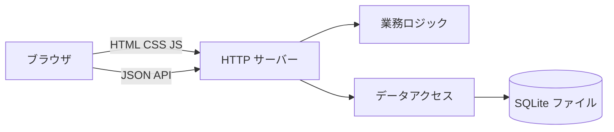
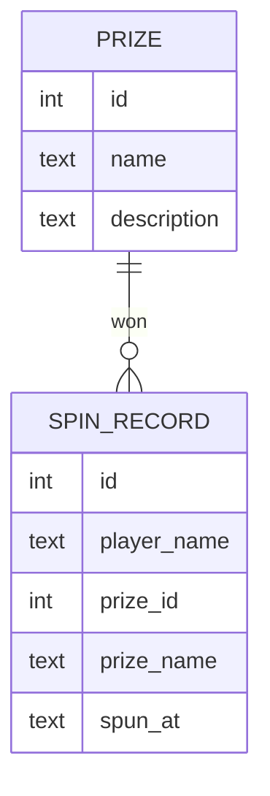
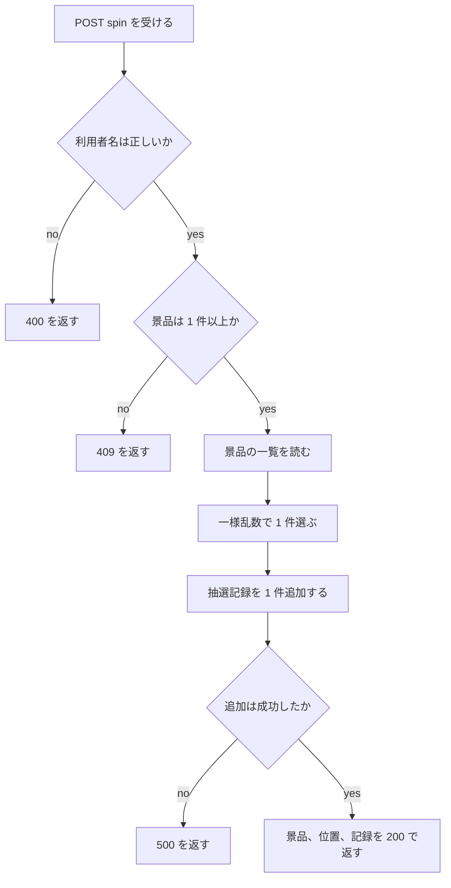

# 詳細設計書: 抽選ホイール Web サイト

作成日: 2026-11-04。フロー: 新規。対応する要件定義書: `docs/requirements.md`。
画面の文言は英語（要件 `RQ-NF-ENGLISH-UI`）。設計書の本文は日本語で書く。

## 1. 言語・フレームワーク・アーキテクチャの選定

### 1-1. 技術制約と判断軸

要件定義書 1-1 から、この案件で効く条件は次のとおり。

- 既存コード無し（新規）。配備は `run.sh` での前景起動、`PORT` と `DATA_DIR` の環境変数（契約）。
- 無償のライブラリだけ。Python 3.12（`python3`）か Node.js 24 のどちらか。
- 画面は 3 つ（Spin、Prizes、My Records）と共通メニュー。データは景品と抽選記録の 2 種類で、DB は SQLite。
- 外部連携は無い。認証は無い。利用人数は少数で、性能の目標は無い。

### 1-2. 候補の比較

| 候補 | 判断軸ごとの評価 | 出典 URL | 確認日 |
|---|---|---|---|
| A. Python 3.12 の標準ライブラリだけ（`http.server`・`sqlite3`・`json`）＋ HTML・CSS・素の JavaScript | 追加のインストールが要らず、`setup.sh` が不要な依存を入れずに済む。Python 3.12 はセキュリティ修正の段階で、保守期限は 2028 年 10 月。SQLite は標準ライブラリ。画面は 3 つで単純なため、フレームワーク無しで足りる | https://devguide.python.org/versions/ | 2026-11-04 |
| B. Python 3.12 ＋ Flask 3.1.3 | 最新安定版は 3.1.3（2026 年 2 月 19 日公開、BSD-3-Clause）。依存を `setup.sh` で入れる必要がある。経路は 6 本程度で、標準ライブラリより多くの部品を入れる利点が小さい | https://pypi.org/project/Flask/ | 2026-11-04 |
| C. Node.js 24 ＋ 標準の `http` モジュール、SQLite は外部パッケージ | Node.js 24 は LTS の表示があるが、サポート期限の列の意味が公式表から確定できなかった（https://nodejs.org/en/about/previous-releases）。SQLite を使うには外部パッケージが要り、標準だけでは完結しない | https://nodejs.org/en/about/previous-releases | 2026-11-04 |

### 1-3. 最終選定結果

| 項目 | 選定 |
|---|---|
| 言語 | Python 3.12 |
| フレームワーク | 無し（標準ライブラリの `http.server`） |
| DB | SQLite（標準ライブラリの `sqlite3`） |
| フロントエンド | HTML・CSS・素の JavaScript（ビルド無し、静的配信） |
| 実行形態 | サーバー（プロセス 1 つ、`run.sh` で前景起動） |

選定理由: 要件の技術制約（無償、標準だけで完結させたい、起動が `run.sh` だけで済む）と、画面と経路の少なさから、外部パッケージを増やす利点が無い。ユーザー承認の記録: 承認日 2026-11-04（ANSWERS.md の固定回答により承認済みとして進める）。

### 1-4. フロントエンドとバックエンドの構成

- フロントエンド: `static/` の HTML・CSS・JavaScript をそのまま配信する（ビルド無し）。
- バックエンド: 同じプロセスが `/api/` 配下の JSON と `/` 配下の静的ファイルを返す。API の経路の接頭辞は `/api` の 1 つに統一する。
- 認証境界: 無し。

## 2. システム構成

### 2-1. コンポーネント一覧

| コンポーネント | 役割 | 配置 |
|---|---|---|
| 起動スクリプト | 依存の確認、サーバーの起動 | `setup.sh`・`run.sh` |
| HTTP サーバー | 静的ファイルの配信、JSON API、抽選の実行 | `app/server.py`・`app/__main__.py` |
| 業務ロジック | 抽選、利用者名の検証 | `app/draw.py`・`app/validation.py` |
| データアクセス | 景品と抽選記録の読み書き、DB の初期化と初期データ | `app/repository.py`・`app/db.py` |
| 画面 | 3 画面と共通メニューの描画、ホイールの描画と回転 | `static/index.html`・`static/app.js`・`static/style.css` |

### 2-2. システム全体構成図



### 2-3. 各コンポーネントの役割

- HTTP サーバー: 要求の経路を判定し、`/api/prizes`・`/api/spin`・`/api/records` を処理する。それ以外の `GET` は `static/` のファイルを返す。
- 業務ロジック: 抽選は景品の中から一様乱数で 1 つを選ぶ。利用者名は前後の空白を除き、1〜30 文字かを判定する。
- データアクセス: 景品の一覧、抽選記録の追加、利用者名の完全一致による抽選記録の取得を行う。

### 2-4. インターフェースとデータフロー

- 画面は JSON API だけを呼ぶ。画面からデータベースには直接触らない。
- 抽選: 画面が利用者名を `POST /api/spin` に送る → 検証 → 景品一覧を取得 → 抽選 → 抽選記録を追加 → 結果（景品、景品の位置、記録）を返す → 画面がホイールを結果の位置へ回す。

### ネットワーク構成図

ネットワーク越しの通信は、ブラウザと HTTP サーバーの間だけ（`127.0.0.1:$PORT`）。構成図は 2-2 の図で代える。

## 3. データ設計

### 3-1. データモデル

DB を使う。理由: 抽選記録を追加し、利用者名で絞り込んで表示する必要があるため。DB 製品は 1-3 の SQLite。

#### テーブル: prize（景品）

| カラム | 型 | 制約 | 対応する要件の項目 |
|---|---|---|---|
| id | INTEGER | PRIMARY KEY AUTOINCREMENT | 景品ID |
| name | TEXT | NOT NULL、長さ 1〜60 文字 | 景品名 |
| description | TEXT | NOT NULL、既定値は空文字、長さ 0〜200 文字 | 説明 |

#### テーブル: spin_record（抽選記録）

| カラム | 型 | 制約 | 対応する要件の項目 |
|---|---|---|---|
| id | INTEGER | PRIMARY KEY AUTOINCREMENT | 抽選記録ID |
| player_name | TEXT | NOT NULL、保存前に前後の空白を除く、長さ 1〜30 文字 | 利用者名 |
| prize_id | INTEGER | NOT NULL、prize.id を参照（外部キー） | 景品ID |
| prize_name | TEXT | NOT NULL | 景品名（記録時点） |
| spun_at | TEXT | NOT NULL、ISO 8601 の UTC 文字列 | 抽選日時 |

インデックス: `spin_record.player_name` に 1 つ（利用者名での絞り込み）。

#### リレーション図



#### 初期件数と参照

景品は初期データ 6 件。抽選記録は 0 件から始まる。

### 3-2. トランザクションと排他制御

- 抽選記録の追加は 1 件の INSERT で、トランザクションの範囲は 1 操作。抽選の結果の景品名は、景品の読み取りと記録の追加の間で変わらない前提で、景品は運用中に変更しない（景品の変更の画面は無い）。
- 排他制御は不要（抽選記録は追記だけで、同じ行を更新する操作は無い）。
- 抽選記録の追加が失敗した場合は、その抽選を失敗として扱い、利用者に「Something went wrong. Please try again.」を返す（記録されない抽選結果は画面に出さない）。

### 3-3. 状態遷移

状態を持つエンティティは無い。

## 4. アーキテクチャ設計

### 4-1. 外部設計

#### 利用者向けインターフェース

| DS-ID | 種類 | 内容 |
|---|---|---|
| DS-IF-STATIC-PAGE | 画面 | `GET /` と `/app.js`、`/style.css` を返す静的ファイル |
| DS-IF-PRIZES-API | Web API | `GET /api/prizes` 景品の一覧を返す |
| DS-IF-SPIN-API | Web API | `POST /api/spin` 利用者名を受け取り抽選を行う |
| DS-IF-RECORDS-API | Web API | `GET /api/records?player_name=` 利用者名の抽選記録を返す |

#### インターフェース仕様

**DS-IF-PRIZES-API（GET /api/prizes）**

| 項目 | 内容 |
|---|---|
| 入力 | なし |
| 入力のバリデーション | なし |
| 出力（200） | `prizes` の配列。各要素は `id`・`name`・`description`。`id` の昇順 |
| エラー | 通常は発生しない。例外時は 500 と `error`（`Internal error`） |

**DS-IF-SPIN-API（POST /api/spin）**

| 項目 | 内容 |
|---|---|
| 入力 | JSON の `player_name`（文字列） |
| 入力のバリデーション | `DS-FN-VALIDATE-PLAYER-NAME` で前後の空白を除き 1〜30 文字を確かめる（要件の 4-2 の利用者名の制約） |
| 出力（200） | `prize`（`id`・`name`・`description`）、`index`（景品一覧の中の位置、0 から）、`record`（`id`・`player_name`・`prize_name`・`spun_at`） |
| エラー 400 | 利用者名が不正。`error` に `Please enter your name (1–30 characters).` を返す。抽選は行わず、記録は作らない |
| エラー 409 | 景品が 0 件。`error` に `No prizes are available` を返す。抽選は行わず、記録は作らない（要件 3-2 の業務ルール） |
| エラー 400（JSON 不正） | リクエストが JSON として読めない。`error` に `Invalid request` を返す |
| エラー 500 | 記録の追加に失敗。`error` に `Something went wrong. Please try again.` を返し、記録は作らない |

**DS-IF-RECORDS-API（GET /api/records?player_name=）**

| 項目 | 内容 |
|---|---|
| 入力 | クエリの `player_name`（文字列） |
| 入力のバリデーション | `DS-FN-VALIDATE-PLAYER-NAME` で確かめる。空白だけ、未指定、31 文字以上は不正 |
| 出力（200） | `records` の配列。各要素は `id`・`prize_name`・`spun_at`。`spun_at` の新しい順。該当が無いときは空の配列 |
| エラー 400 | 利用者名が不正。`error` に `Please enter your name` を返す |

**DS-IF-STATIC-PAGE**

| 項目 | 内容 |
|---|---|
| 入力 | `GET` の要求のパス |
| 出力 | `/` は `index.html`、`/app.js` と `/style.css` は対応するファイル。内容の種類（`Content-Type`）は拡張子で決める |
| エラー 404 | `static/` に無いパス、`/api/` 以外で `POST` の要求は 404 |

API の共通: 応答は JSON（UTF-8）。`/api/` 以外の経路で存在しない要求は 404。

### 4-2. 内部設計

#### 抽選の処理フロー



#### 各処理の役割

- 抽選の選び方: 景品の一覧から、暗号学的に安全な乱数（標準の `secrets`）で 1 件を選ぶ。各景品の確率は等しい（要件 `RQ-FT-DRAW-UNIFORM-PRIZE`）。
- 抽選記録の時刻: 抽選の時刻（UTC）を `spun_at` に入れる。
- 画面の描画: ホイールは景品の数だけ同じ角度の区画で描く。区画は景品の一覧の順。結果の位置の区画へ、複数回転して止まるように回す。

#### バッチ設計

バッチは無い。

## 5. クラス設計

クラスは作らない。すべての処理を関数で書く（対象が小さく、関数の粒度で足りるため）。

- 関数の一覧と役割は 6 章・7 章のファイル一覧に書く。
- 依存の向きは 7 章の依存の規則に従う。

## 6. エラーハンドリングとセキュリティ設計

### 6-1. エラーハンドリング

| 想定エラー | 利用者への見え方 | ログ | 処理 |
|---|---|---|---|
| 利用者名が不正 | 400、入力欄の下にメッセージ | なし | 抽選・記録を行わない |
| 景品が 0 件 | 409、「No prizes are available」 | なし | 抽選・記録を行わない |
| JSON が不正 | 400、`Invalid request` | なし | 処理を中止する |
| 記録の追加が失敗 | 500、「Something went wrong. Please try again.」 | 標準エラー出力に例外を 1 行 | 記録を作らず中止する |
| DB ファイルを開けない | サーバーは起動しない | 標準エラー出力 | 起動を中止する |

### 6-2. 認証と認可

- 認証は無い。
- 認可は無い。すべての利用者が全 API を使える。

### 6-3. 監査ログ

監査ログは無い（要件の運用要件に無い）。

### 6-4. その他のセキュリティ対策

- SQL は必ず引数で渡す（文字列の連結をしない）。
- 画面の表示では、景品名と利用者名を HTML の文字列として解釈させない（`textContent` で入れる）。
- 利用者名は 30 文字以下に制限する。

## 7. コード設計

### 7-1. ディレクトリ構成

```
setup.sh
run.sh
app/
  __main__.py
  server.py
  repository.py
  db.py
  draw.py
  validation.py
static/
  index.html
  app.js
  style.css
tests/        （単体テスト。対象は app/）
e2e/          （E2E テスト。実サーバーを起動して HTTP で確かめる）
scripts/isdd/ （isdd-setup が導入する対応表チェック）
```

### 7-2. ファイル一覧

| ファイル | 役割 | 含まれる要素（クラス・関数） | DS-ID | 実現する設計 ID |
|---|---|---|---|---|
| `setup.sh` | Python のバージョンを確かめ、依存の無いことを表示する | なし（bash） | ―（下の注を参照） | ― |
| `run.sh` | `PORT` と `DATA_DIR` を決めて `python3 -m app` を前景で起動する | なし（bash） | ―（下の注を参照） | ― |
| `app/__main__.py` | 環境変数を読み、DB を開き、サーバーを起動する | `main` | `DS-MD-MAIN` | `DS-OP-START-SERVER` |
| `app/server.py` | 経路の判定、JSON API、静的ファイルの配信 | `handle_spin`、`handle_prizes`、`handle_records`、`serve_static` | `DS-MD-SERVER` | `DS-IF-STATIC-PAGE`、`DS-IF-PRIZES-API`、`DS-IF-SPIN-API`、`DS-IF-RECORDS-API`、`DS-FN-HANDLE-SPIN` |
| `app/repository.py` | 景品の一覧、抽選記録の追加と検索 | `list_prizes`、`insert_spin_record`、`find_records_by_name` | `DS-MD-REPOSITORY` | `DS-FN-LIST-PRIZES`、`DS-FN-INSERT-SPIN-RECORD`、`DS-FN-FIND-RECORDS-BY-NAME` |
| `app/db.py` | DB ファイルの作成、スキーマの作成、初期データの投入 | `open_database`、`SAMPLE_PRIZES` | `DS-MD-DB` | `DS-FN-OPEN-DATABASE`、`DS-SC-PRIZE-TABLE`、`DS-SC-SPIN-RECORD-TABLE`、`DS-OP-SAMPLE-DATA-SEED` |
| `app/draw.py` | 景品の中から一様乱数で 1 件を選ぶ | `draw_prize` | `DS-MD-DRAW` | `DS-FN-DRAW-PRIZE` |
| `app/validation.py` | 利用者名の検証と正規化 | `validate_player_name` | `DS-MD-VALIDATION` | `DS-FN-VALIDATE-PLAYER-NAME` |
| `static/index.html` | 共通メニュー、3 つの画面の枠、読み込み | なし（HTML） | `DS-MD-INDEX-HTML` | `DS-IF-STATIC-PAGE` |
| `static/app.js` | 画面の切り替え、ホイールの描画、利用者名の保存。抽選と記録の API 呼び出しは、各操作のイベント処理の中に書く（関数に切り出さない） | `showView`、`renderWheel`、`rememberPlayerName` | `DS-MD-APP-JS` | `DS-FN-SHOW-VIEW`、`DS-FN-RENDER-WHEEL`、`DS-FN-REMEMBER-PLAYER-NAME` |
| `static/style.css` | 配色と配置 | なし（CSS） | `DS-MD-STYLE-CSS` | なし |

- ルート直下の `setup.sh`・`run.sh` には `DS-MD`・`DS-OP` の ID を付けない。対応表チェッカーはソースディレクトリ（`app`・`static`）と E2E のディレクトリだけを走査し、ルート直下のシェルファイルを対象にできないため（対応表に書くと「ファイルが見つかりません」の誤りになり、ID だけ書くと「未登録」の警告が消えないため）。起動の振る舞いは `app/__main__.py::main`（`DS-OP-START-SERVER`）が実現する。
- テストファイル（`tests/`・`e2e/`）には `DS-MD` を付けない。
- 対応表の粒度: `function`（公開関数まで対応表に載せる。既定）。理由: 関数の数が少なく、1 関数ごとに追える。
- 依存の規則: 無い（外部連携が無く、業務ロジックから外部 API のライブラリを呼ぶ経路が無いため）。

### 7-3. コーディング規約

- Python: PEP 8 の範囲。型注釈は公開関数の引数と戻り値に付ける。標準ライブラリだけを使う。
- JavaScript: ES2020 の範囲。フレームワーク無し。DOM の文字列は `textContent` で入れる。
- コードには要件 ID・設計 ID を書かない（コメントは処理の説明だけ）。設計 ID と対応は `docs/trace_map.md` で管理する。

## 8. テスト設計

### 8-1. テストの種類と方針

- 単体テスト: `app/draw.py`・`app/validation.py`・`app/repository.py`・`app/db.py` の各公開関数。標準の `unittest`。
- 結合テスト: 単体テストの一部として、一時ディレクトリの DB に対して repository と db を組み合わせて確かめる。
- E2E: 7 章の 7 本のシナリオを、一時 `DATA_DIR` で起動した実サーバーに対して HTTP で確かめる（8-2）。
- 非機能の確認: 配色と英語表記（`RQ-NF-LIGHT-GRAY-DARK-RED-THEME`・`RQ-NF-ENGLISH-UI`）は E2E で CSS と HTML の文字列を確かめる。Chromium での表示（`RQ-NF-CHROMIUM-BROWSER`）は、起動確認のときに Chromium で 3 画面を開いて目で確かめる（自動化しない）。

単体・結合テストの実行コマンド: `python3 -m unittest discover -s tests`

### 8-2. E2E テストのシナリオ

外部連携が無いので、モードは設けない。

| DS-ID | 目的 | 前提条件 | 手順 | 期待結果 |
|---|---|---|---|---|
| `DS-TS-SPIN-AND-RECORD-E2E` | 抽選と記録（`RQ-TS-SPIN-AND-RECORD`） | DB の初期データのみ | `POST /api/spin` を利用者名「Alice」で呼ぶ。`GET /api/records?player_name=Alice` を呼ぶ | 200 で景品が 1 件返り、その景品は景品一覧に含まれる。記録が 1 件あり、景品名と日時が一致する |
| `DS-TS-VALIDATE-PLAYER-NAME-E2E` | 利用者名の入力チェック（`RQ-TS-VALIDATE-PLAYER-NAME`） | 初期データのみ | `POST /api/spin` を空、空白だけ、31 文字の名前で呼ぶ。`GET /api/records` を空で呼ぶ | すべて 400 で `error` を返す。抽選記録の件数は増えない |
| `DS-TS-VIEW-PRIZE-LIST-E2E` | 景品一覧（`RQ-TS-VIEW-PRIZE-LIST`） | 初期データのみ | `GET /api/prizes` を呼ぶ。`GET /` を呼ぶ | 景品が 6 件、名前と説明を持つ。`index.html` が Prizes の画面の枠を含む |
| `DS-TS-VIEW-OWN-RECORDS-E2E` | 自分の記録の絞り込みと新しい順（`RQ-TS-VIEW-OWN-RECORDS`） | Alice が 2 回、Bob が 1 回抽選済み | `GET /api/records?player_name=Alice`、`Carol` を呼ぶ | Alice は 2 件、`spun_at` の新しい順。Bob の記録は含まれない。Carol は 200 で空の配列 |
| `DS-TS-NAVIGATE-MENU-E2E` | 共通メニュー（`RQ-TS-NAVIGATE-MENU`） | 初期データのみ | `GET /` を呼び、メニューの 3 つのリンク（`#/spin`、`#/prizes`、`#/records`）を含むことを確かめる | 3 つのリンクがあり、ラベルは Spin、Prizes、My Records |
| `DS-TS-EMPTY-PRIZES-E2E` | 景品が 0 件（`RQ-TS-EMPTY-PRIZES`） | テスト用の DB で景品を全件削除した状態 | `POST /api/spin` を「Alice」で呼ぶ。`GET /api/prizes` を呼ぶ | 409 で `No prizes are available`。記録は増えない。景品一覧は空の配列 |
| `DS-TS-FIRST-START-AND-THEME-E2E` | 空の DATA_DIR での起動と配色・英語（`RQ-TS-FIRST-START-AND-THEME`） | DATA_DIR が空 | `setup.sh` を実行し、`PORT` を指定して `run.sh` を起動する。`GET /` と `GET /style.css` を呼ぶ | 起動し、景品が 6 件。CSS に薄いグレーの背景と濃い赤の部品の色が指定されている。HTML の文言は英語 |

E2E の実行コマンド（8-4 で書く）: 1 つのテストファイルの中で、一時 `DATA_DIR` と空きポートで `python3 -m app` を起動してから実行する。

### 8-3. E2E の実行手段

- 手段: 標準ライブラリの `urllib` で実サーバーに HTTP の要求を送る（ブラウザ自動化は使わない。ANSWERS.md の固定回答で許可された手段）。
- 承認の記録: 2026-11-04（ANSWERS.md の固定回答により承認済みとして進める）。

### 8-4. E2E の実行コマンドと運用

- 実行コマンド: `python3 scripts/isdd/unittest_junit.py -s e2e -o e2e/results/e2e.xml`（`isdd-setup` が複製する標準ライブラリだけの実行器）
- 結果の出力先: `e2e/results/e2e.xml`（JUnit XML）。`e2e/results/` は git 管理外（`isdd-setup` が `.gitignore` に足す）。
- テスト関数と `DS-TS` の対応は、対応表の `DS-TS` の行で `e2e/test_e2e.py::<クラス名>.<関数名>` の形で結ぶ。
- 外部モックは無い。
- テストが失敗したら修正と再実行を繰り返し、全件成功まで続ける。

## 9. 運用設計

### 9-1. 起動方式

- `bash setup.sh`: Python 3.12 系（3.9 以上でも動く）を確かめ、依存が無いことを表示する。インストールは無い。
- `PORT=任意 bash run.sh`: `python3 -m app` を前景で起動する。Ctrl+C で止まる。
- 起動方法と操作説明を README.md に書く。

### 9-2. 初期化

- 起動時に `DATA_DIR` 直下の `wheel.sqlite3` を開く。`DATA_DIR` が無ければ作る。
- DB ファイルが無いときだけスキーマを作り、初期データ（景品 6 件）を投入する（`DS-OP-SAMPLE-DATA-SEED`）。DB ファイルが既にあるときは、景品の数に関わらず初期データを入れない（景品を 0 件にしたテストを正しく確かめるため）。
- 初期ユーザーは無い（認証が無い）。

#### 初期データ（景品 6 件）

| id | 名前 | 説明 |
|---|---|---|
| 1 | Coffee Voucher | A free coffee at the cafe |
| 2 | Gift Card 500 | A 500 yen gift card |
| 3 | Free Dessert | One free dessert |
| 4 | Movie Ticket | One movie ticket |
| 5 | Tote Bag | A canvas tote bag |
| 6 | Mystery Gift | A surprise gift |

### 9-3. 設定値・環境変数

| 名前 | 用途 | 既定値 | 必須 |
|---|---|---|---|
| `PORT` | 待ち受けポート | 8000 | 任意 |
| `DATA_DIR` | DB ファイルの置き場所 | プロジェクトルートの `data` ディレクトリ | 任意 |

秘密情報は無い。

### 9-4. バックアップと復旧

バックアップは必要ない（要件の運用要件）。

### 9-5. データ移行

移行は無い。

### 9-6. 可用性

可用性の要求は無い。

## 10. ログ・監視・アラート・障害対応設計

- ログ: ログの設計は必須ではないため、ログの種類と内容の記述は行わない。標準エラー出力には例外の 1 行だけを出す（6-1）。
- 監視・アラート: 監視・アラートの設計は必須ではないため、監視・アラートの内容と対応方法の記述は行わない。
- 障害対応: 利用者が障害に気づいたときは、画面に出るメッセージで判断する。サーバーが止まったときは `run.sh` を再実行する。DB ファイルが壊れたときは `DATA_DIR` を空にして再起動すれば初期データで起動する（記録は失われる）。

## 11. 要件と設計の対応表

| DS-ID | 対応要件ID |
|---|---|
| `DS-MD-MAIN` | `RQ-OP-START-SCRIPTS` |
| `DS-MD-SERVER` | `RQ-FT-SPIN-WHEEL`, `RQ-FT-LIST-PRIZES`, `RQ-FT-VIEW-OWN-RECORDS`, `RQ-FT-RECORD-WIN`, `RQ-UI-SPIN-SCREEN`, `RQ-UI-PRIZE-LIST-SCREEN`, `RQ-UI-MY-RECORDS-SCREEN`, `RQ-NF-PUBLIC-NO-AUTH` |
| `DS-MD-REPOSITORY` | `RQ-FT-LIST-PRIZES`, `RQ-FT-RECORD-WIN`, `RQ-FT-VIEW-OWN-RECORDS` |
| `DS-MD-DB` | `RQ-DT-STORAGE-SQLITE`, `RQ-OP-SAMPLE-DATA` |
| `DS-MD-DRAW` | `RQ-FT-DRAW-UNIFORM-PRIZE`, `RQ-FT-SPIN-WHEEL` |
| `DS-MD-VALIDATION` | `RQ-FT-SPIN-WHEEL`, `RQ-FT-VIEW-OWN-RECORDS` |
| `DS-MD-INDEX-HTML` | `RQ-UI-NAVIGATION-MENU`, `RQ-UI-SPIN-SCREEN`, `RQ-UI-PRIZE-LIST-SCREEN`, `RQ-UI-MY-RECORDS-SCREEN`, `RQ-NF-ENGLISH-UI` |
| `DS-MD-APP-JS` | `RQ-FT-SPIN-WHEEL`, `RQ-FT-LIST-PRIZES`, `RQ-FT-VIEW-OWN-RECORDS`, `RQ-UI-NAVIGATION-MENU`, `RQ-NF-ENGLISH-UI`, `RQ-NF-CHROMIUM-BROWSER` |
| `DS-MD-STYLE-CSS` | `RQ-NF-LIGHT-GRAY-DARK-RED-THEME` |
| `DS-FN-LIST-PRIZES` | `RQ-FT-LIST-PRIZES` |
| `DS-FN-INSERT-SPIN-RECORD` | `RQ-FT-RECORD-WIN` |
| `DS-FN-FIND-RECORDS-BY-NAME` | `RQ-FT-VIEW-OWN-RECORDS` |
| `DS-FN-OPEN-DATABASE` | `RQ-DT-STORAGE-SQLITE`, `RQ-OP-SAMPLE-DATA` |
| `DS-FN-DRAW-PRIZE` | `RQ-FT-DRAW-UNIFORM-PRIZE`, `RQ-FT-SPIN-WHEEL` |
| `DS-FN-VALIDATE-PLAYER-NAME` | `RQ-FT-SPIN-WHEEL`, `RQ-FT-VIEW-OWN-RECORDS` |
| `DS-FN-HANDLE-SPIN` | `RQ-FT-SPIN-WHEEL`, `RQ-FT-RECORD-WIN` |
| `DS-FN-SHOW-VIEW` | `RQ-UI-NAVIGATION-MENU` |
| `DS-FN-RENDER-WHEEL` | `RQ-FT-SPIN-WHEEL` |
| `DS-FN-REMEMBER-PLAYER-NAME` | `RQ-UI-SPIN-SCREEN`, `RQ-UI-MY-RECORDS-SCREEN` |
| `DS-SC-PRIZE-TABLE` | `RQ-DT-PRIZE` |
| `DS-SC-SPIN-RECORD-TABLE` | `RQ-DT-SPIN-RECORD` |
| `DS-IF-STATIC-PAGE` | `RQ-UI-NAVIGATION-MENU`, `RQ-NF-CHROMIUM-BROWSER`, `RQ-NF-PUBLIC-NO-AUTH` |
| `DS-IF-PRIZES-API` | `RQ-FT-LIST-PRIZES`, `RQ-UI-PRIZE-LIST-SCREEN` |
| `DS-IF-SPIN-API` | `RQ-FT-SPIN-WHEEL`, `RQ-FT-RECORD-WIN`, `RQ-UI-SPIN-SCREEN`, `RQ-NF-PUBLIC-NO-AUTH` |
| `DS-IF-RECORDS-API` | `RQ-FT-VIEW-OWN-RECORDS`, `RQ-UI-MY-RECORDS-SCREEN`, `RQ-NF-PUBLIC-NO-AUTH` |
| `DS-OP-START-SERVER` | `RQ-OP-START-SCRIPTS` |
| `DS-OP-SAMPLE-DATA-SEED` | `RQ-OP-SAMPLE-DATA` |
| `DS-TS-SPIN-AND-RECORD-E2E` | `RQ-TS-SPIN-AND-RECORD` |
| `DS-TS-VALIDATE-PLAYER-NAME-E2E` | `RQ-TS-VALIDATE-PLAYER-NAME` |
| `DS-TS-VIEW-PRIZE-LIST-E2E` | `RQ-TS-VIEW-PRIZE-LIST` |
| `DS-TS-VIEW-OWN-RECORDS-E2E` | `RQ-TS-VIEW-OWN-RECORDS` |
| `DS-TS-NAVIGATE-MENU-E2E` | `RQ-TS-NAVIGATE-MENU` |
| `DS-TS-EMPTY-PRIZES-E2E` | `RQ-TS-EMPTY-PRIZES` |
| `DS-TS-FIRST-START-AND-THEME-E2E` | `RQ-TS-FIRST-START-AND-THEME`, `RQ-NF-LIGHT-GRAY-DARK-RED-THEME` |

### 11-1. 除外要件

除外要件は無い。

### 要件の対応の補足

- `RQ-NF-PUBLIC-NO-AUTH` は、認証の無い API と画面（`DS-IF-*`）で実現する。
- `RQ-NF-CHROMIUM-BROWSER` は、画面の JavaScript と HTML（`DS-MD-APP-JS`・`DS-IF-STATIC-PAGE`）で実現し、起動確認で Chromium により目で確かめる。
- `RQ-UI-NAVIGATION-MENU` の DS-FN-SHOW-VIEW は、メニューの 3 つのリンクをハッシュの経路で切り替える。
