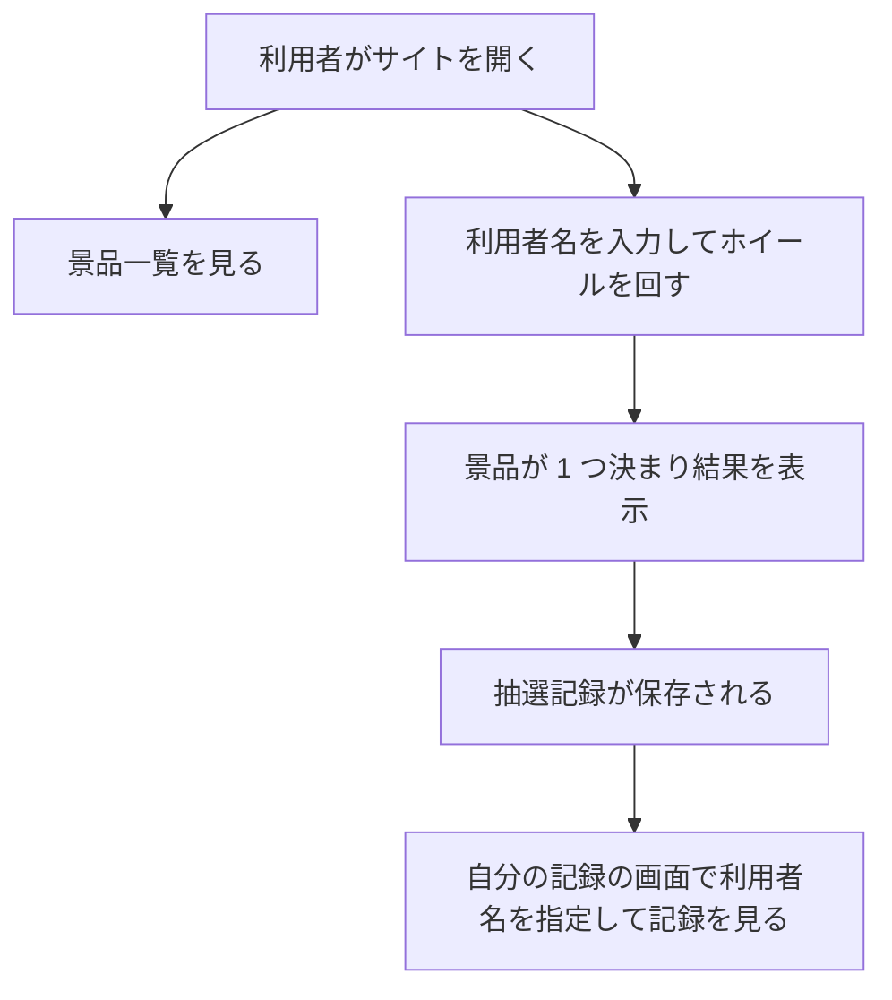
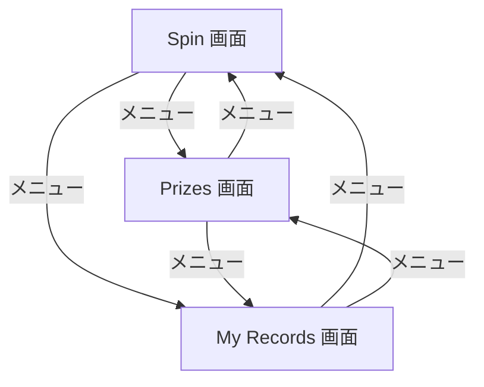

# 要件定義書: 抽選ホイール（Wheel of Fortune）Web サイト

作成日: 2026-11-04。フロー: 新規（`docs/requirements.md`）。
画面の言語は英語（契約）。この文書の本文は日本語で書く。

## 1. 目的・前提

### 1-0. システムの目的

利用者がブラウザでホイールを回し、景品を当てられるようにする。景品の一覧を見られるようにし、各利用者が自分の抽選結果（当選記録）を後から確かめられるようにする。

### 用語集

| 用語 | 業務上の意味 | 本案件での使用範囲 | 同義語/類義語 |
|---|---|---|---|
| 抽選ホイール | 景品の区画が描かれた円盤。回すと 1 区画が指される | 抽選を行う画面の中心部品 | Wheel、ルーレット |
| 景品 | 抽選で当たる賞品 | 抽選の対象。一覧で表示する。初期データのみで、追加・編集はしない | Prize |
| 抽選 | 景品の中から 1 つを決める操作 | 利用者が回したときに 1 回行う | Spin |
| 抽選記録 | 1 回の抽選で、利用者名・当選した景品・日時を残したもの | 利用者ごとに一覧で確かめる | Spin record、当選記録 |
| 利用者名 | 抽選と記録を結びつけるために利用者が入力する名前 | ログインは無く、名前だけで記録を区別する | Player name |

### システムの形態

GUI（画面）。ブラウザで使う画面だけで、CUI・Web API（他のシステム向け）・バッチは無い。

### 1-1. 技術制約

| 制約項目 | 内容 | 出どころ（誰がいつ答えたか） |
|---|---|---|
| 既存コードベース | 無し（新規開発） | ANSWERS.md（段階 1 では既存コード無し） |
| 配備先 | `run.sh` で起動し、`http://127.0.0.1:$PORT` で提供する。データは `DATA_DIR` 配下に置く。Chromium で動くこと | contract.md |
| チームの技術 | 指定なし。Python 3.12（`python3`）または Node.js 24（`node`、`npm`）のどちらかで作る | ANSWERS.md（技術選定は推奨の案でよい）、contract.md |
| ライセンスとコスト | 無償のライブラリだけを使う。外部サービス・有償 API は使わない | contract.md |
| 性能と規模の目安 | 利用人数・応答時間の目標は無い（少数の利用を想定） | ANSWERS.md（非機能: 性能の目標は無い） |

## 2. 業務

### 対象業務一覧

| RQ-BZ-ID | 業務名 | 業務の範囲 | 担当者 |
|---|---|---|---|
| `RQ-BZ-PRIZE-DRAW` | 景品抽選 | 利用者がホイールを回して景品を当て、結果を記録し、景品と自分の記録を確かめる | 一般の利用者 |

### 業務フロー

### 2-1. 業務の問題（あるべき姿と現状のギャップ）

| 問題 | 対象業務（RQ-BZ） | あるべき姿 | 現状 | ギャップ（KPI） | 業務影響 |
|---|---|---|---|---|---|
| 景品の抽選を誰でもブラウザで試せず、当たった結果が残らない | `RQ-BZ-PRIZE-DRAW` | 利用者が景品一覧を見てホイールを回し、結果を自分で後から確かめられる | 依頼の時点では抽選の仕組みが無い | 不明（依頼に数値の目標は無い） | 利用者が抽選の結果を確かめられない |

### 2-2. 業務課題一覧

| RQ-BK-ID | 業務課題（取り組むこと） | 解決する問題（2-1） | 解決後の状態（KPI の目標値） | 対象業務（RQ-BZ） |
|---|---|---|---|---|
| `RQ-BK-SPIN-WHEEL-DRAW` | ホイールを回して景品を 1 つ抽選できるようにする | 景品の抽選を誰でもブラウザで試せない | 数値目標は無い（依頼に無い）。利用者が 1 回の操作で結果を得られる | `RQ-BZ-PRIZE-DRAW` |
| `RQ-BK-SHOW-PRIZES` | 景品の一覧を利用者に示す | 景品が何あるか分からない | 数値目標は無い（依頼に無い）。全景品が一覧に出る | `RQ-BZ-PRIZE-DRAW` |
| `RQ-BK-RECORD-WINS` | 抽選結果を記録し、利用者が自分の記録を確かめられるようにする | 当たった結果が残らず、後から確かめられない | 数値目標は無い（依頼に無い）。自分の記録を新しい順に確かめられる | `RQ-BZ-PRIZE-DRAW` |

### 2-3. 見込み経営効果

見込み経営効果は算定しない（理由: 依頼は利用者向けの抽選サイトの作成であり、金額・時間の効果の見込みを聞いていない。効果の算定に必要な数値が無い）。

## 3. 機能要件

### 入力データと出力データ

- 人手入力: 利用者名（抽選の操作時と記録の確認時）
- 出力データ: 画面に表示する景品の一覧、抽選結果、抽選記録の一覧。帳票・出力ファイルは無い

### 利用者フロー

Spin 画面で利用者名を入力して Spin を押すと、抽選が行われ、結果が表示され、抽選記録が 1 件増える。My Records 画面では利用者名を入力して自分の抽選記録を確かめる。

### 機能一覧

| RQ-ID | カテゴリ | 機能名 | 対応業務課題ID（RQ-BK-*） | この機能が無いと何が困るか |
|---|---|---|---|---|
| `RQ-FT-SPIN-WHEEL` | 業務機能 | 利用者名を入力してホイールを回し、景品を 1 つ抽選して結果を表示する | `RQ-BK-SPIN-WHEEL-DRAW` | 抽選ができず、サイトの中心の操作が成り立たない |
| `RQ-FT-RECORD-WIN` | 業務機能 | 抽選のたびに、利用者名・景品・日時を抽選記録として保存する | `RQ-BK-RECORD-WINS` | 抽選の結果が残らず、後から確かめられない |
| `RQ-FT-LIST-PRIZES` | 業務機能 | 景品の一覧（名前と説明）を表示する | `RQ-BK-SHOW-PRIZES` | 利用者が景品を事前に知ることができない |
| `RQ-FT-VIEW-OWN-RECORDS` | 業務機能 | 利用者名を指定し、その利用者の抽選記録を新しい順に表示する | `RQ-BK-RECORD-WINS` | 利用者が自分の当選を確かめられない |

### 3-1. 帳票・出力ファイル

帳票・出力ファイルは無い。

### 3-2. 業務ルール

| RQ-ID | ルール名 | 内容（条件と結果） | 違反時・エラー時の業務上の扱い | 対応業務課題ID（RQ-BK-*） |
|---|---|---|---|---|
| `RQ-FT-DRAW-UNIFORM-PRIZE` | 景品は等しい確率で決まる | 抽選のたびに、登録されている景品の中から 1 つを等しい確率で選ぶ。利用者は景品を選べない。景品の確率は画面に表示しない。景品が 1 件も無い場合は抽選を行わない | 景品が 0 件のときは、Spin 画面に「No prizes are available」と表示し、抽選記録は作らない | `RQ-BK-SPIN-WHEEL-DRAW` |

### 3-3. 外部連携

外部連携は無い。

## 4. データ

### 4-1. データ要件一覧

| RQ-ID | 種別 | 内容 | 対応業務課題ID（RQ-BK-*） | この要件が無いと何が困るか |
|---|---|---|---|---|
| `RQ-DT-STORAGE-SQLITE` | 内部データ | 景品と抽選記録を SQLite のデータベースファイルとして `DATA_DIR` 配下に保存する。外部 DB は使わない。保持期間は無期限（削除の操作は無い） | `RQ-BK-RECORD-WINS` | 抽選記録が消えたり、再起動で失われたりする |

DB が必要な理由: 抽選記録を追記し、利用者名で絞り込んで表示するため。初期件数は景品 6 件（サンプル）と抽選記録 0 件。1 年後の想定件数・年間増加率は不明（依頼に無い。利用は少数を想定）。参照関係は景品と抽選記録の 1 対多だけで単純。検索は利用者名の完全一致だけ。

### 4-2. 業務エンティティとデータ項目

| RQ-ID | カテゴリ | 業務エンティティ名 | 対応業務課題ID（RQ-BK-*） | この業務エンティティが無いと何が困るか |
|---|---|---|---|---|
| `RQ-DT-PRIZE` | マスタ | 景品 | `RQ-BK-SHOW-PRIZES` | 景品の一覧を出せず、抽選の対象が無い |
| `RQ-DT-SPIN-RECORD` | トランザクション | 抽選記録 | `RQ-BK-RECORD-WINS` | 当選の結果を残せない |

| エンティティ名 | 項目名 | 業務上の意味 | 必須 | 形式・桁 | 値の範囲・制約 | 例 |
|---|---|---|---|---|---|---|
| 景品 | 景品ID | 景品を識別する番号 | 必須 | 整数 | 自動採番、重複なし | 1 |
| 景品 | 景品名 | 画面に出す名前 | 必須 | 文字列 | 1〜60 文字 | Gift Card 500 |
| 景品 | 説明 | 景品の説明 | 任意 | 文字列 | 0〜200 文字 | A 500 yen gift card |
| 抽選記録 | 抽選記録ID | 記録を識別する番号 | 必須 | 整数 | 自動採番、重複なし | 1 |
| 抽選記録 | 利用者名 | 抽選した利用者の名前 | 必須 | 文字列 | 前後の空白を除いて 1〜30 文字。空白だけは不可 | Alice |
| 抽選記録 | 景品ID | 当選した景品 | 必須 | 整数 | 景品ID に存在する値 | 1 |
| 抽選記録 | 景品名（記録時点） | 当選した景品の名前の写し | 必須 | 文字列 | 景品名と同じ規則 | Gift Card 500 |
| 抽選記録 | 抽選日時 | 抽選を行った日時 | 必須 | 日時 | 保存時刻（UTC）。画面は利用者のブラウザの地域時刻で表示する | 2026-11-04 10:00 |

### 4-3. CRUD テーブル

| エンティティ名 | Create | Read（一覧） | Read（詳細） | 検索 | Update | Delete | 備考 |
|---|---|---|---|---|---|---|---|
| 景品 | × | ○ | × | × | × | × | 景品は初期データだけで作る。追加・編集・削除の画面は依頼に無いため作らない |
| 抽選記録 | ○ | ○ | × | ○ | × | × | 検索は利用者名の完全一致（前後の空白を除いて比較し、大文字と小文字は区別する）。Create は Spin 画面で抽選した時に 1 件だけ作る。同時更新の排他制御は不要（記録は追記のみ） |

| 値 | 意味 |
|---|---|
| ○ | 必須の操作 |
| △ | 条件付きで必要な操作 |
| × | 対象外の操作 |

### 4-4. 状態遷移

状態を持つエンティティは無い。

### 4-5. 画面一覧

| RQ-ID | 画面名 | 対応する CRUD 操作（エンティティ名:操作種別） | 主な機能・目的 | 対応業務課題ID（RQ-BK-*） |
|---|---|---|---|---|
| `RQ-UI-SPIN-SCREEN` | Spin 画面（抽選） | 抽選記録:Create、景品:Read | 利用者名を入力し、ホイールを回して結果を表示する | `RQ-BK-SPIN-WHEEL-DRAW` |
| `RQ-UI-PRIZE-LIST-SCREEN` | Prizes 画面（景品一覧） | 景品:Read | 景品の名前と説明を一覧で表示する | `RQ-BK-SHOW-PRIZES` |
| `RQ-UI-MY-RECORDS-SCREEN` | My Records 画面（自分の記録） | 抽選記録:Read、抽選記録:検索 | 利用者名を入力し、その利用者の抽選記録を新しい順に表示する | `RQ-BK-RECORD-WINS` |
| `RQ-UI-NAVIGATION-MENU` | 共通メニュー（全画面） | なし | 全画面の上部に Spin、Prizes、My Records のメニューを表示し、画面を移動する | `RQ-BK-SPIN-WHEEL-DRAW`、`RQ-BK-SHOW-PRIZES`、`RQ-BK-RECORD-WINS` |

画面の要素（5 項目）:

- Spin 画面: 目的は抽選。主要要素は利用者名の入力欄、Spin ボタン、ホイール、結果の表示欄。入力項目は利用者名。表示項目は当選した景品名。エラー時は入力欄の下に「Please enter your name (1–30 characters).」を表示する。景品が 0 件のときは「No prizes are available」を表示する。ホイールが回っている間は Spin ボタンを押せない。利用者名はブラウザに保存し、次回の初期値にする。
- Prizes 画面: 目的は景品の確認。主要要素は景品の表（名前、説明）。入力項目は無い。表示項目は景品名と説明。景品が無いときは「No prizes yet」を表示する。
- My Records 画面: 目的は自分の抽選記録の確認。主要要素は利用者名の入力欄、検索ボタン、記録の表。入力項目は利用者名（Spin 画面で保存した名前を初期値にする）。表示項目は抽選日時、景品名。該当が無いときは「No records found for this name」を表示する。利用者名が未入力のときは「Please enter your name」を表示する。

## 5. 非機能要件

| RQ-ID | カテゴリ | 非機能要件名 | 対応業務課題ID（RQ-BK-*） | この非機能要件が無いと何が困るか |
|---|---|---|---|---|
| `RQ-NF-PUBLIC-NO-AUTH` | 利用者とアクセス経路・セキュリティ | 利用者は一般の利用者で、ログイン（認証）と権限制御は無い。アクセス経路は `run.sh` で起動したホストへの HTTP（契約: `127.0.0.1:$PORT`） | `RQ-BK-SPIN-WHEEL-DRAW`、`RQ-BK-SHOW-PRIZES`、`RQ-BK-RECORD-WINS` | 利用者がすぐに試せない（ログインを要求すると依頼の操作が成り立たない） |
| `RQ-NF-CHROMIUM-BROWSER` | 利用者とアクセス経路 | Chromium のブラウザで全画面が動く | `RQ-BK-SPIN-WHEEL-DRAW`、`RQ-BK-SHOW-PRIZES`、`RQ-BK-RECORD-WINS` | 採点者のブラウザで画面が動かない |
| `RQ-NF-ENGLISH-UI` | 利用者とアクセス経路 | 画面の文言（ボタン、見出し、メッセージ）はすべて英語 | `RQ-BK-SPIN-WHEEL-DRAW`、`RQ-BK-SHOW-PRIZES`、`RQ-BK-RECORD-WINS` | 利用者が画面の操作を理解できない（契約で指定） |
| `RQ-NF-LIGHT-GRAY-DARK-RED-THEME` | 利用者とアクセス経路 | 画面の背景は薄いグレー（既定）、ボタン・見出し・ホイールの区画など部品の色は濃い赤を使う | `RQ-BK-SPIN-WHEEL-DRAW`、`RQ-BK-SHOW-PRIZES`、`RQ-BK-RECORD-WINS` | 依頼の配色指定を満たせない |

- 性能（応答時間の目標）: 要求は無い
- 利用人数: 少数（同時接続数の目標は無い）
- 可用性: 要求は無い（止めてよい時間の指定も無い）
- 移行性: 移行は無い
- 監査証跡の改ざん防止: 不要

## 6. 運用要件

| RQ-ID | 種別 | 内容 | 対応業務課題ID（RQ-BK-*） | この要件が無いと何が困るか |
|---|---|---|---|---|
| `RQ-OP-START-SCRIPTS` | 起動 | `setup.sh` が依存を入れ、`run.sh` が `PORT`（既定 8000）と `DATA_DIR` を使って Web サーバーを前景で起動する | `RQ-BK-SPIN-WHEEL-DRAW` | 採点の起動手順が実行できない |
| `RQ-OP-SAMPLE-DATA` | 初期化 | `DATA_DIR` が空のとき、データベースを作り、サンプル景品 6 件を入れる。抽選記録は 0 件 | `RQ-BK-SHOW-PRIZES` | 初回起動で景品が無く、すべての機能を試せない |

- ログ: ログは必要ないため、ログの内容と保存期間の記述は行わない（一般的な動作ログのみ）
- 監査ログ: 不要
- 監視・アラート: 監視・アラートは必要ないため、監視・アラートの内容と対応方法の記述は行わない
- バックアップと復旧: バックアップは必要ない

## 7. テスト用利用シナリオ

| RQ-ID | テスト目的 | 前提条件 | テスト手順 | 期待される結果 | 検証する要件ID | 対応業務課題ID（RQ-BK-*） |
|---|---|---|---|---|---|---|
| `RQ-TS-SPIN-AND-RECORD` | 抽選と記録の一連の動作 | 初期データのみ（抽選記録 0 件） | Spin 画面で利用者名「Alice」を入力して Spin を押す。ホイールが止まるまで待つ。My Records 画面で「Alice」を検索する | 景品が 1 つ表示される。My Records に抽選記録が 1 件（景品名と日時）表示される。結果の景品は景品一覧のいずれかに一致する | `RQ-FT-SPIN-WHEEL`、`RQ-FT-RECORD-WIN`、`RQ-FT-DRAW-UNIFORM-PRIZE`、`RQ-FT-VIEW-OWN-RECORDS`、`RQ-UI-SPIN-SCREEN`、`RQ-UI-MY-RECORDS-SCREEN` | `RQ-BK-SPIN-WHEEL-DRAW`、`RQ-BK-RECORD-WINS` |
| `RQ-TS-VALIDATE-PLAYER-NAME` | 利用者名の入力チェック | 初期データのみ | Spin 画面で利用者名を空のまま Spin を押す。次に空白だけを入力して Spin を押す。31 文字以上を入力して Spin を押す。My Records で空のまま検索する | 3 種類とも抽選は行われず、抽選記録は増えない。エラーメッセージが表示される。My Records は「Please enter your name」を表示する | `RQ-FT-SPIN-WHEEL`、`RQ-UI-SPIN-SCREEN`、`RQ-UI-MY-RECORDS-SCREEN` | `RQ-BK-SPIN-WHEEL-DRAW`、`RQ-BK-RECORD-WINS` |
| `RQ-TS-VIEW-PRIZE-LIST` | 景品一覧の表示 | 初期データのみ | Prizes 画面を開く | サンプル景品 6 件の名前と説明が表示される | `RQ-FT-LIST-PRIZES`、`RQ-UI-PRIZE-LIST-SCREEN` | `RQ-BK-SHOW-PRIZES` |
| `RQ-TS-VIEW-OWN-RECORDS` | 自分の記録の絞り込みと新しい順 | 利用者「Alice」が 2 回、「Bob」が 1 回抽選済み | My Records で「Alice」を検索する。次に「Carol」を検索する | Alice の記録が 2 件、新しい順に表示され、Bob の記録は含まれない。Carol は「No records found for this name」を表示する | `RQ-FT-VIEW-OWN-RECORDS`、`RQ-UI-MY-RECORDS-SCREEN` | `RQ-BK-RECORD-WINS` |
| `RQ-TS-NAVIGATE-MENU` | 共通メニューで全画面を移動できる | 初期データのみ | 任意の画面から Spin、Prizes、My Records の順にメニューを押す | 各メニューで対応する画面に移動し、現在の画面のメニューが分かる | `RQ-UI-NAVIGATION-MENU` | `RQ-BK-SPIN-WHEEL-DRAW`、`RQ-BK-SHOW-PRIZES`、`RQ-BK-RECORD-WINS` |
| `RQ-TS-EMPTY-PRIZES` | 景品が 0 件のときの振る舞い | 景品を 0 件にした DATA_DIR（テスト用に景品を消した状態） | Spin 画面を開き、利用者名を入力して Spin を押す。Prizes 画面を開く | 抽選は行われず、「No prizes are available」が表示される。抽選記録は増えない。Prizes 画面は「No prizes yet」を表示する | `RQ-FT-DRAW-UNIFORM-PRIZE`、`RQ-UI-PRIZE-LIST-SCREEN` | `RQ-BK-SPIN-WHEEL-DRAW`、`RQ-BK-SHOW-PRIZES` |
| `RQ-TS-FIRST-START-AND-THEME` | 空の DATA_DIR での起動と画面の見た目・言語 | DATA_DIR が空 | `bash setup.sh`、`PORT` を指定して `bash run.sh` を起動し、Spin 画面を開く。3 つの画面の背景と部品の色と文言を確かめる | 起動が成功し、サンプル景品が表示される。背景は薄いグレー、部品は濃い赤。文言はすべて英語 | `RQ-OP-START-SCRIPTS`、`RQ-OP-SAMPLE-DATA`、`RQ-NF-LIGHT-GRAY-DARK-RED-THEME`、`RQ-NF-ENGLISH-UI`、`RQ-NF-CHROMIUM-BROWSER`、`RQ-UI-SPIN-SCREEN` | `RQ-BK-SPIN-WHEEL-DRAW`、`RQ-BK-SHOW-PRIZES` |

網羅性の確認: 機能（4 件）、業務ルール（1 件）、画面（3 件）と共通メニューのすべての利用フローを、上のシナリオのどれかが通る。
