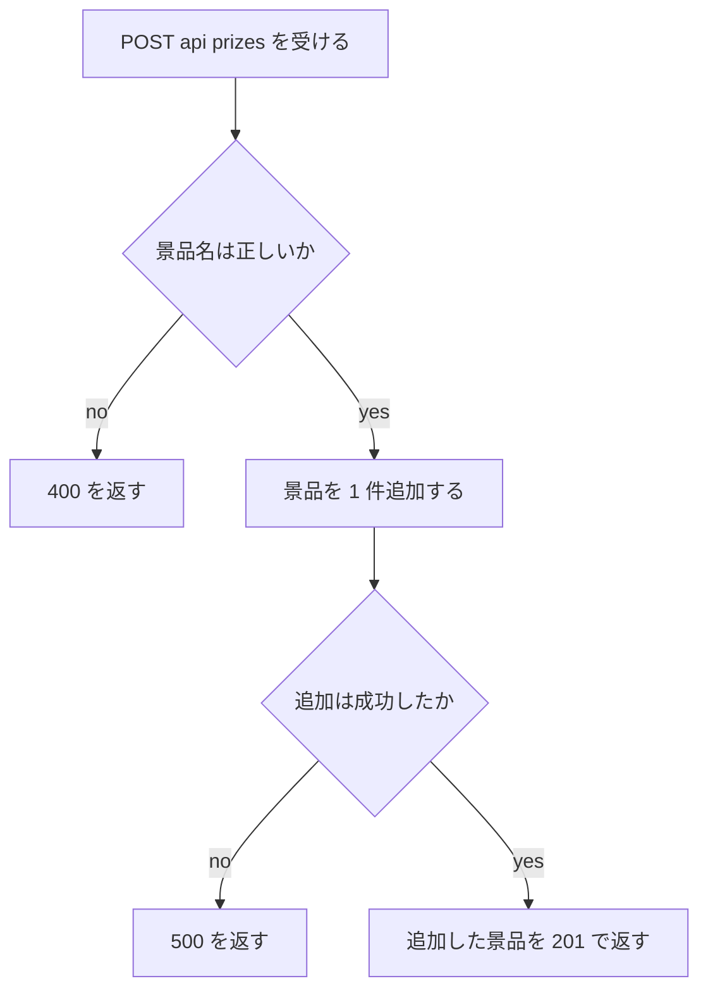
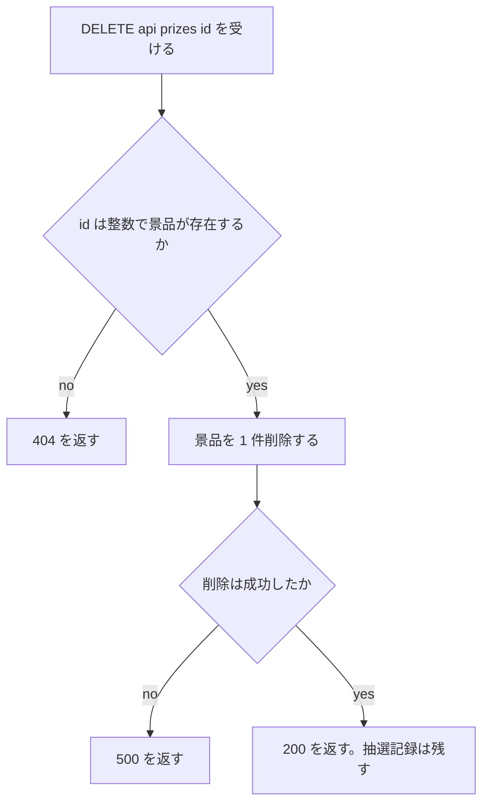

# 変更設計書: 配色の変更と景品管理ページの追加

作成日: 2026-11-04。フロー: 変更。対応する変更要件定義書: `change_requirements.md`（同じディレクトリ）。対応する正本: `docs/detail_design.md`（正本は書き換えない）。
画面の文言は英語（要件 `RQ-NF-ENGLISH-UI`）。設計書の本文は日本語で書く。

区分の書き方: 要素の中身が変わるものは旧 ID を [削除]、新 ID を [追加] にする。ファイル単位の ID（`DS-MD-*`）は 7-2 のファイル一覧と 1 対 1 で、ファイルの中身が変わっても ID は変えない（中身の変更は、そのファイルに含まれる `DS-FN-*`・`DS-IF-*` の [削除] と [追加] で書く）。変えない要素は「変更なし（既存）」と書く。

## 1. 言語・フレームワーク・アーキテクチャの選定

変更なし。既存設計 `docs/detail_design.md` セクション 1 を参照（Python 3.12、標準ライブラリの `http.server`、SQLite、HTML・CSS・素の JavaScript）。既存の技術を引き継ぐ。変更要件の技術制約と矛盾しない。

## 2. システム構成

### 2-1. コンポーネント一覧

変更あり（画面の数が 4 つになる。ファイルと役割は変わらない）。

- 画面: 4 つの画面（Spin、Prizes、My Records、Manage prizes）と共通メニュー。`static/index.html`・`static/app.js`・`static/style.css`。
- HTTP サーバー: 景品の追加（`POST /api/prizes`）と削除（`DELETE /api/prizes/{id}`）を加える。
- 業務ロジック: 景品名の検証を加える。
- データアクセス: 景品の追加と削除を加える。

### 2-2. システム全体構成図

変更なし。既存設計 2-2 の図のまま。

### 2-3. 各コンポーネントの役割

変更あり。
- HTTP サーバー: `/api/prizes` の `POST` で景品を追加し、`/api/prizes/{id}` の `DELETE` で景品を削除する。
- 業務ロジック: 景品名は前後の空白を除き、1〜60 文字かを判定する。
- データアクセス: 景品の追加と削除を行う。景品を削除しても抽選記録は消さない。

### 2-4. インターフェースとデータフロー

変更あり。
- 景品の追加: 画面が景品名を `POST /api/prizes` に送る → 検証 → 景品を 1 件追加 → 追加した景品を 201 で返す → 画面が景品の一覧を読み直す。
- 景品の削除: 画面が `DELETE /api/prizes/{id}` を送る → 景品を削除 → 200 を返す（無ければ 404） → 画面が景品の一覧を読み直す。
- 画面を開くたびに、画面は `GET /api/prizes` で登録済みの景品の一覧を読み、ホイールと Prizes の表を描き直す（`RQ-FT-WHEEL-FOLLOWS-PRIZES`）。

### ネットワーク構成図

変更なし。

## 3. データ設計

### 3-1. データモデル

変更なし（テーブルは `prize` と `spin_record` の 2 つのまま、列も変えない）。

### 3-2. トランザクションと排他制御

変更あり（景品の削除の扱いを追加する）。
- 景品の削除は、`prize` の 1 行を消す 1 件の DELETE。トランザクションの範囲は 1 操作。
- 抽選記録の `prize_id` は景品への番号として残し、景品が消えた後も参照を保つ必要は無い。抽選記録の表示は `prize_name`（記録時点の景品名の写し）を使う。
- 外部キー制約は有効化しない。`spin_record.prize_id` の `REFERENCES` は既存のスキーマのままだが、接続ごとに `PRAGMA foreign_keys` を設定しない（SQLite の既定で無効）。これにより、景品の削除で抽選記録を消さず、削除は成功する。接続で有効化すると、この削除が失敗するため、有効化しないことを設計で固定する。
- 景品の追加と削除の同時実行による競合は、この規模（少数の利用）では扱わない。競合しても景品が 1 件ずつ増減するだけで、整合性を損なう処理は無い。

### 3-3. 状態遷移

変更なし。状態を持つエンティティは無い。

### 3-4. 景品の追加の扱い（データ項目）

- 追加する景品は `name` に入力値（前後の空白を除いた値）、`description` に空文字を入れる。
- 同じ名前の景品を複数登録してよい（変更要件 `RQ-FT-ADD-PRIZE`）。一意制約は付けない（既存の `prize` の制約は変えない）。

## 3-5. テーブル設計（既存のまま）

変更なし。
- DS-SC-PRIZE-TABLE: 変更なし（`name` は 1〜60 文字、`description` は 0〜200 文字。追加の検証と同じ範囲）。
- DS-SC-SPIN-RECORD-TABLE: 変更なし（列は同じ。景品名の写しを持つため、景品が消えても表示できる）。

## 4. アーキテクチャ設計

### 4-1. 外部設計

#### 利用者向けインターフェース

[追加] DS-IF-ADD-PRIZE-API（景品の追加）、[追加] DS-IF-DELETE-PRIZE-API（景品の削除）を加える。

| DS-ID | 種類 | 内容 |
|---|---|---|
| DS-IF-STATIC-PAGE | 画面 | 変更なし（既存）。`GET /`・`/app.js`・`/style.css` を返す静的ファイル。中身は変わるが、配信の仕方は同じ |
| DS-IF-PRIZES-API | Web API | 変更なし（既存）。`GET /api/prizes` 景品の一覧を返す。画面が開くたびに読み直す |
| DS-IF-SPIN-API | Web API | 変更なし（既存） |
| DS-IF-RECORDS-API | Web API | 変更なし（既存） |
| [追加] DS-IF-ADD-PRIZE-API | Web API | `POST /api/prizes` 景品名を受け取り、景品を 1 件追加する |
| [追加] DS-IF-DELETE-PRIZE-API | Web API | `DELETE /api/prizes/{id}` 指定した景品を削除する |

#### インターフェース仕様

変更なしの仕様（DS-IF-PRIZES-API・DS-IF-SPIN-API・DS-IF-RECORDS-API・DS-IF-STATIC-PAGE）は既存設計 4-1 のとおり。

**[追加] DS-IF-ADD-PRIZE-API（POST /api/prizes）**

| 項目 | 内容 |
|---|---|
| 入力 | JSON の `name`（文字列） |
| 入力のバリデーション | `DS-FN-VALIDATE-PRIZE-NAME` で前後の空白を除き 1〜60 文字を確かめる（空、空白だけ、61 文字以上は不正） |
| 出力（201） | `prize`（`id`・`name`・`description`（空文字））。`prize.id` は採番された値 |
| エラー 400 | 景品名が不正。`error` に `Please enter a prize name (1–60 characters).` を返す。景品は作らない |
| エラー 400（JSON 不正） | リクエストが JSON として読めない、または `name` が無い。`error` に `Invalid request` を返す |
| エラー 500 | 景品の追加に失敗。`error` に `Something went wrong. Please try again.` を返す |

**[追加] DS-IF-DELETE-PRIZE-API（DELETE /api/prizes/{id}）**

| 項目 | 内容 |
|---|---|
| 入力 | パスの `{id}`（整数の景品 ID） |
| 入力のバリデーション | `{id}` が整数でない、または該当する景品が無い場合は 404 |
| 出力（200） | `deleted_id`（削除した景品 ID）。その景品の抽選記録は消さない |
| エラー 404 | 景品が無い、または `{id}` が整数でない。`error` に `Prize not found` を返す |
| エラー 500 | 景品の削除に失敗。`error` に `Something went wrong. Please try again.` を返す |

API の共通: 応答は JSON（UTF-8）。`/api/` 以外の経路で存在しない要求は 404。`/api/prizes` は `GET`（一覧）と `POST`（追加）を、`/api/prizes/{id}` は `DELETE` を受ける。それ以外の組み合わせは 404。

### 4-2. 内部設計

#### 景品の追加と削除の処理フロー

#### 各処理の役割

[削除] DS-FN-SHOW-VIEW（旧: 3 画面の切り替えとメニューの表示）。理由: 4 画面になり、画面を開くたびに景品を読み直す処理が加わるため、中身が変わる。

[追加] DS-FN-SHOW-VIEW-AND-RELOAD（`static/app.js::showView`）: 4 画面（spin、prizes、records、manage）を切り替え、メニューの現在の項目を示す。画面を開くたびに `GET /api/prizes` で景品の一覧を読み、Prizes の表、Manage prizes の表（`DS-FN-RENDER-MANAGE-PRIZES`）、ホイール（`DS-FN-RENDER-WHEEL`）を描き直す。読み込みに失敗したら Spin 画面のエラー欄に `Something went wrong. Please try again.` を出す。
- 景品の追加と削除の後も、同じ読み直しを行って表を更新する（画面の操作の中から呼ぶ）。

[追加] DS-FN-RENDER-MANAGE-PRIZES（`static/app.js::renderManagePrizes`）: 景品の一覧を Manage prizes の表に描く。各行に Remove ボタンを付ける。景品が 0 件のときは `No prizes yet` を表示する。景品名と説明は `textContent` で入れる。
- 景品の追加（Add）と削除（Remove）の API 呼び出しは、それぞれのイベント処理の中に書く（既存の方針と同じく関数に切り出さない）。

[変更なし（既存）] DS-FN-RENDER-WHEEL（`static/app.js::renderWheel`）: 景品の一覧を受け取り、その数だけ区画を描く。引数と処理は変えない。区画の色は `static/app.js` の `SEGMENT_COLORS`（モジュールの定数、`DS-MD-APP-JS`）で決まり、配色の変更はその定数で行う。
[変更なし（既存）] DS-FN-REMEMBER-PLAYER-NAME（`static/app.js::rememberPlayerName`）。

[追加] DS-FN-HANDLE-ADD-PRIZE（`app/server.py::handle_add_prize`）: JSON を読み、景品名を `DS-FN-VALIDATE-PRIZE-NAME` で検証し、`DS-FN-INSERT-PRIZE` で景品を追加する。結果を 201 で返す。検証の失敗は 400、JSON が不正なら `Invalid request` で 400、追加の失敗は 500。
[追加] DS-FN-HANDLE-DELETE-PRIZE（`app/server.py::handle_delete_prize`）: パスの ID を整数として読み、`DS-FN-DELETE-PRIZE` で削除する。削除できたら 200、景品が無いまたは ID が整数でないなら 404、削除の失敗は 500。

[追加] DS-FN-VALIDATE-PRIZE-NAME（`app/validation.py::validate_prize_name`）: 景品名を受け取り、前後の空白を除いた値を返す。文字列でない、空、空白だけ、または 60 文字を超える場合は `ValueError` を送出する。エラーの文言は `Please enter a prize name (1–60 characters).`。

[追加] DS-FN-INSERT-PRIZE（`app/repository.py::insert_prize`）: 景品を 1 件追加し、追加した景品（`id`・`name`・`description`（空文字））を返す。

[追加] DS-FN-DELETE-PRIZE（`app/repository.py::delete_prize`）: 指定した ID の景品を 1 件削除し、削除した件数（0 か 1）を返す。抽選記録は消さない。

[変更なし（既存）] DS-FN-LIST-PRIZES（`app/repository.py::list_prizes`）。ホイールと景品一覧の読み込みに使う。変更なし。
[変更なし（既存）] DS-FN-INSERT-SPIN-RECORD、DS-FN-FIND-RECORDS-BY-NAME、DS-FN-OPEN-DATABASE、DS-FN-DRAW-PRIZE、DS-FN-VALIDATE-PLAYER-NAME、DS-FN-HANDLE-SPIN。いずれも処理は変えない。抽選記録は景品名の写しを保存するため、景品の削除の後も表示できる。

#### バッチ設計

バッチは無い。

## 5. クラス設計

クラスは作らない。変更なし（関数で書く）。

## 6. エラーハンドリングとセキュリティ設計

### 6-1. エラーハンドリング

変更あり（次の想定エラーを加える）。

| 想定エラー | 利用者への見え方 | ログ | 処理 |
|---|---|---|---|
| 景品名が不正（空、空白だけ、61 文字以上） | 400、Manage prizes の入力欄の下に `Please enter a prize name (1–60 characters).` | なし | 景品を追加しない |
| 景品の追加の JSON が不正 | 400、`Invalid request` | なし | 処理を中止する |
| 景品の追加が失敗 | 500、`Something went wrong. Please try again.` | 標準エラー出力に例外を 1 行 | 景品を作らずに中止する |
| 景品が無い（削除の対象が無い） | 404、`Prize not found` | なし | 何も消さない |
| 景品の削除が失敗 | 500、`Something went wrong. Please try again.` | 標準エラー出力に例外を 1 行 | 中止する。抽選記録は消さない |

既存の想定エラー（利用者名の不正、景品が 0 件、記録の追加の失敗、DB を開けない）は変更なし。

### 6-2. 認証と認可

変更なし。認証は無い。認可は無い。景品の追加と削除は、どの利用者からも行える（依頼に権限の指定が無いため）。

### 6-3. 監査ログ

変更なし。監査ログは無い。

### 6-4. その他のセキュリティ対策

変更あり（景品の追加と削除の分を加える）。
- SQL は必ず引数で渡す（文字列の連結をしない）。景品の削除の ID も引数で渡す。
- 景品名と説明は、画面の表示では `textContent` で入れ、HTML として解釈させない。
- 景品名は前後の空白を除いて 1〜60 文字に制限する（`DS-FN-VALIDATE-PRIZE-NAME`）。

## 7. コード設計

### 7-1. ディレクトリ構成

変更なし。新しいファイルは作らない。

### 7-2. ファイル一覧

変更あり（含まれる要素の行を変える。ファイルの ID は変えない）。

| ファイル | 役割 | 含まれる要素の変更 | DS-ID |
|---|---|---|---|
| `app/server.py` | 経路の判定、JSON API、静的ファイルの配信 | [追加] `handle_add_prize`、`handle_delete_prize`。`DS-FN-HANDLE-ADD-PRIZE`・`DS-FN-HANDLE-DELETE-PRIZE` | `DS-MD-SERVER`（変更なし） |
| `app/repository.py` | 景品の一覧・追加・削除、抽選記録の追加と検索 | [追加] `insert_prize`、`delete_prize` | `DS-MD-REPOSITORY`（変更なし） |
| `app/validation.py` | 利用者名と景品名の検証 | [追加] `validate_prize_name` | `DS-MD-VALIDATION`（変更なし） |
| `app/db.py` | 変更なし | 変更なし | `DS-MD-DB`（変更なし） |
| `static/index.html` | 共通メニュー（4 項目）、4 つの画面の枠 | 変更あり（中身） | `DS-MD-INDEX-HTML`（変更なし） |
| `static/app.js` | 画面の切り替えと景品の読み直し、ホイールの描画、利用者名の保存、景品の管理の表示 | 変更あり（下の 2 行の関数の入れ替え。`SEGMENT_COLORS` を濃い緑の系統に変更） | `DS-MD-APP-JS`（変更なし） |
| 　（[削除]） | `static/app.js` の `showView` | [削除] `showView` を `showViewAndReload` に置き換える | `DS-FN-SHOW-VIEW`（削除） |
| 　（[追加]） | `static/app.js` の `showViewAndReload` と `renderManagePrizes` | [追加] `showViewAndReload`（`DS-FN-SHOW-VIEW-AND-RELOAD`）、`renderManagePrizes`（`DS-FN-RENDER-MANAGE-PRIZES`） | `DS-FN-SHOW-VIEW-AND-RELOAD`、`DS-FN-RENDER-MANAGE-PRIZES`（追加） |
| `static/style.css` | 配色と配置 | 変更あり（中身。アイボリーの背景、濃い緑の部品） | `DS-MD-STYLE-CSS`（変更なし） |

- ルート直下の `setup.sh`・`run.sh` には `DS-MD`・`DS-OP` の ID を付けない（既存の決まりのまま）。
- テストファイル（`tests/`・`e2e/`）には `DS-MD` を付けない。
- 対応表の粒度: `function`（変更なし）。依存の規則: 無い（変更なし）。

### 7-3. コーディング規約

変更なし。

## 8. テスト設計

### 8-1. テストの種類と方針

変更あり（景品の追加と削除の単体テストを加える）。
- 単体テスト: `app/validation.py::validate_prize_name`、`app/repository.py::insert_prize`・`delete_prize`（一時ディレクトリの DB で確かめる）。
- 既存の単体・結合テストは変更なし。
- E2E: 既存の 7 本（8-2）に、変更の 3 本を加え、2 本を変える。
- 非機能の確認: 配色（`RQ-NF-IVORY-DARK-GREEN-THEME`）は E2E で CSS の文字列を確かめる。Chromium での表示（`RQ-NF-CHROMIUM-BROWSER`）は起動確認のときに目で確かめる。

単体・結合テストの実行コマンド: `python3 -m unittest discover -s tests`（変更なし）

### 8-2. E2E テストのシナリオ

変更あり。

| DS-ID | 目的 | 前提条件 | 手順 | 期待結果 |
|---|---|---|---|---|
| DS-TS-SPIN-AND-RECORD-E2E | 抽選と記録（変更なし） | DB の初期データのみ | 変更なし | 変更なし |
| DS-TS-VALIDATE-PLAYER-NAME-E2E | 利用者名の入力チェック（変更なし） | 初期データのみ | 変更なし | 変更なし |
| DS-TS-VIEW-PRIZE-LIST-E2E | 景品一覧（変更なし） | 初期データのみ | 変更なし | 変更なし |
| DS-TS-VIEW-OWN-RECORDS-E2E | 自分の記録（変更なし） | 変更なし | 変更なし | 変更なし |
| [削除] DS-TS-NAVIGATE-MENU-E2E | （旧）共通メニュー（3 項目） | 初期データのみ | （旧）3 つのリンクを含むことを確かめる | （旧）ラベルは Spin、Prizes、My Records |
| [追加] DS-TS-NAVIGATE-MENU-E2E | 共通メニュー（4 項目） | 初期データのみ | `GET /` を呼び、メニューの 4 つのリンク（`#/spin`、`#/prizes`、`#/records`、`#/manage`）を含むことを確かめる | 4 つのリンクがあり、ラベルは Spin、Prizes、My Records、Manage prizes |
| DS-TS-EMPTY-PRIZES-E2E | 景品が 0 件（変更なし） | 変更なし | 変更なし | 変更なし |
| [削除] DS-TS-FIRST-START-AND-THEME-E2E | （旧）空の DATA_DIR での起動と配色・英語 | DATA_DIR が空 | （旧）`GET /style.css` を呼ぶ | （旧）薄いグレーの背景と濃い赤の部品の色が指定されている |
| [追加] DS-TS-FIRST-START-AND-THEME-E2E | 空の DATA_DIR での起動と配色・英語 | DATA_DIR が空 | `setup.sh` を実行し、`PORT` を指定して `run.sh` を起動する。`GET /` と `GET /style.css` を呼ぶ | 起動し、景品が 6 件。CSS にアイボリーの背景（`#FFFFF0`）と濃い緑の部品（`#006400`）が指定されている。HTML の文言は英語 |
| [追加] DS-TS-MANAGE-PRIZES-E2E | 景品の追加と削除が一覧に反映される | 初期データのみ | `POST /api/prizes` に `Sample Snack` を送る（201）。`GET /api/prizes` を呼ぶ。返された ID で `DELETE /api/prizes/{id}` を呼ぶ（200）。`GET /api/prizes` を呼ぶ | 追加後は 7 件に `Sample Snack` が含まれる。削除後は 6 件に戻る |
| [追加] DS-TS-VALIDATE-PRIZE-NAME-E2E | 景品名の入力チェック | 初期データのみ | `POST /api/prizes` を空、空白だけ、61 文字の名前で呼ぶ。`DELETE /api/prizes/999999` を呼ぶ | 追加の 3 件はすべて 400 で `error` を返し、景品は増えない（6 件のまま）。存在しない ID は 404 |
| [追加] DS-TS-REMOVE-PRIZE-KEEPS-RECORDS-E2E | 景品を削除しても抽選記録は残る | 初期データのみ | `POST /api/spin` を「Alice」で呼び、当たった景品 ID と名前を控える。その景品を `DELETE /api/prizes/{id}` で削除する。`GET /api/records?player_name=Alice` を呼ぶ。`GET /api/prizes` を呼ぶ | 削除の後、景品一覧にその景品は無い。記録は 1 件残り、景品名は削除した景品の名前のまま |

### 8-3. E2E の実行手段

変更なし（標準ライブラリの `urllib` で実サーバーに HTTP の要求を送る）。

### 8-4. E2E の実行コマンドと運用

変更なし。実行コマンド: `python3 scripts/isdd/unittest_junit.py -s e2e -o e2e/results/e2e.xml`。テスト関数と `DS-TS` の対応は、対応表の `DS-TS` の行で結ぶ（変更の 3 本は新しい関数、変更の 2 本は既存の関数に結ぶ）。

## 9. 運用設計

### 9-1. 起動方式

変更なし。`bash setup.sh`、`PORT=任意 bash run.sh`。README.md の起動方法と操作説明に、Manage prizes の画面の使い方を加える（変更の作業の一部）。

### 9-2. 初期化

変更なし。`DATA_DIR` が空のときだけ、サンプル景品 6 件を入れる。景品を追加・削除しても、初期化は変えない（DB ファイルが既にあれば何も入れない）。

### 9-3. 設定値・環境変数

変更なし。

### 9-4. バックアップと復旧

変更なし。バックアップは必要ない。

### 9-5. データ移行

変更なし（既存の DB ファイルはそのまま使える。スキーマは変えない）。

### 9-6. 可用性

変更なし。

## 10. ログ・監視・アラート・障害対応設計

変更なし。

## 11. 要件と設計の対応表

変更の行は、旧い対応を [削除]、新しい対応を [追加] で書く。変更なしの行は書かない（既存の `docs/detail_design.md` 第 11 章のまま）。

| DS-ID | 対応要件ID |
|---|---|
| [追加] `DS-MD-SERVER` | `RQ-FT-ADD-PRIZE`, `RQ-FT-REMOVE-PRIZE` |
| [追加] `DS-MD-REPOSITORY` | `RQ-FT-ADD-PRIZE`, `RQ-FT-REMOVE-PRIZE`, `RQ-DT-STORAGE-SQLITE-RETENTION` |
| [削除] `DS-MD-DB` | `RQ-DT-STORAGE-SQLITE` |
| [追加] `DS-MD-DB` | `RQ-DT-STORAGE-SQLITE-RETENTION` |
| [追加] `DS-MD-VALIDATION` | `RQ-FT-ADD-PRIZE` |
| [削除] `DS-MD-INDEX-HTML` | `RQ-UI-NAVIGATION-MENU` |
| [追加] `DS-MD-INDEX-HTML` | `RQ-UI-NAVIGATION-MENU-WITH-MANAGE`, `RQ-UI-MANAGE-PRIZES-SCREEN` |
| [削除] `DS-MD-APP-JS` | `RQ-UI-NAVIGATION-MENU` |
| [追加] `DS-MD-APP-JS` | `RQ-UI-NAVIGATION-MENU-WITH-MANAGE`, `RQ-UI-MANAGE-PRIZES-SCREEN`, `RQ-FT-WHEEL-FOLLOWS-PRIZES`, `RQ-FT-ADD-PRIZE`, `RQ-FT-REMOVE-PRIZE`, `RQ-NF-IVORY-DARK-GREEN-THEME` |
| [削除] `DS-MD-STYLE-CSS` | `RQ-NF-LIGHT-GRAY-DARK-RED-THEME` |
| [追加] `DS-MD-STYLE-CSS` | `RQ-NF-IVORY-DARK-GREEN-THEME` |
| [削除] `DS-FN-SHOW-VIEW` | `RQ-UI-NAVIGATION-MENU` |
| [追加] `DS-FN-SHOW-VIEW-AND-RELOAD` | `RQ-UI-NAVIGATION-MENU-WITH-MANAGE`, `RQ-FT-WHEEL-FOLLOWS-PRIZES` |
| [追加] `DS-FN-RENDER-MANAGE-PRIZES` | `RQ-UI-MANAGE-PRIZES-SCREEN`, `RQ-FT-REMOVE-PRIZE` |
| [追加] `DS-FN-HANDLE-ADD-PRIZE` | `RQ-FT-ADD-PRIZE` |
| [追加] `DS-FN-HANDLE-DELETE-PRIZE` | `RQ-FT-REMOVE-PRIZE` |
| [追加] `DS-FN-VALIDATE-PRIZE-NAME` | `RQ-FT-ADD-PRIZE` |
| [追加] `DS-FN-INSERT-PRIZE` | `RQ-FT-ADD-PRIZE` |
| [追加] `DS-FN-DELETE-PRIZE` | `RQ-FT-REMOVE-PRIZE`, `RQ-DT-STORAGE-SQLITE-RETENTION` |
| [追加] `DS-SC-SPIN-RECORD-TABLE` | `RQ-DT-STORAGE-SQLITE-RETENTION` |
| [削除] `DS-IF-STATIC-PAGE` | `RQ-UI-NAVIGATION-MENU` |
| [追加] `DS-IF-STATIC-PAGE` | `RQ-UI-NAVIGATION-MENU-WITH-MANAGE`, `RQ-UI-MANAGE-PRIZES-SCREEN` |
| [追加] `DS-IF-PRIZES-API` | `RQ-FT-WHEEL-FOLLOWS-PRIZES` |
| [追加] `DS-IF-ADD-PRIZE-API` | `RQ-FT-ADD-PRIZE`, `RQ-UI-MANAGE-PRIZES-SCREEN` |
| [追加] `DS-IF-DELETE-PRIZE-API` | `RQ-FT-REMOVE-PRIZE` |
| [削除] `DS-TS-NAVIGATE-MENU-E2E` | `RQ-TS-NAVIGATE-MENU` |
| [追加] `DS-TS-NAVIGATE-MENU-E2E` | `RQ-TS-NAVIGATE-MENU` |
| [削除] `DS-TS-FIRST-START-AND-THEME-E2E` | `RQ-TS-FIRST-START-AND-THEME`, `RQ-NF-LIGHT-GRAY-DARK-RED-THEME` |
| [追加] `DS-TS-FIRST-START-AND-THEME-E2E` | `RQ-TS-FIRST-START-AND-THEME`, `RQ-NF-IVORY-DARK-GREEN-THEME` |
| [追加] `DS-TS-MANAGE-PRIZES-E2E` | `RQ-TS-MANAGE-PRIZES` |
| [追加] `DS-TS-VALIDATE-PRIZE-NAME-E2E` | `RQ-TS-VALIDATE-PRIZE-NAME` |
| [追加] `DS-TS-REMOVE-PRIZE-KEEPS-RECORDS-E2E` | `RQ-TS-REMOVE-PRIZE-KEEPS-RECORDS` |
| 変更なし（既存） `DS-FN-DRAW-PRIZE` | `RQ-FT-DRAW-UNIFORM-PRIZE`, `RQ-FT-SPIN-WHEEL` |
| 変更なし（既存） `DS-FN-HANDLE-SPIN` | `RQ-FT-SPIN-WHEEL`, `RQ-FT-RECORD-WIN` |
| 変更なし（既存） `DS-FN-LIST-PRIZES` | `RQ-FT-LIST-PRIZES` |
| 変更なし（既存） `DS-FN-INSERT-SPIN-RECORD` | `RQ-FT-RECORD-WIN` |
| 変更なし（既存） `DS-FN-FIND-RECORDS-BY-NAME` | `RQ-FT-VIEW-OWN-RECORDS` |
| 変更なし（既存） `DS-FN-VALIDATE-PLAYER-NAME` | `RQ-FT-SPIN-WHEEL`, `RQ-FT-VIEW-OWN-RECORDS` |
| 変更なし（既存） `DS-FN-RENDER-WHEEL` | `RQ-FT-SPIN-WHEEL` |
| 変更なし（既存） `DS-FN-REMEMBER-PLAYER-NAME` | `RQ-UI-SPIN-SCREEN`, `RQ-UI-MY-RECORDS-SCREEN` |
| 変更なし（既存） `DS-FN-OPEN-DATABASE` | `RQ-OP-SAMPLE-DATA` |
| 変更なし（既存） `DS-IF-SPIN-API` | `RQ-FT-SPIN-WHEEL`, `RQ-FT-RECORD-WIN`, `RQ-UI-SPIN-SCREEN` |
| 変更なし（既存） `DS-IF-RECORDS-API` | `RQ-FT-VIEW-OWN-RECORDS`, `RQ-UI-MY-RECORDS-SCREEN` |
| 変更なし（既存） `DS-IF-PRIZES-API` | `RQ-FT-LIST-PRIZES`, `RQ-UI-PRIZE-LIST-SCREEN` |
| 変更なし（既存） `DS-SC-PRIZE-TABLE` | `RQ-DT-PRIZE` |
| 変更なし（既存） `DS-MD-MAIN` | `RQ-OP-START-SCRIPTS` |
| 変更なし（既存） `DS-OP-START-SERVER` | `RQ-OP-START-SCRIPTS` |
| 変更なし（既存） `DS-OP-SAMPLE-DATA-SEED` | `RQ-OP-SAMPLE-DATA` |
| 変更なし（既存） `DS-MD-INDEX-HTML` | `RQ-NF-ENGLISH-UI` |
| 変更なし（既存） `DS-MD-APP-JS` | `RQ-NF-ENGLISH-UI`, `RQ-NF-CHROMIUM-BROWSER` |
| 変更なし（既存） `DS-IF-STATIC-PAGE` | `RQ-NF-CHROMIUM-BROWSER`, `RQ-NF-PUBLIC-NO-AUTH` |
| 変更なし（既存） `DS-TS-SPIN-AND-RECORD-E2E` | `RQ-TS-SPIN-AND-RECORD` |
| 変更なし（既存） `DS-TS-VALIDATE-PLAYER-NAME-E2E` | `RQ-TS-VALIDATE-PLAYER-NAME` |
| 変更なし（既存） `DS-TS-VIEW-PRIZE-LIST-E2E` | `RQ-TS-VIEW-PRIZE-LIST` |
| 変更なし（既存） `DS-TS-VIEW-OWN-RECORDS-E2E` | `RQ-TS-VIEW-OWN-RECORDS` |
| 変更なし（既存） `DS-TS-EMPTY-PRIZES-E2E` | `RQ-TS-EMPTY-PRIZES` |

既存の対応のうち変更しないもの（`DS-MD-SERVER` の既存行、`DS-MD-REPOSITORY` の既存行、`DS-FN-RENDER-WHEEL` など）は、正本の第 11 章のまま有効。

### 11-1. 除外要件

除外要件は無い。

### 要件の対応の補足

- `RQ-NF-PUBLIC-NO-AUTH` は変更なし（追加の API も認証無し）。
- `RQ-FT-WHEEL-FOLLOWS-PRIZES` は、画面を開くたびに `GET /api/prizes` を読み直すことで実現する（`DS-FN-SHOW-VIEW-AND-RELOAD`・`DS-IF-PRIZES-API`）。景品の追加と削除は同じ読み直しで反映される。
