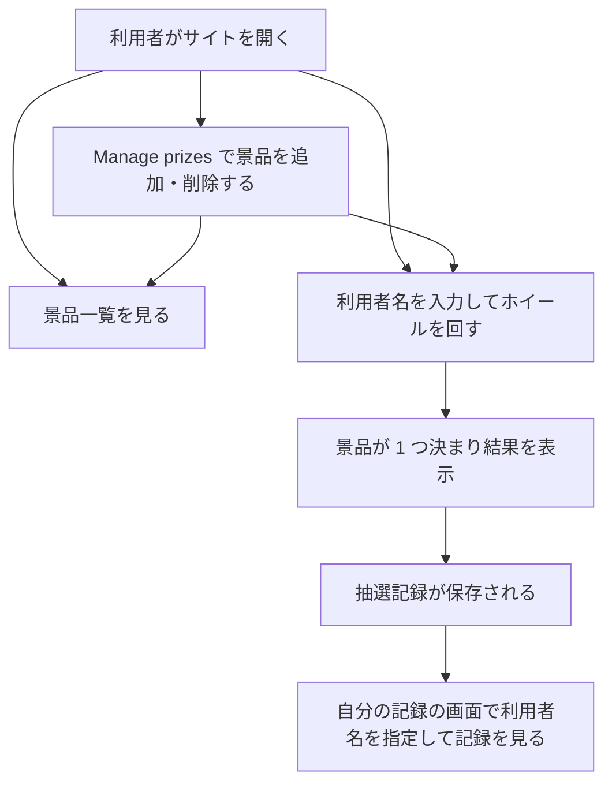
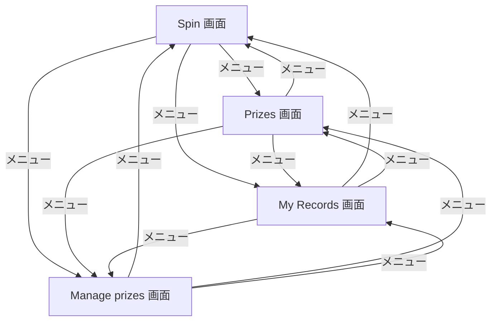

# 変更要件定義書: 配色の変更と景品管理ページの追加

作成日: 2026-11-04。フロー: 変更（`.history/20261104-prize-management-and-colors/`）。対応する正本: `docs/requirements.md`（正本は書き換えない）。
画面の言語は英語（契約）。この文書の本文は日本語で書く。
区分: 変更する要件項目には [追加] か [削除] を付ける。変更の無い章は「変更なし」と書く。

## 1. 目的・前提

### 1-0. システムの目的

変更なし。利用者がブラウザでホイールを回し、景品を当てられるようにする。景品の一覧を見られるようにし、各利用者が自分の抽選結果を後から確かめられるようにする。
追加: 利用者が景品を画面から追加・削除できるようにし、ホイールと景品一覧を常に登録済みの景品と一致させる。

### 用語集

変更あり（用語の意味を直す。ID は付けない）。

| 用語 | 業務上の意味 | 本案件での使用範囲 | 同義語/類義語 |
|---|---|---|---|
| 景品 | 抽選で当たる賞品 | 抽選の対象。一覧で表示し、管理画面で追加・削除する（変更前は初期データのみで追加・編集しないとしていた） | Prize |

（抽選ホイール、抽選、抽選記録、利用者名は変更なし）

### システムの形態

変更なし。GUI（画面）。ブラウザで使う画面だけ。

### 1-1. 技術制約

変更なし。既存要件定義書 `docs/requirements.md` 1-1 を参照。

## 2. 業務

### 対象業務一覧

変更なし。`RQ-BZ-PRIZE-DRAW`（景品抽選）の業務範囲に、景品の追加と削除を加える（業務名と担当者は変えない）。

| RQ-BZ-ID | 業務名 | 業務の範囲 | 担当者 |
|---|---|---|---|
| `RQ-BZ-PRIZE-DRAW` | 景品抽選 | 利用者がホイールを回して景品を当て、結果を記録し、景品と自分の記録を確かめる。景品を画面から追加・削除する（変更で追加） | 一般の利用者 |

### 業務フロー

変更あり（管理画面への経路を加える）。

### 2-1. 業務の問題（あるべき姿と現状のギャップ）

[追加] 変更で追加する問題（ID は付けない）。

| 問題 | 対象業務（RQ-BZ） | あるべき姿 | 現状 | ギャップ（KPI） | 業務影響 |
|---|---|---|---|---|---|
| 景品の内容を画面から変えられない | `RQ-BZ-PRIZE-DRAW` | 利用者が景品を画面から追加・削除でき、ホイールと景品一覧が登録済みの景品を示す | 景品は初期データ 6 件のみで、追加も削除もできない | 不明（依頼に数値の目標は無い） | 景品を入れ替えるたびに開発者の作業が要る |

（変更前の問題「景品の抽選を誰でもブラウザで試せず、当たった結果が残らない」は変更なし）

### 2-2. 業務課題一覧

| RQ-BK-ID | 業務課題（取り組むこと） | 解決する問題（2-1） | 解決後の状態（KPI の目標値） | 対象業務（RQ-BZ） |
|---|---|---|---|---|
| [追加] `RQ-BK-MANAGE-PRIZES` | 景品を画面から追加・削除できるようにする | 景品の内容を画面から変えられない | 数値目標は無い（依頼に無い）。景品の追加と削除が画面で完結する | `RQ-BZ-PRIZE-DRAW` |

（`RQ-BK-SPIN-WHEEL-DRAW`・`RQ-BK-SHOW-PRIZES`・`RQ-BK-RECORD-WINS` は変更なし）

### 2-3. 見込み経営効果

変更なし。見込み経営効果は算定しない（既存要件定義書 2-3 を参照）。

## 3. 機能要件

### 入力データと出力データ

変更あり。人手入力に「景品名（Manage prizes 画面で景品を追加するとき）」を加える。出力データと帳票は変更なし。

### 利用者フロー

変更あり。

Manage prizes 画面では景品名を入力して Add を押すと景品が 1 件増え、一覧の Remove を押すと景品が 1 件減る。

### 機能一覧

| RQ-ID | カテゴリ | 機能名 | 対応業務課題ID（RQ-BK-*） | この機能が無いと何が困るか |
|---|---|---|---|---|
| [追加] `RQ-FT-ADD-PRIZE` | マスタ管理 | 景品名を入力して景品を 1 件追加する。景品名は前後の空白を除いて 1〜60 文字（空白だけは不可）。説明は空で登録する。同じ名前の景品を複数登録してよい（重複を禁じる規則は依頼に無いため作らない） | `RQ-BK-MANAGE-PRIZES` | 景品を増やせず、抽選の対象を変えられない |
| [追加] `RQ-FT-REMOVE-PRIZE` | マスタ管理 | Manage prizes 画面で景品を 1 件選んで削除する。確認の画面は出さず、Remove を押すと即削除する。景品が 0 件になってもよい（以後の抽選は行わない）。削除しても、その景品の抽選記録は消さず、景品名の写しで表示する | `RQ-BK-MANAGE-PRIZES` | 不要になった景品を外せない |
| [追加] `RQ-FT-WHEEL-FOLLOWS-PRIZES` | 業務機能 | ホイールの区画と Prizes 画面の景品一覧は、画面を開くたびに登録済みの景品の一覧を読み直して描く。景品の追加・削除の直後に画面を開いたとき、古い区画や古い一覧を表示しない | `RQ-BK-SPIN-WHEEL-DRAW`、`RQ-BK-SHOW-PRIZES`、`RQ-BK-MANAGE-PRIZES` | 追加・削除が抽選の区画や景品一覧に反映されず、依頼の要求を満たせない |

（`RQ-FT-SPIN-WHEEL`・`RQ-FT-RECORD-WIN`・`RQ-FT-LIST-PRIZES`・`RQ-FT-VIEW-OWN-RECORDS` は変更なし）

### 3-1. 帳票・出力ファイル

変更なし。帳票・出力ファイルは無い。

### 3-2. 業務ルール

変更なし。`RQ-FT-DRAW-UNIFORM-PRIZE`（景品は等しい確率で決まる。景品が 0 件のときは抽選しない）は、景品の一覧が変わっても同じ規則で動く。

### 3-3. 外部連携

変更なし。外部連携は無い。

### 3-4. 業務課題と要件の対応（変更後）

| RQ-BK-ID | 対応する要件（変更後の有効な要件） |
|---|---|
| `RQ-BK-SPIN-WHEEL-DRAW` | `RQ-FT-SPIN-WHEEL`、`RQ-FT-DRAW-UNIFORM-PRIZE`、`RQ-FT-RECORD-WIN`、`RQ-FT-WHEEL-FOLLOWS-PRIZES`、`RQ-UI-SPIN-SCREEN`、`RQ-UI-NAVIGATION-MENU-WITH-MANAGE` |
| `RQ-BK-SHOW-PRIZES` | `RQ-FT-LIST-PRIZES`、`RQ-FT-WHEEL-FOLLOWS-PRIZES`、`RQ-UI-PRIZE-LIST-SCREEN` |
| `RQ-BK-RECORD-WINS` | `RQ-FT-RECORD-WIN`、`RQ-FT-VIEW-OWN-RECORDS`、`RQ-UI-MY-RECORDS-SCREEN`、`RQ-DT-STORAGE-SQLITE-RETENTION` |
| `RQ-BK-MANAGE-PRIZES` | `RQ-FT-ADD-PRIZE`、`RQ-FT-REMOVE-PRIZE`、`RQ-FT-WHEEL-FOLLOWS-PRIZES`、`RQ-UI-MANAGE-PRIZES-SCREEN`、`RQ-UI-NAVIGATION-MENU-WITH-MANAGE`、`RQ-DT-STORAGE-SQLITE-RETENTION` |

## 4. データ

### 4-1. データ要件一覧

| RQ-ID | 種別 | 内容 | 対応業務課題ID（RQ-BK-*） | この要件が無いと何が困るか |
|---|---|---|---|---|
| [削除] `RQ-DT-STORAGE-SQLITE` | 内部データ | （旧内容）景品と抽選記録を SQLite に保存する。保持期間は無期限（削除の操作は無い） | `RQ-BK-RECORD-WINS` | 削除: 景品の削除の操作ができたため「削除の操作は無い」が成り立たなくなる。内容は下の新要件に移す |
| [追加] `RQ-DT-STORAGE-SQLITE-RETENTION` | 内部データ | 景品と抽選記録を SQLite のデータベースファイルとして `DATA_DIR` 配下に保存する。外部 DB は使わない。保持期間は無期限。景品は管理画面から削除できるが、抽選記録は削除しない（景品を消しても、その景品の抽選記録は残す） | `RQ-BK-RECORD-WINS`、`RQ-BK-MANAGE-PRIZES` | 抽選記録が消えたり、景品の削除で過去の当選が分からなくなったりする |

DB が必要な理由は変更なし（抽選記録を追記し、利用者名で絞り込んで表示するため）。景品の件数は画面から増減する。

### 4-2. 業務エンティティとデータ項目

変更なし。景品のデータ項目（景品ID、景品名 1〜60 文字、説明 0〜200 文字、任意）と、抽選記録のデータ項目は既存の表のとおり。管理画面から追加する景品の説明は空で登録する。

### 4-3. CRUD テーブル

全エンティティ分を書く。

| エンティティ名 | Create | Read（一覧） | Read（詳細） | 検索 | Update | Delete | 備考 |
|---|---|---|---|---|---|---|---|
| 景品 | ○ | ○ | × | × | × | ○ | 変更あり（変更前は Create と Delete が ×）。Create は Manage prizes 画面の Add、Delete は Remove で行う。Update（編集）は依頼に無いため作らない（×） |
| 抽選記録 | ○ | ○ | × | ○ | × | × | 変更なし。景品の削除では抽選記録を消さない（Delete は対象外のまま） |

| 値 | 意味 |
|---|---|
| ○ | 必須の操作 |
| △ | 条件付きで必要な操作 |
| × | 対象外の操作 |

### 4-4. 状態遷移

変更なし。状態を持つエンティティは無い。

### 4-5. 画面一覧

| RQ-ID | 画面名 | 対応する CRUD 操作（エンティティ名:操作種別） | 主な機能・目的 | 対応業務課題ID（RQ-BK-*） |
|---|---|---|---|---|
| `RQ-UI-SPIN-SCREEN` | Spin 画面（抽選） | 抽選記録:Create、景品:Read | 変更なし（ホイールの区画は `RQ-FT-WHEEL-FOLLOWS-PRIZES` に従う） | `RQ-BK-SPIN-WHEEL-DRAW` |
| `RQ-UI-PRIZE-LIST-SCREEN` | Prizes 画面（景品一覧） | 景品:Read | 変更なし（一覧は `RQ-FT-WHEEL-FOLLOWS-PRIZES` に従う） | `RQ-BK-SHOW-PRIZES` |
| `RQ-UI-MY-RECORDS-SCREEN` | My Records 画面（自分の記録） | 抽選記録:Read、抽選記録:検索 | 変更なし | `RQ-BK-RECORD-WINS` |
| [削除] `RQ-UI-NAVIGATION-MENU` | 共通メニュー（旧: 3 項目） | なし | 旧内容。項目が 4 つになり意味が変わるため、新 ID へ移す | `RQ-BK-SPIN-WHEEL-DRAW`、`RQ-BK-SHOW-PRIZES`、`RQ-BK-RECORD-WINS` |
| [追加] `RQ-UI-NAVIGATION-MENU-WITH-MANAGE` | 共通メニュー（全画面） | なし | 全画面の上部に Spin、Prizes、My Records、Manage prizes の 4 項目を表示し、画面を移動する。現在の画面の項目を示す | `RQ-BK-SPIN-WHEEL-DRAW`、`RQ-BK-SHOW-PRIZES`、`RQ-BK-RECORD-WINS`、`RQ-BK-MANAGE-PRIZES` |
| [追加] `RQ-UI-MANAGE-PRIZES-SCREEN` | Manage prizes 画面（景品の管理） | 景品:Create、景品:Delete、景品:Read | 景品名の入力欄と Add ボタンで景品を追加し、景品の表の Remove ボタンで景品を削除する | `RQ-BK-MANAGE-PRIZES` |

画面の要素（5 項目）:

- [追加] Manage prizes 画面: 目的は景品の追加と削除。主要要素は景品名の入力欄、Add ボタン、エラー欄、景品の表（Prize、Description、操作の Remove ボタン）。入力項目は景品名。表示項目は景品名と説明。入力欄の下のエラーは「Please enter a prize name (1–60 characters).」（空、空白だけ、61 文字以上のとき）。景品が 0 件のときは「No prizes yet」を表示する。Add の後は入力欄を空にし、表に新しい景品を出す。Remove の後は、その景品を表から消す。通信に失敗したときは「Something went wrong. Please try again.」を出す。確認の画面は無い。
- [追加] 共通メニュー: 項目は Spin、Prizes、My Records、Manage prizes の順。表示名は英語。
- Spin 画面、Prizes 画面、My Records 画面の要素は変更なし。

## 5. 非機能要件

| RQ-ID | カテゴリ | 非機能要件名 | 対応業務課題ID（RQ-BK-*） | この非機能要件が無いと何が困るか |
|---|---|---|---|---|
| [削除] `RQ-NF-LIGHT-GRAY-DARK-RED-THEME` | 利用者とアクセス経路 | （旧内容）背景は薄いグレー、部品は濃い赤 | `RQ-BK-SPIN-WHEEL-DRAW`、`RQ-BK-SHOW-PRIZES`、`RQ-BK-RECORD-WINS` | 依頼で配色を変えるため削除する。内容は下の新要件に移す |
| [追加] `RQ-NF-IVORY-DARK-GREEN-THEME` | 利用者とアクセス経路 | 4 つの画面（Spin、Prizes、My Records、Manage prizes）すべてで、画面の背景はアイボリー（既定 `#FFFFF0`）。ヘッダー、ボタン、カード（入力の枠）、表の見出し、ホイールの区画など部品の色は濃い緑（`#006400`、CSS 名 `darkgreen`）。濃い緑の部品の上の文字は白 | `RQ-BK-SPIN-WHEEL-DRAW`、`RQ-BK-SHOW-PRIZES`、`RQ-BK-RECORD-WINS`、`RQ-BK-MANAGE-PRIZES` | 依頼の配色指定（ivory の背景、dark green の部品）を満たせない |

- 性能（応答時間の目標）、利用人数、可用性、移行性、監査証跡の改ざん防止、認証無しと Chromium・英語表示の要件: 変更なし（既存要件定義書 5 を参照）

## 6. 運用要件

変更なし。起動の要件と、`DATA_DIR` が空のときのサンプル景品 6 件の要件は既存のまま（既存要件定義書 6 を参照）。

## 7. テスト用利用シナリオ

[削除] と [追加] の行は、同じ `RQ-TS` ID を 2 行に分けて書く（旧い列を [削除]、新しい列を [追加]）。

| RQ-ID | テスト目的 | 前提条件 | テスト手順 | 期待される結果 | 検証する要件ID | 対応業務課題ID（RQ-BK-*） |
|---|---|---|---|---|---|---|
| [削除] `RQ-TS-FIRST-START-AND-THEME` | （旧）空の DATA_DIR での起動と画面の見た目・言語 | DATA_DIR が空 | 旧の手順 | 旧の期待結果（薄いグレーの背景、濃い赤の部品） | `RQ-OP-START-SCRIPTS`、`RQ-OP-SAMPLE-DATA`、`RQ-NF-LIGHT-GRAY-DARK-RED-THEME`、`RQ-NF-ENGLISH-UI`、`RQ-NF-CHROMIUM-BROWSER`、`RQ-UI-SPIN-SCREEN` | `RQ-BK-SPIN-WHEEL-DRAW`、`RQ-BK-SHOW-PRIZES` |
| [追加] `RQ-TS-FIRST-START-AND-THEME` | 空の DATA_DIR での起動と画面の見た目・言語 | DATA_DIR が空 | `bash setup.sh`、`PORT` を指定して `bash run.sh` を起動する。Spin 画面を開き、Prizes、My Records、Manage prizes の画面を順に開いて背景と部品の色と文言を確かめる | 起動が成功し、サンプル景品が 6 件ある。背景はアイボリー、部品は濃い緑。文言はすべて英語 | `RQ-OP-START-SCRIPTS`、`RQ-OP-SAMPLE-DATA`、`RQ-NF-IVORY-DARK-GREEN-THEME`、`RQ-NF-ENGLISH-UI`、`RQ-NF-CHROMIUM-BROWSER`、`RQ-UI-SPIN-SCREEN` | `RQ-BK-SPIN-WHEEL-DRAW`、`RQ-BK-SHOW-PRIZES`、`RQ-BK-MANAGE-PRIZES` |
| [削除] `RQ-TS-NAVIGATE-MENU` | （旧）共通メニューで全画面を移動できる | 初期データのみ | （旧）Spin、Prizes、My Records の順にメニューを押す | （旧）各メニューで対応する画面に移動する | `RQ-UI-NAVIGATION-MENU` | `RQ-BK-SPIN-WHEEL-DRAW`、`RQ-BK-SHOW-PRIZES`、`RQ-BK-RECORD-WINS` |
| [追加] `RQ-TS-NAVIGATE-MENU` | 共通メニューで全画面を移動できる | 初期データのみ | 任意の画面から Spin、Prizes、My Records、Manage prizes の順にメニューを押す | 各メニューで対応する画面に移動し、現在の画面の項目が分かる | `RQ-UI-NAVIGATION-MENU-WITH-MANAGE` | `RQ-BK-SPIN-WHEEL-DRAW`、`RQ-BK-SHOW-PRIZES`、`RQ-BK-RECORD-WINS`、`RQ-BK-MANAGE-PRIZES` |
| [追加] `RQ-TS-MANAGE-PRIZES` | 景品の追加と削除が、景品一覧とホイールに反映される | 初期データのみ（景品 6 件） | Manage prizes を開き、景品名「Sample Snack」を入力して Add を押す。Prizes 画面を開く。Spin 画面を開く。Manage prizes を開き、「Sample Snack」の Remove を押す。Prizes 画面を開く | 追加後、Prizes の一覧に 7 件で「Sample Snack」が出る。Spin 画面を開き直すとホイールの区画が 7 になる。削除後は Prizes の一覧が 6 件に戻り、ホイールの区画も 6 になる | `RQ-FT-ADD-PRIZE`、`RQ-FT-REMOVE-PRIZE`、`RQ-FT-WHEEL-FOLLOWS-PRIZES`、`RQ-UI-MANAGE-PRIZES-SCREEN`、`RQ-UI-NAVIGATION-MENU-WITH-MANAGE` | `RQ-BK-MANAGE-PRIZES`、`RQ-BK-SPIN-WHEEL-DRAW`、`RQ-BK-SHOW-PRIZES` |
| [追加] `RQ-TS-VALIDATE-PRIZE-NAME` | 景品名の入力チェック | 初期データのみ | Manage prizes で景品名を空のまま Add を押す。次に空白だけを入力して Add を押す。61 文字の名前を入力して Add を押す | 3 種類とも景品は追加されず、景品の数は 6 のまま。「Please enter a prize name (1–60 characters).」が表示される | `RQ-FT-ADD-PRIZE`、`RQ-UI-MANAGE-PRIZES-SCREEN` | `RQ-BK-MANAGE-PRIZES` |
| [追加] `RQ-TS-REMOVE-PRIZE-KEEPS-RECORDS` | 景品を削除しても抽選記録は残る | 初期データのみ | Spin 画面で利用者名「Alice」を入力して Spin を押し、当たった景品名を控える。Manage prizes で、その景品の Remove を押す。My Records 画面で「Alice」を検索する | その景品は Prizes の一覧とホイールから消える。My Records には Alice の抽選記録が残り、景品名は削除した景品の名前のまま表示される | `RQ-FT-REMOVE-PRIZE`、`RQ-FT-WHEEL-FOLLOWS-PRIZES`、`RQ-UI-MANAGE-PRIZES-SCREEN` | `RQ-BK-MANAGE-PRIZES`、`RQ-BK-RECORD-WINS` |

変更なし: 既存の 5 本のシナリオ（抽選と記録、利用者名の入力チェック、景品一覧、自分の記録、景品が 0 件）は正本の第 7 章のまま使う。

網羅性の確認: [追加] の `RQ-FT-ADD-PRIZE`・`RQ-FT-REMOVE-PRIZE`・`RQ-FT-WHEEL-FOLLOWS-PRIZES`、[追加] の `RQ-UI-MANAGE-PRIZES-SCREEN`・`RQ-UI-NAVIGATION-MENU-WITH-MANAGE` は、上の新シナリオのどれかの「検証する要件ID」に現れる。Manage prizes 画面の利用フロー（追加、空・空白・長すぎる名前、削除、削除後の記録）と共通メニューの 4 項目を、新シナリオのどれかが通る。
