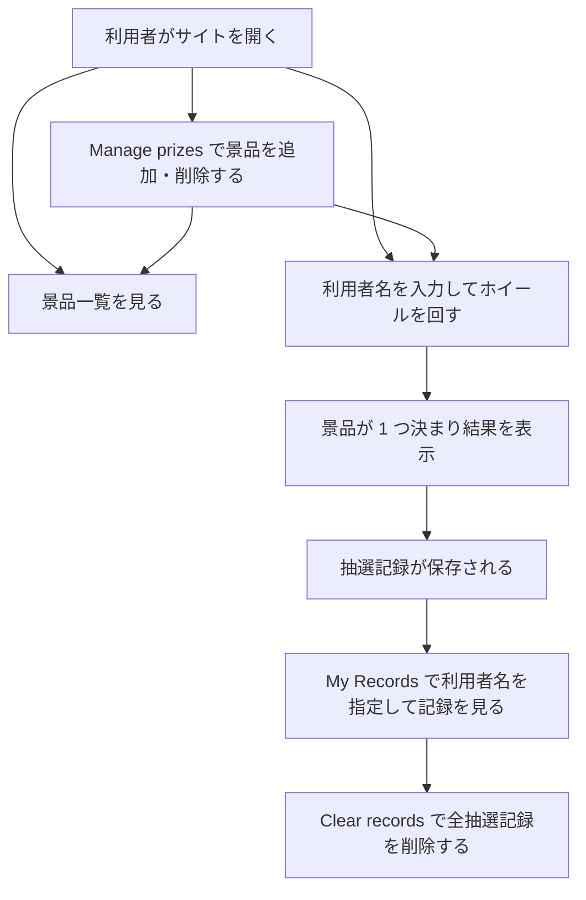
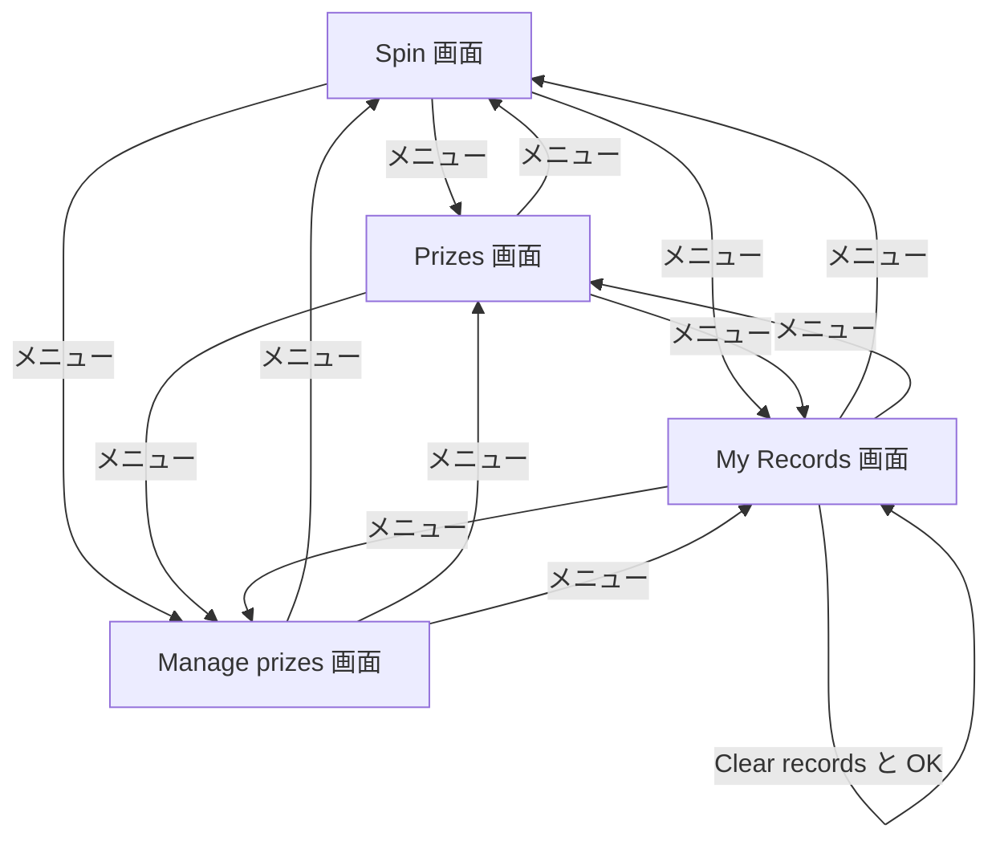

# 変更要件定義書: 利用者名の表示と抽選記録の一括削除

作成日: 2026-11-04。フロー: 変更（`.history/20261104-name-entry-and-clear-records/`）。対応する正本: `docs/requirements.md`（正本は書き換えない）。
画面の言語は英語（契約）。この文書の本文は日本語で書く。
区分: 変更する要件項目には [追加] か [削除] を付ける。内容を変える既存の要件は、旧 ID を [削除]、新しい ID を [追加] で書く（チェッカーは [追加] と [削除] だけを見る）。変更の無い章は「変更なし」と書く。

依頼（REQUEST.md）の 2 件の扱い:
- 依頼 1（回す前に利用者名を必須にする。当選記録に利用者名・景品・日時を出す）: 利用者名の入力欄は既存の画面にあり、空・空白だけ・31 文字以上では抽選しない動作も既存（既存の入力検証の試験）。このため、既存の動作を業務ルールとして明文化する [追加]（`RQ-FT-SPIN-REQUIRES-NAME`）。記録の一覧に利用者名の列を加える（[削除] と [追加] の組）。
- 依頼 2（My Records に Clear records を置き、確認のうえ全抽選記録を削除する）: 機能（`RQ-FT-CLEAR-RECORDS`）、業務課題（`RQ-BK-CLEAR-RECORDS`）、データの保持の変更（抽選記録を全件削除できる）。

## 1. 目的・前提

### 1-0. システムの目的

変更なし。利用者がブラウザでホイールを回し、景品を当てられるようにする。景品の一覧を見られるようにし、各利用者が自分の抽選結果を後から確かめられるようにする。利用者が景品を画面から追加・削除できるようにし、ホイールと景品一覧を常に登録済みの景品と一致させる。

### 用語集

変更なし。抽選記録は既に利用者名・景品・日時を持つ。

### システムの形態

変更なし。GUI（画面）。ブラウザで使う画面だけ。

### 1-1. 技術制約

変更なし。既存要件定義書 `docs/requirements.md` 1-1 を参照。

## 2. 業務

### 対象業務一覧

変更なし。`RQ-BZ-PRIZE-DRAW`（景品抽選）の業務範囲に、抽選記録の一括削除を加える（業務名と担当者は変えない）。

| RQ-BZ-ID | 業務名 | 業務の範囲 | 担当者 |
|---|---|---|---|
| `RQ-BZ-PRIZE-DRAW` | 景品抽選 | 利用者がホイールを回して景品を当て、結果を記録し、景品と自分の記録を確かめる。景品を画面から追加・削除する。抽選記録を画面から一括で削除する（変更で追加） | 一般の利用者 |

### 業務フロー

変更あり（My Records から抽選記録を一括で削除する経路を加える）。

### 2-1. 業務の問題（あるべき姿と現状のギャップ）

変更あり。[追加] 次の問題を加える（ID は付けない）。

| 問題 | 対象業務（RQ-BZ） | あるべき姿 | 現状 | ギャップ（KPI） | 業務影響 |
|---|---|---|---|---|---|
| [追加] 試し回した抽選記録を画面から消せない | `RQ-BZ-PRIZE-DRAW` | 利用者または運営者が、確認のうえ画面から抽選記録をまとめて消せる | 抽選記録は画面からも消せず、テストで作った記録が残り続ける | 不明（依頼に数値の目標は無い） | 記録の一覧が不要な記録で埋まり、確かめたい記録が探しにくい |

（変更前の 2 つの問題は変更なし）

### 2-2. 業務課題一覧

変更あり。

| RQ-BK-ID | 業務課題（取り組むこと） | 解決する問題（2-1） | 解決後の状態（KPI の目標値） | 対象業務（RQ-BZ） |
|---|---|---|---|---|
| [追加] `RQ-BK-CLEAR-RECORDS` | 抽選記録を画面から確認付きで一括削除できるようにする | 試し回した抽選記録を画面から消せない | 数値目標は無い（依頼に無い）。確認のうえ、すべての抽選記録が画面から消える | `RQ-BZ-PRIZE-DRAW` |

（`RQ-BK-SPIN-WHEEL-DRAW`・`RQ-BK-SHOW-PRIZES`・`RQ-BK-RECORD-WINS`・`RQ-BK-MANAGE-PRIZES` は変更なし）

### 2-3. 見込み経営効果

変更なし。見込み経営効果は算定しない（既存要件定義書 2-3 を参照）。

## 3. 機能要件

### 入力データと出力データ

変更あり。人手入力に「抽選記録の一括削除の確認（ブラウザの確認ダイアログでの OK / Cancel）」を加える。出力データは、抽選記録の一覧に利用者名の列を加える。帳票は変更なし。

### 利用者フロー

変更あり。

My Records 画面では、利用者名を入力して Search を押すと、その利用者の抽選記録を表示する。表は利用者名・景品名・日時を並べる。Clear records を押すと、ブラウザの確認ダイアログを出す。OK を押すと、利用者名に関係なくすべての抽選記録を削除する。Cancel を押すと何もしない。景品は消さない。

### 機能一覧

| RQ-ID | カテゴリ | 機能名 | 対応業務課題ID（RQ-BK-*） | この機能が無いと何が困るか |
|---|---|---|---|---|
| [削除] `RQ-FT-VIEW-OWN-RECORDS` | 業務機能 | 利用者名を指定し、その利用者の抽選記録を新しい順に表示する（旧内容。表示する項目に利用者名が無い） | `RQ-BK-RECORD-WINS` | 削除: 記録の一覧に利用者名が無い要件に変わったため。内容は下の新要件に移す |
| [追加] `RQ-FT-VIEW-OWN-RECORDS-WITH-NAME` | 業務機能 | 利用者名を指定し、その利用者の抽選記録を新しい順に表示する。各記録に利用者名・景品名・抽選日時を並べて出す | `RQ-BK-RECORD-WINS` | 利用者が自分の当選を確かめられない。誰の記録か分からない |
| [追加] `RQ-FT-CLEAR-RECORDS` | 業務機能 | My Records 画面の Clear records ボタンで、すべての抽選記録を削除する。ブラウザの確認ダイアログ（`window.confirm`）で OK を押したときだけ削除する。Cancel のときは何もしない。景品は消さない。記録が 0 件のときも押せ、何も起きない | `RQ-BK-CLEAR-RECORDS` | 試した抽選記録を画面から消せない |

（上記以外の機能は変更なし）

### 3-1. 帳票・出力ファイル

変更なし。帳票・出力ファイルは無い。

### 3-2. 業務ルール

変更あり。

| RQ-ID | ルール名 | 内容（条件と結果） | 違反時・エラー時の業務上の扱い | 対応業務課題ID（RQ-BK-*） |
|---|---|---|---|---|
| [追加] `RQ-FT-SPIN-REQUIRES-NAME` | 利用者名が無いと抽選しない | Spin 画面で、利用者名（前後の空白を除いて 1〜30 文字）が無いときは抽選を行わず、ホイールも回さない。利用者名の入力欄は必須で、Spin ボタンの近くにある。空、空白だけ、31 文字以上のときは、入力欄の下に「Please enter your name (1–30 characters).」を表示する | 抽選記録は作らない。既存の動作（利用者名の入力検証）と同じ規則を、依頼に従って業務ルールとして明文化する | `RQ-BK-SPIN-WHEEL-DRAW`、`RQ-BK-RECORD-WINS` |

（上記以外の業務ルールは変更なし）

### 3-3. 外部連携

変更なし。外部連携は無い。

### 3-4. 業務課題と要件の対応（変更後）

| RQ-BK-ID | 対応する要件（変更後の有効な要件） |
|---|---|
| `RQ-BK-SPIN-WHEEL-DRAW` | `RQ-FT-SPIN-WHEEL`、`RQ-FT-SPIN-REQUIRES-NAME`、`RQ-FT-DRAW-UNIFORM-PRIZE`、`RQ-FT-RECORD-WIN`、`RQ-FT-WHEEL-FOLLOWS-PRIZES`、`RQ-UI-SPIN-SCREEN`、`RQ-UI-NAVIGATION-MENU-WITH-MANAGE` |
| `RQ-BK-SHOW-PRIZES` | `RQ-FT-LIST-PRIZES`、`RQ-FT-WHEEL-FOLLOWS-PRIZES`、`RQ-UI-PRIZE-LIST-SCREEN` |
| `RQ-BK-RECORD-WINS` | `RQ-FT-RECORD-WIN`、`RQ-FT-VIEW-OWN-RECORDS-WITH-NAME`、`RQ-FT-SPIN-REQUIRES-NAME`、`RQ-UI-MY-RECORDS-SCREEN-CLEAR`、`RQ-DT-STORAGE-SQLITE-RETENTION-CLEAR` |
| `RQ-BK-MANAGE-PRIZES` | `RQ-FT-ADD-PRIZE`、`RQ-FT-REMOVE-PRIZE`、`RQ-FT-WHEEL-FOLLOWS-PRIZES`、`RQ-UI-MANAGE-PRIZES-SCREEN`、`RQ-UI-NAVIGATION-MENU-WITH-MANAGE`、`RQ-DT-STORAGE-SQLITE-RETENTION-CLEAR` |
| `RQ-BK-CLEAR-RECORDS` | `RQ-FT-CLEAR-RECORDS`、`RQ-UI-MY-RECORDS-SCREEN-CLEAR`、`RQ-DT-STORAGE-SQLITE-RETENTION-CLEAR` |

## 4. データ

### 4-1. データ要件一覧

| RQ-ID | 種別 | 内容 | 対応業務課題ID（RQ-BK-*） | この要件が無いと何が困るか |
|---|---|---|---|---|
| [削除] `RQ-DT-STORAGE-SQLITE-RETENTION` | 内部データ | （旧内容）景品と抽選記録を SQLite のデータベースファイルとして `DATA_DIR` 配下に保存する。外部 DB は使わない。保持期間は無期限。景品は管理画面から削除できるが、抽選記録は削除しない | `RQ-BK-RECORD-WINS`、`RQ-BK-MANAGE-PRIZES` | 削除: 抽選記録を一括で削除する操作が加わり「抽選記録は削除しない」が成り立たなくなったため。内容は下の新要件に移す |
| [追加] `RQ-DT-STORAGE-SQLITE-RETENTION-CLEAR` | 内部データ | 景品と抽選記録を SQLite のデータベースファイルとして `DATA_DIR` 配下に保存する。外部 DB は使わない。保持期間は無期限。景品は管理画面から削除できる。抽選記録は、景品を削除しても消さない。抽選記録は My Records の Clear records でのみ、すべての件を一括で削除できる（1 件ずつの削除は無い） | `RQ-BK-RECORD-WINS`、`RQ-BK-MANAGE-PRIZES`、`RQ-BK-CLEAR-RECORDS` | 抽選記録が消えたり、景品の削除で過去の当選が分からなくなったり、一括削除の範囲が決まらなかったりする |

DB が必要な理由は変更なし。抽選記録の表（`spin_record`）は利用者名を既に持つため、テーブルの項目は変えない。

### 4-2. 業務エンティティとデータ項目

変更なし。`spin_record` の項目（利用者名・景品名・抽選日時）は既存のまま。

### 4-3. 状態遷移

変更なし。状態を持つエンティティは無い。

### 4-4. 業務ルールとデータの関係

変更なし。

### 4-5. 画面一覧

変更あり。

| RQ-ID | 画面名 | 対応する CRUD 操作（エンティティ名:操作種別） | 主な機能・目的 | 対応業務課題ID（RQ-BK-*） |
|---|---|---|---|---|
| [削除] `RQ-UI-MY-RECORDS-SCREEN` | My Records 画面（自分の記録）（旧内容） | 抽選記録:Read、抽選記録:検索 | 利用者名を入力し、その利用者の抽選記録を新しい順に表示する。表は抽選日時と景品名だけ | `RQ-BK-RECORD-WINS` |
| [追加] `RQ-UI-MY-RECORDS-SCREEN-CLEAR` | My Records 画面（自分の記録と一括削除） | 抽選記録:Read、抽選記録:検索、抽選記録:Delete（一括） | 利用者名を入力し、その利用者の抽選記録を新しい順に表示する。表は利用者名・景品名・抽選日時。Clear records ボタンで全件を確認のうえ削除する | `RQ-BK-RECORD-WINS`、`RQ-BK-CLEAR-RECORDS` |

（上記以外の画面は変更なし）

画面の要素（変更後の My Records 画面）:

- My Records 画面: 目的は自分の抽選記録の確認と、記録の一括削除。主要要素は利用者名の入力欄、Search ボタン、記録の表（Player、Prize、Date and time）、Clear records ボタン。入力項目は利用者名（Spin 画面で保存した名前を初期値にする）と、確認ダイアログでの OK / Cancel。表示項目は利用者名、景品名、抽選日時。該当が無いときは「No records found for this name」を表示する。利用者名が未入力のときは「Please enter your name」を表示する。Clear records を押すと確認ダイアログを出す（文言は `Delete all winning records? This cannot be undone.`）。OK のあとは、表を空にし、「All winning records were deleted.」を表示する。Cancel のときは何も変えない。Clear records の失敗時は「Something went wrong. Please try again.」を表示する。ボタンの色は濃い緑（既存の配色の規則）。

## 5. 非機能要件

変更なし。ボタンの配色は既存の部品の規則（濃い緑、文字は白）に従う。

## 6. 運用要件

変更なし。

## 7. テスト用利用シナリオ

変更あり。[削除] の行のシナリオは受け入れ網羅に数えない。

| RQ-ID | テスト目的 | 前提条件 | テスト手順 | 期待される結果 | 検証する要件ID | 対応業務課題ID（RQ-BK-*） |
|---|---|---|---|---|---|---|
| [削除] `RQ-TS-SPIN-AND-RECORD` | 抽選と記録の一連の動作（旧内容） | 初期データのみ（抽選記録 0 件） | 旧内容のとおり | 旧内容のとおり（記録の表は景品名と日時のみ） | `RQ-FT-SPIN-WHEEL`、`RQ-FT-RECORD-WIN`、`RQ-FT-DRAW-UNIFORM-PRIZE`、`RQ-FT-VIEW-OWN-RECORDS`、`RQ-UI-SPIN-SCREEN`、`RQ-UI-MY-RECORDS-SCREEN` | `RQ-BK-SPIN-WHEEL-DRAW`、`RQ-BK-RECORD-WINS` |
| [追加] `RQ-TS-SPIN-AND-RECORD-V2` | 抽選と記録の一連の動作（利用者名の表示） | 初期データのみ（抽選記録 0 件） | Spin 画面で利用者名「Alice」を入力して Spin を押す。ホイールが止まるまで待つ。My Records 画面で「Alice」を検索する | 景品が 1 つ表示される。My Records に抽選記録が 1 件表示され、利用者名「Alice」・景品名・日時の 3 つが並ぶ。結果の景品は景品一覧のいずれかに一致する | `RQ-FT-SPIN-WHEEL`、`RQ-FT-SPIN-REQUIRES-NAME`、`RQ-FT-RECORD-WIN`、`RQ-FT-DRAW-UNIFORM-PRIZE`、`RQ-FT-VIEW-OWN-RECORDS-WITH-NAME`、`RQ-UI-SPIN-SCREEN`、`RQ-UI-MY-RECORDS-SCREEN-CLEAR` | `RQ-BK-SPIN-WHEEL-DRAW`、`RQ-BK-RECORD-WINS` |
| [削除] `RQ-TS-VALIDATE-PLAYER-NAME` | 利用者名の入力チェック（旧内容） | 初期データのみ | 旧内容のとおり | 旧内容のとおり | `RQ-FT-SPIN-WHEEL`、`RQ-UI-SPIN-SCREEN`、`RQ-UI-MY-RECORDS-SCREEN` | `RQ-BK-SPIN-WHEEL-DRAW`、`RQ-BK-RECORD-WINS` |
| [追加] `RQ-TS-VALIDATE-PLAYER-NAME-V2` | 利用者名の入力チェック（回す前の必須と、記録の検索） | 初期データのみ（抽選記録 0 件） | Spin 画面で利用者名を空のまま Spin を押す。次に空白だけを入力して Spin を押す。31 文字以上を入力して Spin を押す。My Records で空のまま Search を押す | 3 種類とも抽選は行われず、ホイールは回らず、抽選記録は増えない。入力欄の下に「Please enter your name (1–30 characters).」が表示される。My Records は「Please enter your name」を表示する | `RQ-FT-SPIN-REQUIRES-NAME`、`RQ-FT-SPIN-WHEEL`、`RQ-UI-SPIN-SCREEN`、`RQ-UI-MY-RECORDS-SCREEN-CLEAR` | `RQ-BK-SPIN-WHEEL-DRAW`、`RQ-BK-RECORD-WINS` |
| [削除] `RQ-TS-VIEW-OWN-RECORDS` | 自分の記録の絞り込みと新しい順（旧内容） | 利用者「Alice」が 2 回、「Bob」が 1 回抽選済み | 旧内容のとおり | 旧内容のとおり | `RQ-FT-VIEW-OWN-RECORDS`、`RQ-UI-MY-RECORDS-SCREEN` | `RQ-BK-RECORD-WINS` |
| [追加] `RQ-TS-VIEW-OWN-RECORDS-V2` | 自分の記録の絞り込みと新しい順（利用者名の表示） | 利用者「Alice」が 2 回、「Bob」が 1 回抽選済み | My Records で「Alice」を検索する。次に「Carol」を検索する | Alice の記録が 2 件、新しい順に表示され、各行に「Alice」が出る。Bob の記録は含まれない。Carol は「No records found for this name」を表示する | `RQ-FT-VIEW-OWN-RECORDS-WITH-NAME`、`RQ-UI-MY-RECORDS-SCREEN-CLEAR` | `RQ-BK-RECORD-WINS` |
| [追加] `RQ-TS-CLEAR-RECORDS` | 抽選記録の一括削除（確認のキャンセルと OK、景品は残る） | 利用者「Alice」が 1 回、「Bob」が 1 回抽選済み（景品は初期データの 6 件） | My Records で Clear records を押し、確認ダイアログで Cancel を押す。次に「Alice」を検索する。次に Clear records を押し、確認ダイアログで OK を押す。「Alice」を検索する。Prizes 画面を開く | Cancel のあとは Alice の記録が 1 件残る。OK のあとは「Alice」の検索が「No records found for this name」を表示し、Bob の記録も消えている（検索で確かめる）。Prizes 画面は景品 6 件のまま。確認ダイアログには「Delete all winning records? This cannot be undone.」が出る | `RQ-FT-CLEAR-RECORDS`、`RQ-UI-MY-RECORDS-SCREEN-CLEAR`、`RQ-DT-STORAGE-SQLITE-RETENTION-CLEAR` | `RQ-BK-CLEAR-RECORDS`、`RQ-BK-RECORD-WINS` |

網羅性の確認: 追加された機能（`RQ-FT-SPIN-REQUIRES-NAME`、`RQ-FT-VIEW-OWN-RECORDS-WITH-NAME`、`RQ-FT-CLEAR-RECORDS`）と画面（`RQ-UI-MY-RECORDS-SCREEN-CLEAR`）は、上のシナリオ（V2 と `RQ-TS-CLEAR-RECORDS`）のどれかが通る。`RQ-DT-STORAGE-SQLITE-RETENTION-CLEAR` は `RQ-TS-CLEAR-RECORDS` で確かめる。
