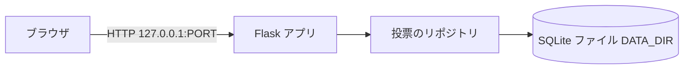
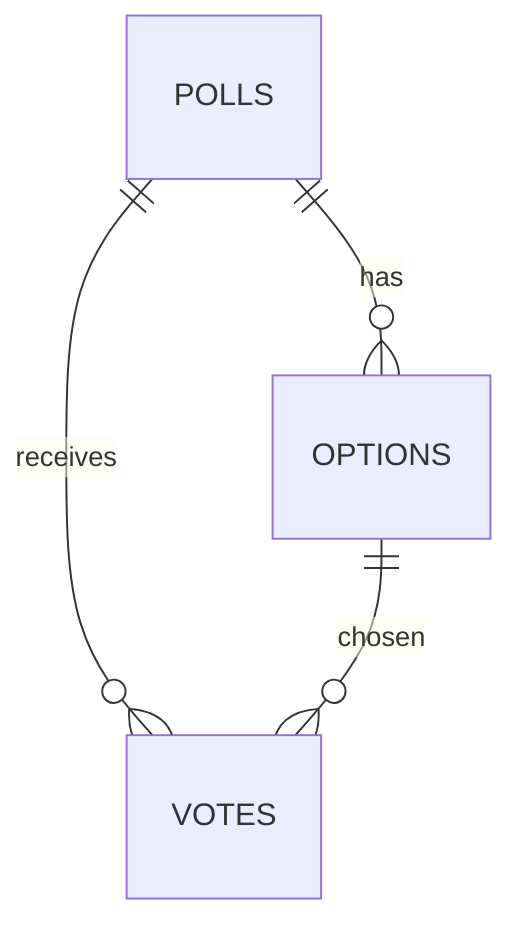
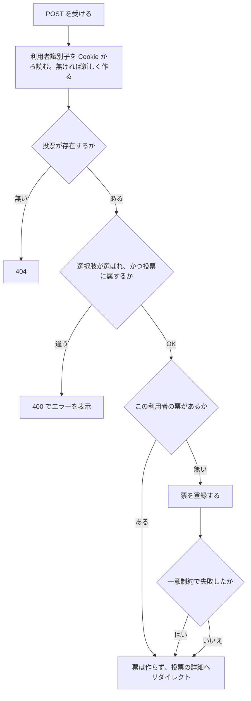
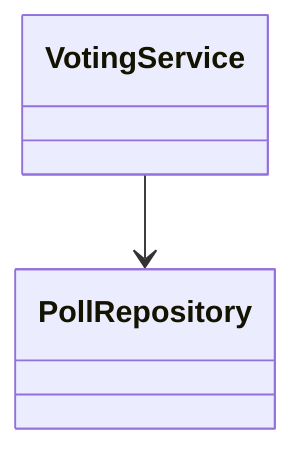
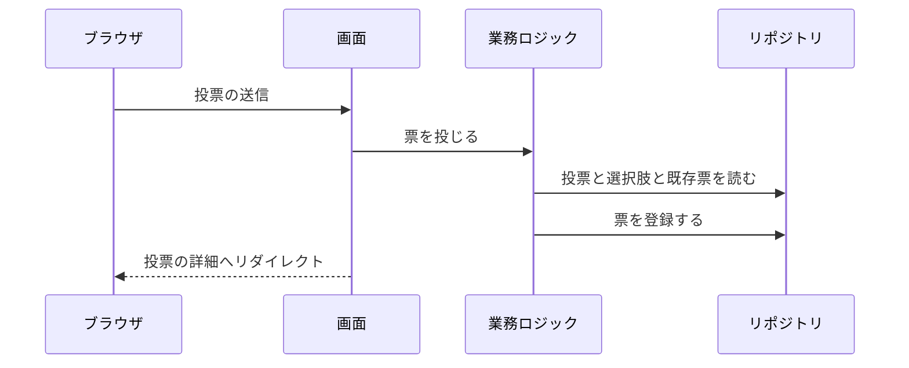

# 詳細設計書: 投票サイト（Polls）

## 1. 言語・フレームワーク・アーキテクチャの選定

### 判定

- 判定日時: 2026-11-04
- 技術制約の要約: 既存コード無し。ローカルの `bash run.sh` で起動し `http://127.0.0.1:$PORT` で提供する。無償のみ。Python 3.12 か Node.js 24。画面は英語。DATA_DIR の下に保存する。
- 判断軸ごとの該当有無:

| 判断軸 | 該当 | 理由 |
|---|---|---|
| 既存資産との整合 | 無し | 新規作成 |
| チームの技術 | 無し（制約無し） | 依頼者の指定なし |
| 配備先 | あり | ローカル実行のみ。コンテナ不要 |
| 認証と認可の境界 | 無し | 認証無し（RQ-NF-AUTH） |
| 画面の規模 | あり（小） | 画面 3 種。遷移は単純。サーバー側でテンプレートを描画すれば足りる |
| データの規模と構造 | あり（小） | 投票 3 件程度、票は数千件。参照は 3 段。SQL で集計できる DB を使う |
| 外部連携 | 無し | - |
| ライセンスとコスト | あり | 無償のみ |
| 保守性 | あり | 保守中のフレームワークを選ぶ |

### 候補の比較

| 候補 | 判断軸ごとの評価 | 出典 URL | 確認日 |
|---|---|---|---|
| Python 3.12 + Flask 3.1.3 + SQLite（標準 sqlite3） | 画面 3 種の描画に十分。テンプレート（Jinja2）と経路が単純。BSD-3-Clause。Python 3.9 以上で動く。最新版 2026-02-19 | https://pypi.org/project/Flask/ | 2026-11-04 |
| Python 3.12 + FastAPI 0.162.0 + Jinja2 + SQLite | API 中心の枠組み。HTML 描画の追加部品（Jinja2）が要り、依存が増える（Starlette、Pydantic）。MIT。Python 3.10 以上。最新版 2026-10-23 | https://pypi.org/project/fastapi/ | 2026-11-04 |
| Python 3.12 標準ライブラリだけ（http.server + sqlite3） | 依存ゼロで setup.sh が不要になるが、経路とテンプレートを自作する量が多く、保守性が下がる。Python 3.12 系の最新安定版は 3.12.16（2026-10-25） | https://www.python.org/downloads/ | 2026-11-04 |
| Node.js 24 + Express + SQLite | 依頼で許されるが、依頼者の既定環境の Python 3.12 のほうが単純。必須理由は無い | 未調査（不採用理由: 必須理由が無いため） | 2026-11-04 |

### 最終選定

- 言語: Python 3.12
- フレームワーク: Flask 3.1.3（テンプレートは Flask 同梱の Jinja2 を使う）
- DB: SQLite（Python 標準の sqlite3）
- 実行形態: ローカルのサーバー（Flask の組み込みサーバーを 1 プロセスで動かす）
- 選定理由: 要件の画面数と業務ルールは小さく、標準的な経路とテンプレートだけで足りる。Flask は保守中で、依存が少ない。SQLite は 1 つのファイルで、DATA_DIR に置ける。
- 承認: ANSWERS.md の固定回答「技術選定: 推奨の案でよい（Python のフレームワーク ＋ SQLite が最も単純）」により承認（2026-11-04）。

## 2. システム構成

### コンポーネント一覧

| コンポーネント | 役割 |
|---|---|
| 起動スクリプト（`setup.sh`・`run.sh`） | 仮想環境の作成と依存の導入、サーバーの起動 |
| Web アプリ（`app/`） | 経路、業務ロジック、データ保存、画面の描画 |
| データベース（SQLite、`DATA_DIR/polls.db`） | 投票・選択肢・票の保存 |
| テスト（`tests/`・`e2e/`） | 単体テスト、E2E テスト（実サーバーに HTTP で接続） |

### システム全体構成図



### 各コンポーネントの役割

- Flask アプリ: 経路を受け、投票の業務ロジックを呼び、HTML を返す。
- 投票のリポジトリ: SQL の発行を一箇所に集める。
- SQLite ファイル: 投票・選択肢・票を保存する。

### インターフェースとデータフロー

ブラウザは GET と POST（HTML フォーム）で `DS-IF-*` の経路を呼ぶ。投票の POST は、利用者識別子（Cookie）を読み、業務ロジック（`DS-CL-VOTING-SERVICE`）で検証してから票を保存する。

### ネットワーク構成図

ネットワーク越しの通信は、利用者のブラウザから `127.0.0.1` への HTTP だけである。外部サーバーとの通信は無い。構成は上記の全体構成図で示す。

## 3. データ設計

### 3-1. データモデル

DB を使う。理由: 票の集計と、1 投票 1 票の判定が必要なため。

#### テーブル

| DS-ID | テーブル | カラム | 型 | 制約 |
|---|---|---|---|---|
| `DS-SC-POLLS-TABLE` | polls | id, question, description, created_at | INTEGER 主キー（自動採番）, TEXT, TEXT, TEXT | question は NOT NULL で 1〜200 文字、description は 0〜500 文字 |
| `DS-SC-OPTIONS-TABLE` | options | id, poll_id, label, position | INTEGER 主キー, INTEGER, TEXT, INTEGER | poll_id は polls.id の外部キー、label は NOT NULL で 1〜100 文字、(poll_id, label) は一意、position は 1 以上 |
| `DS-SC-VOTES-TABLE` | votes | id, poll_id, option_id, voter_id, voted_at | INTEGER 主キー, INTEGER, INTEGER, TEXT, TEXT | poll_id と option_id は外部キー、voter_id は 32 文字の 16 進、(poll_id, voter_id) は一意（1 投票 1 票）、voted_at は UTC の ISO 8601 文字列 |



- 票の選択肢が同じ投票に属することは、業務ロジック（`DS-FN-CAST-VOTE`）で確かめる。

### 3-2. トランザクションと排他制御

- 票の登録（`DS-FN-CAST-VOTE`）は 1 つのトランザクションで行う。処理は、投票の存在確認、選択肢の所属確認、既存票の確認、票の登録の順。
- 同時に同じ利用者が 2 回投じた場合は、(poll_id, voter_id) の一意制約で 2 件目が失敗する。その失敗は「既に投票済み」として扱い、既存の結果を表示する（排他制御は一意制約による判定）。
- 集計（`DS-FN-GET-POLL-RESULT`・`DS-FN-GET-ALL-RESULTS`）は読み取りだけで、トランザクションを要しない。

### 3-3. 状態遷移

状態を持つエンティティは無い。

## 4. アーキテクチャ設計

### 4-1. 外部設計

#### 利用者向けインターフェース

| DS-ID | 画面・経路 | 目的 |
|---|---|---|
| `DS-IF-POLLS-PAGE` | GET `/` | 投票の一覧。全画面に共通の見た目（上部のナビゲーション Polls・Results、白背景、ネイビーの部品）を含む |
| `DS-IF-POLL-PAGE` | GET `/polls/<poll_id>` | 投票の詳細。未投票なら投票フォーム、投票済みなら結果 |
| `DS-IF-VOTE-ACTION` | POST `/polls/<poll_id>/vote` | 投票の受け付け（フォームの送信先） |
| `DS-IF-RESULTS-PAGE` | GET `/results` | 全投票の結果 |
| `DS-IF-NOT-FOUND` | 存在しない投票のとき | 404 のページに「Poll not found.」を表示 |

#### インターフェース仕様

| DS-ID | 入力とバリデーション | 出力 | エラー仕様 |
|---|---|---|---|
| `DS-IF-POLLS-PAGE` | 無し | 投票の一覧（質問文、選択肢の数、詳細へのリンク） | 投票が 0 件なら「No polls yet.」 |
| `DS-IF-POLL-PAGE` | poll_id は整数。存在しなければ 404（`DS-IF-NOT-FOUND`） | 質問文、説明、選択肢。投票済みなら結果（票数と割合） | 存在しない投票は 404 |
| `DS-IF-VOTE-ACTION` | option_id のフォーム値が無い、または整数でない → 「Please choose an option.」（業務ルール: 選択肢の検証）。option_id がその投票に属さない → 「That option is not part of this poll.」。投票が存在しない → 404 | 成功時は投票の詳細へ 303 でリダイレクト（結果が表示される）。投票済みなら票を作らず同じリダイレクト（1 投票 1 票） | エラー時は投票の詳細を 400 で再表示し、エラー文を画面に出す。票は作らない |
| `DS-IF-RESULTS-PAGE` | 無し | 全投票の質問、選択肢ごとの票数と割合、合計票数 | 票が 0 件の投票は「No votes yet.」 |

#### 外部システム連携

外部連携は無い。

### 4-2. 内部設計

#### 処理フロー（投票）



#### 各処理の役割

- 利用者識別子の作成（`DS-FN-IDENTIFY-VOTER`）: 無ければ 32 文字の 16 進を作り、Cookie（`voter_id`、HttpOnly、SameSite=Lax、有効期限 1 年）に保存する。
- 起動時の初期化（`DS-FN-CREATE-APP`）: DATA_DIR が無ければ作る。DB を開き、テーブルが無ければ作る。投票が 0 件なら初期データを入れる。
- バッチ: 無し。

## 5. クラス設計

| クラス | 責務（1 文） |
|---|---|
| `DS-CL-POLL-REPOSITORY` | 投票・選択肢・票の読み書きを SQL で行う |
| `DS-CL-VOTING-SERVICE` | 投票の検証（存在、選択肢の所属、1 投票 1 票）と結果の集計を行う |

- 依存の向き: `DS-CL-VOTING-SERVICE` → `DS-CL-POLL-REPOSITORY` → SQLite。画面（`DS-MD-VIEWS`）→ `DS-CL-VOTING-SERVICE`。SQL は画面から直接呼ばない。

### クラスの主要メソッド

- `DS-CL-POLL-REPOSITORY`: 投票の一覧、投票の取得、選択肢の一覧、票の登録（一意制約違反を区別して返す）、利用者の票の取得、選択肢ごとの票数の取得。
- `DS-CL-VOTING-SERVICE`: `DS-FN-CAST-VOTE`、`DS-FN-GET-POLL-RESULT`、`DS-FN-GET-ALL-RESULTS`。

### クラス図



### システム内メッセージ一覧

| メッセージ | 送り手 → 受け手 | 役割 |
|---|---|---|
| 投票の一覧の取得 | 画面 → 業務ロジック → リポジトリ | 一覧表示 |
| 票の投じる要求 | 画面 → 業務ロジック → リポジトリ | 投票 |

### メッセージフロー図



## 6. エラーハンドリングとセキュリティ設計

- エラーハンドリング: 存在しない投票は 404。フォームの入力エラーは 400 で同じ画面に再表示。想定外の例外は Flask の 500 ページ。処理は中止し、票は作らない。
- 認証: 無い（「認証は無い」）。
- 認可: 無い（「認可は無い」）。
- 利用者識別子: Cookie による識別。識別子を別のブラウザへ複製すれば票を重ねられる点は仕様として許容する（RQ-NF-AUTH）。
- 監査ログ: 無い。
- その他のセキュリティ対策: HTML のエスケープは Jinja2 の自動エスケープに任せる。認証が無く、結果への影響が 1 票に限られるため、POST に CSRF 対策は入れない。

## 7. コード設計

### 7-1. ディレクトリ構成

```
project root
├── setup.sh
├── run.sh
├── requirements.txt
├── app/
│   ├── __init__.py
│   ├── __main__.py
│   ├── database.py
│   ├── sample_data.py
│   ├── repository.py
│   ├── voting.py
│   ├── views.py
│   ├── templates/
│   └── static/
├── tests/        （単体テスト）
└── e2e/          （E2E テスト）
```

### 7-2. ファイル一覧

| ファイル | 役割 | DS-MD-ID | 実現する設計 ID |
|---|---|---|---|
| `app/__main__.py` | 起動の入口（`python -m app`。PORT と DATA_DIR を読み、アプリを起動） | `DS-MD-SERVER` | `DS-OP-RUN-SERVER`, `DS-OP-ENVIRONMENT-VARIABLES` |
| `app/__init__.py` | アプリの組み立て | `DS-MD-APP-PACKAGE` | `DS-FN-CREATE-APP` |
| `app/database.py` | DB の接続と初期化 | `DS-MD-DATABASE` | `DS-FN-OPEN-DATABASE`, `DS-FN-INIT-SCHEMA`, `DS-SC-POLLS-TABLE`, `DS-SC-OPTIONS-TABLE`, `DS-SC-VOTES-TABLE` |
| `app/sample_data.py` | 初期データ | `DS-MD-SAMPLE-DATA` | `DS-FN-SEED-SAMPLE-DATA` |
| `app/repository.py` | SQL の発行 | `DS-MD-REPOSITORY` | `DS-CL-POLL-REPOSITORY` |
| `app/voting.py` | 投票の業務ロジック | `DS-MD-VOTING` | `DS-CL-VOTING-SERVICE`, `DS-FN-CAST-VOTE`, `DS-FN-GET-POLL-RESULT`, `DS-FN-GET-ALL-RESULTS` |
| `app/views.py` | 経路と画面の描画 | `DS-MD-VIEWS` | `DS-IF-POLLS-PAGE`, `DS-IF-POLL-PAGE`, `DS-IF-VOTE-ACTION`, `DS-IF-RESULTS-PAGE`, `DS-IF-NOT-FOUND`, `DS-FN-IDENTIFY-VOTER` |

非コードのファイル（`setup.sh`・`run.sh`・`requirements.txt`・`app/templates/*.html`・`app/static/style.css`）は、この表に載せない。設計要素は運用（`DS-OP-*`）と画面（`DS-IF-*`）として 4-1・9 章に書き、対応表チェッカーが読めるのは上の拡張子のファイルだけであるため。

### 対応表の粒度

`function`（公開関数まで対応表に載せる。既定）。理由: 業務ロジックの関数が少なく、要件との追跡を関数単位で確かめられるため。

### 依存の規則

| 依存元（ディレクトリ） | 依存してよい先（プロジェクト内） | 依存してはいけない先（プロジェクト内のパスか外部モジュール名） | 理由 |
|---|---|---|---|
| `app/` | `app/`（同じパッケージ内）、標準ライブラリ、flask | `tests/`、`e2e/` | 本体がテストコードに依存しないため |
| `tests/`・`e2e/` | `app/`、標準ライブラリ、pytest | - | テストは本体を呼ぶ |

- 外部連携は無いため、外部 API のライブラリに関する規則は書かない。

### コーディング規約

- Python: PEP 8 に従う。関数の引数と戻り値に型注釈を付ける。
- HTML: 英語の文言。Jinja2 の自動エスケープを使う。

## 8. テスト設計

### 8-1. テストの種類と方針

- 単体テスト（`tests/`）: `DS-CL-POLL-REPOSITORY`、`DS-CL-VOTING-SERVICE`、`DS-FN-SEED-SAMPLE-DATA` を一時 DB で確かめる。実行コマンド: `.venv/bin/python -m pytest tests`
- 結合テスト: 単体テストの中で、業務ロジックと SQLite の組み合わせを確かめる。
- 総合テスト: E2E で代替する。
- 非機能要件: 利用人数と性能の目標は無いため、性能のテストは書かない。127.0.0.1 での待ち受けは `DS-TS-PUBLIC-ACCESS-E2E` で確かめる。配色は `DS-TS-THEME-E2E` で確かめる。

### 8-2. E2E テストのシナリオ

| DS-ID | 目的 | 前提条件 | 手順 | 期待結果 |
|---|---|---|---|---|
| `DS-TS-BROWSE-POLLS-E2E` | 一覧と詳細 | 初期データ | `/` を取得、1 件目の詳細を取得 | 一覧に 3 件、詳細に質問と選択肢 |
| `DS-TS-CAST-VOTE-E2E` | 投票できる | 未投票の利用者 | 選択肢を選んで POST | 票が 1 増え、結果が表示される |
| `DS-TS-REJECT-INVALID-VOTE-E2E` | 未選択と他投票の選択肢を拒否 | 未投票 | option_id 無しで POST、別の投票の option_id で POST | 400 とエラー文。票は増えない |
| `DS-TS-ONE-VOTE-E2E` | 1 投票 1 票 | 投票済みの利用者 | 同じ投票に別の選択肢で POST | 票は増えず、既存の結果が表示される |
| `DS-TS-RESULT-AFTER-VOTE-E2E` | 投票後の結果 | 未投票 | 投票し、投票の詳細を再取得 | 票数と割合が表示される |
| `DS-TS-ALL-RESULTS-E2E` | 全投票の結果 | 初期データ | `/results` を取得 | 3 件の投票の質問と票数 |
| `DS-TS-NAVIGATION-E2E` | ナビゲーション | 任意 | 各画面の nav リンクを辿る | Polls と Results のリンクが全画面にある |
| `DS-TS-SAMPLE-DATA-E2E` | 空の DATA_DIR で初期データ | DATA_DIR が空 | サーバーを起動し一覧と結果を取得 | サンプルの投票と票がある |
| `DS-TS-THEME-E2E` | 配色 | 任意 | `style.css` と base の内容を取得 | 背景 `#ffffff`、部品 `#000080` の指定がある |
| `DS-TS-PUBLIC-ACCESS-E2E` | ログイン無しで使える、127.0.0.1 で待つ | サーバー起動 | ログイン無しで `/` を取得 | 200 で一覧が出る。待ち受けは 127.0.0.1 |

- モード: 外部連携が無いため `mock` / `real` の区別は設けない。単一モード。
- E2E の実装方式: `e2e/` のテストが `python -m app`（`app/__main__.py`）を一時 DATA_DIR と空きポートで子プロセスとして起動し、HTTP クライアント（標準ライブラリの urllib と http.cookiejar）で実サーバーに接続する。ブラウザ自動化は使わない（ANSWERS.md の固定回答）。

### 8-3. E2E の実行手段

- 実行形態: ローカルのサーバー。CLI・コンテナは無い。
- テスト実行器: pytest（requirements.txt に入れる）。
- 承認: ANSWERS.md の固定回答により承認（2026-11-04）。

### 8-4. E2E の実行コマンドと運用

- 実行コマンド: `.venv/bin/python -m pytest e2e --junitxml=e2e/results/e2e.xml`
- 単体テストの実行コマンド: `.venv/bin/python -m pytest tests`
- 結果の出力先: `e2e/results/`（git 管理外）。
- テスト資産: `e2e/` と `tests/`（プロジェクトルート直下）。
- 外部連携が無いため、モック方式は無い。
- テストが失敗したら、修正と再実行を全件通過まで繰り返す。

## 9. 運用設計

### 起動・初期化

- `DS-OP-SETUP-ENVIRONMENT`: `bash setup.sh` が `.venv` を作り（`python3 -m venv .venv`）、`requirements.txt` を入れる。何度実行しても同じ状態になる。
- `DS-OP-RUN-SERVER`: `PORT=任意 bash run.sh` が `.venv/bin/python -m app` を前景で起動する（`exec` で置き換えるため、Ctrl+C や kill でサーバーが止まる）。待ち受けは 127.0.0.1 のみ。
- `DS-OP-ENVIRONMENT-VARIABLES`: 環境変数の一覧。

  | 名前 | 用途 | 既定値 | 必須 |
  |---|---|---|---|
  | `PORT` | 待ち受けポート | 8000 | 無し |
  | `DATA_DIR` | DB と保存先 | プロジェクト直下の `data` | 無し |

- 初期化: 起動時に DATA_DIR を作り、DB とテーブルを作る。投票が 0 件なら `DS-FN-SEED-SAMPLE-DATA` で初期データを入れる。
- 初期ユーザー: 認証が無いため「初期ユーザーは無い」。
- バックアップと復旧: 不要。
- データ移行: 無し。
- 可用性: 要求は無い。止める作業は無い。
- 起動方法と操作説明は README.md に書く。

## 10. ログ・監視・アラート・障害対応設計

- ログ: 必要ないため、ログの種類と内容の記述は行わない（Flask の標準の要求ログが標準エラーに出るだけ）。
- 監視・アラート: 監視・アラートの設計は必須ではないため、内容と対応方法の記述は行わない。
- 障害対応: 利用者が障害に気づいたときは、ターミナルの標準エラーを確かめ、サーバーを再起動する。DATA_DIR の DB が壊れた場合は、DATA_DIR を空にして再起動すると初期データで起動する。

## 11. 要件と設計の対応表

| DS-ID | 対応要件ID |
|---|---|
| `DS-MD-SERVER` | `RQ-OP-START-COMMANDS`, `RQ-NF-PUBLIC-ACCESS` |
| `DS-MD-APP-PACKAGE` | `RQ-OP-START-COMMANDS` |
| `DS-FN-CREATE-APP` | `RQ-OP-START-COMMANDS`, `RQ-OP-SAMPLE-DATA` |
| `DS-MD-DATABASE` | `RQ-DT-DB-NEEDED`, `RQ-DT-LOCAL-STORAGE` |
| `DS-FN-OPEN-DATABASE` | `RQ-DT-LOCAL-STORAGE` |
| `DS-FN-INIT-SCHEMA` | `RQ-DT-LOCAL-STORAGE` |
| `DS-SC-POLLS-TABLE` | `RQ-DT-POLL-ENTITY` |
| `DS-SC-OPTIONS-TABLE` | `RQ-DT-OPTION-ENTITY` |
| `DS-SC-VOTES-TABLE` | `RQ-DT-VOTE-ENTITY`, `RQ-FT-ONE-VOTE-PER-POLL` |
| `DS-MD-SAMPLE-DATA` | `RQ-OP-SAMPLE-DATA` |
| `DS-FN-SEED-SAMPLE-DATA` | `RQ-OP-SAMPLE-DATA` |
| `DS-MD-REPOSITORY` | `RQ-DT-POLL-ENTITY`, `RQ-DT-OPTION-ENTITY`, `RQ-DT-VOTE-ENTITY`, `RQ-DT-LOCAL-STORAGE` |
| `DS-CL-POLL-REPOSITORY` | `RQ-DT-POLL-ENTITY`, `RQ-DT-OPTION-ENTITY`, `RQ-DT-VOTE-ENTITY` |
| `DS-MD-VOTING` | `RQ-FT-CAST-VOTE`, `RQ-FT-REJECT-INVALID-VOTE`, `RQ-FT-ONE-VOTE-PER-POLL`, `RQ-FT-SHOW-POLL-RESULT`, `RQ-FT-SHOW-ALL-RESULTS` |
| `DS-CL-VOTING-SERVICE` | `RQ-FT-CAST-VOTE`, `RQ-FT-REJECT-INVALID-VOTE`, `RQ-FT-ONE-VOTE-PER-POLL`, `RQ-FT-SHOW-POLL-RESULT`, `RQ-FT-SHOW-ALL-RESULTS` |
| `DS-FN-CAST-VOTE` | `RQ-FT-CAST-VOTE`, `RQ-FT-REJECT-INVALID-VOTE`, `RQ-FT-ONE-VOTE-PER-POLL` |
| `DS-FN-GET-POLL-RESULT` | `RQ-FT-SHOW-POLL-RESULT`, `RQ-FT-SHOW-RESULT-AFTER-VOTE` |
| `DS-FN-GET-ALL-RESULTS` | `RQ-FT-SHOW-ALL-RESULTS` |
| `DS-MD-VIEWS` | `RQ-FT-LIST-POLLS`, `RQ-FT-SHOW-POLL-OPTIONS`, `RQ-FT-CAST-VOTE`, `RQ-FT-SHOW-RESULT-AFTER-VOTE`, `RQ-UI-NAV-MENU` |
| `DS-FN-IDENTIFY-VOTER` | `RQ-FT-ONE-VOTE-PER-POLL`, `RQ-NF-AUTH` |
| `DS-IF-POLLS-PAGE` | `RQ-UI-POLLS-SCREEN`, `RQ-FT-LIST-POLLS`, `RQ-UI-NAV-MENU`, `RQ-NF-VISUAL-THEME`, `RQ-NF-UI-LANGUAGE` |
| `DS-IF-POLL-PAGE` | `RQ-UI-POLL-DETAIL-SCREEN`, `RQ-FT-SHOW-POLL-OPTIONS`, `RQ-FT-SHOW-RESULT-AFTER-VOTE` |
| `DS-IF-VOTE-ACTION` | `RQ-FT-CAST-VOTE`, `RQ-FT-REJECT-INVALID-VOTE` |
| `DS-IF-RESULTS-PAGE` | `RQ-UI-RESULTS-SCREEN`, `RQ-FT-SHOW-ALL-RESULTS` |
| `DS-IF-NOT-FOUND` | `RQ-FT-SHOW-POLL-OPTIONS` |
| `DS-OP-SETUP-ENVIRONMENT` | `RQ-OP-START-COMMANDS` |
| `DS-OP-RUN-SERVER` | `RQ-OP-START-COMMANDS`, `RQ-NF-PUBLIC-ACCESS`, `RQ-NF-SMALL-SCALE` |
| `DS-OP-ENVIRONMENT-VARIABLES` | `RQ-OP-START-COMMANDS`, `RQ-DT-LOCAL-STORAGE` |
| `DS-TS-BROWSE-POLLS-E2E` | `RQ-TS-BROWSE-POLLS` |
| `DS-TS-CAST-VOTE-E2E` | `RQ-TS-CAST-VOTE` |
| `DS-TS-REJECT-INVALID-VOTE-E2E` | `RQ-TS-REJECT-INVALID-VOTE` |
| `DS-TS-ONE-VOTE-E2E` | `RQ-TS-ONE-VOTE-PER-POLL` |
| `DS-TS-RESULT-AFTER-VOTE-E2E` | `RQ-TS-RESULT-AFTER-VOTE` |
| `DS-TS-ALL-RESULTS-E2E` | `RQ-TS-ALL-RESULTS` |
| `DS-TS-NAVIGATION-E2E` | `RQ-TS-NAVIGATION` |
| `DS-TS-SAMPLE-DATA-E2E` | `RQ-TS-SAMPLE-DATA` |
| `DS-TS-THEME-E2E` | `RQ-TS-THEME` |
| `DS-TS-PUBLIC-ACCESS-E2E` | `RQ-TS-PUBLIC-ACCESS` |
| `DS-TS-UNIT-REPOSITORY` | `RQ-DT-LOCAL-STORAGE` |
| `DS-TS-UNIT-VOTING` | `RQ-FT-CAST-VOTE`, `RQ-FT-ONE-VOTE-PER-POLL` |

### 11-1. 除外要件

除外要件は無い。
