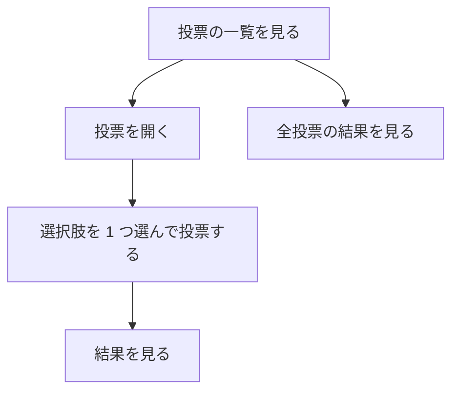
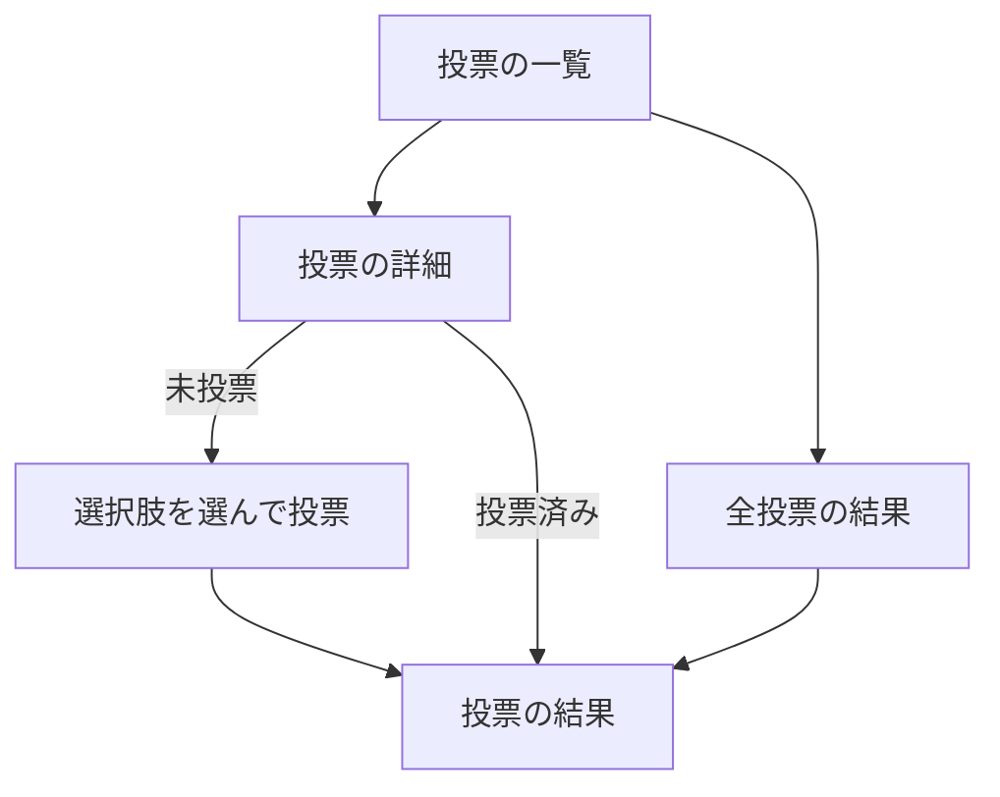

# 要件定義書: 投票サイト（Polls）

## 1. 目的・前提

### 1-0. システムの目的

利用者が公開されている投票の一覧から投票を選び、選択肢を 1 つ選んで投票し、投票ごとの結果を見られる Web サイトを作る。

### 用語集

| 用語 | 業務上の意味 | 本案件での使用範囲 | 同義語/類義語 |
|---|---|---|---|
| 投票 | 1 つの質問と、それに対する複数の選択肢の組 | 利用者が投じる単位 | poll |
| 選択肢 | 投票の質問に対する回答の候補 | 1 つの投票に 2 つ以上 | option |
| 票 | 利用者が 1 つの選択肢に投じた 1 回分の記録 | 1 人が 1 つの投票に 1 票 | vote |
| 利用者 | ログインせずに使う一般の人 | 画面を操作する人すべて | - |

### システムの形態

GUI（画面）。ブラウザで使う。CUI・Web API・バッチは無い。

## 1-1. 技術制約（前提）

| 制約項目 | 内容 | 出どころ（誰がいつ答えたか） |
|---|---|---|
| 既存コードベース | 無し（新規作成） | 依頼者（ANSWERS.md、2026-11-04） |
| 配備先 | ローカル実行。`bash run.sh` で起動し、`http://127.0.0.1:$PORT` で提供する。コンテナは使わない | 契約 contract.md |
| チームの技術 | 制約無し。Python 3.12（`python3`）か Node.js 24 を使える環境。無償のものだけ | 契約・ANSWERS.md |
| ライセンスとコスト | 無償のライブラリのみ。外部サービスや有償 API は使わない | 契約 contract.md |
| 性能と規模の目安 | 利用者は少数。性能目標は無い | ANSWERS.md |

## 2. 業務

### 対象業務一覧

| RQ-BZ-ID | 業務名 | 業務の範囲 | 担当者 |
|---|---|---|---|
| `RQ-BZ-POLLING` | 投票 | 投票の閲覧、投票、結果の閲覧 | 利用者 |

### 業務フロー

### 2-1. 業務の問題（あるべき姿と現状のギャップ）

| 問題 | 対象業務（RQ-BZ） | あるべき姿 | 現状 | ギャップ（KPI） | 業務影響 |
|---|---|---|---|---|---|
| 利用者が意見を投票で示す場が無い | `RQ-BZ-POLLING` | 利用者が投票一覧から投票を選び、その場で 1 票を投じられる | 投票を受け付ける場が無い | 投票の受付手段 0 件（目標 1 件以上） | 利用者の意見が集まらない |
| 投票の結果を集めて見られない | `RQ-BZ-POLLING` | 投票ごとの票数と割合を、投票後すぐに確認できる | 結果を集計して見る手段が無い | 結果の閲覧手段 0 件（目標 1 件以上） | 投票の意味が利用者に伝わらない |

### 2-2. 業務課題一覧

| RQ-BK-ID | 業務課題（取り組むこと） | 解決する問題（2-1） | 解決後の状態（KPI の目標値） | 対象業務（RQ-BZ） |
|---|---|---|---|---|
| `RQ-BK-BROWSE-POLLS` | 投票の一覧と選択肢を見られるようにする | 利用者が意見を投票で示す場が無い | 全投票が一覧に出て、選択肢を開ける（投票可能な投票 100%） | `RQ-BZ-POLLING` |
| `RQ-BK-CAST-VOTES` | 利用者が投票できるようにする | 利用者が意見を投票で示す場が無い | 選択肢を選んで 1 票を投じられる（投票手段 1 件以上） | `RQ-BZ-POLLING` |
| `RQ-BK-SHOW-RESULTS` | 投票の結果を集計して表示する | 投票の結果を集めて見られない | 投票ごとの票数と割合を表示（結果閲覧手段 1 件以上） | `RQ-BZ-POLLING` |

### 2-3. 見込み経営効果

見込み経営効果は算定しない（理由: 利用者向けの公開投票サイトで、支出や工数の前後比較の対象となる既存業務が無いため）。

## 3. 機能要件

### 入力データ・出力データ

- 人手入力: 投票する選択肢の選択（画面の操作）
- 外部連携による入力: 無し
- 出力データ: 画面に表示する投票の一覧、選択肢、票数、割合

### 利用フロー

### システムの形態ごとの仕様（GUI）

- 画面遷移図は「利用フロー」の図を参照する。
- 画面ごとの仕様は 4-5 に書く。

### 機能一覧

| RQ-ID | カテゴリ | 機能名 | 対応業務課題ID（RQ-BK-*） | この機能が無いと何が困るか |
|---|---|---|---|---|
| `RQ-FT-LIST-POLLS` | 業務機能 | 投票の一覧を表示する | `RQ-BK-BROWSE-POLLS` | 利用者が投票を探せず、投票できない |
| `RQ-FT-SHOW-POLL-OPTIONS` | 業務機能 | 投票の詳細で質問と選択肢を表示する | `RQ-BK-BROWSE-POLLS` | 利用者が何に投票するのか分からない |
| `RQ-FT-CAST-VOTE` | 業務機能 | 選択肢を 1 つ選んで投票する | `RQ-BK-CAST-VOTES` | 利用者が意見を示せない |
| `RQ-FT-REJECT-INVALID-VOTE` | 業務機能 | 選択肢が未選択、または投票に属さない選択肢のときは投票を受け付けない | `RQ-BK-CAST-VOTES` | 不正な票が集計に入る |
| `RQ-FT-ONE-VOTE-PER-POLL` | 業務機能 | 同じ利用者は同じ投票に 1 票だけ投じられる（利用者の区別はブラウザに保存した識別子で行う） | `RQ-BK-CAST-VOTES` | 1 人が何票も投じて結果が歪む |
| `RQ-FT-SHOW-RESULT-AFTER-VOTE` | 業務機能 | 投票を完了したら、その投票の結果を表示する。投票済みの投票を開いたときも結果を表示する | `RQ-BK-CAST-VOTES`, `RQ-BK-SHOW-RESULTS` | 投票の後に結果が分からない |
| `RQ-FT-SHOW-POLL-RESULT` | 業務機能 | 投票ごとに、各選択肢の票数と割合を表示する | `RQ-BK-SHOW-RESULTS` | 投票の結果を確認できない |
| `RQ-FT-SHOW-ALL-RESULTS` | 業務機能 | 全投票の結果を一覧で表示する | `RQ-BK-SHOW-RESULTS` | 投票ごとに開かないと結果を比べられない |

### 3-1. 帳票・出力ファイル

帳票・出力ファイルは無い。

### 3-2. 業務ルール

| RQ-ID | ルール名 | 内容（条件と結果） | 違反時・エラー時の業務上の扱い | 対応業務課題ID（RQ-BK-*） |
|---|---|---|---|---|
| `RQ-FT-ONE-VOTE-PER-POLL` | 1 投票 1 票 | 同じ識別子（ブラウザ保存）で同じ投票に 2 票目は入らない。結果は 1 票のみ | 2 票目は受け付けず、既存の結果を表示する | `RQ-BK-CAST-VOTES` |
| `RQ-FT-REJECT-INVALID-VOTE` | 選択肢の検証 | 選択肢が選ばれていない、または選択肢がその投票に属さない場合は票を作らない | 投票の詳細画面にエラーを表示し、票は記録しない | `RQ-BK-CAST-VOTES` |

### 3-3. 外部連携

外部連携は無い。

## 4. データ

### 4-1. データ要件一覧

| RQ-ID | 種別 | 内容 | 対応業務課題ID（RQ-BK-*） | この要件が無いと何が困るか |
|---|---|---|---|---|
| `RQ-DT-LOCAL-STORAGE` | 内部データ | 投票・選択肢・票は内部データとして、環境変数 `DATA_DIR` の下の SQLite ファイルに保存する。保持期間は無期限 | `RQ-BK-BROWSE-POLLS`, `RQ-BK-CAST-VOTES` | 再起動で投票と票が消える |
| `RQ-DT-DB-NEEDED` | 内部データ | DB が必要（票は保存・集計が必要）。初期件数は投票 3 件、選択肢は各 3〜4 件。1 年後の想定件数は利用者が少ないため投票 数十件・票数千件程度、増加率は不明（利用者数が無いため算定しない）。参照関係は投票 → 選択肢 → 票の 3 段で単純。検索は投票一覧の表示のみ、集計は票数の数え上げ | `RQ-BK-SHOW-RESULTS` | 票の集計ができず結果を表示できない |

### 4-2. 業務エンティティとデータ項目

| RQ-ID | カテゴリ | 業務エンティティ名 | 対応業務課題ID（RQ-BK-*） | この業務エンティティが無いと何が困るか |
|---|---|---|---|---|
| `RQ-DT-POLL-ENTITY` | 業務データ | 投票 | `RQ-BK-BROWSE-POLLS` | 投票の一覧を表示できない |
| `RQ-DT-OPTION-ENTITY` | 業務データ | 選択肢 | `RQ-BK-BROWSE-POLLS` | 投票の選択肢を示せない |
| `RQ-DT-VOTE-ENTITY` | 業務データ | 票 | `RQ-BK-CAST-VOTES`, `RQ-BK-SHOW-RESULTS` | 投票の記録と結果の集計ができない |

| エンティティ名 | 項目名 | 業務上の意味 | 必須 | 形式・桁 | 値の範囲・制約 | 例 |
|---|---|---|---|---|---|---|
| 投票 | 投票ID | 投票の識別子 | 必須 | 整数（自動採番） | 一意 | 1 |
| 投票 | 質問文 | 投票の質問 | 必須 | 文字列 1〜200 文字 | 空白のみ不可 | Which language do you prefer? |
| 投票 | 説明 | 投票の補足 | 任意 | 文字列 0〜500 文字 | - | Pick one. |
| 選択肢 | 選択肢ID | 選択肢の識別子 | 必須 | 整数（自動採番） | 一意 | 1 |
| 選択肢 | 投票ID | 所属する投票 | 必須 | 整数 | 投票 に存在する | 1 |
| 選択肢 | 表示名 | 選択肢の文言 | 必須 | 文字列 1〜100 文字 | 同じ投票内で重複不可 | Python |
| 選択肢 | 並び順 | 表示の順番 | 必須 | 整数 | 1 以上 | 1 |
| 票 | 票ID | 票の識別子 | 必須 | 整数（自動採番） | 一意 | 1 |
| 票 | 投票ID | 投じた投票 | 必須 | 整数 | 投票 に存在する | 1 |
| 票 | 選択肢ID | 投じた選択肢 | 必須 | 整数 | 同じ投票の選択肢 | 2 |
| 票 | 利用者識別子 | ブラウザに保存した識別子 | 必須 | 文字列 32 文字（16 進） | 同じ投票で一意 | 3f2a... |
| 票 | 投票日時 | 投じた日時 | 必須 | 日時（UTC） | - | 2026-11-04T10:00:00Z |

### 4-3. CRUD テーブル

| エンティティ名 | Create | Read（一覧） | Read（詳細） | 検索 | Update | Delete | 備考 |
|---|---|---|---|---|---|---|---|
| 投票 | × | ○ | ○ | × | × | × | 作成は初期データのみ（利用者からの作成は無い） |
| 選択肢 | × | ○ | ○ | × | × | × | 投票の詳細で読む |
| 票 | ○ | ○ | △ | × | × | × | 投票の詳細で同じ利用者の票を確認（△: 投票済みの判定）。備考: 1 投票 1 票はトランザクションで判定と記録を一体にする（3-2） |

### 4-4. 状態遷移

状態を持つエンティティは無い。

### 4-5. 画面一覧（GUI）

| RQ-ID | 画面名 | 対応する CRUD 操作（エンティティ名:操作種別） | 主な機能・目的 | 対応業務課題ID（RQ-BK-*） |
|---|---|---|---|---|
| `RQ-UI-POLLS-SCREEN` | 投票の一覧 | 投票:Read（一覧） | 公開中の投票を一覧し、投票を開く | `RQ-BK-BROWSE-POLLS` |
| `RQ-UI-POLL-DETAIL-SCREEN` | 投票の詳細と投票 | 投票:Read（詳細）、選択肢:Read（詳細）、票:Create | 質問と選択肢を表示し、1 票を投じる。投票済みなら結果を表示する | `RQ-BK-BROWSE-POLLS`, `RQ-BK-CAST-VOTES`, `RQ-BK-SHOW-RESULTS` |
| `RQ-UI-RESULTS-SCREEN` | 全投票の結果 | 票:Read（一覧）、投票:Read（一覧） | 全投票の結果を一覧し、各投票の結果へ移る | `RQ-BK-SHOW-RESULTS` |

#### 画面の仕様

| 画面 | 画面の目的 | 主要要素 | 入力項目 | 表示項目 | エラー時の見え方 |
|---|---|---|---|---|---|
| 投票の一覧 | 投票を選ぶ | 投票名のリスト（各項目が詳細へのリンク） | 無し | 質問文、選択肢の数 | 投票が 0 件のときは「No polls yet.」と表示 |
| 投票の詳細と投票 | 選んで投票する | 選択肢のラジオボタン、Vote ボタン | 選択肢（1 つ） | 質問文、説明、選択肢。投票済みなら結果 | 未選択で Vote を押すと「Please choose an option.」を表示。投票に属さない選択肢は「That option is not part of this poll.」 |
| 全投票の結果 | 全投票の結果を比べる | 投票ごとの結果ブロック（質問、選択肢ごとの票数と割合の棒） | 無し | 質問文、各選択肢の票数と割合、合計票数 | 票が 0 件の投票は「No votes yet.」 |

#### 画面遷移

全画面の上部にナビゲーションを置く。ナビゲーションの項目は `Polls` と `Results` の 2 つ。サイト名（Polls）のリンクは `Polls` と同じ一覧へ移る。

### 4-6. 共通の画面仕様

| RQ-ID | 項目 | 内容 | 対応業務課題ID（RQ-BK-*） |
|---|---|---|---|
| `RQ-UI-NAV-MENU` | ナビゲーションメニュー | 全画面の上部に `Polls`（投票の一覧）と `Results`（全投票の結果）のリンクを置き、現在の画面を示す | `RQ-BK-BROWSE-POLLS`, `RQ-BK-SHOW-RESULTS` |

## 5. 非機能要件

| RQ-ID | カテゴリ | 非機能要件名 | 対応業務課題ID（RQ-BK-*） | この非機能要件が無いと何が困るか |
|---|---|---|---|---|
| `RQ-NF-PUBLIC-ACCESS` | 利用者とアクセス経路 | 利用者は一般の人で、ログインは不要。ローカルの `127.0.0.1` で提供する | `RQ-BK-BROWSE-POLLS` | 利用者が画面に入れない（認証の要件は無い） |
| `RQ-NF-SMALL-SCALE` | 利用人数 | 同時利用者は少数（数人程度）を想定する。性能の目標値は無い | `RQ-BK-CAST-VOTES` | 利用人数の前提が無く、設計の判断根拠が無い |
| `RQ-NF-VISUAL-THEME` | デザイン | 背景は白。画面の部品（ナビゲーション、ボタン、結果の棒、見出し）はネイビー（#000080）。文字は白の部品上で白、それ以外は黒 | `RQ-BK-BROWSE-POLLS` | 指定の配色にならず依頼と食い違う |
| `RQ-NF-UI-LANGUAGE` | 言語 | 画面の文言はすべて英語 | `RQ-BK-BROWSE-POLLS` | 依頼と契約の言語に合わない |
| `RQ-NF-AUTH` | セキュリティ | 認証は無い。投票の不正防止は `RQ-FT-ONE-VOTE-PER-POLL` の識別子で行う（ブラウザを変えれば別の利用者として扱われることを許容する） | `RQ-BK-CAST-VOTES` | 業務ルールの前提が決まらない |

- 可用性の要求は無い。
- 移行は無い。

## 6. 運用要件

| RQ-ID | 種別 | 内容 | 対応業務課題ID（RQ-BK-*） | この要件が無いと何が困るか |
|---|---|---|---|---|
| `RQ-OP-START-COMMANDS` | 起動 | `bash setup.sh` で依存を入れ、`PORT=任意 bash run.sh` で起動する。`run.sh` は前景で動き続ける。PORT の既定値は 8000 | `RQ-BK-BROWSE-POLLS` | 起動できず、サイトを確かめられない |
| `RQ-OP-SAMPLE-DATA` | 初期データ | `DATA_DIR` が空（DB が無い）のときは起動時にサンプルの投票 3 件（選択肢あり）と、サンプルの票を入れる | `RQ-BK-BROWSE-POLLS`, `RQ-BK-SHOW-RESULTS` | 空の状態では全機能を試せない |

- ログ: ログは必要ないため、ログの内容と保存期間の記述は行わない。
- 監査ログ: 不要。
- 監視・アラート: 監視・アラートは必要ないため、監視・アラートの内容と対応方法の記述は行わない。
- バックアップ: バックアップは必要ない。

## 7. テスト用利用シナリオ

| RQ-ID | テスト目的 | 前提条件 | テスト手順 | 期待される結果 | 検証する要件ID | 対応業務課題ID（RQ-BK-*） |
|---|---|---|---|---|---|---|
| `RQ-TS-BROWSE-POLLS` | 投票の一覧と詳細を見られる | 初期データがある | 1. 根の URL を開く 2. 投票の一覧に 3 件の投票があるのを確認 3. 1 件目を開く 4. 質問文と選択肢が表示されるのを確認 | 一覧に投票が並び、詳細に質問と選択肢が出る | `RQ-FT-LIST-POLLS`, `RQ-FT-SHOW-POLL-OPTIONS`, `RQ-UI-POLLS-SCREEN`, `RQ-UI-POLL-DETAIL-SCREEN` | `RQ-BK-BROWSE-POLLS` |
| `RQ-TS-CAST-VOTE` | 選択肢を選んで投票できる | 投票の詳細を開いている（未投票） | 1. 選択肢を 1 つ選ぶ 2. Vote を押す | 票が記録され、結果画面が表示される | `RQ-FT-CAST-VOTE`, `RQ-UI-POLL-DETAIL-SCREEN` | `RQ-BK-CAST-VOTES` |
| `RQ-TS-REJECT-INVALID-VOTE` | 未選択で投票できない | 投票の詳細を開いている | 1. 何も選ばず Vote を押す | 「Please choose an option.」が表示され、票は増えない | `RQ-FT-REJECT-INVALID-VOTE`, `RQ-UI-POLL-DETAIL-SCREEN` | `RQ-BK-CAST-VOTES` |
| `RQ-TS-ONE-VOTE-PER-POLL` | 同じ投票に 2 票目を入れられない | 同じブラウザで投票済み | 1. 同じ投票を再度開く 2. 別の選択肢を選んで Vote を押す | 2 票目は記録されず、既存の結果が表示される | `RQ-FT-ONE-VOTE-PER-POLL` | `RQ-BK-CAST-VOTES` |
| `RQ-TS-RESULT-AFTER-VOTE` | 投票後に結果が見える | 未投票の投票がある | 1. 投票する 2. 結果が表示されるのを確認 3. 投票を再度開く | 結果（票数と割合）が表示される | `RQ-FT-SHOW-RESULT-AFTER-VOTE`, `RQ-FT-SHOW-POLL-RESULT` | `RQ-BK-SHOW-RESULTS` |
| `RQ-TS-ALL-RESULTS` | 全投票の結果を一覧で見られる | 初期データがある | 1. Results を押す 2. 全投票の結果が並ぶのを確認 | 全投票の質問、票数、割合が表示される | `RQ-FT-SHOW-ALL-RESULTS`, `RQ-UI-RESULTS-SCREEN` | `RQ-BK-SHOW-RESULTS` |
| `RQ-TS-NAVIGATION` | ナビゲーションで主要画面へ移れる | 任意の画面 | 1. Polls と Results を順に押す | 各画面がナビゲーションから開け、現在の項目が強調される | `RQ-UI-NAV-MENU`, `RQ-NF-UI-LANGUAGE` | `RQ-BK-BROWSE-POLLS`, `RQ-BK-SHOW-RESULTS` |
| `RQ-TS-SAMPLE-DATA` | 空の DATA_DIR で起動し、サンプルで全機能を試せる | DATA_DIR が空 | 1. 起動する 2. 投票一覧と結果を開く | サンプルの投票と票が表示される | `RQ-OP-SAMPLE-DATA`, `RQ-OP-START-COMMANDS`, `RQ-FT-LIST-POLLS` | `RQ-BK-BROWSE-POLLS`, `RQ-BK-SHOW-RESULTS` |
| `RQ-TS-THEME` | 白背景とネイビーの部品 | 任意の画面 | 1. 各画面を開く | 背景が白、ナビゲーションとボタンと結果の棒がネイビー | `RQ-NF-VISUAL-THEME` | `RQ-BK-BROWSE-POLLS` |
| `RQ-TS-PUBLIC-ACCESS` | ログインなしで 127.0.0.1 から使える | サーバーが起動している | 1. ログインなしで根の URL を開く | 投票の一覧が表示される | `RQ-NF-PUBLIC-ACCESS` | `RQ-BK-BROWSE-POLLS` |

- 業務ルール（3-2）の違反は `RQ-TS-REJECT-INVALID-VOTE` と `RQ-TS-ONE-VOTE-PER-POLL` で確かめる。
- 状態遷移は無い。権限制御は無い。監査ログは無い。同時更新は無い（1 投票 1 票は同じ票の判定と記録を 1 つのトランザクションで行う）。

## 業務課題と要件の対応表

| RQ-BK-ID | 対応する要件 |
|---|---|
| `RQ-BK-BROWSE-POLLS` | `RQ-FT-LIST-POLLS`, `RQ-FT-SHOW-POLL-OPTIONS`, `RQ-UI-POLLS-SCREEN`, `RQ-UI-POLL-DETAIL-SCREEN`, `RQ-UI-NAV-MENU`, `RQ-OP-START-COMMANDS`, `RQ-OP-SAMPLE-DATA`, `RQ-DT-POLL-ENTITY`, `RQ-DT-OPTION-ENTITY`, `RQ-DT-LOCAL-STORAGE`, `RQ-NF-PUBLIC-ACCESS`, `RQ-NF-VISUAL-THEME`, `RQ-NF-UI-LANGUAGE`, `RQ-TS-BROWSE-POLLS`, `RQ-TS-NAVIGATION`, `RQ-TS-THEME`, `RQ-TS-PUBLIC-ACCESS`, `RQ-TS-SAMPLE-DATA` |
| `RQ-BK-CAST-VOTES` | `RQ-FT-CAST-VOTE`, `RQ-FT-REJECT-INVALID-VOTE`, `RQ-FT-ONE-VOTE-PER-POLL`, `RQ-FT-SHOW-RESULT-AFTER-VOTE`, `RQ-UI-POLL-DETAIL-SCREEN`, `RQ-DT-VOTE-ENTITY`, `RQ-DT-LOCAL-STORAGE`, `RQ-NF-SMALL-SCALE`, `RQ-NF-AUTH`, `RQ-TS-CAST-VOTE`, `RQ-TS-REJECT-INVALID-VOTE`, `RQ-TS-ONE-VOTE-PER-POLL` |
| `RQ-BK-SHOW-RESULTS` | `RQ-FT-SHOW-POLL-RESULT`, `RQ-FT-SHOW-ALL-RESULTS`, `RQ-FT-SHOW-RESULT-AFTER-VOTE`, `RQ-UI-RESULTS-SCREEN`, `RQ-UI-NAV-MENU`, `RQ-DT-VOTE-ENTITY`, `RQ-DT-DB-NEEDED`, `RQ-OP-SAMPLE-DATA`, `RQ-TS-RESULT-AFTER-VOTE`, `RQ-TS-ALL-RESULTS`, `RQ-TS-NAVIGATION`, `RQ-TS-SAMPLE-DATA` |

注: `RQ-BK-*` を受けるものを上の表で網羅した。
