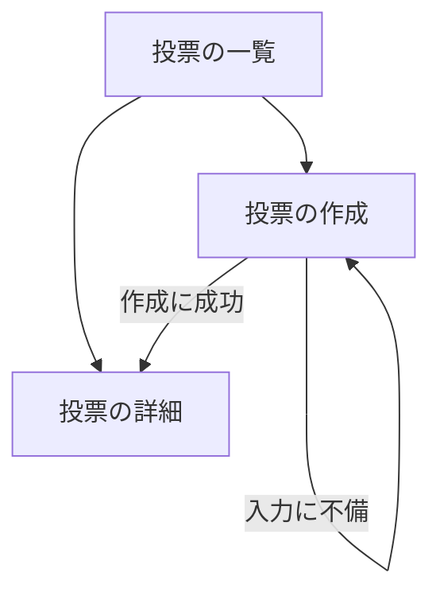

# 変更要件定義書: 投票の作成ページ（Create poll）

本書は既存の要件定義書 `docs/requirements.md` への変更だけを書く。正本は書き換えない。変更の区分は [追加] と [削除] の 2 つ。変える要件は旧要件を [削除]、新要件を [追加] に分けて書く。

## 1. 目的・前提

### 1-0. システムの目的

変更なし。既存要件定義書 `docs/requirements.md` セクション 1-0 を参照。今回の変更の目的は次の 2 つ。

- 利用者が、自分の質問と 2 件以上の選択肢を入力して投票を作れるようにする（ナビゲーションの「Create poll」から開く画面）。
- 作った投票は、投票の一覧に即時に現れ、投票でき、全投票の結果に票数 0 で現れるようにする。

### 用語集

変更なし。既存要件定義書 `docs/requirements.md` の用語集を参照。今回の変更で増える用語は無い（「投票の作成」は「投票」と「選択肢」の作成を指す）。

### システムの形態

変更なし。既存要件定義書 `docs/requirements.md` セクション 1 を参照（GUI）。

## 1-1. 技術制約（前提）

変更なし。既存要件定義書 `docs/requirements.md` 1-1 を参照。

## 2. 業務

### 対象業務一覧

変更なし。既存要件定義書 `docs/requirements.md` セクション 2 を参照（`RQ-BZ-POLLING`）。

### 業務フロー

変更なし。既存要件定義書 `docs/requirements.md` セクション 2 を参照。

### 2-1. 業務の問題（あるべき姿と現状のギャップ）

| 問題 | 対象業務（RQ-BZ） | あるべき姿 | 現状 | ギャップ（KPI） | 業務影響 |
|---|---|---|---|---|---|
| [追加] 利用者が自分の質問で投票を始められない | `RQ-BZ-POLLING` | 利用者が質問と 2 件以上の選択肢を入力すると、投票が作られ、一覧と結果に現れて投票できる | 投票は初期データだけで作られ、利用者が作る手段が無い | 利用者が投票を作れる手段 0 件（目標 1 件以上） | 利用者が知りたい質問を投票にかけられない |

既存の問題は変更なし。

### 2-2. 業務課題一覧

| RQ-BK-ID | 業務課題（取り組むこと） | 解決する問題（2-1） | 解決後の状態（KPI の目標値） | 対象業務（RQ-BZ） |
|---|---|---|---|---|
| [追加] `RQ-BK-CREATE-POLLS` | 利用者が質問と選択肢を入力して投票を作れるようにする | 利用者が自分の質問で投票を始められない | 入力した投票が作られ、一覧・投票・結果に現れる（投票を作る手段 1 件以上） | `RQ-BZ-POLLING` |

既存の業務課題は変更なし。

### 2-3. 見込み経営効果

変更なし。既存要件定義書 `docs/requirements.md` 2-3 を参照（算定しない）。

## 3. 機能要件

### 入力データ・出力データ

変更なし。既存要件定義書 `docs/requirements.md` セクション 3 を参照。投票の作成では、人手入力に「質問と選択肢の入力」が加わる（投票の作成画面）。

### 利用フロー

[追加] 利用フローに次の経路を加える。投票の作成が成功すると、作った投票の詳細へ移る。その後は既存の投票の詳細（未投票）から投票できる。

上の追加分以外は変更なし。既存要件定義書 `docs/requirements.md` セクション 3 を参照。

### システムの形態ごとの仕様（GUI）

変更なし。画面の仕様は 4-5 に書く。

### 機能一覧

| RQ-ID | 区分 | カテゴリ | 機能名 | 対応業務課題ID（RQ-BK-*） | この機能が無いと何が困るか |
|---|---|---|---|---|---|
| [追加] `RQ-FT-CREATE-POLL` | 追加 | 業務機能 | 利用者が質問と 2 件以上の選択肢を入力して投票を作成する。選択肢は画面の入力欄 4 つまでで、空欄は無視する。作成した投票は、投票の一覧に即時に現れ、投票できて、全投票の結果に票数 0 で現れる | `RQ-BK-CREATE-POLLS` | 利用者が自分の質問で投票を始められない |
| [追加] `RQ-FT-REJECT-INVALID-POLL` | 追加 | 業務機能 | 入力に不備があるとき（3-2 の投票の入力ルール）は投票を作らず、入力した値を残して理由を画面に表示する | `RQ-BK-CREATE-POLLS` | 不備のある投票が一覧に出て、投票者が混乱する |

上の 2 件以外の既存の機能要件は変更なし。

### 3-1. 帳票・出力ファイル

変更なし。既存要件定義書 `docs/requirements.md` 3-1 を参照（無い）。

### 3-2. 業務ルール

[追加] 次の投票の入力ルールを加える（既存の業務ルールは変更なし）。

| RQ-ID | ルール名 | 内容（条件と結果） | 違反時・エラー時の業務上の扱い | 対応業務課題ID（RQ-BK-*） |
|---|---|---|---|---|
| [追加] `RQ-FT-REJECT-INVALID-POLL` | 投票の入力 | 前後の空白を除いて判定する。質問が空、または 200 文字を超える場合は不備。選択肢（空欄を除く）が 2 件未満、または 1 件が 100 文字を超える場合、または同じ文言の選択肢が 2 つある場合は不備。不備のときは投票を作らない。判定の順は質問、選択肢の件数、選択肢の文字数、選択肢の重複 | 投票の作成画面に理由を 1 つ表示し、入力した値を残す。投票は作らない | `RQ-BK-CREATE-POLLS` |

- 既存の業務ルール（1 投票 1 票、選択肢の検証）は変更なし。

### 3-3. 外部連携

変更なし。外部連携は無い。

## 4. データ

### 4-1. データ要件一覧

変更なし。既存要件定義書 `docs/requirements.md` 4-1 を参照（投票と選択肢は既存の DB に保存する）。

### 4-2. 業務エンティティとデータ項目

変更なし。既存要件定義書 `docs/requirements.md` 4-2 を参照。質問文（1〜200 文字）と表示名（1〜100 文字、同じ投票内で重複不可）は既存の項目定義をそのまま使う。

### 4-3. CRUD テーブル

投票と選択肢の Create の欄だけが変わる。票は変更なし。

| エンティティ名 | 区分 | Create | Read（一覧） | Read（詳細） | 検索 | Update | Delete | 備考 |
|---|---|---|---|---|---|---|---|---|
| 投票 | [削除] | × | ○ | ○ | × | × | × | 作成は初期データのみ（利用者からの作成は無い） |
| 投票 | [追加] | ○ | ○ | ○ | × | × | × | 利用者が投票の作成画面から作る（`RQ-FT-CREATE-POLL`）。初期データの投入は従来どおり |
| 選択肢 | [削除] | × | ○ | ○ | × | × | × | 投票の詳細で読む |
| 選択肢 | [追加] | ○ | ○ | ○ | × | × | × | 投票を作るときに、入力された選択肢を同じ投票に作る |
| 票 | 変更なし | ○ | ○ | △ | × | × | × | 投票の詳細で同じ利用者の票を確認（△: 投票済みの判定）。1 投票 1 票は既存の規則のまま |

### 4-4. 状態遷移

変更なし。状態を持つエンティティは無い。

### 4-5. 画面一覧（GUI）

| RQ-ID | 区分 | 画面名 | 対応する CRUD 操作（エンティティ名:操作種別） | 主な機能・目的 | 対応業務課題ID（RQ-BK-*） |
|---|---|---|---|---|---|
| [追加] `RQ-UI-CREATE-POLL-SCREEN` | 追加 | 投票の作成 | 投票:Create、選択肢:Create | 質問と選択肢を入力して投票を作る。不備があれば理由を表示する | `RQ-BK-CREATE-POLLS` |

既存の画面（一覧、詳細、全投票の結果、投票済みの投票の詳細）は変更なし。

#### 画面の仕様（追加分）

| 画面 | 画面の目的 | 主要要素 | 入力項目 | 表示項目 | エラー時の見え方 |
|---|---|---|---|---|---|
| 投票の作成 | 質問と選択肢を入力して投票を作る | 見出し「Create a poll」、質問の入力欄（1 つ）、選択肢の入力欄（「Option 1」〜「Option 4」の 4 つ）、「Create poll」ボタン | 質問文（必須）、選択肢（2 件以上。空欄は無視） | 入力欄。作成に成功すると投票の詳細へ移り、「Your poll has been created.」を表示する | 質問が空: 「Please enter a question.」。質問が 200 文字超: 「The question must be 200 characters or fewer.」。選択肢が 2 件未満: 「Please enter at least two options.」。選択肢が 100 文字超: 「Each option must be 100 characters or fewer.」。同じ選択肢: 「Each option must be different.」。いずれも 400 で同じ画面を再表示し、入力値を残す |

#### 画面遷移

[削除] 全画面の上部のナビゲーションは `Polls` と `Results` の 2 項目。
[追加] 全画面の上部のナビゲーションは `Polls`、`Create poll`、`Results` の 3 項目（この順）。`Create poll` は投票の作成画面へ移る。現在の画面の項目を強調する。投票の作成の成功後は投票の詳細へ移る。

### 4-6. 共通の画面仕様

| RQ-ID | 区分 | 項目 | 内容 | 対応業務課題ID（RQ-BK-*） |
|---|---|---|---|---|
| [削除] `RQ-UI-NAV-MENU` | 削除 | ナビゲーションメニュー | 全画面の上部に `Polls`（投票の一覧）と `Results`（全投票の結果）のリンクを置き、現在の画面を示す | `RQ-BK-BROWSE-POLLS`, `RQ-BK-SHOW-RESULTS` |
| [追加] `RQ-UI-NAV-MENU-CREATE` | 追加 | ナビゲーションメニュー | 全画面の上部に `Polls`（投票の一覧）、`Create poll`（投票の作成）、`Results`（全投票の結果）のリンクをこの順で置き、現在の画面を示す | `RQ-BK-BROWSE-POLLS`, `RQ-BK-SHOW-RESULTS`, `RQ-BK-CREATE-POLLS` |

## 5. 非機能要件

変更なし。既存要件定義書 セクション 5 を参照。今回の変更で増える非機能要件は無い（配色は既存の配色の非機能要件に従い、新しい画面にもその配色を使う）。

## 6. 運用要件

変更なし。既存要件定義書 `docs/requirements.md` セクション 6 を参照。

## 7. テスト用利用シナリオ

| RQ-ID | 区分 | テスト目的 | 前提条件 | テスト手順 | 期待される結果 | 検証する要件ID | 対応業務課題ID（RQ-BK-*） |
|---|---|---|---|---|---|---|---|
| [追加] `RQ-TS-CREATE-POLL` | 追加 | 利用者が投票を作り、投票と結果に現れる | 初期データがある | 1. Create poll を押す 2. 質問と 2 件の選択肢を入力して Create poll を押す 3. 作成後の投票の詳細で完了の文を確認する 4. 選択肢を 1 つ選んで投票する 5. Results を開き、新しい投票の票数を確認する | 作成の完了の文が出る。投票できる。結果に新しい投票の質問と選択肢が並び、票数が表示される | `RQ-FT-CREATE-POLL`, `RQ-UI-CREATE-POLL-SCREEN`, `RQ-FT-CAST-VOTE`, `RQ-FT-SHOW-ALL-RESULTS` | `RQ-BK-CREATE-POLLS` |
| [追加] `RQ-TS-REJECT-INVALID-POLL` | 追加 | 不備のある投票は作られない | 初期データがある | 1. Create poll を押す 2. 質問を入力し、選択肢を 1 件だけ入力して Create poll を押す 3. 投票の一覧を開く | 「Please enter at least two options.」が出て、入力値が残る。投票の一覧の件数は増えない | `RQ-FT-REJECT-INVALID-POLL`, `RQ-UI-CREATE-POLL-SCREEN` | `RQ-BK-CREATE-POLLS` |
| [削除] `RQ-TS-NAVIGATION` | 削除 | ナビゲーションで主要画面へ移れる（旧） | 任意の画面 | 1. Polls と Results を順に押す | 各画面がナビゲーションから開け、現在の項目が強調される | `RQ-UI-NAV-MENU`, `RQ-NF-UI-LANGUAGE` | `RQ-BK-BROWSE-POLLS`, `RQ-BK-SHOW-RESULTS` |
| [追加] `RQ-TS-NAVIGATION` | 追加 | ナビゲーションで主要画面へ移れる（新） | 任意の画面 | 1. Polls、Create poll、Results を順に押す | 各画面がナビゲーションから開け、現在の項目が強調される | `RQ-UI-NAV-MENU-CREATE`, `RQ-NF-UI-LANGUAGE` | `RQ-BK-BROWSE-POLLS`, `RQ-BK-SHOW-RESULTS`, `RQ-BK-CREATE-POLLS` |

上の以外の既存のシナリオは変更なし。既存の投票の一覧・投票・結果・1 投票 1 票のシナリオは、新しい投票が増えても期待結果が変わらない（既存の投票を対象にする）。

## 業務課題と要件の対応表（変更の差分）

| RQ-BK-ID | 区分 | 対応する要件（追加・削除を含む） |
|---|---|---|
| `RQ-BK-CREATE-POLLS` | 追加 | `RQ-FT-CREATE-POLL`, `RQ-FT-REJECT-INVALID-POLL`, `RQ-UI-CREATE-POLL-SCREEN`, `RQ-UI-NAV-MENU-CREATE`, `RQ-TS-CREATE-POLL`, `RQ-TS-REJECT-INVALID-POLL`, `RQ-TS-NAVIGATION` |
| `RQ-BK-BROWSE-POLLS` | 変更あり | [削除] `RQ-UI-NAV-MENU`、[削除] `RQ-TS-NAVIGATION`（旧）。代わりに `RQ-UI-NAV-MENU-CREATE`、`RQ-TS-NAVIGATION`（新）を対応させる。他の対応は既存のまま |
| `RQ-BK-SHOW-RESULTS` | 変更あり | [削除] `RQ-UI-NAV-MENU`、[削除] `RQ-TS-NAVIGATION`（旧）。代わりに `RQ-UI-NAV-MENU-CREATE`、`RQ-TS-NAVIGATION`（新）を対応させる。他の対応は既存のまま |
