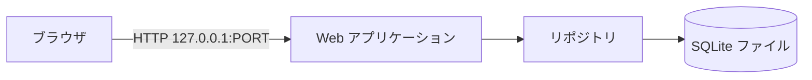
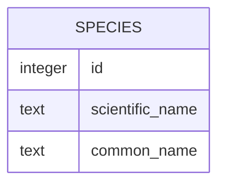
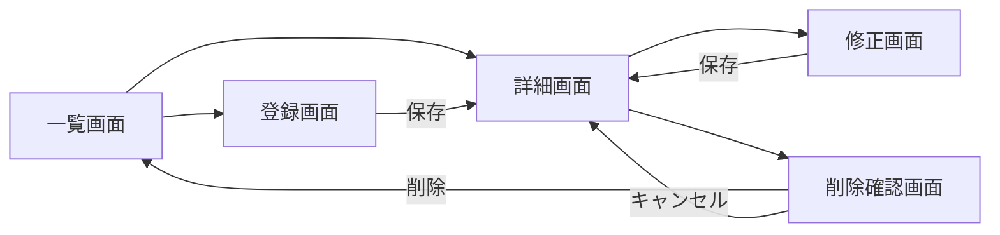
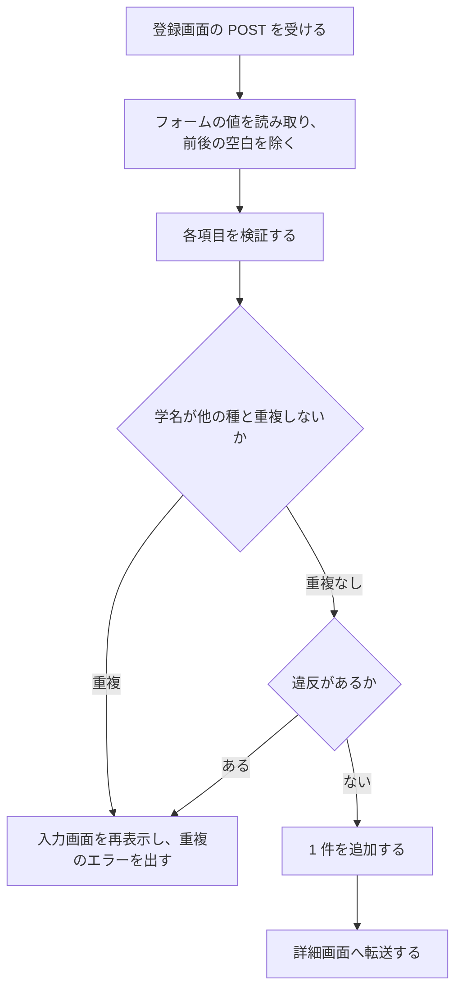
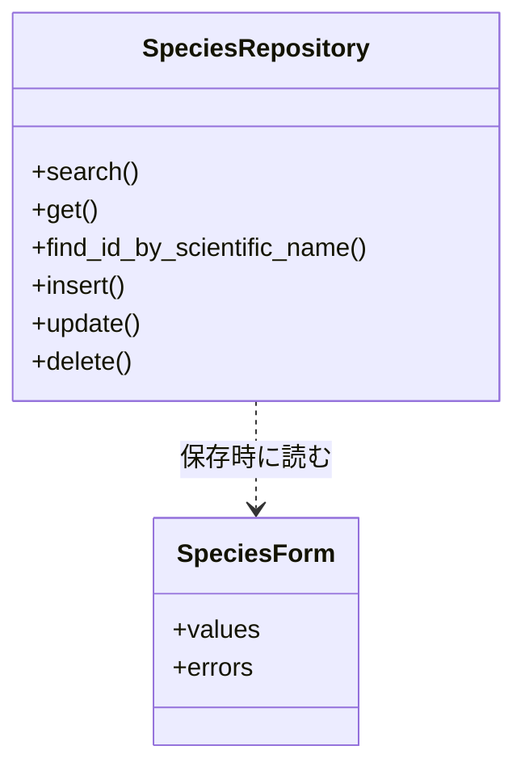

# 詳細設計書: 生物種情報データベース

## 1. 言語・フレームワーク・アーキテクチャの選定

### 判定

- 判定日: 2026-11-04
- 承認: 固定回答（ANSWERS.md）により、推奨の案（Python のフレームワーク ＋ SQLite）で承認済みとして進める。

### 技術制約の要約（要件定義書 1-1）

- 既存コードは無い。配備は利用者の PC 上で `bash run.sh` により起動し、`http://127.0.0.1:$PORT` で提供する。
- Python 3.12 か Node.js 24 のどちらかを使い、無償のライブラリだけを使う（契約）。
- 利用者は少数、性能の目標は無い。データは数百件以下。認証は無い。画面は英語。

### 判断軸

| 判断軸 | この案件で効く条件 | 該当 | 理由 |
|---|---|---|---|
| 既存資産との整合 | 既存コードは無い | 無し | 制約なし |
| チームの技術 | Python 3.12 か Node.js 24 | 有り | 両方を候補にできる。Python を選ぶ |
| 配備先 | PC 上でのローカル起動、コンテナ不使用 | 有り | 依存を setup.sh で入れられる構成にする |
| 認証と認可の境界 | 認証無し | 無し | 境界の設計は不要 |
| 画面の規模 | 一覧・詳細・登録・修正・削除確認の 5 画面程度、フォームあり | 有り | サーバー側で HTML を描画する構成が単純 |
| データの規模と構造 | 12 件から数百件、検索・絞り込みあり、単純な 1 テーブル | 有り | 本格的な RDB は不要。組み込みの SQLite で足りる |
| 外部連携 | 無し | 無し | — |
| ライセンスとコスト | 無償のみ | 有り | BSD 系・MIT 系・標準ライブラリのみを候補にする |
| 保守性 | 保守中のライブラリ | 有り | 公式の配布元で最新版と公開日を確かめる |

### 候補の比較

| 候補 | 判断軸ごとの評価 | 出典 URL | 確認日 |
|---|---|---|---|
| Flask 3.1.3（Python） | 最新版は 2026-02-19 公開。ライセンス BSD-3-Clause。Python 3.9 以上に対応。テンプレート描画・フォーム処理・ルーティングが少ないコードで書ける。依存は Werkzeug と Jinja2 | https://pypi.org/project/Flask/ 、https://flask.palletsprojects.com/ | 2026-11-04 |
| FastAPI 0.162.0（Python） | 最新版は 2026-10-23 公開。ライセンス MIT。Python 3.10 以上。JSON API 向けで、HTML の画面を作るにはテンプレートの追加設定と、非同期の扱いが要る。本件は JSON API を必要としない | https://pypi.org/project/fastapi/ 、https://fastapi.tiangolo.com/ | 2026-11-04 |
| 標準ライブラリ（http.server と sqlite3） | 追加の依存は無い。ただしルーティング、フォーム解析、HTML のエスケープをすべて自作するため、コードが増えて誤りやすい | https://docs.python.org/3/library/sqlite3.html 、https://docs.python.org/3/library/http.server.html | 2026-11-04 |

### 最終選定

- 言語: Python 3.12
- フレームワーク: Flask 3.1.3（HTML をサーバー側で描画する）
- データベース: SQLite（Python 標準の sqlite3 モジュール）。ファイルは `DATA_DIR` の下に置く
- 実行形態: サーバー（ローカル起動の Web アプリケーション）。コンテナは使わない
- テンプレート: Flask に含まれる Jinja2。HTML の自動エスケープを有効にする

選定理由: 画面の数が少なく、HTML の描画とフォームの処理が中心で、JSON API は要らない。Flask は依存が少なく、公式の配布元で保守されている。標準ライブラリだけでは同じ機能を作るコードが増えるため採らない。

### 承認の記録

- 承認日: 2026-11-04（固定回答による承認）

## 2. システム構成

### コンポーネント一覧

| コンポーネント | 役割 | 配置 |
|---|---|---|
| ブラウザ | 利用者が画面を操作する | 利用者の PC |
| Web アプリケーション（Flask） | 画面の描画、入力の検証、業務の処理 | `app/` |
| SQLite データベース | 生物種の情報の保存 | `DATA_DIR/species.db` |
| 起動スクリプト | 依存の導入（setup.sh）と起動（run.sh） | プロジェクトルート |

### システム全体構成図



### 各コンポーネントの役割

- Web アプリケーション: 経路ごとの処理（一覧、詳細、登録、修正、削除確認、削除）を行い、HTML を返す。入力値は検証してから保存する。
- リポジトリ: 生物種の表への読み書きを 1 か所に集める。画面の処理は SQL を直接書かない。
- SQLite データベース: 1 ファイルで完結する。起動時に表が無ければ作る。

### コンポーネント間インターフェースとデータフロー

- ブラウザと Web アプリケーションは HTTP（GET と POST、フォームの送信）で通信する。JSON は使わない。
- Web アプリケーションとデータベースは、同じプロセス内の関数呼び出しと SQLite の接続で通信する。

### ネットワーク構成図

ネットワーク越しの通信は、利用者の PC 内のブラウザと `127.0.0.1` のサーバーの間だけなので、ネットワーク構成図は書かない（外部へは出ない）。

## 3. データ設計

### 3-1. データモデル

DB が必要かの判定: 必要。理由は、生物種の一覧、キーワード検索、条件による絞り込み、登録・修正・削除を、再起動をまたいで保つ必要があるため。初期件数は 12 件、1 年後も数百件以下を想定する（増加率は不明だが、少数の利用を前提とする）。エンティティの参照関係は無く、1 テーブルで足りる。

DB 製品は第 1 章で選定した SQLite を使う。

#### テーブル: species（生物種）

| カラム | 型 | 制約 | 対応するデータ項目（要件 4-2） |
|---|---|---|---|
| id | INTEGER | 主キー、自動採番 | 内部の識別子（画面には出さない項目） |
| scientific_name | TEXT | NOT NULL、UNIQUE、COLLATE NOCASE、長さ 1〜100 | 学名 |
| common_name | TEXT | NOT NULL、長さ 1〜100 | 和名・一般名 |
| kingdom | TEXT | NOT NULL、CHECK で 6 種の値のいずれか | 界 |
| taxonomic_class | TEXT | NULL 可、長さ 0〜60（空は NULL で保存） | 綱 |
| habitat | TEXT | NOT NULL、CHECK で 4 種の値のいずれか | 生息環境 |
| diet | TEXT | NOT NULL、CHECK で 4 種の値のいずれか | 食性 |
| conservation_status | TEXT | NOT NULL、CHECK で 8 種の値のいずれか | 保全状況 |
| average_length_cm | REAL | NULL 可、0 より大きく 100000 以下（空は NULL） | 平均体長 |
| description | TEXT | NULL 可、長さ 0〜2000（空は NULL） | 説明 |
| created_at | TEXT | NOT NULL（UTC の ISO 8601 文字列） | 内部の項目（登録日時。画面には出さない） |
| updated_at | TEXT | NOT NULL（UTC の ISO 8601 文字列） | 内部の項目（更新日時。画面には出さない） |

- 値の選択肢（界・生息環境・食性・保全状況）は 8 章の `app/constants.py` の一覧と同じにする。CHECK 制約もこの一覧から作る。
- 保全状況の値は IUCN の略号（LC、NT、VU、EN、CR、EW、EX、DD）を保存し、画面では英語の表記（例: Vulnerable（VU））で表示する。
- 学名の一意性は、データベースの UNIQUE 制約（大文字小文字を区別しない）と、登録前の業務ルールの判定（3-2 の業務ルール）の両方で守る。業務ルールの判定は画面に理由を出すために行い、UNIQUE 制約は最後の防護として残す。

リレーション図: 単一のテーブルのため、リレーションは無い。



### 3-2. トランザクションと排他制御

- 登録・修正・削除は、それぞれ 1 件の行を書き換える 1 つの SQL 文で、1 回のコミットで完了させる。複数操作をまとめるトランザクションは無い。
- 排他制御は行わない（利用者は少数で、同時に同じ行を修正する操作は想定しない。後から保存した内容が残る）。
- 学名の重複判定と登録は、別々に行われるため、極めて稀に同時登録で競合しうる。その場合は UNIQUE 制約が違反を検出し、利用者には「この学名は既に登録されています」を表示する（Web アプリケーションは IntegrityError を同じ重複エラーとして扱う）。

### 3-3. 状態遷移

状態を持つエンティティは無い。

## 4. アーキテクチャ設計

### 4-1. 外部設計

#### 画面（GUI）

画面一覧は次のとおり。各画面の要素と機能を書く。

| 画面 | パス | 要素と機能 |
|---|---|---|
| 一覧・検索・絞り込み画面（DS-IF-SPECIES-LIST-SCREEN） | `GET /` | 上部の案内メニュー。キーワードの入力欄と「Search」ボタン。界・生息環境・食性・保全状況の選択欄（先頭は「All」）。「Clear」リンク（条件を消して `/` に戻る）。一覧の表（和名、学名、界、生息環境、食性、保全状況）。各行の和名は詳細画面へのリンク。0 件のときは「No species match」。削除後は `notice=deleted` で「Species deleted.」を表示 |
| 詳細画面（DS-IF-SPECIES-DETAIL-SCREEN） | `GET /species/<id>` | すべての項目（学名、和名・一般名、界、綱、生息環境、食性、保全状況（表記つき）、平均体長（cm）、説明）。「Edit」（修正画面へ）と「Delete」（削除確認画面へ）のボタン。登録・修正の直後は「Species saved.」を表示 |
| 登録・修正画面（DS-IF-SPECIES-FORM-SCREEN） | `GET/POST /species/new`、`GET/POST /species/<id>/edit` | 項目の入力欄（学名、和名、界、綱、生息環境、食性、保全状況、平均体長、説明）。選択欄は値の一覧を持つ。「Save」ボタン。見出しは「Add species」または「Edit species」。入力エラーは各項目の下に表示し、入力値は残す |
| 削除確認画面（DS-IF-SPECIES-DELETE-CONFIRM-SCREEN） | `GET/POST /species/<id>/delete` | 削除対象の和名と学名の表示。「Delete species」ボタン（POST で削除）と「Cancel」リンク（詳細画面へ戻る） |
| 案内メニュー（DS-IF-GLOBAL-NAVIGATION） | 全画面 | 上部に「Species Database」（一覧へ）、「Browse species」（一覧へ）、「Add species」（登録画面へ）を常に表示する |

画面遷移図:



#### インターフェース仕様

| インターフェース | 入力と、そのバリデーション | 出力 | エラー仕様 |
|---|---|---|---|
| 一覧（`GET /`） | クエリの `q`（キーワード。前後の空白を除く。空なら条件なし）、`kingdom`、`habitat`、`diet`、`conservation_status`（空または選択肢の値。選択肢以外は無視して全件として扱う）、`notice`（`deleted` のときだけ表示）。業務ルールは 3-2 に無し | 一覧の HTML。条件を組み合わせた AND の結果 | 0 件は「No species match」を表示（エラーではない） |
| 詳細（`GET /species/<id>`） | 整数の id | 詳細の HTML | 存在しない id は 404 の画面「Species not found.」と一覧へのリンク |
| 登録（`POST /species/new`） | フォームの各項目（業務ルール 3-2 と 4-2 の項目の規則）。前後の空白は除く。空の任意項目は NULL | 成功時は 302 で詳細画面へ転送（`/species/<新 id>`）。失敗時は同じ入力画面を 200 で返し、入力値を残す | 下の「エラーメッセージ」の表に従う |
| 修正（`POST /species/<id>/edit`） | 登録と同じ。自分自身の学名は重複と判定しない | 成功時は 302 で詳細画面へ転送。失敗時は同じ入力画面を 200 で返す。存在しない id は 404 | 同上 |
| 削除（`POST /species/<id>/delete`） | id のみ | 成功時は 302 で `/?notice=deleted` へ転送。存在しない id は 404 | — |

エラーメッセージ（英語。項目の下に表示）:

| 項目 | 違反 | 表示 |
|---|---|---|
| 学名 | 空、または 100 文字超 | 「Scientific name is required and must be at most 100 characters.」 |
| 学名 | 他の種と重複（大文字小文字を区別しない） | 「This scientific name is already registered.」 |
| 和名 | 空、または 100 文字超 | 「Common name is required and must be at most 100 characters.」 |
| 界・生息環境・食性・保全状況 | 空または選択肢以外 | 「Please select a value from the list.」 |
| 綱 | 60 文字超 | 「Class must be at most 60 characters.」 |
| 平均体長 | 数値でない、0 以下、100000 超、小数第 2 位以下の桁がある | 「Average length must be a number greater than 0 and at most 100000, with at most one decimal place.」 |
| 説明 | 2000 文字超 | 「Description must be at most 2000 characters.」 |

- 複数の項目に違反がある場合は、すべての違反を項目ごとに表示する。
- 業務ルールの違反（学名の重複）は、他の項目の違反と同時に表示してよい。
- 利用者が見るメッセージは英語。ログは出さない（10 章）。

#### 外部システム連携

外部システムとの連携は無い。

#### 外部 DB 連携

外部 DB との連携は無い。

### 4-2. 内部設計

#### 処理フロー（登録）



- 修正は、登録の処理に「対象の id を除外して学名を判定する」と「既存の 1 件を更新する」を加えたもの。
- 削除は、対象の id の存在を確かめてから 1 件を削除し、一覧へ転送する。
- 一覧の検索は、キーワードと 4 つの条件を AND で組み合わせた 1 つの SQL の WHERE 句で行う。キーワードは学名、和名、説明に対して大文字小文字を区別せず部分一致させる。キーワードは SQL のパラメータとして渡し、文字列の連結はしない。

#### 処理の役割

| 処理 | 役割 |
|---|---|
| 一覧表示（DS-FN-LIST-SPECIES-PAGE） | クエリの条件を読み、検索結果と選択欄の値を画面に渡す |
| 検索（DS-FN-SEARCH-SPECIES-RECORDS） | キーワードと絞り込み条件を AND で組み合わせて 1 件以上の種を返す |
| 詳細表示（DS-FN-SHOW-SPECIES-DETAIL-PAGE） | 指定 id の種を取得し、存在しなければ 404 を返す |
| 入力の読み取り（DS-FN-PARSE-SPECIES-FORM） | フォームの値を前後の空白を除いて `SpeciesForm` に写す |
| 検証（DS-FN-VALIDATE-SPECIES-FORM） | 4-2 の項目の規則と 3-2 の業務ルールを確かめ、違反を項目ごとに返す |

#### バッチ設計

バッチは無い。

#### イベント設計

イベントは無い。

## 5. クラス設計

### クラス一覧

| クラス | 責務（1 文） | 配置 |
|---|---|---|
| SpeciesForm（DS-CL-SPECIES-FORM） | 登録・修正の入力値を保持し、検証の結果を項目ごとのエラーとして持つ | `app/validation.py` |
| SpeciesRepository（DS-CL-SPECIES-REPOSITORY） | 生物種の表の読み書き（検索、取得、学名の判定、追加、更新、削除）を行う | `app/repository.py` |

### クラスの主要属性とメソッド

- SpeciesForm: 属性は scientific_name、common_name、kingdom、taxonomic_class、habitat、diet、conservation_status、average_length_cm（文字列のまま保持する）、description、errors（項目名から文言への辞書）。空の入力の判定に必要な値の変換は行わない（保存の時点で行う）。
- SpeciesRepository: 属性は接続（データベースの接続を受け取る）。メソッドは次のとおり。
  - search（キーワードと条件の辞書を受け取り、一覧の行を返す）
  - get（id を受け取り、1 件または無しを返す）
  - find_id_by_scientific_name（学名と除外する id を受け取り、重複する id または無しを返す）
  - insert（入力値の辞書（SpeciesForm の項目値）を受け取り、新しい id を返す）
  - update（id と入力値の辞書を受け取る）
  - delete（id を受け取る）
  - close（接続を閉じる。画面の処理の後始末に使う）

### クラス図



### システム内メッセージ一覧

システム内のメッセージは無い。層の間の呼び出しは、関数の引数と戻り値だけで行う。

### メッセージフロー図

画面の処理の流れは 4-2 の処理フローと同じ。

## 6. エラーハンドリングとセキュリティ設計

### エラーハンドリング

| 想定エラー | 利用者への見え方 | ログ | 扱い |
|---|---|---|---|
| 入力の違反 | 入力画面を再表示し、項目ごとにエラーを出す（4-1） | 出さない | 保存せず続行 |
| 学名の重複（登録時と修正時） | 入力画面に重複のエラーを出す | 出さない | 保存せず続行 |
| 存在しない id | 404 の画面「Species not found.」と一覧へのリンク | 出さない | 中止（処理は行わない） |
| 同時登録による UNIQUE 違反 | 学名の重複のエラーと同じ | 出さない | 保存せず続行 |
| データベースファイルを作れない、読み書きできない（起動時） | 起動に失敗し、標準エラーにパスと原因を出す（利用者の画面は無い） | 標準エラーに出す | 起動を中止し終了コードを 1 にする |
| 想定外の例外（処理中） | 500 の汎用画面（英語。詳細は出さない） | Flask の標準の出力 | 処理を中止 |

### 認証

認証は無い。

### 認可

認可は無い（権限の区別は無い）。

### 監査ログ

監査ログは無い（要件定義書 6 章で不要とした）。

### その他のセキュリティ対策

- サーバーは `127.0.0.1` だけで待ち受ける（外部の PC からは接続できない）。
- 画面に出す値は HTML の自動エスケープを通す。SQL はパラメータで渡し、文字列の連結はしない。
- 認証は無いため、データの変更は同じ PC のブラウザから誰でも行える（要件定義書 5 章の前提）。

## 7. コード設計

### ディレクトリ構成

```
プロジェクトルート
├── setup.sh
├── run.sh
├── requirements.txt
├── app/
│   ├── __init__.py
│   ├── __main__.py
│   ├── db.py
│   ├── constants.py
│   ├── repository.py
│   ├── validation.py
│   ├── routes.py
│   ├── seed.py
│   ├── static/
│   │   └── style.css
│   └── templates/
│       ├── base.html
│       ├── species_list.html
│       ├── species_detail.html
│       ├── species_form.html
│       └── species_delete_confirm.html
├── tests/
│   ├── test_repository.py
│   ├── test_validation.py
│   └── test_seed.py
└── e2e/
    └── test_species_site.py
```

### ファイル一覧

| ファイル | 役割 | 含まれるクラス・関数 | 実現する設計 ID |
|---|---|---|---|
| `setup.sh` | 仮想環境を作り、requirements.txt の依存を入れる | — | `DS-OP-START-SERVER` |
| `run.sh` | `PORT`（既定 8000）と `DATA_DIR`（既定 `./data`）を決め、仮想環境の Python で `app` を起動する | — | `DS-OP-START-SERVER` |
| `app/__init__.py` | Flask アプリケーションを作り、データベースの準備と初期データの投入を行う | `create_app` | `DS-MD-APP-FACTORY`、`DS-FN-CREATE-APP` |
| `app/__main__.py` | `127.0.0.1` と `PORT` で Web サーバーを前景で起動する | — | `DS-MD-APP-MAIN` |
| `app/db.py` | SQLite への接続と表の作成を行う | `connect_database`、`ensure_database_schema` | `DS-MD-DB`、`DS-FN-CONNECT-DATABASE`、`DS-FN-ENSURE-DATABASE-SCHEMA`、`DS-SC-SPECIES-TABLE` |
| `app/constants.py` | 界・生息環境・食性・保全状況の選択肢と表示名を持つ | — | `DS-MD-CONSTANTS` |
| `app/repository.py` | 生物種の表への読み書きを行う | `SpeciesRepository` | `DS-MD-REPOSITORY`、`DS-CL-SPECIES-REPOSITORY`、`DS-FN-SEARCH-SPECIES-RECORDS`、`DS-FN-GET-SPECIES-RECORD`、`DS-FN-FIND-SPECIES-ID-BY-SCIENTIFIC-NAME`、`DS-FN-INSERT-SPECIES-RECORD`、`DS-FN-UPDATE-SPECIES-RECORD`、`DS-FN-DELETE-SPECIES-RECORD` |
| `app/validation.py` | 入力値の読み取り、検証、エラーの作成を行う | `SpeciesForm`、`parse_species_form`、`validate_species_form` | `DS-MD-VALIDATION`、`DS-CL-SPECIES-FORM`、`DS-FN-PARSE-SPECIES-FORM`、`DS-FN-VALIDATE-SPECIES-FORM` |
| `app/routes.py` | 経路と画面の処理を結ぶ | `list_species`、`show_species_detail`、`show_create_form`、`submit_create_form`、`show_edit_form`、`submit_edit_form`、`show_delete_confirm`、`submit_delete` | `DS-MD-ROUTES`、`DS-FN-LIST-SPECIES-PAGE`、`DS-FN-SHOW-SPECIES-DETAIL-PAGE`、`DS-FN-SHOW-CREATE-FORM-PAGE`、`DS-FN-SUBMIT-CREATE-FORM`、`DS-FN-SHOW-EDIT-FORM-PAGE`、`DS-FN-SUBMIT-EDIT-FORM`、`DS-FN-SHOW-DELETE-CONFIRM-PAGE`、`DS-FN-SUBMIT-DELETE-SPECIES` |
| `app/seed.py` | 表が空のときにサンプルの生物種 12 件を入れる | `seed_sample_species_if_empty` | `DS-MD-SEED`、`DS-FN-SEED-SAMPLE-SPECIES-IF-EMPTY` |
| `app/templates/base.html` | 全画面の共通の枠（案内メニュー、色の読み込み） | — | `DS-IF-GLOBAL-NAVIGATION` |
| `app/templates/species_list.html` | 一覧・検索・絞り込み画面 | — | `DS-IF-SPECIES-LIST-SCREEN` |
| `app/templates/species_detail.html` | 詳細画面 | — | `DS-IF-SPECIES-DETAIL-SCREEN` |
| `app/templates/species_form.html` | 登録・修正画面 | — | `DS-IF-SPECIES-FORM-SCREEN` |
| `app/templates/species_delete_confirm.html` | 削除確認画面 | — | `DS-IF-SPECIES-DELETE-CONFIRM-SCREEN` |
| `app/static/style.css` | 配色とレイアウト（linen の背景、maroon の部品） | — | 配色は `DS-TS-THEME-LINEN-MAROON` で確かめる（ソースファイルではないため DS-MD を付けない） |

対応表の粒度: `function`（公開関数まで対応表に載せる。既定。`isdd-setup` に `--granularity function` を渡す）。

テストファイル（`tests/`、`e2e/`）は、このファイル一覧には含めない。E2E のテスト関数は 8 章の表で `DS-TS-*` と結ぶ。

### 依存の規則

| 依存元（ディレクトリ） | 依存してよい先（プロジェクト内） | 依存してはいけない先（プロジェクト内のパスか外部モジュール名） | 理由 |
|---|---|---|---|
| `app/routes.py` | `app/repository.py`、`app/validation.py`、`app/constants.py` | `app/db.py`、`app/seed.py` | 画面の処理は保存の手段（SQLite）を直接扱わない |
| `app/validation.py` | `app/repository.py`、`app/constants.py` | `app/routes.py` | 検証は画面の経路に依存しない |
| `app/repository.py` | `app/db.py`、`app/constants.py`、`app/validation.py`（`SpeciesForm` の型のみ） | `app/routes.py`、`app/seed.py` | 保存の処理は画面と初期データに依存しない |
| `app/seed.py` | `app/repository.py`、`app/constants.py` | `app/routes.py` | 初期データは画面に依存しない |
| `app/db.py` | 標準ライブラリのみ | `app/routes.py`、`app/repository.py`、`app/validation.py`、`app/seed.py` | 接続と表の作成は最下層 |

依存の規則は、この表のとおりに守る。外部連携は無いため、外部 API のライブラリに関する規則は無い。

### コーディング規約

- Python: PEP 8、型ヒントを関数の引数と戻り値に付ける、docstring は日本語で処理の説明を書く（ID は書かない）。
- HTML: 英語の文言。Jinja2 の自動エスケープを有効にしたまま、`|safe` を使わない。
- CSS: 色は変数（`:root`）に定義し、部品はその変数を使う。

### ID の扱い

- ソースコードには要件 ID も設計 ID も書かない。設計 ID とコードの対応は実装時に `docs/trace_map.md` へ記録する（書式は対応表のルール）。

## 8. テスト設計

### 8-1. テストの種類と方針

- 単体テスト: `tests/` の標準ライブラリ `unittest` で、各モジュールの関数とクラスを確かめる（検証、リポジトリの検索・追加・更新・削除、学名の判定、サンプルの投入、起動時の表の作成）。
- 結合テスト: リポジトリと検証を組み合わせ、学名の重複判定を含めた登録・修正の流れを確かめる（tests/ の中）。
- 総合テスト・E2E: 実サーバーを `127.0.0.1` で起動し、HTTP で各経路を呼んで、HTML の内容と状態の変化を確かめる（`e2e/`）。ブラウザ自動化は使わず、HTTP クライアント（標準ライブラリの `urllib`）で実サーバーを確かめる（固定回答による承認）。

#### 単体テスト・結合テストの実行コマンド

```bash
.venv/bin/python -m unittest discover -s tests -t . -v
```

#### 非機能要件の検証

- 配色（RQ-NF-VISUAL-THEME-LINEN-MAROON）は、E2E の配色のテスト（`DS-TS-THEME-LINEN-MAROON`）で、スタイルシートの背景色と部品の色を確かめる。
- 認証無し・ローカルアクセス（RQ-NF-ANONYMOUS-LOCAL-ACCESS）は、E2E の起動テストで `127.0.0.1` の接続だけを使うことで確かめる（`DS-TS-STARTUP-WITH-SAMPLE-DATA` の手順に含める）。

### 8-2. E2E テストのシナリオ

要件定義書 7 章の 8 本の `RQ-TS-*` を、次の `DS-TS-*` で網羅する。モードは持たない（外部連携が無いため）。

| DS-ID | 目的 | 前提条件 | 手順 | 期待結果 |
|---|---|---|---|---|
| `DS-TS-STARTUP-WITH-SAMPLE-DATA` | 空の DATA_DIR で起動し、サンプルが出ることを確かめる | DATA_DIR が空 | 実サーバーを `127.0.0.1` と任意の PORT で起動し、`/` を取得する | 12 件のサンプルの和名が一覧に含まれる |
| `DS-TS-BROWSE-AND-VIEW-SPECIES` | 一覧から詳細へ移れることを確かめる | サンプルが入っている | `/` を取得し、先頭の種の詳細のリンクを取得する。詳細を取得する | 詳細に全項目の見出しと値がある。全画面に案内メニューがある |
| `DS-TS-SEARCH-SPECIES-KEYWORD` | キーワード検索を確かめる | サンプルが入っている | `/?q=lion` と `/?q=zzzz` を取得する | 前者は該当する種だけ。後者は「No species match」 |
| `DS-TS-FILTER-AND-COMBINE` | 絞り込みと検索の組み合わせ、解除を確かめる | サンプルが入っている | `/?kingdom=Animalia`、`/?kingdom=…&habitat=…`、`/?kingdom=…&q=…` を取得し、`/` で解除する | 条件の AND で結果が狭まり、解除で全件に戻る |
| `DS-TS-CREATE-SPECIES-RECORD` | 登録と学名の重複の業務ルールを確かめる | サンプルが入っている | `/species/new` に正しい値を POST する。次に同じ学名（大文字小文字違い）で POST する | 1 回目は詳細へ転送され一覧に増える。2 回目は 200 で重複のエラーを返し、入力値が残る |
| `DS-TS-UPDATE-SPECIES-RECORD` | 修正を確かめる | 登録済みの種が 1 件ある | `/species/<id>/edit` に和名を変えて POST する。自分自身の学名のまま POST する | 詳細に変更後の和名が出る。自分の学名は重複とされない |
| `DS-TS-DELETE-SPECIES-RECORD` | 削除の確認と取り消しを確かめる | 登録済みの種が 1 件ある | `/species/<id>/delete` を取得する。キャンセルとして詳細を再取得する。次に POST で削除し、`/` を取得する | キャンセルでは削除されない。削除後は一覧に無く、`notice=deleted` の表示がある |
| `DS-TS-THEME-LINEN-MAROON` | 配色を確かめる | サンプルが入っている | `/`、`/species/1`、`/species/new` を取得し、`/static/style.css` を取得する | スタイルシートの背景が `#FAF0E6`、部品が `#800000` であり、HTML がそれを読み込む |

### 8-3. E2E の実行手段

- 実行形態はサーバー（Web）。E2E は HTTP クライアントで実サーバーを呼ぶ（ブラウザ自動化は使わない）。
- E2E の実装は標準ライブラリの `unittest` と `urllib` で書く。テストは `e2e/test_species_site.py` にまとめ、起動用の補助関数は同じファイルに置く。

### 8-4. E2E の実行コマンドと運用

- 実行コマンド（結果は JUnit XML で出す）:

```bash
.venv/bin/python scripts/isdd/unittest_junit.py -s e2e -o e2e/results/e2e.xml
```

- `e2e/results/` は git 管理外にする（isdd-setup が `.gitignore` に足す）。
- `DS-TS-*` は、対応表の `DS-TS` の行でテスト関数に結ぶ（修飾名は `e2e/test_species_site.py::関数名`）。
- テストが失敗したら修正と再実行を繰り返し、全件通過まで続ける。

## 9. 運用設計

### 起動方式

- 実行形態はサーバー。コンテナは使わない。
- 初回: `bash setup.sh` が `.venv`（Python 3.12）を作り、`requirements.txt`（`Flask==3.1.3`）を入れる。
- 起動: `PORT=任意 bash run.sh`。`run.sh` は `PORT`（既定 8000）と `DATA_DIR`（既定 `./data`）を環境変数から読み、`DATA_DIR` を作成してから `.venv` の Python で `python -m app` を実行する。サーバーは前景で動き続け、終了は Ctrl+C で行う。
- 待ち受けは `127.0.0.1` の `PORT` のみ。
- 起動の度に、データベースの表が無ければ作り、表が空ならサンプルを入れる（10 章の起動時の処理）。

### 初期化

- 表の作成とサンプルの投入は、起動時に `create_app` が行う（`DS-FN-CREATE-APP`）。
- 初期ユーザーは無い（認証が無いため）。

### 設定値・環境変数

| 名前 | 用途 | 既定値 | 必須か |
|---|---|---|---|
| `PORT` | Web サーバーの待ち受けポート | 8000 | 任意 |
| `DATA_DIR` | SQLite ファイル（`species.db`）を置くディレクトリ | `./data` | 任意 |

秘密情報は無い。外部連携は無いので接続情報も無い。

### バックアップと復旧

バックアップは必要ない（要件定義書 6 章）。`DATA_DIR` の `species.db` を利用者が手作業で複製すれば退避できる（自動化は無い）。

### データ移行

移行は無い（要件定義書 5 章）。

### 可用性

可用性の要求は無い。

### README

README.md に起動方法（setup.sh、run.sh、PORT と DATA_DIR の意味）を書く。初期ユーザーは無い。

## 10. ログ・監視・アラート・障害対応設計

### ログ

ログの設計は必須ではないため、ログの種類と内容の記述は行わない。Flask の標準の出力（起動メッセージとリクエストの 1 行）は、そのまま標準出力に出る。

### 監視・アラート

監視・アラートの設計は必須ではないため、監視・アラートの内容と対応方法の記述は行わない。

### 障害対応

| 想定する障害 | 検知の方法 | 対応手順 | 復旧の確認方法 |
|---|---|---|---|
| `DATA_DIR` を作れない、または `species.db` を開けない | 起動時に標準エラーへ出る | `DATA_DIR` の場所と権限を直して再起動する | `run.sh` が起動し、`/` が 200 を返す |
| ポートが使用中 | 起動時に標準エラーへ出る | `PORT` を変えて再起動する | 同上 |
| 画面でのエラー（想定外の例外） | 利用者に 500 の画面が出る | 標準出力のエラーを確かめて、修正後に再起動する | 失敗した操作を再実行する |

## 11. 要件と設計の対応表

| DS-ID | 対応要件ID |
|---|---|
| `DS-OP-START-SERVER` | `RQ-OP-START-WITH-SCRIPTS`, `RQ-NF-ANONYMOUS-LOCAL-ACCESS` |
| `DS-OP-NO-LOG-DESIGN` | `RQ-OP-LOG-NOT-REQUIRED` |
| `DS-OP-NO-MONITORING-DESIGN` | `RQ-OP-MONITORING-NOT-REQUIRED` |
| `DS-OP-NO-BACKUP-DESIGN` | `RQ-OP-BACKUP-NOT-REQUIRED` |
| `DS-MD-APP-FACTORY` | `RQ-DT-SQLITE-STORAGE`, `RQ-OP-SAMPLE-DATA-ON-EMPTY` |
| `DS-FN-CREATE-APP` | `RQ-DT-SQLITE-STORAGE`, `RQ-OP-SAMPLE-DATA-ON-EMPTY` |
| `DS-MD-APP-MAIN` | `RQ-OP-START-WITH-SCRIPTS`, `RQ-NF-ANONYMOUS-LOCAL-ACCESS` |
| `DS-MD-DB` | `RQ-DT-SQLITE-STORAGE` |
| `DS-FN-CONNECT-DATABASE` | `RQ-DT-SQLITE-STORAGE` |
| `DS-FN-ENSURE-DATABASE-SCHEMA` | `RQ-DT-SQLITE-STORAGE`, `RQ-DT-SPECIES-RECORD` |
| `DS-SC-SPECIES-TABLE` | `RQ-DT-SPECIES-RECORD`, `RQ-DT-SQLITE-STORAGE` |
| `DS-MD-CONSTANTS` | `RQ-DT-SPECIES-RECORD` |
| `DS-MD-REPOSITORY` | `RQ-FT-SEARCH-SPECIES-KEYWORD`, `RQ-FT-CREATE-SPECIES-RECORD`, `RQ-FT-UPDATE-SPECIES-RECORD`, `RQ-FT-DELETE-SPECIES-RECORD` |
| `DS-CL-SPECIES-REPOSITORY` | `RQ-FT-BROWSE-SPECIES-LIST`, `RQ-FT-SEARCH-SPECIES-KEYWORD`, `RQ-FT-FILTER-SPECIES-CRITERIA`, `RQ-FT-CREATE-SPECIES-RECORD`, `RQ-FT-UPDATE-SPECIES-RECORD`, `RQ-FT-DELETE-SPECIES-RECORD` |
| `DS-FN-SEARCH-SPECIES-RECORDS` | `RQ-FT-BROWSE-SPECIES-LIST`, `RQ-FT-SEARCH-SPECIES-KEYWORD`, `RQ-FT-FILTER-SPECIES-CRITERIA`, `RQ-FT-COMBINE-SEARCH-AND-FILTER` |
| `DS-FN-GET-SPECIES-RECORD` | `RQ-FT-VIEW-SPECIES-DETAIL`, `RQ-FT-UPDATE-SPECIES-RECORD`, `RQ-FT-DELETE-SPECIES-RECORD` |
| `DS-FN-FIND-SPECIES-ID-BY-SCIENTIFIC-NAME` | `RQ-FT-VALIDATE-SPECIES-RECORD` |
| `DS-FN-INSERT-SPECIES-RECORD` | `RQ-FT-CREATE-SPECIES-RECORD` |
| `DS-FN-UPDATE-SPECIES-RECORD` | `RQ-FT-UPDATE-SPECIES-RECORD` |
| `DS-FN-DELETE-SPECIES-RECORD` | `RQ-FT-DELETE-SPECIES-RECORD` |
| `DS-MD-VALIDATION` | `RQ-FT-VALIDATE-SPECIES-RECORD`, `RQ-FT-CREATE-SPECIES-RECORD`, `RQ-FT-UPDATE-SPECIES-RECORD` |
| `DS-CL-SPECIES-FORM` | `RQ-FT-VALIDATE-SPECIES-RECORD` |
| `DS-FN-PARSE-SPECIES-FORM` | `RQ-FT-CREATE-SPECIES-RECORD`, `RQ-FT-UPDATE-SPECIES-RECORD` |
| `DS-FN-VALIDATE-SPECIES-FORM` | `RQ-FT-VALIDATE-SPECIES-RECORD` |
| `DS-MD-ROUTES` | `RQ-FT-BROWSE-SPECIES-LIST`, `RQ-FT-VIEW-SPECIES-DETAIL`, `RQ-FT-CREATE-SPECIES-RECORD`, `RQ-FT-UPDATE-SPECIES-RECORD`, `RQ-FT-DELETE-SPECIES-RECORD` |
| `DS-FN-LIST-SPECIES-PAGE` | `RQ-FT-BROWSE-SPECIES-LIST`, `RQ-FT-SEARCH-SPECIES-KEYWORD`, `RQ-FT-FILTER-SPECIES-CRITERIA` |
| `DS-FN-SHOW-SPECIES-DETAIL-PAGE` | `RQ-FT-VIEW-SPECIES-DETAIL` |
| `DS-FN-SHOW-CREATE-FORM-PAGE` | `RQ-FT-CREATE-SPECIES-RECORD` |
| `DS-FN-SUBMIT-CREATE-FORM` | `RQ-FT-CREATE-SPECIES-RECORD`, `RQ-FT-VALIDATE-SPECIES-RECORD` |
| `DS-FN-SHOW-EDIT-FORM-PAGE` | `RQ-FT-UPDATE-SPECIES-RECORD` |
| `DS-FN-SUBMIT-EDIT-FORM` | `RQ-FT-UPDATE-SPECIES-RECORD`, `RQ-FT-VALIDATE-SPECIES-RECORD` |
| `DS-FN-SHOW-DELETE-CONFIRM-PAGE` | `RQ-FT-DELETE-SPECIES-RECORD` |
| `DS-FN-SUBMIT-DELETE-SPECIES` | `RQ-FT-DELETE-SPECIES-RECORD` |
| `DS-MD-SEED` | `RQ-OP-SAMPLE-DATA-ON-EMPTY` |
| `DS-FN-SEED-SAMPLE-SPECIES-IF-EMPTY` | `RQ-OP-SAMPLE-DATA-ON-EMPTY` |
| `DS-IF-SPECIES-LIST-SCREEN` | `RQ-UI-SPECIES-LIST-SCREEN` |
| `DS-IF-SPECIES-DETAIL-SCREEN` | `RQ-UI-SPECIES-DETAIL-SCREEN` |
| `DS-IF-SPECIES-FORM-SCREEN` | `RQ-UI-SPECIES-FORM-SCREEN` |
| `DS-IF-SPECIES-DELETE-CONFIRM-SCREEN` | `RQ-UI-SPECIES-DELETE-CONFIRM-SCREEN` |
| `DS-IF-GLOBAL-NAVIGATION` | `RQ-UI-GLOBAL-NAVIGATION` |
| `DS-TS-STARTUP-WITH-SAMPLE-DATA` | `RQ-TS-STARTUP-WITH-SAMPLE-DATA` |
| `DS-TS-BROWSE-AND-VIEW-SPECIES` | `RQ-TS-BROWSE-AND-VIEW-SPECIES` |
| `DS-TS-SEARCH-SPECIES-KEYWORD` | `RQ-TS-SEARCH-SPECIES-KEYWORD` |
| `DS-TS-FILTER-AND-COMBINE` | `RQ-TS-FILTER-AND-COMBINE` |
| `DS-TS-CREATE-SPECIES-RECORD` | `RQ-TS-CREATE-SPECIES-RECORD` |
| `DS-TS-UPDATE-SPECIES-RECORD` | `RQ-TS-UPDATE-SPECIES-RECORD` |
| `DS-TS-DELETE-SPECIES-RECORD` | `RQ-TS-DELETE-SPECIES-RECORD` |
| `DS-TS-THEME-LINEN-MAROON` | `RQ-TS-THEME-LINEN-MAROON`, `RQ-NF-VISUAL-THEME-LINEN-MAROON` |

### 11-1. 除外要件

除外要件は無い。
