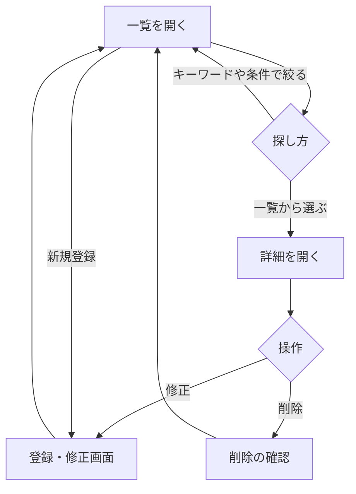
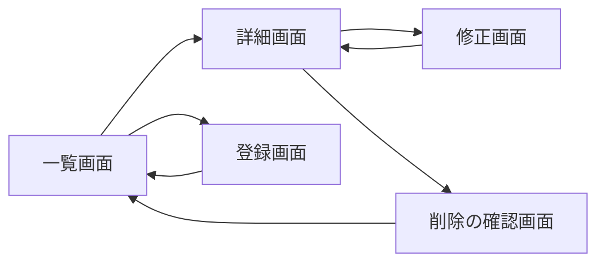

# 要件定義書: 生物種情報データベース

## 1. 目的・前提

- システムの目的: 生物種ごとの生物学的な情報（分類、生息環境、食性、保全状況、体長、説明）を一か所で閲覧・検索・絞り込みでき、登録・修正・削除もできるようにする。
- システムの形態: GUI（ブラウザで使う画面）。CUI・Web API・バッチは無い。

### 用語集

| 用語 | 業務上の意味 | 本案件での使用範囲 | 同義語/類義語 |
|---|---|---|---|
| 生物種 | 学名で区別される生物の種類 | 本システムの管理単位（1 件 = 1 生物種） | 種、species |
| 学名 | 生物種に付けられた国際的な学術名（属名と種小名の 2 語） | 入力された場合の生物種の一意の識別名（任意項目） | 学術名、scientific name |
| 和名・一般名 | 一般の利用者が使う名前 | 一覧と詳細に表示する名前 | 通称、common name |
| 界 | 生物の分類の最上位の区分（動物界、植物界など） | 絞り込みの条件 | kingdom |
| 生息環境 | 生物が主に暮らす場所の区分（陸上、淡水、海洋、混合） | 絞り込みの条件 | habitat |
| 食性 | 主に何を食べるかの区分（草食、肉食、雑食、その他） | 絞り込みの条件 | diet |
| 保全状況 | 絶滅の危険度の区分（IUCN レッドリストの区分） | 絞り込みの条件 | conservation status |

## 1-1. 技術制約

| 制約項目 | 内容 | 出どころ（誰がいつ答えたか） |
|---|---|---|
| 既存コードベース | 無し（新規開発） | 固定回答（2026-11-04） |
| 配備先 | 利用者の PC 上で `bash run.sh` により起動し、`http://127.0.0.1:$PORT` で提供する。コンテナは使わない | 契約（contract.md） |
| チームの技術 | 特に無い。Python 3.12 か Node.js 24 のどちらかを使う（契約） | 契約（contract.md） |
| ライセンスとコスト | 無償のライブラリのみ。外部サービスと有償 API は使わない | 契約（contract.md） |
| 性能と規模の目安 | 利用者は少数。性能の目標は無い。データは数百件以下を想定 | 固定回答（2026-11-04） |

## 2. 業務

- 対象業務一覧

  | RQ-BZ-ID | 業務名 | 業務の範囲 | 担当者 |
  |---|---|---|---|
  | `RQ-BZ-SPECIES-INFORMATION-MANAGEMENT` | 生物種情報の管理 | 生物種の情報を閲覧・検索・絞り込み・登録・修正・削除する | 一般の利用者（認証は無い） |

- 業務フロー

### 2-1. 業務の問題（あるべき姿と現状のギャップ）

| 問題 | 対象業務（RQ-BZ） | あるべき姿 | 現状 | ギャップ（KPI） | 業務影響 |
|---|---|---|---|---|---|
| 生物種の情報が一か所に無く、必要な種を探すのが難しい | `RQ-BZ-SPECIES-INFORMATION-MANAGEMENT` | 利用者が一覧から全体を把握し、キーワードや条件で目的の種を素早く見つけられる | 依頼文に現状の数値は無い | 不明（依頼に数値が無いため作らない） | 目的の種の情報を探すのに手間がかかる |
| 生物種の情報の登録・修正・削除の手段が無い | `RQ-BZ-SPECIES-INFORMATION-MANAGEMENT` | 利用者が画面から情報を追加・修正・削除できる | 依頼文に現状の数値は無い | 不明（依頼に数値が無いため作らない） | 情報を最新に保てない |

### 2-2. 業務課題一覧

| RQ-BK-ID | 業務課題（取り組むこと） | 解決する問題（2-1） | 解決後の状態（KPI の目標値） | 対象業務（RQ-BZ） |
|---|---|---|---|---|
| `RQ-BK-BROWSE-SPECIES-LIST` | 生物種の一覧と詳細を閲覧できるようにする | 1 つ目 | 全件が一覧に出て、各種の詳細を開ける（目標値は依頼に無いため不明） | `RQ-BZ-SPECIES-INFORMATION-MANAGEMENT` |
| `RQ-BK-SEARCH-SPECIES-RECORDS` | キーワードで特定の生物種を探せるようにする | 1 つ目 | キーワードで該当する種が出る（目標値は不明） | `RQ-BZ-SPECIES-INFORMATION-MANAGEMENT` |
| `RQ-BK-FILTER-SPECIES-RECORDS` | 界・生息環境・食性・保全状況で絞り込めるようにする | 1 つ目 | 条件で絞った結果が出る（目標値は不明） | `RQ-BZ-SPECIES-INFORMATION-MANAGEMENT` |
| `RQ-BK-MAINTAIN-SPECIES-RECORDS` | 生物種の情報を登録・修正・削除できるようにする | 2 つ目 | 画面から登録・修正・削除が完結する（目標値は不明） | `RQ-BZ-SPECIES-INFORMATION-MANAGEMENT` |

### 2-3. 見込み経営効果

見込み経営効果は算定しない（依頼文に効果の数値が無く、本件は業務の効率化の見積もりを求められていないため。固定回答による）。

## 3. 機能要件

- 入力データ: 人手入力（登録・修正画面）。外部連携は無い。
- 出力データ: 画面への表示のみ。帳票・出力ファイルは無い。
- 利用フロー: 業務フロー（2 の図）と同じ。画面遷移は 4-5 の画面一覧と 3-1 の図を参照。

### 画面遷移図（GUI）

### 機能一覧

| RQ-ID | カテゴリ | 機能名 | 対応業務課題ID（RQ-BK-*） | この機能が無いと何が困るか |
|---|---|---|---|---|
| `RQ-FT-BROWSE-SPECIES-LIST` | 業務機能 | 生物種の一覧を表示する | `RQ-BK-BROWSE-SPECIES-LIST` | 利用者が登録されている生物種の全体を把握できない |
| `RQ-FT-VIEW-SPECIES-DETAIL` | 業務機能 | 生物種の詳細（全項目）を表示する | `RQ-BK-BROWSE-SPECIES-LIST` | 一覧の名前だけでは生物の情報が分からない |
| `RQ-FT-SEARCH-SPECIES-KEYWORD` | 業務機能 | キーワードで生物種を検索する（学名、和名・一般名、説明の文字列を、大文字小文字を区別せず部分一致で探す） | `RQ-BK-SEARCH-SPECIES-RECORDS` | 目的の種を一覧から目で探すしかない |
| `RQ-FT-FILTER-SPECIES-CRITERIA` | 業務機能 | 界・生息環境・食性・保全状況の条件で生物種を絞り込む | `RQ-BK-FILTER-SPECIES-RECORDS` | 条件に合う種を分類して見られない |
| `RQ-FT-COMBINE-SEARCH-AND-FILTER` | 業務機能 | キーワードと絞り込み条件を同時に使い、両方を満たす種だけを表示する。すべての条件を解除して全件に戻せる | `RQ-BK-SEARCH-SPECIES-RECORDS`, `RQ-BK-FILTER-SPECIES-RECORDS` | 検索と絞り込みを組み合わせて目的の種を狭められない |
| `RQ-FT-ADD-SPECIES-FORM` | マスタ管理 | 案内メニューの「Add species」から登録画面を開き、名前、生息環境、食性、説明を入力して 1 件登録する。名前、生息環境、食性は必須で、説明と他の項目（学名、界、綱、保全状況、平均体長）は任意。保存した種は一覧に加わり、キーワード検索と絞り込みで見つかる | `RQ-BK-MAINTAIN-SPECIES-RECORDS` | 依頼の項目で新しい種を登録できない |
| `RQ-FT-UPDATE-SPECIES-RECORD` | マスタ管理 | 登録済みの生物種の情報を修正する | `RQ-BK-MAINTAIN-SPECIES-RECORDS` | 誤った情報や古い情報を直せない |
| `RQ-FT-DELETE-SPECIES-RECORD` | マスタ管理 | 生物種を削除する（削除の前に確認を行う） | `RQ-BK-MAINTAIN-SPECIES-RECORDS` | 不要になった登録や誤った登録を消せない |
| `RQ-FT-VALIDATE-SPECIES-FORM` | 業務機能 | 登録・修正時に、必須項目の入力、選択肢の値、文字数と数値の規則、学名が入力された場合の一意性を確かめる。違反は画面に理由を示し、保存しない（3-2 の規則） | `RQ-BK-MAINTAIN-SPECIES-RECORDS` | 必須項目の空や不正な値が混入する。学名の重複が登録される |

### 3-1. 帳票・出力ファイル

帳票・出力ファイルは無い。

### 3-2. 業務ルール

| RQ-ID | ルール名 | 内容（条件と結果） | 違反時・エラー時の業務上の扱い | 対応業務課題ID（RQ-BK-*） |
|---|---|---|---|---|
| `RQ-FT-VALIDATE-SPECIES-FORM` | 学名の一意性 | 学名は任意。入力された場合だけ、前後の空白を除き大文字小文字を区別せず、登録済みの他の種と重複してはならない。修正の場合は自分自身を除いて判定する | 重複する学名の登録・修正は保存せず、同じ入力画面に「This scientific name is already registered.」と表示する | `RQ-BK-MAINTAIN-SPECIES-RECORDS` |
| `RQ-FT-VALIDATE-SPECIES-FORM` | 必須項目 | 名前、生息環境、食性は必須。界、保全状況、綱、平均体長、説明は任意（空のまま保存できる） | 必須項目が空の場合は保存せず、その項目の下に英語のメッセージ（「Please select a value from the list.」等）を表示する | `RQ-BK-MAINTAIN-SPECIES-RECORDS` |

業務ルールは上記 2 件（学名の一意性、必須項目）。

### 3-3. 外部連携

外部連携は無い。

## 4. データ

### 4-1. データ要件一覧

| RQ-ID | 種別 | 内容 | 対応業務課題ID（RQ-BK-*） | この要件が無いと何が困るか |
|---|---|---|---|---|
| `RQ-DT-SQLITE-STORAGE` | 内部データ | 生物種の情報は内部データとして、環境変数 `DATA_DIR` の下の SQLite ファイル（`species.db`）に保存する。`DATA_DIR` が無ければ作成する | `RQ-BK-BROWSE-SPECIES-LIST` | 登録した情報が再起動で消え、一覧が保てない |
| `RQ-DT-SQLITE-STORAGE` | 保持期間 | 保持期間は、利用者が削除するまでの無期限とする | `RQ-BK-MAINTAIN-SPECIES-RECORDS` | 保持の方針が無く、データの扱いが決まらない |

### 4-2. 業務エンティティとデータ項目

| RQ-ID | カテゴリ | 業務エンティティ名 | 対応業務課題ID（RQ-BK-*） | この業務エンティティが無いと何が困るか |
|---|---|---|---|---|
| `RQ-DT-SPECIES-RECORD` | マスタ | 生物種 | `RQ-BK-BROWSE-SPECIES-LIST`, `RQ-BK-SEARCH-SPECIES-RECORDS`, `RQ-BK-FILTER-SPECIES-RECORDS`, `RQ-BK-MAINTAIN-SPECIES-RECORDS` | 表示・検索・絞り込み・登録の対象が無い |

生物種のデータ項目:

| エンティティ名 | 項目名 | 業務上の意味 | 必須 | 形式・桁 | 値の範囲・制約 | 例 |
|---|---|---|---|---|---|---|
| 生物種 | 学名 | 生物種の学術名 | 任意 | 文字列、1〜100 文字（空は保存しない） | 入力された場合だけ、業務ルール（3-2）に従い一意 | Panthera leo |
| 生物種 | 和名・一般名 | 一般の名前 | 必須 | 文字列、1〜100 文字 | — | Lion |
| 生物種 | 界 | 分類の最上位区分 | 任意 | 選択式 | Animalia、Plantae、Fungi、Protista、Bacteria、Archaea のいずれか | Animalia |
| 生物種 | 綱 | 分類の綱（任意） | 任意 | 文字列、0〜60 文字 | — | Mammalia |
| 生物種 | 生息環境 | 主な生息場所 | 必須 | 選択式 | Terrestrial、Freshwater、Marine、Mixed のいずれか | Terrestrial |
| 生物種 | 食性 | 主な食べ物 | 必須 | 選択式 | Herbivore、Carnivore、Omnivore、Other のいずれか | Carnivore |
| 生物種 | 保全状況 | 絶滅の危険度 | 任意 | 選択式 | Least Concern（LC）、Near Threatened（NT）、Vulnerable（VU）、Endangered（EN）、Critically Endangered（CR）、Extinct in the Wild（EW）、Extinct（EX）、Data Deficient（DD） のいずれか | Vulnerable（VU） |
| 生物種 | 平均体長 | 成体の平均的な体長（任意） | 任意 | 数値、cm、0 より大きく 100000 以下、小数第 1 位まで | — | 190.0 |
| 生物種 | 説明 | 生物の特徴の説明（任意） | 任意 | 文字列、0〜2000 文字 | — | Large social carnivore living in groups |

### 4-3. CRUD テーブル（必須）

| エンティティ名 | Create | Read（一覧） | Read（詳細） | 検索 | Update | Delete | 備考 |
|---|---|---|---|---|---|---|---|
| 生物種 | ○ | ○ | ○ | ○ | ○ | ○ | 検索: 学名・和名・説明のキーワード（部分一致）と、界・生息環境・食性・保全状況の絞り込み（RQ-FT-SEARCH-SPECIES-KEYWORD、RQ-FT-FILTER-SPECIES-CRITERIA）。同時更新・トランザクションが要る操作は無い（単一ユーザーの単純な 1 件の更新） |

### 4-4. 状態遷移

状態を持つエンティティは無い。

### 4-5. 画面一覧（GUI の場合のみ）

| RQ-ID | 画面名 | 対応する CRUD 操作（エンティティ名:操作種別） | 主な機能・目的 | 対応業務課題ID（RQ-BK-*） |
|---|---|---|---|---|
| `RQ-UI-SPECIES-LIST-SCREEN` | 一覧・検索・絞り込み画面（トップ画面） | 生物種:Read（一覧）、生物種:検索 | 全件の一覧、キーワード検索、界・生息環境・食性・保全状況の絞り込み、条件の解除 | `RQ-BK-BROWSE-SPECIES-LIST`, `RQ-BK-SEARCH-SPECIES-RECORDS`, `RQ-BK-FILTER-SPECIES-RECORDS` |
| `RQ-UI-SPECIES-DETAIL-SCREEN` | 生物種の詳細画面 | 生物種:Read（詳細）、生物種:Delete（削除への入口）、生物種:Update（修正への入口） | 全項目の表示、修正画面と削除確認画面への移動 | `RQ-BK-BROWSE-SPECIES-LIST`, `RQ-BK-MAINTAIN-SPECIES-RECORDS` |
| `RQ-UI-SPECIES-FORM-SCREEN` | 生物種の登録・修正画面 | 生物種:Create、生物種:Update | 項目の入力と保存、入力エラーの表示 | `RQ-BK-MAINTAIN-SPECIES-RECORDS` |
| `RQ-UI-SPECIES-DELETE-CONFIRM-SCREEN` | 生物種の削除確認画面 | 生物種:Delete | 削除対象の表示、「削除する」と「キャンセル」の選択 | `RQ-BK-MAINTAIN-SPECIES-RECORDS` |
| `RQ-UI-GLOBAL-NAVIGATION` | 全画面共通の案内メニュー | — | 「Browse species」（一覧）と「Add species」（登録）への移動を、全画面の上部に常に表示する | `RQ-BK-BROWSE-SPECIES-LIST`, `RQ-BK-MAINTAIN-SPECIES-RECORDS` |

## 5. 非機能要件

- 利用者の種別とアクセス経路: 一般の利用者（認証は無い）。アクセスは利用者の PC 上で起動したサーバーへの `http://127.0.0.1:$PORT`（契約）。
- 性能: 応答時間の目標は無い。
- 利用人数: 少数（同時に数人程度を想定）。
- 可用性: 可用性の要求は無い。
- 移行性: 既存の `DATA_DIR/species.db`（旧い定義）は起動時に新しい定義へ移す（`RQ-OP-MIGRATE-EXISTING-DATABASE`、6 章）。
- セキュリティ: 認証は無い（固定回答）。権限の区別は無い。監査証跡は無い。
- 画面の言語: 英語（契約）。
- 画面の色: 背景は honeydew、すべての画面部品（案内メニュー、ボタン、リンク、表の見出し、入力欄の枠、バッジなど）は dark olive green。

| RQ-ID | カテゴリ | 非機能要件名 | 対応業務課題ID（RQ-BK-*） | この非機能要件が無いと何が困るか |
|---|---|---|---|---|
| `RQ-NF-VISUAL-THEME-HONEYDEW-OLIVE` | 利用者・アクセス | 画面の配色（背景は honeydew `#F0FFF0`、すべての部品は dark olive green `#556B2F`、部品の上の文字は白 `#FFFFFF`） | `RQ-BK-BROWSE-SPECIES-LIST` | 依頼された配色で画面を見てもらえない |
| `RQ-NF-ANONYMOUS-LOCAL-ACCESS` | 利用者・アクセス | 認証無しで、ローカルの `127.0.0.1` からだけ使う | `RQ-BK-BROWSE-SPECIES-LIST` | 利用者がサインインせずに使える前提が崩れ、設計が決まらない |

## 6. 運用要件

| RQ-ID | 種別 | 内容 | 対応業務課題ID（RQ-BK-*） | この要件が無いと何が困るか |
|---|---|---|---|---|
| `RQ-OP-START-WITH-SCRIPTS` | 起動 | `bash setup.sh` で依存を入れ、`PORT=任意 bash run.sh` で Web サーバーを起動する。サーバーは前景で動き続け、停止は終了操作で行う。`PORT` が無ければ 8000 を使う | `RQ-BK-BROWSE-SPECIES-LIST` | 利用者が起動できず、画面を開けない |
| `RQ-OP-SAMPLE-DATA-ON-EMPTY` | 初期データ | `DATA_DIR` の生物種が 1 件も無いとき、起動時に 12 件のサンプル生物種を入れる。サンプルは全機能（一覧、検索、絞り込み、詳細、修正、削除）を試せる内容にする | `RQ-BK-BROWSE-SPECIES-LIST` | 空の状態では一覧も検索も試せない |
| `RQ-OP-LOG-NOT-REQUIRED` | ログ | ログは必要ない。ログの内容と保存期間の記述は行わない | `RQ-BK-BROWSE-SPECIES-LIST` | 該当なし（不要と判断したことを明記する） |
| `RQ-OP-MONITORING-NOT-REQUIRED` | 監視 | 監視・アラートは必要ない。監視・アラートの内容と対応方法の記述は行わない | `RQ-BK-BROWSE-SPECIES-LIST` | 該当なし（不要と判断したことを明記する） |
| `RQ-OP-BACKUP-NOT-REQUIRED` | バックアップ | バックアップは必要ない | `RQ-BK-MAINTAIN-SPECIES-RECORDS` | 該当なし（不要と判断したことを明記する） |
| `RQ-OP-MIGRATE-EXISTING-DATABASE` | データ移行 | 既存の `DATA_DIR/species.db`（学名、界、保全状況が必須の旧い定義）がある場合、起動時にデータを失わず新しい定義（4-2 の任意項目）へ移す。移行は 1 回だけ行い、移行後に既存の行を変えない。既に新しい定義なら何もしない | `RQ-BK-MAINTAIN-SPECIES-RECORDS` | 既存の利用者のデータが消える、または新しい登録ができない |

## 7. テスト用利用シナリオ

| RQ-ID | テスト目的 | 前提条件 | テスト手順 | 期待される結果 | 検証する要件ID | 対応業務課題ID（RQ-BK-*） |
|---|---|---|---|---|---|---|
| `RQ-TS-STARTUP-WITH-SAMPLE-DATA` | 空の DATA_DIR で起動し、サンプルが出ることを確かめる | DATA_DIR が空 | `bash setup.sh` の後、`PORT` を指定して `bash run.sh` を起動し、トップ画面を開く | 12 件のサンプル生物種が一覧に表示される | `RQ-OP-SAMPLE-DATA-ON-EMPTY`、`RQ-UI-SPECIES-LIST-SCREEN` | `RQ-BK-BROWSE-SPECIES-LIST` |
| `RQ-TS-BROWSE-AND-VIEW-SPECIES` | 一覧から詳細を開けることを確かめる | サンプルが入っている | トップ画面で一覧を見て、任意の種の名前を開く | 詳細画面に全項目（学名、和名、界、綱、生息環境、食性、保全状況、平均体長、説明）が表示される。全画面の上部に案内メニューがある | `RQ-FT-BROWSE-SPECIES-LIST`、`RQ-FT-VIEW-SPECIES-DETAIL`、`RQ-UI-SPECIES-LIST-SCREEN`、`RQ-UI-SPECIES-DETAIL-SCREEN`、`RQ-UI-GLOBAL-NAVIGATION` | `RQ-BK-BROWSE-SPECIES-LIST` |
| `RQ-TS-SEARCH-SPECIES-KEYWORD` | キーワード検索を確かめる | サンプルが入っている | 一覧画面の検索欄に大文字小文字の違う部分文字列（例: `lion`）を入れて検索する。次に存在しない語（例: `zzzz`）で検索する | 前者は該当する種だけが表示される。後者は「No species match」と表示される | `RQ-FT-SEARCH-SPECIES-KEYWORD`、`RQ-UI-SPECIES-LIST-SCREEN` | `RQ-BK-SEARCH-SPECIES-RECORDS` |
| `RQ-TS-FILTER-AND-COMBINE` | 絞り込みと検索の組み合わせ、解除を確かめる | サンプルが入っている | Kingdom で「Animalia」、Habitat で「Marine」を選んで絞り込む。次に検索欄にキーワードを足す。最後に「Clear」を押す | 絞り込みの結果だけが表示され、検索を足すとさらに狭まる。「Clear」で全件に戻る | `RQ-FT-FILTER-SPECIES-CRITERIA`、`RQ-FT-COMBINE-SEARCH-AND-FILTER`、`RQ-UI-SPECIES-LIST-SCREEN` | `RQ-BK-FILTER-SPECIES-RECORDS`、`RQ-BK-SEARCH-SPECIES-RECORDS` |
| `RQ-TS-ADD-SPECIES-FORM` | 「Add species」の登録を画面から確かめ、一覧・検索・絞り込みに出ること、学名の重複の規則を確かめる | サンプルが入っている | 案内メニューの「Add species」を開く。Name に `Test Gecko`、Habitat に `Terrestrial`、Diet に `Carnivore`、Description に `A test entry.` を入れて Save する。次に一覧で `Test Gecko` を探す。検索欄に `gecko` を入れて検索する。Habitat で `Terrestrial`、Diet で `Carnivore` を選んで絞り込む。もう一度 Add species から、学名に `panthera leo`（既存の Panthera leo と大文字小文字違い）を入れ、名前、生息環境、食性を入れて Save する | 1 回目は詳細に移り、一覧・検索・絞り込みに `Test Gecko` が出る。2 回目は保存されず、学名の欄の下に「This scientific name is already registered.」が出て、入力値が残る | `RQ-FT-ADD-SPECIES-FORM`、`RQ-FT-VALIDATE-SPECIES-FORM`、`RQ-UI-SPECIES-FORM-SCREEN`、`RQ-UI-GLOBAL-NAVIGATION` | `RQ-BK-MAINTAIN-SPECIES-RECORDS` |
| `RQ-TS-UPDATE-SPECIES-RECORD` | 修正を確かめる | 登録済みの種が 1 件ある | 詳細画面から修正画面を開き、名前を変えて保存する。修正画面で自分自身の学名をそのまま保存する | 詳細画面に変更後の名前が出る。自分自身の学名は重複とされず保存される | `RQ-FT-UPDATE-SPECIES-RECORD`、`RQ-FT-VALIDATE-SPECIES-FORM`、`RQ-UI-SPECIES-FORM-SCREEN` | `RQ-BK-MAINTAIN-SPECIES-RECORDS` |
| `RQ-TS-DELETE-SPECIES-RECORD` | 削除の確認と取り消しを確かめる | 登録済みの種が 1 件ある | 詳細画面から「Delete」を押し、削除確認画面で「Cancel」を押す。次に「Delete」からもう一度開き「Delete species」を押す | Cancel では削除されず詳細に戻る。削除後は一覧から消えている | `RQ-FT-DELETE-SPECIES-RECORD`、`RQ-UI-SPECIES-DELETE-CONFIRM-SCREEN` | `RQ-BK-MAINTAIN-SPECIES-RECORDS` |
| `RQ-TS-THEME-HONEYDEW-OLIVE` | 配色を確かめる | サンプルが入っている | 一覧、詳細、登録画面を開く | 背景が honeydew（`#F0FFF0`）で、案内メニュー、ボタン、リンク、表の見出しが dark olive green（`#556B2F`）で表示される | `RQ-NF-VISUAL-THEME-HONEYDEW-OLIVE`、`RQ-UI-GLOBAL-NAVIGATION` | `RQ-BK-BROWSE-SPECIES-LIST` |
| `RQ-TS-MIGRATE-EXISTING-DATABASE` | 旧い定義の既存データベースを移行し、データが残ることを確かめる | 旧い定義の `species.db` に 1 件の種がある | 旧い定義のファイルを DATA_DIR に置いて起動し、一覧を開く。学名を空にして新しい種を登録する | 既存の種が一覧に残る。学名が空の登録が保存される | `RQ-OP-MIGRATE-EXISTING-DATABASE`、`RQ-FT-ADD-SPECIES-FORM` | `RQ-BK-MAINTAIN-SPECIES-RECORDS` |
