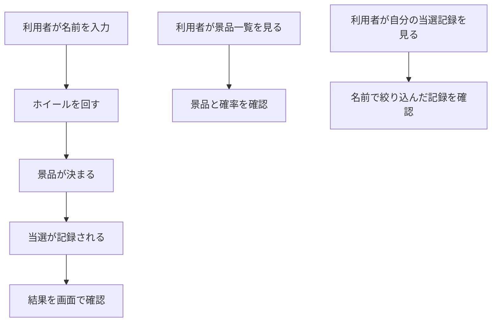
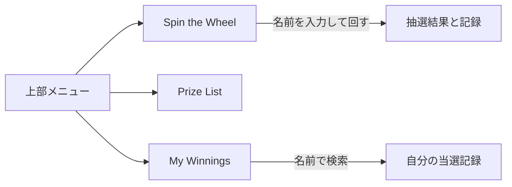

# 要件定義書: Wheel of Fortune（景品抽選ウェブサイト）

- 作成日: 2026-11-05
- フロー: 新規（既存ソースコード無し、外部連携無し）
- 出典: REQUEST.md（依頼）、contract.md（契約）、ANSWERS.md（ヒアリングへの固定回答）

## 1. 目的・前提

### 目的

利用者が名前を入力してホイールを回し、景品を抽選で受け取れるウェブサイトを提供する。景品の一覧と、自分の当選記録を見られるようにする。

### 用語集

| 用語 | 業務上の意味 | 本案件での使用範囲 | 同義語/類義語 |
|---|---|---|---|
| 景品 | 抽選で当たる賞品 | 画面・データ | prize |
| 重み | 景品ごとの当選のしやすさを表す整数（1〜100）。景品の確率は重みの合計に対する割合 | 抽選規則・景品一覧 | weight |
| 当選記録 | 誰が（名前）どの景品に、いつ当たったかの記録 | 画面・データ | winning record |
| 名前 | 利用者を区別するための表示名。ログインは無く、名前で当選記録を分ける | 全画面 | player name |

### システムの形態

GUI（ブラウザの画面）。Web API は画面を支えるための内部の JSON APIとして持つが、外部に公開する API ではない。

### 1-1. 技術制約（前提として記録する。要件ではないため ID は付与しない）

| 制約項目 | 内容 | 出どころ（誰がいつ答えたか） |
|---|---|---|
| 既存コードベース | 無し | ANSWERS.md（2026-11-05） |
| 配備先 | 起動した PC（ローカル）。`bash run.sh` で直接起動する。コンテナは使わない | contract.md |
| チームの技術 | 指定無し。Python 3.12 か Node.js 24 が使えること（契約） | contract.md、ANSWERS.md |
| ライセンスとコスト | 無償のものだけ。外部サービスと有償 API は使わない | contract.md |
| 性能と規模の目安 | 利用者は少数。性能の目標は無い | ANSWERS.md |

### 1-2. 依頼に無く自分で決めた項目（必須）

| 項目 | 決めた内容 | 根拠（最小案か、依頼のどこから推測したか） | 承認（承認済 / 未確認） |
|---|---|---|---|
| 利用者の区別 | 名前の入力で区別する。ログインは無い。当選記録は「名前が完全に一致する」もので絞る（大文字小文字を区別する） | 依頼の「自分の当選記録」に必要。ログイン無しの最小案（ANSWERS.md: 認証無し） | 承認済（ANSWERS.md） |
| 名前の制限 | 前後の空白を除いて 1〜30 文字。空欄・超過は保存せずエラー表示 | 空の名前では記録の持ち主が決まらないため。桁数は最小の既定値 | 承認済（ANSWERS.md の範囲で決定） |
| 名前の記憶 | 最後に使った名前をブラウザ（localStorage）に残し、入力欄に入れておく | 利用者が毎回入力しなくてよい最小の補助 | 承認済（ANSWERS.md の範囲で決定） |
| 景品の初期データ | 景品 8 件（重みの合計 100）と、サンプルの当選記録 3 件（名前 `Sample Player`）を、データが空のとき起動時に入れる | contract.md（空でも試せる初期データ） | 承認済（contract.md） |
| 景品の管理 | 利用者が景品を追加・編集・削除する画面は作らない。景品は初期データのみ | 依頼に管理機能の記述が無い | 承認済（ANSWERS.md の範囲で決定） |
| 当選記録の削除 | 利用者は当選記録を消せない（無期限に残す） | 依頼に削除の記述が無い | 承認済（ANSWERS.md の範囲で決定） |
| 「はずれ」の景品 | 置かない。必ずいずれかの景品に当たる | 依頼に「はずれ」の記述が無い | 承認済（ANSWERS.md の範囲で決定） |
| ホイールの扇形 | 景品ごとに同じ大きさの扇形とする。確率は重みのみで決まり、扇形の大きさとは連動しない（景品一覧に確率を表示する） | 小さい扇形でも文字を読めるようにするため | 承認済（ANSWERS.md の範囲で決定） |
| 利用可能な景品が無い場合 | 回さず「No prizes are available.」を表示し、記録しない（HTTP 409） | 景品が無いと抽選できないため | 承認済（ANSWERS.md の範囲で決定） |
| 当選記録の表示上限 | 新しい順に最大 100 件 | 一覧の大きさを抑えるための既定値 | 承認済（ANSWERS.md の範囲で決定） |
| 配色 | 背景は薄い灰色（#e6e6e6、既定）。ボタン・メニュー・見出し・ホイールなどの部品は濃い赤（#8b0000 系） | 依頼の「light gray as the default background」「dark red for component styling」 | 承認済（依頼文） |
| 画面の言語 | 英語 | contract.md | 承認済（contract.md） |
| 技術選定 | Node.js 24（組み込みの http と node:sqlite）、外部パッケージ無し、HTML/CSS/JavaScript（画面）。詳細は詳細設計書 第 1 章 | ANSWERS.md（推奨案でよい）。公式情報の調査は検索ツールが使えず未実施（詳細設計書 第 1 章を参照） | 承認済（ANSWERS.md）。出典は「未調査（ユーザー承認: 2026-11-05）」 |

## 2. 業務

### 対象業務一覧

| RQ-BZ-ID | 業務名 | 業務の範囲 | 担当者 |
|---|---|---|---|
| RQ-BZ-PRIZE-DRAW | 景品の抽選配布 | 利用者がホイールで景品を抽選し、結果を記録し、景品一覧と自分の当選記録を確認する | 利用者（一般）。運営者の操作は無い |

### 業務フロー

### 2-1. 業務の問題（あるべき姿と現状のギャップ）

| 問題 | 対象業務（RQ-BZ） | あるべき姿 | 現状 | ギャップ（KPI） | 業務影響 |
|---|---|---|---|---|---|
| 景品の抽選の結果が残らず、誰が何を当てたか確認できない | RQ-BZ-PRIZE-DRAW | 抽選のたびに結果が記録され、利用者が自分の当選を確認できる | 依頼文に現状の記述無し（不明） | 不明（数値の記載無し） | 不明（依頼文に記述無し） |
| 景品の内容と当たりやすさが利用者に分からない | RQ-BZ-PRIZE-DRAW | 景品と確率が一覧で分かる | 依頼文に現状の記述無し（不明） | 不明（数値の記載無し） | 不明 |

### 2-2. 業務課題一覧（必須）

| RQ-BK-ID | 業務課題（取り組むこと） | 解決する問題（2-1） | 解決後の状態（KPI の目標値） | 対象業務（RQ-BZ） |
|---|---|---|---|---|
| RQ-BK-SPIN-DRAW | ホイールで景品を抽選できるようにする | 景品の抽選の結果が残らない（1 行目の問題の抽選側） | 利用者が名前を入力して 1 回の操作で景品が決まる（目標値: 不明） | RQ-BZ-PRIZE-DRAW |
| RQ-BK-SHOW-PRIZES | 景品の内容と確率を利用者に見せる | 景品の内容と当たりやすさが分からない | 景品一覧に全景品と確率が出る（目標値: 不明） | RQ-BZ-PRIZE-DRAW |
| RQ-BK-TRACK-WINNINGS | 当選を記録し、利用者が自分の当選記録を見られるようにする | 抽選結果が残らない（1 行目の問題の記録側） | 全当選が記録され、名前で自分の記録を確認できる（目標値: 不明） | RQ-BZ-PRIZE-DRAW |

### 2-3. 見込み経営効果

見込み経営効果は算定しない（依頼文に金額・時間などの算定材料が無いため）。

## 3. 機能要件

### 入力データと出力データ

- 人手入力: 利用者の名前（画面の入力欄）
- 出力: 抽選結果（画面）、景品一覧（画面）、当選記録（画面）
- 外部データ: 無し

### 全機能の利用者フロー

### 機能一覧

| RQ-ID | カテゴリ | 機能名 | 対応業務課題ID（RQ-BK-*） | この機能が無いと何が困るか |
|---|---|---|---|---|
| RQ-FT-SPIN-WHEEL | 抽選 | ホイールを回して景品を決める | RQ-BK-SPIN-DRAW | 抽選そのものができず、依頼の中心機能が成り立たない |
| RQ-FT-RECORD-WINNING | 記録 | 抽選結果を当選記録として保存する | RQ-BK-TRACK-WINNINGS | 当選が残らず、自分の当選記録を見る機能が成り立たない |
| RQ-FT-VIEW-PRIZE-LIST | 閲覧 | 景品一覧（名前・確率）を表示する | RQ-BK-SHOW-PRIZES | 利用者が景品の内容を事前に知れない |
| RQ-FT-VIEW-OWN-WINNINGS | 閲覧 | 名前で指定した利用者の当選記録を表示する | RQ-BK-TRACK-WINNINGS | 依頼の「自分の当選記録を見る」が満たされない |

### 3-1. 帳票・出力ファイル

帳票・出力ファイルは無い。

### 3-2. 業務ルール

| RQ-ID | ルール名 | 内容（条件と結果） | 違反時・エラー時の業務上の扱い | 対応業務課題ID（RQ-BK-*） |
|---|---|---|---|---|
| RQ-FT-WEIGHTED-DRAW | 重みによる抽選 | 景品は 1 件を、各景品の重みに比例した確率で選ぶ。重みは 1〜100 の整数。選ばれた景品が当選になる | 景品が 1 件も無いときは抽選せず「No prizes are available.」を表示する（記録しない） | RQ-BK-SPIN-DRAW |
| RQ-FT-NAME-REQUIRED | 名前の入力規則 | 名前は前後の空白を除いて 1〜30 文字。ホイールを回すときと当選記録を探すときに適用する | 規則に違反したら抽選も記録もせず、「Please enter your name (1-30 characters).」を表示する | RQ-BK-SPIN-DRAW, RQ-BK-TRACK-WINNINGS |

### 3-3. 外部連携

外部連携は無い。

## 4. データ

### 4-1. データ要件一覧

| RQ-ID | 種別 | 内容 | 対応業務課題ID（RQ-BK-*） | この要件が無いと何が困るか |
|---|---|---|---|---|
| RQ-DT-STORAGE-FILE | 保存先 | 景品と当選記録は DATA_DIR の下の SQLite ファイル（`wheel.sqlite`）に保存する。外部 DB は使わない。DB を使う理由: 再起動後も当選記録を残すため。初期件数は景品 8 件、利用に応じて当選記録が増える。件数の増加率は不明（利用者数の記載無し） | RQ-BK-TRACK-WINNINGS | 再起動で当選記録が消える |
| RQ-DT-RETENTION | 保持期間 | 当選記録は削除せず無期限に保持する | RQ-BK-TRACK-WINNINGS | 過去の当選が確認できなくなる |

### 4-2. 業務エンティティとデータ項目

| RQ-ID | カテゴリ | 業務エンティティ名 | 対応業務課題ID（RQ-BK-*） | この業務エンティティが無いと何が困るか |
|---|---|---|---|---|
| RQ-DT-PRIZE | 内部 | 景品 | RQ-BK-SPIN-DRAW, RQ-BK-SHOW-PRIZES | 抽選する対象と一覧の内容が無い |
| RQ-DT-WINNING-RECORD | 内部 | 当選記録 | RQ-BK-TRACK-WINNINGS | 当選の履歴が残らない |

| エンティティ名 | 項目名 | 業務上の意味 | 必須 | 形式・桁 | 値の範囲・制約 | 例 |
|---|---|---|---|---|---|---|
| 景品 | 景品番号 | 景品を一意に表す番号 | 必須 | 整数 | 自動採番、一意 | 1 |
| 景品 | 景品名 | 景品の名前 | 必須 | 文字列 | 1〜40 文字 | Coffee Voucher |
| 景品 | 重み | 当たりやすさ | 必須 | 整数 | 1〜100 | 15 |
| 景品 | 表示順 | 一覧と扇形の並び | 必須 | 整数 | 一意 | 2 |
| 当選記録 | 記録番号 | 記録を一意に表す番号 | 必須 | 整数 | 自動採番、一意 | 1 |
| 当選記録 | 名前 | 当選した利用者の名前 | 必須 | 文字列 | 前後の空白を除いて 1〜30 文字（RQ-FT-NAME-REQUIRED） | Alice |
| 当選記録 | 景品番号 | 当たった景品 | 必須 | 整数 | 景品の番号を参照 | 1 |
| 当選記録 | 景品名 | 当選時点の景品名（景品名が後で変わっても記録は変わらない） | 必須 | 文字列 | 1〜40 文字 | Coffee Voucher |
| 当選記録 | 当選日時 | 抽選が行われた日時 | 必須 | 日時（UTC、ISO 8601） | 記録時刻 | 2026-11-05T03:00:00.000Z |

### 4-3. CRUD テーブル（必須）

| エンティティ名 | Create | Read（一覧） | Read（詳細） | 検索 | Update | Delete | 備考 |
|---|---|---|---|---|---|---|---|
| 景品 | × | ○ | × | × | × | × | 初期データのみ。利用者は変更できない |
| 当選記録 | ○ | ○ | × | △ | × | × | Create は回したときだけ。Read は名前の完全一致で絞り込む（RQ-FT-VIEW-OWN-WINNINGS）。Update・Delete は無い |

### 4-4. 状態遷移

状態を持つエンティティは無い。

### 4-5. 画面一覧（GUI の場合のみ）

| RQ-ID | 画面名 | 対応する CRUD 操作（エンティティ名:操作種別） | 主な機能・目的 | 対応業務課題ID（RQ-BK-*） |
|---|---|---|---|---|
| RQ-UI-SPIN-SCREEN | Spin the Wheel（ホイール画面） | 当選記録:Create、景品:Read | 名前を入力してホイールを回し、結果を表示する | RQ-BK-SPIN-DRAW, RQ-BK-TRACK-WINNINGS |
| RQ-UI-PRIZE-LIST-SCREEN | Prize List（景品一覧画面） | 景品:Read | 景品名と確率を一覧で表示する | RQ-BK-SHOW-PRIZES |
| RQ-UI-MY-WINNINGS-SCREEN | My Winnings（当選記録画面） | 当選記録:Read（名前で絞り込み） | 名前を入力して自分の当選記録を一覧で表示する | RQ-BK-TRACK-WINNINGS |

### 3-4. 画面共通のナビゲーション（RQ-UI-NAVIGATION-MENU）

画面一覧（4-5）の 3 画面に共通の上部メニュー。3 画面へのリンクを常に表示し、今いる画面のリンクを強調する。

| RQ-ID | 画面名 | 対応する CRUD 操作（エンティティ名:操作種別） | 主な機能・目的 | 対応業務課題ID（RQ-BK-*） |
|---|---|---|---|---|
| RQ-UI-NAVIGATION-MENU | 上部メニュー（全画面共通） | 無し（画面遷移のみ） | 3 画面へ移動できるようにする | RQ-BK-SHOW-PRIZES, RQ-BK-SPIN-DRAW, RQ-BK-TRACK-WINNINGS |

## 5. 非機能要件

| RQ-ID | カテゴリ | 非機能要件名 | 対応業務課題ID（RQ-BK-*） | この非機能要件が無いと何が困るか |
|---|---|---|---|---|
| RQ-NF-LOCAL-ACCESS | アクセス経路・利用者 | 利用者は一般の人（ログイン無し）。起動した PC の `http://127.0.0.1:PORT` から使う。利用人数は少数（数値の記載無し）。性能の目標は無い | RQ-BK-SPIN-DRAW | 起動先と利用の前提が決まらず、設計と検証ができない |
| RQ-NF-BROWSER-SUPPORT | 利用環境 | Chromium ブラウザで動く（契約）。外部パッケージやネットワーク接続無しで動く | RQ-BK-SPIN-DRAW, RQ-BK-SHOW-PRIZES | 動かないブラウザで利用者が使えない |
| RQ-NF-UI-LANGUAGE-EN | 画面 | 画面の文言はすべて英語（契約） | RQ-BK-SHOW-PRIZES | 指定の言語で表示されず、採点で使えない |
| RQ-NF-VISUAL-STYLE | 画面 | 背景は薄い灰色（既定）。ボタン・メニュー・見出し・ホイールなどの部品は濃い赤を使う | RQ-BK-SHOW-PRIZES, RQ-BK-SPIN-DRAW | 依頼の指定の配色にならない |

認証・権限・監査ログ・移行・可用性は要求が無い（認証無し、権限の区別無し、移行は無い、可用性の要求は無い）。

## 6. 運用要件

- ログ: 一般的な動作ログ・エラーログ以外は必要ない。ログの内容と保存期間の記述は行わない。
- 監査ログ: 必要ない。
- 監視・アラート: 監視・アラートは必要ないため、監視・アラートの内容と対応方法の記述は行わない。
- バックアップと復旧: バックアップは必要ない（DATA_DIR の内容を利用者が自分で管理する）。

## 7. テスト用利用シナリオ

| RQ-ID | テスト目的 | 前提条件 | テスト手順 | 期待される結果 | 検証する要件ID | 対応業務課題ID（RQ-BK-*） |
|---|---|---|---|---|---|---|
| RQ-TS-SPIN-AND-RECORD | 名前を入れてホイールを回すと景品が決まり、当選記録に残ること | 起動直後（初期データあり） | Spin the Wheel 画面で名前 `Alice` を入れ、Spin を押す。結果の景品名を控え、My Winnings 画面で名前 `Alice` を入れて検索する | 景品が 1 件表示される。My Winnings に同じ景品名と日時の記録が 1 件ある。景品は重みに比例した確率で選ばれる | RQ-FT-SPIN-WHEEL, RQ-FT-WEIGHTED-DRAW, RQ-FT-RECORD-WINNING, RQ-UI-SPIN-SCREEN | RQ-BK-SPIN-DRAW, RQ-BK-TRACK-WINNINGS |
| RQ-TS-NAME-VALIDATION | 名前が空や長すぎるときに抽選も記録もされないこと | 起動直後 | 名前を空欄にして Spin を押す。次に 31 文字の名前で Spin を押す | 両方ともエラー「Please enter your name (1-30 characters).」が出る。当選記録は増えない | RQ-FT-NAME-REQUIRED, RQ-UI-SPIN-SCREEN | RQ-BK-SPIN-DRAW |
| RQ-TS-VIEW-PRIZES | 景品一覧に全景品と確率が出ること | 起動直後 | Prize List 画面を開く | 8 件の景品名と確率（重みの割合）が表示される。確率の合計は 100% になる | RQ-FT-VIEW-PRIZE-LIST, RQ-UI-PRIZE-LIST-SCREEN | RQ-BK-SHOW-PRIZES |
| RQ-TS-VIEW-OWN-WINNINGS | 名前で絞り込んだ当選記録だけが出ること | 名前 `Bob` の当選記録が無い。`Alice` で 2 回回した後 | My Winnings で `Bob` を検索し、次に `Alice` を検索する | `Bob` は記録 0 件と表示される。`Alice` は自分の 2 件だけを新しい順に表示する | RQ-FT-VIEW-OWN-WINNINGS, RQ-UI-MY-WINNINGS-SCREEN | RQ-BK-TRACK-WINNINGS |
| RQ-TS-NAVIGATE-SCREENS | 3 画面を上部メニューだけで行き来できること | 起動直後 | 上部メニューで 3 画面を順に開き、各画面で現在の画面のリンクが強調されることを確かめる | 3 画面すべてに同じメニューがあり、リンクで移動できる。画面の文言は英語 | RQ-UI-NAVIGATION-MENU, RQ-UI-SPIN-SCREEN, RQ-UI-PRIZE-LIST-SCREEN, RQ-UI-MY-WINNINGS-SCREEN | RQ-BK-SHOW-PRIZES, RQ-BK-SPIN-DRAW, RQ-BK-TRACK-WINNINGS |
| RQ-TS-INITIAL-DATA | データが空の状態で起動しても、景品と当選記録のサンプルが見られること | DATA_DIR が空のディレクトリ | 空の DATA_DIR で起動し、Prize List と `Sample Player` の My Winnings を開く | 景品 8 件が表示される。`Sample Player` の記録が 3 件表示される | RQ-DT-PRIZE, RQ-DT-WINNING-RECORD, RQ-DT-STORAGE-FILE | RQ-BK-SHOW-PRIZES, RQ-BK-TRACK-WINNINGS |

---

### 設計に進む前の確認事項

- 承認を求める項目は 1-2 の表のとおり。ANSWERS.md により承認は与えられている。
- 技術選定の公式情報の調査は、検索ツールの権限が無く実施できなかった。出典は「未調査（ユーザー承認: 2026-11-05）」として詳細設計書に記録する。
