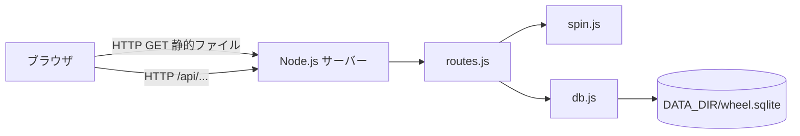
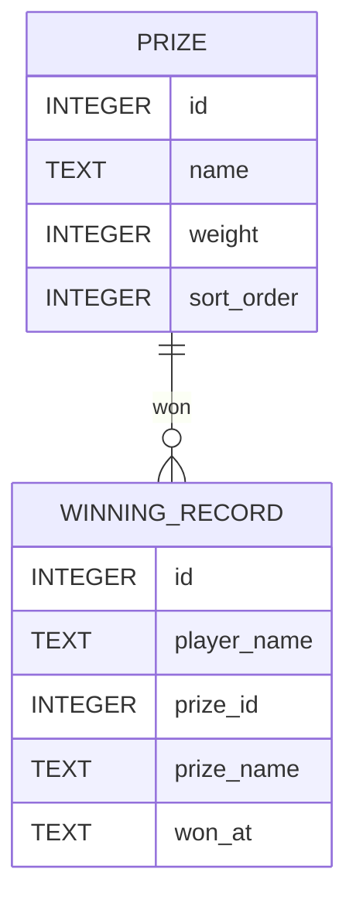
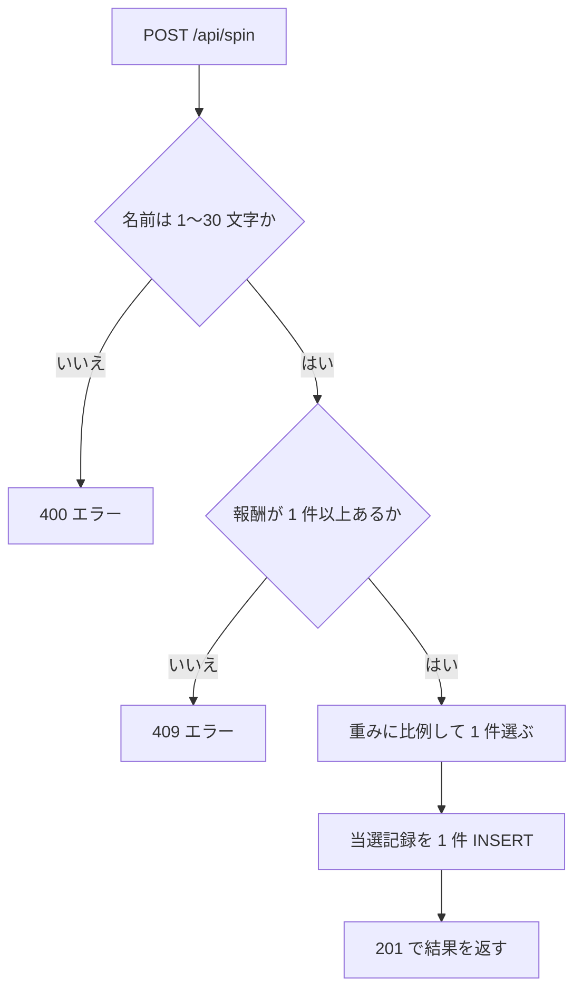

# 詳細設計書: Wheel of Fortune（報酬抽選ウェブサイト）

- 作成日: 2026-11-05
- 入力: docs/requirements.md（要件定義書）
- 対応する引き渡し: .history/20261105-wheel-of-fortune/tasks.md

## 1. 言語・フレームワーク・アーキテクチャの選定

### 1-1. 技術制約の要約

要件定義書 1-1 のとおり。既存コード無し、配備先は起動した PC（`bash run.sh`）、無償の技術のみ、利用者は少数、画面は英語、Chromium で動くこと。

### 1-2. 判断軸

| 判断軸 | 見るもの | この案件で効く条件 |
|---|---|---|
| 既存資産との整合 | 既存コード | 無し。判断に効かない |
| チームの技術 | 扱える言語 | 指定無し。contract.md が Python 3.12 か Node.js 24 を用意すると明記 |
| 配備先 | OS、動く実行環境 | 検証環境には Node.js 24.19.0 がある（ローカル確認済み）。Python は既定の `python3` が 3.9.6 で 3.12 が無い |
| 認証と認可の境界 | 認証・権限 | 無し。単一のサーバーで足りる |
| 画面の規模 | 画面数と遷移 | 3 画面と共通メニュー。単一ページで足りる |
| データの規模と構造 | 件数、参照関係 | 報酬 8 件、当選記録は追記のみ。1 ファイルの組み込み DB で足りる。参照関係は 1 つ（記録 → 報酬） |
| 外部連携 | 外部 API | 無し |
| ライセンスとコスト | 有償・OSS 制約 | 無償のみ。外部パッケージを増やさない方が起動が確実 |
| 保守性 | 保守状況 | 公式の組み込みモジュールだけを使う案が最も少ない依存で済む |

### 1-3. 候補の比較

出典と確認日: 検索ツールの利用権限が得られず、公式情報は調査できなかった。ANSWERS.md の「技術選定: 推奨の案でよい」により、未調査のまま進める承認を記録する（出典列: 未調査（ユーザー承認: 2026-11-05））。

| 候補 | 判断軸ごとの評価 | 出典 URL | 確認日 |
|---|---|---|---|
| A. Node.js 24 ＋ 組み込み `http` ＋ 組み込み `node:sqlite` ＋ 静的な HTML/CSS/JavaScript | 外部パッケージ無し。検証環境に Node.js 24.19.0 があり、`node:sqlite` で SQLite（3.53.3）を開けることをローカルで確認済み。テストは組み込みの `node:test` | 未調査（ユーザー承認: 2026-11-05） | 2026-11-05（ローカル確認） |
| B. Python 3.12 ＋ 標準の `http.server` ＋ 標準の `sqlite3` | 外部パッケージ無し。ただし検証環境の既定 `python3` は 3.9.6 で、3.12 はローカルに無い。契約では 3.12 が使えるとあるが、ここでは確認できない | 未調査（ユーザー承認: 2026-11-05） | 2026-11-05 |
| C. Node.js ＋ Express ＋ better-sqlite3 | 外部パッケージが増え、`setup.sh` でのインストールとネイティブビルドが要る。起動の確実さが下がる | 未調査（ユーザー承認: 2026-11-05） | 2026-11-05 |

### 1-4. 最終選定結果

- 言語・実行環境: JavaScript（ES modules）、Node.js 24
- フレームワーク: 無し（組み込み `http`）
- DB: SQLite（組み込み `node:sqlite`）。ファイルは `DATA_DIR/wheel.sqlite`
- 実行形態: サーバー（コンテナは使わない）。`bash run.sh` で前面に起動する
- 画面: 静的な HTML・CSS・JavaScript（フレームワーク無し、ビルド無し）
- 選定理由: 要件の「外部パッケージ無し」「英語」「Chromium で動く」「`bash run.sh` で起動」をすべて満たし、依存が最も少ない。候補 B は 3.12 を確認できず、C は依存を増やすため採らない

**リスク（未調査のため記録）**: `node:sqlite` が Node.js 24 で実験的扱いの警告を出す可能性がある。警告が出ても動作には影響しない前提で進め、動かない場合は候補 B に切り替える判断を後で行う。

- 承認: 2026-11-05（ANSWERS.md の固定回答により、ユーザーが承認を与えたものとして進行）

### 1-5. 構成（フロントエンドとバックエンドの分離）

- フロントエンド: `public/` の静的ファイルを同じ Node.js プロセスが配信する（ビルド無し）
- バックエンド: 同じプロセスの `/api/` 配下の JSON API。パスの接頭辞は `/api/` に統一する
- 認証境界: 無し

## 2. システム構成

### コンポーネント一覧

| コンポーネント | 役割 | 実装 |
|---|---|---|
| HTTP サーバー | 静的ファイルと JSON API を返す | `src/server.js`、`src/routes.js` |
| 抽選ロジック | 名前の検証、重みによる抽選、当選の記録 | `src/spin.js` |
| データアクセス | SQLite の開設、初期データ、報酬と当選記録の読み書き | `src/db.js` |
| 画面 | 3 画面と上部メニュー、ホイールの描画 | `public/index.html`、`public/style.css`、`public/app.js` |

### システム全体構成図



### 各コンポーネントの役割

- `server.js`: 環境変数を読み、DB を開き、HTTP サーバーを起動する
- `routes.js`: URL ごとに処理を振り分け、JSON と静的ファイルを返す
- `spin.js`: 名前の検証、重みによる報酬の選択、抽選の一連の処理を行う
- `db.js`: SQLite の接続、テーブル作成、初期データ投入、読み書きを行う

### コンポーネント間インターフェースとデータフロー

ブラウザは JSON で `routes.js` に依頼し、`routes.js` は `spin.js`（抽選）か `db.js`（読み出し）を呼ぶ。`spin.js` は `db.js` で報酬を読み、当選を書く。

### ネットワーク構成図

ネットワーク越しの通信は、利用者のブラウザから起動した PC への HTTP だけ（`127.0.0.1:PORT`）。外部への通信は無い。

## 3. データ設計

### 3-1. データモデル

DB が必要な理由: 再起動後も当選記録を残すため（要件 RQ-DT-STORAGE-FILE）。DB 製品は 1-4 の SQLite（`node:sqlite`）。

テーブル:

| テーブル | カラム | 型 | 制約 |
|---|---|---|---|
| prize | id | INTEGER | 主キー、自動採番 |
| prize | name | TEXT | NOT NULL、1〜40 文字 |
| prize | weight | INTEGER | NOT NULL、1〜100 |
| prize | sort_order | INTEGER | NOT NULL、一意 |
| winning_record | id | INTEGER | 主キー、自動採番 |
| winning_record | player_name | TEXT | NOT NULL、前後の空白を除いて 1〜30 文字 |
| winning_record | prize_id | INTEGER | NOT NULL、prize.id を参照 |
| winning_record | prize_name | TEXT | NOT NULL、当選時点の報酬名（記録の固定化） |
| winning_record | won_at | TEXT | NOT NULL、UTC の ISO 8601 |

リレーション図:



- `DS-SC-DATABASE-FILE`: `DATA_DIR/wheel.sqlite`（1 ファイル）
- `DS-SC-PRIZE`: 上の prize テーブル
- `DS-SC-WINNING-RECORD`: 上の winning_record テーブル。削除しない

索引: `winning_record(player_name, won_at)` を 1 つ作る（名前での絞り込みと新しい順の並び替え用）。

### 3-2. トランザクションと排他制御

トランザクション・排他制御が要る操作は無い。抽選と記録は 1 件の INSERT で完結し、Node.js は 1 スレッドで処理するため同時更新の競合は起きない（要件の CRUD 備考に同時更新の要求は無い）。

### 3-3. 状態遷移

状態を持つエンティティは無い。

## 4. アーキテクチャ設計

### 4-1. 外部設計

#### 利用者向けインターフェース（画面）

| DS-IF | 画面・要素 | 機能 |
|---|---|---|
| DS-IF-NAVIGATION-MENU | 上部メニュー（Spin the Wheel / Reward List / My Winnings）。Reward List のリンク先は `#/rewards`（旧 `#/prizes`）。現在の画面のリンクを強調する | 3 画面への移動 |
| DS-IF-SPIN-SCREEN-NAME-REQUIRED | 見出し「Spin the Wheel」。必須の名前の入力欄（ラベル「Your name (required)」。最後に使った名前を入れる）と Spin ボタンを同じ行に置く。Spin を押したとき、前後の空白を除いた名前が 1〜30 文字でなければ、サーバーへ送らず、エラー欄に「Please enter your name (1-30 characters).」を出して名前欄にフォーカスを移す（ホイールは回らず、記録もしない）。1〜30 文字ならサーバーへ送る。ホイール（報酬ごとの扇形、同じ大きさ。文字は扇形の中央に報酬名）。結果カード（dark green の背景に白い文字。「You won」、報酬名、「Recorded for 名前 at 日時」）、エラー欄 | 名前を必須で入力して回し、結果（名前・報酬名・日時）を表示する |
| DS-IF-PRIZE-LIST-SCREEN | 見出し「Reward List」、表（報酬名、確率）。確率は重みの割合を小数点 1 桁の % で表示する | 報酬と確率を一覧で見る |
| DS-IF-MY-WINNINGS-SCREEN-DETAILS | 見出し「My Winnings」、名前の入力欄、Show my winnings ボタン、表（列: Player、Reward、Won at。各行に当選者の名前、報酬名、当選日時）、件数表示、エラー欄 | 名前で絞った当選記録を、名前・報酬・日時の 3 項目で見る |
| DS-IF-THEME-STYLESHEET | 背景 #fffff0（ivory）。部品は #006400（dark green）: 上部メニュー、ボタン、見出し、カードの枠と結果カードの背景、表の見出し、フッター、ホイールの枠。ホバーと押下は同じ緑の濃い色（#004d1a か #00800f）。文字は白（部品上）と濃い灰色（背景上）。表の偶数行は薄い緑（#eef5ea）。エラー欄は白地に dark green の枠と濃い文字（赤は使わない）。幅の狭い画面でも崩れないレイアウト | 配色とレイアウト |

ホイールの見た目: 報酬数 n の扇形を角度 360/n で等分し、扇形は dark green（#006400）と #1e7b34 を交互に使い、報酬数が奇数のとき最後の扇形は #004d1a にする。文字は扇形の中央に報酬名を置く。回転は CSS の transition で行い、当選の扇形の中央がポインタ（上）に来る角度で止める。

#### Web API（画面を支える内部 API。外部公開しない）

| DS-IF | メソッドとパス | 用途 | 入力 | 出力 | エラー |
|---|---|---|---|---|---|
| DS-IF-API-SPIN | POST /api/spin | 抽選と記録 | JSON `{"name": "..."}` | 201: `{"record": {"id", "playerName", "prizeId", "prizeName", "wonAt"}, "prize": {"id", "name", "weight", "sortOrder"}, "prizeIndex": 0 から始まる整数（表示順の並びでの位置）}` | 400: `{"error": "Please enter your name (1-30 characters)."}`（名前の違反）。409: `{"error": "No rewards are available."}`。JSON が壊れている場合は 400 `{"error": "Request body must be JSON."}` |
| DS-IF-API-PRIZES | GET /api/prizes | 報酬一覧 | なし | 200: `{"prizes": [{"id", "name", "weight", "chance", "sortOrder"}], "totalWeight": 整数}`。`chance` は重みの割合（%、小数点 1 桁の数値） | なし |
| DS-IF-API-WINNINGS-DETAILS | GET /api/winnings?name=... | 名前で絞った当選記録（新しい順、最大 100 件。各記録に当選者の名前を含む） | クエリ `name`（前後の空白を除いて 1〜30 文字） | 200: `{"name": "...", "winnings": [{"id", "playerName", "prizeName", "wonAt"}]}`（`playerName` は `name` と同じ） | 400: `{"error": "Please enter your name (1-30 characters)."}` |

その他の応答: `/` と静的ファイルは 200。存在しない経路は 404 `Not found`。予期しない例外は 500 `{"error": "Something went wrong."}`（詳細はサーバーのログに出す）。

#### 外部システム連携

無し。

#### 外部 DB 連携

無し。

### 4-2. 内部設計

#### 処理フロー（抽選）



#### 各処理の役割

- `validatePlayerName`: 文字列の前後の空白を除き、1〜30 文字か判定する
- `pickWeightedPrize`: 重みの合計を求め、0 以上合計未満の一様な整数を引き、累積の重みで報酬を選ぶ
- `performSpin`: 名前の検証、報酬の取得、抽選、記録を順に行い、結果または失敗の種類を返す
- `openDatabase`: `DATA_DIR` を作成し、SQLite を開き、テーブルと索引を作る
- `seedInitialData`: 報酬が 0 件のとき報酬 8 件を入れる。当選記録が 0 件のとき `Sample Player` の記録 3 件を入れる

バッチ設計: 無し。

初期報酬（名前、重み）: Gift Card $50（5）、Coffee Voucher（15）、Free Dessert（20）、Sticker Pack（25）、Keychain（15）、Tote Bag（10）、Mug（7）、Grand Reward Headphones（3）。合計 100。表示順は上の並び。

### 4-3. 状態遷移の処理

無し。

## 5. クラス設計

クラスは使わない。Node.js の ES module の関数で構成する（責務の分け方は 4-2 の関数単位）。

- システム内メッセージ: 無し。
- メッセージフロー: 無し（関数呼び出しのみ）。

## 6. エラーハンドリングとセキュリティ設計

### エラーハンドリング

| 想定エラー | 利用者への見え方 | ログ | 扱い |
|---|---|---|---|
| 名前が空・31 文字以上 | エラー欄に「Please enter your name (1-30 characters).」 | 残さない | 抽選も記録もしない |
| 報酬が 0 件 | エラー欄に「No rewards are available.」 | 残さない | 抽選も記録もしない |
| JSON が壊れている | エラー欄に「Something went wrong.」（API は 400 の `Request body must be JSON.`） | 残さない | 処理を中止 |
| DB が開けない | サーバーが起動しない | 標準エラーに出す | 終了コード 1 で終了 |
| 予期しない例外 | 「Something went wrong.」 | 標準エラーに出す | その要求だけ 500 |

### 認証

無し（要件 1-2 の決定）。

### 認可

無し。全機能を誰でも使える。

### 監査ログ

無し。

### その他のセキュリティ対策

- 出力する文字列は HTML としてではなく `textContent` で画面に入れる（名前の入力を画面に表示するため、HTML として解釈させない）
- SQL は必ずプレースホルダで渡す（名前を文字列に連結しない）
- 外部公開しない（起動した PC の `127.0.0.1` で待ち受ける）

## 7. コード設計

### ディレクトリ構成

```
src/        サーバーのコード（対応表の対象）
public/     ブラウザに配る静的ファイル（対応表の対象外）
tests/unit/ 単体テスト（対応表の対象外）
e2e/        E2E テスト（対応表の DS-TS の行で結ぶ）
setup.sh    起動前の確認（DS-OP）
run.sh      起動（DS-OP）
```

### ファイル一覧（対応表の対象）

| ファイル | 役割 | 含まれる関数 | 実現する設計 ID |
|---|---|---|---|
| src/server.js | 起動 | startServer | DS-MD-SERVER、DS-FN-START-SERVER |
| src/routes.js | 経路と応答 | handleRequest、serveStaticFile、handleSpin、handlePrizes、handleWinnings | DS-MD-ROUTES、DS-FN-ROUTE-REQUEST、DS-FN-SERVE-STATIC-FILE、DS-IF-API-SPIN、DS-IF-API-PRIZES、DS-IF-API-WINNINGS-DETAILS |
| src/spin.js | 抽選 | validatePlayerName、pickWeightedPrize、performSpin | DS-MD-SPIN、DS-FN-VALIDATE-PLAYER-NAME、DS-FN-PICK-WEIGHTED-PRIZE、DS-FN-PERFORM-SPIN |
| src/db.js | データ | openDatabase、seedInitialData、listPrizes、insertWinningRecord、listWinningsByName | DS-MD-DB、DS-FN-OPEN-DATABASE、DS-FN-SEED-INITIAL-DATA、DS-FN-LIST-PRIZES、DS-FN-INSERT-WINNING-RECORD、DS-FN-LIST-WINNINGS-BY-NAME |

### 依存の規則

依存の規則は無い（単一ディレクトリ `src/` のみ。層の規則は設けない）。

### コーディング規約

- ES modules、インデントは 2 つの空白、セミコロンあり
- 関数の先頭に処理の説明（引数、戻り値）を書く。ID は書かない
- 外部パッケージは使わない

### 対応表

コードには要件 ID・設計 ID を書かない。設計 ID とコードの対応は `docs/trace_map.md` に記録する。粒度は `function`（公開関数まで。ファイルと公開関数を対応表に載せる）。理由: 関数数が少なく、要件の追跡に関数単位が必要なため。

## 8. テスト設計

### 8-1. テストの種類と方針

- 単体テスト（`tests/unit/`）: `spin.js` の名前検証と重みによる抽選（乱数を注入して決まった結果を確かめる）、`db.js` の初期データ投入。実行: `node --test tests/unit/`
- 結合テスト: HTTP の JSON API を実サーバーで確かめる。E2E の中で行う
- 総合テスト・E2E: 8-2 のシナリオを、実サーバー（一時的な DATA_DIR と空きポート）に対して HTTP で行う。画面の文言と構造は HTML の内容で確かめる（ブラウザは使わない）
- 非機能要件の検証: 配色は E2E の中で CSS の値を確かめる（DS-TS-THEME-COLORS-E2E）。英語表示は HTML の文言を確かめる（DS-TS-NAVIGATE-SCREENS-E2E）

### 8-2. E2E テストのシナリオ

| DS-ID | 目的 | 前提条件 | 手順 | 期待結果 |
|---|---|---|---|---|
| DS-TS-SPIN-AND-RECORD-E2E | 名前を入れて回すと報酬が決まり、記録される（RQ-TS-SPIN-AND-RECORD） | 初期データのある起動 | POST /api/spin `{"name":"Alice"}` → 201、GET /api/winnings?name=Alice | 報酬名が 8 件のどれかで、記録に同じ報酬名と日時がある |
| DS-TS-NAME-VALIDATION-E2E | 名前の違反で抽選も記録もされない（RQ-TS-NAME-VALIDATION） | 初期データのある起動 | 空の名前、31 文字の名前で POST /api/spin | 両方 400 で同じエラー文言。記録の件数が変わらない |
| DS-TS-VIEW-PRIZES-E2E | 報酬一覧に全報酬と確率が出る（RQ-TS-VIEW-PRIZES） | 初期データのある起動 | GET /api/prizes と GET / の英語の見出し | 8 件、確率の合計が 100 |
| DS-TS-VIEW-OWN-WINNINGS-E2E | 名前で絞った記録だけが出る（RQ-TS-VIEW-OWN-WINNINGS） | 初期データのある起動、Alice で 2 回回す | GET /api/winnings?name=Bob、name=Alice | Bob は 0 件。Alice は 2 件で新しい順 |
| DS-TS-NAVIGATE-SCREENS-E2E | 3 画面へメニューで移動できる。英語で表示される（RQ-TS-NAVIGATE-SCREENS） | 起動 | GET / を取得し、メニューのリンク 3 件、見出し、`lang="en"` を確かめる | 3 画面へのリンクがある。英語の見出し |
| DS-TS-INITIAL-DATA-E2E | データが空でも報酬と `Sample Player` の記録が見られる（RQ-TS-INITIAL-DATA） | 空の DATA_DIR | 起動し、GET /api/prizes と GET /api/winnings?name=Sample%20Player | 報酬 8 件、記録 3 件 |
| DS-TS-SPIN-NAME-REQUIRED-E2E | 名前欄が必須で Spin の隣にあり、空・31 文字では抽選も記録もされない（RQ-TS-SPIN-NAME-REQUIRED） | 初期データのある起動 | GET / の HTML で、名前の入力欄に `required` があり、Spin ボタンと同じ form の中にあることを確かめる。POST /api/spin に空の名前と 31 文字の名前を送る | HTML に required と Spin の同じ form がある。両方 400、同じ文言、記録の件数が変わらない |
| DS-TS-WINNING-DETAILS-E2E | 当選記録に名前・報酬名・日時がすべて出る（RQ-TS-WINNING-DETAILS） | 初期データのある起動 | POST /api/spin `{"name":"Alice"}` → 201。GET /api/winnings?name=Alice。GET / の My Winnings の表の見出し | 各記録に playerName が Alice、prizeName、wonAt がある。見出しに Player、Reward、Won at がある |
| DS-TS-THEME-COLORS-E2E | 全画面が ivory 背景と dark green の部品（RQ-TS-THEME-COLORS） | 起動 | GET /style.css を取得し、背景 #fffff0、部品 #006400 を確かめる。#e6e6e6 と #8b0000 が無いことを確かめる | 背景と部品の値がある。旧い値が無い |
| DS-TS-REWARD-WORDING-E2E | 画面の語が reward に統一され、prize が画面に出ないこと（RQ-TS-REWARD-WORDING） | 初期データのある起動 | GET / の HTML を取り、見える文字（タグの外の文字）と aria-label・placeholder の値に prize の語（大文字小文字を問わず）が無いことを確かめる。上部メニューの「Reward List」と `#/rewards` を確かめる。GET /api/prizes の名前に prize の語が無く、「Grand Reward Headphones」が含まれる | 見える文字と各ラベルに prize の語が無い。メニューと一覧の名前は reward に統一されている。ID・data 属性・API の名前（内部の識別子）は対象外 |

E2E のファイル: `e2e/spin-and-record.test.js`、`e2e/name-validation.test.js`、`e2e/view-prizes.test.js`、`e2e/view-own-winnings.test.js`、`e2e/navigate-screens.test.js`、`e2e/initial-data.test.js`、`e2e/spin-name-required.test.js`、`e2e/winning-details.test.js`、`e2e/theme-colors.test.js`、`e2e/reward-wording.test.js`。

### 8-3. E2E の実行手段

Node.js の組み込みテスト（`node:test`）で、実サーバーに対して HTTP で確かめる。ブラウザ自動化は使わない（ANSWERS.md の固定回答: ブラウザ自動化が使えなければ HTTP クライアントで実サーバーを確かめてよい）。テスト対象のサーバーは各テストが起動し、終わったら止める。

### 8-4. E2E の実行コマンドと運用

```bash
mkdir -p e2e/results && node --test --test-reporter=junit --test-reporter-destination=e2e/results/e2e.xml 'e2e/*.test.js'
```

- 結果は JUnit XML で `e2e/results/e2e.xml`（git 管理外）
- 外部連携が無いので、モードは設けない
- テストが失敗したら修正して全件通るまで再実行する

## 9. 運用設計

- `DS-OP-SETUP-SCRIPT`（`setup.sh`）: Node.js のバージョンが 24 以上であることと、`node:sqlite` が読めることを確かめる。外部パッケージは入れない（インストールは無い）
- `DS-OP-START-SCRIPT`（`run.sh`）: `PORT`（既定 8000）と `DATA_DIR`（既定 `./data`）を環境変数から読み、`node src/server.js` を前面で動かす。`DATA_DIR` が無ければ作る
- 設定値:

  | 名前 | 用途 | 既定値 | 必須か |
  |---|---|---|---|
  | PORT | 待ち受けポート | 8000 | 任意 |
  | DATA_DIR | SQLite ファイルの置き場所 | `./data` | 任意 |

- 初期化: 起動のたびに、テーブルを作り（無ければ）、空なら初期データを入れる
- 初期ユーザー: 無し（認証が無いため）
- バックアップと復旧: 不要（要件 6）。利用者が `DATA_DIR` を複製すれば保存できる
- データ移行: 無し
- 可用性: 要求なし
- 起動方法と操作説明は README.md に書く

## 10. ログ・監視・アラート・障害対応設計

- ログ: 一般的な動作ログは出さない。エラーは標準エラーに出すのみ（件数や保存期間の設計は無い）
- 監視・アラート: 監視・アラートの設計は必須ではないため、内容と対応方法の記述は行わない
- 障害対応:
  - DB ファイルが開けない: 起動時に標準エラーへ表示して終了する。対応は `DATA_DIR` の権限を直して再起動する
  - ポートが使用中: 起動時に標準エラーへ表示して終了する。対応は `PORT` を変えて再起動する

## 11. 要件と設計の対応表

| DS-ID | 対応要件ID |
|---|---|
| DS-MD-SERVER | RQ-NF-LOCAL-ACCESS |
| DS-FN-START-SERVER | RQ-NF-LOCAL-ACCESS |
| DS-MD-ROUTES | RQ-NF-LOCAL-ACCESS |
| DS-FN-ROUTE-REQUEST | RQ-NF-LOCAL-ACCESS |
| DS-FN-SERVE-STATIC-FILE | RQ-NF-THEME-IVORY-GREEN, RQ-NF-BROWSER-SUPPORT |
| DS-IF-API-SPIN | RQ-FT-SPIN-WHEEL, RQ-FT-NAME-REQUIRED, RQ-FT-RECORD-WINNING |
| DS-IF-API-PRIZES | RQ-FT-VIEW-PRIZE-LIST |
| DS-IF-API-WINNINGS-DETAILS | RQ-FT-VIEW-OWN-WINNINGS, RQ-FT-SHOW-WINNING-DETAILS |
| DS-MD-SPIN | RQ-FT-WEIGHTED-DRAW, RQ-FT-NAME-REQUIRED |
| DS-FN-VALIDATE-PLAYER-NAME | RQ-FT-NAME-REQUIRED |
| DS-FN-PICK-WEIGHTED-PRIZE | RQ-FT-WEIGHTED-DRAW, RQ-FT-SPIN-WHEEL |
| DS-FN-PERFORM-SPIN | RQ-FT-SPIN-WHEEL, RQ-FT-RECORD-WINNING, RQ-FT-NAME-REQUIRED |
| DS-MD-DB | RQ-DT-STORAGE-FILE, RQ-DT-PRIZE, RQ-DT-WINNING-RECORD |
| DS-FN-OPEN-DATABASE | RQ-DT-STORAGE-FILE |
| DS-FN-SEED-INITIAL-DATA | RQ-DT-PRIZE, RQ-DT-WINNING-RECORD |
| DS-FN-LIST-PRIZES | RQ-FT-VIEW-PRIZE-LIST |
| DS-FN-INSERT-WINNING-RECORD | RQ-FT-RECORD-WINNING, RQ-DT-RETENTION |
| DS-FN-LIST-WINNINGS-BY-NAME | RQ-FT-VIEW-OWN-WINNINGS |
| DS-SC-DATABASE-FILE | RQ-DT-STORAGE-FILE |
| DS-SC-PRIZE | RQ-DT-PRIZE |
| DS-SC-WINNING-RECORD | RQ-DT-WINNING-RECORD, RQ-DT-RETENTION |
| DS-IF-SPIN-SCREEN-NAME-REQUIRED | RQ-UI-SPIN-SCREEN, RQ-UI-SPIN-NAME-FIELD, RQ-FT-NAME-REQUIRED, RQ-FT-SHOW-WINNING-DETAILS, RQ-NF-BROWSER-SUPPORT |
| DS-IF-PRIZE-LIST-SCREEN | RQ-UI-PRIZE-LIST-SCREEN |
| DS-IF-MY-WINNINGS-SCREEN-DETAILS | RQ-UI-MY-WINNINGS-SCREEN, RQ-FT-SHOW-WINNING-DETAILS |
| DS-IF-NAVIGATION-MENU | RQ-UI-NAVIGATION-MENU, RQ-NF-UI-LANGUAGE-EN |
| DS-IF-THEME-STYLESHEET | RQ-NF-THEME-IVORY-GREEN, RQ-NF-BROWSER-SUPPORT |
| DS-OP-SETUP-SCRIPT | RQ-NF-BROWSER-SUPPORT |
| DS-OP-START-SCRIPT | RQ-NF-LOCAL-ACCESS |
| DS-TS-SPIN-AND-RECORD-E2E | RQ-TS-SPIN-AND-RECORD |
| DS-TS-NAME-VALIDATION-E2E | RQ-TS-NAME-VALIDATION |
| DS-TS-VIEW-PRIZES-E2E | RQ-TS-VIEW-PRIZES |
| DS-TS-VIEW-OWN-WINNINGS-E2E | RQ-TS-VIEW-OWN-WINNINGS |
| DS-TS-NAVIGATE-SCREENS-E2E | RQ-TS-NAVIGATE-SCREENS |
| DS-TS-INITIAL-DATA-E2E | RQ-TS-INITIAL-DATA |
| DS-TS-SPIN-NAME-REQUIRED-E2E | RQ-TS-SPIN-NAME-REQUIRED |
| DS-TS-WINNING-DETAILS-E2E | RQ-TS-WINNING-DETAILS |
| DS-TS-THEME-COLORS-E2E | RQ-TS-THEME-COLORS |
| DS-TS-REWARD-WORDING-E2E | RQ-TS-REWARD-WORDING |

### 11-1. 除外要件

除外要件は無い。

