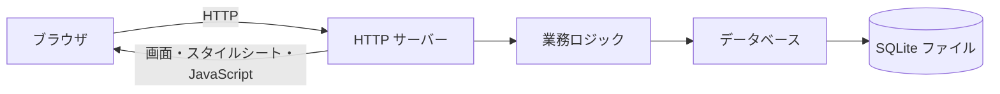
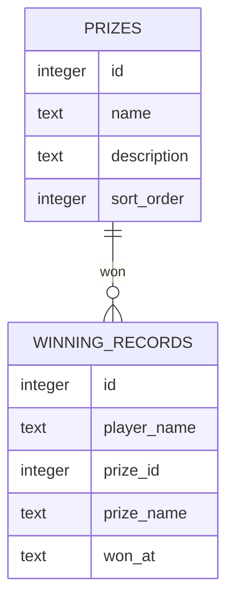
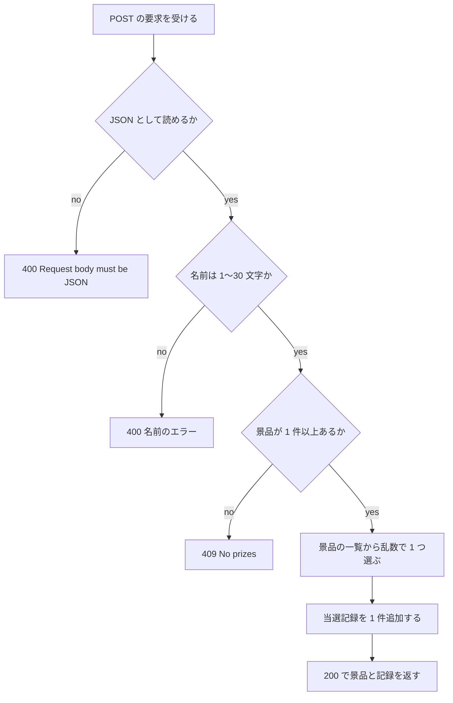
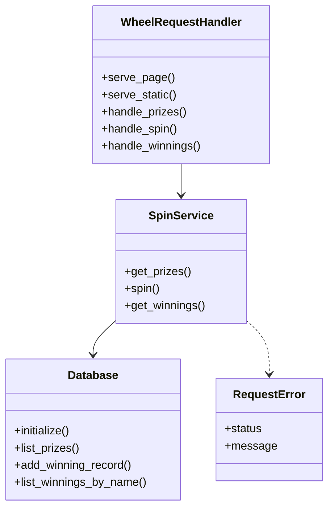

# 詳細設計書: Wheel of Fortune（ホイール抽選の Web サイト）

判定日: 2026-11-05 / 入力要件: `docs/requirements.md`

## 1. 言語・フレームワーク・アーキテクチャの選定

### 1-1. 技術制約の要約

要件定義書 1-1 のとおり。新規開発、配備は PC 上でのサーバー起動（`bash run.sh`）、無償・外部サービス無し、利用者は少数。

### 1-2. 判断軸

| 判断軸 | この案件で効く条件 | 効き方 |
|---|---|---|
| 既存資産との整合 | 無し（新規） | 効かない |
| チームの技術 | 特に無い。Python 3.12 か Node.js 24 が使える前提 | どちらも候補に残る |
| 配備先 | `bash run.sh` で起動し、ブラウザで開く。依存の取得は `setup.sh` で行える | 外部パッケージが無くても動く案が有利 |
| 認証と認可の境界 | 無し | 効かない |
| 画面の規模 | 3 画面、画面遷移は単純。ブラウザ側の描画（ホイール）が要る | 素の HTML と JavaScript で足りる |
| データの規模と構造 | 景品 6 件、当選記録は増えても小さい。名前での絞り込みと新しい順の並べ替えが要る | 組み込みの SQLite で足りる |
| 外部連携 | 無し | 効かない |
| ライセンスとコスト | 無償のみ | 有償・サービス依存の案は外す |
| 保守性 | 単純な構成が有利 | 標準ライブラリだけの案が有利 |

### 1-3. 候補の比較

| 候補 | 判断軸ごとの評価 | 出典 URL | 確認日 |
|---|---|---|---|
| A. Python 3.12 標準ライブラリ（`http.server` の `ThreadingHTTPServer`、`sqlite3`）＋素の HTML/CSS/JS | 外部パッケージ不要で `setup.sh` が版を確かめるだけで済む。画面は少なく、フレームワーク不要。SQLite は標準ライブラリ | https://docs.python.org/3/library/http.server.html、https://docs.python.org/3/library/sqlite3.html | 2026-11-05（http.server と sqlite3 の説明を確認） |
| B. Python 3.12 ＋ Flask 等の外部フレームワーク | 機能は足りるが、`setup.sh` で外部パッケージの取得（ネットワーク）が要る。画面が 3 つのため利点が小さい | 未調査（候補として比較のみ。採用しない） | 未調査 |
| C. Node.js 24 ＋ 標準の `http` と `node:sqlite` | 標準の HTTP 機能で足りる。ただし SQLite 機能の安定度は Python の `sqlite3` より確認が要る | 未調査（採用しない） | 未調査 |

Python 3.12 の保守状況（python.org のリリース表）は本セッションでは取得できなかった（WebFetch の権限が無い）。候補 A の出典は `http.server` と `sqlite3` の公式ドキュメントに限る。

### 1-4. 最終選定結果

| 項目 | 選定 |
|---|---|
| 言語 | Python 3.12 を想定（`python3`）。ローカルの `python3` は 3.9.6 だったため、コードは Python 3.9 以上で動く書き方にする |
| フレームワーク | 無し。標準ライブラリの `http.server`（`ThreadingHTTPServer`） |
| DB | SQLite（標準ライブラリの `sqlite3`）。ファイルは `DATA_DIR/wheel.sqlite3` |
| 画面 | 素の HTML・CSS・JavaScript（ホイールは canvas と CSS の回転）。ビルド工程と外部の CDN は使わない |
| 実行形態 | サーバー（`bash run.sh` で前景起動） |
| 選定理由 | 要件の 1-1 の制約（無償、外部サービス無し、少数利用、PC 上で起動）を満たす最小の構成。外部パッケージを入れないので `setup.sh` が通信を要らない |

承認: ANSWERS.md の固定回答（技術選定は推奨の案でよい。Python のフレームワーク＋ SQLite）により 2026-11-05 に承認。

## 2. システム構成

### 2-1. コンポーネント一覧

| コンポーネント | 役割 |
|---|---|
| ブラウザの画面（`web/`） | 3 画面の HTML、スタイルシート、画面の動き（ホイール、名前の保存、一覧の描画） |
| HTTP サーバー（`app/server.py`） | 画面とスタイルシート、JavaScript を返す。JSON の API を受ける |
| 業務ロジック（`app/service.py`） | 名前の検証、抽選、当選記録の作成と取得 |
| データベース（`app/database.py`） | SQLite の接続、表の作成、初期データ、問い合わせ |
| 起動（`app/__main__.py`） | 環境変数の読み取り、各部品の組み立て、サーバーの起動 |

### 2-2. システム全体構成



### 2-3. インターフェースとデータフロー

- ブラウザは画面（HTML）を取得し、JavaScript が JSON の API を呼ぶ。
- 抽選は必ずサーバーで行い、結果の景品番号をブラウザに返す。ブラウザは番号に対応する区画へホイールを回す。
- 通信は HTTP の平文。`127.0.0.1` だけで待ち受ける。

### 2-4. ネットワーク構成

ネットワーク越しの通信は、利用者の PC 内のブラウザと `127.0.0.1` のサーバーの間だけ。外部との通信は無い。図は書かない。

## 3. データ設計

### 3-1. データモデル

DB を使う（理由は要件定義書 4-1）。

テーブル `prizes`（景品）

| カラム | 型 | 制約 | 対応する要件の項目 |
|---|---|---|---|
| id | INTEGER | 主キー、自動採番 | 景品ID |
| name | TEXT | NOT NULL、1〜60 文字（アプリで検査） | 景品名 |
| description | TEXT | NOT NULL、既定値は空文字、0〜200 文字（アプリで検査） | 説明 |
| sort_order | INTEGER | NOT NULL、既定値 0 | 表示順 |

テーブル `winning_records`（当選記録）

| カラム | 型 | 制約 | 対応する要件の項目 |
|---|---|---|---|
| id | INTEGER | 主キー、自動採番 | 記録ID |
| player_name | TEXT | NOT NULL、前後の空白を除いた 1〜30 文字（アプリで検査） | 名前 |
| prize_id | INTEGER | NOT NULL、`prizes.id` を参照 | 景品ID |
| prize_name | TEXT | NOT NULL（当選時点の景品名を保存） | 景品名 |
| won_at | TEXT | NOT NULL、UTC の ISO 8601（例 `2026-11-05T06:30:00Z`） | 当選日時 |

索引: `winning_records(player_name COLLATE NOCASE, won_at)`。名前の完全一致（大文字小文字を区別しない）で絞り込む。

リレーション図



ファイルの初期化: 起動時に表が無ければ作る。景品の表が空のときだけ初期データを入れる（3-2 の初期データ参照）。

### 3-2. トランザクションと排他制御

- 当選記録の追加は 1 件の INSERT だけで、複数操作の一体完了は要らない。
- 初期データの投入は 1 つのトランザクションで行う（景品 6 件と当選記録 3 件を両方入れる、または両方入れない）。
- 同時更新の排他制御は無い。当選記録は追加のみで、同じ行を更新しないため。SQLite の既定の排他（書き込みの直列化）に任せる。

初期データ（要件定義書 6 の初期化の要件）:

| 景品名 | 説明 |
|---|---|
| Free Coffee | One cup of coffee at the counter |
| Free Dessert | One dessert of your choice |
| 10% Off Coupon | 10% off your next purchase |
| Free Tote Bag | A cloth tote bag |
| Movie Ticket Pair | Two tickets for a movie |
| Mystery Gift | A surprise gift from the staff |

当選記録のサンプル: 名前 `Sample Player` で、景品名 `Free Coffee`、`Free Dessert`、`10% Off Coupon` を 1 件ずつ。当選日時は起動時刻の 3 時間前、2 時間前、1 時間前（UTC）。

### 3-3. 状態遷移

状態を持つエンティティは無い。

## 4. アーキテクチャ設計

### 4-1. 外部設計

利用者向けインターフェース（画面と API）。

画面

| 設計 ID | 画面 | 配信元 | 要素と機能 |
|---|---|---|---|
| `DS-IF-SPIN-SCREEN-NAME-FIELD` | Spin the Wheel（`/`） | `web/index.html`、`web/static/spin.js` | 見出し、ホイール（canvas）、指針、名前の入力欄（Spin ボタンと同じ行、ラベルは「Your name (required)」、required の属性）、Spin ボタン、結果欄（景品名、名前、景品名、当選日時）。名前は localStorage に保存し、読み込み時に入れる。空、または 31 文字以上で Spin を押したら、名前欄の下に検証の文言を出し、回さない |
| `DS-IF-PRIZE-LIST-SCREEN` | Prize List（`/prizes`） | `web/prizes.html`、`web/static/prizes.js` | 見出し、景品のカード（名前、説明）、件数 |
| `DS-IF-MY-WINNINGS-SCREEN-WITH-NAME` | My Winnings（`/my-winnings`） | `web/my-winnings.html`、`web/static/my-winnings.js` | 見出し、名前の入力欄、Show ボタン、当選記録の表（列は Player（名前）、Prize（景品名）、Date won（当選日時）の順） |
| `DS-IF-NAVIGATION-MENU` | 全画面の上部の共通メニュー | 各 HTML の `<header>` | Spin the Wheel、Prize List、My Winnings のリンク。開いている画面のリンクに `aria-current="page"` |
| `DS-IF-THEME-STYLESHEET` | 配色 | `web/static/style.css` | 背景 ivory（#FFFFF0）。部品（ナビゲーション、ボタン、カード、見出し、表の見出し、指針、エラーの文字）は dark green（#006400）。カードの文字は白。light gray（#D3D3D3）と dark red（#8B0000）は使わない |
| `DS-IF-STATIC-ASSETS` | 静的ファイルの配信 | `web/static/` 配下 | スタイルシートと JavaScript を返す |

画面の表示は文字だけで、表示する文字はすべて英語。動的な文字（名前、景品名）は `textContent` で入れ、HTML として解釈させない。

API

| 設計 ID | メソッドとパス | 入力 | 出力（成功） | エラー |
|---|---|---|---|---|
| `DS-IF-PRIZES-API` | GET `/api/prizes` | 無し | 200。`{"prizes": [{"id", "name", "description"}]}`（表示順） | 500（`{"error": "..."}`） |
| `DS-IF-SPINS-API` | POST `/api/spins` | JSON `{"player_name": 文字列}` | 200。`{"prize": {"id", "name", "description"}, "prize_index": 整数（0 から）, "prize_count": 整数, "record": {"id", "player_name", "prize_id", "prize_name", "won_at"}}` | 400: 名前が空（`Please enter your name.`）、30 文字超（`Name must be 30 characters or fewer.`）、JSON が不正（`Request body must be JSON.`）。409: 景品が 0 件（`No prizes are available right now.`） |
| `DS-IF-WINNINGS-API-WITH-NAME` | GET `/api/winnings?name=文字列` | クエリの `name` | 200。`{"player_name": 文字列, "winnings": [{"id", "player_name", "prize_id", "prize_name", "won_at"}]}`（新しい順） | 400: 名前が空・30 文字超（上と同じ文言） |

- 名前は前後の空白を除いてから検査し、保存と絞り込みにも除いた値を使う。
- エラーの応答は `{"error": 文字列}` の JSON。Content-Type は application/json; charset=utf-8。
- 未知のパスは 404（画面の場合は「Page not found」の文字、API の場合は JSON）。
- 未知のメソッドは 404 とする（405 は使わない）。

### 4-2. 内部設計

抽選の処理フロー



各処理の役割

| 処理 | 役割 |
|---|---|
| ルーティング | GET と POST を見て、画面・静的ファイル・API に振り分ける |
| 名前の検証 | 前後の空白を除き、長さを確かめる |
| 抽選 | 景品の件数の範囲で一様な乱数を 1 つ引き、その景品を選ぶ |
| 当選記録の追加 | 名前、景品ID、景品名、UTC の当選日時を 1 件保存する |
| 当選記録の取得 | 名前（大文字小文字を区別しない完全一致）で絞り込み、新しい順（当選日時、記録IDの降順）に返す。各行に名前を含める（`DS-FN-LIST-WINNINGS-WITH-NAME`） |

バッチは無い。

ホイールの描画（ブラウザ側）: 景品 N 件に対し、各区画の角度は 360 ÷ N 度。区画は上（指針の位置）から時計回りに並べる。抽選結果の `prize_index` の区画の中央が指針に来るように、5 回転以上の回転角を計算して CSS の回転で動かす。回転は約 4 秒。

ホイールの操作: 回転中は Spin ボタンを無効にする。抽選の応答が届いてから回転を始める。

## 5. クラス設計

| クラス（設計 ID） | 所在 | 責務 |
|---|---|---|
| `DS-CL-SPIN-SERVICE` | `app/service.py` | 抽選、景品一覧の取得、当選記録の取得を行う |
| `DS-CL-REQUEST-ERROR` | `app/service.py` | 利用者に見せるエラー（HTTP の状態番号と文言）を運ぶ |
| `DS-CL-DATABASE` | `app/database.py` | SQLite の接続、表の作成、初期データ、景品と当選記録の問い合わせを行う |
| `DS-CL-WHEEL-REQUEST-HANDLER` | `app/server.py` | 1 件の HTTP 要求を受け、画面、静的ファイル、API に振り分けて応答する |

クラス図



メッセージ一覧（HTTP 要求の流れ）

| 順 | 送り手 | 受け手 | 内容 |
|---|---|---|---|
| 1 | ブラウザ | WheelRequestHandler | GET（画面、静的ファイル、`/api/prizes`、`/api/winnings`）または POST `/api/spins` |
| 2 | WheelRequestHandler | SpinService | `get_prizes`、`spin`、`get_winnings` |
| 3 | SpinService | Database | `list_prizes`、`add_winning_record`、`list_winnings_by_name` |
| 4 | SpinService | WheelRequestHandler | 結果の辞書、または `RequestError` |
| 5 | WheelRequestHandler | ブラウザ | JSON または HTML、静的ファイル |

## 6. エラーハンドリングとセキュリティ設計

### 6-1. エラーハンドリング

| 想定エラー | 利用者への見え方 | ログ | 扱い |
|---|---|---|---|
| 名前が空 | 入力欄の下に「Please enter your name before spinning.」（画面側で先に検査）。サーバーは 400 `Please enter your name.` | なし | 抽選しない、記録しない |
| 名前が 30 文字超 | 「Name must be 30 characters or fewer.」 | なし | 抽選しない、記録しない |
| JSON が不正 | 画面の通常の操作では起きない。API は 400 `Request body must be JSON.` を返す | なし | 処理を中止 |
| 景品が 0 件 | 「No prizes are available right now.」 | なし | 抽選しない |
| 想定外の例外 | 「Something went wrong. Please try again.」（500、JSON） | 標準エラー出力に例外の種類とスタックを出す | 応答を返して続行。サーバーは止めない |
| 静的ファイルが無い、またはパスが範囲外 | 404 の「Page not found」 | なし | 応答して続行 |
| 景品を取得できない（画面） | 「The prize list could not be loaded.」 | なし | 画面の操作は止める |

### 6-2. 認証

認証は無い。

### 6-3. 認可

認可は無い。名前は本人確認に使わない（要件定義書 5 の方針）。

### 6-4. 監査ログ

監査ログは無い（要件定義書 6）。

### 6-5. その他のセキュリティ対策

- SQL はすべてパラメータで渡す（文字列の連結をしない）。
- 静的ファイルは `web/` の下の既知のファイルだけを返す。パスは解決したうえで `web/` の内側にあることを確かめる（`..` による範囲外の読み取りを防ぐ）。
- 画面の表示は `textContent` を使い、名前や景品名を HTML として解釈させない。
- サーバーは `127.0.0.1` だけで待ち受ける。

## 7. コード設計

### 7-1. ディレクトリ構成

```
run.sh                 起動（対応表の対象外。9-1 の起動スクリプト）
setup.sh               Python の版の確認（対応表の対象外）
app/                   Python のソースコード（対応表の対象）
  __main__.py
  server.py
  service.py
  database.py
web/                   画面（HTML）とスタイルシート・JavaScript（対応表の対象外）
  index.html
  prizes.html
  my-winnings.html
  static/
tests/                 単体テスト（対応表の対象外）
e2e/                   E2E テスト（対応表の対象外。8-2）
docs/                  仕様書と対応表
```

### 7-2. ソースファイルの一覧

| ファイル | DS-MD | 役割 | 実現する設計 ID |
|---|---|---|---|
| `app/__main__.py` | `DS-MD-MAIN` | 環境変数の読み取り、データ保存先の作成、部品の組み立て、サーバーの起動 | `DS-FN-MAIN` |
| `app/server.py` | `DS-MD-SERVER` | HTTP 要求の振り分け、画面・静的ファイル・API の応答 | `DS-CL-WHEEL-REQUEST-HANDLER`、`DS-FN-CREATE-SERVER`、`DS-FN-ROUTE-REQUEST`、`DS-IF-SPIN-SCREEN-NAME-FIELD`、`DS-IF-PRIZE-LIST-SCREEN`、`DS-IF-MY-WINNINGS-SCREEN-WITH-NAME`、`DS-IF-NAVIGATION-MENU`、`DS-IF-STATIC-ASSETS`、`DS-IF-THEME-STYLESHEET`、`DS-IF-PRIZES-API`、`DS-IF-SPINS-API`、`DS-IF-WINNINGS-API-WITH-NAME` |
| `app/service.py` | `DS-MD-SERVICE` | 名前の検証、抽選、当選記録の作成と取得 | `DS-CL-SPIN-SERVICE`、`DS-CL-REQUEST-ERROR`、`DS-FN-SPIN-WHEEL`、`DS-FN-GET-PRIZE-LIST`、`DS-FN-GET-OWN-WINNINGS`、`DS-FN-VALIDATE-PLAYER-NAME` |
| `app/database.py` | `DS-MD-DATABASE` | SQLite の表の作成、初期データ、問い合わせ | `DS-CL-DATABASE`、`DS-FN-INITIALIZE-DATABASE`、`DS-FN-LIST-PRIZES`、`DS-FN-ADD-WINNING-RECORD`、`DS-FN-LIST-WINNINGS-WITH-NAME` |

テストファイル（`tests/`、`e2e/`）には `DS-MD-*` を付けない。`web/` の HTML・CSS・JavaScript は `DS-MD-*` の対象外（画面の `DS-IF-*` の説明に含める）。

### 7-3. 対応表の粒度

`function`（公開関数まで対応表に載せる）。既定の粒度のまま。理由: 公開関数・メソッドの数が約 16 件と少なく、要件と関数の対応を追う価値があるため。

### 7-4. 依存の規則

| 依存元（ディレクトリ・ファイル） | 依存してよい先（プロジェクト内） | 依存してはいけない先（プロジェクト内のパスか外部モジュール名） | 理由 |
|---|---|---|---|
| `app/__main__.py` | `app/server.py`、`app/service.py`、`app/database.py` | `sqlite3` | 起動は部品を組み立てるだけで、SQL を直接書かない |
| `app/server.py` | `app/service.py` | `app/database.py`、`sqlite3` | 画面は業務ロジックを通してだけデータに触れる |
| `app/service.py` | `app/database.py` | `app/server.py`、`sqlite3`、`http` | 業務ロジックは HTTP と SQL の詳細に依らない |
| `app/database.py` | （プロジェクト内の依存は無い） | `app/server.py`、`app/service.py`、`app/__main__.py`、`http` | データ層は業務と画面に依らない |

### 7-5. コーディング規約

- Python 3.9 以上で動く書き方（`match` 文、`X | Y` の型注釈は使わない）。型注釈は `typing` を使う。
- 外部パッケージは使わない。
- コードには要件 ID・設計 ID を書かない。コメントは処理の説明、引数、戻り値だけ。
- 1 行 100 文字以内。

設計 ID とコードの対応は実装時に `docs/trace_map.md` へ記録する。

## 8. テスト設計

### 8-1. テストの種類と方針

| 種類 | 目的 | 方法 |
|---|---|---|
| 単体テスト | 名前の検証、抽選、データ層の振る舞いを、サーバーを起動せずに確かめる | Python 標準の `unittest`。`tests/` に置く |
| 結合テスト | 業務ロジックとデータ層を実際の SQLite ファイルで組み合わせて確かめる | 同上。一時ディレクトリに DB を作る |
| E2E テスト | 利用者の操作（HTTP の要求）どおりに、実サーバーで全シナリオを確かめる | 8-3 のとおり |

実装するテストケース: 単体（名前の検証、抽選が景品の範囲に収まる、当選記録の追加と絞り込み、当選記録の行に名前・景品名・当選日時が入る、初期データは空のときだけ入る）、結合（初期化した DB に抽選して記録が残る）。

単体・結合テストの実行コマンド:

```bash
python3 -m unittest discover -s tests -t . -v
```

非機能要件は無いため、非機能を確かめるテストは作らない。

### 8-2. E2E テストのシナリオ

要件定義書 第 7 章の 10 本（`RQ-TS-*`）を 100% 網羅する。HTTP の要求で確かめ、画面の見た目の確認は HTML と CSS の内容で行う（ブラウザは使わない。8-3）。

| DS-ID | 目的 | 前提条件 | 手順 | 期待結果 |
|---|---|---|---|---|
| `DS-TS-SPIN-AND-RECORD` | 名前を入れて回すと景品が決まり、当選記録に残る | 初期データ入りの一時 DB で実サーバーが起動している | 1. `/` を取得 2. `POST /api/spins` を名前「Alice」で呼ぶ 3. `GET /api/winnings?name=Alice` を呼ぶ | 2 は 200 で景品と記録が返る。3 に記録が 1 件あり、景品名が 2 の結果と同じ |
| `DS-TS-REQUIRE-PLAYER-NAME` | 名前が空、または 31 文字なら抽選も記録もされない | 同上 | 1. 名前を空にして `POST /api/spins` 2. 31 文字の名前で `POST /api/spins` 3. 当選記録の件数を取得 | 1・2 は 400 で、文言に「name」が含まれる。3 は件数が増えていない |
| `DS-TS-PRIZE-LIST-SHOWS-ALL` | 景品一覧に全景品が出る | 同上 | 1. `GET /api/prizes` 2. `GET /prizes` を取得 | 1 は 6 件。2 は 200 で、景品一覧を描く `prizes.js` を読み込む（件数の表示はブラウザ側の描画で、HTTP では確かめない） |
| `DS-TS-OWN-WINNINGS-FILTER` | 名前で絞り込み、新しい順に出る | 同上。「Bob」で 2 回抽選済み | 1. `GET /api/winnings?name=Bob` 2. `GET /api/winnings?name=sample player`（大文字小文字違い） 3. `GET /api/winnings?name=Nobody` | 1 は Bob の 2 件で、当選日時の降順。2 は Sample Player の 3 件で Bob の記録を含まない。3 は空の一覧 |
| `DS-TS-PRIZE-SELECTION-RULE` | 全景品が一度は選ばれる（等確率の抽選） | 同上 | 1. `POST /api/spins` を 300 回（名前「Odds」） 2. 返った景品IDの集合を作る | 集合が 6 件すべてを含む |
| `DS-TS-NAVIGATION-ALL-PAGES` | 全画面にリンク 3 つがあり、開いている画面が強調される | 同上 | 1. `/`、`/prizes`、`/my-winnings` を取得 2. 各 HTML のリンクを調べる | 3 画面とも同じ 3 リンクがあり、開いている画面のリンクに `aria-current="page"` がある |
| `DS-TS-THEME-IVORY-GREEN` | 背景 ivory、部品 dark green で、light gray と dark red が無い | 同上 | 1. `/`、`/prizes`、`/my-winnings` を取得 2. `/static/style.css` と各 JavaScript を取得 3. 各 HTML が stylesheet を読み込むか調べる | 2 のスタイルシートに `#FFFFF0` と `#006400` があり、`#D3D3D3` と `#8B0000` が無い。3 の画面はすべて `/static/style.css` を読み込む |
| `DS-TS-SPIN-NAME-FIELD` | 名前の入力欄が Spin ボタンと同じ行にあり、required の属性がある。空の名前は抽選されない | 同上 | 1. `/` を取得 2. 名前の入力欄（`player-name`）と Spin ボタン（`spin-button`）が同じ form（`spin-form`）の中にあり、入力欄に required の属性があるか調べる 3. 名前を空にして `POST /api/spins` | 2 は両方が `spin-form` の中にあり、入力欄に required がある。3 は 400 で、件数は増えない |
| `DS-TS-RECORD-SHOWS-NAME-PRIZE-DATE` | 当選記録に名前、景品名、当選日時が必ず含まれる | 同上 | 1. `POST /api/spins` を名前「Alice」で呼ぶ 2. `GET /api/winnings?name=Alice` を呼ぶ 3. `/my-winnings` を取得し、表の見出しを調べる | 1 の記録に `player_name`、`prize_name`、`won_at` がある。2 の各行に同じ項目がある。3 の表の見出しは Player、Prize、Date won の順 |
| `DS-TS-START-WITH-SAMPLE-DATA` | 保存先が空でも起動し、サンプルが入る。再起動で増えない | 新しい空のディレクトリを DATA_DIR にする | 1. サーバーを起動 2. `/api/prizes` と `/api/winnings?name=Sample Player` を取得 3. サーバーを止めて同じ DATA_DIR で再起動 4. 同じ 2 を取得 | 2 は景品 6 件、記録 3 件。4 も同じ件数 |

### 8-3. E2E の実行手段

- 実行形態はサーバー。E2E は Python の標準ライブラリ（`unittest`、`urllib`）で書き、テストごとに実サーバーを子プロセスとして起動する（`python3 -m app`）。
- 空いているポートは、テストの開始時に `127.0.0.1` のポート 0 を使って決める。DATA_DIR は一時ディレクトリにする。終了時は自分が起動した子プロセスだけを止める。
- ブラウザ（Chromium）は使わない。ブラウザで動く JavaScript は `node --check` で構文を確かめるだけで、動作は E2E では確かめない。理由: 検証環境に Chromium が無く、自動化ツールの導入を承認されていないため（ANSWERS.md は「HTTP クライアントで実サーバーを確かめる形でよい」と回答）。
- 承認: ANSWERS.md の固定回答により、HTTP クライアントで実サーバーを確かめる方式を承認したものとする。

### 8-4. E2E の実行コマンドと運用

```bash
python3 scripts/isdd/unittest_junit.py -s e2e -t . -o e2e/results/e2e.xml
```

- 結果は JUnit XML で `e2e/results/e2e.xml` に出る。`e2e/results/` は git 管理外にする（`isdd-setup` が `.gitignore` に追加する）。
- テストの関数は `e2e/test_wheel_site.py` の `WheelSiteTest` のメソッドにする。メソッド名は 8-2 の各シナリオの内容を表す名前にし、対応表の `DS-TS` の行で結ぶ（例: 名前を入れて回すシナリオは `test_spin_and_record`）。
- モックは使わない（外部連携が無い）。モードは設けない。
- テストが失敗したら、修正と再実行を全件通過まで繰り返す。

## 9. 運用設計

### 9-1. 起動スクリプト（`DS-OP-RUN-SCRIPT`）

- `setup.sh`: Python 3 の版を確かめるだけ（3.9 以上）。外部パッケージは入れない。
- `run.sh`: `PORT`（既定 8000）と `DATA_DIR`（既定はプロジェクト直下の `data`）を環境変数から決め、`python3 -m app` を前景で実行する。終了は Ctrl+C か終了シグナル。

起動方法（README.md に書く）:

```bash
bash setup.sh
PORT=8000 bash run.sh
```

設定値

| 名前 | 用途 | 既定値 | 必須 |
|---|---|---|---|
| `PORT` | 待ち受けポート（`127.0.0.1`） | 8000 | 無し |
| `DATA_DIR` | SQLite ファイルの保存先（無ければ作る） | `data` | 無し |

秘密情報は無い。

### 初期化

起動時に `DATA_DIR/wheel.sqlite3` が無ければ作る。表を作り、景品の表が空なら 3-2 の初期データを入れる（DS-FN-INITIALIZE-DATABASE）。初期ユーザーは無い（認証が無い）。

### バックアップと復旧

バックアップは必要ない（要件定義書 6）。移行は無い。可用性の要求は無い。

## 10. ログ・監視・アラート・障害対応設計

- ログの設計は必須ではないため、ログの種類と内容の記述は行わない。想定外の例外は標準エラー出力に出すだけ。
- 監視・アラートの設計は必須ではないため、内容と対応方法の記述は行わない。
- 障害対応: 利用者が画面でエラーに気づいたら、サーバーを再起動する（`bash run.sh`）。保存先のファイルが壊れた場合は、`DATA_DIR` のファイルを消すと初期データで作り直される（当選記録は失われる）。

## 11. 要件と設計の対応表

| DS-ID | 対応要件ID |
|---|---|
| `DS-MD-MAIN` | `RQ-OP-LAUNCH-COMMAND`, `RQ-OP-DATA-DIR-STORAGE` |
| `DS-MD-SERVER` | `RQ-UI-SPIN-SCREEN`, `RQ-UI-PRIZE-LIST-SCREEN`, `RQ-UI-MY-WINNINGS-SCREEN`, `RQ-UI-NAVIGATION-MENU`, `RQ-UI-IVORY-DARK-GREEN-THEME` |
| `DS-MD-SERVICE` | `RQ-FT-SPIN-WHEEL`, `RQ-FT-PRIZE-SELECTION-RULE`, `RQ-FT-REQUIRE-PLAYER-NAME`, `RQ-FT-VIEW-PRIZE-LIST`, `RQ-FT-VIEW-OWN-WINNINGS` |
| `DS-MD-DATABASE` | `RQ-FT-RECORD-WINNING`, `RQ-DT-PRIZE`, `RQ-DT-WINNING-RECORD`, `RQ-DT-DATABASE-FILE`, `RQ-OP-START-WITH-SAMPLE-DATA` |
| `DS-CL-SPIN-SERVICE` | `RQ-FT-SPIN-WHEEL`, `RQ-FT-PRIZE-SELECTION-RULE` |
| `DS-CL-REQUEST-ERROR` | `RQ-FT-REQUIRE-PLAYER-NAME` |
| `DS-CL-DATABASE` | `RQ-FT-RECORD-WINNING`, `RQ-DT-DATABASE-FILE` |
| `DS-CL-WHEEL-REQUEST-HANDLER` | `RQ-UI-SPIN-SCREEN`, `RQ-UI-PRIZE-LIST-SCREEN`, `RQ-UI-MY-WINNINGS-SCREEN` |
| `DS-FN-MAIN` | `RQ-OP-LAUNCH-COMMAND`, `RQ-OP-DATA-DIR-STORAGE`, `RQ-OP-START-WITH-SAMPLE-DATA` |
| `DS-FN-CREATE-SERVER` | `RQ-OP-LAUNCH-COMMAND` |
| `DS-FN-ROUTE-REQUEST` | `RQ-UI-SPIN-SCREEN`, `RQ-UI-PRIZE-LIST-SCREEN`, `RQ-UI-MY-WINNINGS-SCREEN` |
| `DS-FN-SPIN-WHEEL` | `RQ-FT-SPIN-WHEEL`, `RQ-FT-PRIZE-SELECTION-RULE` |
| `DS-FN-GET-PRIZE-LIST` | `RQ-FT-VIEW-PRIZE-LIST` |
| `DS-FN-GET-OWN-WINNINGS` | `RQ-FT-VIEW-OWN-WINNINGS` |
| `DS-FN-VALIDATE-PLAYER-NAME` | `RQ-FT-REQUIRE-PLAYER-NAME` |
| `DS-FN-INITIALIZE-DATABASE` | `RQ-OP-START-WITH-SAMPLE-DATA`, `RQ-DT-DATABASE-FILE` |
| `DS-FN-LIST-PRIZES` | `RQ-FT-VIEW-PRIZE-LIST`, `RQ-DT-PRIZE` |
| `DS-FN-ADD-WINNING-RECORD` | `RQ-FT-RECORD-WINNING`, `RQ-DT-WINNING-RECORD`, `RQ-FT-WINNING-RECORD-DISPLAY` |
| `DS-FN-LIST-WINNINGS-WITH-NAME` | `RQ-FT-VIEW-OWN-WINNINGS`, `RQ-DT-WINNING-RECORD`, `RQ-FT-WINNING-RECORD-DISPLAY` |
| `DS-IF-SPIN-SCREEN-NAME-FIELD` | `RQ-UI-SPIN-SCREEN`, `RQ-UI-SPIN-NAME-FIELD`, `RQ-FT-WINNING-RECORD-DISPLAY` |
| `DS-IF-PRIZE-LIST-SCREEN` | `RQ-UI-PRIZE-LIST-SCREEN` |
| `DS-IF-MY-WINNINGS-SCREEN-WITH-NAME` | `RQ-UI-MY-WINNINGS-SCREEN`, `RQ-FT-WINNING-RECORD-DISPLAY` |
| `DS-IF-NAVIGATION-MENU` | `RQ-UI-NAVIGATION-MENU` |
| `DS-IF-THEME-STYLESHEET` | `RQ-UI-IVORY-DARK-GREEN-THEME` |
| `DS-IF-STATIC-ASSETS` | `RQ-UI-SPIN-SCREEN`, `RQ-UI-IVORY-DARK-GREEN-THEME` |
| `DS-IF-PRIZES-API` | `RQ-UI-SPIN-SCREEN`, `RQ-UI-PRIZE-LIST-SCREEN` |
| `DS-IF-SPINS-API` | `RQ-UI-SPIN-SCREEN` |
| `DS-IF-WINNINGS-API-WITH-NAME` | `RQ-UI-MY-WINNINGS-SCREEN`, `RQ-FT-VIEW-OWN-WINNINGS`, `RQ-FT-WINNING-RECORD-DISPLAY` |
| `DS-OP-RUN-SCRIPT` | `RQ-OP-LAUNCH-COMMAND`, `RQ-OP-DATA-DIR-STORAGE` |
| `DS-SC-PRIZE-TABLE` | `RQ-DT-PRIZE` |
| `DS-SC-WINNING-RECORD-TABLE` | `RQ-DT-WINNING-RECORD` |
| `DS-SC-DATABASE-FILE` | `RQ-DT-DATABASE-FILE`, `RQ-OP-DATA-DIR-STORAGE` |
| `DS-TS-SPIN-AND-RECORD` | `RQ-TS-SPIN-AND-RECORD` |
| `DS-TS-REQUIRE-PLAYER-NAME` | `RQ-TS-REQUIRE-PLAYER-NAME` |
| `DS-TS-PRIZE-LIST-SHOWS-ALL` | `RQ-TS-PRIZE-LIST-SHOWS-ALL` |
| `DS-TS-OWN-WINNINGS-FILTER` | `RQ-TS-OWN-WINNINGS-FILTER` |
| `DS-TS-PRIZE-SELECTION-RULE` | `RQ-TS-PRIZE-SELECTION-RULE` |
| `DS-TS-NAVIGATION-ALL-PAGES` | `RQ-TS-NAVIGATION-ALL-PAGES` |
| `DS-TS-THEME-IVORY-GREEN` | `RQ-TS-IVORY-DARK-GREEN-THEME` |
| `DS-TS-SPIN-NAME-FIELD` | `RQ-TS-SPIN-NAME-FIELD` |
| `DS-TS-RECORD-SHOWS-NAME-PRIZE-DATE` | `RQ-TS-RECORD-SHOWS-NAME-PRIZE-DATE` |
| `DS-TS-START-WITH-SAMPLE-DATA` | `RQ-TS-START-WITH-SAMPLE-DATA` |

### 11-1. 除外要件

除外要件は無い。
