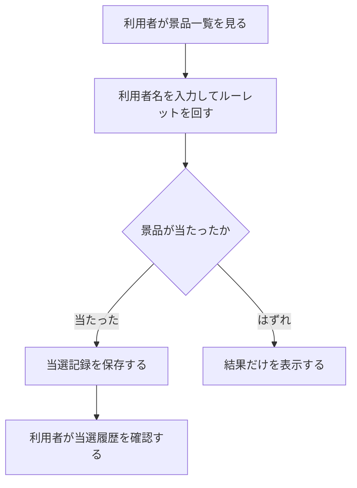
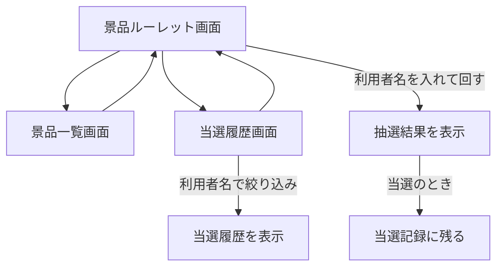

# 要件定義書: 景品ルーレット Web サイト

本書は新規フロー（`isdd-spec`）で作成した要件定義書。依頼文（REQUEST.md）、契約（contract.md）、固定回答（ANSWERS.md）を根拠とする。
変更依頼 1（配色、利用者名の必須化、当選履歴への利用者名の表示）を反映済み（変更の記録: `.history/20261105-theme-player-name-records/`）。

## 1. 目的・前提

- システムの目的: 利用者がブラウザでルーレットを回して景品を抽選し、景品の一覧と自分の当選履歴を確認できるようにする。
- 用語集

  | 用語 | 業務上の意味 | 本案件での使用範囲 | 同義語/類義語 |
  |---|---|---|---|
  | 景品 | 抽選で当たる賞品・特典 | 景品一覧、当選記録 | 賞品、プライズ |
  | はずれ | 景品が当たらなかった区分。画面では「Try again」と表示する | ルーレットの区分。当選記録には残さない | もう一度 |
  | 利用者名 | 抽選と当選履歴を結びつける名前（ログインは無い） | 抽選画面、当選履歴画面 | 名前、プレイヤー名 |
  | 当選記録 | 利用者名・景品・日時の組 | 当選履歴画面、保存データ | 当選履歴 |
  | 重み | 景品ごとの抽選の割合を決める整数。当選確率は「その景品の重み ÷ 全区分の重みの合計」 | 景品の設定、抽選 | 確率 |

- システムの形態: GUI（ブラウザの画面）。帳票・CUI・バッチは無い。Web API は画面（JavaScript）から使う内部の仕組みで、利用者向けの公開 API は作らない。

### 1-1. 技術制約（前提として記録する。要件ではないため ID は付与しない）

| 制約項目 | 内容 | 出どころ（誰がいつ答えたか） |
|---|---|---|
| 既存コードベース | 無し（新規開発） | 固定回答（ANSWERS.md）: 段 1 では既存ソースコードは無い |
| 配備先 | 利用者のローカル PC。`bash run.sh` で起動し、同じマシンのブラウザから `http://127.0.0.1:$PORT` で開く | 契約（contract.md） |
| チームの技術 | 特に無い | 固定回答（ANSWERS.md）。推奨案でよいとされた |
| ライセンスとコスト | 無償のソフトウェアのみ。外部サービス・有償 API は使わない | 契約（contract.md） |
| 性能と規模の目安 | 利用者は少数。性能の数値目標は無い | 固定回答（ANSWERS.md）: 性能の目標は無い |

### 1-2. 依頼に無く自分で決めた項目（必須）

依頼と固定回答に無い決め事。ユーザー不在のため聞けず、最小案で決めた。承認はすべて「未確認」。

| 項目 | 決めた内容 | 根拠（最小案か、依頼のどこから推測したか） | 承認（承認済 / 未確認） |
|---|---|---|---|
| 利用者の識別 | ログインは作らない。抽選時に利用者名を入力し、その名前で当選記録を残す。当選履歴は利用者名で絞り込んで表示する | 依頼の「自分の当選記録を見られる」を満たす最小の方法。固定回答「ログインは不要」 | 未確認 |
| 利用者名の規則 | 前後の空白を除いて 1〜20 文字。空欄・空白だけ・21 文字以上は抽選せず、「Please enter a name of 1 to 20 characters.」と表示する | 最小の規則。桁数は表示欄に収まる長さ | 未確認 |
| 抽選回数の上限 | 上限は無い（何回でも回せる） | 依頼に制限の記述が無い | 未確認 |
| 景品の確率 | 景品ごとに重み（整数 1〜100）を持つ。当選確率は重みの比で決まる。景品一覧には「その景品の重み ÷ 全区分の重みの合計」を % で表示する | 依頼の「抽選」を満たす最小の仕組み | 未確認 |
| はずれ区分 | 「Try again」をはずれの区分としてルーレットに入れる。はずれになっても当選記録は残さない | 依頼の「当選記録」は当選したものを指すと解釈した | 未確認 |
| 当選履歴の表示 | 利用者名が一致する記録を新しい順に表示する。0 件のときは「No winning records yet.」と表示する | 依頼の「自分の当選記録を見られる」の最小形 | 未確認 |
| 初期データ | 景品 7 件（はずれ 1 件を含む）と、利用者名「Sample Player」の当選記録 2 件を、景品が 0 件のときに起動時に入れる | 契約: 空の DATA_DIR でも全機能を試せるサンプルを置く | 未確認 |
| 景品の追加・編集 | 作らない（画面も API も無い。景品は初期データを変えて設定する） | 依頼に景品の管理は書かれていない | 未確認 |
| 連続操作 | 抽選中は抽選ボタンを無効にし、1 回の抽選が終わるまで次の抽選を始めない | 依頼に無い操作の同時実行。二重記録を防ぐ最小の扱い | 未確認 |
| 通信エラー時 | 抽選に失敗したら「Something went wrong. Please try again.」と表示し、当選記録は残さない | 依頼に無いエラー時の扱い。最小の表示 | 未確認 |
| 配色の具体値（変更依頼 1） | 背景は ivory（`#FFFFF0`）。部品（ボタン、メニュー、見出し帯、表の見出し、パネルの上の枠、ルーレットの区分の一方、検証とエラーの文字）は dark green（`#006400`）。ルーレットのもう一方の区分と表の地は白（`#FFFFFF`） | 依頼の色名を CSS の標準色名で表す | 承認済（ANSWERS.md により承認とみなす） |
| 検証・エラーの文字色（変更依頼 1） | 検証メッセージと通信エラーの文字は dark green の太字 | 依頼が dark red を全画面から外すよう求めるため | 承認済（ANSWERS.md により承認とみなす） |
| 利用者名欄の位置（変更依頼 1） | 景品ルーレット画面で、利用者名の入力欄を抽選ボタンの左隣に同じ行で置く | 依頼の「next to the spin control」を満たす最小の配置 | 承認済（ANSWERS.md により承認とみなす） |
| 空欄で回したときの文言（変更依頼 1） | 既存の「Please enter a name of 1 to 20 characters.」を使う | 既存の規則違反の文言を再利用する最小の扱い | 承認済（ANSWERS.md により承認とみなす） |
| 抽選の開始の止め方（変更依頼 1） | 利用者名が規則に合わないときは、画面から抽選の要求を送らず、ルーレットを回さない。サーバー側の検証（400）は残す | 依頼の「does not spin」を画面で確実にする最小の方法 | 承認済（ANSWERS.md により承認とみなす） |
| 当選履歴の列の順（変更依頼 1） | 利用者名（Player）、景品名（Prize）、当選日時（Won at） | 依頼の「利用者名と一緒に景品と日付」を先頭から並べる最小の形 | 承認済（ANSWERS.md により承認とみなす） |
| 当選履歴 API の項目（変更依頼 1） | 各要素に `player_name`（利用者名）を追加する。既存の項目は変えない。DB の変更は無し | 画面が利用者名を出すために必要な最小の変更 | 承認済（ANSWERS.md により承認とみなす） |
| ルーレットの区分の色（変更依頼 1） | dark green と白を交互に使う | 配色の規則と読みやすさの両立 | 承認済（ANSWERS.md により承認とみなす） |
| 既存データ（変更依頼 1） | 既存の当選記録（`DATA_DIR` の SQLite）は変えない。DB の移行は無い | 依頼に保存データの変更は無い | 承認済（ANSWERS.md により承認とみなす） |

## 2. 業務

- 対象業務一覧

  | RQ-BZ-ID | 業務名 | 業務の範囲 | 担当者 |
  |---|---|---|---|
  | `RQ-BZ-PRIZE-PROMOTION` | 景品抽選の提供 | 利用者が景品ルーレットを回し、景品の一覧と自分の当選履歴を確認する | 一般の利用者 |

- 業務フロー

### 2-1. 業務の問題（あるべき姿と現状のギャップ）

| 問題 | 対象業務（RQ-BZ） | あるべき姿 | 現状 | ギャップ（KPI） | 業務影響 |
|---|---|---|---|---|---|
| 利用者が景品抽選を体験する場が無い | `RQ-BZ-PRIZE-PROMOTION` | 利用者がルーレットを回して景品に当たる体験ができる | 依頼の範囲では、この仕組みは無い | 不明（依頼に数値目標が無い） | 景品を楽しく知ってもらう接点が無い |
| 当選した景品を後から確かめられない | `RQ-BZ-PRIZE-PROMOTION` | 利用者が自分の当選履歴をいつでも一覧で確認できる | 依頼の範囲では、この仕組みは無い | 不明（依頼に数値目標が無い） | 当選の確認に問い合わせが必要になる恐れがある |

### 2-2. 業務課題一覧（必須）

| RQ-BK-ID | 業務課題（取り組むこと） | 解決する問題（2-1） | 解決後の状態（KPI の目標値） | 対象業務（RQ-BZ） |
|---|---|---|---|---|
| `RQ-BK-PRIZE-WHEEL-SPIN` | 景品ルーレットを提供し、利用者が抽選できるようにする | 利用者が景品抽選を体験する場が無い | 利用者がルーレットを回して結果を得られる（目標値: 不明） | `RQ-BZ-PRIZE-PROMOTION` |
| `RQ-BK-PRIZE-LIST-PUBLISH` | 景品の内容と当選確率を利用者に公開する | 利用者が景品抽選を体験する場が無い | 利用者が景品一覧を見られる（目標値: 不明） | `RQ-BZ-PRIZE-PROMOTION` |
| `RQ-BK-WINNING-RECORD-VIEW` | 当選記録を保存し、本人が当選履歴を確認できるようにする | 当選した景品を後から確かめられない | 利用者が自分の当選履歴を確認できる（目標値: 不明） | `RQ-BZ-PRIZE-PROMOTION` |

- 業務課題ごとに機能が 1 つ以上ある（3. 機能一覧で確認）。

### 2-3. 見込み経営効果

見込み経営効果は算定しない（理由: 依頼に金額・件数・時間の目標が無く、算定の根拠を持たないため）。

## 3. 機能要件

- 入力データ: 人手入力は利用者名（抽選と当選履歴の画面）。出力データは抽選結果、景品一覧、当選履歴。外部連携は無い。
- 利用者の流れ（全機能）

- 業務フローとの対応: 業務フローの「ルーレットを回す」は抽選画面、「景品一覧を見る」は景品一覧画面、「当選履歴を確認する」は当選履歴画面に対応する。

- 画面ごとの仕様（GUI）

  - 景品ルーレット画面（`RQ-UI-SPIN-SCREEN`）: 画面の目的は抽選。主要要素は、共通メニュー、利用者名の入力欄、抽選ボタン、ルーレット、結果の表示欄。入力項目は利用者名。表示項目は景品の一覧に沿ったルーレットと抽選結果。通信失敗は結果欄に通信エラーの文言を出す。利用者名の入力欄は抽選ボタンの左隣（同じ行）に置く。利用者名が空欄・空白だけ・21 文字以上のときは、Spin を押してもルーレットは回らず、入力欄の下に規則の文言を出す（`RQ-UI-SPIN-NAME-FIELD`）。
  - 景品一覧画面（`RQ-UI-PRIZE-LIST-SCREEN`）: 画面の目的は景品と当選確率の確認。主要要素は共通メニューと一覧の表。表示項目は景品名、説明、当選確率（%）。エラー時は一覧の代わりに「Could not load prizes.」を表示する。
  - 当選履歴画面（`RQ-UI-RECORDS-SCREEN`）: 画面の目的は自分の当選履歴の確認。主要要素は共通メニュー、利用者名の入力欄（抽選画面で入れた名前を引き継ぐ）、表示ボタン、一覧の表。表示項目は利用者名、景品名、当選日時（この順の 3 列）。0 件のときは「No winning records yet.」。エラー時は利用者名の規則の文言。

- 機能一覧

  | RQ-ID | カテゴリ | 機能名 | 対応業務課題ID（RQ-BK-*） | この機能が無いと何が困るか |
  |---|---|---|---|---|
  | `RQ-FT-SPIN-WHEEL` | 業務機能 | ルーレットを回して抽選する | `RQ-BK-PRIZE-WHEEL-SPIN` | 抽選の体験そのものが成立しない |
  | `RQ-FT-DRAW-BY-WEIGHT` | 業務機能 | 景品と「はずれ」を重みに従って 1 つ選ぶ | `RQ-BK-PRIZE-WHEEL-SPIN` | 当選の割合が決まらず、景品の設定が生きない |
  | `RQ-FT-PLAYER-NAME-REQUIRED` | 業務機能 | 抽選には利用者名が必要であることを確かめる | `RQ-BK-PRIZE-WHEEL-SPIN` | 誰の当選か分からず、当選履歴と結びつかない |
  | `RQ-FT-RECORD-WINNING` | 業務機能 | 当選した景品を利用者名と日時付きで保存する | `RQ-BK-WINNING-RECORD-VIEW` | 当選履歴の確認ができない |
  | `RQ-FT-MISS-NOT-RECORDED` | 業務機能 | はずれのときは当選記録を残さない | `RQ-BK-WINNING-RECORD-VIEW` | はずれが当選履歴に混ざり、履歴が見づらくなる |
  | `RQ-FT-LIST-PRIZES` | 業務機能 | 景品一覧と当選確率を表示する | `RQ-BK-PRIZE-LIST-PUBLISH` | 利用者が何が当たるかを知る手段が無い |
  | `RQ-FT-VIEW-OWN-RECORDS` | 業務機能 | 利用者名で当選履歴を絞り込んで表示する | `RQ-BK-WINNING-RECORD-VIEW` | 利用者が自分の当選を確認できない |

- 各機能の補足（利用者から見た動き）
  - `RQ-FT-SPIN-WHEEL`: 利用者名を入れて抽選ボタンを押すと、ルーレットが回り、止まった区分を結果として表示する。
  - `RQ-FT-DRAW-BY-WEIGHT`: 抽選結果は各区分の重みの比で決まる。
  - `RQ-FT-PLAYER-NAME-REQUIRED`: 利用者名が規則に合わなければ抽選せず、エラーを表示する。
  - `RQ-FT-RECORD-WINNING`: 景品が当たったときだけ、利用者名・景品名・日時を当選記録に残す。
  - `RQ-FT-MISS-NOT-RECORDED`: はずれのときは結果を表示するだけで、当選記録に残さない。
  - `RQ-FT-LIST-PRIZES`: 景品一覧画面で、すべての区分（はずれを含む）の名前、説明、当選確率を表示する。
  - `RQ-FT-VIEW-OWN-RECORDS`: 利用者名に一致する当選記録だけを、新しい順に表示する。

### 3-1. 帳票・出力ファイル

帳票・出力ファイルは無い。

### 3-2. 業務ルール

| RQ-ID | ルール名 | 内容（条件と結果） | 違反時・エラー時の業務上の扱い | 対応業務課題ID（RQ-BK-*） |
|---|---|---|---|---|
| `RQ-FT-DRAW-BY-WEIGHT` | 重みに従う抽選 | 抽選区分（景品とはずれ）ごとの重みの合計を分母に、各区分を重みの比で選ぶ。重みは整数 1〜100 | 重みが範囲外の景品は初期データに無い。設定を変えるとき範囲外の値を入れない | `RQ-BK-PRIZE-WHEEL-SPIN` |
| `RQ-FT-PLAYER-NAME-REQUIRED` | 利用者名の必須と長さ | 前後の空白を除いて 1〜20 文字の利用者名が無ければ抽選しない | 規則違反は抽選せず、「Please enter a name of 1 to 20 characters.」を表示。当選記録は残さない | `RQ-BK-PRIZE-WHEEL-SPIN` |
| `RQ-FT-MISS-NOT-RECORDED` | はずれは記録しない | 抽選結果がはずれのときは当選記録を作らない | 記録しないことが正しい扱い。結果の表示は行う | `RQ-BK-WINNING-RECORD-VIEW` |

### 3-3. 外部連携

外部連携は無い。

## 4. データ

### 4-1. データ要件一覧

| RQ-ID | 種別 | 内容 | 対応業務課題ID（RQ-BK-*） | この要件が無いと何が困るか |
|---|---|---|---|---|
| `RQ-DT-LOCAL-DATABASE` | 内部データ | 景品と当選記録を、データ保存先（環境変数 `DATA_DIR`）の中の SQLite ファイルに保存する。保持期間は無期限（削除の操作は無い）。外部のデータベースには接続しない | `RQ-BK-WINNING-RECORD-VIEW` | 当選記録が再起動で消え、当選履歴が確認できない |
| `RQ-DT-SAMPLE-SEED` | 内部データ | 景品が 0 件のとき、起動時に初期景品と初期の当選記録（「Sample Player」2 件）を入れる | `RQ-BK-PRIZE-LIST-PUBLISH` | 空のデータ保存先では、景品一覧と当選履歴を試せない |

- DB が必要な理由: 当選記録を再起動後も残す必要があるため。件数の想定は少数（数百件未満）で、年間増加率は算定していない（依頼に数値が無い）。検索は利用者名の一致だけ。

### 4-2. 業務エンティティとデータ項目

| RQ-ID | カテゴリ | 業務エンティティ名 | 対応業務課題ID（RQ-BK-*） | この業務エンティティが無いと何が困るか |
|---|---|---|---|---|
| `RQ-DT-PRIZE-ENTITY` | 業務データ | 景品（抽選区分） | `RQ-BK-PRIZE-LIST-PUBLISH` | 抽選の区分と当選確率が決まらない |
| `RQ-DT-WINNING-RECORD-ENTITY` | 業務データ | 当選記録 | `RQ-BK-WINNING-RECORD-VIEW` | 当選履歴を残せない |

| エンティティ名 | 項目名 | 業務上の意味 | 必須 | 形式・桁 | 値の範囲・制約 | 例 |
|---|---|---|---|---|---|---|
| 景品 | 景品ID | 区分の識別子 | 必須 | 整数（自動採番） | 一意 | 1 |
| 景品 | 名前 | 区分の表示名 | 必須 | 文字列 | 1〜40 文字 | 10% Off Coupon |
| 景品 | 説明 | 区分の説明 | 必須 | 文字列 | 1〜120 文字 | Save 10% on your next order |
| 景品 | 重み | 抽選の割合 | 必須 | 整数 | 1〜100 | 10 |
| 景品 | はずれフラグ | はずれの区分かどうか | 必須 | 0 か 1 | 1 のとき「はずれ」（当選記録に残さない） | 0 |
| 景品 | 表示順 | 景品一覧とルーレットの並び順 | 必須 | 整数 | 一意 | 1 |
| 当選記録 | 当選記録ID | 記録の識別子 | 必須 | 整数（自動採番） | 一意 | 1 |
| 当選記録 | 利用者名 | 抽選した人の名前 | 必須 | 文字列 | 前後の空白を除いて 1〜20 文字 | Sample Player |
| 当選記録 | 景品ID | 当たった景品 | 必須 | 整数 | 景品に存在する ID | 1 |
| 当選記録 | 景品名 | 記録時点の景品名（後で名前が変わっても履歴を保つ） | 必須 | 文字列 | 1〜40 文字 | 10% Off Coupon |
| 当選記録 | 当選日時 | 当選した日時 | 必須 | 日時（YYYY-MM-DD HH:MM:SS、サーバーの時刻） | 記録時に設定 | 2026-11-05 10:00:00 |

### 4-3. CRUD テーブル（必須）

| エンティティ名 | Create | Read（一覧） | Read（詳細） | 検索 | Update | Delete | 備考 |
|---|---|---|---|---|---|---|---|
| 景品 | × | ○ | × | × | × | × | 景品の作成・変更は画面にも API にも無い。初期データのみ（RQ-DT-SAMPLE-SEED） |
| 当選記録 | ○ | △ | × | △ | × | × | Create は当選時のみ（RQ-FT-RECORD-WINNING）。Read（一覧）と検索は利用者名の完全一致の絞り込みだけ（RQ-FT-VIEW-OWN-RECORDS）。同時更新・トランザクションが要る操作は無い |

### 4-4. 状態遷移

状態を持つエンティティは無い。

### 4-5. 画面一覧（GUI の場合のみ）

| RQ-ID | 画面名 | 対応する CRUD 操作（エンティティ名:操作種別） | 主な機能・目的 | 対応業務課題ID（RQ-BK-*） |
|---|---|---|---|---|
| `RQ-UI-SPIN-SCREEN` | 景品ルーレット画面（トップ） | 当選記録:Create、景品:Read（一覧） | 利用者名を入れてルーレットを回し、結果を見る | `RQ-BK-PRIZE-WHEEL-SPIN` |
| `RQ-UI-SPIN-NAME-FIELD` | 景品ルーレット画面の利用者名欄（抽選ボタンの横） | 当選記録:Create（抽選の前提） | 抽選ボタンの横に必須の利用者名欄を置き、規則に合わない名前では回さない | `RQ-BK-PRIZE-WHEEL-SPIN` |
| `RQ-UI-PRIZE-LIST-SCREEN` | 景品一覧画面 | 景品:Read（一覧） | 景品の名前、説明、当選確率を見る | `RQ-BK-PRIZE-LIST-PUBLISH` |
| `RQ-UI-RECORDS-SCREEN` | 当選履歴画面 | 当選記録:Read（一覧）、当選記録:検索 | 利用者名で自分の当選履歴を見る。各行に利用者名・景品名・当選日時を表示する | `RQ-BK-WINNING-RECORD-VIEW` |

- 画面遷移: 3 画面はそれぞれ共通のメニュー（Spin Wheel、Prize List、My Winning Records）から行き来できる。メニューは全画面の上部に置き、現在の画面を示す。

## 5. 非機能要件

- 利用者の種別: 一般（ログイン無し）。アクセス経路は、同じマシンのブラウザから `http://127.0.0.1:$PORT` のみ。

| RQ-ID | カテゴリ | 非機能要件名 | 対応業務課題ID（RQ-BK-*） | この非機能要件が無いと何が困るか |
|---|---|---|---|---|
| `RQ-NF-USER-ACCESS-LOCAL` | 利用者とアクセス経路 | 同じマシンのブラウザからだけ使える（127.0.0.1 で待ち受ける） | `RQ-BK-PRIZE-WHEEL-SPIN` | 依頼者の環境以外から誰でも抽選できてしまう |
| `RQ-NF-COLOR-THEME-IVORY-GREEN` | 画面の見た目 | 画面の背景は ivory（#FFFFF0）、部品（ボタン、メニュー、見出し帯、表の見出し、パネルの上の枠、ルーレットの区分の一方、検証とエラーの文字）は dark green（#006400）を使う。light gray（#D3D3D3）と dark red（#8B0000）は、どの画面でも使わない | `RQ-BK-PRIZE-WHEEL-SPIN` | 依頼で指定した配色にならない |
| `RQ-NF-ENGLISH-UI` | 画面の言語 | 画面の文言はすべて英語にする | `RQ-BK-PRIZE-WHEEL-SPIN` | 依頼者が英語の画面を確かめられない |

- 性能（応答時間）・利用人数（同時接続数）の数値目標は無い（依頼に無い）。
- 可用性: 可用性の要求は無い。
- 移行性: 移行は無い。
- セキュリティ: 認証は無い。認可（権限）は無い。監査証跡は無い（依頼に無い）。

## 6. 運用要件

| RQ-ID | 種別 | 内容 | 対応業務課題ID（RQ-BK-*） | この要件が無いと何が困るか |
|---|---|---|---|---|
| `RQ-OP-START-SCRIPTS` | 起動 | `bash setup.sh` で準備し、`PORT=任意の番号 bash run.sh` で起動する。起動したままにして、停止は利用者が行う | `RQ-BK-PRIZE-WHEEL-SPIN` | 依頼者が起動できない |
| `RQ-OP-CONFIG-ENV` | 設定 | 環境変数 `PORT`（既定 8000）と `DATA_DIR`（既定は `data` フォルダ）で待ち受けポートと保存先を決める | `RQ-BK-PRIZE-WHEEL-SPIN` | 契約どおりの場所・ポートで動かせない |

- ログ: ログは必要ないため、ログの内容と保存期間の記述は行わない。
- 監査ログ: 無い。
- 監視・アラート: 監視・アラートは必要ないため、監視・アラートの内容と対応方法の記述は行わない。
- バックアップと復旧: バックアップは必要ない。

## 7. テスト用利用シナリオ

| RQ-ID | テスト目的 | 前提条件 | テスト手順 | 期待される結果 | 検証する要件ID | 対応業務課題ID（RQ-BK-*） |
|---|---|---|---|---|---|---|
| `RQ-TS-SPIN-AND-RECORD` | 名前を入れて回すと結果が出て、当たったときだけ当選履歴に残る | 初期データがある状態でサーバーが起動している | 1. 景品ルーレット画面で利用者名「Tester A」を入れる。2. 抽選ボタンを押し、結果が出るまで待つ。3. 結果が「Try again」なら当選履歴を見ずに終わる。景品なら当選履歴画面で「Tester A」を入れて表示する。4. 抽選を複数回繰り返す | 結果は景品一覧の区分のいずれかになる。景品が当たった回は当選履歴に同じ景品名が 1 件増え、「Try again」の回は増えない | `RQ-FT-SPIN-WHEEL`, `RQ-FT-DRAW-BY-WEIGHT`, `RQ-FT-RECORD-WINNING`, `RQ-FT-MISS-NOT-RECORDED`, `RQ-UI-SPIN-SCREEN` | `RQ-BK-PRIZE-WHEEL-SPIN`, `RQ-BK-WINNING-RECORD-VIEW` |
| `RQ-TS-NAME-VALIDATION` | 利用者名が空・空白・21 文字のときは回らず、規則の文言が出て、当選記録も増えない | 初期データがある状態でサーバーが起動している | 1. 景品ルーレット画面で利用者名を空欄にして Spin を押す。2. 空白だけにして Spin を押す。3. 21 文字の名前にして Spin を押す。4. 3 回とも、ルーレットが回らず入力欄の下に規則の文言が出ることを見る。5. 当選履歴画面で、どの名前にも新しい記録が増えていないことを見る | 3 回とも回転せず、入力欄の下に「Please enter a name of 1 to 20 characters.」が出る。当選記録は増えない。サーバーに同じ入力を送ると 400 と同じ文言が返る | `RQ-FT-PLAYER-NAME-REQUIRED`, `RQ-UI-SPIN-NAME-FIELD` | `RQ-BK-PRIZE-WHEEL-SPIN` |
| `RQ-TS-VIEW-PRIZES` | 景品一覧に景品と当選確率が表示される | 初期データがある状態でサーバーが起動している | 1. 景品一覧画面を開く | 景品 7 件（はずれ 1 件を含む）の名前、説明、当選確率（%）が表示され、確率の合計は 100% になる | `RQ-FT-LIST-PRIZES`, `RQ-UI-PRIZE-LIST-SCREEN` | `RQ-BK-PRIZE-LIST-PUBLISH` |
| `RQ-TS-VIEW-OWN-RECORDS` | 利用者名で絞り込んだ当選履歴だけが、利用者名・景品名・当選日時つきで表示される | 「Sample Player」の初期記録がある | 1. 当選履歴画面で「Sample Player」を入れて表示する。2. 一覧の各行の利用者名、景品名、当選日時を見る。3. 「Nobody Here」を入れて表示する | 1. では初期の 2 件が、利用者名・景品名・当選日時つきで新しい順に出る。3. では「No winning records yet.」が出る | `RQ-FT-VIEW-OWN-RECORDS`, `RQ-UI-RECORDS-SCREEN` | `RQ-BK-WINNING-RECORD-VIEW` |
| `RQ-TS-NAVIGATION` | 3 画面のメニューで行き来でき、配色（背景 ivory、部品 dark green）と英語の文言が指定どおり | サーバーが起動している | 1. 景品ルーレット画面を開く。2. メニューで景品一覧、当選履歴、景品ルーレットの順に移る。3. 各画面の背景色と部品の色、文言を確かめる | 全画面でメニューから他の画面へ移れる。背景は #FFFFF0（ivory）、部品は #006400（dark green）で、#D3D3D3 と #8B0000 は使われない。文言は英語 | `RQ-UI-SPIN-SCREEN`, `RQ-UI-PRIZE-LIST-SCREEN`, `RQ-UI-RECORDS-SCREEN`, `RQ-NF-COLOR-THEME-IVORY-GREEN`, `RQ-NF-ENGLISH-UI` | `RQ-BK-PRIZE-WHEEL-SPIN` |
| `RQ-TS-SEED-DATA` | 空のデータ保存先で起動すると、景品と初期記録が入る | データ保存先が空（ファイル無し） | 1. 空の保存先でサーバーを起動する。2. 景品一覧と「Sample Player」の当選履歴を開く | 景品 7 件と、初期の当選記録 2 件が表示される。2 回目の起動で増えない | `RQ-DT-SAMPLE-SEED` | `RQ-BK-PRIZE-LIST-PUBLISH` |

- 全機能（`RQ-FT-*`）と画面（`RQ-UI-*`）は、いずれかのテスト用利用シナリオで確かめる。
- 業務ルール（3-2）の違反は `RQ-TS-NAME-VALIDATION` と `RQ-TS-SPIN-AND-RECORD` で確かめる。
- 状態遷移・権限・監査ログ・同時更新は無いため、それらのシナリオは無い。
