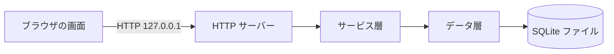
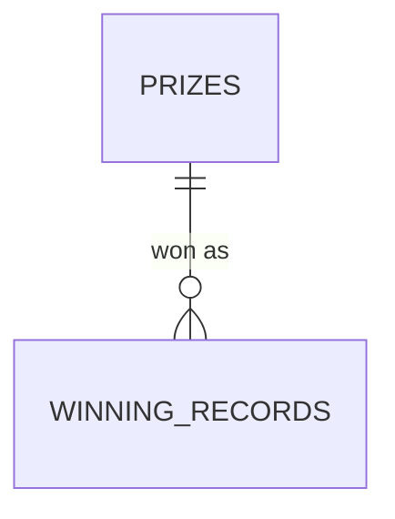
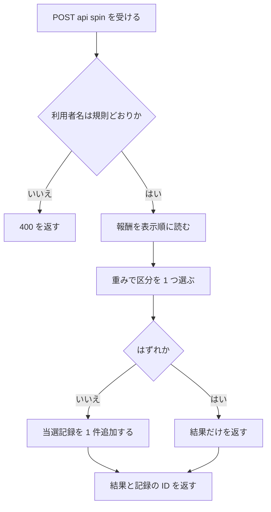
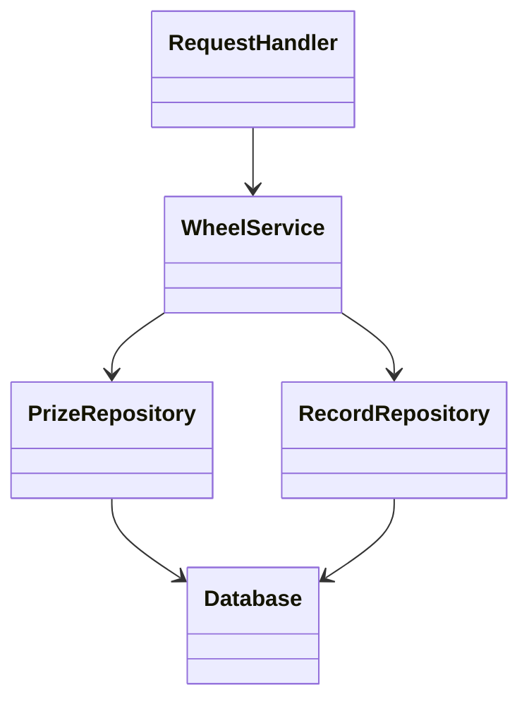

# 詳細設計書: 報酬ルーレット Web サイト

本書は `docs/requirements.md` を満たす設計。要件との対応は第 11 章だけに書く。

## 1. 言語・フレームワーク・アーキテクチャの選定

判定日: 2026-11-05。技術制約（要件定義書 1-1）: 新規開発、ローカルの PC で `bash run.sh` により起動、無償のみ、利用者は少数、ログイン無し。

判断軸と、この案件で効く条件

| 判断軸 | この案件で効く条件 | 該当の有無と理由 |
|---|---|---|
| 既存資産との整合 | 既存コード無し | 該当しない |
| チームの技術 | 特に無い | 該当しない。Python 3.12 と Node.js 24 が使える（契約） |
| 配備先 | ローカル PC。`setup.sh` と `run.sh` だけで動かす | 外部のパッケージ取得に頼らない構成が有利 |
| 認証と認可の境界 | 認証無し | 該当しない |
| 画面の規模 | 画面 3 つ、共通のメニュー、ルーレットの描画 | 小規模。ビルドの仕組みは要らない |
| データの規模と構造 | 報酬 7 件、当選記録は少数。検索は利用者名の一致だけ | 小さな RDB（SQLite）で足りる |
| 外部連携 | 無し | 該当しない |
| ライセンスとコスト | 無償のみ | 標準ライブラリだけなら制約を満たす |
| 保守性 | 小規模で長期の保守対象ではない | 依存が少ないほど保守が少ない |

候補の比較表（候補は既存の 2 件に絞った）

| 候補 | 評価 | 出典 URL | 確認日 |
|---|---|---|---|
| A: Python 3.12 標準ライブラリ（`http.server` の `ThreadingHTTPServer` と `sqlite3`） | 外部依存が無く、`setup.sh` は準備の確認だけで済む。画面 3・API 3 の規模に足りる。公式ドキュメントに「本番運用には推奨しない」の注記があるが、認証無しでローカルの 127.0.0.1 だけで待ち受けるため影響は限定的 | https://docs.python.org/3.12/library/http.server.html、https://docs.python.org/3/library/sqlite3.html（sqlite3 は公式に「オプションのモジュール」と注記されているため、`setup.sh` で読み込みを確かめる） | 2026-11-05 |
| B: Python 3.12 ＋ Flask 3.1.x | 公式ドキュメントの安定版は 3.1.x。枠組みの機能は多いが、この規模では利点が小さい。`setup.sh` でパッケージの取得（ネットワーク）が必要 | https://flask.palletsprojects.com/en/stable/ | 2026-11-05 |

最終選定結果

- 言語: Python 3.12（判定は 3.9 以上でも動くように書く。動作確認は実行環境の `python3`）
- フレームワーク: 無し（標準ライブラリの HTTP サーバー）
- データベース: SQLite（標準ライブラリの `sqlite3`）。保存先は `DATA_DIR` の下の `wheel.db`
- 画面: HTML・CSS・JavaScript（ビルド無し）。ルーレットは HTML の canvas に描く
- 実行形態: サーバー（コンテナは使わない。`bash run.sh` で起動）
- 選定理由: 依存を増やさないことが契約（`setup.sh` と `run.sh` だけで起動）と最小構成に合う。Flask は規模に対して利点が小さい。

承認の記録

- 技術選定（上記の最終選定結果）: 固定回答（ANSWERS.md）「技術選定: 推奨の案でよい（Python のフレームワーク ＋ SQLite が最も単純）」を根拠に承認とみなす。ユーザー不在のため本人確認は未了。
- E2E の実行手段: 第 8 章 8-3 のとおり、標準ライブラリの `unittest` と `urllib` で実サーバーに HTTP で問い合わせる。ブラウザ自動化のツールは使わない（ANSWERS.md「ブラウザ自動化が使えなければ HTTP クライアントで実サーバーを確かめる形でよい」）。

## 2. システム構成

コンポーネント一覧

| コンポーネント | 役割 | 配置 |
|---|---|---|
| 画面（HTML・CSS・JavaScript） | 3 画面の表示、ルーレットの描画、API の呼び出し | `src/web/static/` |
| HTTP サーバー（ルーティングと API） | 画面ファイルの配信、API の受付 | `src/server.py`、`src/web/` |
| サービス層 | 抽選、利用者名の検証、当選記録と報酬の取り出し | `src/service/` |
| データ層（SQLite） | 報酬と当選記録の保存。ファイルは `DATA_DIR/wheel.db` | `src/store/` |
| 起動スクリプト | 準備と起動 | `setup.sh`、`run.sh` |

システム全体構成図



- ネットワーク構成図: 同一マシン内（127.0.0.1）の HTTP 通信だけで、ネットワーク越しの通信は無いため、ネットワーク構成図は書かない。

インターフェース・データフロー: 画面は `/api/` の 3 つの API を呼ぶ。API はサービス層を呼び、サービス層はデータ層に問い合わせる。

## 3. データ設計

### 3-1. データモデル

DB が必要な理由: 当選記録を再起動後も残すため（要件 `RQ-DT-LOCAL-DATABASE`）。DB 製品は第 1 章の SQLite。

テーブル設計（`DS-SC-PRIZES-TABLE`）: 報酬

| カラム | 型 | 制約 | 対応要件（要件定義書 4-2） |
|---|---|---|---|
| id | INTEGER | 主キー、自動採番 | 報酬ID |
| name | TEXT | NOT NULL、1〜40 文字 | 名前 |
| description | TEXT | NOT NULL、1〜120 文字 | 説明 |
| weight | INTEGER | NOT NULL、1〜100 の CHECK | 重み |
| is_miss | INTEGER | NOT NULL、0 か 1 の CHECK | はずれフラグ |
| position | INTEGER | NOT NULL、UNIQUE | 表示順 |

テーブル設計（`DS-SC-WINNING-RECORDS-TABLE`）: 当選記録

| カラム | 型 | 制約 | 対応要件（要件定義書 4-2） |
|---|---|---|---|
| id | INTEGER | 主キー、自動採番 | 当選記録ID |
| player_name | TEXT | NOT NULL、1〜20 文字の CHECK | 利用者名 |
| prize_id | INTEGER | NOT NULL、報酬の id を参照 | 報酬ID |
| prize_name | TEXT | NOT NULL、1〜40 文字 | 報酬名（記録時点の名前） |
| won_at | TEXT | NOT NULL、`YYYY-MM-DD HH:MM:SS` | 当選日時 |

- 索引: 利用者名（`player_name`）に索引を 1 つ作り、利用者名の一致検索を速くする。
- 整合性: 報酬の `id` と当選記録の `prize_id` の参照。当選記録は削除しない。

リレーション図



サンプルデータ（`DS-SC-SAMPLE-DATA-SET`）: 報酬 7 件と、利用者名「Sample Player」の当選記録 2 件の内容。内容は下の表と文に書く（データ層の定数として `src/store/seed.py` に置く）。

報酬（初期データ。位置、名前、重み、はずれフラグ）

| 表示順 | 名前 | 説明 | 重み | はずれ |
|---|---|---|---|---|
| 1 | 10% Off Coupon | Save 10% on your next order | 15 | いいえ |
| 2 | Free Coffee | One free coffee at any store | 10 | いいえ |
| 3 | Free Shipping | Free shipping on one order | 10 | いいえ |
| 4 | $5 Voucher | A $5 voucher for any purchase | 8 | いいえ |
| 5 | Mystery Gift | A surprise gift from our team | 5 | いいえ |
| 6 | Grand Reward: $50 Gift Card | A $50 gift card | 2 | いいえ |
| 7 | Try again | No reward this time | 50 | はい |

- 当選確率は「重み ÷ 重みの合計（100）」なので、各報酬の確率は 15%、10%、10%、8%、5%、2%、50%。

当選記録の初期データ: 利用者名「Sample Player」、報酬「Free Coffee」（当選日時 2026-11-04 18:30:00）、報酬「10% Off Coupon」（当選日時 2026-11-05 09:15:00）。

### 3-2. トランザクションと排他制御

- 当選記録の作成は 1 件の INSERT だけで完結するため、複数操作をまとめるトランザクションは無い。
- 同時更新の操作は無い（報酬の更新は無く、当選記録は追加のみ）。排他制御は無い。
- 同時に抽選されても、それぞれが独立した 1 件の INSERT になる。

### 3-3. 状態遷移

状態を持つエンティティは無い。

## 4. アーキテクチャ設計

### 4-1. 外部設計

利用者向けインターフェース（画面と API）

| 種類 | 設計 ID | 経路 | 役割 |
|---|---|---|---|
| 画面 | `DS-IF-SPIN-SCREEN-NAME-FIELD` | `/` | 報酬ルーレット画面（`src/web/static/index.html` と `js/wheel.js`、`styles.css`）。抽選ボタンの横に必須の利用者名欄を置く |
| 画面 | `DS-IF-PRIZES-SCREEN` | `/rewards` | 報酬一覧画面（`src/web/static/rewards.html` と `js/rewards.js`、`styles.css`） |
| 画面 | `DS-IF-RECORDS-SCREEN-PLAYER-COLUMN` | `/records` | 当選履歴画面（`src/web/static/records.html` と `js/records.js`、`styles.css`）。利用者名・報酬名・当選日時の列 |
| 画面の配信 | `DS-IF-PAGE-ROUTES` | `/`、`/rewards`、`/records`、`/static/...` | 画面ファイルと静的ファイルを返す |
| API | `DS-IF-PRIZES-API` | GET `/api/rewards` | 報酬の一覧 |
| API | `DS-IF-SPIN-API` | POST `/api/spin` | 抽選して結果を返す（当選のときは記録も作る） |
| API | `DS-IF-RECORDS-API-WITH-PLAYER` | GET `/api/records` | 利用者名に一致する当選記録の一覧（各記録に利用者名を含む） |

画面の共通事項

- 全画面の上部に共通のメニューを置く。メニューは「Spin Wheel」（`/`）、「Reward List」（`/rewards`）、「My Winning Records」（`/records`）の 3 項目で、現在の画面の項目を強調する。
- 配色は背景 #FFFFF0（ivory）。ボタン、メニュー、見出し帯、表の見出し、パネルの上の枠、検証とエラーの文字は #006400（dark green）。表の地とルーレットの区分の一方は #FFFFFF（白）。ルーレットの区分は dark green と白を交互に使い、区分の文字は塗りと反対の色にする。light gray（#D3D3D3）と dark red（#8B0000）は使わない。
- 文言はすべて英語。

画面ごとの要素（DS-IF の説明）

- 報酬ルーレット画面: 利用者名の入力欄（`name`、必須。抽選ボタンの左隣の同じ行に置く。入力制限は無く、検証は画面（抽選の前）と API で行う）、抽選ボタン（Spin）、ルーレットの canvas、結果の表示欄、エラーの表示欄（入力欄の下）。起動時に報酬一覧を `/api/rewards` で取得し、区分を描く。利用者名は `localStorage` のキー `wheel.playerName` に保存し、次回の表示で入れておく。抽選中は抽選ボタンを無効にする。
- 報酬一覧画面: 報酬の表（名前、説明、当選確率 %）。取得に失敗したら「Could not load rewards.」を表示する。
- 当選履歴画面: 利用者名の入力欄（起動時に `wheel.playerName` を入れる）、表示ボタン（Show）、履歴の表（利用者名、報酬名、当選日時の 3 列）。0 件なら「No winning records yet.」。

インターフェース仕様

| 設計 ID | 入力と検証 | 出力 | エラー仕様 |
|---|---|---|---|
| `DS-IF-PRIZES-API` | 入力は無し | 200 で報酬の配列。各要素は id、name、description、weight、probability_percent（重みの比を小数 1 桁の %）、is_miss、position。表示順に並べる | 想定外の失敗は 500 と `{"error": "Something went wrong. Please try again."}` |
| `DS-IF-SPIN-API` | 本文の JSON の `player_name`。利用者名の規則（`RQ-FT-PLAYER-NAME-REQUIRED`）に合わないと 400 | 200 で `{"segment_index", "prize_id", "prize_name", "is_miss", "record_id"}`。`segment_index` は表示順での位置（0 始まり）。`record_id` は当選のときだけ数値、はずれのときは null | 規則違反は 400 と `{"error": "Please enter a name of 1 to 20 characters."}`。JSON が壊れている、または `player_name` が無い場合も 400 で同じ文言。想定外の失敗は 500 と通信エラーの文言。記録は残さない |
| `DS-IF-RECORDS-API-WITH-PLAYER` | クエリの `player_name`。規則に合わないと 400 | 200 で当選記録の配列。各要素は id、player_name、prize_name、won_at。`player_name` は検証済みの利用者名（記録の利用者名と同じ値）。新しい順（won_at の降順、同じ時刻なら id の降順） | 規則違反は 400 と利用者名の文言。想定外の失敗は 500 |

- 画面の配信（`DS-IF-PAGE-ROUTES`）: `/` と `/rewards`、`/records` は HTML を返す。`/static/` 以下は `src/web/static/` の中のファイルだけを返し、外へのパス指定（`..` を含むもの）は 404 にする。未知のパスは 404 の短い文字列を返す。

帳票・出力ファイル: 無し。

外部システム連携: 無し。外部 DB 連携: 無し。

### 4-2. 内部設計

処理フロー（抽選）



- 抽選の処理: 区分の重みの合計 T を求め、0 以上 T 未満の乱数 r を 1 つ取る。区分を表示順に並べ、重みを先頭から足していき、累計が r を超えた最初の区分を選ぶ。
- ルーレットの角度: 区分数を N とし、区分 i（0 始まり）は表示順どおりに時計回りに並ぶ。針は上にある。停止させる角度は区分 i の中央が針の位置に来るように決める。
- 利用者名の検査（画面、`DS-FN-START-SPIN-WITH-NAME-CHECK`）: 抽選ボタンが押されたら、入力欄の値を前後の空白を除いて検査する。1〜20 文字でなければ、入力欄の下に規則の文言を出し、ルーレットを回さず、`/api/spin` を呼ばない。規則どおりなら `/api/spin` を呼ぶ。
- 当選履歴の取り出し（`WheelService.list_records`）: 利用者名で一致する記録を取り出し、各記録に検証済みの利用者名を `player_name` として付ける。記録の利用者名は絞り込みの値と完全に同じなので、保存の表と読み取りの処理は変えない。
- バッチ: 無し。

## 5. クラス設計

| クラス | 責務（1 文） | 主要メソッド |
|---|---|---|
| `RequestHandler`（`DS-CL-REQUEST-HANDLER`） | 届いた HTTP 要求を、画面の配信か API の呼び出しに振り分ける | `do_GET`、`do_POST`、`send_json`、`send_file` |
| `WheelService`（`DS-CL-WHEEL-SERVICE`） | 抽選、報酬の取り出し、当選履歴の取り出しを 1 つの業務として扱う | `list_prizes`、`spin`、`list_records` |
| `PlayerNameError`（`DS-CL-PLAYER-NAME-ERROR`） | 利用者名が規則に合わないことを表す例外 | （例外） |
| `Database`（`DS-CL-DATABASE`） | SQLite の接続を開き、テーブルを用意する | `connect`、`init_schema` |
| `PrizeRepository`（`DS-CL-PRIZE-REPOSITORY`） | 報酬の表をデータとして読む | `list_all`、`count` |
| `RecordRepository`（`DS-CL-RECORD-REPOSITORY`） | 当選記録の表を追加・絞り込みして読む | `insert`、`find_by_player` |

- クラス間の依存: `RequestHandler` → `WheelService` → リポジトリ → `Database`。逆向きの依存は無い。
- クラス図



- システム内メッセージ一覧: 無し（同期の関数呼び出しだけ）。

## 6. エラーハンドリングとセキュリティ設計

エラーハンドリング

| 想定エラー | 利用者への見え方 | ログ | 扱い |
|---|---|---|---|
| 利用者名の規則違反 | 入力欄の下（抽選画面）または一覧の上（履歴画面）に規則の文言 | 無し | 処理を中止。記録は残さない |
| 想定外の例外（API） | 通信エラーの文言 | 標準エラーに例外の要点 | 500 を返し、サーバーは続行 |
| 報酬一覧の取得失敗 | 「Could not load rewards.」 | 無し | 画面の表示だけ失敗 |
| データ保存先が書けない | 起動時にエラー終了 | 標準エラー | 起動を中止 |
| ポートが使用中 | 起動時にエラー終了 | 標準エラー | 起動を中止 |
| 不正なポート番号（数字でない、1〜65535 の外） | 起動時にエラー終了 | 標準エラー | 起動を中止 |

認証: 認証は無い。
認可: 認可（権限）は無い。
監査ログ: 無い。
その他のセキュリティ対策: 待ち受けは 127.0.0.1 のみ。静的ファイルは `src/web/static/` の外へ出さない。利用者名は HTML に出すときに必ずエスケープする（`js/common.js` の関数で行う）。

## 7. コード設計

ディレクトリ構成

```
setup.sh
run.sh
README.md
src/
  server.py
  web/
    router.py
    api.py
    static/
      index.html, rewards.html, records.html, styles.css
      js/common.js, wheel.js, rewards.js, records.js
  service/
    wheel.py
    validation.py
  store/
    database.py
    repositories.py
    seed.py
tests/
  unit/ ...
e2e/
  test_wheel_e2e.py
```

ファイルの一覧（対応表の対象はテストファイルを除く。`e2e/` と `tests/` は対象外）

| ファイル | 役割 | 含まれるクラス・関数（設計 ID） | 実現する設計 ID |
|---|---|---|---|
| `src/server.py` | 起動の入口。環境変数を読み、DB を用意し、HTTP サーバーを 127.0.0.1 で起動する | 関数 `main`、`read_port` | `DS-MD-SERVER-ENTRY`、`DS-FN-READ-PORT` |
| `src/web/router.py` | HTTP 要求の振り分けと画面の配信 | `RequestHandler` | `DS-MD-HTTP-ROUTER`、`DS-CL-REQUEST-HANDLER`、`DS-IF-PAGE-ROUTES` |
| `src/web/api.py` | 3 つの API の処理（要求から応答まで） | `handle_list_prizes`、`handle_spin`、`handle_list_records` | `DS-MD-API-HANDLERS`、`DS-IF-PRIZES-API`、`DS-IF-SPIN-API`、`DS-IF-RECORDS-API-WITH-PLAYER` |
| `src/service/wheel.py` | 抽選と当選記録の業務 | `WheelService`、`choose_segment_by_weight` | `DS-MD-WHEEL-SERVICE`、`DS-CL-WHEEL-SERVICE`、`DS-FN-CHOOSE-SEGMENT-BY-WEIGHT` |
| `src/service/validation.py` | 利用者名の規則 | `PlayerNameError`、`validate_player_name` | `DS-MD-NAME-VALIDATION`、`DS-CL-PLAYER-NAME-ERROR`、`DS-FN-VALIDATE-PLAYER-NAME` |
| `src/store/database.py` | SQLite の接続とテーブルの用意 | `Database` | `DS-MD-DATABASE`、`DS-CL-DATABASE`、`DS-SC-PRIZES-TABLE`、`DS-SC-WINNING-RECORDS-TABLE` |
| `src/store/repositories.py` | 報酬と当選記録の読み書き | `PrizeRepository`、`RecordRepository` | `DS-MD-REPOSITORIES`、`DS-CL-PRIZE-REPOSITORY`、`DS-CL-RECORD-REPOSITORY` |
| `src/store/seed.py` | 報酬が 0 件のときの初期データ投入 | `seed_sample_data` | `DS-MD-SEED-DATA`、`DS-FN-SEED-SAMPLE-DATA`、`DS-SC-SAMPLE-DATA-SET` |
| `src/web/static/js/common.js` | 画面共通の取得処理、HTML のエスケープ | `fetchJson`、`escapeHtml` | `DS-MD-COMMON-JS`、`DS-FN-FETCH-JSON`、`DS-FN-ESCAPE-HTML` |
| `src/web/static/js/wheel.js` | 報酬ルーレット画面の処理（ルーレットの描画、区分の文字、回転、利用者名の検査） | `initSpinPage`、`startSpin`、`drawWheel`、`drawSegmentLabel`、`animateWheelTo` | `DS-MD-WHEEL-JS`、`DS-IF-SPIN-SCREEN-NAME-FIELD`、`DS-FN-START-SPIN-WITH-NAME-CHECK`、`DS-FN-DRAW-WHEEL-THEMED`、`DS-FN-DRAW-SEGMENT-LABEL`、`DS-FN-ANIMATE-WHEEL-TO` |
| `src/web/static/js/rewards.js` | 報酬一覧画面の処理 | `initRewardsPage`、`renderRewardTable` | `DS-MD-PRIZES-JS`、`DS-IF-PRIZES-SCREEN`、`DS-FN-RENDER-PRIZE-TABLE` |
| `src/web/static/js/records.js` | 当選履歴画面の処理 | `initRecordsPage`、`loadRecords` | `DS-MD-RECORDS-JS`、`DS-IF-RECORDS-SCREEN-PLAYER-COLUMN`、`DS-FN-LOAD-RECORDS-WITH-PLAYER` |

- 画面の HTML と CSS（`src/web/static/*.html`、`styles.css`）は対応表の対象外（設計 ID は上の画面の DS-IF に含める）。`setup.sh`・`run.sh` は `DS-OP-*`（第 9 章）で受ける。
- 対応表の粒度: `class`。理由: 薄い CRUD と小さな画面の部品が中心で、公開関数の一つ一つを追う価値が小さいため。設計にある `DS-FN` と `DS-CL`、`DS-IF` の関数だけを対応表に載せる。`isdd-setup` の `--granularity class` に渡す。

依存の規則

| 依存元（ディレクトリ） | 依存してよい先（プロジェクト内） | 依存してはいけない先（プロジェクト内のパスか外部モジュール名） | 理由 |
|---|---|---|---|
| `src/store` | （無し） | `src/service`、`src/web` | データ層は業務と HTTP を知らない |
| `src/service` | `src/store` | `src/web` | 業務は HTTP の形式を知らない |
| `src/web` | `src/service` | `src/store` | 画面と API はデータ層を直接触らず、サービス層を通す |

- 外部連携は無いため、外部 API のライブラリに関する規則は無い。

コーディング規約

- Python: PEP 8 に従う（4 文字のインデント、行の長さ 100 文字以内の目安）。型注釈は関数の引数と戻り値に書く。標準ライブラリのみ使う。
- JavaScript: ビルドの無い素の ES2017 相当。`const` と `let` を使い、グローバル変数を増やさない。画面ごとに `init*Page` 関数を 1 つ置く。
- コードには要件 ID・設計 ID を書かない。設計 ID とコードの対応は `docs/trace_map.md` で管理する。

## 8. テスト設計

### 8-1. テストの種類と方針

- 単体テスト（`tests/unit/`、標準ライブラリの `unittest`）: 利用者名の検証（空、空白だけ、前後の空白、20 文字と 21 文字）、重みによる選択（区分の境界、重みの合計、乱数を固定して確かめる）、リポジトリ（一時ファイルの SQLite）、初期データの投入（空のときだけ、2 回目は増えない）。
- 結合テスト（`tests/unit/` の中の `test_integration.py`）: `WheelService` と一時 DB を組み合わせ、抽選で当選した回だけ記録が増え、はずれでは増えないことを確かめる。利用者名を付けた当選履歴（各記録の `player_name`）も確かめる。
- 総合テスト: 無し（E2E がシステム全体を確かめる）。
- 実行コマンド（単体・結合）: `python3 -m unittest discover -s tests/unit -p "test_*.py"`
- 非機能要件の検証: 性能と利用人数の数値目標は無いため、専用のテストは作らない。

### 8-2. E2E テストのシナリオ

要件定義書 第 7 章の 6 本を、実サーバー（`src/server.py` を一時 DB で起動）に対する HTTP 要求で確かめる。

| DS-ID | 目的 | 前提条件 | 手順 | 期待結果 |
|---|---|---|---|---|
| `DS-TS-SPIN-AND-RECORD-E2E` | 抽選の結果と当選記録の増減 | 初期データ入りのサーバー | 利用者名「Tester A」で抽選を 20 回。各回の応答を確かめ、当選した回数だけ当選履歴が増えることを見る | 結果は報酬一覧の区分の 1 つ。当選した回は `record_id` があり、はずれの回は null。履歴の増加と当選回数が一致 |
| `DS-TS-SPIN-NAME-REQUIRED-E2E` | 利用者名の必須（サーバーの検証と、画面の入力欄の配置） | 同上 | 1. 空、空白だけ、21 文字の名前を `/api/spin` に送る。2. `/` の HTML を取得し、利用者名の入力欄（`id="player-name"`）と抽選ボタン（`id="spin-button"`）が同じ行（同じ `inline-form spin-row` の中）にあることを見る。3. `wheel.js` に規則の検査（20 文字の上限）があることを見る | 1. は 3 回とも 400 と規則の文言、履歴は増えない。2. と 3. は、入力欄と抽選ボタンが同じ行にあり、画面の検査の処理がある |
| `DS-TS-VIEW-PRIZES-E2E` | 報酬一覧の内容 | 同上 | `/api/rewards` と `/rewards` を取得する。`/prizes` と `/api/prizes` は 404 になる | 7 件、確率の合計は 100.0。`/rewards` は見出し「Reward List」と表の見出し「Reward」を含む。旧い URL は 404 |
| `DS-TS-VIEW-RECORDS-WITH-PLAYER-E2E` | 利用者名による絞り込みと、各記録の利用者名 | 「Sample Player」の初期記録 | `/api/records` を「Sample Player」と「Nobody Here」で呼ぶ。`/records` の HTML を取得する | 前者は 2 件で新しい順。各要素の `player_name` は「Sample Player」。後者は空の配列。`/records` の表に「Player」「Reward」「Won at」の見出しがある |
| `DS-TS-NAVIGATION-THEME-E2E` | 画面の配信、メニュー、配色（ivory と dark green）と英語、「prize」の語が無いこと | 同上 | `/`、`/rewards`、`/records` を取得し、メニューの 3 つの項目を確かめる。`styles.css` の色を確かめる。3 画面の HTML と `/api/rewards` の応答に「prize」（大文字小文字を問わず）が無いことを確かめる | 3 画面にメニューのリンク（`/`、`/rewards`、`/records`）があり、メニューの項目は Spin Wheel、Reward List、My Winning Records。`styles.css` に `#FFFFF0` と `#006400` があり、`#D3D3D3` と `#8B0000` は無い。画面の HTML に「prize」が無い |
| `DS-TS-SEED-DATA-E2E` | 空の保存先の初期データと、2 回目の起動で増えないこと | 空の保存先 | 起動して報酬と履歴を確かめ、停止して再起動する | 1 回目は報酬 7 件、履歴 2 件。再起動後も同じ件数 |

- 外部連携が無いため、モードは設けない。

### 8-3. E2E の実行手段

- 種類: 実サーバーに対する HTTP 要求（ブラウザ自動化は使わない）。理由: ANSWERS.md の方針と、依存を増やさないため。画面の文言・配色の確認は HTML と CSS の取得内容で行う。
- ツール: 標準ライブラリの `unittest`（テストクラス）と `urllib.request`。E2E のテスト関数の中で、一時ディレクトリを `DATA_DIR` にして `src/server.py` を子プロセスとして起動し、終了時にその子プロセスだけを終了させる（他のプロセスには触れない）。
- 使用するバージョン: 実行環境の `python3`（3.12 を想定。3.9 でも動く）。

### 8-4. E2E の実行コマンドと運用

- 実行コマンド: `python3 scripts/isdd/unittest_junit.py -s e2e -t . -o e2e/results/e2e.xml`
- 結果の出力先: `e2e/results/e2e.xml`（JUnit XML。`e2e/results/` は git 管理外）
- テスト資産: `e2e/test_wheel_e2e.py`。テストクラス `WheelE2ETest` の各テストメソッドを `DS-TS` に結ぶ。
- 外部連携が無いためモックは無い。
- 失敗したら修正と再実行を繰り返し、全件通過まで続ける。

## 9. 運用設計

起動・初期化・設定

- `DS-OP-SETUP-SCRIPT`（`setup.sh`）: 実行環境の Python 3 と、標準ライブラリの sqlite3 が使えることを確かめる。インストールするものは無い。`DATA_DIR` を作る。終了コードは、確かめられたら 0、どちらか欠けたら 1 と理由を標準エラーに出す。
- `DS-OP-RUN-SCRIPT`（`run.sh`）: 環境変数を読み、`src/server.py` を `exec` で起動する。フォアグラウンドで動き、停止は利用者が行う。待ち受けは 127.0.0.1 のみ。
- `DS-OP-CONFIG-ENV`（環境変数）

  | 名前 | 用途 | 既定値 | 必須か |
  |---|---|---|---|
  | `PORT` | 待ち受けポート（1〜65535） | 8000 | 任意 |
  | `DATA_DIR` | SQLite ファイルの保存先（無ければ作る） | リポジトリ直下の `data` | 任意 |

  秘密情報は無い。
- 初期化（`DS-SC-SAMPLE-DATA-SET` と `DS-FN-SEED-SAMPLE-DATA`）: サーバー起動時に、テーブルを作り（無ければ）、報酬が 0 件なら初期データを入れる。

初期ユーザー: 初期ユーザーは無い（認証が無い）。

バックアップと復旧: バックアップは必要ない（要件定義書 6 章）。
データ移行: 移行は無い。
可用性: 可用性の要求は無い。

起動方法と操作説明は `README.md` に書く。

## 10. ログ・監視・アラート・障害対応設計

- ログ: ログの設計は必須ではないため、ログの種類と内容の記述は行わない。標準エラーには、HTTP サーバーの既定の要求ログと、想定外の例外の要点だけが出る。
- 監視・アラート: 監視・アラートの設計は必須ではないため、監視・アラートの内容と対応方法の記述は行わない。
- 障害対応

| 想定する障害 | 検知の方法 | 対応手順 | 復旧の確認方法 |
|---|---|---|---|
| ポートが使用中 | 起動時のエラー（標準エラー） | `PORT` を別の番号にして `run.sh` を再実行する | 起動の表示が出て、画面が開く |
| データ保存先が書けない | 起動時のエラー | `DATA_DIR` を書き込める場所にする | 起動して報酬一覧が表示される |
| 抽選の途中で失敗 | 画面の通信エラーの文言 | 再試行する。記録は残っていない | 次の抽選が成功する |

## 11. 要件と設計の対応表

| DS-ID | 対応要件ID |
|---|---|
| `DS-MD-SERVER-ENTRY` | `RQ-OP-CONFIG-ENV`, `RQ-DT-LOCAL-DATABASE` |
| `DS-MD-HTTP-ROUTER` | `RQ-FT-SPIN-WHEEL`, `RQ-UI-SPIN-SCREEN` |
| `DS-MD-API-HANDLERS` | `RQ-FT-SPIN-WHEEL`, `RQ-FT-VIEW-OWN-RECORDS`, `RQ-FT-LIST-PRIZES` |
| `DS-MD-WHEEL-SERVICE` | `RQ-FT-SPIN-WHEEL`, `RQ-FT-DRAW-BY-WEIGHT`, `RQ-FT-RECORD-WINNING`, `RQ-FT-MISS-NOT-RECORDED` |
| `DS-MD-NAME-VALIDATION` | `RQ-FT-PLAYER-NAME-REQUIRED` |
| `DS-MD-DATABASE` | `RQ-DT-LOCAL-DATABASE` |
| `DS-MD-REPOSITORIES` | `RQ-FT-LIST-PRIZES`, `RQ-FT-VIEW-OWN-RECORDS`, `RQ-DT-PRIZE-ENTITY`, `RQ-DT-WINNING-RECORD-ENTITY` |
| `DS-MD-SEED-DATA` | `RQ-DT-SAMPLE-SEED` |
| `DS-MD-COMMON-JS` | `RQ-UI-SPIN-SCREEN`, `RQ-UI-PRIZE-LIST-SCREEN`, `RQ-UI-RECORDS-SCREEN` |
| `DS-MD-WHEEL-JS` | `RQ-FT-SPIN-WHEEL`, `RQ-UI-SPIN-SCREEN` |
| `DS-MD-PRIZES-JS` | `RQ-FT-LIST-PRIZES`, `RQ-UI-PRIZE-LIST-SCREEN` |
| `DS-MD-RECORDS-JS` | `RQ-FT-VIEW-OWN-RECORDS`, `RQ-UI-RECORDS-SCREEN` |
| `DS-CL-REQUEST-HANDLER` | `RQ-FT-SPIN-WHEEL`, `RQ-FT-LIST-PRIZES`, `RQ-FT-VIEW-OWN-RECORDS` |
| `DS-CL-WHEEL-SERVICE` | `RQ-FT-SPIN-WHEEL`, `RQ-FT-RECORD-WINNING`, `RQ-FT-MISS-NOT-RECORDED` |
| `DS-CL-PLAYER-NAME-ERROR` | `RQ-FT-PLAYER-NAME-REQUIRED` |
| `DS-CL-DATABASE` | `RQ-DT-LOCAL-DATABASE` |
| `DS-CL-PRIZE-REPOSITORY` | `RQ-FT-LIST-PRIZES`, `RQ-DT-PRIZE-ENTITY` |
| `DS-CL-RECORD-REPOSITORY` | `RQ-FT-RECORD-WINNING`, `RQ-FT-VIEW-OWN-RECORDS`, `RQ-DT-WINNING-RECORD-ENTITY` |
| `DS-FN-CHOOSE-SEGMENT-BY-WEIGHT` | `RQ-FT-DRAW-BY-WEIGHT` |
| `DS-FN-VALIDATE-PLAYER-NAME` | `RQ-FT-PLAYER-NAME-REQUIRED` |
| `DS-FN-SEED-SAMPLE-DATA` | `RQ-DT-SAMPLE-SEED` |
| `DS-FN-START-SPIN-WITH-NAME-CHECK` | `RQ-FT-SPIN-WHEEL`, `RQ-FT-PLAYER-NAME-REQUIRED`, `RQ-UI-SPIN-NAME-FIELD` |
| `DS-FN-RENDER-PRIZE-TABLE` | `RQ-FT-LIST-PRIZES` |
| `DS-FN-LOAD-RECORDS-WITH-PLAYER` | `RQ-FT-VIEW-OWN-RECORDS`, `RQ-UI-RECORDS-SCREEN` |
| `DS-FN-READ-PORT` | `RQ-OP-CONFIG-ENV` |
| `DS-FN-FETCH-JSON` | `RQ-FT-SPIN-WHEEL`, `RQ-FT-LIST-PRIZES`, `RQ-FT-VIEW-OWN-RECORDS` |
| `DS-FN-ESCAPE-HTML` | `RQ-FT-LIST-PRIZES`, `RQ-FT-VIEW-OWN-RECORDS` |
| `DS-FN-DRAW-WHEEL-THEMED` | `RQ-FT-SPIN-WHEEL`, `RQ-NF-COLOR-THEME-IVORY-GREEN` |
| `DS-FN-DRAW-SEGMENT-LABEL` | `RQ-FT-SPIN-WHEEL` |
| `DS-FN-ANIMATE-WHEEL-TO` | `RQ-FT-SPIN-WHEEL` |
| `DS-IF-SPIN-SCREEN-NAME-FIELD` | `RQ-UI-SPIN-SCREEN`, `RQ-UI-SPIN-NAME-FIELD`, `RQ-NF-COLOR-THEME-IVORY-GREEN`, `RQ-NF-ENGLISH-UI` |
| `DS-IF-PRIZES-SCREEN` | `RQ-UI-PRIZE-LIST-SCREEN`, `RQ-NF-COLOR-THEME-IVORY-GREEN`, `RQ-NF-ENGLISH-UI` |
| `DS-IF-RECORDS-SCREEN-PLAYER-COLUMN` | `RQ-UI-RECORDS-SCREEN`, `RQ-NF-COLOR-THEME-IVORY-GREEN`, `RQ-NF-ENGLISH-UI` |
| `DS-IF-PAGE-ROUTES` | `RQ-UI-SPIN-SCREEN`, `RQ-UI-PRIZE-LIST-SCREEN`, `RQ-UI-RECORDS-SCREEN` |
| `DS-IF-PRIZES-API` | `RQ-FT-LIST-PRIZES` |
| `DS-IF-SPIN-API` | `RQ-FT-SPIN-WHEEL`, `RQ-FT-RECORD-WINNING` |
| `DS-IF-RECORDS-API-WITH-PLAYER` | `RQ-FT-VIEW-OWN-RECORDS`, `RQ-UI-RECORDS-SCREEN` |
| `DS-SC-PRIZES-TABLE` | `RQ-DT-PRIZE-ENTITY`, `RQ-DT-LOCAL-DATABASE` |
| `DS-SC-WINNING-RECORDS-TABLE` | `RQ-DT-WINNING-RECORD-ENTITY`, `RQ-DT-LOCAL-DATABASE` |
| `DS-SC-SAMPLE-DATA-SET` | `RQ-DT-SAMPLE-SEED` |
| `DS-OP-SETUP-SCRIPT` | `RQ-OP-START-SCRIPTS` |
| `DS-OP-RUN-SCRIPT` | `RQ-OP-START-SCRIPTS`, `RQ-NF-USER-ACCESS-LOCAL` |
| `DS-OP-CONFIG-ENV` | `RQ-OP-CONFIG-ENV` |
| `DS-TS-SPIN-AND-RECORD-E2E` | `RQ-TS-SPIN-AND-RECORD` |
| `DS-TS-SPIN-NAME-REQUIRED-E2E` | `RQ-TS-NAME-VALIDATION`, `RQ-FT-PLAYER-NAME-REQUIRED`, `RQ-UI-SPIN-NAME-FIELD` |
| `DS-TS-VIEW-PRIZES-E2E` | `RQ-TS-VIEW-PRIZES` |
| `DS-TS-VIEW-RECORDS-WITH-PLAYER-E2E` | `RQ-TS-VIEW-OWN-RECORDS`, `RQ-UI-RECORDS-SCREEN` |
| `DS-TS-NAVIGATION-THEME-E2E` | `RQ-TS-NAVIGATION`, `RQ-NF-COLOR-THEME-IVORY-GREEN`, `RQ-NF-ENGLISH-UI` |
| `DS-TS-SEED-DATA-E2E` | `RQ-TS-SEED-DATA` |

### 11-1. 除外要件

除外要件は無い。

## 参考: 対応しない項目

- 業務課題（`RQ-BK`）・業務（`RQ-BZ`）は設計 ID を持たない（要件の前提）。
- 見込み経営効果（`RQ-EF`）は算定しないため無い。
