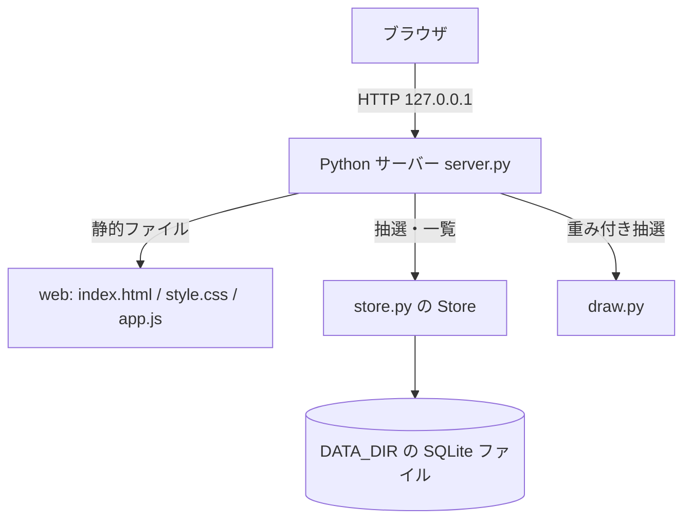
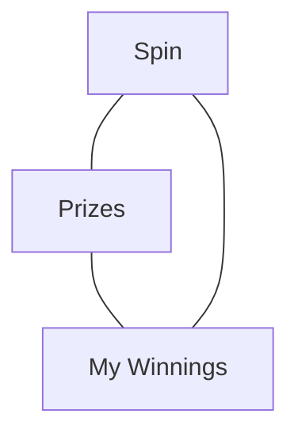
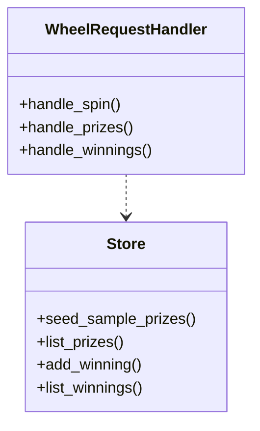

# 詳細設計書: 景品ルーレット Web サイト

## 1. 言語・フレームワーク・アーキテクチャの選定

### 1-1. 技術制約の要約

要件定義書 1-1 のとおり。既存コード無し、ローカル PC で `bash run.sh` により起動、無償のライブラリのみ、Python 3.12（`python3`）と Node.js 24 が利用可能、Chromium で動くこと。

### 1-2. 判断軸と選定

| 判断軸 | この案件で効く条件 | 該当 | 理由 |
|---|---|---|---|
| 既存資産との整合 | 無し | 無し | 新規開発 |
| チームの技術 | 指定無し | 無し | - |
| 配備先 | 利用者の PC、`bash run.sh` で起動、コンテナ不要 | 有り | 追加のサービスや常駐基盤を要さない構成が必要 |
| 認証と認可の境界 | 認証無し、権限制御無し | 無し | 画面と API を分ける必要が無い |
| 画面の規模 | 3 画面、画面遷移は単純 | 有り | 軽量な素の HTML/JavaScript で十分 |
| データの規模と構造 | 景品 8 件固定、当選記録は数千件程度、検索・集計は一覧の絞り込みだけ | 有り | 組み込みの SQLite で足りる |
| 外部連携 | 無し | 無し | - |
| ライセンスとコスト | 無償のみ、外部サービス不可 | 有り | 外部ライブラリを増やさない |
| 保守性 | 依存を増やさない | 有り | 標準ライブラリのみにすると保守対象が少ない |

候補の比較

| 候補 | 判断軸ごとの評価 | 出典 URL | 確認日 |
|---|---|---|---|
| 候補 A: Python 3 標準ライブラリ（http.server、sqlite3）＋素の HTML/JavaScript | 配備先で追加インストール不要。画面は素の HTML/JS。依存ゼロ | 未調査（検索権限が無く実施できず。承認: 未確認） | 2026-11-05 |
| 候補 B: Node.js 24 の組み込み HTTP ＋ 素の HTML/JavaScript（SQLite は JSON ファイル） | 契約書に Node 24 あり。依存ゼロにできる。Python 側の実装と役割が重なる | 未調査（同上） | 2026-11-05 |
| 候補 C: Python の Flask ＋ SQLite | 外部パッケージが必要。`setup.sh` でインストールが要る | 未調査（同上） | 2026-11-05 |

最終選定結果

- 言語: Python 3.12（契約書の指定。ローカルの `python3` は 3.9 のため、3.9 でも動くように書く）
- フレームワーク: 無し（標準ライブラリの `http.server`。複数スレッドで処理する `ThreadingHTTPServer`）
- DB: SQLite（標準ライブラリの `sqlite3`）。DATA_DIR 内のファイル
- フロントエンド: 素の HTML、CSS、JavaScript（ビルド無し）。Canvas でルーレットを描く
- 実行形態: サーバー（コンテナを使わない）。`run.sh` で起動する
- 選定理由: 依存を増やさず、契約書の「無償・外部サービス無し・SQLite で可」に合う。要件 RQ-NF-CONCURRENT-USERS（10 件同時）は ThreadingHTTPServer と SQLite の接続ごとの処理で満たす
- 承認: 未確認。公式情報の Web 調査は未実施（検索ツールの権限が無かった）。この点を最終報告で示す

フロントエンドとバックエンドを分ける構成は採らない（同じ Python サーバーが HTML・CSS・JavaScript を静的に配信する）。

## 2. システム構成

### 2-1. コンポーネント



| コンポーネント | 役割と機能 |
|---|---|
| サーバー（server.py） | HTTP の受付、静的ファイルの配信、利用者識別子の Cookie 発行、JSON API の処理 |
| 保存（store.py） | SQLite の接続、景品の初期投入、景品一覧、当選記録の追加と一覧 |
| 抽選（draw.py） | 重みに比例した景品の選択 |
| 画面（web/） | メニュー、Spin 画面（ルーレットの描画と回転）、Prizes 画面、My Winnings 画面 |

### 2-2. インターフェースとデータフロー

- ブラウザ → サーバー: 画面（`GET /`、`GET /static/...`）と JSON API（下の 4-2）。
- 抽選の流れ: 画面が `POST /api/spin` を送る → サーバーが Cookie の利用者識別子と表示名を確かめる → 抽選（draw.py）→ 当選扱いなら保存（store.py）→ 結果を返す → 画面が結果の区画で止まるよう回す。

ネットワーク構成図: サーバーとブラウザが同じ PC の 127.0.0.1 で通信する。外部への通信は無い。

## 3. データ設計

### 3-1. データモデル

DB を使う（SQLite）。DB 製品は 1-2 で選んだ SQLite のみ。ファイルは `DATA_DIR/wheel.sqlite3`。

- `DS-SC-PRIZE-TABLE`（テーブル prizes）: id（整数、主キー、自動採番）、name（文字列 1〜40、一意、必須）、description（文字列 0〜120、必須でなくてもよく空文字で保存）、weight（整数 1〜100、必須）、is_win（整数 0 または 1、必須）、position（整数 1 以上、一意、必須）。
- `DS-SC-WINNING-RECORD-TABLE`（テーブル winning_records）: id（整数、主キー、自動採番）、player_key（英数字 32 文字、必須、索引あり）、display_name（文字列 1〜30、必須）、prize_name（文字列 1〜40、必須。記録時点の景品名）、won_at（文字列、協定世界時の ISO 8601、秒まで、必須）。

リレーションは無い（景品の削除は無いため、記録の prize_name は記録時点の値を持つ）。

DB を使うかの判定: DB が必要（記録の追加と、利用者ごとの一覧が要るため）。

### 3-2. トランザクションと排他制御

- 当選記録の追加は 1 件の INSERT。トランザクションは 1 件ずつ自動で確定させる（まとめて行う操作は無い）。
- 同時更新は当選記録の追加だけで、どの追加も他の行に影響しないため、排他制御の方式は要らない。SQLite の書き込みは既定の再試行（タイムアウト 5 秒）に任せる。

### 3-3. 状態遷移

状態を持つエンティティは無い。

## 4. アーキテクチャ設計

### 4-1. 外部設計

利用者向けインターフェース: GUI。画面は 3 つ（Spin、Prizes、My Winnings）と共通のメニュー。

| DS-ID | 画面 | 入力とバリデーション | 出力 | エラー仕様 |
|---|---|---|---|---|
| `DS-IF-SPIN-PAGE` | Spin | 表示名（任意。前後の空白を除去、空なら Guest、31 字以上は不可。3-2 のとおり） | ルーレット、結果の文（"You won: 景品名" / "No prize this time"） | 表示名が不正なら入力欄の下に "Name must be 30 characters or less." を出し、抽選しない。通信失敗は "Something went wrong. Please try again." |
| `DS-IF-PRIZES-PAGE` | Prizes | なし | 景品の表（景品名、説明、当選確率 % 小数 1 桁。ハズレは "No prize"） | 景品が無ければ "No prizes are available yet." |
| `DS-IF-MY-WINNINGS-PAGE` | My Winnings | なし | 当選記録の表（当選日時、景品名、表示名）新しい順 | 記録が無ければ "You have no winnings yet. Spin the wheel to win a prize!" と Spin へのリンク |
| `DS-IF-NAV-MENU` | 共通メニュー | なし | Spin / Prizes / My Winnings の 3 項目。現在の画面を示す | なし |

画面遷移図



画面の見た目: 背景は明るいグレー（#E6E6E6）、部品（ボタン、メニュー、見出し、ルーレットの縁）は dark red（#8B0000）、文字は白。ルーレットの区画は dark red 系の濃淡を交互に使い、文字は白。

外部システム連携は無い。

### 4-2. 内部設計

処理フロー（抽選 `POST /api/spin`）:
1. 利用者識別子の Cookie が無ければ 32 文字の乱数を発行し、応答に `Set-Cookie` を付ける（HttpOnly、SameSite=Lax、有効期間 1 年）。
2. リクエストの JSON から表示名を取り出し、前後の空白を除く。空なら Guest。31 字以上なら 400 を返す（"Name must be 30 characters or less."）。
3. 景品一覧を読み、抽選（`DS-FN-PICK-PRIZE`）で 1 件を選ぶ。
4. 当選扱いなら、利用者識別子・表示名・景品名・当選日時（協定世界時）を当選記録に追加する（`DS-FN-ADD-WINNING`）。ハズレなら追加しない。
5. 結果（景品 ID、景品名、当選扱いか、区画の位置）を JSON で返す。

処理の一覧

| DS-ID | 処理 | 役割 |
|---|---|---|
| `DS-FN-HANDLE-SPIN` | 抽選 API | 上の処理フロー 1〜5 |
| `DS-FN-HANDLE-PRIZES` | 景品一覧 API（`GET /api/prizes`） | 景品一覧を JSON で返す。当選確率は画面側で計算する |
| `DS-FN-HANDLE-WINNINGS` | 当選記録一覧 API（`GET /api/winnings`） | 利用者識別子の一致する記録を新しい順に返す |
| `DS-FN-SEED-SAMPLE-PRIZES` | 初期投入 | 景品が 0 件のとき、4-2 のサンプル景品 8 件を入れる |
| `DS-FN-LIST-PRIZES` | 景品一覧 | prizes を表示順に返す |
| `DS-FN-ADD-WINNING` | 当選記録の追加 | 1 件の INSERT |
| `DS-FN-LIST-WINNINGS` | 当選記録の一覧 | 利用者識別子で絞り、won_at の降順に返す |
| `DS-FN-BUILD-SERVER` | サーバーの組み立て | DB を初期化し、景品が 0 件なら初期投入し、`127.0.0.1` の指定ポートで HTTP サーバーを作る（テストは port 0 で使う） |
| `DS-FN-MAIN` | 起動 | PORT（既定 8000）と DATA_DIR（既定 ./data）を環境変数から読み、DATA_DIR を作り、`DS-FN-BUILD-SERVER` でサーバーを作って待ち受ける |
| `DS-FN-SPIN-WHEEL-ANIMATION` | ルーレットの回転（画面） | 結果の区画の中央が上の矢印に来るよう、数回転してから止める。約 4 秒 |
| `DS-FN-DRAW-WHEEL` | ルーレットの描画（画面） | 景品の数で等分し、区画の色と景品名を描く |

API の形式: `GET /api/prizes` は `[{id, name, description, weight, is_win, position}]`。`POST /api/spin` は要求 `{display_name}`、応答 `{prize: {id, name, is_win, position}, recorded}`。`GET /api/winnings` は `[{id, display_name, prize_name, won_at}]`。エラーは `{error}`（英語の文）。400（不正な要求、表示名が 30 字を超える）、404（該当の無い URL）、503（景品が 1 件も無い）、500（想定外の例外）。

### 4-3. 状態遷移の処理

状態を持つエンティティは無いため、該当する処理は無い。

## 5. クラス設計

| クラス | 責務（1 文） | 主要メソッド |
|---|---|---|
| `DS-CL-STORE`（`src/store.py::Store`） | SQLite に景品と当選記録を保存・取得する | `seed_sample_prizes`、`list_prizes`、`add_winning`、`list_winnings` |
| `DS-CL-WHEEL-REQUEST-HANDLER`（`src/server.py::WheelRequestHandler`） | HTTP の要求を受け、画面・API に振り分ける | `handle_spin`、`handle_prizes`、`handle_winnings` |

関数の責務: `DS-FN-PICK-PRIZE`（`src/draw.py::pick_prize`）は、景品の列と乱数の値から、重みに比例して 1 件を返す純粋な関数。

クラス図



システム内メッセージ: ブラウザ ⇔ サーバーの HTTP のみ。メッセージフロー図は 4-2 の処理フローのとおり。

## 6. エラーハンドリングとセキュリティ設計

- エラーハンドリング: 不正な JSON は 400（"Invalid request."）。表示名が長すぎるのは 400（"Name must be 30 characters or less."）。想定外の例外は 500（"Something went wrong. Please try again."）とし、サーバーの標準エラー出力に例外を出す。処理は中止する。
- 認証: 無い（認証は無い）。
- 認可: 無い（権限制御は無い）。当選記録の一覧は利用者識別子の一致だけで絞る。
- 監査ログ: 無い。
- その他: Cookie は HttpOnly と SameSite=Lax。サーバーは 127.0.0.1 だけで待ち受ける。

## 7. コード設計

ディレクトリ構成

```
setup.sh
run.sh
README.md
src/
  server.py
  store.py
  draw.py
  web/
    index.html
    style.css
    app.js
e2e/
  test_wheel.py
tests/
  test_draw.py
  test_store.py
```

ファイル一覧

| ファイル | 役割 | 含まれるクラス・関数 | `DS-MD-*` | 実現する設計 ID |
|---|---|---|---|---|
| `src/server.py` | HTTP サーバーの起動、画面と API の振り分け | `WheelRequestHandler`、`build_server`、`main` | `DS-MD-SERVER-MODULE` | `DS-CL-WHEEL-REQUEST-HANDLER`、`DS-FN-HANDLE-SPIN`、`DS-FN-HANDLE-PRIZES`、`DS-FN-HANDLE-WINNINGS`、`DS-FN-BUILD-SERVER`、`DS-FN-MAIN` |
| `src/store.py` | SQLite の保存と取得 | `Store` | `DS-MD-STORE-MODULE` | `DS-CL-STORE`、`DS-FN-SEED-SAMPLE-PRIZES`、`DS-FN-LIST-PRIZES`、`DS-FN-ADD-WINNING`、`DS-FN-LIST-WINNINGS` |
| `src/draw.py` | 重み付き抽選 | `pick_prize` | `DS-MD-DRAW-MODULE` | `DS-FN-PICK-PRIZE` |
| `src/web/app.js` | 画面の描画、ルーレットの描画と回転、メニュー | `renderSpinPage`、`renderPrizesPage`、`renderMyWinningsPage`、`renderNavigation`、`drawWheel`、`spinWheelTo` | `DS-MD-PAGES-SCRIPT` | `DS-IF-SPIN-PAGE`、`DS-IF-PRIZES-PAGE`、`DS-IF-MY-WINNINGS-PAGE`、`DS-IF-NAV-MENU`、`DS-FN-SPIN-WHEEL-ANIMATION`、`DS-FN-DRAW-WHEEL` |

- `src/web/index.html` と `src/web/style.css` は対応表の対象外（HTML と CSS は対応表チェッカーが読まない）。画面の要素は `DS-IF-*` の説明に含める。
- 対応表の粒度: `class`（ファイルとクラスまで。公開関数は設計書に `DS-FN-*` があるものだけ対応表に載せる）。理由: 関数が少なく、主要な関数だけで追跡できるため。
- 依存の規則: 無し。依存の向きは `server.py` → `store.py`・`draw.py` の一方向だけとし、`store.py` と `draw.py` は `server.py` を import しない（コード規約）。
- 言語の規約: Python は標準ライブラリだけを使い、関数と引数には型注釈を付ける。JavaScript はモジュールを使わず、グローバルに関数を置かない（`DOMContentLoaded` で起動）。
- コードには要件 ID・設計 ID を書かない。設計 ID とコードの対応は `docs/trace_map.md` に記録する。

## 8. テスト設計

### 8-1. テストの種類と方針

- 単体テスト（`tests/`、Python の unittest）: `pick_prize` が重みの比で選ぶこと、`Store` が景品の初期投入と当選記録の追加・絞り込みを行うこと。
- 結合テスト: 単体テストと同じ `tests/` で、Store と HTTP の API を接続して確かめる（E2E の一部として `e2e/` で実施）。
- 単体・結合テストの実行コマンド: `python3 -m unittest discover -s tests -v`
- 非機能要件の検証: 応答時間（RQ-NF-RESPONSE-TIME）と同時実行（RQ-NF-CONCURRENT-USERS）は、E2E シナリオ `DS-TS-RESPONSE-TIME` と `DS-TS-CONCURRENT-SPINS` で確かめる。

### 8-2. E2E テストのシナリオ

モード: 外部連携が無いためモードは設けない。

| DS-ID | 目的 | 前提条件 | 手順 | 期待結果 |
|---|---|---|---|---|
| `DS-TS-EMPTY-DATA-START` | 空のデータでサンプル景品が出る | DATA_DIR が空 | サーバーを起動し、`/api/prizes` と Prizes 画面を確かめる | 8 件、確率の合計 100% |
| `DS-TS-SPIN-AND-RECORD` | 回すと結果が出て、当選なら記録される | 起動直後 | `/api/spin` を当選が出るまで送る。`/api/winnings` を確かめる | 結果があり、当選の件数が 1 件増える |
| `DS-TS-BROWSE-PRIZES` | 景品一覧と確率が見られる | 起動直後 | Prizes 画面の HTML と `/api/prizes` の応答を確かめる | 景品名と確率が含まれる |
| `DS-TS-VIEW-OWN-WINNINGS` | 自分の記録だけが新しい順に見える | 同じ Cookie で当選が 1 件以上 | `/api/winnings` を Cookie 付きで取得する | 自分の記録だけで、新しい順 |
| `DS-TS-NAVIGATE-MENU` | 全画面にメニューがある | 起動直後 | 3 つの画面の HTML を取得し、メニュー項目を確かめる | 3 画面すべてに Spin / Prizes / My Winnings のメニューがある |
| `DS-TS-PLAYER-NAME-RULE` | 表示名の規則 | 起動直後 | 空欄で回す。31 字で回す | 空欄は Guest で記録される。31 字は 400 |
| `DS-TS-NO-PRIZE-NOT-RECORDED` | ハズレは記録されない | 起動直後 | ハズレが出るまで回す | ハズレの件数分、記録は増えない |
| `DS-TS-WEIGHTED-DRAW` | 出現率が重みの比になる | 起動直後 | 300 回回し、景品ごとの出現率を数える | 各景品の出現率が確率の ±8 ポイント以内 |
| `DS-TS-RESPONSE-TIME` | 応答時間 | 起動直後 | 20 回回し、各応答時間を測る | すべて 1 秒以内 |
| `DS-TS-CONCURRENT-SPINS` | 同時の抽選 | 起動直後 | 10 本のスレッドから同時に回す | 当選件数と記録の増分が一致する |

### 8-3. E2E の実行手段

ブラウザ自動化ツールは使わない。E2E は Python の標準ライブラリ（unittest と urllib）で、起動したサーバーに HTTP で要求して確かめる（画面の HTML と API の応答を確かめる）。ブラウザでの見た目は、実装後に Chrome の headless モードで画面を撮って人が確かめる（自動化の対象ではない）。
この手段は承認が未確認（最終報告に記す）。

### 8-4. E2E の実行コマンドと運用

- 実行コマンド: `python3 scripts/isdd/unittest_junit.py -s e2e -o e2e/results/e2e.xml`（JUnit XML を `e2e/results/` に出す。標準ライブラリだけで動く）
- テスト資産は `e2e/` に置く。各テストは一時ディレクトリを DATA_DIR にし、空いたポートでサーバーを起動する。
- `DS-TS-*` は対応表の `DS-TS` の行で、`e2e/test_wheel.py::WheelScenarios.test_<シナリオ名>` に結ぶ。
- テストが失敗したら修正と再実行を繰り返し、全件通過まで続ける。
- モック無し、real モード無し。

## 9. 運用設計

- `DS-OP-START-SCRIPTS`: `setup.sh` は Python と Node.js の有無と版を確かめ、DATA_DIR を作る（既定 `./data`）。依存の追加は無い。`run.sh` は `PORT`（既定 8000）と `DATA_DIR`（既定 `./data`）を環境変数から読み、`python3 src/server.py` を前面で実行する。終了は Ctrl+C。
- 初期化: 起動時に SQLite ファイルを作り、テーブルを作り、景品が 0 件なら `DS-FN-SEED-SAMPLE-PRIZES` で 8 件入れる。
- 設定値（環境変数）: `PORT`（既定 8000、任意の数値）、`DATA_DIR`（既定 `./data`）。秘密情報は無い。
- バックアップ: 不要。データ移行: 無し。可用性: 要求無し。
- 起動方法と操作説明は README.md に書く。

## 10. ログ・監視・アラート・障害対応設計

- ログ: ログの設計は必須ではないため、ログの種類と内容の記述は行わない。サーバーの標準エラー出力に、想定外の例外の概要だけを出す。
- 監視・アラート: 監視・アラートの設計は必須ではないため、内容と対応方法の記述は行わない。
- 障害対応: SQLite ファイルが書けない場合は起動時にエラーで止まり、メッセージを出す（`DS-OP-START-SCRIPTS`）。サーバーが落ちたら `run.sh` を再実行する。

## 11. 要件と設計の対応表

| DS-ID | 対応要件ID |
|---|---|
| `DS-MD-SERVER-MODULE` | `RQ-FT-SPIN-WHEEL`, `RQ-FT-PLAYER-IDENTITY`, `RQ-FT-LIST-PRIZES`, `RQ-FT-VIEW-OWN-WINNINGS` |
| `DS-MD-STORE-MODULE` | `RQ-DT-RETAIN-LOCAL-DB`, `RQ-DT-SAMPLE-PRIZES`, `RQ-DT-PRIZE`, `RQ-DT-WINNING-RECORD`, `RQ-FT-RECORD-WINNING` |
| `DS-MD-DRAW-MODULE` | `RQ-FT-WEIGHTED-DRAW`, `RQ-FT-NO-PRIZE-OUTCOME` |
| `DS-MD-PAGES-SCRIPT` | `RQ-UI-SPIN-SCREEN`, `RQ-UI-PRIZES-SCREEN`, `RQ-UI-MY-WINNINGS-SCREEN`, `RQ-UI-NAVIGATION-MENU` |
| `DS-CL-WHEEL-REQUEST-HANDLER` | `RQ-FT-SPIN-WHEEL`, `RQ-FT-PLAYER-NAME-RULE`, `RQ-FT-PLAYER-IDENTITY`, `RQ-NF-CONCURRENT-USERS` |
| `DS-CL-STORE` | `RQ-DT-RETAIN-LOCAL-DB`, `RQ-FT-RECORD-WINNING`, `RQ-FT-LIST-PRIZES` |
| `DS-FN-PICK-PRIZE` | `RQ-FT-WEIGHTED-DRAW`, `RQ-FT-NO-PRIZE-OUTCOME` |
| `DS-FN-HANDLE-SPIN` | `RQ-FT-SPIN-WHEEL`, `RQ-FT-RECORD-WINNING`, `RQ-FT-PLAYER-NAME-RULE`, `RQ-NF-RESPONSE-TIME` |
| `DS-FN-HANDLE-PRIZES` | `RQ-FT-LIST-PRIZES` |
| `DS-FN-HANDLE-WINNINGS` | `RQ-FT-VIEW-OWN-WINNINGS`, `RQ-FT-PLAYER-IDENTITY` |
| `DS-FN-SEED-SAMPLE-PRIZES` | `RQ-DT-SAMPLE-PRIZES` |
| `DS-FN-LIST-PRIZES` | `RQ-FT-LIST-PRIZES` |
| `DS-FN-ADD-WINNING` | `RQ-FT-RECORD-WINNING`, `RQ-DT-WINNING-RECORD` |
| `DS-FN-LIST-WINNINGS` | `RQ-FT-VIEW-OWN-WINNINGS` |
| `DS-FN-BUILD-SERVER` | `RQ-NF-ACCESS-PATH`, `RQ-DT-RETAIN-LOCAL-DB`, `RQ-DT-SAMPLE-PRIZES` |
| `DS-FN-MAIN` | `RQ-NF-ACCESS-PATH`, `RQ-OP-START-BY-RUN-SCRIPT` |
| `DS-FN-SPIN-WHEEL-ANIMATION` | `RQ-FT-SPIN-WHEEL` |
| `DS-FN-DRAW-WHEEL` | `RQ-UI-SPIN-SCREEN` |
| `DS-IF-SPIN-PAGE` | `RQ-UI-SPIN-SCREEN` |
| `DS-IF-PRIZES-PAGE` | `RQ-UI-PRIZES-SCREEN` |
| `DS-IF-MY-WINNINGS-PAGE` | `RQ-UI-MY-WINNINGS-SCREEN` |
| `DS-IF-NAV-MENU` | `RQ-UI-NAVIGATION-MENU` |
| `DS-SC-PRIZE-TABLE` | `RQ-DT-PRIZE`, `RQ-DT-RETAIN-LOCAL-DB` |
| `DS-SC-WINNING-RECORD-TABLE` | `RQ-DT-WINNING-RECORD`, `RQ-DT-RETAIN-LOCAL-DB` |
| `DS-OP-START-SCRIPTS` | `RQ-OP-START-BY-RUN-SCRIPT` |
| `DS-TS-EMPTY-DATA-START` | `RQ-TS-EMPTY-DATA-START` |
| `DS-TS-SPIN-AND-RECORD` | `RQ-TS-SPIN-AND-RECORD` |
| `DS-TS-BROWSE-PRIZES` | `RQ-TS-BROWSE-PRIZES` |
| `DS-TS-VIEW-OWN-WINNINGS` | `RQ-TS-VIEW-OWN-WINNINGS` |
| `DS-TS-NAVIGATE-MENU` | `RQ-TS-NAVIGATE-MENU` |
| `DS-TS-PLAYER-NAME-RULE` | `RQ-TS-PLAYER-NAME-RULE` |
| `DS-TS-NO-PRIZE-NOT-RECORDED` | `RQ-TS-NO-PRIZE-NOT-RECORDED` |
| `DS-TS-WEIGHTED-DRAW` | `RQ-TS-WEIGHTED-DRAW` |
| `DS-TS-RESPONSE-TIME` | `RQ-TS-RESPONSE-TIME` |
| `DS-TS-CONCURRENT-SPINS` | `RQ-TS-CONCURRENT-SPINS` |

### 11-1. 除外要件

除外要件は無い。
