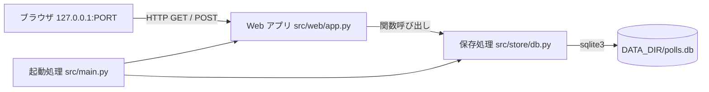
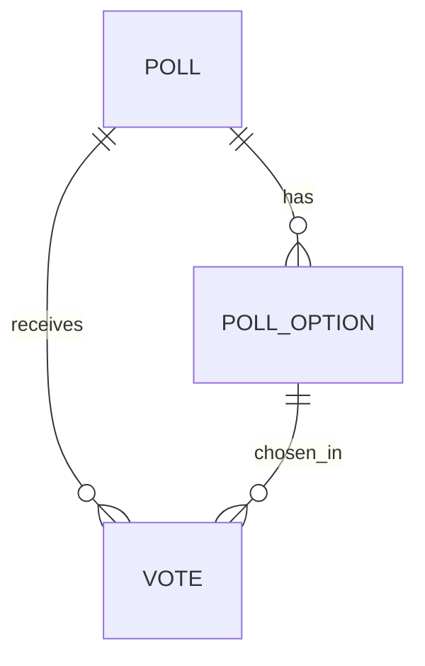

# 詳細設計書: Polls Website（投票サイト）

作成日: 2026-11-05
入力: `docs/requirements.md`（要件定義書）

---

## 1. 言語・フレームワーク・アーキテクチャの選定

### 1-0. 選定の根拠（要件定義書の要約）

- 技術制約: 新規開発。無償の技術だけ。`bash setup.sh` で依存を入れ、`bash run.sh` で直接起動する（コンテナ不使用）。実行環境は Python 3.12 か Node.js 24（契約）。
- 要件: 画面 4 種と共通メニュー（5 部品）。エンティティ 3 つ（投票テーマ、選択肢、投票）。外部連携は無い。DB は必要（投票を再起動後も残し、票数を集計する）。利用人数は少数。性能目標は無い。
- 判断軸: 配備先（Python 3.12 が動く PC）、画面の規模（小）、データの規模（小さく単純）、外部連携（無い）、ライセンス（無償）、保守性（保守中）。

### 1-1. 判断軸ごとの該当有無

| 判断軸 | 該当 | 理由 |
|---|---|---|
| 既存資産との整合 | 無し | 新規開発 |
| チームの技術 | 指定無し | 実行環境は契約で Python 3.12 か Node.js 24。Python を選ぶ（標準ライブラリの sqlite3 を使えるため） |
| 配備先 | 該当 | `bash run.sh` で起動できる環境であること。仮想環境（venv）が作れる Python 3 |
| 認証と認可の境界 | 無し | 認証は無い |
| 画面の規模 | 該当（小） | 画面 4 種。状態管理は無い。サーバー側テンプレートで足りる |
| データの規模と構造 | 該当（小） | 投票テーマ 3 件程度、票は数十件。参照関係は 1 段（テーマ → 選択肢 → 投票） |
| 外部連携 | 無し | 外部連携は無い |
| ライセンスとコスト | 該当 | 無償のみ |
| 保守性 | 該当 | 保守中の版を使う |

### 1-2. 候補の比較

| 区分 | 候補 | 評価 | 出典 URL | 確認日 |
|---|---|---|---|---|
| 言語 | Python 3.12 | 契約の実行環境。標準ライブラリに sqlite3 がある。Flask が使える | https://www.python.org/downloads/ （契約の実行環境）、https://pypi.org/project/Flask/ の requires_python | 2026-11-05 |
| 言語 | Node.js 24 | 契約の実行環境。ただし SQLite はネイティブモジュールの追加が要る場合がある | 契約（contract.md） | 2026-11-05 |
| Web フレームワーク | Flask 3.1.3 | requires_python >=3.9。サーバー側テンプレート（Jinja2）と URL ルーティングが標準的。小規模に向く | https://pypi.org/pypi/flask/json（version 3.1.3、requires_python >=3.9） | 2026-11-05 |
| Web フレームワーク | FastAPI 0.162.0 | requires_python >=3.10。API 向けの枠組み。HTML 画面はテンプレートの追加が要る | https://pypi.org/pypi/fastapi/json（version 0.162.0、requires_python >=3.10） | 2026-11-05 |
| Web フレームワーク | 標準ライブラリの http.server | 追加の依存なし。ルーティングとテンプレートを自作する量が増える | https://docs.python.org/3/library/http.server.html | 2026-11-05 |
| DB | SQLite（標準の sqlite3） | ファイル 1 つで完結。追加のサーバーが不要。サンプルと小規模に十分 | https://docs.python.org/3/library/sqlite3.html | 2026-11-05 |
| DB | PostgreSQL 等のサーバー型 DB | 常駐サーバーが要り、`bash run.sh` だけで起動する契約に合わない | 契約（contract.md の「無償、外部サービスなし」） | 2026-11-05 |
| DB | JSON ファイル | 集計と同時書き込みを自前で扱う必要がある | — | — |
| テンプレート | Jinja2（Flask に含まれる） | Flask の標準。自動エスケープで出力の安全性が保たれる | Flask の依存（PyPI の Flask 3.1.3） | 2026-11-05 |
| E2E 実行手段 | Python の unittest と urllib（標準ライブラリ）で、実サーバーに HTTP で問い合わせる | 追加のブラウザ導入が要らない。ANSWERS.md の回答（HTTP クライアントで実サーバーを確かめる形でよい）に合う | https://docs.python.org/3/library/unittest.html | 2026-11-05 |
| E2E 実行手段 | ブラウザ自動化（Playwright など） | ブラウザのダウンロードが要り、導入が重い。画面の見た目は別途確認する | — | — |

### 1-3. 最終選定結果

| 項目 | 選定 |
|---|---|
| 言語 | Python 3.12（契約）。ローカルの既定 `python3` が 3.9 でも動く書き方にする（文法は 3.9 で通るものだけ使う） |
| フレームワーク | Flask 3.1.3（`requirements.txt` で固定） |
| DB | SQLite（標準の sqlite3）。ファイルは `DATA_DIR/polls.db` |
| 実行形態 | サーバー（コンテナを使わない。`bash run.sh` で起動） |
| テンプレート | Jinja2（Flask に含まれる） |
| E2E 実行手段 | unittest と urllib による実サーバーへの HTTP テスト。JUnit XML は `scripts/isdd/unittest_junit.py` で出す |
| 外部連携 | 無し。モック方式は不要 |

選定理由: 要件の画面数と業務ルールは小さく、サーバー側テンプレートで足りる。Flask は小規模な HTML 画面で最も少ない記述で済む。SQLite は契約（追加サーバー無し、無償）に合う。

ユーザー承認の記録: 技術選定は ANSWERS.md の回答（「技術選定: 推奨の案でよい（Python のフレームワーク ＋ SQLite が最も単純）」）で一任され承認済。E2E の実行手段は ANSWERS.md（「ローカルで直接実行。ブラウザ自動化が使えなければ HTTP クライアントで実サーバーを確かめる形でよい」）で承認済。

---

## 2. システム構成

### 2-1. コンポーネント一覧

| コンポーネント | 役割 | 対応する要件 |
|---|---|---|
| ブラウザ（利用者） | 画面を表示し、投票のフォームを送信する | RQ-UI-POLL-LIST-SCREEN、RQ-UI-POLL-DETAIL-SCREEN、RQ-UI-POLL-RESULTS-SCREEN、RQ-UI-RESULTS-OVERVIEW-SCREEN |
| Web アプリ（Flask） | URL を処理し、HTML を返す。入力を検証する | RQ-FT-*、RQ-UI-* |
| 保存処理（store） | SQLite にアクセスし、投票テーマ・選択肢・投票を読み書きする。集計を行う | RQ-FT-*、RQ-DT-* |
| SQLite ファイル | `DATA_DIR/polls.db` に投票データを保存する | RQ-DT-LOCAL-SQLITE-STORAGE |
| 起動処理（main） | 設定を読み、DB を初期化し、初期データを入れ、Web サーバーを起動する | RQ-DT-SAMPLE-DATA-ON-EMPTY、RQ-DT-LOCAL-SQLITE-STORAGE |

### 2-2. 全体構成図



### 2-3. 各コンポーネントの役割と機能

- 起動処理: `PORT` と `DATA_DIR` を環境変数から読む（`read_settings`）。DB を作り（`init_db`）、空なら初期データを入れ（`seed_sample_polls`）、Flask アプリを `127.0.0.1:PORT` で起動する。
- Web アプリ: ルーティング、フォームの入力の受け取り、検証（選択肢が未選択か）、テンプレートへの描画。業務の判断（投票を数えるかどうか）は保存処理に任せる。
- 保存処理: 投票テーマの一覧・詳細、投票の記録（投票テーマに属する選択肢かどうかの確認と 1 件の追加をトランザクションで行う）、票数と割合の集計。

### 2-4. コンポーネント間インターフェースとデータフロー

- Web アプリ → 保存処理: 関数呼び出し（Python の関数。戻り値は辞書）。不正な投票は `ValueError` で通知する。
- 保存処理 → SQLite: `sqlite3`。SQL はパラメータを束縛する（文字列の連結をしない）。
- ネットワーク越しの通信はブラウザと Web アプリの HTTP のみ（`127.0.0.1` で待ち受け）。

ネットワーク構成図: ブラウザと同じ PC の `127.0.0.1` 上の HTTP だけなので、ネットワーク構成図は書かない（ネットワーク越しの通信は契約の範囲で `127.0.0.1` だけ）。

---

## 3. データ設計

### 3-1. データモデル

DB を使う（投票の永続化と集計のため）。DB 製品は 1-3 のとおり SQLite。



| テーブル（DS-SC） | カラム | 型 | 制約 | 対応する要件定義書のデータ項目 |
|---|---|---|---|---|
| `polls`（DS-SC-POLL） | `id` | INTEGER | PRIMARY KEY AUTOINCREMENT | 投票テーマ ID |
| | `question` | TEXT | NOT NULL、長さ 1〜200（アプリで検証） | 質問文 |
| | `description` | TEXT | 可（NULL 可）、500 文字以下（アプリで検証） | 説明 |
| `poll_options`（DS-SC-POLL-OPTION） | `id` | INTEGER | PRIMARY KEY AUTOINCREMENT | 選択肢 ID |
| | `poll_id` | INTEGER | NOT NULL、REFERENCES polls(id) | 投票テーマ ID |
| | `text` | TEXT | NOT NULL、長さ 1〜100 | 選択肢名 |
| | | | UNIQUE(poll_id, text) | 同じ投票テーマ内で重複しない |
| `votes`（DS-SC-VOTE） | `id` | INTEGER | PRIMARY KEY AUTOINCREMENT | 投票 ID |
| | `poll_id` | INTEGER | NOT NULL、REFERENCES polls(id) | 投票テーマ ID |
| | `option_id` | INTEGER | NOT NULL、REFERENCES poll_options(id) | 選択肢 ID |
| | `voted_at` | TEXT | NOT NULL（UTC の ISO 8601 形式） | 投票日時 |

- `PRAGMA foreign_keys = ON` を接続ごとに設定する。
- 投票の検証は、`option_id` が `poll_id` に属することを SQL で確かめてから `votes` に入れる（`cast_vote`）。

### 3-2. トランザクションと排他制御

- 投票の記録（`cast_vote`）は 1 トランザクション（選択肢が投票テーマに属するかの確認と、`votes` への 1 行の追加）。失敗したらロールバックし、票を残さない。
- 同時更新の排他制御: 投票は追加のみで、同じ行を更新しない。方式は SQLite の既定の書き込みロック（書き込みは SQLite が直列化する）。楽観的・悲観的のどちらも使わない。理由は、更新が無く競合の扱いが不要なため。

### 3-3. 状態遷移

状態を持つエンティティは無い。

---

## 4. アーキテクチャ設計

### 4-1. 外部設計

利用者向けインターフェース（画面と HTTP のルート）。すべて GUI（HTML）で、JSON API は持たない。

| DS-IF | 種類 | URL | 処理（関数） | 入力 | 出力 |
|---|---|---|---|---|---|
| DS-IF-NAVIGATION-MENU | 共通部品 | 全画面 | `provide_navigation` | 現在の URL（endpoint） | 「Polls」「Results」のリンクと、現在の画面の強調 |
| DS-IF-POLL-LIST-SCREEN | 画面 | GET `/` | `show_poll_list` | なし | 投票テーマ一覧（HTML） |
| DS-IF-POLL-DETAIL-SCREEN | 画面 | GET `/polls/<poll_id>` | `show_poll_detail` | URL の `poll_id`（整数） | 質問文と選択肢のラジオボタン、「Vote」ボタン（HTML） |
| DS-IF-VOTE-SUBMIT | 送信 | POST `/polls/<poll_id>/vote` | `submit_vote` | フォーム `option_id`（整数） | 成功: 303 で `/polls/<poll_id>/results?voted=1` へ移動。失敗: 詳細画面を 400 で再表示し、エラー文言を出す |
| DS-IF-POLL-RESULTS-SCREEN | 画面 | GET `/polls/<poll_id>/results` | `show_poll_results` | URL の `poll_id`、クエリ `voted`（任意） | 票数・割合・総票数の表（HTML）。`voted=1` のとき「Thank you for voting.」 |
| DS-IF-RESULTS-OVERVIEW-SCREEN | 画面 | GET `/results` | `show_results_overview` | なし | 投票テーマごとの総票数と一番多い選択肢（HTML） |
| DS-FN-HANDLE-NOT-FOUND | 共通 | 存在しない URL・存在しない投票テーマ | `handle_not_found` | なし | 「Not found」画面（404） |

入力の検証とエラー仕様:

| 対象 | 検証 | 失敗時 |
|---|---|---|
| `poll_id`（URL） | 存在する投票テーマであること | 404（`handle_not_found`） |
| `option_id`（フォーム） | 未送信・空・整数でない → 投票を記録しない。投票テーマに属する選択肢であること | 未送信・空・整数でない・属さない → 400 で詳細画面を再表示し「Please select one option before you vote.」を出す（属さない選択肢も同じ文言） |
| 投票テーマの存在（送信時） | `poll_id` が存在しない | 404 |

エラー画面: 英語。Web アプリの想定外のエラー（DB 書き込み失敗など）は Flask の 500 応答（英語の「Internal Server Error」）になる。利用者には詳細を見せない。

外部システム連携: 無し。

外部 DB 連携: 無し。

### 4-2. 内部設計

処理フロー（投票）:

```mermaid
sequenceDiagram
    participant B as ブラウザ
    participant W as submit_vote
    participant S as cast_vote
    participant D as SQLite
    B->>W: POST /polls/1/vote（option_id）
    W->>W: option_id が空・整数でないか確認
    alt 未選択・整数でない
        W-->>B: 400 詳細画面（エラー文言）
    else
        W->>S: cast_vote(db, poll_id, option_id)
        S->>D: BEGIN; 選択肢が投票テーマに属するか; INSERT votes; COMMIT
        alt 属さない・存在しない
            S-->>W: ValueError
            W-->>B: 400 詳細画面（エラー文言）
        else
            S-->>W: 完了
            W-->>B: 303 /polls/1/results?voted=1
        end
    end
```

各処理の役割:

- `init_db`: テーブルを作る（無ければ）。`PRAGMA foreign_keys = ON` を設定する。
- `seed_sample_polls`: `polls` が 0 件のときだけ、投票テーマ 3 件、選択肢 3〜4 件ずつ、サンプルの投票数件を入れる。2 回目以降は何もしない。
- `list_polls`: 全投票テーマを返す（各テーマの総票数と、一番多い選択肢の名前を含む）。
- `get_poll`: 投票テーマ 1 件と、選択肢ごとの票数・割合・総票数を返す。存在しなければ `None`。
- `cast_vote`: 上の処理フローのとおり。

バッチ設計: 無し（バッチ処理は無い）。

---

## 5. クラス設計

クラスは無い。モジュールの関数だけで構成する（3 つのモジュールに分け、それぞれ関数を持つ）。

- 関数の一覧と役割は 7 章の表と 4-2 のとおり。
- クラス図・メッセージ一覧は無い（クラスも非同期のメッセージも無いため）。

---

## 6. エラーハンドリングとセキュリティ設計

### エラーハンドリング

| 想定エラー | 利用者への見え方 | ログ | 処理 |
|---|---|---|---|
| 投票テーマが存在しない | 「Not found」画面（404）と「Polls」へのリンク | 無し | 処理を終える |
| 選択肢が未選択・整数でない・属さない | 詳細画面に「Please select one option before you vote.」（400） | 無し | 投票を記録しない（ロールバック） |
| DB ファイルに書けない・DB が壊れている | 英語の「Internal Server Error」（500） | Flask の標準エラーログ（標準エラー出力） | 処理を中止する。`DATA_DIR` の権限を確かめる（9 章） |

### 認証

認証は無い（要件定義書 5 章）。

### 認可

認可は無い（誰でも投票と閲覧ができる）。

### 監査ログ

無い（要件定義書 6 章: 監査ログは必要ない）。

### その他のセキュリティ対策

- SQL はパラメータを束縛する。
- Jinja2 の自動エスケープで、投票テーマや選択肢の文字列を HTML として出力しない。
- 待ち受けは `127.0.0.1` のみ（外部の PC からは届かない）。

---

## 7. コード設計

### 7-1. ディレクトリ構成

```
setup.sh            … 仮想環境の作成と依存の導入（DS-OP-SETUP-ENVIRONMENT）
run.sh              … 起動（DS-OP-START-SERVER）
requirements.txt    … 依存（Flask==3.1.3）
src/
  main.py           … 起動処理
  store/
    db.py           … SQLite の保存処理
  web/
    app.py          … Flask のルーティングと描画
    templates/      … HTML（対応表の対象外）
    static/         … CSS（対応表の対象外）
tests/
  test_store.py     … 保存処理の単体テスト（標準ライブラリの unittest）
e2e/
  test_site.py      … 実サーバーへの E2E テスト（標準ライブラリの unittest と urllib）
  results/          … JUnit XML（git 管理外）
```

### 7-2. ファイル一覧

| ファイル | 役割 | DS-MD | 実現する設計 ID |
|---|---|---|---|
| `src/main.py` | 起動処理 | DS-MD-MAIN | DS-FN-READ-SETTINGS、DS-FN-MAIN |
| `src/store/db.py` | SQLite の保存処理と集計 | DS-MD-STORE | DS-FN-INIT-DB、DS-FN-SEED-SAMPLE-POLLS、DS-FN-LIST-POLLS、DS-FN-GET-POLL、DS-FN-CAST-VOTE |
| `src/web/app.py` | ルーティング、入力の検証、描画 | DS-MD-APP | DS-FN-CREATE-APP、DS-IF-POLL-LIST-SCREEN、DS-IF-POLL-DETAIL-SCREEN、DS-IF-VOTE-SUBMIT、DS-IF-POLL-RESULTS-SCREEN、DS-IF-RESULTS-OVERVIEW-SCREEN、DS-IF-NAVIGATION-MENU、DS-FN-HANDLE-NOT-FOUND |

対応表の対象外（DS-MD を付けない）: `setup.sh`・`run.sh`（運用設計 DS-OP）、`requirements.txt`、`src/web/templates/*.html`（画面 DS-IF の説明に含む）、`src/web/static/style.css`（画面 DS-IF の説明に含む）、テストファイル（`tests/`、`e2e/`）。

### 7-3. 対応表の粒度

`function`（既定。ファイル・クラス・公開関数まで載せる）。理由: 関数が少なく、公開関数ごとに要件が対応しているかを追えるため。

### 7-4. 依存の規則

| 依存元（ディレクトリ） | 依存してよい先（プロジェクト内） | 依存してはいけない先（プロジェクト内のパスか外部モジュール名） | 理由 |
|---|---|---|---|
| `src/store` | 無し | `src/web`、`src/main.py`、`flask` | 保存処理は Web の枠組みに依存しない（画面の変更が保存処理に波及しないため） |
| `src/web` | `src/store` | `src/main.py` | 画面層は保存処理だけに依存する |

### 7-5. コーディング規約

- Python: PEP 8。関数には説明（docstring）を 1 行書く。コードに要件 ID・設計 ID は書かない（対応は `docs/trace_map.md` で持つ）。
- 文字列: 画面の文言はすべて英語。コメントは日本語でよい。
- 例外: 入力の不正は `ValueError`。`cast_vote` 以外で例外を握りつぶさない。
- 実装の確認: Python 3.12 で動かす。ローカルの既定 `python3`（3.9）でも動く文法だけを使う。

---

## 8. テスト設計

### 8-1. テストの種類と方針

| 種類 | 目的 | 方法 | 対象 |
|---|---|---|---|
| 単体テスト | 保存処理の関数が仕様どおり動くこと（初期データ、投票の検証、集計） | `tests/test_store.py`。標準ライブラリの unittest。一時ディレクトリの SQLite を使う | `src/store/db.py` の全関数 |
| 結合テスト | 起動から画面までがつながること | 単体テストと E2E テストに含める（個別の結合テストは作らない） | — |
| E2E テスト | 要件定義書 7 章のテスト用利用シナリオを、実サーバーに対する HTTP で確かめる | `e2e/test_site.py`。標準ライブラリの unittest と urllib。テストごとに一時の DATA_DIR で `src/main.py` を起動する | 7 章の全シナリオ |

単体テスト・結合テストの実行コマンド（isdd-build と tasks.md はこのコマンドをそのまま使う）:

```bash
PYTHONPATH=src .venv/bin/python -m unittest discover -s tests -t . -v
```

非機能要件の検証: 非機能要件は無いため、テストは無い。

### 8-2. E2E テストのシナリオ

要件定義書 7 章の 7 シナリオを、1 対 1 で DS-TS にする。

| DS-ID | 目的 | 前提条件 | 手順 | 期待結果 |
|---|---|---|---|---|
| DS-TS-BROWSE-POLL-LIST | 投票テーマ一覧が表示され、詳細へ進めること（RQ-TS-BROWSE-POLL-LIST） | 空の DATA_DIR で起動する | `/` を開く。「Vote」リンクを押す | 3 件の投票テーマが出る。詳細画面に選択肢（ラジオボタン）が出る |
| DS-TS-VIEW-POLL-OPTIONS | 投票テーマの質問と選択肢が表示されること（RQ-TS-VIEW-POLL-OPTIONS） | 初期データがある | 詳細画面を開く | 質問文、3〜4 個の選択肢、「Vote」ボタンがある |
| DS-TS-CAST-VOTE-AND-VIEW-RESULT | 投票すると 1 票増え、結果画面に反映されること（RQ-TS-CAST-VOTE-AND-VIEW-RESULT） | 初期データがある。投票前の票数を控える | 選択肢を選んで投票する。結果画面を見る。同じ選択肢に再度投票する | 1 回目の後に「Thank you for voting.」と、その選択肢の票数が 1 増える。2 回目で再び 1 増える |
| DS-TS-REJECT-INVALID-VOTE | 未選択・不正な選択肢・存在しない投票テーマへの投票が記録されないこと（RQ-TS-REJECT-INVALID-VOTE） | 初期データがある。投票前の票数を控える | 未選択で投票する。属さない選択肢 ID で投票する。存在しない投票テーマの URL を開く | 未選択と属さない選択肢は「Please select one option before you vote.」を出し票数は変わらない。存在しないテーマは「Not found」（404）と「Polls」へのリンク |
| DS-TS-VIEW-ALL-RESULTS | 全投票テーマの結果が一覧で見られること（RQ-TS-VIEW-ALL-RESULTS） | 初期データがある | `/results` を開き、「Details」リンクを押す | 3 件の総票数と一番多い選択肢が出る。「Details」で結果画面へ移る |
| DS-TS-NAVIGATE-MENU | どの画面からも「Polls」「Results」で主要な画面へ移れること（RQ-TS-NAVIGATE-MENU） | 初期データがある | 一覧、詳細、結果、結果一覧の各画面で「Polls」と「Results」を押す | 押した画面へ移り、現在の画面のメニュー項目が強調される |
| DS-TS-SAMPLE-DATA-ON-EMPTY-START | 空の DATA_DIR で起動すると初期データが入り、2 回目の起動で増えないこと（RQ-TS-SAMPLE-DATA-ON-EMPTY-START） | DATA_DIR が空 | 起動する。`/` を開く。停止して再起動し、`/` を開く | 初回は 3 件。再起動後も 3 件のまま |

### 8-3. E2E の実行手段

- 手段: unittest と urllib（標準ライブラリ）。テストは `src/main.py` を子プロセスとして起動し、`127.0.0.1` の空きポートに HTTP で問い合わせる。
- 理由: ANSWERS.md の回答（HTTP クライアントで実サーバーを確かめる形でよい）。ブラウザ導入を要求しない。
- 承認の記録: ANSWERS.md で承認済。
- 画面の見た目（配色、レイアウト）は E2E の対象外。実装後に Chrome のヘッドレス表示でスクリーンショットを撮って確かめる（手動の確認で、テストの必須ゴールには入れない）。

### 8-4. E2E の実行コマンドと運用

```bash
.venv/bin/python scripts/isdd/unittest_junit.py -s e2e -t . -o e2e/results/e2e.xml
```

- 結果は JUnit XML で `e2e/results/e2e.xml` に出す（`e2e/results/` は git 管理外。`isdd-setup` が `.gitignore` に足す）。
- テスト資産は `e2e/` に置く。対応表の `DS-TS` 行では `e2e/test_site.py::PollsSiteTest.test_...` の形でテスト関数に結ぶ。
- テストが失敗したら修正と再実行を繰り返し、全件通過まで続ける。
- 外部連携が無いのでモードは設けない。

---

## 9. 運用設計

### DS-OP-SETUP-ENVIRONMENT（setup.sh）

- `python3 -m venv .venv` で仮想環境を作る（既にあれば作らない）。`.venv/bin/pip install -r requirements.txt` で Flask を入れる。
- 何度実行しても同じ状態になる。

### DS-OP-START-SERVER（run.sh）

- `PORT` が無ければ 8000、`DATA_DIR` が無ければ `./data` を使う。`DATA_DIR` を作る。
- `exec .venv/bin/python src/main.py` で起動する（前景で動き、停止は Ctrl+C か PID への終了シグナル）。
- 起動時に DB を初期化し、空なら初期データを入れる（`src/main.py` の `main`）。

設定値・環境変数:

| 名前 | 用途 | 既定値 | 必須か |
|---|---|---|---|
| `PORT` | 待ち受けポート（`127.0.0.1`） | 8000 | 任意 |
| `DATA_DIR` | SQLite ファイル（`polls.db`）の置き場所 | `./data` | 任意 |

初期化: DB スキーマと初期データは起動時に自動で行う。初期ユーザーは無い（認証が無いため）。

バックアップと復旧: 要件定義書 6 章のとおり必要ない。手動で `DATA_DIR` ごとコピーできる。

データ移行: 移行は無い。

可用性: 要求は無い。

README.md に起動方法（`bash setup.sh` → `PORT=8000 bash run.sh` → `http://127.0.0.1:8000`）を書く。

---

## 10. ログ・監視・アラート・障害対応設計

- ログ: 一般的な動作ログ・エラーログ以外は無い。Flask の標準ログを標準エラー出力に出す。内容と保存期間の設計は必須ではない。
- 監視・アラート: 監視・アラートの設計は必須ではない（要件定義書 6 章）。
- 障害対応（利用者が障害に気づいたときの対応）:

| 想定する障害 | 検知の方法 | 対応手順 | 復旧の確認方法 |
|---|---|---|---|
| `DATA_DIR` に書けない（権限不足、ディスク満杯） | 投票で「Internal Server Error」が出る。起動時のエラー | `DATA_DIR` の権限と空き容量を確かめ、直す。必要なら `DATA_DIR` を変えて再起動する | 投票して結果が増えること |
| 起動ポートが使用中 | 起動時に「Address already in use」 | `PORT` を変えて `bash run.sh` を実行する | `http://127.0.0.1:<PORT>` が開くこと |
| `polls.db` が壊れた | 画面が「Internal Server Error」を返す | `DATA_DIR` を退避し、再起動する（初期データが入り直す。投票は失われる） | `/` に初期データが出ること |

---

## 11. 要件と設計の対応表

| DS-ID | 対応要件ID |
|---|---|
| `DS-MD-MAIN` | `RQ-DT-LOCAL-SQLITE-STORAGE`, `RQ-DT-SAMPLE-DATA-ON-EMPTY` |
| `DS-FN-READ-SETTINGS` | `RQ-DT-LOCAL-SQLITE-STORAGE` |
| `DS-FN-MAIN` | `RQ-DT-LOCAL-SQLITE-STORAGE`, `RQ-DT-SAMPLE-DATA-ON-EMPTY` |
| `DS-MD-STORE` | `RQ-DT-POLL`, `RQ-DT-POLL-OPTION`, `RQ-DT-VOTE`, `RQ-FT-BROWSE-POLLS`, `RQ-FT-VIEW-POLL-OPTIONS`, `RQ-FT-CAST-VOTE`, `RQ-FT-REJECT-INVALID-VOTE`, `RQ-FT-COUNT-EVERY-VOTE`, `RQ-FT-VIEW-RESULTS`, `RQ-FT-VIEW-ALL-RESULTS` |
| `DS-FN-INIT-DB` | `RQ-DT-LOCAL-SQLITE-STORAGE` |
| `DS-FN-SEED-SAMPLE-POLLS` | `RQ-DT-SAMPLE-DATA-ON-EMPTY` |
| `DS-FN-LIST-POLLS` | `RQ-FT-BROWSE-POLLS`, `RQ-FT-VIEW-ALL-RESULTS` |
| `DS-FN-GET-POLL` | `RQ-FT-VIEW-POLL-OPTIONS`, `RQ-FT-VIEW-RESULTS` |
| `DS-FN-CAST-VOTE` | `RQ-FT-CAST-VOTE`, `RQ-FT-REJECT-INVALID-VOTE`, `RQ-FT-COUNT-EVERY-VOTE` |
| `DS-SC-POLL` | `RQ-DT-POLL` |
| `DS-SC-POLL-OPTION` | `RQ-DT-POLL-OPTION` |
| `DS-SC-VOTE` | `RQ-DT-VOTE`, `RQ-DT-LOCAL-SQLITE-STORAGE` |
| `DS-MD-APP` | `RQ-UI-POLL-LIST-SCREEN`, `RQ-UI-POLL-DETAIL-SCREEN`, `RQ-UI-POLL-RESULTS-SCREEN`, `RQ-UI-RESULTS-OVERVIEW-SCREEN`, `RQ-UI-NAVIGATION-MENU` |
| `DS-FN-CREATE-APP` | `RQ-UI-NAVIGATION-MENU` |
| `DS-IF-POLL-LIST-SCREEN` | `RQ-UI-POLL-LIST-SCREEN`, `RQ-FT-BROWSE-POLLS` |
| `DS-IF-POLL-DETAIL-SCREEN` | `RQ-UI-POLL-DETAIL-SCREEN`, `RQ-FT-VIEW-POLL-OPTIONS` |
| `DS-IF-VOTE-SUBMIT` | `RQ-UI-POLL-DETAIL-SCREEN`, `RQ-FT-CAST-VOTE`, `RQ-FT-REJECT-INVALID-VOTE` |
| `DS-IF-POLL-RESULTS-SCREEN` | `RQ-UI-POLL-RESULTS-SCREEN`, `RQ-FT-VIEW-RESULTS` |
| `DS-IF-RESULTS-OVERVIEW-SCREEN` | `RQ-UI-RESULTS-OVERVIEW-SCREEN`, `RQ-FT-VIEW-ALL-RESULTS` |
| `DS-IF-NAVIGATION-MENU` | `RQ-UI-NAVIGATION-MENU` |
| `DS-FN-HANDLE-NOT-FOUND` | `RQ-FT-REJECT-INVALID-VOTE` |
| `DS-OP-SETUP-ENVIRONMENT` | `RQ-DT-LOCAL-SQLITE-STORAGE` |
| `DS-OP-START-SERVER` | `RQ-DT-LOCAL-SQLITE-STORAGE`, `RQ-DT-SAMPLE-DATA-ON-EMPTY` |
| `DS-TS-BROWSE-POLL-LIST` | `RQ-TS-BROWSE-POLL-LIST` |
| `DS-TS-VIEW-POLL-OPTIONS` | `RQ-TS-VIEW-POLL-OPTIONS` |
| `DS-TS-CAST-VOTE-AND-VIEW-RESULT` | `RQ-TS-CAST-VOTE-AND-VIEW-RESULT` |
| `DS-TS-REJECT-INVALID-VOTE` | `RQ-TS-REJECT-INVALID-VOTE` |
| `DS-TS-VIEW-ALL-RESULTS` | `RQ-TS-VIEW-ALL-RESULTS` |
| `DS-TS-NAVIGATE-MENU` | `RQ-TS-NAVIGATE-MENU` |
| `DS-TS-SAMPLE-DATA-ON-EMPTY-START` | `RQ-TS-SAMPLE-DATA-ON-EMPTY-START` |

### 11-1. 除外要件

除外要件は無い。
