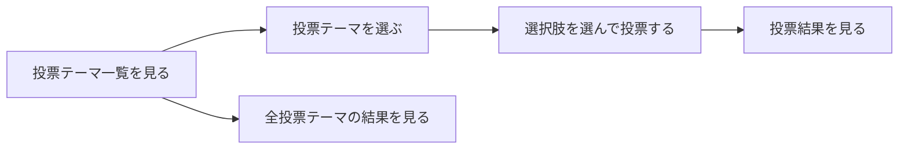
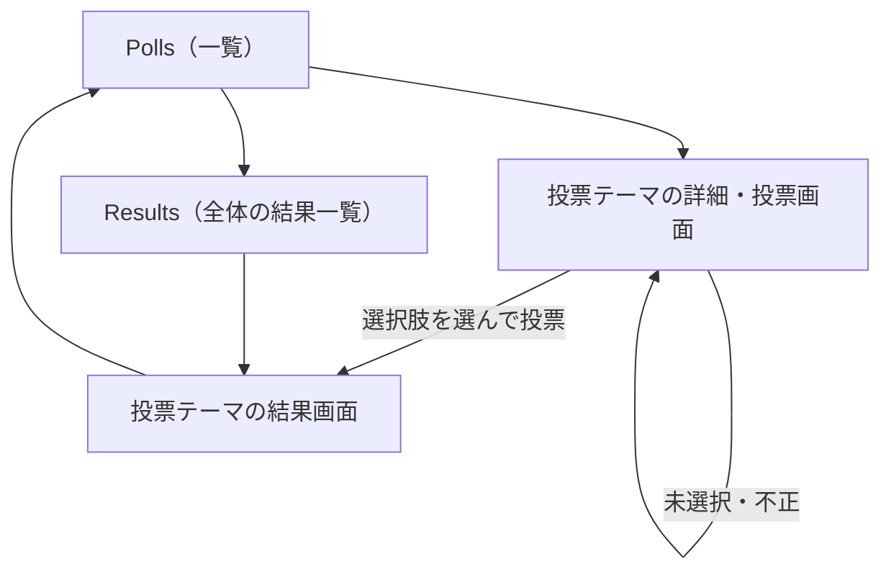

# 要件定義書: Polls Website（投票サイト）

作成日: 2026-11-05
フロー: 新規（isdd-spec）
入力: `REQUEST.md`、`contract.md`、`ANSWERS.md`（ヒアリングへの固定回答）

---

## 1. 目的・前提

### 目的

利用者がブラウザで投票テーマ（ポール）を閲覧し、選択肢を選んで投票でき、投票結果（票数と割合）を画面で確認できるようにする。

### 用語集

| 用語 | 業務上の意味 | 本案件での使用範囲 | 同義語/類義語 |
|---|---|---|---|
| 投票テーマ（ポール） | 利用者に投票を求める質問。選択肢を複数持つ | 一覧・詳細・結果の各画面 | poll |
| 選択肢 | 投票テーマに対する回答の候補 | 投票テーマの詳細画面、結果画面 | option |
| 投票 | 利用者が選択肢を 1 つ選んで送信し、その選択肢に 1 票が入ること | 投票画面、データ | vote |
| 投票結果 | 選択肢ごとの票数と、全体に対する割合 | 結果画面、結果一覧画面 | results |

### システムの形態

- GUI（ブラウザで操作する画面）。複数を組み合わせない。

### 1-1. 技術制約（前提として記録する。要件ではないため ID は付与しない）

| 制約項目 | 内容 | 出どころ（誰がいつ答えたか） |
|---|---|---|
| 既存コードベース | 無し（新規開発） | ANSWERS.md（段 1 では既存コード無し） |
| 配備先 | 利用者の PC 上で `bash run.sh` により直接起動する。コンテナは使わない。サーバーの配備先は指定無し | contract.md、ANSWERS.md |
| チームの技術 | 指定無し。実行環境は Python 3.12（`python3`）か Node.js 24。無償の技術だけを使う | contract.md、ANSWERS.md（技術制約） |
| ライセンスとコスト | 無償のものだけ。外部サービス・有償 API は使わない | contract.md |
| 性能と規模の目安 | 利用人数は少数。性能の目標は無し。データ量は少ない（初期データ数件） | ANSWERS.md（非機能） |

### 1-2. 依頼に無く自分で決めた項目（必須）

| 項目 | 決めた内容 | 根拠（最小案か、依頼のどこから推測したか） | 承認（承認済 / 未確認） |
|---|---|---|---|
| 投票の回数制限 | 制限しない。同じ利用者が同じ投票テーマに何度投票しても、そのたびに 1 票ずつ数える | 最小案。依頼に制限の記述が無い。利用者の区別（ログイン）を作らないため | 承認済（ANSWERS.md で一任） |
| 未選択・不正な投票の扱い | 投票を記録せず、同じ画面に英語のエラー文言「Please select one option before you vote.」を表示する。存在しない選択肢・存在しない投票テーマへの投票も記録しない | 最小案。「選択肢を選んで投票する」の前提から、未選択は受け付けられない | 承認済（ANSWERS.md で一任） |
| 投票結果が 0 件のとき | 票数 0、割合 0.0% と表示し、「No votes yet」と書く | 最小案。空の結果を見せるため | 承認済（ANSWERS.md で一任） |
| 初期データ | 投票テーマ 3 件（各 3〜4 選択肢）と、サンプルの投票数件を、DB が空のときだけ投入する | contract.md（空でも機能を試せるサンプル内容） | 承認済（ANSWERS.md で一任） |
| 画面のナビゲーション | 全画面の上部に「Polls」（投票テーマ一覧）と「Results」（全投票テーマの結果一覧）のメニューを置く | contract.md（分かりやすいナビゲーション）。結果を見る入口を作るため | 承認済（ANSWERS.md で一任） |
| 投票テーマの作成・編集・削除 | 作らない。初期データだけで運用する | 依頼文に無い。依頼の機能（投票・結果閲覧）に必要ない | 承認済（ANSWERS.md で一任） |
| 投票後の遷移 | 投票後は結果画面へ移動し、「Thank you for voting.」を表示する | 最小案。投票の結果をすぐ確認できるようにするため | 承認済（ANSWERS.md で一任） |
| 存在しない投票テーマの URL | 英語の「Not found」画面と「Polls」へのリンクを表示する（HTTP 404） | 最小案 | 承認済（ANSWERS.md で一任） |
| 割合の表示 | 小数点以下 1 桁の % で表示する（四捨五入） | 最小案。表示の既定 | 承認済（ANSWERS.md で一任） |
| 色 | 背景は白（#FFFFFF）。ナビゲーション・見出し・ボタン・結果バーなどの部品の色は navy（#000080） | 依頼文（背景 white、部品 navy） | 承認済（依頼文の指定） |
| データの保存先 | `DATA_DIR` の下の `polls.db`（SQLite）。`DATA_DIR` が無ければ `./data` | contract.md（DATA_DIR）。保存先を 1 つに決める | 承認済（ANSWERS.md で一任） |
| 起動ポートと待ち受け | `PORT` が無ければ 8000。`127.0.0.1` で待ち受ける | contract.md（PORT の既定値、127.0.0.1） | 承認済（contract.md） |
| 同時投票 | 特別な制御はしない。各投票は 1 件ずつ記録する | 最小案。投票は 1 行の追加で完結する | 承認済（ANSWERS.md で一任） |
| 認証・権限 | 無し。誰でも投票と閲覧ができる | ANSWERS.md（認証無し、利用者の区別が要る機能は依頼に無い） | 承認済（ANSWERS.md で一任） |

---

## 2. 業務

### 対象業務一覧

| RQ-BZ-ID | 業務名 | 業務の範囲 | 担当者 |
|---|---|---|---|
| RQ-BZ-POLL-VOTING | 投票業務 | 投票テーマの閲覧、選択肢への投票、投票結果の閲覧 | 利用者（一般の利用者。ログイン無し） |

### 業務フロー

### 2-1. 業務の問題（あるべき姿と現状のギャップ）

| 問題 | 対象業務（RQ-BZ） | あるべき姿 | 現状 | ギャップ（KPI） | 業務影響 |
|---|---|---|---|---|---|
| 利用者がウェブで投票し、その結果を見る手段が無い | RQ-BZ-POLL-VOTING | 利用者がブラウザで投票テーマを選び、選択肢に投票し、結果を見られる | 投票を受け付け、結果を表示するウェブ画面が無い（新規開発。依頼文より） | 不明（依頼に現状の数値が無いため、KPI は算定しない） | 不明（依頼に業務影響の記述が無い） |

### 2-2. 業務課題一覧（必須）

| RQ-BK-ID | 業務課題（取り組むこと） | 解決する問題（2-1） | 解決後の状態（KPI の目標値） | 対象業務（RQ-BZ） |
|---|---|---|---|---|
| RQ-BK-ONLINE-VOTE-COLLECTION | 利用者がブラウザで投票テーマを選び、選択肢に投票できるようにする | 利用者がウェブで投票する手段が無い | 投票テーマの閲覧から投票までをブラウザだけで完了できる（目標値: 不明。依頼に無し） | RQ-BZ-POLL-VOTING |
| RQ-BK-RESULTS-PUBLIC-VIEW | 投票結果（票数と割合）を利用者が画面で確認できるようにする | 投票結果を見る手段が無い | 投票直後と、いつでも、投票結果を画面で確認できる（目標値: 不明。依頼に無し） | RQ-BZ-POLL-VOTING |

### 2-3. 見込み経営効果

見込み経営効果は算定しない（理由: 依頼文に効果の算定に必要な情報（件数、工数、費用）が無く、算定根拠を持たないため）。

---

## 3. 機能要件

- 入力データ: 人手入力（投票の選択肢の選択）。外部連携は無い。
- 出力データ: 画面に表示する投票テーマ、選択肢、票数、割合。

### 全機能のユーザー利用フロー

業務フローとの対応: 業務フローの「投票テーマ一覧を見る」は RQ-FT-BROWSE-POLLS、「選択肢を選んで投票する」は RQ-FT-CAST-VOTE、「投票結果を見る」は RQ-FT-VIEW-RESULTS、「全投票テーマの結果を見る」は RQ-FT-VIEW-ALL-RESULTS に対応する。

### システムの形態ごとの仕様（GUI）

- 画面遷移図は上記の「全機能のユーザー利用フロー」を画面遷移として使う。
- 画面ごとの 5 項目（画面の目的、主要要素、入力項目、表示項目、エラー時の見え方）は 4-5 の画面一覧と、次のとおり。

#### 画面: Polls（投票テーマ一覧、RQ-UI-POLL-LIST-SCREEN）

- 目的: 投票テーマの一覧を見て、投票する対象を選ぶ
- 主要要素: 見出し「Polls」、投票テーマごとのカード（質問文、選択肢の数、総票数、「Vote」リンク、「Results」リンク）
- 入力項目: 無し
- 表示項目: 投票テーマの質問文と総票数。投票テーマが 1 件も無いときは「No polls yet.」
- エラー時の見え方: 無し（データ取得に失敗したときは、英語のエラー画面）

#### 画面: 投票テーマの詳細・投票（RQ-UI-POLL-DETAIL-SCREEN）

- 目的: 選択肢を見て、1 つを選んで投票する
- 主要要素: 質問文、選択肢のラジオボタン、「Vote」ボタン、「View results」リンク
- 入力項目: 選択肢（ラジオボタンで 1 つ）
- 表示項目: 質問文、選択肢の名前
- エラー時の見え方: 未選択のまま送信したとき、同じ画面の上部に赤字で「Please select one option before you vote.」を表示し、選択は残らない（投票は記録しない）

#### 画面: 投票テーマの結果（RQ-UI-POLL-RESULTS-SCREEN）

- 目的: 1 つの投票テーマの票数と割合を見る
- 主要要素: 質問文、選択肢ごとの結果行（名前、票数、割合、navy の横棒グラフ）、総票数、「Back to polls」リンク
- 入力項目: 無し
- 表示項目: 選択肢ごとの票数と割合、総票数。投票直後は「Thank you for voting.」を上部に表示する
- エラー時の見え方: 投票が 0 件のときは「No votes yet」と表示し、票数は 0、割合は 0.0%

#### 画面: Results（全投票テーマの結果一覧、RQ-UI-RESULTS-OVERVIEW-SCREEN）

- 目的: 全投票テーマの結果をまとめて見る
- 主要要素: 見出し「Results」、投票テーマごとの行（質問文、総票数、一番多い選択肢、「Details」リンク）
- 入力項目: 無し
- 表示項目: 投票テーマごとの総票数と一番多い選択肢
- エラー時の見え方: 投票テーマが無いときは「No polls yet.」

#### 共通: ナビゲーション（RQ-UI-NAVIGATION-MENU）

- 目的: どの画面からも主要な画面へ移れるようにする
- 主要要素: 画面上部の navy の帯に「Polls」と「Results」のリンク
- 入力項目: 無し
- 表示項目: 現在の画面の項目を強調する
- エラー時の見え方: 無し

### 3-1. 帳票・出力ファイル

帳票・出力ファイルは無い（出力は画面表示だけ）。

### 機能一覧

| RQ-ID | カテゴリ | 機能名 | 対応業務課題ID（RQ-BK-*） | この機能が無いと何が困るか |
|---|---|---|---|---|
| RQ-FT-BROWSE-POLLS | 業務機能 | 投票テーマの一覧を表示する | RQ-BK-ONLINE-VOTE-COLLECTION | 利用者が投票する対象を選べない |
| RQ-FT-VIEW-POLL-OPTIONS | 業務機能 | 投票テーマの質問と選択肢を表示する | RQ-BK-ONLINE-VOTE-COLLECTION | 利用者が何に投票するのか分からない |
| RQ-FT-CAST-VOTE | 業務機能 | 選んだ選択肢に 1 票を記録する | RQ-BK-ONLINE-VOTE-COLLECTION | 投票という業務が成り立たない |
| RQ-FT-VIEW-RESULTS | 業務機能 | 投票テーマごとに票数と割合を表示する | RQ-BK-RESULTS-PUBLIC-VIEW | 投票結果を確認できない |
| RQ-FT-VIEW-ALL-RESULTS | 業務機能 | 全投票テーマの結果を一覧で表示する | RQ-BK-RESULTS-PUBLIC-VIEW | 投票テーマごとに開かないと結果の全体が分からない |

### 3-2. 業務ルール

| RQ-ID | ルール名 | 内容（条件と結果） | 違反時・エラー時の業務上の扱い | 対応業務課題ID（RQ-BK-*） |
|---|---|---|---|---|
| RQ-FT-REJECT-INVALID-VOTE | 不正な投票を受け付けない | 次のいずれかの投票は記録しない。(1) 選択肢が未選択、(2) 投票テーマに属さない選択肢、(3) 存在しない投票テーマ | (1)(2) は投票画面に英語のエラー文言を表示する。(3) は「Not found」画面を表示する。いずれも票数は変わらない | RQ-BK-ONLINE-VOTE-COLLECTION |
| RQ-FT-COUNT-EVERY-VOTE | 投票は回数に関係なく数える | 同じ利用者による同じ投票テーマへの投票も、送信のたびに 1 票ずつ数える | 無し（制限をしないため、違反は起きない） | RQ-BK-ONLINE-VOTE-COLLECTION |

### 3-3. 外部連携

外部連携は無い。

---

## 4. データ

### 4-1. データ要件一覧

| RQ-ID | 種別 | 内容 | 対応業務課題ID（RQ-BK-*） | この要件が無いと何が困るか |
|---|---|---|---|---|
| RQ-DT-LOCAL-SQLITE-STORAGE | 内部データ | 投票テーマ・選択肢・投票は、`DATA_DIR` の下の `polls.db`（SQLite）に保存する。保持期間は無期限（削除の機能が無いため）。外部 DB は使わない。DB が必要な理由は、投票を再起動の後も残し、票数を集計するため。初期件数は投票テーマ 3 件、サンプル票数件。1 年後の想定件数は不明（依頼に無い。利用人数は少数） | RQ-BK-ONLINE-VOTE-COLLECTION、RQ-BK-RESULTS-PUBLIC-VIEW | 再起動すると投票が消え、結果を確認できない |
| RQ-DT-SAMPLE-DATA-ON-EMPTY | 内部データ | DB が空（投票テーマが 1 件も無い）のときだけ、サンプルの投票テーマ 3 件と選択肢、サンプル票を投入する | RQ-BK-ONLINE-VOTE-COLLECTION | 空のサイトでは機能を試せない（契約で求められる） |

### 4-2. 業務エンティティとデータ項目

| RQ-ID | カテゴリ | 業務エンティティ名 | 対応業務課題ID（RQ-BK-*） | この業務エンティティが無いと何が困るか |
|---|---|---|---|---|
| RQ-DT-POLL | データ | 投票テーマ（Poll） | RQ-BK-ONLINE-VOTE-COLLECTION | 投票する対象が無い |
| RQ-DT-POLL-OPTION | データ | 選択肢（PollOption） | RQ-BK-ONLINE-VOTE-COLLECTION | 投票の候補が無い |
| RQ-DT-VOTE | データ | 投票（Vote） | RQ-BK-ONLINE-VOTE-COLLECTION、RQ-BK-RESULTS-PUBLIC-VIEW | 票を記録できず、結果が作れない |

| エンティティ名 | 項目名 | 業務上の意味 | 必須 | 形式・桁 | 値の範囲・制約 | 例 |
|---|---|---|---|---|---|---|
| 投票テーマ | 投票テーマ ID | 投票テーマを一意に示す番号 | 必須 | 整数（自動採番） | 1 以上 | 1 |
| 投票テーマ | 質問文 | 利用者に問う文 | 必須 | 文字列 | 1 文字以上 200 文字以下 | Which language do you prefer? |
| 投票テーマ | 説明 | 投票テーマの補足 | 任意 | 文字列 | 500 文字以下 | Pick one. |
| 選択肢 | 選択肢 ID | 選択肢を一意に示す番号 | 必須 | 整数（自動採番） | 1 以上 | 1 |
| 選択肢 | 投票テーマ ID | 所属する投票テーマ | 必須 | 整数 | 存在する投票テーマの ID | 1 |
| 選択肢 | 選択肢名 | 利用者に見せる回答の候補 | 必須 | 文字列 | 1 文字以上 100 文字以下。同じ投票テーマ内で重複しない | Python |
| 投票 | 投票 ID | 投票を一意に示す番号 | 必須 | 整数（自動採番） | 1 以上 | 1 |
| 投票 | 投票テーマ ID | 投票先の投票テーマ | 必須 | 整数 | 存在する投票テーマの ID | 1 |
| 投票 | 選択肢 ID | 選んだ選択肢 | 必須 | 整数 | 同じ投票テーマに属する選択肢の ID | 2 |
| 投票 | 投票日時 | 投票を受け付けた時刻 | 必須 | 日時（UTC、ISO 8601 形式の文字列） | 自動で入る | 2026-11-05T10:00:00Z |

### 4-3. CRUD テーブル（必須）

| エンティティ名 | Create | Read（一覧） | Read（詳細） | 検索 | Update | Delete | 備考 |
|---|---|---|---|---|---|---|---|
| 投票テーマ（Poll） | × | ○ | ○ | × | × | × | 作成・編集・削除は依頼に無いため対象外。初期データだけで作る |
| 選択肢（PollOption） | × | ○ | ○ | × | × | × | 投票テーマの詳細画面で一覧表示する。作成・編集・削除は対象外 |
| 投票（Vote） | ○ | △ | × | × | × | × | Create は投票画面からの送信。Read は票数の集計（結果画面・結果一覧）だけで、投票の一覧や詳細は画面に出さない。Create は 1 件の追加で完結し、トランザクションの複数操作は無い。同時更新の排他制御は不要（追加のみ） |

### 4-4. 状態遷移

状態を持つエンティティは無い。

### 4-5. 画面一覧（GUI）

| RQ-ID | 画面名 | 対応する CRUD 操作（エンティティ名:操作種別） | 主な機能・目的 | 対応業務課題ID（RQ-BK-*） |
|---|---|---|---|---|
| RQ-UI-POLL-LIST-SCREEN | Polls（投票テーマ一覧） | 投票テーマ:Read（一覧） | 投票テーマを選ぶ | RQ-BK-ONLINE-VOTE-COLLECTION |
| RQ-UI-POLL-DETAIL-SCREEN | 投票テーマの詳細・投票 | 投票テーマ:Read（詳細）、選択肢:Read（一覧）、投票:Create | 選択肢を選んで投票する | RQ-BK-ONLINE-VOTE-COLLECTION |
| RQ-UI-POLL-RESULTS-SCREEN | 投票テーマの結果 | 投票:Read（集計）、投票テーマ:Read（詳細） | 票数と割合を見る | RQ-BK-RESULTS-PUBLIC-VIEW |
| RQ-UI-RESULTS-OVERVIEW-SCREEN | Results（全投票テーマの結果一覧） | 投票:Read（集計）、投票テーマ:Read（一覧） | 全投票テーマの結果をまとめて見る | RQ-BK-RESULTS-PUBLIC-VIEW |
| RQ-UI-NAVIGATION-MENU | 共通ナビゲーション | 無し（画面共通の部品） | 主要な画面へ移る | RQ-BK-ONLINE-VOTE-COLLECTION、RQ-BK-RESULTS-PUBLIC-VIEW |

---

## 5. 非機能要件

- 利用者の種別: 一般の利用者（ログイン無し）。アクセス経路は、起動した PC のブラウザから（`127.0.0.1`）。インターネット公開は要件に無い。
- 性能: 性能の目標は無い。
- 利用人数: 少数（同時に数名）。依頼に人数の記述が無いため、この目安を最小案として使う。
- 可用性: 可用性の要求は無い。
- 移行性: 移行は無い（既存のシステムや台帳からのデータは無い）。
- セキュリティ: 認証は無い。権限制御は無い。監査証跡は無い。
- 非機能要件の RQ-NF は無い。

---

## 6. 運用要件

- ログ: 一般的な動作ログ・エラーログ以外のログは必要ない。ログの内容と保存期間の記述は行わない。
- 監査ログ: 監査ログは必要ない。
- 監視・アラート: 監視・アラートは必要ないため、監視・アラートの内容と対応方法の記述は行わない。
- バックアップと復旧: バックアップは必要ない（データは `DATA_DIR` の SQLite ファイルのみで、利用者がファイルを手動で複製できる）。
- RQ-OP は無い。

---

## 7. テスト用利用シナリオ

| RQ-ID | テスト目的 | 前提条件 | テスト手順 | 期待される結果 | 検証する要件ID | 対応業務課題ID（RQ-BK-*） |
|---|---|---|---|---|---|---|
| RQ-TS-BROWSE-POLL-LIST | 投票テーマ一覧が表示され、詳細へ進めること | DB が空で起動する（初期データが入る） | 1. `/` を開く。2. 投票テーマの「Vote」リンクを押す | 一覧に 3 件の投票テーマが出る。「Vote」で詳細画面（選択肢が見える）へ移る | RQ-FT-BROWSE-POLLS、RQ-UI-POLL-LIST-SCREEN | RQ-BK-ONLINE-VOTE-COLLECTION |
| RQ-TS-VIEW-POLL-OPTIONS | 投票テーマの質問と選択肢が表示されること | 初期データが入っている | 1. 投票テーマの詳細画面を開く | 質問文と 3〜4 個の選択肢（ラジオボタン）と「Vote」ボタンが表示される | RQ-FT-VIEW-POLL-OPTIONS、RQ-UI-POLL-DETAIL-SCREEN | RQ-BK-ONLINE-VOTE-COLLECTION |
| RQ-TS-CAST-VOTE-AND-VIEW-RESULT | 選択肢に投票すると 1 票が増え、結果画面に反映されること | 初期データが入っている。投票前の票数を控える | 1. 詳細画面で選択肢を 1 つ選ぶ。2. 「Vote」を押す。3. 結果画面を見る。4. 同じ選択肢で再度投票する | 1 回目の投票後、結果画面に「Thank you for voting.」と、その選択肢の票数が 1 増えた表示が出る。2 回目の投票でも 1 票ずつ増える | RQ-FT-CAST-VOTE、RQ-FT-VIEW-RESULTS、RQ-FT-COUNT-EVERY-VOTE、RQ-UI-POLL-RESULTS-SCREEN | RQ-BK-ONLINE-VOTE-COLLECTION、RQ-BK-RESULTS-PUBLIC-VIEW |
| RQ-TS-REJECT-INVALID-VOTE | 未選択の投票、存在しない選択肢・投票テーマでの投票が記録されないこと | 初期データが入っている。投票前の票数を控える | 1. 選択肢を選ばずに「Vote」を押す。2. 存在しない選択肢 ID で投票のリクエストを送る。3. 存在しない投票テーマの URL を開く | 1 と 2 は同じ画面に「Please select one option before you vote.」（2 は同じ文言）を表示し、票数は変わらない。3 は「Not found」画面と「Polls」へのリンクが表示される | RQ-FT-REJECT-INVALID-VOTE | RQ-BK-ONLINE-VOTE-COLLECTION |
| RQ-TS-VIEW-ALL-RESULTS | 全投票テーマの結果が一覧で見られること | 初期データが入っている | 1. 「Results」メニューを押す。2. 投票テーマの「Details」リンクを押す | 一覧に 3 件の投票テーマの総票数と一番多い選択肢が出る。「Details」で結果画面へ移る | RQ-FT-VIEW-ALL-RESULTS、RQ-UI-RESULTS-OVERVIEW-SCREEN | RQ-BK-RESULTS-PUBLIC-VIEW |
| RQ-TS-NAVIGATE-MENU | どの画面からも「Polls」「Results」で主要な画面へ移れること | 初期データが入っている | 1. 一覧画面、詳細画面、結果画面、結果一覧画面で、それぞれ「Polls」と「Results」を押す | 押したメニューの画面へ移り、現在の画面のメニュー項目が強調される | RQ-UI-NAVIGATION-MENU | RQ-BK-ONLINE-VOTE-COLLECTION、RQ-BK-RESULTS-PUBLIC-VIEW |
| RQ-TS-SAMPLE-DATA-ON-EMPTY-START | 空の DATA_DIR で起動すると、初期データが入って機能を試せること | DATA_DIR が空のディレクトリ | 1. 起動する。2. `/` を開く | 3 件の投票テーマと選択肢、サンプルの票数が表示される。2 回目の起動では初期データが増えない | RQ-DT-SAMPLE-DATA-ON-EMPTY、RQ-DT-LOCAL-SQLITE-STORAGE | RQ-BK-ONLINE-VOTE-COLLECTION |

テストの対象外: 投票テーマの作成・編集・削除（要件に無い）。

---

## 要件と業務課題の対応

| 業務課題（RQ-BK） | 対応する要件（RQ-*） |
|---|---|
| RQ-BK-ONLINE-VOTE-COLLECTION | RQ-FT-BROWSE-POLLS、RQ-FT-VIEW-POLL-OPTIONS、RQ-FT-CAST-VOTE、RQ-FT-REJECT-INVALID-VOTE、RQ-FT-COUNT-EVERY-VOTE、RQ-UI-POLL-LIST-SCREEN、RQ-UI-POLL-DETAIL-SCREEN、RQ-UI-NAVIGATION-MENU、RQ-DT-LOCAL-SQLITE-STORAGE、RQ-DT-SAMPLE-DATA-ON-EMPTY、RQ-DT-POLL、RQ-DT-POLL-OPTION、RQ-DT-VOTE |
| RQ-BK-RESULTS-PUBLIC-VIEW | RQ-FT-VIEW-RESULTS、RQ-FT-VIEW-ALL-RESULTS、RQ-UI-POLL-RESULTS-SCREEN、RQ-UI-RESULTS-OVERVIEW-SCREEN、RQ-UI-NAVIGATION-MENU、RQ-DT-VOTE、RQ-DT-LOCAL-SQLITE-STORAGE |
