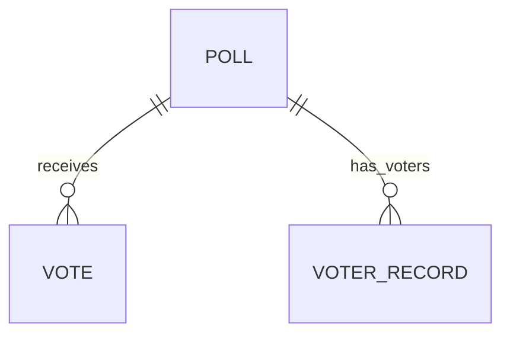

# 変更設計書: Polls Website（投票サイト）— 配色の変更と、1 ブラウザ 1 回の投票

作成日: 2026-11-05
フロー: 変更（isdd-spec）。変更の記録。正本 `docs/detail_design.md` は書き換えない（反映は実装後レビューで行う）
入力: `.history/20261105-theme-and-one-vote/change_requirements.md`（変更要件定義書）、正本 `docs/requirements.md`・`docs/detail_design.md`

凡例: 各設計要素に [追加] か [削除] を付ける。中身が変わる既存の要素は、旧 ID を [削除]、新 ID を [追加] にする。変更の無い章は「変更なし。既存設計 `docs/detail_design.md` セクション[N] を参照」と書く。

---

## 1. 言語・フレームワーク・アーキテクチャの選定

変更なし。既存設計 `docs/detail_design.md` セクション 1 を参照（Python 3.12、Flask 3.1.3、SQLite）。投票者 ID は標準ライブラリの `uuid` と Flask の Cookie で扱うため、追加の依存は無い。

## 2. システム構成

変更なし。既存設計 `docs/detail_design.md` セクション 2 を参照（コンポーネントは変わらない。投票者 ID の判定は Web アプリ、記録は保存処理が行う）。

## 3. データ設計

### 3-1. データモデル

既存のテーブル（`polls`、`poll_options`、`votes`）は変更なし。次のテーブルを [追加] する。



| テーブル（DS-ID） | カラム | 型 | 制約 | 対応する要件定義書のデータ項目 |
|---|---|---|---|---|
| `poll_voters`（DS-SC-VOTER-RECORD） [追加] | `poll_id` | INTEGER | NOT NULL、REFERENCES polls(id)、PRIMARY KEY (poll_id, voter_id) | 投票テーマ ID |
| | `voter_id` | TEXT | NOT NULL（32 桁の英小文字と数字。アプリで検証） | 投票者 ID |
| | `voted_at` | TEXT | NOT NULL（UTC の ISO 8601 形式） | 投票日時 |

- `poll_voters` は、投票テーマごとに「この投票者 ID が投票済みか」を持つ。主キーの組で同じ投票者の重複を DB 側でも防ぐ。
- 既存の DB に `poll_voters` を足すのは `CREATE TABLE IF NOT EXISTS` で行う（既存の票は消さない。移行は不要）。

### 3-2. トランザクションと排他制御

- [追加] 投票の記録（`cast_vote`）は 1 トランザクションで次の順に行う。(1) 選択肢が投票テーマに属するかを確かめる（属さなければ `ValueError` で、何も書かない）。(2) `poll_voters` に `INSERT OR IGNORE` で投票者記録を入れる。影響行数が 0 なら、既に投票済みなので、何も記録せずにロールバックして `False` を返す。(3) `votes` に 1 行追加する。(4) コミットして `True` を返す。
- 同じ投票者が同時に 2 回送っても、SQLite の書き込みロックで直列化され、主キーにより 2 回目は `False` になる。票が 2 つ入ることは無い。
- 排他制御の方式は既存（SQLite の既定の書き込みロック）のまま。楽観的・悲観的のどちらも使わない。

### 3-3. 状態遷移

変更なし。状態を持つエンティティは無い。

---

## 4. アーキテクチャ設計

### 4-1. 外部設計

利用者向けインターフェース（画面と HTTP のルート）。既存の画面・ルートは変えず、次を [追加] / [削除] する。

| DS-ID | 種類 | URL | 処理（関数） | 入力 | 出力 |
|---|---|---|---|---|---|
| DS-IF-VOTE-SUBMIT [削除] | 送信 | POST `/polls/<poll_id>/vote` | `submit_vote` | フォーム `option_id` | 削除理由: 投票者 ID の判定と、投票済みへの 409 応答を加えるため、中身が変わる。新 ID DS-IF-VOTE-SUBMIT-ONCE に移す |
| DS-IF-VOTE-SUBMIT-ONCE [追加] | 送信 | POST `/polls/<poll_id>/vote` | `submit_vote` | Cookie `voter_id`（任意）、フォーム `option_id`（整数） | 成功: 303 で `/polls/<poll_id>/results?voted=1` へ移動。投票済み: 409 で詳細画面を再表示し「You have already voted」（投票の操作は無効）。未選択・不正・属さない選択肢: 400 で詳細画面を再表示し「Please select one option before you vote.」。いずれの応答でも、投票者 ID の Cookie を付ける |
| DS-IF-ALREADY-VOTED-STATE [追加] | 画面の状態 | GET `/polls/<poll_id>`（`show_poll_detail`） | Cookie `voter_id`（任意） | URL の `poll_id` | 投票済みのとき、選択肢のラジオボタンと「Vote」ボタンを無効にし、「You have already voted」を表示する。「View results」は有効のまま。投票済みでなければ既存の画面と同じ |
| DS-IF-COLOR-THEME [追加] | 共通（配色） | 全画面 | 静的なスタイルシート（`src/web/static/style.css`。対応表の対象外） | — | 背景 `#FFFFE0`（light yellow）。部品 `#2F4F4F`（dark slate gray）。本文の文字 `#2F4F4F`、部品の上の文字 `#FFFFE0`。白（`#FFFFFF`）と navy（`#000080`）は使わない。CSS の変数で指定する |

投票者 ID の Cookie の仕様（[追加]）:

| 項目 | 内容 |
|---|---|
| 名前 | `voter_id` |
| 値 | 標準の `uuid.uuid4().hex`（32 桁の英小文字と数字）。読むときは形式を確かめ、合わない値は無いものとして扱い、新しい値を発行する |
| 属性 | HttpOnly、SameSite=Lax、Path=/、Max-Age=31536000（1 年） |
| 発行 | 投票（DS-IF-VOTE-SUBMIT-ONCE の送信）のとき、Cookie が無ければ発行する |

入力の検証とエラー仕様（既存の表に加える行。[追加]）:

| 対象 | 検証 | 失敗時 |
|---|---|---|
| 投票者 ID（Cookie） [追加] | 32 桁の英小文字と数字であること | 形式が合わなければ無いものとして扱い、投票済みでないとみなす（新しい値を発行する） |
| 投票済み（送信時） [追加] | `poll_voters` に、投票テーマ ID と投票者 ID の組があること | 409 で詳細画面を再表示し「You have already voted」を出す（票は増えない） |

外部システム連携: 無し。外部 DB 連携: 無し。

### 4-2. 内部設計

処理フロー（投票、変更後）:

```mermaid
sequenceDiagram
    participant B as ブラウザ
    participant W as submit_vote
    participant S as cast_vote
    participant D as SQLite
    B->>W: POST /polls/1/vote（option_id、Cookie voter_id）
    W->>W: 投票テーマの存在。投票者 ID を読む（無ければ発行）
    W->>S: has_voted(db, poll_id, voter_id)
    alt 投票済み
        W-->>B: 409 詳細画面（「You have already voted」）＋ Cookie
    else
        W->>W: option_id が空・整数でないか確認
        alt 未選択・整数でない
            W-->>B: 400 詳細画面（エラー文言）＋ Cookie
        else
            W->>S: cast_vote(db, poll_id, option_id, voter_id)
            S->>D: BEGIN; 選択肢が投票テーマに属するか; INSERT OR IGNORE poll_voters; INSERT votes; COMMIT
            alt 属さない・存在しない
                S-->>W: ValueError
                W-->>B: 400 詳細画面（エラー文言）＋ Cookie
            else 記録しなかった（投票済み・競合）
                S-->>W: False
                W-->>B: 409 詳細画面（「You have already voted」）＋ Cookie
            else 記録した
                S-->>W: True
                W-->>B: 303 /polls/1/results?voted=1 ＋ Cookie
            end
        end
    end
```

各処理の役割:

- [追加] DS-FN-HAS-VOTED: `has_voted(db_path, poll_id, voter_id) -> bool`。`poll_voters` に投票テーマ ID と投票者 ID の組があるかを返す（`src/store/db.py::has_voted`）。
- [削除] DS-FN-CAST-VOTE: 削除理由: 投票者 ID を受け取り、投票済みの判定と記録を 1 トランザクションで行う関数に変わるため。新 ID DS-FN-CAST-VOTE-ONCE に移す。
- [追加] DS-FN-CAST-VOTE-ONCE: `cast_vote(db_path, poll_id, option_id, voter_id) -> bool`。3-2 の順で記録する。記録したら `True`、投票済みで何も記録しなければ `False`、選択肢が投票テーマに属さなければ `ValueError`（`src/store/db.py::cast_vote`。名前は既存の関数と同じで、中身と戻り値が変わる）。
- [追加] DS-FN-READ-VOTER-COOKIE: `read_voter_cookie() -> Optional[str]`。リクエストの Cookie `voter_id` を読み、形式が合えばその値、無ければ `None` を返す（`src/web/app.py::read_voter_cookie`）。
- [追加] DS-FN-SET-VOTER-COOKIE: `set_voter_cookie(response, voter_id)`。応答に Cookie `voter_id` を付ける（属性は 4-1 のとおり）。付けた応答を返す（`src/web/app.py::set_voter_cookie`）。
- DS-IF-VOTE-SUBMIT-ONCE（`submit_vote`）: 上の処理フローのとおり。投票者 ID が無ければ `uuid.uuid4().hex` で発行し、すべての応答に `set_voter_cookie` で付ける。
- DS-IF-ALREADY-VOTED-STATE（`show_poll_detail`）: `read_voter_cookie()` の値があれば `has_voted` で投票済みかを確かめ、テンプレートに `already_voted` を渡す。投票済みのときは選択肢と「Vote」ボタンを無効にする。
- `init_db`（既存の関数）: 変更なし。テーブルを作る処理の中身は同じで、作るテーブルに `poll_voters` が増える（3-1 で定義）。
- `seed_sample_polls`、`list_polls`、`get_poll`（既存の関数）: 変更なし。サンプルには投票者記録を入れない（初期データは従来どおり、どのブラウザも 1 回投票できる）。

バッチ設計: 変更なし。

---

## 5. クラス設計

変更なし。クラスは無い（モジュールの関数だけで構成する）。

---

## 6. エラーハンドリングとセキュリティ設計

### エラーハンドリング

既存の表に次の行を加える（[追加]）。

| 想定エラー | 利用者への見え方 | ログ | 処理 |
|---|---|---|---|
| 投票済み（同じ投票者 ID、同じ投票テーマ） [追加] | 詳細画面に「You have already voted」（409）。投票の操作は無効 | 無し | 投票を記録しない（票は増えない） |
| 投票者記録の競合（同時の 2 回送信） [追加] | 投票済みと同じ（409） | 無し | 後から来た方は記録しない（主キーの重複を `INSERT OR IGNORE` の影響行数 0 で検知してロールバック） |
| 投票者 ID の Cookie の形式が不正 [追加] | 利用者には見えない（投票済みでないとみなし、新しい ID を発行する） | 無し | 無いものとして扱う |

既存の行（投票テーマが存在しない、選択肢が未選択・属さない、DB の書き込み失敗）は変更なし。

### 認証

変更なし（認証は無い）。

### 認可

変更なし。ただし投票者 ID は「同じブラウザ」の目安であり、本人の認証ではない（Cookie を消せば再投票できる。1-2 の決め事）。

### 監査ログ

変更なし。無い。

### その他のセキュリティ対策

既存の対策（SQL のパラメータ束縛、Jinja2 の自動エスケープ、`127.0.0.1` の待ち受け）は変更なし。次を [追加] する。

- 投票者 ID の Cookie は HttpOnly（スクリプトから読めない）、SameSite=Lax。値は推測されにくい乱数（`uuid4`）。
- Cookie の形式は読み取るときに検証し、合わない値は使わない（SQL には検証後の値だけを渡す。値は必ずパラメータで束縛する）。

---

## 7. コード設計

### 7-1. ディレクトリ構成

変更なし。新しいファイルは作らない。`src/web/static/style.css` と `src/web/templates/poll_detail.html` の内容を変える。

### 7-2. ファイル一覧

| ファイル | 役割 | DS-MD | 実現する設計 ID |
|---|---|---|---|
| `src/store/db.py` | SQLite の保存処理と集計 | 変更なし | 変更なし（既存の設計 ID は `docs/detail_design.md` 7-2 を参照） |
| `src/store/db.py` | 同上 | 変更なし | [削除] DS-FN-CAST-VOTE（削除理由は 4-2） |
| `src/store/db.py` | 同上 | 変更なし | [追加] DS-FN-HAS-VOTED、[追加] DS-FN-CAST-VOTE-ONCE |
| `src/web/app.py` | ルーティング、入力の検証、描画、投票者 ID | 変更なし | 変更なし（既存の設計 ID は `docs/detail_design.md` 7-2 を参照） |
| `src/web/app.py` | 同上 | 変更なし | [削除] DS-IF-VOTE-SUBMIT（削除理由は 4-1） |
| `src/web/app.py` | 同上 | 変更なし | [追加] DS-IF-VOTE-SUBMIT-ONCE、[追加] DS-IF-ALREADY-VOTED-STATE |
| `src/web/app.py` | 同上 | 変更なし | [追加] DS-FN-READ-VOTER-COOKIE、[追加] DS-FN-SET-VOTER-COOKIE |

対応表の対象外（DS-MD を付けない）: 変更なし（`setup.sh`・`run.sh`、`requirements.txt`、テンプレート、`style.css`、テストファイル）。`style.css` は DS-IF-COLOR-THEME を実現するが、CSS は対応表の対象外（7 章の規則）なので、ここの「実現する設計 ID」には書かない。

### 7-3. 対応表の粒度

変更なし。`function`。

### 7-4. 依存の規則

変更なし。`src/web` は `src/store` だけに依存し、`src/store` は Web の枠組み（Flask）に依存しない。新しい依存は `uuid`（標準ライブラリ）と Flask の Cookie 機能（`src/web` 内）だけ。`scripts/isdd/dependencies.json` は変更しない。

### 7-5. コーディング規約

変更なし。

---

## 8. テスト設計

### 8-1. テストの種類と方針

| 種類 | 目的 | 方法 | 対象 |
|---|---|---|---|
| 単体テスト | 保存処理の関数が仕様どおり動くこと。投票者記録の判定と 1 票の制限を含む | `tests/test_store.py`（変更あり。`has_voted`、`cast_vote` の戻り値と投票者記録の確認を追加）。標準ライブラリの unittest。一時ディレクトリの SQLite | `src/store/db.py` の全関数 |
| 結合テスト | 起動から画面までがつながること | 単体テストと E2E テストに含める（個別の結合テストは作らない） | — |
| E2E テスト | 要件定義書 7 章のテスト用利用シナリオを、実サーバーに対する HTTP で確かめる | `e2e/test_site.py`（変更あり。旧シナリオの削除と、新しい 2 つのシナリオの追加）。Cookie は `http.cookiejar` で保持する | 7 章の全シナリオ |

単体テスト・結合テストの実行コマンド（変更なし）:

```bash
PYTHONPATH=src .venv/bin/python -m unittest discover -s tests -t . -v
```

非機能要件の検証: 非機能要件は無いため、テストは無い。

### 8-2. E2E テストのシナリオ

要件定義書 7 章の変更分を、1 対 1 で DS-TS にする。

| DS-ID | 目的 | 前提条件 | 手順 | 期待結果 |
|---|---|---|---|---|
| DS-TS-CAST-VOTE-AND-VIEW-RESULT [削除] | （削除）旧い 2 回投票の規則を確かめていた | — | — | 削除理由: 2 回目も票が増える旧い規則（RQ-FT-COUNT-EVERY-VOTE）を検証していたため。新 ID DS-TS-CAST-VOTE-ONCE-PER-POLL に移す |
| DS-TS-CAST-VOTE-ONCE-PER-POLL [追加] | 1 回目は数えられ、同じブラウザの 2 回目は数えられず、別のブラウザは数えられること（RQ-TS-CAST-VOTE-ONCE-PER-POLL） | 初期データがある。投票前の票数を控える。Cookie を保持する HTTP クライアントを使う | 1. 詳細画面で選択肢を選んで投票する。2. 結果画面を見る。3. 同じ投票テーマの詳細画面を開く。4. 同じ Cookie で同じ選択肢を直接送信する。5. Cookie の無いクライアントで同じ選択肢を送信する | 1 で「Thank you for voting.」と票数 +1。3 で投票の操作が無効で「You have already voted」。4 は 409 で票数は変わらない。5 は票数 +1 |
| DS-TS-COLOR-THEME [追加] | 全画面が指定の配色で表示されること（RQ-TS-COLOR-THEME） | 初期データがある | 1. 一覧、詳細、結果、結果一覧の各画面を開く。2. 各画面が読み込むスタイルシートを取得する | 各画面がスタイルシートを読み込む。スタイルシートに `#FFFFE0` と `#2F4F4F` があり、`#FFFFFF` と `#000080` が無い |

残りの E2E シナリオ（一覧から詳細へ進む、詳細の表示、不正な投票、全結果の一覧、メニュー、空の DATA_DIR の初期データ）は変更なし。既存設計 `docs/detail_design.md` セクション 8-2 を参照。

### 8-3. E2E の実行手段

変更なし。unittest と urllib（標準ライブラリ）で実サーバーに HTTP で問い合わせる。配色の確認はスタイルシートの値を HTTP で取得して行い、画面の目視はテストに含めない。

### 8-4. E2E の実行コマンドと運用

変更なし。

```bash
.venv/bin/python scripts/isdd/unittest_junit.py -s e2e -t . -o e2e/results/e2e.xml
```

---

## 9. 運用設計

変更なし。`setup.sh`・`run.sh`、環境変数 `PORT`・`DATA_DIR` は既存のまま。

## 10. ログ・監視・アラート・障害対応設計

変更なし。

---

## 11. 要件と設計の対応表

変更要件定義書にある既存の要件 ID（変更しない要件）は、既存の設計要素の「変更なし（既存）」の行で受ける。ここには変更の行と、その既存の受け手だけを書く。

| DS-ID | 対応要件ID |
|---|---|
| `DS-MD-STORE` [削除] | `RQ-FT-COUNT-EVERY-VOTE` |
| `DS-MD-STORE` [追加] | `RQ-FT-ONE-VOTE-PER-POLL`, `RQ-DT-VOTER-RECORD` |
| `DS-SC-VOTER-RECORD` [追加] | `RQ-DT-VOTER-RECORD`, `RQ-DT-LOCAL-SQLITE-STORAGE` |
| `DS-FN-CAST-VOTE` [削除] | `RQ-FT-CAST-VOTE`, `RQ-FT-REJECT-INVALID-VOTE`, `RQ-FT-COUNT-EVERY-VOTE` |
| `DS-FN-CAST-VOTE-ONCE` [追加] | `RQ-FT-CAST-VOTE`, `RQ-FT-REJECT-INVALID-VOTE`, `RQ-FT-ONE-VOTE-PER-POLL`, `RQ-DT-VOTER-RECORD` |
| `DS-FN-HAS-VOTED` [追加] | `RQ-FT-ONE-VOTE-PER-POLL`, `RQ-DT-VOTER-RECORD` |
| `DS-FN-READ-VOTER-COOKIE` [追加] | `RQ-FT-ONE-VOTE-PER-POLL`, `RQ-DT-VOTER-RECORD` |
| `DS-FN-SET-VOTER-COOKIE` [追加] | `RQ-FT-ONE-VOTE-PER-POLL`, `RQ-DT-VOTER-RECORD` |
| `DS-IF-VOTE-SUBMIT` [削除] | `RQ-UI-POLL-DETAIL-SCREEN`, `RQ-FT-CAST-VOTE`, `RQ-FT-REJECT-INVALID-VOTE` |
| `DS-IF-VOTE-SUBMIT-ONCE` [追加] | `RQ-UI-POLL-DETAIL-SCREEN`, `RQ-FT-CAST-VOTE`, `RQ-FT-REJECT-INVALID-VOTE`, `RQ-FT-ONE-VOTE-PER-POLL`, `RQ-UI-ALREADY-VOTED-MESSAGE` |
| `DS-IF-ALREADY-VOTED-STATE` [追加] | `RQ-UI-ALREADY-VOTED-MESSAGE`, `RQ-FT-ONE-VOTE-PER-POLL` |
| `DS-IF-COLOR-THEME` [追加] | `RQ-UI-COLOR-THEME` |
| `DS-SC-POLL` 変更なし（既存） | `RQ-DT-POLL` |
| `DS-SC-POLL-OPTION` 変更なし（既存） | `RQ-DT-POLL-OPTION` |
| `DS-SC-VOTE` 変更なし（既存） | `RQ-DT-VOTE` |
| `DS-FN-SEED-SAMPLE-POLLS` 変更なし（既存） | `RQ-DT-SAMPLE-DATA-ON-EMPTY` |
| `DS-FN-LIST-POLLS` 変更なし（既存） | `RQ-FT-BROWSE-POLLS`, `RQ-FT-VIEW-ALL-RESULTS` |
| `DS-FN-GET-POLL` 変更なし（既存） | `RQ-FT-VIEW-POLL-OPTIONS`, `RQ-FT-VIEW-RESULTS` |
| `DS-IF-POLL-LIST-SCREEN` 変更なし（既存） | `RQ-UI-POLL-LIST-SCREEN`, `RQ-FT-BROWSE-POLLS` |
| `DS-IF-POLL-DETAIL-SCREEN` 変更なし（既存） | `RQ-UI-POLL-DETAIL-SCREEN`, `RQ-FT-VIEW-POLL-OPTIONS` |
| `DS-IF-POLL-RESULTS-SCREEN` 変更なし（既存） | `RQ-UI-POLL-RESULTS-SCREEN`, `RQ-FT-VIEW-RESULTS` |
| `DS-IF-RESULTS-OVERVIEW-SCREEN` 変更なし（既存） | `RQ-UI-RESULTS-OVERVIEW-SCREEN`, `RQ-FT-VIEW-ALL-RESULTS` |
| `DS-IF-NAVIGATION-MENU` 変更なし（既存） | `RQ-UI-NAVIGATION-MENU` |
| `DS-TS-CAST-VOTE-AND-VIEW-RESULT` [削除] | `RQ-TS-CAST-VOTE-AND-VIEW-RESULT` |
| `DS-TS-CAST-VOTE-ONCE-PER-POLL` [追加] | `RQ-TS-CAST-VOTE-ONCE-PER-POLL` |
| `DS-TS-COLOR-THEME` [追加] | `RQ-TS-COLOR-THEME` |

### 11-1. 除外要件

除外要件は無い。
