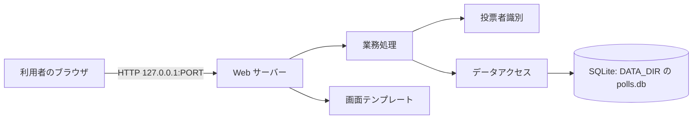
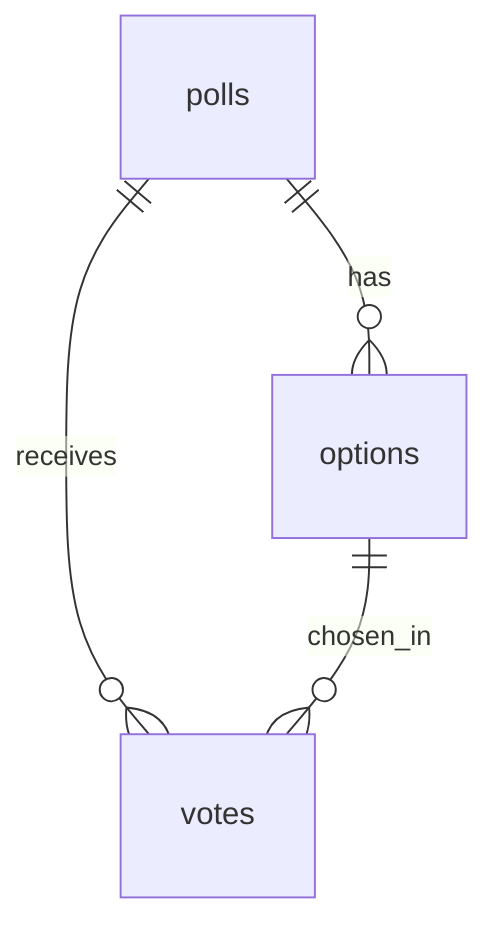
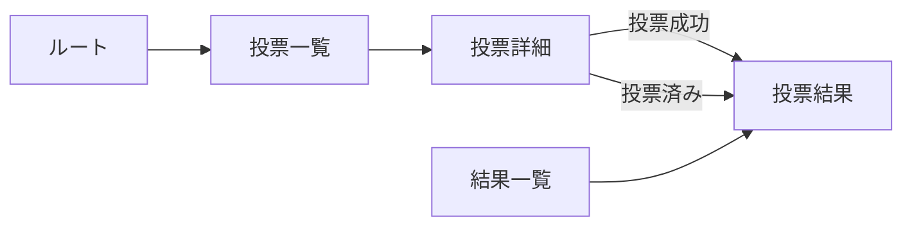
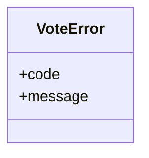

# 詳細設計書: 投票サイト（Polls Website）

## 1. 言語・フレームワーク・アーキテクチャの選定

### 1-1. 判定の記録

- 判定日時: 2026-11-05
- 技術制約の要約: 既存コード無し。ローカルで `bash run.sh` により起動する。無償のものだけ。Python 3.12 か Node.js 24。画面は英語。利用者は少数（要件定義書 1-1）。
- 判断軸ごとの該当有無:

| 判断軸 | 該当 | 理由 |
|---|---|---|
| 既存資産との整合 | 無し | 新規開発 |
| チームの技術 | Python 3.12 か Node.js 24 | 契約で両方が許されている。推奨は Python（最も単純に組める） |
| 配備先 | ローカル PC、OS 非依存 | `bash run.sh` で起動できる実行環境 |
| 認証と認可の境界 | 無し | 認証は無い（要件 `RQ-NF-ANONYMOUS-USE`） |
| 画面の規模 | 小（画面 4 種。投票フォームとナビゲーションのみ） | サーバー側テンプレートで十分 |
| データの規模と構造 | 小（投票テーマ 3 件、選択肢、票）。参照は 3 段 | ファイルベースの DB ではなく RDB 相当（SQLite）。集計はテーマごとの GROUP BY |
| 外部連携 | 無し | - |
| ライセンスとコスト | 無償 | 候補はすべて OSS |
| 保守性 | 保守中の版を選ぶ | 下の比較表の出典で確認 |

- 候補の比較表（出典は PyPI の公式メタデータ。確認日 2026-11-05）:

| 候補 | 判断軸ごとの評価 | 出典 URL | 確認日 |
|---|---|---|---|
| Python 3.12 + Flask 3.1.3 + sqlite3（標準ライブラリ） | 最新版 3.1.3。`requires_python >=3.9` で 3.12 に対応。テンプレート（Jinja2）同梱。SQLite は標準ライブラリで依存が増えない | https://pypi.org/pypi/Flask/json（Documentation: https://flask.palletsprojects.com/） | 2026-11-05 |
| Python 3.12 + FastAPI + Jinja2 + sqlite3 | 利用できるが、画面が 4 種だけの小規模では非同期と型定義の利点が使われず、依存が増える | 未調査（不採用の理由は規模との不一致の判断による） | - |
| Node.js 24 + Express + better-sqlite3 | 利用できるが、SQLite の拡張にネイティブビルドが要り、環境差で導入が失敗しやすい（一般論の判断） | 未調査（不採用の理由は導入の不確実性の判断による） | - |

- 最終選定結果: 言語 Python 3.12、フレームワーク Flask 3.1.3、DB SQLite（標準ライブラリ `sqlite3`）、実行形態はローカルの Web サーバー（Flask の開発サーバーを 127.0.0.1 で動かす。コンテナは使わない）。
- 選定理由: 技術制約（無償、ローカル起動、画面 4 種、少数の利用者）に対し、最小の依存で画面と DB を組める。
- ユーザー承認の記録: ANSWERS.md「技術選定: 推奨の案でよい（Python のフレームワーク ＋ SQLite が最も単純）」により承認済み（2026-11-05）。インターネット調査は WebSearch の利用が許可されなかったため、PyPI の公式メタデータ（上表の URL）で確認した。

### 1-2. 構成の要点

- 利用者が使う画面はサーバー側で HTML を組み立てて返す（フロントエンドとバックエンドの分離は無い）。CSS は 1 ファイル。
- 認証境界は無い。

## 2. システム構成

### 2-1. コンポーネント一覧

| コンポーネント | 役割 | 実現するファイル |
|---|---|---|
| Web サーバー（Flask） | HTTP の受付、ルーティング、HTML 描画 | `src/server.py`、`src/web.py` |
| 業務処理 | 投票テーマの参照、投票の保存と重複判定、集計 | `src/polls.py` |
| 投票者識別 | 投票用 Cookie の発行と読み取り | `src/voter.py` |
| データアクセス | SQLite 接続、テーブル作成 | `src/db.py` |
| 初期データ | サンプル投入 | `src/sample_data.py` |
| 画面テンプレート・CSS | 画面の見た目（light yellow の背景、dark slate gray の部品） | `src/templates/*.html`、`src/static/style.css`（対応表の対象外） |

### 2-2. システム全体構成図



### 2-3. インターフェース・データフロー

- ブラウザ → Web サーバー: GET と POST（フォーム）。Cookie `voter_token` を往復させる
- Web サーバー → 業務処理: 接続オブジェクトと引数を渡す関数呼び出し
- 業務処理 → SQLite: SQL（パラメータ付き）

ネットワーク越しの通信は利用者のブラウザとの HTTP のみ（ローカル）。ネットワーク構成図は、ブラウザと同一マシン上の通信のため書かない（ネットワーク越しの通信は要件上も無い）。

## 3. データ設計

### 3-1. データモデル

DB を使う（理由: 投票は起動をまたいで残り、重複判定と集計が必要。要件 `RQ-DT-POLL-STORAGE`）。DB 製品は SQLite（1-1 の選定）。保存先は `DATA_DIR/polls.db`。

| テーブル | カラム | 型 | 制約 | 要件の項目との対応 |
|---|---|---|---|---|
| `polls` | id | INTEGER | PRIMARY KEY（自動採番） | 投票テーマ.id |
| `polls` | title | TEXT | NOT NULL、1〜120 文字（アプリ側で検査） | 投票テーマ.title |
| `polls` | description | TEXT | NULL 可、0〜500 文字（アプリ側で検査） | 投票テーマ.description |
| `options` | id | INTEGER | PRIMARY KEY（自動採番） | 選択肢.id |
| `options` | poll_id | INTEGER | NOT NULL、FOREIGN KEY → polls.id | 選択肢.poll_id |
| `options` | text | TEXT | NOT NULL、1〜100 文字（アプリ側で検査） | 選択肢.text |
| `options` | position | INTEGER | NOT NULL、0 以上。UNIQUE(poll_id, position) | 選択肢.position |
| `votes` | id | INTEGER | PRIMARY KEY（自動採番） | 投票.id |
| `votes` | poll_id | INTEGER | NOT NULL、FOREIGN KEY → polls.id | 投票.poll_id |
| `votes` | option_id | INTEGER | NOT NULL、FOREIGN KEY → options.id | 投票.option_id |
| `votes` | voter_token | TEXT | NOT NULL、英数字 32 文字。UNIQUE(poll_id, voter_token) | 投票.voter_token |
| `votes` | created_at | TEXT | NOT NULL（UTC の `YYYY-MM-DD HH:MM:SS`） | 投票.created_at |

リレーション図:



テーブルごとの ID: `DS-SC-POLL-TABLE`（polls）、`DS-SC-OPTION-TABLE`（options）、`DS-SC-VOTE-TABLE`（votes）。

### 3-2. トランザクションと排他制御

- 投票（`DS-FN-CAST-VOTE`）: 1 トランザクションで「選択肢が同じ投票テーマに属するかの確認」「INSERT」を行う。重複は UNIQUE(poll_id, voter_token) で判定し、同時に 2 件来た場合も DB が 1 件を拒否する。拒否された側は「already voted」として扱う。ロールバック条件: 検査に失敗したとき、または INSERT が一意制約違反のとき（何も保存しない）。
- 排他制御の方式: 楽観的（一意制約に頼る）。理由: 投票は 1 利用者 1 件の追記だけで、更新の競合が無いため。
- 結果の集計（`DS-FN-GET-RESULTS`）は読み取りだけで、トランザクションは要らない。

### 3-3. 状態遷移

状態を持つエンティティは無い。

## 4. アーキテクチャ設計

### 4-1. 外部設計

#### 利用者向けインターフェース（GUI）

画面一覧（すべて英語表示。上部にナビゲーション「Polls」「Results」を表示）:

| DS-ID | 画面 | パス | 要素と機能 |
|---|---|---|---|
| `DS-IF-ROOT-REDIRECT` | ルート | `/` | 転送のみ（`/polls` へ 302）。画面は持たない |
| `DS-IF-POLL-LIST-SCREEN` | 投票一覧 | `GET /polls` | 見出し「Polls」。投票テーマごとにタイトル（リンク）、説明、選択肢の数、合計票数。0 件のときは「No polls yet.」 |
| `DS-IF-POLL-VOTE-SCREEN` | 投票詳細・投票フォーム | `GET /polls/<id>` | タイトル、説明、選択肢のラジオボタン、「Vote」ボタン。投票済みのときは、選択肢と Vote を disabled（無効）で表示し、「You have already voted in this poll.」と結果へのリンクを表示する。投票の受付で失敗したときは、同じ画面にエラー文（赤字）を表示する。存在しない ID は 404 |
| `DS-IF-CAST-VOTE-ACTION` | 投票の受付 | `POST /polls/<id>/vote` | フォーム項目 `option_id`。成功で結果画面へ 303 転送。失敗は投票詳細を同じ画面で再表示（エラー文を赤字で表示） |
| `DS-IF-POLL-RESULTS-SCREEN` | 投票結果 | `GET /polls/<id>/results` | タイトル、選択肢ごとの票数、割合（小数第 1 位の%）、棒グラフ（dark slate gray の横棒）、合計票数。票が 0 件のときは「No votes yet」と表示し、割合は 0.0% |
| `DS-IF-RESULTS-LIST-SCREEN` | 結果一覧 | `GET /results` | 投票テーマごとにタイトル（リンク）と合計票数。0 件のときは「No polls yet.」 |
| `DS-IF-COLOR-THEME` | 全画面（共通の配色） | （全画面） | 背景は `#FFFFE0`（light yellow）。ナビゲーション、見出し、カード、ボタン、表の見出し、棒グラフの棒と枠、フィールドセットの枠は `#2F4F4F`（dark slate gray）。カードとナビゲーションの文字は `#FFFFE0`。白（`#ffffff`）と navy（`#000080`）は使わない。エラー文の赤（`#8b0000`）だけは例外。`src/static/style.css` と `src/templates/base.html` が実現する |

画面遷移図:



画面の見た目（`DS-IF-COLOR-THEME`）: 背景は light yellow（#FFFFE0）。部品（ナビゲーション帯、見出し、カード、ボタン、表の見出し、棒グラフ、枠）は dark slate gray（#2F4F4F）。白（#ffffff）と navy（#000080）は使わない。HTML テンプレートと CSS は対応表の対象外（ファイルには DS-MD を付けない）。

#### インターフェース仕様（入力・バリデーション・出力・エラー）

| DS-ID | 入力とバリデーション | 出力 | エラー仕様 |
|---|---|---|---|
| `DS-IF-POLL-LIST-SCREEN` | 入力なし | 投票一覧の HTML（200） | 例外なし |
| `DS-IF-POLL-VOTE-SCREEN` | パス `id` は整数。存在しなければ 404。投票用 Cookie が無い、または形式が不正なら未投票として扱う | 投票詳細の HTML（200）。投票済みなら選択肢と Vote を disabled にし、「You have already voted in this poll.」を表示する | 存在しない ID は 404 |
| `DS-IF-COLOR-THEME` | 入力なし | CSS（`/static/style.css`）と HTML の配色 | 例外なし |
| `DS-IF-CAST-VOTE-ACTION` | パス `id` は整数（404 の検査）。フォーム `option_id` は未指定または空なら「未選択」（`RQ-FT-VALIDATE-VOTE`）。整数化できない、または同じ投票テーマの選択肢でないなら「不正」（同） | 成功: 303 → `/polls/<id>/results`、Cookie `voter_token` を設定（未発行のときのみ） | 未選択: 400 で詳細を再表示「Please select an option before voting.」。不正: 400「The selected option is not valid for this poll.」。投票済み: 409 で詳細を再表示「You have already voted in this poll.」（票は変えない） |
| `DS-IF-POLL-RESULTS-SCREEN` | パス `id` は整数。存在しなければ 404 | 結果の HTML（200） | 存在しない ID は 404 |
| `DS-IF-RESULTS-LIST-SCREEN` | 入力なし | 結果一覧の HTML（200） | 例外なし |
| `DS-IF-ROOT-REDIRECT` | 入力なし | 302 → `/polls` | 例外なし |

業務ルールとの対応: `RQ-FT-ONE-VOTE-PER-POLL` は `DS-FN-HAS-VOTED` と `DS-FN-CAST-VOTE` の一意制約で判定し、`DS-IF-CAST-VOTE-ACTION` の 409 で返す。`RQ-FT-VALIDATE-VOTE` は `DS-FN-CAST-VOTE` が `DS-CL-VOTE-ERROR` の code（`not_selected`・`invalid_option`）で返し、`DS-IF-CAST-VOTE-ACTION` が 400 で表示する。

`RQ-FT-LOCK-VOTE-CONTROLS` は `DS-IF-POLL-VOTE-SCREEN` が `DS-FN-HAS-VOTED` で投票済みを判定し、選択肢と Vote を disabled で表示する。二重投票の拒否（`RQ-FT-ONE-VOTE-PER-POLL`）は `DS-IF-CAST-VOTE-ACTION` の 409 と `DS-FN-CAST-VOTE` の一意制約による仕組みのまま。

外部システム連携: 無し。外部 DB 連携: 無し。帳票・出力ファイル: 無し。

### 4-2. 内部設計

#### 投票の処理フロー（`DS-IF-CAST-VOTE-ACTION`）

1. パスの投票テーマを取得する。無ければ 404。
2. Cookie `voter_token` を読む（`DS-FN-GET-VOTER-TOKEN`）。無ければ新しく発行する（`DS-FN-ISSUE-VOTER-TOKEN`）。発行したときは応答に Cookie を付ける（有効期間 1 年、HttpOnly、SameSite=Lax）。
3. `DS-FN-CAST-VOTE` を呼ぶ。
   - 選択肢が未指定 → `not_selected`
   - 選択肢が整数でない、または同じ投票テーマに無い → `invalid_option`
   - 同じ投票テーマに同じ `voter_token` の投票がある（一意制約違反を含む） → `already_voted`
   - それ以外は投票を INSERT して成功
4. 成功なら 303 で結果へ。`VoteError` の code に応じて 400 または 409 で投票詳細を再表示する。 再表示のときは `DS-FN-HAS-VOTED` で投票済みかを判定し直し、投票済みなら選択肢と Vote を disabled にする（`DS-IF-POLL-VOTE-SCREEN`）。

#### 投票テーマの詳細画面の処理（`DS-IF-POLL-VOTE-SCREEN`）

1. パスの投票テーマを取得する。無ければ 404。
2. Cookie の投票者識別子を読む（`DS-FN-GET-VOTER-TOKEN`）。識別子が無ければ未投票とみなす。
3. `DS-FN-HAS-VOTED` で、その投票テーマに投票済みかを判定する。
4. 投票済みなら、選択肢のラジオボタンと Vote ボタンに disabled を付け、「You have already voted in this poll.」を表示する。未投票なら操作を出す。

#### 集計（`DS-FN-GET-RESULTS`）

投票テーマの選択肢を position の順に取り、各選択肢の票数を GROUP BY で数える。合計は票数の和。割合は `票数 ÷ 合計 × 100` を小数第 1 位に丸めた値。合計が 0 のときは 0.0。

#### 初期化（`DS-FN-CREATE-APP`）

1. `DATA_DIR` を作る（無ければ）。
2. `DS-FN-INIT-DB` でテーブルを作る（無ければ。既にあれば何もしない）。
3. `DS-OP-SAMPLE-DATA` で投票テーマが 0 件のときだけサンプルを入れる。

### 4-3. 外部システム連携

無し。

## 5. クラス設計

本設計は関数中心で、クラスは例外の型 1 つだけ持つ。

| クラス | 責務（1 文） | 所属ファイル |
|---|---|---|
| `VoteError` | 投票の検査に失敗したことを、理由の code と共に呼び出し元へ伝える | `src/polls.py`（`DS-CL-VOTE-ERROR`） |

- 依存の向き: `web.py` → `polls.py`、`voter.py`、`db.py`、`sample_data.py`（画面が業務処理を呼ぶ）。`server.py` → `web.py`、`db.py`、`sample_data.py`。`sample_data.py` → `db.py`（テーブル作成のあと投入するため。ただし投入は `DS-OP-SAMPLE-DATA` の関数だけ）。`polls.py` → `db.py` は使わず、接続を引数で受ける。
- クラス図:



- システム内メッセージ: 無し（同期の関数呼び出しだけ）。

## 6. エラーハンドリングとセキュリティ設計

### 6-1. エラーハンドリング

| 想定エラー | 利用者への見え方 | ログ | 続行か中止か |
|---|---|---|---|
| 存在しない投票テーマの ID | 404 の標準ページ | なし | 中止（応答のみ） |
| 未選択で投票 | 同じ画面に赤字のエラー文（400） | なし | 中止（投票しない） |
| 不正な選択肢で投票 | 同じ画面に赤字のエラー文（400） | なし | 中止（投票しない） |
| 投票済みでの再投票 | 同じ画面に投票済みの表示（選択肢と Vote の無効化と案内文）。結果へのリンク（409） | なし | 中止（投票しない） |
| DATA_DIR が作れない、DB を開けない | 起動時にエラーで終了 | 標準エラー出力 | 起動を中止 |

### 6-2. 認証

認証は無い。

### 6-3. 認可

認可は無い（ロールも無い）。

### 6-4. 監査ログ

監査ログは無い（要件の運用要件に無いため）。

### 6-5. その他のセキュリティ対策

- 入力はテンプレートの自動エスケープで HTML として解釈させない（Jinja2 の既定の自動エスケープを使う）。
- 投票は POST だけで受け付ける（GET の投票は無い）。
- SQL はパラメータ化して書く（文字列連結をしない）。
- Cookie は HttpOnly、SameSite=Lax、有効期間 1 年。Secure は付けない（ローカルの http のため）。

## 7. コード設計

### 7-1. ディレクトリ構成

```
setup.sh
run.sh
requirements.txt
src/
  server.py
  db.py
  polls.py
  voter.py
  sample_data.py
  web.py
  templates/
  static/
tests/
e2e/
```

### 7-2. ファイル一覧

| ファイル | 役割 | 含まれるクラス・関数 | 実現する設計 ID |
|---|---|---|---|
| `src/server.py` | 実行の入口。アプリを作って起動する | `create_app`、`main` | `DS-MD-SERVER`、`DS-FN-CREATE-APP`、`DS-OP-START-SERVER` |
| `src/db.py` | SQLite の接続とテーブル作成（テーブル定義は SQL 文字列として持つ） | `get_db`、`init_db` | `DS-MD-DB`、`DS-FN-GET-DB`、`DS-FN-INIT-DB`（`DS-SC-*` のテーブル定義は SQL のため対応表に載せない） |
| `src/polls.py` | 投票テーマの参照、投票、集計 | `VoteError`、`list_polls`、`get_poll`、`has_voted`、`cast_vote`、`get_results`、`list_poll_summaries` | `DS-MD-POLLS`、`DS-CL-VOTE-ERROR`、`DS-FN-LIST-POLLS`、`DS-FN-GET-POLL`、`DS-FN-HAS-VOTED`、`DS-FN-CAST-VOTE`、`DS-FN-GET-RESULTS`、`DS-FN-LIST-POLL-SUMMARIES` |
| `src/voter.py` | 投票用 Cookie の読み書き | `get_voter_token`、`issue_voter_token` | `DS-MD-VOTER`、`DS-FN-GET-VOTER-TOKEN`、`DS-FN-ISSUE-VOTER-TOKEN` |
| `src/sample_data.py` | サンプル投票テーマの投入 | `seed_sample_data` | `DS-MD-SAMPLE-DATA`、`DS-OP-SAMPLE-DATA` |
| `src/web.py` | HTTP の画面と投票の受付 | `root_redirect`、`poll_list_page`、`poll_detail_page`、`cast_vote_action`、`poll_results_page`、`results_list_page` | `DS-MD-WEB`、`DS-IF-ROOT-REDIRECT`、`DS-IF-POLL-LIST-SCREEN`、`DS-IF-POLL-VOTE-SCREEN`、`DS-IF-CAST-VOTE-ACTION`、`DS-IF-POLL-RESULTS-SCREEN`、`DS-IF-RESULTS-LIST-SCREEN` |

- 対応表の粒度: `function`（理由: 関数が少なく、公開関数まで追える。既定）。
- 対応表の対象外（DS-MD を付けない）: `setup.sh`、`run.sh`、`requirements.txt`、`src/templates/*.html`、`src/static/style.css`。起動スクリプトは `DS-OP-SETUP-ENV`、画面の見た目は `DS-IF-*` の説明に含める。
- 依存の規則: 無い（依存の規則は無い。単一のアプリ内のモジュール間の依存だけで、外部連携は無い）。
- コードには要件 ID・設計 ID を書かない。設計 ID とコードの対応は `docs/trace_map.md` で管理する。
- コーディング規約: PEP 8、関数の docstring は処理・引数・戻り値だけ。SQL はパラメータ化。

### 7-3. 運用スクリプトの設計

- `setup.sh`（`DS-OP-SETUP-ENV`）: `.venv` を作り（Python 3.12 があればそれ、無ければ `python3`）、`requirements.txt` を入れる。何度実行しても同じ状態になる。
- `run.sh`（`DS-OP-SETUP-ENV`）: `.venv` の Python で `src/server.py` を起動する。`PORT`（既定 8000）と `DATA_DIR`（既定はプロジェクト直下の `data`）を環境変数から読む。前面で動き続ける。

## 8. テスト設計

### 8-1. テストの種類と方針

- 単体テスト・結合テスト（`tests/`）: `polls.py`、`voter.py`、`db.py`、`sample_data.py` の関数を、一時的な SQLite で直接確かめる。`web.py` は Flask のテストクライアントで各ルートを確かめる。対応表には載せない（テストファイルは `DS-TS` の行だけで載せる）。
- E2E テスト（`e2e/`）: 実際のサーバーを `src/server.py` として別プロセスで起動し、HTTP で要件 `RQ-TS-*` の利用シナリオを確かめる。ブラウザ自動化は使わない（ANSWERS.md の許可による）。

単体・結合テストの実行コマンド: `.venv/bin/python -m unittest discover -s tests -v`

非機能要件の検証: `RQ-NF-ANONYMOUS-USE` は `DS-FN-GET-VOTER-TOKEN` と `DS-FN-ISSUE-VOTER-TOKEN` の実装で実現し、E2E の `DS-TS-CAST-VOTE-E2E` が認証無しの投票で確かめる。

### 8-2. E2E テストのシナリオ

| DS-ID | 目的 | 前提条件 | 手順 | 期待結果 |
|---|---|---|---|---|
| `DS-TS-BROWSE-POLLS-E2E` | 一覧から詳細まで閲覧できる（`RQ-TS-BROWSE-POLLS-FLOW`） | 空の DATA_DIR で起動（サンプルが入る） | `/` → `/polls` → 1 件目の詳細 | 一覧に 3 件、詳細に問いと 3 件以上の選択肢 |
| `DS-TS-CAST-VOTE-E2E` | 投票し、結果に反映される（`RQ-TS-CAST-VOTE-FLOW`） | 未投票のテーマ | 選択肢を選んで POST → 結果画面 | 票数が 1 増え、割合が再計算されている |
| `DS-TS-ONE-VOTE-RULE-E2E` | 同じ Cookie で 2 回目は投票できない（`RQ-TS-ONE-VOTE-RULE`） | 直前の投票と同じ Cookie | 同じテーマへ別の選択肢を POST | 409、案内文、票数は変わらない |
| `DS-TS-VALIDATE-VOTE-E2E` | 未選択・不正な選択肢は保存されない（`RQ-TS-VALIDATE-VOTE`） | 別の Cookie（未投票） | 未選択で POST、他テーマの選択肢 ID で POST | 400 と各エラー文、票数は変わらない |
| `DS-TS-VIEW-RESULTS-E2E` | 結果の票数と割合が見える（`RQ-TS-VIEW-RESULTS`） | 初期データ | 結果画面を開く | 選択肢ごとの票数、割合（小数第 1 位）、合計。0 件のテーマは「No votes yet」 |
| `DS-TS-RESULTS-LIST-E2E` | 結果一覧から結果へ進める（`RQ-TS-RESULTS-LIST`） | 初期データ | `/results` → 1 件のリンク | 3 件の合計票数、リンク先が結果画面 |
| `DS-TS-NAVIGATION-E2E` | ナビゲーションで行き来できる（`RQ-TS-NAVIGATION`） | 初期データ | `/` → Results → Polls | 各画面にナビゲーション、`/` が `/polls` へ転送 |
| `DS-TS-VERIFY-VOTE-LOCK-E2E` | 投票済みの投票テーマで操作が無効になり、直接の 2 回目の投票を数えない（`RQ-TS-VERIFY-VOTE-LOCK`） | 同じ Cookie で未投票のテーマに 1 票投じた後 | 同じテーマの詳細を開く → 選択肢と Vote の disabled と案内文を確かめる → 同じテーマへ別の選択肢を POST | 選択肢と Vote に disabled、「You have already voted in this poll.」、POST は 409、票数は変わらない |
| `DS-TS-VERIFY-COLOR-THEME-E2E` | 全画面の配色が依頼の指定どおり（`RQ-TS-VERIFY-COLOR-THEME`） | 初期データ | `/polls`、`/polls/1`、`/polls/1/results`、`/results` を開き、読み込む CSS の配色を確かめる | CSS に `#FFFFE0` と `#2F4F4F` があり、`#ffffff` と `#000080` が無い |

### 8-3. E2E の実行手段

ローカルの HTTP クライアント（Python 標準ライブラリ `urllib` と `http.cookiejar`）で、実サーバーに対して確かめる。承認: ANSWERS.md（E2E の実行手段はローカルで直接実行）。

### 8-4. E2E の実行コマンドと運用

- 実行コマンド: `.venv/bin/python scripts/isdd/unittest_junit.py -s e2e -o e2e/results/e2e.xml`（JUnit XML を `e2e/results/` に出す。標準ライブラリだけの実行器）
- テスト資産は `e2e/` の下（`e2e/test_polls_e2e.py`）。`DS-TS-*` は `e2e/test_polls_e2e.py::test_*` の関数に結ぶ。
- E2E は起動時に空の一時 DATA_DIR と空きポートを使う（既存のデータを変えない）。
- 外部連携は無いので mock モードは無い。
- テストが失敗したら修正と再実行を繰り返し、全件通過まで続ける。

## 9. 運用設計

- 起動方式: ローカルの Python 実行（コンテナは使わない）。
- 初期化: 起動時に DATA_DIR を作り、テーブルを作り、テーマが 0 件ならサンプルを入れる（`DS-FN-CREATE-APP`、`DS-OP-SAMPLE-DATA`）。認証は無いため初期ユーザーは無い。
- 設定値・環境変数:

| 名前 | 用途 | 既定値 | 必須か |
|---|---|---|---|
| `PORT` | HTTP の待ち受けポート（127.0.0.1） | 8000 | 任意 |
| `DATA_DIR` | SQLite ファイルの置き場所（`polls.db`） | プロジェクト直下の `data` | 任意 |

- 起動方法と操作説明を `README.md` に書く。
- バックアップ: 不要（要件どおり）。データ移行: 無し。可用性: 要求無し。

### 9-1. 起動の設計

- `DS-OP-START-SERVER`: `src/server.py` の `main` が `PORT` と `DATA_DIR` を読み、`create_app` で初期化してから 127.0.0.1 で待ち受ける。Ctrl+C で終了する。
- `DS-OP-SETUP-ENV`: `setup.sh` と `run.sh`（7-3 参照）。

## 10. ログ・監視・アラート・障害対応設計

- ログの設計は必須ではないため、ログの種類と内容の記述は行わない（要件の運用要件に従い、ログは不要）。
- 監視・アラートの設計は必須ではないため、監視・アラートの内容と対応方法の記述は行わない。
- 障害対応: 利用者が障害に気づいたときは、ターミナルの標準エラー出力に表示されるエラーを確かめ、`run.sh` を再起動する。DATA_DIR の `polls.db` は消さなければ残る。

## 11. 要件と設計の対応表

| DS-ID | 対応要件ID |
|---|---|
| `DS-MD-SERVER` | `RQ-UI-POLL-LIST-SCREEN` |
| `DS-MD-DB` | `RQ-DT-POLL-STORAGE` |
| `DS-MD-POLLS` | `RQ-FT-LIST-POLLS`、`RQ-FT-VIEW-POLL-OPTIONS`、`RQ-FT-CAST-VOTE`、`RQ-FT-VIEW-RESULTS` |
| `DS-MD-VOTER` | `RQ-NF-ANONYMOUS-USE` |
| `DS-MD-SAMPLE-DATA` | `RQ-OP-SAMPLE-DATA` |
| `DS-MD-WEB` | `RQ-UI-POLL-LIST-SCREEN`、`RQ-UI-POLL-DETAIL-SCREEN`、`RQ-UI-POLL-RESULTS-SCREEN`、`RQ-UI-RESULTS-LIST-SCREEN` |
| `DS-FN-CREATE-APP` | `RQ-OP-SAMPLE-DATA`、`RQ-OP-START-LOCAL` |
| `DS-OP-START-SERVER` | `RQ-OP-START-LOCAL` |
| `DS-OP-SETUP-ENV` | `RQ-OP-START-LOCAL` |
| `DS-FN-GET-DB` | `RQ-DT-POLL-STORAGE` |
| `DS-FN-INIT-DB` | `RQ-DT-POLL-STORAGE` |
| `DS-SC-POLL-TABLE` | `RQ-DT-POLL-ENTITY`、`RQ-DT-POLL-STORAGE` |
| `DS-SC-OPTION-TABLE` | `RQ-DT-OPTION-ENTITY`、`RQ-DT-POLL-STORAGE` |
| `DS-SC-VOTE-TABLE` | `RQ-DT-VOTE-ENTITY`、`RQ-DT-POLL-STORAGE` |
| `DS-FN-LIST-POLLS` | `RQ-FT-LIST-POLLS` |
| `DS-FN-GET-POLL` | `RQ-FT-VIEW-POLL-OPTIONS` |
| `DS-FN-HAS-VOTED` | `RQ-FT-ONE-VOTE-PER-POLL` |
| `DS-FN-CAST-VOTE` | `RQ-FT-CAST-VOTE`、`RQ-FT-ONE-VOTE-PER-POLL`、`RQ-FT-VALIDATE-VOTE` |
| `DS-CL-VOTE-ERROR` | `RQ-FT-VALIDATE-VOTE`、`RQ-FT-ONE-VOTE-PER-POLL` |
| `DS-FN-GET-RESULTS` | `RQ-FT-VIEW-RESULTS` |
| `DS-FN-LIST-POLL-SUMMARIES` | `RQ-UI-RESULTS-LIST-SCREEN` |
| `DS-FN-GET-VOTER-TOKEN` | `RQ-NF-ANONYMOUS-USE` |
| `DS-FN-ISSUE-VOTER-TOKEN` | `RQ-NF-ANONYMOUS-USE` |
| `DS-OP-SAMPLE-DATA` | `RQ-OP-SAMPLE-DATA` |
| `DS-IF-ROOT-REDIRECT` | `RQ-UI-POLL-LIST-SCREEN`、`RQ-OP-START-LOCAL` |
| `DS-IF-POLL-LIST-SCREEN` | `RQ-UI-POLL-LIST-SCREEN`、`RQ-FT-LIST-POLLS` |
| `DS-IF-POLL-VOTE-SCREEN` | `RQ-UI-POLL-DETAIL-SCREEN`、`RQ-FT-VIEW-POLL-OPTIONS`、`RQ-FT-LOCK-VOTE-CONTROLS` |
| `DS-IF-COLOR-THEME` | `RQ-UI-COLOR-THEME` |
| `DS-TS-VERIFY-VOTE-LOCK-E2E` | `RQ-TS-VERIFY-VOTE-LOCK` |
| `DS-TS-VERIFY-COLOR-THEME-E2E` | `RQ-TS-VERIFY-COLOR-THEME` |
| `DS-IF-CAST-VOTE-ACTION` | `RQ-FT-CAST-VOTE`、`RQ-FT-ONE-VOTE-PER-POLL`、`RQ-FT-VALIDATE-VOTE` |
| `DS-IF-POLL-RESULTS-SCREEN` | `RQ-UI-POLL-RESULTS-SCREEN`、`RQ-FT-VIEW-RESULTS` |
| `DS-IF-RESULTS-LIST-SCREEN` | `RQ-UI-RESULTS-LIST-SCREEN` |
| `DS-TS-BROWSE-POLLS-E2E` | `RQ-TS-BROWSE-POLLS-FLOW` |
| `DS-TS-CAST-VOTE-E2E` | `RQ-TS-CAST-VOTE-FLOW` |
| `DS-TS-ONE-VOTE-RULE-E2E` | `RQ-TS-ONE-VOTE-RULE` |
| `DS-TS-VALIDATE-VOTE-E2E` | `RQ-TS-VALIDATE-VOTE` |
| `DS-TS-VIEW-RESULTS-E2E` | `RQ-TS-VIEW-RESULTS` |
| `DS-TS-RESULTS-LIST-E2E` | `RQ-TS-RESULTS-LIST` |
| `DS-TS-NAVIGATION-E2E` | `RQ-TS-NAVIGATION` |

### 11-1. 除外要件

除外要件は無い。
