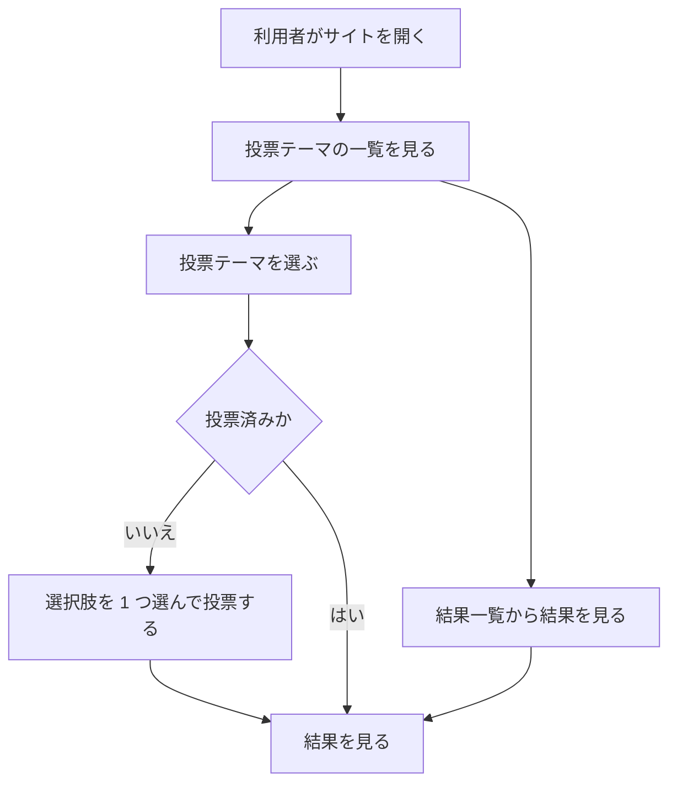
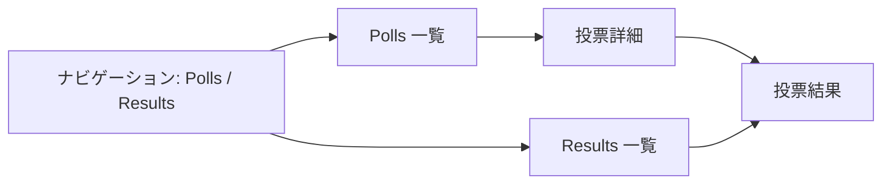

# 要件定義書: 投票サイト（Polls Website）

## 1. 目的・前提

### 目的

利用者が投票テーマ（poll）の選択肢を閲覧し、1 つの選択肢に投票し、投票結果を確認できる Web サイトを提供する。

### 用語集

| 用語 | 業務上の意味 | 本案件での使用範囲 | 同義語/類義語 |
|---|---|---|---|
| 投票テーマ | 利用者に問いかける 1 つの質問と、その選択肢の集まり | 投票の単位。サンプルとして 3 件を初期データに含む | 投票、poll |
| 選択肢 | 投票テーマの中で利用者が選ぶ回答 | 投票テーマごとに 2 件以上 | オプション、option |
| 投票 | 利用者が 1 つの選択肢を選んで送信した 1 票 | 同じブラウザは同じ投票テーマに 1 票だけ | 票、vote |
| 結果 | 投票テーマごとの選択肢別の票数と割合 | 投票後の結果画面と結果一覧で表示 | 集計、結果表示 |

### システムの形態

GUI（ブラウザで操作する Web 画面）。

### 1-1. 技術制約（前提として記録する。要件ではないため ID は付与しない）

| 制約項目 | 内容 | 出どころ（誰がいつ答えたか） |
|---|---|---|
| 既存コードベース | 無し（新規開発） | ANSWERS.md（2026-11-05） |
| 配備先 | 利用者の PC のローカルで `bash run.sh` により起動し、`http://127.0.0.1:$PORT` で提供する。コンテナは使わない | contract.md |
| チームの技術 | Python 3.12 か Node.js 24 のどちらか。推奨は Python（フレームワーク ＋ SQLite） | ANSWERS.md（技術選定は推奨の案でよい） |
| ライセンスとコスト | 無償のライブラリだけを使う。外部サービス・有償 API は使わない | contract.md |
| 性能と規模の目安 | 利用者は少数。性能の目標値は無い | ANSWERS.md |

### 1-2. 依頼に無く自分で決めた項目（必須）

| 項目 | 決めた内容 | 根拠（最小案か、依頼のどこから推測したか） | 承認（承認済 / 未確認） |
|---|---|---|---|
| 投票の重複制御 | 同じブラウザ（同じ投票用の Cookie）は同じ投票テーマに 1 票だけ投票できる。2 回目は投票を受け付けず、「already voted」の表示と結果画面への案内を出す | 認証が無いため、投票の公正さを保つ最小の仕組みとして Cookie を使う（REQUEST の「cast votes」に対する最小案） | 未確認 |
| 投票用 Cookie | 名前は `voter_token`、値はランダムな 32 文字の英数字、有効期間は 1 年、HttpOnly | 重複制御に必要な最小の識別子 | 未確認 |
| 未選択・不正な選択での投票 | 選択肢を選ばずに送信した場合、または投票テーマに属さない選択肢 ID が送られた場合は投票を保存せず、同じ画面にエラー文を表示する | 依頼に無い入力の扱い。保存しない最小案 | 未確認 |
| 投票テーマの作成・編集・削除 | 作らない（画面も操作も無い） | 依頼は「投票する」「結果を見る」だけを求めている（依頼に無い画面は足さない） | 未確認 |
| ルート URL | `/` は `/polls` へ転送する | 利用者が最初に開く入口として最小の案 | 未確認 |
| 表示順 | 投票テーマは作成順（ID の昇順）、選択肢は登録順 | 既定の並び順として最小の案 | 未確認 |
| 割合の表示 | 小数第 1 位まで（例: 42.9%）。票が 0 件の投票テーマは「No votes yet」と表示し、割合は 0.0% | 依頼に無い表示の決め事。0 件時の扱いを明示 | 未確認 |
| サンプルデータ | 投票テーマ 3 件（各 3〜4 件の選択肢）と、各テーマに数票のサンプル票。DATA_DIR が空のとき起動時に投入し、既にデータがあるときは投入しない | contract.md（初期データ）に従う最小の内容 | 未確認 |
| 画面の言語 | 英語。日付や数値の表示形式も英語の書式 | contract.md | 承認済（契約） |
| 画面の配色 | 背景は light yellow（#FFFFE0）。ナビゲーション、見出し、カード、ボタン、表の見出し、棒グラフ、枠などの部品は dark slate gray（#2F4F4F）。部品の上の文字は #FFFFE0。白（#ffffff）と navy（#000080）は使わない。エラー文の赤（#8b0000）は例外 | REQUEST.md の指定（変更 1）の色名（light yellow、dark slate gray）を CSS の標準色名の値に対応させた | 承認済（依頼） |
| 投票済みの見せ方 | 同じブラウザで投票済みの投票テーマは、投票フォームを隠さず、選択肢と Vote ボタンを disabled で表示し、「You have already voted in this poll.」と結果へのリンクを出す。無効の部品は不透明度 0.5、カーソルは not-allowed | REQUEST.md の「voting controls are disabled ... instead」。操作が無効だと見て分かるようにする最小案 | 承認済（ANSWERS.md により承認したものとして進める） |

## 2. 業務

### 2-0. 対象業務一覧

| RQ-BZ-ID | 業務名 | 業務の範囲 | 担当者 |
|---|---|---|---|
| `RQ-BZ-POLLING` | 投票 | 投票テーマの閲覧、投票、結果の確認 | 一般の利用者（ログイン無し） |

### 業務フロー



### 2-1. 業務の問題（あるべき姿と現状のギャップ）

| 問題 | 対象業務（RQ-BZ） | あるべき姿 | 現状 | ギャップ（KPI） | 業務影響 |
|---|---|---|---|---|---|
| 利用者の意見を集める仕組みが無く、選択肢ごとの支持の傾向が分からない | `RQ-BZ-POLLING` | 利用者が投票テーマに答え、その結果を誰でも確認できる | 投票の仕組みが無い（既存の仕組みは無いと回答） | 不明（既存の仕組みが無いため、現状の数値を測定できない） | 利用者の意見が集計されず、結果を共有できない |
| 画面の配色が依頼の指定と違い、白背景と navy の部品になっている | `RQ-BZ-POLLING` | 背景が light yellow、部品が dark slate gray | 白背景と navy の部品 | 配色が指定と一致しない（全画面） | 指定の見た目で利用者に提供できない |
| 投票済みの投票テーマで、投票の操作が無効であることが操作の位置に出ない | `RQ-BZ-POLLING` | 投票済みの投票テーマでは、選択肢と Vote が無効表示になり、投票済みと分かる | 投票フォームを隠し、案内文と結果へのリンクだけを表示する | 無効な操作が画面に見えない（KPI は不明。既存の数値が無いため） | 投票済みの利用者が操作の状態を確かめにくい |

### 2-2. 業務課題一覧（必須）

| RQ-BK-ID | 業務課題（取り組むこと） | 解決する問題（2-1） | 解決後の状態（KPI の目標値） | 対象業務（RQ-BZ） |
|---|---|---|---|---|
| `RQ-BK-BROWSE-POLLS` | 利用者が投票テーマと選択肢を一覧と詳細で見られるようにする | 利用者の意見を集める仕組みが無い | 全投票テーマの一覧と、各テーマの選択肢を画面で閲覧できる（目標値は不明: 既存の数値が無いため） | `RQ-BZ-POLLING` |
| `RQ-BK-CAST-VOTES` | 利用者が選択肢を選んで 1 票を投じられるようにする | 利用者の意見を集める仕組みが無い | 利用者が投票テーマごとに 1 票を投じられる（目標値は不明） | `RQ-BZ-POLLING` |
| `RQ-BK-SHOW-RESULTS` | 利用者が投票結果を確認できるようにする | 集計結果を共有できない | 投票テーマごとの票数と割合を、投票後と結果一覧から確認できる（目標値は不明） | `RQ-BZ-POLLING` |
| `RQ-BK-COLOR-THEME` | 全画面を依頼の配色（light yellow と dark slate gray）で統一する | 画面の配色が指定と違う | 全画面が指定の配色で表示される（目標値は依頼の指定どおり） | `RQ-BZ-POLLING` |

### 2-3. 見込み経営効果

見込み経営効果は算定しない（理由: 利用者向けの投票の仕組みで、支出・工数・資金の現状値が無く、効果を数値で見積もる根拠が無いため）。

## 3. 機能要件

### 入力データと出力データ

- 人手入力: 投票（選択肢の選択）。投票テーマの登録は無い
- 外部連携の入力: 無し
- 出力: 画面の表示のみ（帳票・出力ファイルは無い）

### 利用者の利用フロー

```mermaid
flowchart LR
    Root[/ を開く] --> List[投票一覧]
    List --> Detail[投票詳細・投票フォーム]
    Detail -->|投票| Results[投票結果]
    Detail -->|投票済み| Results
    List --> ResultsList[結果一覧]
    ResultsList --> Results
```

### 画面遷移図



### 機能一覧

| RQ-ID | カテゴリ | 機能名 | 対応業務課題ID（RQ-BK-*） | この機能が無いと何が困るか |
|---|---|---|---|---|
| `RQ-FT-LIST-POLLS` | 業務機能 | 投票テーマの一覧を表示する | `RQ-BK-BROWSE-POLLS` | 利用者が投票テーマを選べない |
| `RQ-FT-VIEW-POLL-OPTIONS` | 業務機能 | 投票テーマの詳細と選択肢を表示する | `RQ-BK-BROWSE-POLLS` | 利用者が選択肢を比べて選べない |
| `RQ-FT-CAST-VOTE` | 業務機能 | 選んだ 1 つの選択肢に投票する | `RQ-BK-CAST-VOTES` | 利用者が意見を投じられない |
| `RQ-FT-ONE-VOTE-PER-POLL` | 業務機能 | 同じブラウザは同じ投票テーマに 1 票だけ投票できる | `RQ-BK-CAST-VOTES` | 同じ人が何度も投票でき、結果が偏る |
| `RQ-FT-LOCK-VOTE-CONTROLS` | 業務機能 | 投票済みの投票テーマでは、選択肢と Vote ボタンを無効（disabled）にして表示し、「You have already voted」を表示する | `RQ-BK-CAST-VOTES` | 投票済みの利用者に、操作できない理由が操作の位置で分からない |
| `RQ-FT-VIEW-RESULTS` | 業務機能 | 投票テーマごとの票数と割合を表示する | `RQ-BK-SHOW-RESULTS` | 投票結果を確認できない |
| `RQ-FT-VALIDATE-VOTE` | 業務機能 | 未選択や不正な選択肢の投票を受け付けない | `RQ-BK-CAST-VOTES` | 存在しない選択肢や空の投票が結果に混ざる |

### 3-1. 帳票・出力ファイル

帳票・出力ファイルは無い。

### 3-2. 業務ルール

| RQ-ID | ルール名 | 内容（条件と結果） | 違反時・エラー時の業務上の扱い | 対応業務課題ID（RQ-BK-*） |
|---|---|---|---|---|
| `RQ-FT-ONE-VOTE-PER-POLL` | 投票は 1 投票テーマにつき 1 票 | 投票用 Cookie が既にその投票テーマに投票済みなら、新しい投票を保存しない | 「You have already voted in this poll.」を表示し、結果画面への案内を出す。票数は変わらない | `RQ-BK-CAST-VOTES` |
| `RQ-FT-LOCK-VOTE-CONTROLS` | 投票済みの投票テーマの表示 | 投票用 Cookie がその投票テーマに投票済み（`RQ-FT-ONE-VOTE-PER-POLL` の判定）なら、詳細画面の選択肢と Vote を disabled で表示する。投票の受付で投票済みと判定された場合も同じ表示にする | 「You have already voted in this poll.」を表示し、結果画面への案内を出す。票数は変わらない | `RQ-BK-CAST-VOTES` |
| `RQ-FT-VALIDATE-VOTE` | 投票する選択肢は、その投票テーマに属する選択肢だけ | 選択肢が未選択、または選択肢 ID が存在しない、または別の投票テーマの選択肢のときは投票を保存しない | 「Please select an option before voting.」（未選択）または「The selected option is not valid for this poll.」（不正）を同じ画面に表示する。票数は変わらない | `RQ-BK-CAST-VOTES` |

### 3-3. 外部連携

外部連携は無い。

## 4. データ

### 4-1. データ要件一覧

| RQ-ID | 種別 | 内容 | 対応業務課題ID（RQ-BK-*） | この要件が無いと何が困るか |
|---|---|---|---|---|
| `RQ-DT-POLL-STORAGE` | 内部データ | 投票テーマ、選択肢、投票は内部データとして SQLite の 1 ファイルに保存する。保存先は環境変数 DATA_DIR の下。保持期間は無期限（削除の要件は無い） | `RQ-BK-BROWSE-POLLS`、`RQ-BK-CAST-VOTES`、`RQ-BK-SHOW-RESULTS` | 投票と結果が再起動のたびに消え、結果を確認できない |

DB が必要な理由: 投票は起動をまたいで残り、同じ投票テーマへの重複投票を判定し、票数を集計する必要があるため。初期件数はサンプル 3 件の投票テーマと数票。1 年後の想定件数は利用者が少数のため 1,000 件未満（想定）。年間増加率は不明（想定の範囲内で増える）。参照関係は投票テーマ → 選択肢 → 投票の 3 段。検索・集計は投票テーマごとの票数集計のみ。

### 4-2. 業務エンティティとデータ項目

| RQ-ID | カテゴリ | 業務エンティティ名 | 対応業務課題ID（RQ-BK-*） | この業務エンティティが無いと何が困るか |
|---|---|---|---|---|
| `RQ-DT-POLL-ENTITY` | 業務データ | 投票テーマ（Poll） | `RQ-BK-BROWSE-POLLS` | 投票の単位が無く、選択肢を束ねられない |
| `RQ-DT-OPTION-ENTITY` | 業務データ | 選択肢（Option） | `RQ-BK-BROWSE-POLLS` | 利用者が選ぶ回答が無い |
| `RQ-DT-VOTE-ENTITY` | 業務データ | 投票（Vote） | `RQ-BK-CAST-VOTES`、`RQ-BK-SHOW-RESULTS` | 投票を記録できず、結果を集計できない |

| エンティティ名 | 項目名 | 業務上の意味 | 必須 | 形式・桁 | 値の範囲・制約 | 例 |
|---|---|---|---|---|---|---|
| 投票テーマ（Poll） | id | 投票テーマの識別子 | 必須 | 整数（自動採番） | 一意 | 1 |
| 投票テーマ（Poll） | title | 投票テーマの問い | 必須 | 文字列 | 1〜120 文字 | Which programming language do you prefer? |
| 投票テーマ（Poll） | description | 補足説明 | 任意 | 文字列 | 0〜500 文字 | Choose one option. |
| 選択肢（Option） | id | 選択肢の識別子 | 必須 | 整数（自動採番） | 一意 | 3 |
| 選択肢（Option） | poll_id | 所属する投票テーマ | 必須 | 整数 | 投票テーマの id を参照 | 1 |
| 選択肢（Option） | text | 選択肢の文言 | 必須 | 文字列 | 1〜100 文字 | Python |
| 選択肢（Option） | position | 表示順 | 必須 | 整数 | 0 以上。同じ投票テーマ内で一意 | 0 |
| 投票（Vote） | id | 投票の識別子 | 必須 | 整数（自動採番） | 一意 | 10 |
| 投票（Vote） | poll_id | 投票先の投票テーマ | 必須 | 整数 | 投票テーマの id を参照 | 1 |
| 投票（Vote） | option_id | 選んだ選択肢 | 必須 | 整数 | 同じ投票テーマの選択肢 id であること | 3 |
| 投票（Vote） | voter_token | 投票者の識別子（投票用 Cookie の値） | 必須 | 英数字 32 文字 | 同じ投票テーマで重複しないこと | Ab12... |
| 投票（Vote） | created_at | 投票日時 | 必須 | 日時（UTC） | 投票時に自動設定 | 2026-11-05 10:00:00 |

### 4-3. CRUD テーブル（必須）

| エンティティ名 | Create | Read（一覧） | Read（詳細） | 検索 | Update | Delete | 備考 |
|---|---|---|---|---|---|---|---|
| 投票テーマ（Poll） | × | ○ | ○ | × | × | × | 作成・編集・削除の画面は無い。作成はサンプルデータの投入のみ |
| 選択肢（Option） | × | × | ○ | × | × | × | 投票テーマの詳細画面で読む。単独の一覧は無い |
| 投票（Vote） | ○ | × | × | × | × | × | 投票は 1 件ずつ保存する。同じ投票テーマへの重複判定と保存は 1 つのトランザクションで行う（3-2 の業務ルール）。投票の一覧・詳細画面は無い。票数は投票テーマごとの集計で読む（結果画面） |

### 4-4. 状態遷移

状態を持つエンティティは無い。

### 4-5. 画面一覧（GUI）

| RQ-ID | 画面名 | 対応する CRUD 操作（エンティティ名:操作種別） | 主な機能・目的 | 対応業務課題ID（RQ-BK-*） |
|---|---|---|---|---|
| `RQ-UI-POLL-LIST-SCREEN` | 投票一覧 | 投票テーマ:Read（一覧） | 投票テーマの一覧を表示し、選ぶ入口になる（`/polls`） | `RQ-BK-BROWSE-POLLS` |
| `RQ-UI-POLL-DETAIL-SCREEN` | 投票詳細・投票フォーム | 投票テーマ:Read（詳細）、選択肢:Read、投票:Create | 投票テーマの選択肢を表示し、1 つを選んで投票する（`/polls/<id>`） | `RQ-BK-BROWSE-POLLS`、`RQ-BK-CAST-VOTES` |
| `RQ-UI-POLL-RESULTS-SCREEN` | 投票結果 | 投票:Read（集計）、投票テーマ:Read（詳細） | 投票テーマの選択肢別の票数と割合を表示する（`/polls/<id>/results`） | `RQ-BK-SHOW-RESULTS` |
| `RQ-UI-RESULTS-LIST-SCREEN` | 結果一覧 | 投票テーマ:Read（一覧）、投票:Read（集計） | 全投票テーマの合計票数を一覧し、各結果へ進む（`/results`） | `RQ-BK-SHOW-RESULTS` |
| `RQ-UI-COLOR-THEME` | 全画面（共通の配色） | なし（表示のみ） | 全画面の配色。背景は light yellow（`#FFFFE0`）、ナビゲーション、見出し、カード、ボタン、表の見出し、棒グラフ、枠は dark slate gray（`#2F4F4F`）。白と navy を使わない | `RQ-BK-COLOR-THEME` |

画面共通: 上部に dark slate gray の帯のナビゲーションを置き、その文字は #FFFFE0（背景は light yellow）。「Polls」（投票一覧）と「Results」（結果一覧）を常に表示する。ナビゲーションの見出しは英語。配色は `RQ-UI-COLOR-THEME` に従う。

## 5. 非機能要件

| RQ-ID | カテゴリ | 非機能要件名 | 対応業務課題ID（RQ-BK-*） | この非機能要件が無いと何が困るか |
|---|---|---|---|---|
| `RQ-NF-ANONYMOUS-USE` | 利用者とアクセス経路 | 利用者は認証無しで利用でき、利用者の区別は投票用 Cookie による投票の重複判定だけに使う。アクセスは `127.0.0.1` 上のサーバー。利用者種別は一般利用者、利用人数は少数 | `RQ-BK-CAST-VOTES` | 投票の重複を判定できない。利用者の識別が過剰になる |

- 性能（応答時間の目標値）: 要求は無い（性能の目標は定めない）
- 利用人数（同時接続数）: 少数。同時接続の上限は要求しない
- 可用性: 可用性の要求は無い
- 移行性: 移行は無い
- セキュリティ: 認証は無い。権限制御は無い（ロールは無い）。監査証跡の要求は無い。投票の入力は HTML として解釈させず、投票は POST だけで受け付ける

## 6. 運用要件

| RQ-ID | 種別 | 内容 | 対応業務課題ID（RQ-BK-*） | この要件が無いと何が困るか |
|---|---|---|---|---|
| `RQ-OP-START-LOCAL` | 起動 | `bash setup.sh` で依存を入れ、`PORT=任意 bash run.sh` で起動する。`PORT` の既定値は 8000、`DATA_DIR` の既定値はプロジェクト直下の `data`。`run.sh` は前面で動き続ける | `RQ-BK-BROWSE-POLLS` | 利用者が起動できず、採点や確認ができない |
| `RQ-OP-SAMPLE-DATA` | 初期化 | 起動時に DATA_DIR のデータベースが無い、または投票テーマが 1 件も無いときは、サンプルの投票テーマ 3 件と数票を投入する。既にデータがあるときは何もしない | `RQ-BK-BROWSE-POLLS` | 空の状態では何も試せない |

- ログ: ログは必要ないため、ログの内容と保存期間の記述は行わない
- 監査ログ: 不要
- 監視・アラート: 監視・アラートは必要ないため、監視・アラートの内容と対応方法の記述は行わない
- バックアップと復旧: バックアップは必要ない

## 7. テスト用利用シナリオ

| RQ-ID | テスト目的 | 前提条件 | テスト手順 | 期待される結果 | 検証する要件ID | 対応業務課題ID（RQ-BK-*） |
|---|---|---|---|---|---|---|
| `RQ-TS-BROWSE-POLLS-FLOW` | 投票一覧から投票詳細まで閲覧できる | 初期データが投入されている（`RQ-OP-SAMPLE-DATA`） | `/` を開く → 投票一覧（Polls）に 3 件の投票テーマが表示されることを確認 → 1 件を選んで詳細を開く | 投票一覧に 3 件のテーマがあり、詳細に問いと 3 件以上の選択肢が表示される | `RQ-FT-LIST-POLLS`、`RQ-FT-VIEW-POLL-OPTIONS`、`RQ-UI-POLL-LIST-SCREEN`、`RQ-UI-POLL-DETAIL-SCREEN`、`RQ-OP-SAMPLE-DATA` | `RQ-BK-BROWSE-POLLS` |
| `RQ-TS-CAST-VOTE-FLOW` | 選択肢を選んで投票し、結果画面に票が反映される | 未投票の投票テーマがある | 投票詳細で選択肢を 1 つ選ぶ → Vote を押す → 結果画面を確認 | 結果画面の選んだ選択肢の票数が 1 増え、割合が再計算されている | `RQ-FT-CAST-VOTE`、`RQ-UI-POLL-DETAIL-SCREEN`、`RQ-UI-POLL-RESULTS-SCREEN` | `RQ-BK-CAST-VOTES` |
| `RQ-TS-ONE-VOTE-RULE` | 同じブラウザで同じ投票テーマに 2 回目の投票ができない | `RQ-TS-CAST-VOTE-FLOW` の後で同じブラウザを使う | 同じ投票テーマの詳細を開く → 別の選択肢を選んで Vote を押す | 「You have already voted in this poll.」が表示され、票数は変わらない | `RQ-FT-ONE-VOTE-PER-POLL` | `RQ-BK-CAST-VOTES` |
| `RQ-TS-VALIDATE-VOTE` | 未選択で投票すると保存されず、エラーが出る | 未投票の投票テーマがある（別のブラウザ） | 選択肢を選ばず Vote を押す | 「Please select an option before voting.」が表示され、票数は変わらない | `RQ-FT-VALIDATE-VOTE` | `RQ-BK-CAST-VOTES` |
| `RQ-TS-VIEW-RESULTS` | 結果画面で選択肢別の票数と割合が見える | 初期データに票がある | 投票テーマの結果画面（Results）を開く | 選択肢ごとの票数と割合（小数第 1 位）、合計票数が表示される。票が 0 件のテーマは「No votes yet」 | `RQ-FT-VIEW-RESULTS`、`RQ-UI-POLL-RESULTS-SCREEN` | `RQ-BK-SHOW-RESULTS` |
| `RQ-TS-RESULTS-LIST` | 結果一覧から各テーマの結果へ進める | 初期データがある | ナビゲーションの Results を開く → 1 件の結果リンクを選ぶ | 結果一覧に 3 件の合計票数が表示され、リンク先が投票結果画面になる | `RQ-UI-RESULTS-LIST-SCREEN` | `RQ-BK-SHOW-RESULTS` |
| `RQ-TS-NAVIGATION` | ナビゲーションから主要な画面を行き来できる | 初期データがある | `/` を開く → Results → Polls の順にナビゲーションで移動 | 各画面にナビゲーションが表示され、`/` は `/polls` に転送される | `RQ-UI-POLL-LIST-SCREEN`、`RQ-UI-RESULTS-LIST-SCREEN`、`RQ-OP-START-LOCAL` | `RQ-BK-BROWSE-POLLS` |
| `RQ-TS-VERIFY-VOTE-LOCK` | 投票済みの投票テーマで操作が無効になり、直接送られた 2 回目の投票を数えない | 同じブラウザで未投票の投票テーマに 1 票を投じた後 | その投票テーマの詳細を開く → 選択肢と Vote が無効で、「You have already voted in this poll.」が出ることを確認 → 同じ投票テーマへ別の選択肢を POST | 選択肢と Vote が disabled で表示され、POST は 409 で返り、票数は変わらない | `RQ-FT-LOCK-VOTE-CONTROLS`、`RQ-FT-ONE-VOTE-PER-POLL`、`RQ-UI-POLL-DETAIL-SCREEN` | `RQ-BK-CAST-VOTES` |
| `RQ-TS-VERIFY-COLOR-THEME` | 全画面の配色が依頼の指定どおりである | 初期データがある | `/polls`、`/polls/1`、`/polls/1/results`、`/results` を開き、画面が読み込む CSS の配色を確かめる | CSS に背景の `#FFFFE0` と部品の `#2F4F4F` があり、白（`#ffffff`）と navy（`#000080`）が無い | `RQ-UI-COLOR-THEME` | `RQ-BK-COLOR-THEME` |

- 業務ルール（3-2）: `RQ-TS-ONE-VOTE-RULE` と `RQ-TS-VALIDATE-VOTE` で違反時の扱いを確かめる
- 権限制御・監査ログ・同時更新・状態遷移: 該当なし（無い）
