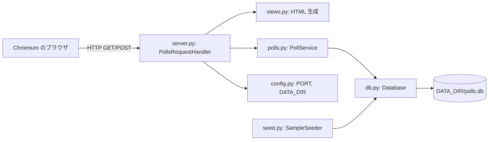
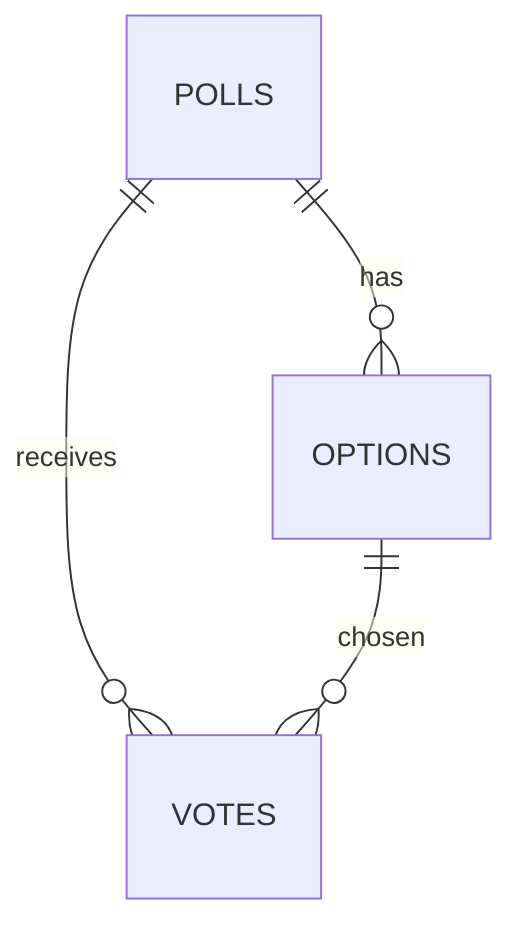
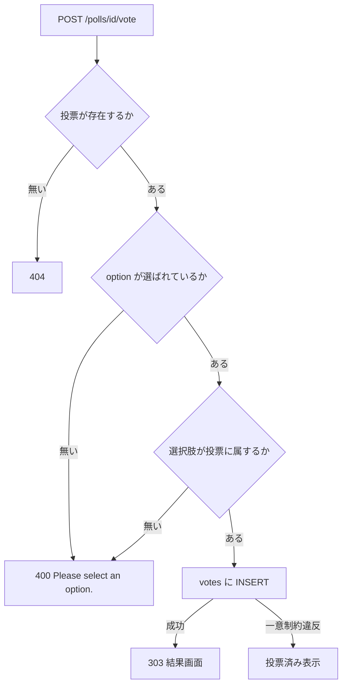
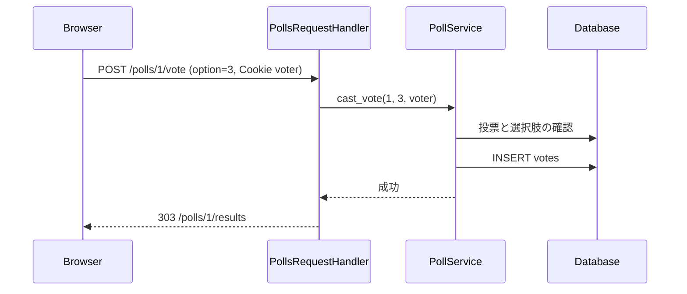

# 詳細設計書: 投票サイト（Polls Website）

- 作成日: 2026-11-05
- 入力: `docs/requirements.md`（要件定義書）
- 承認: 未確認（依頼者が「任せる」と回答。最小案で決定し、下表の未確認項目を記録する）

## 1. 言語・フレームワーク・アーキテクチャの選定

### 1-0. 選定の根拠と調査の状況

- 技術制約（要件定義書 1-1）: 既存コード無し、ローカル実行、Python 3.12 と Node.js 24 が使える、無料のライブラリのみ、利用者は数人、データは数十件以下。
- 判断軸: 既存資産（無し）、チームの技術（特に無し）、配備先（ローカルの Python）、画面の規模（画面 4 種と共通メニュー、状態を持たない）、データの規模（数十件、単純な参照、集計は票の数え上げのみ）、外部連携（無し）、ライセンスとコスト（無料のみ）、保守性（標準ライブラリは保守の心配が無い）。
- 候補の比較

  | 判断軸 | 候補 A: Python 標準ライブラリ（http.server + sqlite3 + サーバー側 HTML） | 候補 B: Python + Flask + SQLite | 候補 C: Node.js + Express + SQLite（better-sqlite3 等） |
  |---|---|---|---|
  | 依存の少なさ | ◎ 追加パッケージ不要 | ○ 1 パッケージ | △ 複数パッケージ |
  | 起動の確実さ | ◎ `python3` だけで動く | ○ | ○ |
  | 画面の規模 | ○ 画面 4 種で足りる | ◎ | ◎ |
  | 出典・確認 | 未調査（依頼者が「任せる」と回答したため、外部情報の確認は行っていない） | 未調査 | 未調査 |

- 最終選定結果
  - 言語: Python 3.12（`python3`）
  - フレームワーク: 無し（標準ライブラリの `http.server.ThreadingHTTPServer` と `BaseHTTPRequestHandler`）
  - DB: SQLite（標準ライブラリの `sqlite3`）、ファイルは `DATA_DIR/polls.db`
  - 実行形態: サーバー（ローカルで 1 プロセス。`127.0.0.1` で待ち受け）
  - 選定理由: 要件の規模に対して最小の構成で、契約（Python 3.12、無料のみ、DATA_DIR）を満たし、起動の失敗要因が最も少ない。
  - 未確認の記録: 候補 B・C と標準ライブラリの保守状況・ライセンスは調査していない。標準ライブラリはこの用途の範囲で問題になりにくいが、承認時に確認する。
- ユーザー承認: 未確認。

### 1-1. 構成の方式

- フロントエンドとバックエンドを分けない。サーバーが HTML を返す 1 プロセス構成。
- 画面の部品は CSS（`views.py` 内の文字列）で指定する。JavaScript は使わない。

## 2. システム構成

- システム全体構成図



- ネットワーク構成図: ブラウザと同じ PC の `127.0.0.1:$PORT` の通信だけ。外部への通信は無い。

| コンポーネント | 役割と機能 |
|---|---|
| server.py | HTTP の受け口。経路を振り分け、結果を HTML にして返す。投票 POST を受けて PollService に渡す。Cookie の投票者識別子を発行する |
| views.py | 画面の HTML と CSS を作る（共通メニュー、各画面）。データは受け取るだけで DB を触らない |
| polls.py | 投票の業務処理（一覧、詳細、投票の検証と記録、結果の集計） |
| db.py | SQLite の接続、スキーマ作成、問い合わせの実行 |
| seed.py | DB が空のときサンプルデータを入れる |
| config.py | 環境変数 `PORT`・`DATA_DIR` を読む |

## 3. データ設計

### 3-1. データモデル

DB を使う（SQLite）。理由: 投票の一意制約と集計が必要で、ファイルの直接編集より安全なため。

- `DS-SC-POLL-TABLE`: `polls`（id INTEGER PRIMARY KEY、title TEXT NOT NULL CHECK(length 1〜200)、description TEXT NOT NULL DEFAULT ''、created_at TEXT NOT NULL）
- `DS-SC-OPTION-TABLE`: `options`（id INTEGER PRIMARY KEY、poll_id INTEGER NOT NULL REFERENCES polls(id)、label TEXT NOT NULL（1〜100 文字）、position INTEGER NOT NULL）
- `DS-SC-VOTE-TABLE`: `votes`（id INTEGER PRIMARY KEY、poll_id INTEGER NOT NULL REFERENCES polls(id)、option_id INTEGER NOT NULL REFERENCES options(id)、voter_token TEXT NOT NULL、created_at TEXT NOT NULL、UNIQUE(poll_id, voter_token)）
- `DS-SC-DATABASE-FILE`: DB ファイル `DATA_DIR/polls.db`。`DATA_DIR` が無ければ作る。スキーマは起動時に `CREATE TABLE IF NOT EXISTS` で作る。

リレーション図



### 3-2. トランザクションと排他制御

- 投票の記録（`votes` への INSERT）は 1 文で行い、一意制約 `UNIQUE(poll_id, voter_token)` で同時の二重投票を防ぐ。制約違反は「既に投票済み」として扱う。
- 排他制御の方式: DB 制約による楽観的な扱い（同時送信は 1 件だけ成功）。
- 選択肢が投票に属するかの確認と INSERT は同じ接続のトランザクションで行う。

### 3-3. 状態遷移

状態を持つエンティティは無い。

## 4. アーキテクチャ設計

### 4-1. 外部設計

利用者向けインターフェース（HTTP の画面）

| DS-ID | 画面・経路 | 目的 | 入力 | 出力 | エラー仕様 |
|---|---|---|---|---|---|
| DS-IF-ROOT-REDIRECT | GET / | 投票一覧へ転送 | なし | 302 → /polls | なし |
| DS-IF-POLL-LIST-SCREEN | GET /polls | 投票一覧（RQ-UI-POLL-LIST-SCREEN） | なし | HTML（投票カードの一覧）。0 件は「No polls yet.」 | DB 障害は 500 画面「Something went wrong.」 |
| DS-IF-POLL-VOTE-SCREEN | GET /polls/{id} | 投票画面（RQ-UI-POLL-VOTE-SCREEN） | パス id（整数） | HTML（質問、説明、選択肢のラジオボタン、Submit vote） | 存在しない id は 404「Poll not found.」。投票済みかどうかは GET では表示せず、投票を送ったときに判定する |
| DS-IF-POLL-VOTE-SUBMIT | POST /polls/{id}/vote | 投票の記録 | フォーム項目 `option`（選択肢の id） | 成功時は 303 → /polls/{id}/results。未選択または選択肢不正は同じ投票画面を 400 で再表示し「Please select an option.」。投票済みは同じ投票画面を 200 で表示し「You have already voted in this poll.」と結果へのリンク | 選択肢が投票に属さない場合は 400「Please select an option.」。存在しない投票は 404 |
| DS-IF-POLL-RESULTS-SCREEN | GET /polls/{id}/results | 投票結果（RQ-UI-POLL-RESULTS-SCREEN） | パス id | HTML（質問、選択肢ごとの票数と割合の棒、合計）。票 0 件は「No votes yet.」と割合 0% | 存在しない id は 404 |
| DS-IF-RESULTS-LIST-SCREEN | GET /results | 結果一覧（RQ-UI-RESULTS-LIST-SCREEN） | なし | HTML（投票ごとの質問と合計票数、View results リンク）。0 件は「No polls yet.」 | DB 障害は 500 |

- 共通メニュー（DS-MD-VIEWS の共通部品）: 上部に「Polls」（/polls）と「Results」（/results）。全画面に出す。
- 投票者識別子: 初めてのアクセス（投票画面、投票の POST）で Cookie `voter` を発行する（英数字 32 文字、`secrets.token_hex(16)`、HttpOnly、Path=/）。

画面遷移図

```mermaid
graph LR
    R[/] --> L[/polls]
    L --> V[/polls/id]
    V -->|POST vote| RS[/polls/id/results]
    V -->|投票済み| RS
    RL[/results] --> RS
```

外部システム連携: 無し。

### 4-2. 内部設計

処理フロー（投票の POST）



- 処理の役割
  - PollService.list_polls: 投票の一覧（選択肢数を含む）
  - PollService.get_poll: 投票 1 件と選択肢
  - PollService.cast_vote: 上の検証と INSERT を行い、結果（成功 / 未選択 / 選択肢不正 / 投票済み）を返す
  - PollService.get_results: 選択肢ごとの票数と割合、合計
  - PollService.list_results: 投票の一覧と合計票数
- バッチ: 無し。

## 5. クラス設計

| クラス | 責務（1 文） | 主要メソッド | 所在 |
|---|---|---|---|
| PollService | 投票の一覧・詳細・投票の記録・結果の集計という業務処理を行う | list_polls, get_poll, cast_vote, get_results, list_results | polls.py |
| Database | SQLite の接続とスキーマを管理する | connect, ensure_schema, execute, query | db.py |
| SampleSeeder | 投票が 0 件のときサンプルデータを入れる | seed_if_empty | seed.py |
| PollsHTTPServer | 127.0.0.1 のポートで待ち受け、PollService を保持する | serve_forever（継承） | server.py |
| PollsRequestHandler | HTTP の経路を振り分けて、サービスの結果を HTML と応答にする | do_GET, do_POST | server.py |

- クラス間のメッセージ: PollsRequestHandler → PollService → Database。SampleSeeder → Database。views.py の関数は HTML 文字列を返すだけで、他の業務クラスを呼ばない。
- メッセージフロー図



## 6. エラーハンドリングとセキュリティ設計

- エラーハンドリング
  - 未選択、選択肢不正: 400 と画面上の文言「Please select an option.」。ログは残さない。
  - 存在しない投票: 404 画面「Poll not found.」。
  - 投票済み: 「You have already voted in this poll.」を表示し、結果へのリンクを出す（記録はしない）。
  - 想定外の例外（DB 障害など）: 500 画面「Something went wrong.」。標準エラーに例外を出す。サーバーは動き続ける。
  - DB ファイルが書けない: 起動時に失敗し、標準エラーにメッセージを出して終了する。
- 認証: 無し（要件定義書 5 の決定どおり）。
- 認可: 無し。
- 監査ログ: 要件に無いため作らない。
- その他のセキュリティ対策: 画面に出す値はすべて HTML エスケープする（投票の質問と選択肢の文字列）。待ち受けは `127.0.0.1` のみ。Cookie は HttpOnly。

## 7. コード設計

### 7-1. ディレクトリ構成

```
run.sh
setup.sh
requirements-dev.txt
app/                  （--src の対象。Python のソースだけを置く）
  server.py
  config.py
  db.py
  polls.py
  seed.py
  views.py
e2e/                  （テスト。Playwright + pytest。単体テストを含む）
  conftest.py
  test_site.py          （E2E）
  test_polls_unit.py   （単体テスト）
  results/            （git 管理外。JUnit XML）
```

### 7-2. ファイルごとの役割

| ファイル | 役割 | 含まれるクラス | 実現する設計 ID |
|---|---|---|---|
| app/server.py | HTTP 経路の振り分けと起動 | PollsHTTPServer, PollsRequestHandler | DS-MD-SERVER, DS-CL-HTTP-SERVER, DS-CL-REQUEST-HANDLER, DS-IF-ROOT-REDIRECT, DS-IF-POLL-LIST-SCREEN, DS-IF-POLL-VOTE-SCREEN, DS-IF-POLL-VOTE-SUBMIT, DS-IF-POLL-RESULTS-SCREEN, DS-IF-RESULTS-LIST-SCREEN |
| app/config.py | 環境変数の読み取り | なし（関数） | DS-MD-CONFIG |
| app/db.py | SQLite の接続とスキーマ | Database | DS-MD-DATABASE, DS-CL-DATABASE |
| app/polls.py | 投票の業務処理 | PollService | DS-MD-POLLS, DS-CL-POLL-SERVICE |
| app/seed.py | サンプルデータ | SampleSeeder | DS-MD-SEED, DS-CL-SAMPLE-SEEDER |
| app/views.py | HTML と CSS の生成 | なし（関数） | DS-MD-VIEWS |

HTML テンプレート、CSS は `views.py` の文字列として置く（別ファイルにしない）。`run.sh`・`setup.sh`・`requirements-dev.txt` は対応表の対象外で、運用設計の DS-OP-* で扱う。

- 対応表の粒度: `class`。理由: 薄い CRUD で関数の数が少なく、クラスとファイルまでの対応で十分追えるため。isdd-setup の `--granularity class` に渡す。

### 7-3. 依存の規則

依存の規則は無い（すべて `app/` の中で、外部連携が無いため）。

### 7-4. コーディング規約

- Python 3.12 標準の書き方。型ヒントを関数の引数と戻り値に付ける。
- 画面の文言は英語。
- コードには要件 ID・設計 ID を書かない。コメントは処理の説明だけ。
- 設計 ID とコードの対応は `docs/trace_map.md` に記録する。

## 8. テスト設計

### 8-1. テストの種類と方針

- 単体テスト（DS-TS-UNIT-POLL-SERVICE）: PollService の検証（未選択、選択肢不正、投票済み、結果の割合）を unittest（pytest で実行）で確かめる。テストは `e2e/test_polls_unit.py`。
- 結合テスト: 単体テストが DB を含むため（一時ファイルの DB）、Database と PollService を組み合わせて確かめる。
- 総合テスト・E2E: 下の 8-2 のシナリオを Playwright（Python）と pytest でブラウザ操作として確かめる。
- 単体テストの実行コマンド: `.venv/bin/python -m pytest e2e/test_polls_unit.py`
- 非機能要件の検証: 配色と言語は DS-TS-VISUAL-STYLE-E2E で確かめる。

### 8-2. E2E テストのシナリオ

| DS-ID | 目的 | 前提条件 | 手順 | 期待結果 |
|---|---|---|---|---|
| DS-TS-BROWSE-AND-VOTE-E2E | RQ-TS-BROWSE-AND-VOTE | 起動直後 | `/` → 1 件の Vote → 選択肢を選ぶ → Submit | 結果画面に票が増えている |
| DS-TS-VOTE-WITHOUT-SELECTION-E2E | RQ-TS-VOTE-WITHOUT-SELECTION | 投票画面 | 選ばずに Submit | 「Please select an option.」、票は増えない |
| DS-TS-ONE-VOTE-E2E | RQ-TS-ONE-VOTE-PER-BROWSER | 同じブラウザで投票済み | 同じ投票画面で再投票 | 「You have already voted in this poll.」 |
| DS-TS-RESULTS-LIST-E2E | RQ-TS-RESULTS-LIST | 起動直後 | Results → View results | 一覧と結果画面が出る |
| DS-TS-UNKNOWN-POLL-E2E | RQ-TS-UNKNOWN-POLL | 起動直後 | `/polls/99999` | 「Poll not found.」とメニュー |
| DS-TS-VISUAL-STYLE-E2E | RQ-TS-VISUAL-STYLE | 起動直後 | 各画面の背景色・部品の色・文言 | 背景 #ffffff、部品 #000080、英語 |
| DS-TS-EMPTY-RESULTS-E2E | RQ-TS-EMPTY-POLL-RESULTS | 票 0 件の投票がある | その投票の結果画面 | 「No votes yet.」、0% |
| DS-TS-UNIT-POLL-SERVICE | RQ-FT-VOTE-VALIDATION・RQ-FT-ONE-VOTE-PER-POLL の単体確認 | 一時 DB | cast_vote の各結果 | 成功・未選択・不正・投票済みが正しく返る |

### 8-3. E2E の実行手段

- ブラウザ自動化: Playwright（Python）。バージョンは `requirements-dev.txt` に書く。Chromium を使う。
- 承認: 未確認（依頼者の「任せる」で決定）。
- 外部連携が無いためモードは設けない。

### 8-4. E2E の実行コマンドと運用

- E2E 実行コマンド: `.venv/bin/python -m pytest e2e --junitxml=e2e/results/e2e.xml`（`setup.sh` が作る `.venv` を使う）（テストは `conftest.py` が一時ポートでサーバーを起動し、一時 DATA_DIR を使う）
- 結果の出力先: `e2e/results/e2e.xml`（JUnit XML。git 管理外）
- テストが失敗したら修正と再実行を繰り返し、全件成功まで続ける。

## 9. 運用設計

- 起動方式: サーバー（ローカル）。
  - `DS-OP-SETUP-SCRIPT`: `setup.sh` は Python 3.12 の確認、`DATA_DIR` の作成、開発用の依存（pytest、playwright）と Chromium の導入。依存の導入は 1 回だけ。
  - `DS-OP-RUN-SCRIPT`: `run.sh` は `PORT`（既定 8000）と `DATA_DIR`（既定 `./data`）を読み、`python3 app/server.py` を前面で実行する。停止は Ctrl-C または kill。
- 初期化: 起動時に `DS-SC-DATABASE-FILE` のスキーマを作り、`SampleSeeder` が投票 0 件のときサンプルデータを入れる（DS-CL-SAMPLE-SEEDER）。サンプルは次の 3 件: 「Favorite season?」（4 選択肢）、「Best programming language for beginners?」（3 選択肢、票 0 件）、「Preferred lunch?」（3 選択肢、票あり）。票は各投票に数件（自動で入れる固定値）。
- 設定値・環境変数（DS-OP-ENV-VARS）

  | 名前 | 用途 | 既定値 | 必須か |
  |---|---|---|---|
  | PORT | 待ち受けポート | 8000 | 任意 |
  | DATA_DIR | DB ファイルの置き場所 | ./data | 任意 |

- バックアップと復旧: 不要（要件定義書 6）。
- データ移行: 無し。
- 可用性: 要求なし。
- 起動方法と操作説明は README.md に書く。

## 10. ログ・監視・アラート・障害対応設計

- ログ: 標準出力に起動メッセージ（URL）と HTTP の標準ログのみ。ログの設計は必須ではないため、ログの種類と内容の記述は行わない。
- 監視・アラート: 必須ではないため、内容と対応方法の記述は行わない。
- 障害対応
  - ポートが使用中: 起動に失敗し、標準エラーにメッセージを出す。利用者は `PORT` を変えて再実行する。
  - DB ファイルが開けない: 起動に失敗する。`DATA_DIR` の権限を確かめる。
  - 想定外の例外: 500 画面を返し、標準エラーに出す。サーバーは動き続ける。

## 11. 要件と設計の対応表

| DS-ID | 対応要件ID |
|---|---|
| DS-MD-SERVER | RQ-UI-POLL-LIST-SCREEN, RQ-UI-POLL-VOTE-SCREEN, RQ-UI-POLL-RESULTS-SCREEN, RQ-UI-RESULTS-LIST-SCREEN, RQ-UI-NAVIGATION-MENU, RQ-BK-POLL-PARTICIPATION |
| DS-MD-CONFIG | RQ-OP-START-SCRIPTS, RQ-DT-STORAGE-LOCATION |
| DS-MD-DATABASE | RQ-DT-STORAGE-LOCATION, RQ-DT-POLL-ENTITY, RQ-DT-OPTION-ENTITY, RQ-DT-VOTE-ENTITY |
| DS-MD-POLLS | RQ-FT-BROWSE-POLLS, RQ-FT-VIEW-POLL-OPTIONS, RQ-FT-CAST-VOTE, RQ-FT-VOTE-VALIDATION, RQ-FT-ONE-VOTE-PER-POLL, RQ-FT-VIEW-RESULTS, RQ-FT-BROWSE-RESULTS |
| DS-MD-SEED | RQ-OP-SAMPLE-DATA |
| DS-MD-VIEWS | RQ-UI-NAVIGATION-MENU, RQ-UI-POLL-LIST-SCREEN, RQ-UI-POLL-VOTE-SCREEN, RQ-UI-POLL-RESULTS-SCREEN, RQ-UI-RESULTS-LIST-SCREEN, RQ-NF-VISUAL-STYLE, RQ-NF-ENGLISH-UI, RQ-NF-BROWSER-SUPPORT |
| DS-CL-HTTP-SERVER | RQ-OP-START-SCRIPTS, RQ-BK-POLL-PARTICIPATION |
| DS-CL-REQUEST-HANDLER | RQ-UI-NAVIGATION-MENU, RQ-UI-POLL-VOTE-SCREEN, RQ-FT-CAST-VOTE |
| DS-CL-POLL-SERVICE | RQ-FT-BROWSE-POLLS, RQ-FT-VIEW-POLL-OPTIONS, RQ-FT-CAST-VOTE, RQ-FT-VOTE-VALIDATION, RQ-FT-ONE-VOTE-PER-POLL, RQ-FT-VIEW-RESULTS, RQ-FT-BROWSE-RESULTS |
| DS-CL-DATABASE | RQ-DT-STORAGE-LOCATION, RQ-DT-RETENTION |
| DS-CL-SAMPLE-SEEDER | RQ-OP-SAMPLE-DATA |
| DS-IF-ROOT-REDIRECT | RQ-UI-NAVIGATION-MENU |
| DS-IF-POLL-LIST-SCREEN | RQ-UI-POLL-LIST-SCREEN, RQ-FT-BROWSE-POLLS |
| DS-IF-POLL-VOTE-SCREEN | RQ-UI-POLL-VOTE-SCREEN, RQ-FT-VIEW-POLL-OPTIONS |
| DS-IF-POLL-VOTE-SUBMIT | RQ-UI-POLL-VOTE-SCREEN, RQ-FT-CAST-VOTE, RQ-FT-VOTE-VALIDATION, RQ-FT-ONE-VOTE-PER-POLL |
| DS-IF-POLL-RESULTS-SCREEN | RQ-UI-POLL-RESULTS-SCREEN, RQ-FT-VIEW-RESULTS |
| DS-IF-RESULTS-LIST-SCREEN | RQ-UI-RESULTS-LIST-SCREEN, RQ-FT-BROWSE-RESULTS |
| DS-SC-POLL-TABLE | RQ-DT-POLL-ENTITY |
| DS-SC-OPTION-TABLE | RQ-DT-OPTION-ENTITY |
| DS-SC-VOTE-TABLE | RQ-DT-VOTE-ENTITY, RQ-FT-ONE-VOTE-PER-POLL |
| DS-SC-DATABASE-FILE | RQ-DT-STORAGE-LOCATION, RQ-DT-RETENTION |
| DS-OP-SETUP-SCRIPT | RQ-OP-START-SCRIPTS |
| DS-OP-RUN-SCRIPT | RQ-OP-START-SCRIPTS |
| DS-OP-ENV-VARS | RQ-OP-START-SCRIPTS, RQ-DT-STORAGE-LOCATION |
| DS-TS-BROWSE-AND-VOTE-E2E | RQ-TS-BROWSE-AND-VOTE |
| DS-TS-VOTE-WITHOUT-SELECTION-E2E | RQ-TS-VOTE-WITHOUT-SELECTION |
| DS-TS-ONE-VOTE-E2E | RQ-TS-ONE-VOTE-PER-BROWSER |
| DS-TS-RESULTS-LIST-E2E | RQ-TS-RESULTS-LIST |
| DS-TS-UNKNOWN-POLL-E2E | RQ-TS-UNKNOWN-POLL |
| DS-TS-VISUAL-STYLE-E2E | RQ-TS-VISUAL-STYLE, RQ-NF-VISUAL-STYLE, RQ-NF-ENGLISH-UI |
| DS-TS-EMPTY-RESULTS-E2E | RQ-TS-EMPTY-POLL-RESULTS |
| DS-TS-UNIT-POLL-SERVICE | RQ-FT-VOTE-VALIDATION, RQ-FT-ONE-VOTE-PER-POLL |

### 11-1. 除外要件

除外要件は無い。
