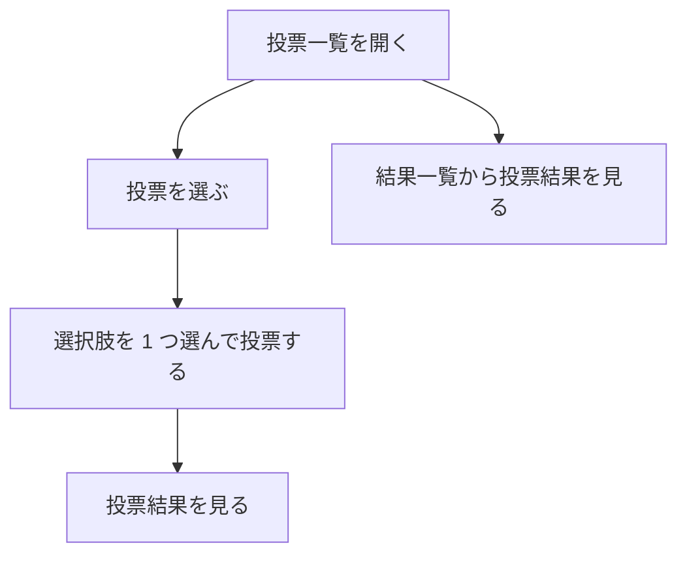

# 要件定義書: 投票サイト（Polls Website）

- 作成日: 2026-11-05
- フロー: 新規
- 出どころ: 依頼 `REQUEST.md`、契約 `contract.md`。業務の問題は依頼者が「分からない」と回答し、最小案（投票の閲覧・投票・結果表示に絞る）で進めることを任された。

## 1. 目的・前提

- システムの目的: 利用者がブラウザで投票の一覧を見て、選択肢に投票し、投票結果を見られるようにする。
- 用語集

  | 用語 | 業務上の意味 | 本案件での使用範囲 | 同義語/類義語 |
  |---|---|---|---|
  | 投票（poll） | 質問と複数の選択肢からなる 1 件の投票 | 画面と DB の投票 1 件 | アンケート |
  | 選択肢（option） | 投票の中で選べる回答 | 投票 1 件あたり 2 件以上 | 回答 |
  | 投票記録（vote） | 1 人が 1 投票で 1 選択肢を選んだ記録 | DB の 1 行 | 票 |
  | 利用者 | 投票に参加し結果を見る人。ログインは無い | 画面の利用者 | ユーザー |

- システムの形態: GUI（ブラウザの画面）

### 1-1. 技術制約（前提として記録する。要件ではないため ID は付与しない）

| 制約項目 | 内容 | 出どころ（誰がいつ答えたか） |
|---|---|---|
| 既存コードベース | 無し（作業ディレクトリに既存コードは無い） | 作業ディレクトリの確認（2026-11-05） |
| 配備先 | 利用者の PC のローカルで `run.sh` により起動し、`http://127.0.0.1:$PORT` で開く | contract.md |
| チームの技術 | 特に無い。実行環境は Python 3.12 と Node.js 24 | contract.md |
| ライセンスとコスト | 無料のライブラリのみ。外部サービスと有償 API は使わない | contract.md |
| 性能と規模の目安 | 利用者は同時に数人程度を想定。データ量は数十件以下 | 依頼者「任せる」により最小案で想定（承認: 未確認） |

## 2. 業務

- 対象業務一覧

  | RQ-BZ-ID | 業務名 | 業務の範囲 | 担当者 |
  |---|---|---|---|
  | RQ-BZ-POLL-VOTING | 投票 | 利用者が投票を見つけ、選んで投票し、結果を見る | 利用者 |

- 業務フロー



### 2-1. 業務の問題（あるべき姿と現状のギャップ）

| 問題 | 対象業務（RQ-BZ） | あるべき姿 | 現状 | ギャップ（KPI） | 業務影響 |
|---|---|---|---|---|---|
| 投票を集める場と結果を見る場が無い | RQ-BZ-POLL-VOTING | 投票を 1 か所で行い、結果をすぐ見られる | 不明（依頼者が分からないと回答） | 不明（数値は作らない） | 不明 |

### 2-2. 業務課題一覧

| RQ-BK-ID | 業務課題（取り組むこと） | 解決する問題（2-1） | 解決後の状態（KPI の目標値） | 対象業務（RQ-BZ） |
|---|---|---|---|---|
| RQ-BK-POLL-PARTICIPATION | 投票を 1 か所で一覧・選択・投票できるようにする | 投票を集める場が無い | 利用者が投票一覧から投票まで迷わず到達できる（目標値は未設定） | RQ-BZ-POLL-VOTING |
| RQ-BK-RESULT-VISIBILITY | 投票結果をすぐ見られるようにする | 結果を見る場が無い | 投票後に結果を見られる（目標値は未設定） | RQ-BZ-POLL-VOTING |

### 2-3. 見込み経営効果

見込み経営効果は算定しない（理由: 現状の数値（件数・工数）が不明で、効果を金額や時間で算定できないため）。

## 3. 機能要件

- 入力データ: 人手入力（投票の選択、投票記録）。外部連携は無い。出力データ: 投票一覧、投票の選択肢、投票結果。
- 全機能の利用フロー: 2 の業務フローと同じ。

### 3-0. 機能一覧

| RQ-ID | カテゴリ | 機能名 | 対応業務課題ID（RQ-BK-*） | この機能が無いと何が困るか |
|---|---|---|---|---|
| RQ-FT-BROWSE-POLLS | 業務機能 | 投票の一覧を見る | RQ-BK-POLL-PARTICIPATION | 投票を探せず、投票に参加できない |
| RQ-FT-VIEW-POLL-OPTIONS | 業務機能 | 投票の質問と選択肢を見る | RQ-BK-POLL-PARTICIPATION | 何に投票するのか分からない |
| RQ-FT-CAST-VOTE | 業務機能 | 選択肢を 1 つ選んで投票する | RQ-BK-POLL-PARTICIPATION | 投票という業務そのものができない |
| RQ-FT-VOTE-VALIDATION | 業務機能 | 選択肢が選ばれていない投票を受け付けない | RQ-BK-POLL-PARTICIPATION | 空の投票が記録されてしまう |
| RQ-FT-ONE-VOTE-PER-POLL | 業務機能 | 1 つの投票には 1 人（ブラウザ）1 回だけ投票できる | RQ-BK-POLL-PARTICIPATION | 同じ人が何度も投票して結果が歪む |
| RQ-FT-VIEW-RESULTS | 業務機能 | 投票の結果（選択肢ごとの票数と割合）を見る | RQ-BK-RESULT-VISIBILITY | 投票の結果が分からない |
| RQ-FT-BROWSE-RESULTS | 業務機能 | 結果を見られる投票の一覧を見る | RQ-BK-RESULT-VISIBILITY | 結果のある投票を探せない |

### 3-1. 帳票・出力ファイル

帳票・出力ファイルは無い。

### 3-2. 業務ルール

業務ルールは 3-0 の機能 RQ-FT-ONE-VOTE-PER-POLL（一人一票。2 回目は記録せず「already voted」を表示）と RQ-FT-VOTE-VALIDATION（未選択は記録しない）に含める。それ以外の業務ルールは無い。

### 3-3. 外部連携

外部連携は無い。

## 4. データ

### 4-1. データ要件一覧

| RQ-ID | 種別 | 内容 | 対応業務課題ID（RQ-BK-*） | この要件が無いと何が困るか |
|---|---|---|---|---|
| RQ-DT-STORAGE-LOCATION | 内部データ | 投票データは環境変数 `DATA_DIR` 配下の SQLite ファイル（`polls.db`）に保存する。`DATA_DIR` が無ければ作る | RQ-BK-POLL-PARTICIPATION | 再起動すると投票が消え、結果が残らない |
| RQ-DT-RETENTION | 内部データ | データ保持期間は定めない（削除機能は無い） | RQ-BK-RESULT-VISIBILITY | 保持期間が分からず、データの扱いを決められない（依頼に無いため無期限として扱う） |

DB 初期件数: 0 件から始め、初回起動時にサンプルデータを入れる（RQ-OP-SAMPLE-DATA）。1 年後の想定件数は数十件以下（承認: 未確認）。

### 4-2. 業務エンティティとデータ項目

| RQ-ID | カテゴリ | 業務エンティティ名 | 対応業務課題ID（RQ-BK-*） | この業務エンティティが無いと何が困るか |
|---|---|---|---|---|
| RQ-DT-POLL-ENTITY | 業務 | 投票（poll） | RQ-BK-POLL-PARTICIPATION | 投票の一覧と質問を表せない |
| RQ-DT-OPTION-ENTITY | 業務 | 選択肢（option） | RQ-BK-POLL-PARTICIPATION | 選べる回答を表せない |
| RQ-DT-VOTE-ENTITY | 業務 | 投票記録（vote） | RQ-BK-RESULT-VISIBILITY | 結果（票数）を集計できない |

| エンティティ名 | 項目名 | 業務上の意味 | 必須 | 形式・桁 | 値の範囲・制約 | 例 |
|---|---|---|---|---|---|---|
| 投票（poll） | id | 投票の識別子 | 必須 | 整数（自動採番） | 1 以上 | 1 |
| 投票（poll） | title | 投票の質問 | 必須 | 文字列 | 1〜200 文字 | Favorite season? |
| 投票（poll） | description | 補足説明 | 任意 | 文字列 | 0〜500 文字 | Pick one. |
| 選択肢（option） | id | 選択肢の識別子 | 必須 | 整数（自動採番） | 1 以上 | 3 |
| 選択肢（option） | poll_id | 所属する投票 | 必須 | 整数 | 投票の id を指す | 1 |
| 選択肢（option） | label | 選択肢の文言 | 必須 | 文字列 | 1〜100 文字 | Spring |
| 選択肢（option） | position | 表示順 | 必須 | 整数 | 1 以上 | 1 |
| 投票記録（vote） | id | 投票記録の識別子 | 必須 | 整数（自動採番） | 1 以上 | 10 |
| 投票記録（vote） | poll_id | 投票 | 必須 | 整数 | 投票の id を指す | 1 |
| 投票記録（vote） | option_id | 選んだ選択肢 | 必須 | 整数 | 同じ投票の選択肢の id | 3 |
| 投票記録（vote） | voter_token | ブラウザを識別する値（Cookie） | 必須 | 文字列（英数字 32 文字） | 同じ投票につき 1 件だけ | 9f8e... |
| 投票記録（vote） | created_at | 投票日時 | 必須 | 日時（ISO 8601、UTC） | — | 2026-11-05T01:00:00Z |

### 4-3. CRUD テーブル

| エンティティ名 | Create | Read（一覧） | Read（詳細） | 検索 | Update | Delete | 備考 |
|---|---|---|---|---|---|---|---|
| 投票（poll） | × | ○ | ○ | × | × | × | 作成はサンプルデータのみ（依頼に無いため作成画面は作らない） |
| 選択肢（option） | × | ○ | ○ | × | × | × | 投票の詳細で表示 |
| 投票記録（vote） | ○ | △ | × | × | × | × | 一覧は表示しない。票数の集計として読む。同時投票は一意制約で 1 件に限る |

### 4-4. 状態遷移

状態を持つエンティティは無い（投票の公開・終了の状態は依頼に無いため作らない）。

### 4-5. 画面一覧

| RQ-ID | 画面名 | 対応する CRUD 操作（エンティティ名:操作種別） | 主な機能・目的 | 対応業務課題ID（RQ-BK-*） |
|---|---|---|---|---|
| RQ-UI-POLL-LIST-SCREEN | 投票一覧画面 | 投票:Read（一覧） | 投票の一覧を見る | RQ-BK-POLL-PARTICIPATION |
| RQ-UI-POLL-VOTE-SCREEN | 投票画面 | 投票:Read（詳細）、選択肢:Read（詳細）、投票記録:Create | 質問と選択肢を見て投票する | RQ-BK-POLL-PARTICIPATION |
| RQ-UI-POLL-RESULTS-SCREEN | 投票結果画面 | 投票記録:Read（集計） | 1 件の投票の結果を見る | RQ-BK-RESULT-VISIBILITY |
| RQ-UI-RESULTS-LIST-SCREEN | 結果一覧画面 | 投票:Read（一覧）、投票記録:Read（集計） | 結果を見られる投票の一覧を見る | RQ-BK-RESULT-VISIBILITY |
| RQ-UI-NAVIGATION-MENU | 共通ナビゲーション | — | 全画面の上部に「Polls」「Results」のメニューを出す | RQ-BK-POLL-PARTICIPATION |

各画面の 5 項目（目的・主要要素・入力項目・表示項目・エラー時の見え方）:

- 投票一覧画面（RQ-UI-POLL-LIST-SCREEN）: 目的は投票を探すこと。主要要素は見出し「Polls」と投票カードの一覧（質問、選択肢数、「Vote」リンク）。入力項目は無い。表示項目は投票の質問と選択肢数。投票が 0 件のときは「No polls yet.」。
- 投票画面（RQ-UI-POLL-VOTE-SCREEN）: 目的は 1 件の投票に参加すること。主要要素は質問、説明、選択肢のラジオボタン、「Submit vote」ボタン。入力項目は選択肢 1 つ。表示項目は質問と説明と選択肢。エラー時は選択なしのとき画面上部に「Please select an option.」を出し、選択を保つ。既に投票済みなら投票せず「You have already voted in this poll.」を出し、結果画面へのリンクを出す。存在しない投票は 404 画面「Poll not found.」。
- 投票結果画面（RQ-UI-POLL-RESULTS-SCREEN）: 目的は 1 件の投票の結果を見ること。表示項目は質問、各選択肢の票数と割合（棒グラフ）、合計票数。投票が 0 件のときは「No votes yet.」と表示し、割合は 0%。存在しない投票は 404 画面。
- 結果一覧画面（RQ-UI-RESULTS-LIST-SCREEN）: 目的は結果のある投票を探すこと。表示項目は投票の質問と合計票数、「View results」リンク。0 件のとき「No polls yet.」。
- 共通ナビゲーション（RQ-UI-NAVIGATION-MENU）: 全画面の上部に「Polls」（投票一覧へ）と「Results」（結果一覧へ）を表示する。ルート URL（`/`）は投票一覧へ転送する。

画面遷移図

```mermaid
graph LR
    H[/ ルート] --> L[投票一覧 Polls]
    L --> V[投票画面 Vote]
    V -->|投票後| R[投票結果画面]
    V -->|投票済み| R
    N[結果一覧 Results] --> R
    L -.ナビゲーション.-> N
```

## 5. 非機能要件

- 利用者の種別: 社内の利用者 1 人〜数人（ローカル実行）。アクセス経路はローカルホストのみ（`127.0.0.1`）。
- 性能: 応答時間の目標値は定めない（依頼に無い。データ量が少ないため特に問題にならない想定）。
- 利用人数: 同時に数人程度（承認: 未確認）。
- 可用性: 可用性の要求は無い。
- 移行性: 移行は無い。
- セキュリティ: 認証は無い（依頼に無く、ログイン機能は作らない）。認可は無い。一人一票はブラウザの Cookie で判定し、本人確認はしない。

| RQ-ID | カテゴリ | 非機能要件名 | 対応業務課題ID（RQ-BK-*） | この非機能要件が無いと何が困るか |
|---|---|---|---|---|
| RQ-NF-VISUAL-STYLE | 画面 | 背景は白、画面部品（ナビゲーション、ボタン、見出し、結果の棒）はネイビー（#000080）で統一する | RQ-BK-POLL-PARTICIPATION | 依頼の配色が満たされず、採点で見た目が要件外になる |
| RQ-NF-ENGLISH-UI | 画面 | 画面の文言はすべて英語 | RQ-BK-POLL-PARTICIPATION | 契約（contract.md）の言語要件を満たせない |
| RQ-NF-BROWSER-SUPPORT | 画面 | Chromium のブラウザで動く（JavaScript は使わなくても動く） | RQ-BK-POLL-PARTICIPATION | 契約の対象ブラウザで使えない |

## 6. 運用要件

| RQ-ID | 種別 | 内容 | 対応業務課題ID（RQ-BK-*） | この要件が無いと何が困るか |
|---|---|---|---|---|
| RQ-OP-START-SCRIPTS | 起動 | `setup.sh` で依存を入れ、`run.sh` で `PORT`（既定 8000）で起動し、フォアグラウンドで動き続ける。`DATA_DIR`（既定 `./data`）を作る | RQ-BK-POLL-PARTICIPATION | 採点者が起動できない |
| RQ-OP-SAMPLE-DATA | 初期データ | `DATA_DIR` が空（投票が 0 件）のとき、サンプルの投票 3 件（各 3〜4 選択肢、票は数件ずつ）を入れる | RQ-BK-POLL-PARTICIPATION | 初めて開いたときに試せる投票が無い |
ログ: 一般的な動作ログ（標準出力の起動メッセージと HTTP の標準ログ）以外は必要ないため、ログの内容と保存期間の記述は行わない。
監視・アラート: 必要ないため、内容と対応方法の記述は行わない。
バックアップ: 必要ない。

## 7. テスト用利用シナリオ

| RQ-ID | テスト目的 | 前提条件 | テスト手順 | 期待される結果 | 検証する要件ID | 対応業務課題ID（RQ-BK-*） |
|---|---|---|---|---|---|---|
| RQ-TS-BROWSE-AND-VOTE | 投票一覧から投票し、結果を見られる | 起動直後（サンプルデータあり） | 1. `/` を開く 2. 投票一覧で 1 件の「Vote」を押す 3. 選択肢を 1 つ選ぶ 4. 「Submit vote」を押す | 結果画面が開き、選んだ選択肢の票が 1 増えている | RQ-FT-BROWSE-POLLS, RQ-FT-VIEW-POLL-OPTIONS, RQ-FT-CAST-VOTE, RQ-FT-VIEW-RESULTS, RQ-UI-POLL-LIST-SCREEN, RQ-UI-POLL-VOTE-SCREEN, RQ-UI-POLL-RESULTS-SCREEN, RQ-UI-NAVIGATION-MENU | RQ-BK-POLL-PARTICIPATION, RQ-BK-RESULT-VISIBILITY |
| RQ-TS-VOTE-WITHOUT-SELECTION | 選択肢を選ばずに投票したときの扱い | 投票画面を開いている | 1. 選択肢を選ばず「Submit vote」を押す | 「Please select an option.」が出て、投票は記録されない | RQ-FT-VOTE-VALIDATION, RQ-UI-POLL-VOTE-SCREEN | RQ-BK-POLL-PARTICIPATION |
| RQ-TS-ONE-VOTE-PER-BROWSER | 同じ投票に 2 回目は投票できない | 同じブラウザで 1 回投票済み | 1. 同じ投票画面を開く 2. 選択肢を選んで「Submit vote」を押す | 「You have already voted in this poll.」が出て、票数は増えない | RQ-FT-ONE-VOTE-PER-POLL, RQ-UI-POLL-VOTE-SCREEN | RQ-BK-POLL-PARTICIPATION |
| RQ-TS-RESULTS-LIST | 結果一覧から結果を見る | 起動直後 | 1. ナビゲーションの「Results」を押す 2. 1 件の「View results」を押す | 結果一覧に投票の質問と合計票数が出て、結果画面に票数と割合が出る | RQ-FT-BROWSE-RESULTS, RQ-UI-RESULTS-LIST-SCREEN, RQ-UI-POLL-RESULTS-SCREEN | RQ-BK-RESULT-VISIBILITY |
| RQ-TS-UNKNOWN-POLL | 存在しない投票を開いたとき | 起動直後 | 1. `/polls/99999` を開く | 404 画面「Poll not found.」が出て、ナビゲーションが使える | RQ-UI-POLL-VOTE-SCREEN, RQ-UI-NAVIGATION-MENU | RQ-BK-POLL-PARTICIPATION |
| RQ-TS-VISUAL-STYLE | 配色と言語 | 起動直後 | 1. 各画面を開く | 背景が白、ナビゲーション・ボタン・見出しがネイビー、文言が英語 | RQ-NF-VISUAL-STYLE, RQ-NF-ENGLISH-UI | RQ-BK-POLL-PARTICIPATION |
| RQ-TS-EMPTY-POLL-RESULTS | 票が 0 件の投票の結果 | サンプルの票が 0 件の投票がある（起動直後の投票 3 件のうち 1 件は票 0） | 1. その投票の結果画面を開く | 「No votes yet.」が出て、割合は 0% | RQ-FT-VIEW-RESULTS, RQ-UI-POLL-RESULTS-SCREEN | RQ-BK-RESULT-VISIBILITY |

## 8. 要件の確認と除外

- 業務課題と要件の対応表

  | RQ-BK-ID | 対応する要件 |
  |---|---|
  | RQ-BK-POLL-PARTICIPATION | RQ-FT-BROWSE-POLLS, RQ-FT-VIEW-POLL-OPTIONS, RQ-FT-CAST-VOTE, RQ-FT-VOTE-VALIDATION, RQ-FT-ONE-VOTE-PER-POLL, RQ-UI-POLL-LIST-SCREEN, RQ-UI-POLL-VOTE-SCREEN, RQ-UI-NAVIGATION-MENU, RQ-NF-VISUAL-STYLE, RQ-NF-ENGLISH-UI, RQ-NF-BROWSER-SUPPORT, RQ-DT-POLL-ENTITY, RQ-DT-OPTION-ENTITY, RQ-DT-STORAGE-LOCATION, RQ-OP-START-SCRIPTS, RQ-OP-SAMPLE-DATA, RQ-TS-BROWSE-AND-VOTE, RQ-TS-VOTE-WITHOUT-SELECTION, RQ-TS-ONE-VOTE-PER-BROWSER, RQ-TS-UNKNOWN-POLL, RQ-TS-VISUAL-STYLE |
  | RQ-BK-RESULT-VISIBILITY | RQ-FT-VIEW-RESULTS, RQ-FT-BROWSE-RESULTS, RQ-UI-POLL-RESULTS-SCREEN, RQ-UI-RESULTS-LIST-SCREEN, RQ-DT-VOTE-ENTITY, RQ-DT-RETENTION, RQ-TS-RESULTS-LIST, RQ-TS-EMPTY-POLL-RESULTS, RQ-TS-BROWSE-AND-VOTE |

- 除外要件: 無し。

## 1-2. 依頼に無く自分で決めた項目

| 項目 | 決めた内容 | 根拠（最小案か、依頼のどこから推測したか） | 承認（承認済 / 未確認） |
|---|---|---|---|
| 投票の作成 | 利用者画面では作らない。投票はサンプルデータだけ | 依頼は閲覧・投票・結果表示。最小案 | 未確認 |
| 投票の終了・公開状態 | 作らない。全投票が常に投票可能 | 依頼に無い。最小案 | 未確認 |
| 一人一票 | 同じブラウザ（Cookie）で同じ投票に 1 回だけ。2 回目は記録せず「already voted」と表示して結果を見せる | 依頼の「cast votes」から、重複投票を防ぐ最小の規則を置いた | 未確認 |
| 選択肢の未選択 | 「Please select an option.」を表示し、投票は記録しない | 空の投票を防ぐ最小の規則 | 未確認 |
| 同時の二重投票 | DB の一意制約（投票 1 件・ブラウザ 1 件）で 1 件に限り、後の送信は「already voted」 | 同時送信で票が二重に入るのを防ぐ | 未確認 |
| 存在しない投票 | 404 画面「Poll not found.」 | 不正な URL の最小の扱い | 未確認 |
| 票が 0 件の投票 | 「No votes yet.」と割合 0% | 空の結果の最小の表示 | 未確認 |
| サンプルデータ | 初回起動で投票 3 件（票は一部の投票だけに数件、1 件は票 0） | contract.md の「sample content」要件 | 未確認 |
| 配色 | 背景 #ffffff、部品 #000080 | 依頼の「white」「navy」をそのまま使う | 未確認 |
| 画面の言語 | 英語 | contract.md | 未確認 |
| 技術 | Python 3.12 標準ライブラリ（http.server・sqlite3）、画面はサーバー側の HTML、JavaScript は使わない。E2E 試験用に Playwright（Python）と pytest を開発時のみ使う | 無料で依存が少なく、起動が確実な最小案。契約の Python 3.12 に合わせた | 未確認 |
| 待ち受けアドレスと既定ポート | `127.0.0.1`、既定 `PORT` は 8000 | contract.md（PORT 既定 8000）。ローカルのみ公開 | 未確認 |
| 保存先 | `DATA_DIR`（既定 `./data`）の `polls.db` | contract.md（DATA_DIR） | 未確認 |
| 投票の保持期間 | 無期限（削除機能は無い） | 依頼に無い。削除を作らない | 未確認 |

## 2. 変更履歴

- 2026-11-05: 新規作成（依頼 REQUEST.md、契約 contract.md に基づく最小案）
