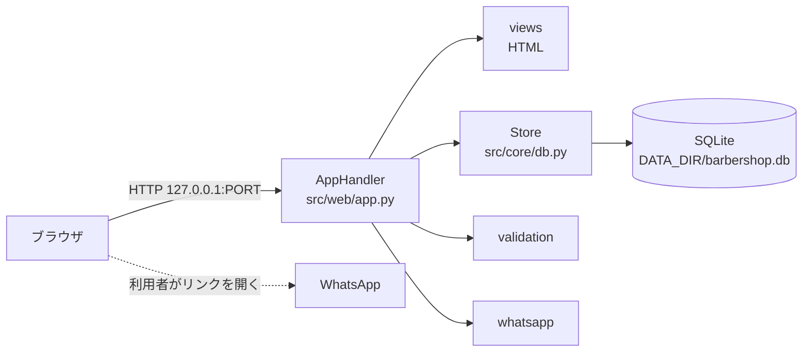
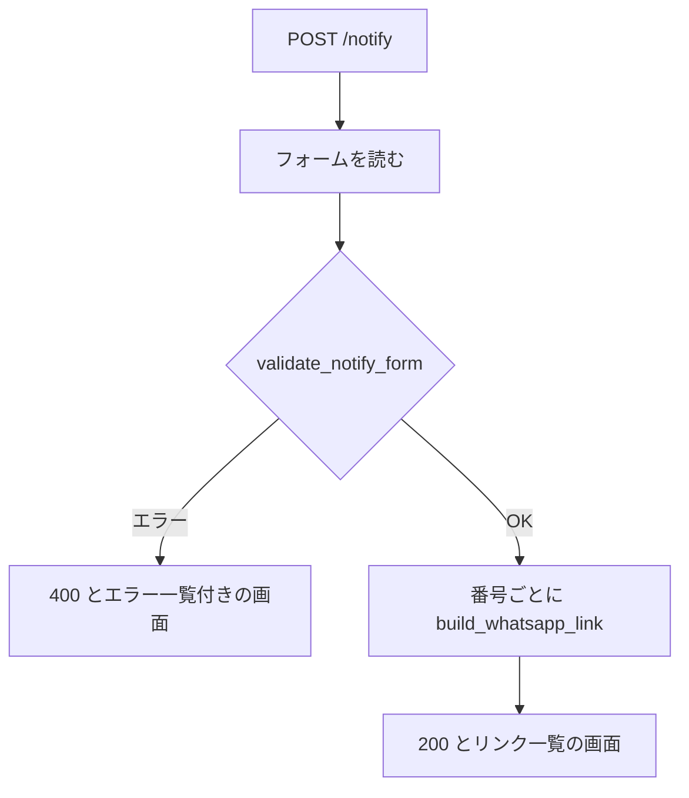

# 詳細設計書: 理髪店管理ウェブサイト

- 作成日: 2026-11-05
- 入力: `docs/requirements.md`（承認済み、2026-11-05）
- 状態: 承認済（2026-11-05。技術選定は未調査のままの承認、E2E の実行手段は 8-3 の「承認: 未確認」を含む）

## 1. 言語・フレームワーク・アーキテクチャの選定

**判定日時**: 2026-11-05

**技術制約の要約**（要件定義書 1-1）: 既存コードなし。利用者の PC でローカル起動（127.0.0.1）。無料ライブラリのみ、外部サービス・有償 API 不可。SQLite か JSON ファイルで保存可。画面は英語。実行環境は Python 3.12（python3）と Node.js 24。

**判断軸**

| 判断軸 | この案件で効く条件 | 該当の有無と理由 |
|---|---|---|
| 既存資産との整合 | 無し | 該当なし（既存コードは無い） |
| チームの技術 | 未確認 | 該当なし（回答が無く、Python 3.12 を実行環境の既定とした） |
| 配備先 | 127.0.0.1 でローカル起動、`bash run.sh` で前景起動 | 標準ライブラリだけで動くものが有利 |
| 認証と認可の境界 | 無し（D3） | 該当なし |
| 画面の規模 | 6 画面程度、遷移は一覧から追加へ戻るだけ | サーバー描画で足りる |
| データの規模と構造 | 2 種類のエンティティ、件数は小さい、参照関係なし | SQLite の 1 ファイルで足りる |
| 外部連携 | 無し（D2） | 該当なし |
| ライセンスとコスト | 無料のみ、外部パッケージを入れない方が契約に沿う | 標準ライブラリを優先 |
| 保守性 | 少人数、単純な構成 | 依存を増やさない |

**候補の比較表**（出典: 未調査。ユーザー承認: 2026-11-05 で未調査のまま進める許可が出た）

| 候補 | 判断軸ごとの評価 | 出典 URL | 確認日 |
|---|---|---|---|
| A. Python 3.12 標準ライブラリ（http.server、sqlite3、html） | 外部パッケージ不要、契約に合う、規模に十分。ThreadingHTTPServer は本番向けの性能は無いが、要件の利用人数（1〜3 名）では足りる | 未調査（ユーザー承認: 2026-11-05） | 2026-11-05 |
| B. Python 3.12 + Flask（pip） | 機能は豊富だが pip による外部パッケージが増える。契約の「free libraries」には合うが、この規模では利点が小さい | 未調査（ユーザー承認: 2026-11-05） | 2026-11-05 |
| C. Node.js 24（http モジュール、JSON ファイル保存） | 契約に合う。ただし SQLite の標準機能の安定性は未確認 | 未調査（ユーザー承認: 2026-11-05） | 2026-11-05 |

**最終選定結果**

- 言語: Python 3.12（実行は `python3`。ローカルの確認は Python 3.9 でも動くよう、構文は 3.9 の範囲に限る）
- フレームワーク: なし（標準ライブラリの `http.server`）
- DB: SQLite（標準ライブラリの `sqlite3`）
- 実行形態: server（コンテナを使わない）
- 描画: サーバーが HTML を返す。JavaScript は使わない（雪の動きは CSS だけ）

**選定理由**: 要件 1-1 の「無料・外部サービス不可」と、3 の機能（一覧と追加、リンク作成）に対して最も少ない依存で足りる（候補 A）。候補 B は要件に無い機能を持ち込むため採らない。候補 C は JSON 保存でも足りるが、SQLite のほうが検証の制約（一意性・型）を置きやすい。

**承認の記録**: 2026-11-05、ユーザーが候補 B（未調査のまま進める）を承認。

**フロントエンドとバックエンドを分ける構成**: 分けない。1 つのサーバーが HTML と CSS を返す。API の経路は無い（画面の HTML を返す経路だけ、8 節は 4-1 の DS-IF-HTTP-ROUTES）。

## 2. システム構成

**コンポーネント一覧**

| コンポーネント | 役割 | 根拠（RQ） |
|---|---|---|
| 起動部（`src/web/server.py`） | PORT と DATA_DIR を読み、DB を開いて HTTP サーバーを起動する | RQ-OP-START-WITH-RUN-SCRIPT |
| HTTP 層（`src/web/app.py`） | 経路の振り分け、フォームの受け取り、PRG（POST 後の転送） | RQ-FT-*、RQ-UI-* |
| 画面描画（`src/web/views.py`、`src/web/static/style.css`） | HTML の生成、共通レイアウト、雪と配色 | RQ-UI-* |
| 保存（`src/core/db.py`） | SQLite の作成、一覧と追加、サンプルの投入 | RQ-DT-*、RQ-FT-SEED-SAMPLE-DATA |
| 入力検査（`src/core/validation.py`） | 入力規則（D7〜D9）の検査と値の変換 | RQ-FT-VALIDATE-ENTRY-FIELDS |
| 送信リンク（`src/core/whatsapp.py`） | 電話番号の一覧の分解と wa.me リンクの生成 | RQ-FT-SEND-WHATSAPP-NOTIFICATION |

**システム全体構成図**



**各コンポーネントの役割と機能**: 2 の表のとおり。

**コンポーネント間インターフェースとデータフロー**: AppHandler が Store、validation、whatsapp を呼び、views が HTML を返す。送信リンクは利用者のブラウザが開く（サーバーは WhatsApp に接続しない）。

**ネットワーク構成図**: ネットワーク越しの通信は、ブラウザと 127.0.0.1 のサーバーだけ。外部への通信は無いため、ネットワーク構成図は書かない。

## 3. データ設計

### 3-1. データモデル

DB が必要かの判定: 必要（再起動後も残すため。要件 4-1）。製品は SQLite（第 1 章）。

**DS-SC-BARBER-TABLE**（テーブル `barbers`）

| カラム | 型 | 制約 | 対応要件（4-2） |
|---|---|---|---|
| id | INTEGER | PRIMARY KEY AUTOINCREMENT | 内部用 |
| name | TEXT | NOT NULL、1〜60 文字（検査は validation） | バーバー.name |
| specialty | TEXT | NOT NULL DEFAULT ''、0〜100 文字 | バーバー.specialty |
| phone | TEXT | NOT NULL DEFAULT ''、空か 8〜15 桁 | バーバー.phone |

**DS-SC-SERVICE-TABLE**（テーブル `services`）

| カラム | 型 | 制約 | 対応要件（4-2） |
|---|---|---|---|
| id | INTEGER | PRIMARY KEY AUTOINCREMENT | 内部用 |
| name | TEXT | NOT NULL、1〜80 文字 | 施術メニュー.name |
| price_cents | INTEGER | NOT NULL、0 以上 1000000（10000.00 を 100 倍した値） | 施術メニュー.price（小数第 2 位まで。表示は `%d.%02d`） |
| duration_min | INTEGER | NOT NULL、5 以上 480 以下 | 施術メニュー.duration_min |
| description | TEXT | NOT NULL DEFAULT ''、0〜300 文字 | 施術メニュー.description |

- 料金を整数（セント）で持つのは、小数の誤差を避けるため。
- テーブルは `CREATE TABLE IF NOT EXISTS` で起動時に作る。

**リレーション図**: 2 テーブルは参照関係を持たない（図は書かない）。

### 3-2. トランザクションと排他制御

- トランザクションが要る操作は無い（各追加は 1 文の INSERT）。
- 排他制御は無い（D14）。後から保存された内容が残る。

### 3-3. 状態遷移

状態を持つエンティティは無い。

## 4. アーキテクチャ設計

### 4-1. 外部設計

**利用者向けインターフェース**

| 設計 ID | 種類 | 内容 |
|---|---|---|
| DS-IF-HTTP-ROUTES | HTTP 経路 | 下の経路表 |
| DS-IF-HOME-SCREEN | 画面 | Home |
| DS-IF-BARBER-LIST-SCREEN | 画面 | Barbers 一覧 |
| DS-IF-BARBER-ADD-SCREEN | 画面 | Add barber |
| DS-IF-SERVICE-LIST-SCREEN | 画面 | Services 一覧 |
| DS-IF-SERVICE-ADD-SCREEN | 画面 | Add service |
| DS-IF-NOTIFY-SCREEN | 画面 | Notify（送信と送信リンク表示） |
| DS-IF-PAGE-LAYOUT | 画面の共通部分 | 上部メニュー、雪、配色 |

**HTTP 経路（DS-IF-HTTP-ROUTES）**

| メソッド | パス | 用途 | 成功時 | 失敗時 |
|---|---|---|---|---|
| GET | `/` | Home | 200 | — |
| GET | `/barbers` | Barbers 一覧 | 200 | — |
| GET | `/barbers/new` | Add barber | 200 | — |
| POST | `/barbers` | バーバー追加 | 303 → `/barbers` | 400（同じフォームにエラー表示） |
| GET | `/services` | Services 一覧 | 200 | — |
| GET | `/services/new` | Add service | 200 | — |
| POST | `/services` | 施術メニュー追加 | 303 → `/services` | 400（同じフォームにエラー表示） |
| GET | `/notify` | Notify | 200 | — |
| POST | `/notify` | 送信リンク作成 | 200（同じ画面にリンクを表示） | 400（同じフォームにエラー表示） |
| GET | `/static/style.css` | スタイル | 200 | — |
| その他 | — | — | — | 404（英語のページ） |

**インターフェース仕様**（入力の検査は `validation`。規則は要件 D7〜D9）

| 入力 | バリデーション | 出力 | エラー仕様 |
|---|---|---|---|
| バーバー追加（name、specialty、phone） | DS-FN-VALIDATE-BARBER-FORM。D7 | 保存して 303 | 全項目のエラーを英語で一覧表示、入力値を残す、400 |
| 施術メニュー追加（name、price、duration_min、description） | DS-FN-VALIDATE-SERVICE-FORM。D8 | 保存して 303 | 同上 |
| 送信（phones、message） | DS-FN-VALIDATE-NOTIFY-FORM。D9 | 送信リンクの一覧（200） | 同上。1 件でも不正なら送信リンクを作らない |

**エラー文の例（英語）**: `Name is required.`、`Name must be 60 characters or fewer.`、`Price must be between 0 and 10000.`、`Phone number "abc" is not valid. Use 8 to 15 digits, with country code.`、`Message is required.`

**外部システム連携**: 無し（D2）。

**外部 DB 連携**: 無し。

### 4-2. 内部設計

**処理フロー（POST /notify）**



**各処理の役割と機能**: 追加（POST）は検査→保存→303。一覧（GET）は全件取得→表示。送信は検査→リンク生成→表示（保存しない）。

**バッチ設計**: バッチは無い。

## 5. クラス設計

| クラス | 責務（1 文） | 主要メソッド | 所在 |
|---|---|---|---|
| Store | SQLite に、バーバーと施術メニューを保存・取得する | `init_schema`、`seed_sample_data_if_empty`、`list_barbers`、`add_barber`、`list_services`、`add_service` | DS-CL-STORE（`src/core/db.py`） |
| AppHandler | HTTP の経路を振り分け、フォームを処理して画面を返す | `do_GET`、`do_POST` | DS-CL-APP-HANDLER（`src/web/app.py`） |
| ValidationError | 入力検査で見つかったエラー文の一覧を運ぶ | — | DS-CL-VALIDATION-ERROR（`src/core/validation.py`） |

- クラス間の依存の向きは 7 の依存の規則に従う。
- クラス図は省略（クラスは 3 つ）。
- システム内メッセージ: 無し（単一プロセス内の関数呼び出しのみ）。

## 6. エラーハンドリングとセキュリティ設計

**エラーハンドリング**

| 想定エラー | 利用者への見え方 | ログ | 続行か中止か |
|---|---|---|---|
| 入力規則違反 | フォーム上部に英語のエラー一覧（400） | 出さない | 続行（同じ画面） |
| DB ファイルを開けない・書けない | 500 の英語のページ「Something went wrong.」 | 標準エラー出力に例外を出す | 当該リクエストだけ中止 |
| 起動時に DATA_DIR を作れない | 起動時に英語のメッセージを標準エラー出力に出して終了（終了コード 1） | 同左 | 中止 |
| PORT が数値でない、または範囲外 | 起動時に英語のメッセージで終了（終了コード 1） | 同左 | 中止 |
| 未定義の経路 | 404 の英語のページ | 出さない | 続行 |

**認証**: 認証は無い（D3）。

**認可**: 認可は無い（D3）。

**監査ログ**: 要件に無いため無し。

**その他のセキュリティ対策**

- 利用者の入力は HTML にそのまま出さない（`html.escape`）。
- 待ち受けは 127.0.0.1 のみ。
- 秘密情報は無い（DB に保存する値は業務データのみ）。
- 送信リンクの文面は `urllib.parse.quote` で URL エンコードする。

## 7. コード設計

**ソースコードのディレクトリ構成**

```
src/
├── web/
│   ├── server.py        起動部
│   ├── app.py           HTTP 層
│   ├── views.py         HTML 生成
│   └── static/
│       └── style.css    スタイル（対応表の対象外）
└── core/
    ├── db.py            保存
    ├── validation.py    入力検査
    └── whatsapp.py      送信リンク
tests/                   単体・結合テスト（対応表の対象外）
e2e/                     E2E テスト（対応表の対象外。DS-TS の行で結ぶ）
run.sh, setup.sh         起動スクリプト（対応表の対象外。DS-OP）
```

- `src/web` と `src/core` は `__init__.py` を置かない（名前空間パッケージ）。`PYTHONPATH=src` で `web.server`、`core.db` として読む。

**ファイルごとの役割**

| ファイル | 役割 | 実現する設計 ID |
|---|---|---|
| `src/web/server.py` | 環境変数の読み取り、DB の初期化、HTTP サーバーの起動 | DS-MD-SERVER-ENTRY |
| `src/web/app.py` | 経路の振り分け、フォームの処理、PRG | DS-MD-APP-HANDLER、DS-CL-APP-HANDLER、DS-IF-HTTP-ROUTES |
| `src/web/views.py` | HTML の生成（画面ごと） | DS-MD-VIEWS、DS-IF-HOME-SCREEN、DS-IF-BARBER-LIST-SCREEN、DS-IF-BARBER-ADD-SCREEN、DS-IF-SERVICE-LIST-SCREEN、DS-IF-SERVICE-ADD-SCREEN、DS-IF-NOTIFY-SCREEN、DS-IF-PAGE-LAYOUT |
| `src/core/db.py` | SQLite の保存と取得、サンプルの投入 | DS-MD-STORE、DS-CL-STORE、DS-FN-SEED-SAMPLE-DATA |
| `src/core/validation.py` | 入力規則の検査と値の変換 | DS-MD-VALIDATION、DS-CL-VALIDATION-ERROR、DS-FN-VALIDATE-BARBER-FORM、DS-FN-VALIDATE-SERVICE-FORM、DS-FN-VALIDATE-NOTIFY-FORM |
| `src/core/whatsapp.py` | 電話番号の分解、wa.me リンクの生成 | DS-MD-WHATSAPP-LINK、DS-FN-SPLIT-PHONE-LIST、DS-FN-BUILD-WHATSAPP-LINK |
| `src/web/static/style.css` | 配色、雪、レイアウト | 対応表の対象外（DS-IF-PAGE-LAYOUT の説明に含む） |

**対応表の粒度**: `class`。理由: 薄い CRUD と画面の部品が多く、関数ごとに追う価値が小さいため。設計書に書いた DS-FN・DS-IF は粒度にかかわらず対応表に載せる。

**依存の規則**

| 依存元（ディレクトリ） | 依存してよい先（プロジェクト内） | 依存してはいけない先 | 理由 |
|---|---|---|---|
| `src/web` | `src/web`、`src/core` | — | 画面と HTTP は業務の保存と検査を使う |
| `src/core` | `src/core` | `src/web` | 保存と検査は HTTP を知らない |

（外部連携は無いため、外部 API の import 規則は無い。標準ライブラリの import は制限しない。）

**コーディング規約**: Python は PEP 8 に従う。関数には docstring（処理、引数、戻り値）を書く。コードに要件 ID・設計 ID を書かない（対応は `docs/trace_map.md` で管理）。

## 8. テスト設計

### 8-1. テストの種類と方針

- 単体テスト: `src/core` の各関数（検査、リンク生成、保存）。`tests/` に置く。
- 結合テスト: `src/web` の HTTP 経路を、一時 DB に対して実際に呼ぶ。`tests/` に置く。
- 総合テスト: 無し（E2E で代替する）。
- 非機能要件の検証: 非機能要件は無い（要件 5）。

**単体・結合テストの実行コマンド**

```bash
PYTHONPATH=src python3 -m unittest discover -s tests -p "test_*.py"
```

### 8-2. E2E テストのシナリオ

| DS-ID | 目的（RQ-TS） | 前提条件 | 手順 | 期待結果 |
|---|---|---|---|---|
| DS-TS-START-WITH-SAMPLE-DATA-E2E | RQ-TS-START-WITH-SAMPLE-DATA | 空の DATA_DIR | サーバーを起動し、Barbers と Services を開く | バーバー 3 件、施術メニュー 4 件 |
| DS-TS-NAVIGATE-FROM-HOME-E2E | RQ-TS-NAVIGATE-FROM-HOME | 起動済み | Home を開き、メニューとカードから 3 画面を開く | 各画面が 200、メニューに現在の画面が示される |
| DS-TS-BROWSE-AND-ADD-BARBER-E2E | RQ-TS-BROWSE-AND-ADD-BARBER | 起動済み | Add barber で「Test Barber」を保存 | Barbers に追加される |
| DS-TS-BROWSE-AND-ADD-SERVICE-E2E | RQ-TS-BROWSE-AND-ADD-SERVICE | 起動済み | Add service で「Test Cut」12.50、20 分を保存 | Services に料金 12.50、所要時間 20 で追加される |
| DS-TS-SEND-WHATSAPP-LINKS-E2E | RQ-TS-SEND-WHATSAPP-LINKS | 起動済み | Notify で 2 件の番号と案内文を送信 | 番号ごとの wa.me リンク（数字と URL エンコードされた文面） |
| DS-TS-REJECT-INVALID-ENTRIES-E2E | RQ-TS-REJECT-INVALID-ENTRIES | 起動済み | 3 画面に不正な入力を送る | 保存・リンク作成なし、英語のエラー、入力値が残る |
| DS-TS-SNOW-AND-GRAY-THEME-E2E | RQ-TS-SNOW-AND-GRAY-THEME | 起動済み | 画面の HTML と CSS を取得して確かめる | 雪の要素があり、CSS の主色が #696969、動きを減らす設定の規則がある |

**モック**: 外部連携が無いため、モックは無い。

### 8-3. E2E の実行手段

- 方式: 実際にサーバーを起動し、HTTP で画面を取得・送信して HTML を確かめる（標準ライブラリの `urllib` と `html.parser`）。ブラウザ自動化ツールは使わない（ブラウザ自動化の調査は行っていない。未調査）。
- 承認: 2026-11-05 の全件承認は要件の 1-2 に対するもの。E2E の実行手段の承認は **未確認**（最小案として決め、最終報告で確認する）。
- 理由: 外部パッケージを増やさず、ブラウザ本体も使えない環境で実行できる。画面の見た目（雪、色）はテストで CSS の値として確かめ、目視は人が行う。

### 8-4. E2E の実行コマンドと運用

```bash
python3 scripts/isdd/unittest_junit.py -s e2e -t . -o e2e/results/e2e.xml
```

- 結果は `e2e/results/e2e.xml`（JUnit XML）。`e2e/results/` は git 管理外（isdd-setup が `.gitignore` に足す）。
- 照合は関数単位（`e2e/test_site.py::test_...`）。
- E2E テストは、テストごとに一時ディレクトリを DATA_DIR にし、空いているポートでサーバーを子プロセスとして起動する。終了時は自分が起動したプロセスだけを止める。
- 失敗したら修正と再実行を繰り返し、全件通過まで続ける。

## 9. 運用設計

- 起動方式: server（コンテナなし）。
- **DS-OP-SETUP-SH**（`setup.sh`）: Python 3.9 以上があるかを確かめ、必要なパッケージが無いことを表示する（依存の導入は無い）。
- **DS-OP-RUN-SH**（`run.sh`）: プロジェクト直下に移動し、`PYTHONPATH=src` で `python3 -m web.server` を前景で起動する。PORT と DATA_DIR の既定値を与える。
- 設定値・環境変数:

  | 名前 | 用途 | 既定値 | 必須か |
  |---|---|---|---|
  | PORT | 待ち受けポート | 8000 | 任意 |
  | DATA_DIR | 保存先ディレクトリ（無ければ作る） | プロジェクト直下の `data` | 任意 |

- 初期化: 起動時に `barbershop.db` が無ければ作成し、バーバーと施術メニューが空ならサンプルを入れる（バーバー 3 件、施術メニュー 4 件）。
- 認証: 無いため「初期ユーザーは無い」。
- バックアップと復旧: 要件に無い（DATA_DIR のコピーは利用者の任意）。
- データ移行: 無し。
- 可用性: 要件に無い。
- 起動方法と操作説明は `README.md` に書く。

## 10. ログ・監視・アラート・障害対応設計

- ログ: ログの設計は必須ではないため、ログの種類と内容の記述は行わない（例外は標準エラー出力に出る）。
- 監視・アラート: 監視・アラートの設計は必須ではないため、監視・アラートの内容と対応方法の記述は行わない。
- 障害対応:

  | 想定する障害 | 検知 | 対応手順 | 復旧の確認 |
  |---|---|---|---|
  | DATA_DIR が書き込めない | 起動時のエラー、または保存時の 500 | DATA_DIR を変える、権限を直す | `bash run.sh` が起動し、画面が 200 |
  | ポートが使用中 | 起動時のエラー | `PORT` を変えて起動する | 同上 |

## 11. 要件と設計の対応表

| DS-ID | 対応要件ID |
|---|---|
| DS-MD-SERVER-ENTRY | RQ-OP-START-WITH-RUN-SCRIPT, RQ-FT-SEED-SAMPLE-DATA |
| DS-MD-APP-HANDLER | RQ-FT-BROWSE-BARBERS, RQ-FT-ADD-BARBER, RQ-FT-BROWSE-SERVICES, RQ-FT-ADD-SERVICE, RQ-FT-SEND-WHATSAPP-NOTIFICATION, RQ-FT-VALIDATE-ENTRY-FIELDS |
| DS-MD-VIEWS | RQ-UI-HOME-SCREEN, RQ-UI-BARBER-LIST-SCREEN, RQ-UI-BARBER-ADD-SCREEN, RQ-UI-SERVICE-LIST-SCREEN, RQ-UI-SERVICE-ADD-SCREEN, RQ-UI-NOTIFY-SCREEN, RQ-UI-VISUAL-THEME |
| DS-MD-STORE | RQ-DT-LOCAL-STORAGE, RQ-DT-BARBER, RQ-DT-SERVICE, RQ-FT-SEED-SAMPLE-DATA, RQ-FT-BROWSE-BARBERS, RQ-FT-ADD-BARBER, RQ-FT-BROWSE-SERVICES, RQ-FT-ADD-SERVICE |
| DS-MD-VALIDATION | RQ-FT-VALIDATE-ENTRY-FIELDS |
| DS-MD-WHATSAPP-LINK | RQ-FT-SEND-WHATSAPP-NOTIFICATION |
| DS-CL-STORE | RQ-DT-LOCAL-STORAGE, RQ-FT-SEED-SAMPLE-DATA, RQ-FT-BROWSE-BARBERS, RQ-FT-ADD-BARBER, RQ-FT-BROWSE-SERVICES, RQ-FT-ADD-SERVICE |
| DS-CL-APP-HANDLER | RQ-FT-SEND-WHATSAPP-NOTIFICATION, RQ-UI-HOME-SCREEN |
| DS-CL-VALIDATION-ERROR | RQ-FT-VALIDATE-ENTRY-FIELDS |
| DS-FN-VALIDATE-BARBER-FORM | RQ-FT-VALIDATE-ENTRY-FIELDS, RQ-FT-ADD-BARBER |
| DS-FN-VALIDATE-SERVICE-FORM | RQ-FT-VALIDATE-ENTRY-FIELDS, RQ-FT-ADD-SERVICE |
| DS-FN-VALIDATE-NOTIFY-FORM | RQ-FT-VALIDATE-ENTRY-FIELDS, RQ-FT-SEND-WHATSAPP-NOTIFICATION |
| DS-FN-BUILD-WHATSAPP-LINK | RQ-FT-SEND-WHATSAPP-NOTIFICATION |
| DS-FN-SPLIT-PHONE-LIST | RQ-FT-SEND-WHATSAPP-NOTIFICATION |
| DS-FN-SEED-SAMPLE-DATA | RQ-FT-SEED-SAMPLE-DATA |
| DS-IF-HTTP-ROUTES | RQ-FT-BROWSE-BARBERS, RQ-FT-ADD-BARBER, RQ-FT-BROWSE-SERVICES, RQ-FT-ADD-SERVICE, RQ-FT-SEND-WHATSAPP-NOTIFICATION |
| DS-IF-HOME-SCREEN | RQ-UI-HOME-SCREEN |
| DS-IF-BARBER-LIST-SCREEN | RQ-UI-BARBER-LIST-SCREEN |
| DS-IF-BARBER-ADD-SCREEN | RQ-UI-BARBER-ADD-SCREEN |
| DS-IF-SERVICE-LIST-SCREEN | RQ-UI-SERVICE-LIST-SCREEN |
| DS-IF-SERVICE-ADD-SCREEN | RQ-UI-SERVICE-ADD-SCREEN |
| DS-IF-NOTIFY-SCREEN | RQ-UI-NOTIFY-SCREEN |
| DS-IF-PAGE-LAYOUT | RQ-UI-VISUAL-THEME |
| DS-SC-BARBER-TABLE | RQ-DT-BARBER, RQ-DT-LOCAL-STORAGE |
| DS-SC-SERVICE-TABLE | RQ-DT-SERVICE, RQ-DT-LOCAL-STORAGE |
| DS-OP-SETUP-SH | RQ-OP-START-WITH-RUN-SCRIPT |
| DS-OP-RUN-SH | RQ-OP-START-WITH-RUN-SCRIPT |
| DS-TS-START-WITH-SAMPLE-DATA-E2E | RQ-TS-START-WITH-SAMPLE-DATA |
| DS-TS-NAVIGATE-FROM-HOME-E2E | RQ-TS-NAVIGATE-FROM-HOME |
| DS-TS-BROWSE-AND-ADD-BARBER-E2E | RQ-TS-BROWSE-AND-ADD-BARBER |
| DS-TS-BROWSE-AND-ADD-SERVICE-E2E | RQ-TS-BROWSE-AND-ADD-SERVICE |
| DS-TS-SEND-WHATSAPP-LINKS-E2E | RQ-TS-SEND-WHATSAPP-LINKS |
| DS-TS-REJECT-INVALID-ENTRIES-E2E | RQ-TS-REJECT-INVALID-ENTRIES |
| DS-TS-SNOW-AND-GRAY-THEME-E2E | RQ-TS-SNOW-AND-GRAY-THEME |

### 11-1. 除外要件

除外要件は無い。

## 12. 未確定事項

無し（D1〜D21 は要件 1-2 で承認済み。E2E の実行手段は 8-3 で承認未確認）。
