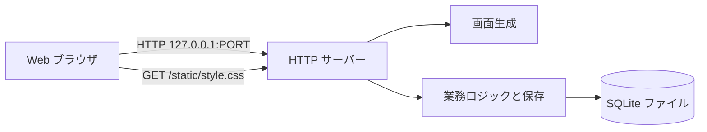
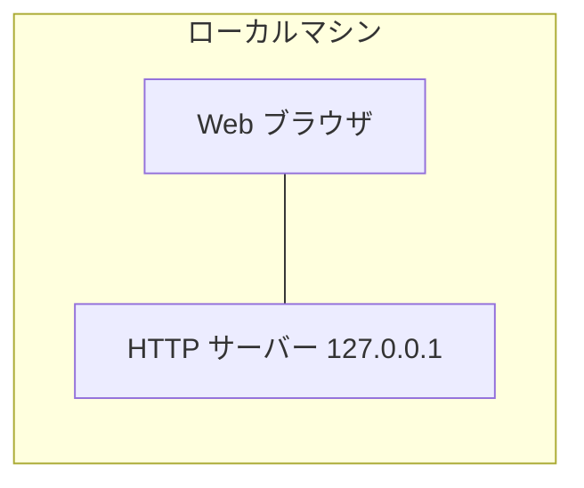
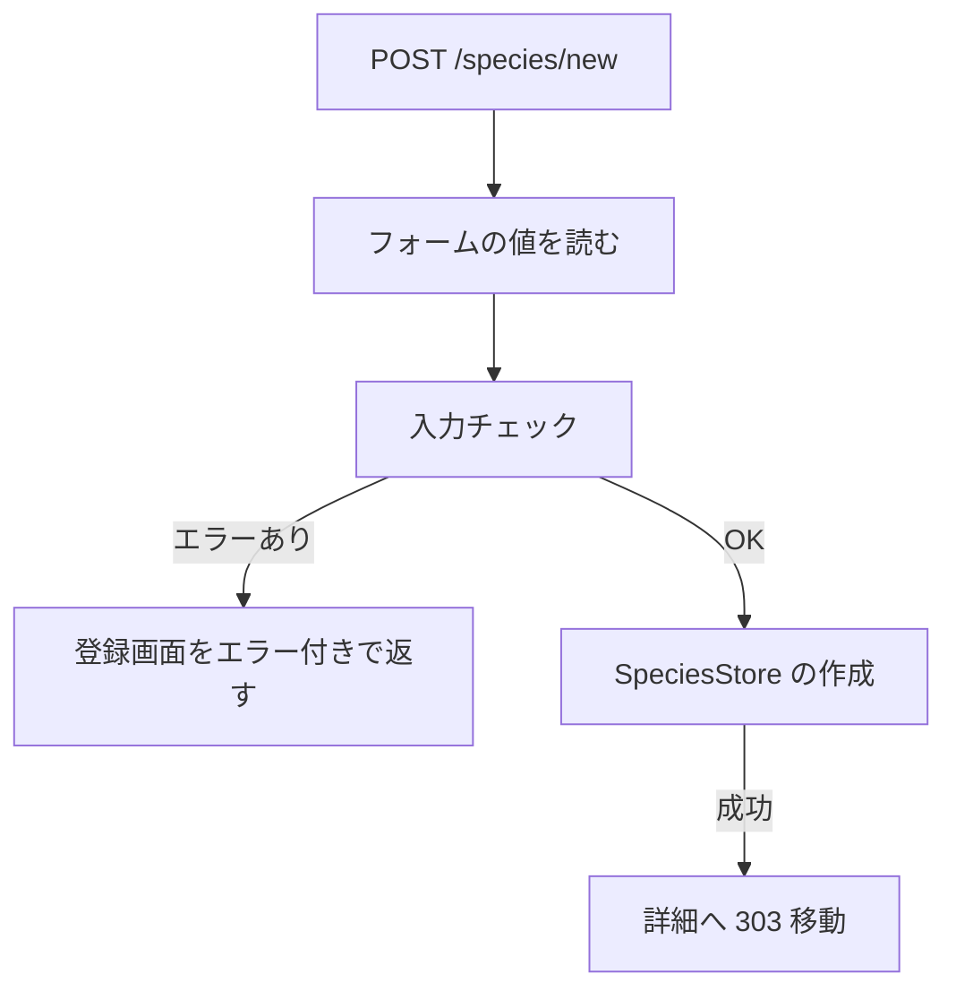
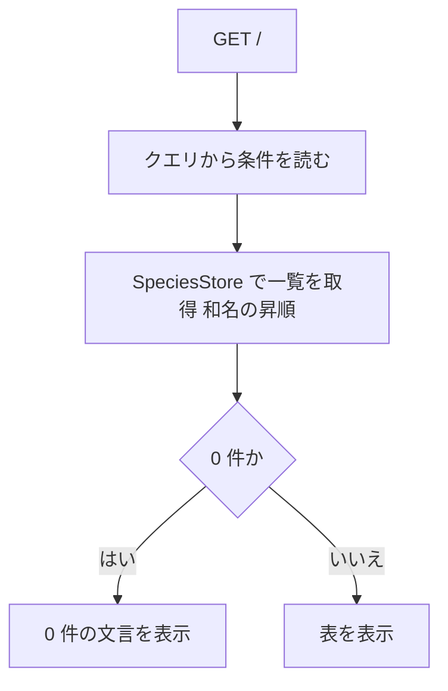
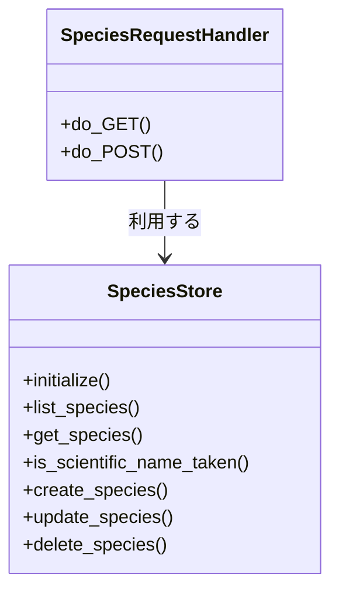

# 詳細設計書: 生物種情報データベース

## 1. 言語・フレームワーク・アーキテクチャの選定

### 1-1. 選定結果

| 項目 | 選定結果 |
|---|---|
| 言語 | Python 3.12（契約どおり。ローカル確認は Python 3.9 でも動くように、3.9 で使えない文法を避ける） |
| フレームワーク | 無し。標準ライブラリの `http.server`（`ThreadingHTTPServer`）と `urllib.parse`、`html` を使う |
| DB | SQLite（標準ライブラリの `sqlite3`）。ファイルは `DATA_DIR/species.db` |
| 実行形態 | サーバー（`bash run.sh` で前面起動する単一プロセスの Web サーバー） |
| 外部ライブラリ | 使わない（`setup.sh` は Python のバージョン確認と保存先の作成だけ） |

### 1-2. 判断軸

| 判断軸 | この案件で効く条件 | 評価 |
|---|---|---|
| 既存資産との整合 | 既存コード無し | 該当しない |
| チームの技術 | 指定なし。無償・標準的な技術のみ | 標準ライブラリで足りる |
| 配備先 | ローカルで `bash run.sh` が動けばよい。外部サービス不可 | 追加インストール不要の構成が有利 |
| 認証と認可の境界 | 認証無し | 該当しない |
| 画面の規模 | 画面 4 種（一覧・詳細・登録修正・404）。部品の共有が必要 | テンプレート関数で十分。フレームワークは不要 |
| データの規模と構造 | 数十件、単一テーブル、検索と絞り込みが必要 | SQLite が適する（ファイル保存より検索が簡単） |
| 外部連携 | 無し | 該当しない |
| ライセンスとコスト | 無償のみ | 標準ライブラリは追加費用なし |
| 保守性 | 依存が少ないほど保守が楽 | 標準ライブラリのみが有利 |

### 1-3. 候補の比較

| 候補 | 判断軸ごとの評価 | 出典 URL | 確認日 |
|---|---|---|---|
| A. Python 3.12 標準ライブラリ（http.server・sqlite3） | 追加インストール不要。画面数が少ないので十分。HTML はテンプレート関数で作る | 未調査（ユーザー承認: ANSWERS.md、2026-11-05）。インターネット検索の権限が得られず、公式の保守状況は確認していない | 2026-11-05 |
| B. Python 3.12 + Flask + SQLite | 経路と画面の書き方は簡単。ただし `setup.sh` で pip の外部取得が必要 | 未調査（同上） | 2026-11-05 |
| C. Node.js 24 + 標準の http | 文法は新しいが、SQLite 用の標準機能の成熟度を確かめられていない | 未調査（同上） | 2026-11-05 |

**選定理由**: 依頼の機能（一覧・検索・絞り込み・登録・修正・削除）は数画面で足り、外部依存を増やす理由が無い。標準ライブラリのみの A が、起動の確実さ（契約の `bash run.sh` のみで起動）と保守性で最小。B は pip の取得を要し、C は確認できていない点が多い。

**承認の記録**: 技術選定は ANSWERS.md の「技術選定: 推奨の案でよい（Python のフレームワーク ＋ SQLite が最も単純）」に従い承認済み。出典は未調査のため、比較表の出典列にその旨を記録した。

## 2. システム構成

### 2-1. コンポーネント一覧

| コンポーネント | 役割 | 実行場所 |
|---|---|---|
| HTTP サーバー（`src/web/server.py`） | 経路の振り分け、フォームの読み取り、リダイレクト | Python プロセス |
| 画面生成（`src/web/views.py`） | HTML の組み立て（共通レイアウト、一覧、詳細、登録修正、404） | Python プロセス |
| 業務ロジックと保存（`src/core/`） | 入力チェック、条件の読み取り、SQLite への保存と検索、サンプルデータ | Python プロセス |
| スタイルシート（`src/web/static/style.css`） | 配色（linen・maroon）とレイアウト | ブラウザが取得 |
| DB ファイル（`DATA_DIR/species.db`） | 生物種の情報 | ローカルファイル |

### 2-2. システム全体構成図



### 2-3. 各コンポーネントの役割と機能

- HTTP サーバー: GET は画面を返し、POST は登録・修正・削除を行ってから別の画面へ移動させる（Post/Redirect/Get）。経路に無いものは 404 画面を返す。
- 画面生成: 全画面を共通レイアウト（上部のナビゲーション、本文、スタイルシート）で包む。値は必ず HTML エスケープして出す。
- 業務ロジックと保存: 入力チェックの規則を 1 か所に集める。DB への読み書きは保存クラスだけが行う。

### 2-4. コンポーネント間インターフェースとデータフロー

- 画面 → サーバー: GET のクエリ文字列（検索語と 4 つの条件）、POST のフォーム項目（9 項目）。
- サーバー → 業務ロジック: 条件の辞書、入力値の辞書、ID。
- 業務ロジック → 画面: 生物種のレコードの辞書（項目名はフォームの項目名と同じ）と、エラー文言の一覧。

### 2-5. ネットワーク構成図

ネットワーク越しの通信は、利用者の Web ブラウザと同じマシンの `127.0.0.1` の間だけ。外部との通信は無い。



## 3. データ設計

### 3-1. データモデル

DB を使う。製品は第 1 章の SQLite。

**テーブル `species`（`DS-SC-SPECIES-TABLE`）**

| カラム | 型 | 制約 | 対応するデータ項目（4-2） |
|---|---|---|---|
| id | INTEGER | 主キー、自動採番 | （内部 ID） |
| scientific_name | TEXT | 必須（前後の空白を除いて 1 文字以上）、100 文字以内 | 学名 |
| common_name | TEXT | 必須、100 文字以内 | 和名 |
| taxonomic_class | TEXT | 必須、分類群の選択肢のいずれか | 分類群 |
| habitat | TEXT | 必須、生息環境の選択肢のいずれか | 生息環境 |
| diet | TEXT | 必須、食性の選択肢のいずれか | 食性 |
| lifespan_years | INTEGER | 空可、1〜500 | 寿命 |
| body_mass_kg | REAL | 空可、0 より大きく 200000 以下 | 成体の体重 |
| conservation_status | TEXT | 必須、保全状況の選択肢のいずれか | 保全状況 |
| description | TEXT | 空可、1000 文字以内（空は空文字で保存） | 説明 |

- 一意制約: `scientific_name` の大文字小文字と前後の空白を無視した値に対する一意インデックス（式インデックス `lower(trim(scientific_name))`）。学名の重複を DB でも防ぐ。
- 選択肢の値は `src/core/vocabulary.py` の定義と同じ文字列を保存する（例: `Mammals`）。
- リレーションは無い。

**DB の要否の理由**: 検索（部分一致）と絞り込み（AND 条件）、一意制約が必要なため、単一テーブルの SQLite とする。

### 3-2. トランザクションと排他制御

- トランザクション: 登録・修正・削除はそれぞれ 1 行の操作。1 つの操作の中で複数行は扱わないため、明示的なトランザクションは不要（各操作は SQLite の自動コミットで確定する）。
- 排他制御: しない。後から保存した内容で上書きする（依頼に無い最小案、1-2 の承認済み項目）。

### 3-3. 状態遷移

状態を持つエンティティは無い。

## 4. アーキテクチャ設計

### 4-1. 外部設計

#### 利用者向けインターフェース（`DS-IF-*`）

画面は HTML で、スタイルシートは `/static/style.css` で配る。画面の見た目の要素は次のとおり（テンプレートは Python の関数が組み立てる。テンプレートファイルは作らない）。

- 共通レイアウト（`DS-IF-SITE-LAYOUT`）: 上部に見出し「Species Biology Database」とナビゲーション（Browse species → `/`、Add species → `/species/new`）。背景は linen（#FAF0E6）、ナビゲーション・見出し・ボタン・表の見出し行・選択欄の枠線・バッジはマルーン（#800000、文字は白）。本文の幅は画面中央、最大 960px 程度。
- 一覧画面（`DS-IF-SPECIES-LIST-PAGE`）: 検索欄（Search）と 4 つの選択欄（Taxonomic class、Habitat、Diet、Conservation status。先頭は「All」）、Search ボタン、Clear リンク、件数の表示、表（Common name（詳細へのリンク）、Scientific name、Class、Habitat、Diet、Conservation status）。0 件のときは表の代わりに「No species match the current search and filters.」。
- 詳細画面（`DS-IF-SPECIES-DETAIL-PAGE`）: 和名を見出し、学名（斜体）、9 項目を定義リスト形式で表示。空欄の項目は「Unknown」。Edit リンク、Delete ボタン（`onsubmit` の確認ダイアログ「Delete this species?」で OK のときだけ送信）、Back to list リンク。
- 登録・修正画面（`DS-IF-SPECIES-FORM-PAGE`）: 9 項目の入力欄（選択欄は先頭に空の選択肢「Select…」を置き、未選択は必須エラー）、入力欄の上にエラーの一覧（赤ではなくマルーンの枠）、Save ボタン、Cancel リンク。登録と修正で見出しを変える（Add species / Edit species）。
- 404 画面（`DS-FN-RENDER-NOT-FOUND-PAGE`）: 「Species not found」（存在しない ID の詳細・修正画面）、または「Page not found」（経路が無い場合）の見出しと Browse species リンク。
- 登録・修正・削除の受け付け（`DS-IF-SPECIES-CREATE`・`DS-IF-SPECIES-UPDATE`・`DS-IF-SPECIES-DELETE`）: 下の経路表を参照。

経路表（HTTP サーバーの経路）:

| メソッド | パス | 処理 | 成功時の応答 | 入力エラー時の応答 |
|---|---|---|---|---|
| GET | `/` | 一覧画面を返す（クエリ: q, taxonomic_class, habitat, diet, conservation_status） | 200 一覧 | 不正な条件値は「All」として扱う（エラーにしない） |
| GET | `/species/<id>` | 詳細画面 | 200 詳細 | 404 「Species not found」 |
| GET | `/species/new` | 登録画面（空） | 200 登録画面 | — |
| POST | `/species/new` | 登録（`DS-IF-SPECIES-CREATE`） | 303 → `/species/<新しい id>` | 200 登録画面（エラーと入力値を残す） |
| GET | `/species/<id>/edit` | 修正画面（現在値） | 200 修正画面 | 404 |
| POST | `/species/<id>/edit` | 修正（`DS-IF-SPECIES-UPDATE`） | 303 → `/species/<id>` | 200 修正画面（エラーと入力値） / 対象が無ければ 404 |
| POST | `/species/<id>/delete` | 削除（`DS-IF-SPECIES-DELETE`） | 303 → `/` | 対象が無ければ 404 |
| GET | `/static/style.css` | スタイルシート | 200 text/css | — |
| その他 | — | 404 「Page not found」 | — | — |

#### 外部システム連携

無し。

#### 外部 DB 連携

無し。

### 4-2. 内部設計

#### 処理フロー（登録）



#### 処理フロー（一覧）



#### 各処理の役割

- 起動（`main`）: 環境変数 PORT（既定 8000）と DATA_DIR（既定はプロジェクトの `data`）を読み、保存先を作り、保存クラスを初期化（テーブルが新しく作られた場合だけサンプルを入れる）、`127.0.0.1` で待ち受ける。
- 条件の読み取り（`read_filter_conditions`）: 検索語の前後の空白を除く。選択欄の値は選択肢に含まれる場合だけ採用し、それ以外は空（All）とする。
- 検索（`list_species`）: 検索語を含む学名・和名・説明（部分一致、大文字小文字を区別しない）と、4 条件の AND で絞る。並び順は和名の昇順、同じなら学名の昇順。検索語の `%` と `_` は文字として扱う（LIKE のエスケープ）。
- 入力チェック（`validate_species_input`）: 3-2 業務ルールの規則を順に確かめ、エラー文言の一覧と整えた値を返す。学名の重複は引数で渡された判定関数（保存クラスの `is_scientific_name_taken`）で確かめる。
- 数値の扱い: 寿命は整数として解釈（小数や数字以外は「whole number」エラー）。体重は数値として解釈（有限の数）。空欄は None として保存する。

### 4-3. 対応する処理（データの扱い）

- 登録: 入力チェックが通った値を 1 行挿入する。挿入時の一意制約違反（同時登録の競合）は 500 にせず、登録画面に「Scientific name already exists.」を返す。
- 修正: 対象 ID の行を全項目で更新する（後勝ち）。
- 削除: 対象 ID の行を削除する。対象が無ければ 404。

## 5. クラス設計

### 責務一覧

| クラス | 責務（1 文） | 所在 |
|---|---|---|
| `SpeciesStore` | 生物種の情報を SQLite に保存し、検索・取得・登録・修正・削除を行う | `src/core/store.py` |
| `SpeciesRequestHandler` | HTTP の要求を経路で振り分け、画面生成と保存クラスを呼ぶ | `src/web/server.py` |

### クラス図



### メッセージ（呼び出し）一覧

| 呼び出し元 | 呼び出し先 | 役割 |
|---|---|---|
| `main` | `SpeciesStore.initialize` | DB を作り、必要ならサンプルを入れる |
| `SpeciesRequestHandler.do_GET` | `read_filter_conditions`、`SpeciesStore.list_species`、`get_species`、`render_*` | 一覧・詳細・登録修正画面の準備 |
| `SpeciesRequestHandler.do_POST` | `validate_species_input`、`SpeciesStore.is_scientific_name_taken`、`create_species`、`update_species`、`delete_species` | 登録・修正・削除 |

## 6. エラーハンドリングとセキュリティ設計

### 6-1. エラーハンドリング

| 想定エラー | 利用者への見え方 | ログ | 扱い |
|---|---|---|---|
| 入力値の不正（必須、範囲、選択肢、重複、長さ） | 入力画面の上にエラー文言、入力値は残る | なし | 登録・修正しない（続行） |
| 存在しない ID の詳細・修正 | 404「Species not found」 | なし | 中止 |
| 経路が無い | 404「Page not found」 | なし | 中止 |
| 同時登録による一意制約違反 | 登録画面に「Scientific name already exists.」 | なし | 中止 |
| DATA_DIR が作れない、DB を開けない | 標準エラーに理由を出して終了（終了コード 1） | 標準エラー | 起動を中止 |
| 想定外の例外 | 500 の簡素な英語の応答（「Internal server error」） | 標準エラーにスタックトレース | 当該要求のみ中止、サーバーは続行 |

### 6-2. 認証

認証は無い（要件 `RQ-NF-ACCESS-OPEN`）。

### 6-3. 認可

認可は無い。誰でも閲覧・登録・修正・削除できる。

### 6-4. 監査ログ

監査ログは無い（運用要件に無い）。

### 6-5. その他のセキュリティ対策

- 出力は必ず HTML エスケープする（利用者の入力を画面に出すすべての箇所）。
- 変更は POST のみ。GET で変更しない。
- サーバーは `127.0.0.1` だけで待ち受け、外部のネットワークからは接続させない。
- 入力の長さと範囲を 3-2 のルールで制限する。

## 7. コード設計

### 7-1. ディレクトリ構成

```
run.sh
setup.sh
README.md
src/
  core/        業務ロジックと保存（外部の画面を知らない）
  web/         HTTP と画面生成
    static/    スタイルシート
tests/         単体テスト（標準ライブラリの unittest）
e2e/           E2E テスト（HTTP で実サーバーに接続）
docs/          isdd の正本
```

### 7-2. ファイル一覧

| ファイル | 役割 | 含まれるクラス・関数 | 実現する設計 ID |
|---|---|---|---|
| `src/core/vocabulary.py` | 分類群・生息環境・食性・保全状況の選択肢 | 定数のみ | `DS-MD-VOCABULARY` |
| `src/core/seed_data.py` | 初期サンプルの生物種 | `sample_species` | `DS-MD-SEED-DATA`、`DS-FN-SAMPLE-SPECIES` |
| `src/core/validation.py` | 入力チェック、検索条件の読み取り | `validate_species_input`、`read_filter_conditions` | `DS-MD-VALIDATION`、`DS-FN-VALIDATE-SPECIES-INPUT`、`DS-FN-READ-FILTER-CONDITIONS` |
| `src/core/store.py` | SQLite への保存と検索 | `SpeciesStore`（`initialize`、`list_species`、`get_species`、`is_scientific_name_taken`、`create_species`、`update_species`、`delete_species`） | `DS-MD-STORE`、`DS-CL-SPECIES-STORE`、`DS-FN-INITIALIZE-STORE`、`DS-FN-LIST-SPECIES`、`DS-FN-GET-SPECIES`、`DS-FN-IS-SCIENTIFIC-NAME-TAKEN`、`DS-FN-CREATE-SPECIES`、`DS-FN-UPDATE-SPECIES`、`DS-FN-DELETE-SPECIES` |
| `src/web/server.py` | 起動、経路の振り分け | `main`、`SpeciesRequestHandler`（`do_GET`、`do_POST`） | `DS-MD-SERVER`、`DS-FN-MAIN`、`DS-CL-SPECIES-REQUEST-HANDLER`、`DS-IF-SPECIES-CREATE`、`DS-IF-SPECIES-UPDATE`、`DS-IF-SPECIES-DELETE` |
| `src/web/views.py` | HTML の組み立て | `render_layout`、`render_list_page`、`render_detail_page`、`render_form_page`、`render_not_found_page` | `DS-MD-VIEWS`、`DS-FN-RENDER-LAYOUT`、`DS-FN-RENDER-LIST-PAGE`、`DS-FN-RENDER-DETAIL-PAGE`、`DS-FN-RENDER-FORM-PAGE`、`DS-FN-RENDER-NOT-FOUND-PAGE`、`DS-IF-SITE-LAYOUT`、`DS-IF-SPECIES-LIST-PAGE`、`DS-IF-SPECIES-DETAIL-PAGE`、`DS-IF-SPECIES-FORM-PAGE` |
| `src/web/static/style.css` | 配色とレイアウト | 対応表の対象外（CSS） | 画面の `DS-IF-SITE-LAYOUT` の説明に含む |
| `run.sh`・`setup.sh` | 起動・準備 | 対応表の対象外（シェル） | `DS-OP-RUN-SCRIPT`、`DS-OP-SETUP-SCRIPT` |

`DS-MD-*` の対象はテストを除くプログラムのファイル（`src/` の `.py`）。`src/core/vocabulary.py` は定数だけなので関数は持たない。

### 7-3. 依存の規則

| 依存元（ディレクトリ） | 依存してよい先（プロジェクト内） | 依存してはいけない先（プロジェクト内のパスか外部モジュール名） | 理由 |
|---|---|---|---|
| `src/core` | `src/core` | `src/web` | 業務層は画面層に依存しない（保存と検証を画面から独立させるため） |
| `src/web` | `src/core`、`src/web` | — | 画面層は業務層だけに依存する |

### 7-4. コーディング規約

- 標準ライブラリだけを使う。サードパーティ製パッケージを入れない。
- Python 3.9 でも動く文法にする（`match` 文、`X | Y` 形式の型注釈を使わない）。
- 関数・クラスには処理を説明する日本語のドキュメントコメントを付けてよい。要件 ID・設計 ID を書かない。
- 画面に出る文言は英語。コメントと docstring は日本語でよい。

## 8. テスト設計

### 8-1. テストの種類と方針

- 単体テスト: `src/core/validation.py` の入力チェック（必須、範囲、選択肢、長さ、重複）と条件の読み取り、`src/core/store.py` の検索・登録・修正・削除（一時フォルダの DB を使う）。
- 結合テスト: 各モジュールを組み合わせた保存と検索の振る舞い（単体テストに含めて `tests/` で実行）。
- 総合テスト: E2E（8-2）。
- 単体テスト・結合テストの実行コマンド: `python3 -m unittest discover -s tests -p "test_*.py"`
- 非機能要件の検証: 配色とナビゲーションは `DS-TS-NAVIGATION-AND-STYLE` で確かめる（RQ-NF-CHROMIUM-BROWSER と RQ-UI-SITE-LAYOUT）。アクセス範囲（`RQ-NF-ACCESS-OPEN`）は `DS-TS-FRESH-START` で起動時の待ち受けを確かめる。

### 8-2. E2E テストのシナリオ

E2E は Python 標準ライブラリの HTTP クライアントで、テストごとに一時フォルダを DATA_DIR にして実サーバー（子プロセス）を起動し、画面の HTML と応答を確かめる。ブラウザ自動化は使わない（ANSWERS.md の承認。Chromium での表示は手動の確認で補う）。

| DS-ID | 目的 | 前提条件 | 手順 | 期待結果 |
|---|---|---|---|---|
| `DS-TS-BROWSE-SPECIES-LIST` | 一覧に生物種が表示される | 空の保存先で起動（サンプル投入） | `/` を取得する | サンプルの和名が和名順に並ぶ |
| `DS-TS-VIEW-SPECIES-DETAIL` | 詳細で全項目が見え、存在しない ID は 404 | サンプルがある | 一覧から詳細を開く。存在しない ID の詳細を開く | 9 項目が表示され、空欄は Unknown。存在しない ID は 404 と「Species not found」 |
| `DS-TS-SEARCH-SPECIES` | キーワードで絞れる | サンプルがある | 一部の和名で検索。存在しない語で検索 | 一致する種だけ。一致なしは「No species match the current search and filters.」 |
| `DS-TS-FILTER-SPECIES` | 条件を AND で絞れる | サンプルがある | 分類群 Birds。分類群と食性の組み合わせ。条件なしに戻す | 条件どおりに絞られ、条件なしで全件 |
| `DS-TS-CREATE-SPECIES` | 登録できる | 学名が未登録 | 登録画面に全必須項目を入れて POST | 303 で詳細へ移動し、一覧にも現れる |
| `DS-TS-VALIDATE-SPECIES-INPUT` | 不正入力は登録されず、エラーが出る | 登録画面 | 必須を空で POST。既存の学名で POST。寿命 0 で POST | 各場合に英語のエラー文言、件数は増えない、入力値が残る |
| `DS-TS-UPDATE-SPECIES` | 修正できる | サンプルがある | 修正画面で説明を変えて POST | 詳細に変更後の説明が表示される |
| `DS-TS-DELETE-SPECIES` | 削除できる | サンプルがある | 削除 POST。一覧を取得。削除した ID の詳細を取得 | 一覧から消え、詳細は 404 |
| `DS-TS-NAVIGATION-AND-STYLE` | 全画面に同じメニューがあり、配色が指定どおり | サンプルがある | 各画面を取得して Browse species・Add species のリンクを確認。スタイルシートを取得して linen と maroon の値を確認 | 全画面にメニューがあり、スタイルシートに linen（#FAF0E6）と maroon（#800000）が定義されている |
| `DS-TS-FRESH-START` | 空の保存先でも起動し、サンプルが見え、127.0.0.1 だけで待ち受ける | DATA_DIR が空 | `run.sh` を起動し、`/` を取得する | 起動し、サンプルが表示される。待ち受けアドレスは 127.0.0.1 |

- 外部連携が無いためモードは設けない。

### 8-3. E2E の実行手段

Python の標準ライブラリ `unittest` と HTTP クライアント（`urllib.request`）。テストの各ファイルは `e2e/` に置く。

### 8-4. E2E の実行コマンドと運用

- 実行コマンド: `python3 scripts/isdd/unittest_junit.py -s e2e -t . -o e2e/results/e2e.xml`（JUnit XML を `e2e/results/` に出す。`-t .` で classname をファイル名付きにし、対応表の `e2e/ファイル::クラス.メソッド` と照合する）。
- テスト資産は `e2e/` に置く。
- 実装時・完了時の必須ゴールは E2E の全件通過。失敗したら修正と再実行を繰り返す。

## 9. 運用設計

- 起動方式: サーバー（コンテナを使わない）。
  - 準備: `bash setup.sh`（DS-OP-SETUP-SCRIPT）。Python のバージョンを確かめ（3.9 以上、契約では 3.12）、保存先（DATA_DIR）を作る。外部のパッケージは入れない。
  - 起動: `PORT=任意 bash run.sh`（DS-OP-RUN-SCRIPT）。前面で動き続け、Ctrl+C か kill で止まる。`cd` で実行場所に依らないよう、スクリプトは自分の場所を基準にする。
- 設定値・環境変数:

  | 名前 | 用途 | 既定値 | 必須か |
  |---|---|---|---|
  | PORT | 待ち受けポート | 8000 | 任意 |
  | DATA_DIR | DB を置くフォルダ | プロジェクトの `data` | 任意 |

- 初期化: `SpeciesStore.initialize` が、DB ファイルの中のテーブル `species` が無い場合に作成し、同時にサンプルを入れる（DS-FN-INITIALIZE-STORE）。全件削除後の再起動ではサンプルは入らない（テーブルは存在するため）。
- バックアップと復旧: 不要（運用要件に無い）。
- データ移行: 無し。
- 可用性: 要求なし。止める作業は無い。

## 10. ログ・監視・アラート・障害対応設計

- ログ: 標準出力に起動メッセージ（URL）だけを出す。ログの設計は必須ではないため、ログの種類と内容の記述は行わない。
- 監視・アラート: 必要ないため、監視・アラートの内容と対応方法の記述は行わない。
- 障害対応:
  - DATA_DIR を作れない、または DB が開けない: 起動時に理由を標準エラーに出して終了する。利用者は DATA_DIR を変えて再起動する。
  - 想定外の例外: 当該の要求だけ 500 を返し、サーバーは続行する。標準エラーのスタックトレースで原因を調べる。
  - ポートが使用中: 起動時にエラーで終了する。利用者は PORT を変えて再起動する。

## 11. 要件と設計の対応表

| DS-ID | 対応要件ID |
|---|---|
| `DS-MD-VOCABULARY` | `RQ-DT-SPECIES`、`RQ-FT-VALIDATE-SPECIES-INPUT` |
| `DS-MD-SEED-DATA` | `RQ-OP-SAMPLE-DATA-ON-EMPTY` |
| `DS-FN-SAMPLE-SPECIES` | `RQ-OP-SAMPLE-DATA-ON-EMPTY` |
| `DS-MD-VALIDATION` | `RQ-FT-VALIDATE-SPECIES-INPUT` |
| `DS-FN-VALIDATE-SPECIES-INPUT` | `RQ-FT-VALIDATE-SPECIES-INPUT`、`RQ-FT-CREATE-SPECIES`、`RQ-FT-UPDATE-SPECIES` |
| `DS-FN-READ-FILTER-CONDITIONS` | `RQ-FT-SEARCH-SPECIES`、`RQ-FT-FILTER-SPECIES` |
| `DS-MD-STORE` | `RQ-DT-SPECIES-STORE` |
| `DS-CL-SPECIES-STORE` | `RQ-DT-SPECIES-STORE`、`RQ-FT-BROWSE-SPECIES-LIST`、`RQ-FT-VIEW-SPECIES-DETAIL`、`RQ-FT-SEARCH-SPECIES`、`RQ-FT-FILTER-SPECIES`、`RQ-FT-CREATE-SPECIES`、`RQ-FT-UPDATE-SPECIES`、`RQ-FT-DELETE-SPECIES` |
| `DS-FN-INITIALIZE-STORE` | `RQ-OP-SAMPLE-DATA-ON-EMPTY`、`RQ-DT-SPECIES-STORE` |
| `DS-FN-LIST-SPECIES` | `RQ-FT-BROWSE-SPECIES-LIST`、`RQ-FT-SEARCH-SPECIES`、`RQ-FT-FILTER-SPECIES` |
| `DS-FN-GET-SPECIES` | `RQ-FT-VIEW-SPECIES-DETAIL` |
| `DS-FN-IS-SCIENTIFIC-NAME-TAKEN` | `RQ-FT-VALIDATE-SPECIES-INPUT` |
| `DS-FN-CREATE-SPECIES` | `RQ-FT-CREATE-SPECIES` |
| `DS-FN-UPDATE-SPECIES` | `RQ-FT-UPDATE-SPECIES` |
| `DS-FN-DELETE-SPECIES` | `RQ-FT-DELETE-SPECIES` |
| `DS-SC-SPECIES-TABLE` | `RQ-DT-SPECIES`、`RQ-DT-SPECIES-STORE` |
| `DS-MD-SERVER` | `RQ-UI-SITE-LAYOUT` |
| `DS-FN-MAIN` | `RQ-NF-ACCESS-OPEN`、`RQ-OP-STARTUP-COMMANDS` |
| `DS-CL-SPECIES-REQUEST-HANDLER` | `RQ-FT-BROWSE-SPECIES-LIST`、`RQ-FT-VIEW-SPECIES-DETAIL`、`RQ-FT-CREATE-SPECIES`、`RQ-FT-UPDATE-SPECIES`、`RQ-FT-DELETE-SPECIES`、`RQ-UI-SPECIES-LIST-SCREEN`、`RQ-UI-SPECIES-DETAIL-SCREEN`、`RQ-UI-SPECIES-FORM-SCREEN` |
| `DS-IF-SPECIES-CREATE` | `RQ-FT-CREATE-SPECIES`、`RQ-UI-SPECIES-FORM-SCREEN` |
| `DS-IF-SPECIES-UPDATE` | `RQ-FT-UPDATE-SPECIES`、`RQ-UI-SPECIES-FORM-SCREEN` |
| `DS-IF-SPECIES-DELETE` | `RQ-FT-DELETE-SPECIES`、`RQ-UI-SPECIES-DETAIL-SCREEN` |
| `DS-MD-VIEWS` | `RQ-UI-SITE-LAYOUT`、`RQ-UI-SPECIES-LIST-SCREEN`、`RQ-UI-SPECIES-DETAIL-SCREEN`、`RQ-UI-SPECIES-FORM-SCREEN` |
| `DS-FN-RENDER-LAYOUT` | `RQ-UI-SITE-LAYOUT` |
| `DS-FN-RENDER-LIST-PAGE` | `RQ-FT-BROWSE-SPECIES-LIST`、`RQ-FT-SEARCH-SPECIES`、`RQ-FT-FILTER-SPECIES`、`RQ-UI-SPECIES-LIST-SCREEN` |
| `DS-FN-RENDER-DETAIL-PAGE` | `RQ-FT-VIEW-SPECIES-DETAIL`、`RQ-UI-SPECIES-DETAIL-SCREEN` |
| `DS-FN-RENDER-FORM-PAGE` | `RQ-FT-VALIDATE-SPECIES-INPUT`、`RQ-UI-SPECIES-FORM-SCREEN` |
| `DS-FN-RENDER-NOT-FOUND-PAGE` | `RQ-FT-VIEW-SPECIES-DETAIL`、`RQ-UI-SPECIES-DETAIL-SCREEN` |
| `DS-IF-SITE-LAYOUT` | `RQ-UI-SITE-LAYOUT` |
| `DS-IF-SPECIES-LIST-PAGE` | `RQ-UI-SPECIES-LIST-SCREEN`、`RQ-FT-BROWSE-SPECIES-LIST`、`RQ-FT-SEARCH-SPECIES`、`RQ-FT-FILTER-SPECIES` |
| `DS-IF-SPECIES-DETAIL-PAGE` | `RQ-UI-SPECIES-DETAIL-SCREEN`、`RQ-FT-VIEW-SPECIES-DETAIL` |
| `DS-IF-SPECIES-FORM-PAGE` | `RQ-UI-SPECIES-FORM-SCREEN`、`RQ-FT-CREATE-SPECIES`、`RQ-FT-UPDATE-SPECIES` |
| `DS-OP-SETUP-SCRIPT` | `RQ-OP-STARTUP-COMMANDS` |
| `DS-OP-RUN-SCRIPT` | `RQ-OP-STARTUP-COMMANDS`、`RQ-NF-ACCESS-OPEN` |
| `DS-TS-BROWSE-SPECIES-LIST` | `RQ-TS-BROWSE-SPECIES-LIST` |
| `DS-TS-VIEW-SPECIES-DETAIL` | `RQ-TS-VIEW-SPECIES-DETAIL` |
| `DS-TS-SEARCH-SPECIES` | `RQ-TS-SEARCH-SPECIES` |
| `DS-TS-FILTER-SPECIES` | `RQ-TS-FILTER-SPECIES` |
| `DS-TS-CREATE-SPECIES` | `RQ-TS-CREATE-SPECIES` |
| `DS-TS-VALIDATE-SPECIES-INPUT` | `RQ-TS-VALIDATE-SPECIES-INPUT` |
| `DS-TS-UPDATE-SPECIES` | `RQ-TS-UPDATE-SPECIES` |
| `DS-TS-DELETE-SPECIES` | `RQ-TS-DELETE-SPECIES` |
| `DS-TS-NAVIGATION-AND-STYLE` | `RQ-TS-NAVIGATION-AND-STYLE`、`RQ-NF-CHROMIUM-BROWSER` |
| `DS-TS-FRESH-START` | `RQ-TS-FRESH-START`、`RQ-OP-SAMPLE-DATA-ON-EMPTY` |

### 11-1. 除外要件

除外要件は無い。
