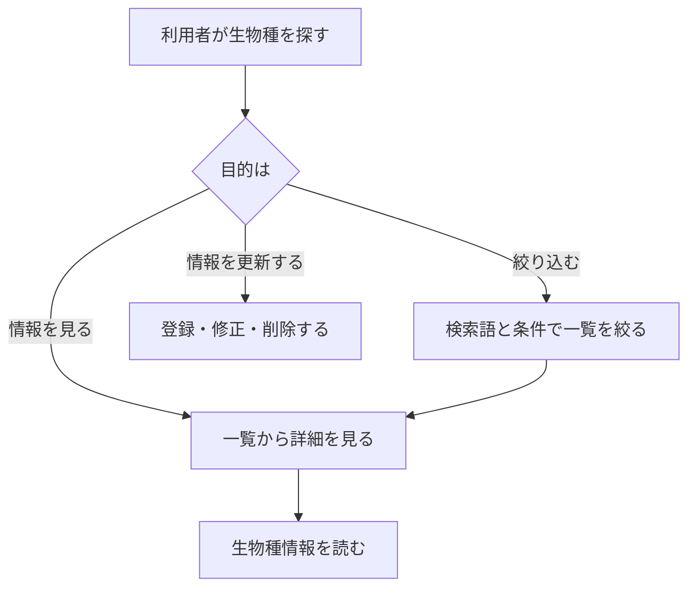
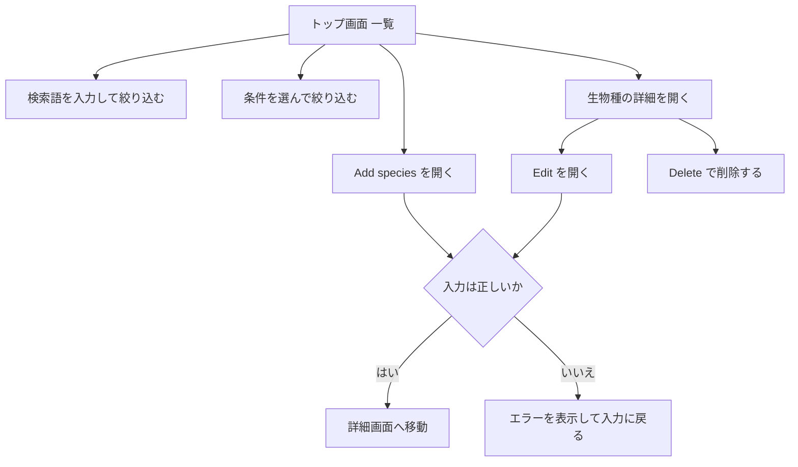

# 要件定義書: 生物種情報データベース

## 1. 目的・前提

### 1-0. システムの目的

生物種ごとの生物学的情報（分類、生息環境、食性、寿命、体重、保全状況など）を一か所にまとめ、利用者が Web ブラウザで閲覧・検索・絞り込みできるようにする。あわせて、利用者が情報を登録・修正・削除できるようにする。

### 用語集

| 用語 | 業務上の意味 | 本案件での使用範囲 | 同義語/類義語 |
|---|---|---|---|
| 生物種（Species） | 1 つの種を表す情報の単位 | 本システムで管理する 1 件のレコード | 種、species |
| 学名（Scientific name） | 国際的に使われる学術上の名前（属名と種小名） | 生物種を一意に識別する項目 | 学術名 |
| 和名（Common name） | 一般的に使われる名前 | 一覧・詳細で主に表示する名前 | 一般名、通称 |
| 分類群（Taxonomic class） | 生物の大分類（哺乳類、鳥類など） | 絞り込みの条件 | クラス |
| 生息環境（Habitat） | 主に暮らす環境（森林、草原など） | 絞り込みの条件 | 生息地 |
| 食性（Diet） | 主な食べ物の種類 | 絞り込みの条件 | 食べ物 |
| 保全状況（Conservation status） | 絶滅の危険度の区分（IUCN レッドリストの区分名を使う） | 絞り込みの条件 | 保全ステータス、レッドリスト区分 |

### システムの形態

- GUI（Web ブラウザの画面）。他のシステムへの提供（Web API）、コマンド、バッチは無い。

### 1-1. 技術制約（前提として記録する。要件ではないため ID は付与しない）

| 制約項目 | 内容 | 出どころ（誰がいつ答えたか） |
|---|---|---|
| 既存コードベース | 無し（新規開発） | ANSWERS.md（2026-11-05） |
| 配備先 | ローカルマシンで `bash run.sh` により起動する Web サーバー。Chromium で動くこと | contract.md |
| チームの技術 | 指定なし。Python 3.12 か Node.js 24 のいずれか。無償のものだけ | ANSWERS.md・contract.md |
| ライセンスとコスト | 無償のライブラリ・サービスのみ。外部サービスと有償 API は使わない | contract.md |
| 性能と規模の目安 | 利用者は少数。性能の数値目標は無い。データは数十件規模を想定 | ANSWERS.md（2026-11-05） |

### 1-2. 依頼に無く自分で決めた項目（必須）

| 項目 | 決めた内容 | 根拠（最小案か、依頼のどこから推測したか） | 承認（承認済 / 未確認） |
|---|---|---|---|
| 生物種の項目 | 学名、和名、分類群、生息環境、食性、寿命（年）、成体の体重（kg）、保全状況、説明の 9 項目。寿命・体重・説明は空欄可 | 依頼は「biological information」としか書いていないため、一般的な生物学的情報の最小限の項目を選んだ | 承認済（ANSWERS.md により承認） |
| 分類群・生息環境・食性・保全状況の選択肢 | 分類群 6（Mammals、Birds、Reptiles、Amphibians、Fish、Insects）、生息環境 8（Forest、Grassland、Wetland、Freshwater、Marine、Desert、Mountain、Urban）、食性 4（Herbivore、Carnivore、Omnivore、Insectivore）、保全状況 6（IUCN 区分の Least Concern、Near Threatened、Vulnerable、Endangered、Critically Endangered、Data Deficient） | 絞り込みに必要な区分を、最小の数で定義した | 承認済（ANSWERS.md により承認） |
| 一覧の並び順 | 和名の昇順（同じ和名は学名の昇順） | 並び順の指定が無いため、探しやすい最小の規則を選んだ | 承認済（ANSWERS.md により承認） |
| 入力チェックの上限 | 学名・和名は 100 文字以内、説明は 1000 文字以内。寿命は 1〜500 の整数、体重は 0 より大きく 200000 以下の数値 | 依頼に上限が無いため、一般的な生物の範囲を満たす値を選んだ | 承認済（ANSWERS.md により承認） |
| 学名の重複 | 同じ学名（大文字小文字と前後の空白を無視）は登録できない | 学名を一意の識別子とみなすため | 承認済（ANSWERS.md により承認） |
| 空欄・不正入力の文言 | 必須項目が空、選択肢に無い値、数値の範囲外のときは、入力フォームの上に英語の文言を表示し、登録・更新を行わない | 依頼に無いため最小案。画面の言語は英語（契約） | 承認済（ANSWERS.md により承認） |
| 削除の確認 | 削除ボタンを押すと確認ダイアログを出し、「OK」のときだけ削除する | 誤削除を防ぐ最小の確認 | 承認済（ANSWERS.md により承認） |
| 検索・絞り込みの結果が 0 件 | 「No species match the current search and filters.」と表示する | 依頼に無いため最小案 | 承認済（ANSWERS.md により承認） |
| 同時更新 | 後から保存した内容で上書きする（排他制御はしない） | 利用者は少数で、競合の要求は無いため最小案 | 承認済（ANSWERS.md により承認） |
| 認証 | 無し。誰でも閲覧・登録・修正・削除できる | ANSWERS.md（認証無し） | 承認済（ANSWERS.md により承認） |
| 件数の表示 | 一覧は件数の上限を設けず、全件を 1 ページに表示する | 数十件規模を想定し、ページ送りを足さない最小案 | 承認済（ANSWERS.md により承認） |

## 2. 業務

### 対象業務一覧

| RQ-BZ-ID | 業務名 | 業務の範囲 | 担当者 |
|---|---|---|---|
| `RQ-BZ-SPECIES-INFORMATION` | 生物種情報の管理 | 生物種の情報を閲覧・検索・絞り込み・登録・修正・削除する | 利用者（認証なし） |

### 2-1. 業務の問題（あるべき姿と現状のギャップ）

| 問題 | 対象業務（RQ-BZ） | あるべき姿 | 現状 | ギャップ（KPI） | 業務影響 |
|---|---|---|---|---|---|
| 生物種の情報が一か所に無く、探すのに手間がかかる | `RQ-BZ-SPECIES-INFORMATION` | 生物種の情報を一つの場所で閲覧・検索できる | 依頼に現状の記述は無い | 不明（依頼に数値が無いため算定しない） | 情報を探す時間が増える |
| 生物種の情報を登録・修正する手段が無い、または分かりにくい | `RQ-BZ-SPECIES-INFORMATION` | 利用者が画面から情報を追加・修正・削除できる | 依頼に現状の記述は無い | 不明（依頼に数値が無いため算定しない） | 情報が古いまま残る |

### 2-2. 業務課題一覧（必須）

| RQ-BK-ID | 業務課題（取り組むこと） | 解決する問題（2-1） | 解決後の状態（KPI の目標値） | 対象業務（RQ-BZ） |
|---|---|---|---|---|
| `RQ-BK-CENTRALIZE-SPECIES-DATA` | 生物種の情報を一つのデータベースにまとめ、一覧と詳細で閲覧できるようにする | 生物種の情報が一か所に無い | 全登録種を一覧と詳細で閲覧できる（目標値は依頼に無い） | `RQ-BZ-SPECIES-INFORMATION` |
| `RQ-BK-FIND-SPECIES-QUICKLY` | 検索語と条件で生物種を素早く絞り込めるようにする | 目的の情報を探すのに手間がかかる | 検索・絞り込みで目的の種に到達できる（目標値は依頼に無い） | `RQ-BZ-SPECIES-INFORMATION` |
| `RQ-BK-MAINTAIN-SPECIES-RECORDS` | 生物種の情報を画面から登録・修正・削除できるようにする | 情報を登録・修正する手段が分かりにくい | 画面から登録・修正・削除が完結する（目標値は依頼に無い） | `RQ-BZ-SPECIES-INFORMATION` |

### 2-3. 見込み経営効果

見込み経営効果は算定しない（理由: 依頼に金額・時間などの現状の数値が無く、算定の根拠が無いため）。`RQ-EF-*` は採番しない。

## 3. 機能要件

### 入力データと出力データ

- 入力: 利用者が画面のフォームに入力する生物種の情報、検索語、絞り込みの条件
- 出力: 画面に表示する生物種の一覧、詳細、入力エラーの文言

### 全機能の利用フロー

### 機能一覧

| RQ-ID | カテゴリ | 機能名 | 対応業務課題ID（RQ-BK-*） | この機能が無いと何が困るか |
|---|---|---|---|---|
| `RQ-FT-BROWSE-SPECIES-LIST` | 業務機能 | 生物種の一覧表示（和名の昇順） | `RQ-BK-CENTRALIZE-SPECIES-DATA` | 登録された生物種を見られない |
| `RQ-FT-VIEW-SPECIES-DETAIL` | 業務機能 | 生物種の詳細表示 | `RQ-BK-CENTRALIZE-SPECIES-DATA` | 生物種の全項目を読めない |
| `RQ-FT-SEARCH-SPECIES` | 業務機能 | キーワードによる検索（学名・和名・説明） | `RQ-BK-FIND-SPECIES-QUICKLY` | 目的の種を名前で探せない |
| `RQ-FT-FILTER-SPECIES` | 業務機能 | 分類群・生息環境・食性・保全状況による絞り込み | `RQ-BK-FIND-SPECIES-QUICKLY` | 条件で種を比べられない |
| `RQ-FT-CREATE-SPECIES` | 業務機能 | 生物種の登録 | `RQ-BK-MAINTAIN-SPECIES-RECORDS` | 新しい種の情報を追加できない |
| `RQ-FT-UPDATE-SPECIES` | 業務機能 | 生物種の情報の修正 | `RQ-BK-MAINTAIN-SPECIES-RECORDS` | 古い情報を直せない |
| `RQ-FT-DELETE-SPECIES` | 業務機能 | 生物種の削除 | `RQ-BK-MAINTAIN-SPECIES-RECORDS` | 誤登録を取り除けない |
| `RQ-FT-VALIDATE-SPECIES-INPUT` | 業務機能 | 生物種の入力チェック（業務ルール 3-2） | `RQ-BK-MAINTAIN-SPECIES-RECORDS` | 不正な情報が登録され、一覧と検索が壊れる |

### 業務フローとの対応

| 業務フローの段階 | 対応する機能 |
|---|---|
| 生物種を探す | `RQ-FT-BROWSE-SPECIES-LIST`、`RQ-FT-SEARCH-SPECIES`、`RQ-FT-FILTER-SPECIES` |
| 生物種の情報を読む | `RQ-FT-VIEW-SPECIES-DETAIL` |
| 情報を更新する | `RQ-FT-CREATE-SPECIES`、`RQ-FT-UPDATE-SPECIES`、`RQ-FT-DELETE-SPECIES`、`RQ-FT-VALIDATE-SPECIES-INPUT` |

### システムの形態ごとの仕様（GUI）

画面遷移図は上の利用フローのとおり。画面ごとの 5 項目は次のとおり。画面の一覧は 4-5 に書く。

**一覧画面（トップ画面、`RQ-UI-SPECIES-LIST-SCREEN`）**

- 目的: 生物種の一覧を閲覧し、検索・絞り込みを行う
- 主要要素: 検索欄、分類群・生息環境・食性・保全状況の選択欄、Search ボタン、Clear ボタン、一覧表、Add species ボタン
- 入力項目: 検索語（任意）、4 つの選択欄（任意。「All」で条件なし）
- 表示項目: 和名、学名、分類群、生息環境、食性、保全状況。和名をクリックすると詳細画面へ移動する
- エラー時の見え方: 0 件のときは「No species match the current search and filters.」を一覧の位置に表示する

**詳細画面（`RQ-UI-SPECIES-DETAIL-SCREEN`）**

- 目的: 1 種の生物学的情報をすべて表示し、修正・削除を行う
- 主要要素: 和名（見出し）、学名、各項目、Edit ボタン、Delete ボタン、Back to list リンク
- 入力項目: 無し
- 表示項目: 9 項目すべて。空欄の項目は「Unknown」と表示する
- エラー時の見え方: 存在しない ID のときは「Species not found」の 404 画面を表示する

**登録・修正画面（`RQ-UI-SPECIES-FORM-SCREEN`）**

- 目的: 生物種を新規に登録し、既存の情報を修正する
- 主要要素: 項目ごとの入力欄（分類群・生息環境・食性・保全状況は選択欄）、Save ボタン、Cancel リンク
- 入力項目: 学名（必須）、和名（必須）、分類群（必須）、生息環境（必須）、食性（必須）、寿命（任意）、成体の体重（任意）、保全状況（必須）、説明（任意）
- 表示項目: 入力値を保持したまま再表示する
- エラー時の見え方: 入力欄の上に英語の文言（例: 「Scientific name is required.」「Scientific name already exists.」「Lifespan must be a whole number from 1 to 500.」）を表示し、入力値は残す

### 3-1. 帳票・出力ファイル

帳票・出力ファイルは無い。

### 3-2. 業務ルール

| RQ-ID | ルール名 | 内容（条件と結果） | 違反時・エラー時の業務上の扱い | 対応業務課題ID（RQ-BK-*） |
|---|---|---|---|---|
| `RQ-FT-VALIDATE-SPECIES-INPUT` | 生物種の入力ルール | 学名は必須で、他の登録と重複しない（大文字小文字と前後の空白を無視）。和名は必須。分類群・生息環境・食性・保全状況は定められた選択肢のいずれかが必須。寿命は空欄可、空欄でなければ 1〜500 の整数。体重は空欄可、空欄でなければ 0 より大きく 200000 以下の数値。学名・和名は 100 文字以内、説明は 1000 文字以内 | 違反したら登録・更新せず、入力フォームに英語の文言を表示し、入力値を残す | `RQ-BK-MAINTAIN-SPECIES-RECORDS` |

業務ルールはこの 1 件だけ。

### 3-3. 外部連携

外部連携は無い。

## 4. データ

### 4-1. データ要件一覧

| RQ-ID | 種別 | 内容 | 対応業務課題ID（RQ-BK-*） | この要件が無いと何が困るか |
|---|---|---|---|---|
| `RQ-DT-SPECIES-STORE` | 内部データ | 生物種の情報は内部データとして、実行環境の DATA_DIR の下に 1 つのデータベースファイルで保存する。外部データは扱わない。保持期間は無期限（利用者が削除するまで） | `RQ-BK-CENTRALIZE-SPECIES-DATA` | 登録した情報が再起動で消え、一覧に残らない |

DB の必要性: 生物種の登録・検索・絞り込み・修正・削除が必要で、件数は数十件規模、参照関係は無い。検索と絞り込みを行うため、ファイル保存より DB が適する。

### 4-2. 業務エンティティとデータ項目

| RQ-ID | カテゴリ | 業務エンティティ名 | 対応業務課題ID（RQ-BK-*） | この業務エンティティが無いと何が困るか |
|---|---|---|---|---|
| `RQ-DT-SPECIES` | 業務 | 生物種 | `RQ-BK-CENTRALIZE-SPECIES-DATA`、`RQ-BK-FIND-SPECIES-QUICKLY`、`RQ-BK-MAINTAIN-SPECIES-RECORDS` | 生物種の情報を保存できず、閲覧・検索・登録ができない |

| エンティティ名 | 項目名 | 業務上の意味 | 必須 | 形式・桁 | 値の範囲・制約 | 例 |
|---|---|---|---|---|---|---|
| 生物種 | 学名 | 学術上の名前 | 必須 | 文字列、100 文字以内 | 他の生物種と重複しない（大文字小文字・前後の空白を無視） | Canis lupus |
| 生物種 | 和名 | 一般的な名前 | 必須 | 文字列、100 文字以内 | なし | Gray wolf |
| 生物種 | 分類群 | 大分類 | 必須 | 選択肢 | Mammals、Birds、Reptiles、Amphibians、Fish、Insects | Mammals |
| 生物種 | 生息環境 | 主な生息環境 | 必須 | 選択肢 | Forest、Grassland、Wetland、Freshwater、Marine、Desert、Mountain、Urban | Forest |
| 生物種 | 食性 | 主な食べ物の種類 | 必須 | 選択肢 | Herbivore、Carnivore、Omnivore、Insectivore | Carnivore |
| 生物種 | 寿命 | 野生での平均寿命（年） | 任意 | 整数 | 1〜500 | 12 |
| 生物種 | 成体の体重 | 成体の平均的な体重（kg） | 任意 | 数値（小数可） | 0 より大きく 200000 以下 | 40 |
| 生物種 | 保全状況 | IUCN の保全区分 | 必須 | 選択肢 | Least Concern、Near Threatened、Vulnerable、Endangered、Critically Endangered、Data Deficient | Least Concern |
| 生物種 | 説明 | 生物種の概要 | 任意 | 文字列、1000 文字以内 | なし | Large canid of the northern forests. |

### 4-3. CRUD テーブル（必須）

| エンティティ名 | Create | Read（一覧） | Read（詳細） | 検索 | Update | Delete | 備考 |
|---|---|---|---|---|---|---|---|
| 生物種 | ○ | ○ | ○ | ○ | ○ | ○ | 検索: 学名・和名・説明のキーワード（部分一致、大文字小文字を無視）と、分類群・生息環境・食性・保全状況の選択による絞り込み（AND 条件）。トランザクションは単一の行の更新のみ |

### 4-4. 状態遷移

状態を持つエンティティは無い。

### 4-5. 画面一覧（GUI の場合のみ）

| RQ-ID | 画面名 | 対応する CRUD 操作（エンティティ名:操作種別） | 主な機能・目的 | 対応業務課題ID（RQ-BK-*） |
|---|---|---|---|---|
| `RQ-UI-SPECIES-LIST-SCREEN` | 一覧画面（トップ） | 生物種:Read（一覧）、生物種:検索 | 一覧表示、キーワード検索、条件の絞り込み | `RQ-BK-CENTRALIZE-SPECIES-DATA`、`RQ-BK-FIND-SPECIES-QUICKLY` |
| `RQ-UI-SPECIES-DETAIL-SCREEN` | 詳細画面 | 生物種:Read（詳細）、生物種:Delete | 1 種の全項目の表示、削除 | `RQ-BK-CENTRALIZE-SPECIES-DATA`、`RQ-BK-MAINTAIN-SPECIES-RECORDS` |
| `RQ-UI-SPECIES-FORM-SCREEN` | 登録・修正画面 | 生物種:Create、生物種:Update | 生物種の登録と修正 | `RQ-BK-MAINTAIN-SPECIES-RECORDS` |
| `RQ-UI-SITE-LAYOUT` | 共通レイアウト | なし（全画面共通） | 画面上部のナビゲーションメニュー（Browse species、Add species）、薄いベージュの背景（linen、#FAF0E6）、マルーン色（maroon、#800000）の部品 | `RQ-BK-CENTRALIZE-SPECIES-DATA` |

## 5. 非機能要件

| RQ-ID | カテゴリ | 非機能要件名 | 対応業務課題ID（RQ-BK-*） | この非機能要件が無いと何が困るか |
|---|---|---|---|---|
| `RQ-NF-ACCESS-OPEN` | 利用者とアクセス経路 | 利用者は一般の利用者。認証は無く、ローカルマシンで起動した Web サーバーに Web ブラウザからアクセスする | `RQ-BK-CENTRALIZE-SPECIES-DATA` | 利用者の範囲と認証の要否が決まらず、設計の前提が定まらない |
| `RQ-NF-CHROMIUM-BROWSER` | 対応ブラウザ | 画面は Chromium 系ブラウザで正しく表示され、操作できる | `RQ-BK-CENTRALIZE-SPECIES-DATA` | 採点の環境で画面が使えない |

- 性能の目標値は無い（利用者は少数、データは数十件規模）。可用性の要求は無い。移行は無い（新規開発でデータの移し替えは無い）。セキュリティは認証無しの前提で、入力値の検証（RQ-FT-VALIDATE-SPECIES-INPUT）と出力時の HTML エスケープのみ行う。

## 6. 運用要件

| RQ-ID | 種別 | 内容 | 対応業務課題ID（RQ-BK-*） | この要件が無いと何が困るか |
|---|---|---|---|---|
| `RQ-OP-STARTUP-COMMANDS` | 起動 | `bash setup.sh` で依存関係を確認し、`PORT=任意 bash run.sh` で Web サーバーを前面で起動する。PORT の既定値は 8000、保存先の DATA_DIR が無ければ作る | `RQ-BK-CENTRALIZE-SPECIES-DATA` | 起動方法が分からず、採点で起動できない |
| `RQ-OP-SAMPLE-DATA-ON-EMPTY` | 初期データ | DATA_DIR が空（データベースが無い）のとき、サンプルの生物種を十数件入れて起動する。サンプルは一覧・検索・絞り込みを試せるように分類群・生息環境・食性・保全状況を散らす | `RQ-BK-CENTRALIZE-SPECIES-DATA` | 初回に何も表示されず、機能を試せない |

- ログ: ログは必要ないため、ログの内容と保存期間の記述は行わない（標準出力に起動メッセージのみ出す）
- 監査ログ: 不要
- 監視・アラート: 監視・アラートは必要ないため、監視・アラートの内容と対応方法の記述は行わない
- バックアップ: バックアップは必要ない

## 7. テスト用利用シナリオ

| RQ-ID | テスト目的 | 前提条件 | テスト手順 | 期待される結果 | 検証する要件ID | 対応業務課題ID（RQ-BK-*） |
|---|---|---|---|---|---|---|
| `RQ-TS-BROWSE-SPECIES-LIST` | 一覧に生物種が表示される | 空の DATA_DIR で起動（サンプル投入）。ブラウザで / を開く | 1. トップ画面を開く | サンプルの生物種が和名順に一覧表示される。上部にナビゲーションメニュー（Browse species、Add species）がある | `RQ-FT-BROWSE-SPECIES-LIST`、`RQ-UI-SPECIES-LIST-SCREEN`、`RQ-UI-SITE-LAYOUT`、`RQ-OP-SAMPLE-DATA-ON-EMPTY` | `RQ-BK-CENTRALIZE-SPECIES-DATA` |
| `RQ-TS-VIEW-SPECIES-DETAIL` | 詳細画面で全項目が見える | サンプルがある | 1. 一覧で生物種の和名を選ぶ 2. 詳細を確認する 3. 存在しない ID の URL を開く | 9 項目が表示され、空欄は Unknown。存在しない ID は「Species not found」の 404 画面 | `RQ-FT-VIEW-SPECIES-DETAIL`、`RQ-UI-SPECIES-DETAIL-SCREEN` | `RQ-BK-CENTRALIZE-SPECIES-DATA` |
| `RQ-TS-SEARCH-SPECIES` | キーワードで検索できる | サンプルがある | 1. 検索欄に一部の和名を入れて Search を押す 2. 存在しない語で検索する | 一致する種だけが表示される。一致が無いときは「No species match the current search and filters.」 | `RQ-FT-SEARCH-SPECIES`、`RQ-UI-SPECIES-LIST-SCREEN` | `RQ-BK-FIND-SPECIES-QUICKLY` |
| `RQ-TS-FILTER-SPECIES` | 条件で絞り込める | サンプルがある | 1. 分類群 Birds を選ぶ 2. Habitat と Diet を組み合わせる 3. Clear を押す | 選んだ条件の AND で絞られる。Clear で全件に戻る | `RQ-FT-FILTER-SPECIES`、`RQ-UI-SPECIES-LIST-SCREEN` | `RQ-BK-FIND-SPECIES-QUICKLY` |
| `RQ-TS-CREATE-SPECIES` | 画面から登録できる | 学名が未登録 | 1. Add species を開く 2. 全必須項目を入れて Save する | 一覧と詳細に新しい種が表示される | `RQ-FT-CREATE-SPECIES`、`RQ-UI-SPECIES-FORM-SCREEN` | `RQ-BK-MAINTAIN-SPECIES-RECORDS` |
| `RQ-TS-VALIDATE-SPECIES-INPUT` | 入力エラーが表示され、登録されない | 登録画面を開く | 1. 必須項目を空にして Save 2. 既存の学名を入れて Save 3. 寿命に 0 を入れて Save | 各場合に英語のエラー文言が表示され、データは増えない。入力値は残る | `RQ-FT-VALIDATE-SPECIES-INPUT`、`RQ-UI-SPECIES-FORM-SCREEN` | `RQ-BK-MAINTAIN-SPECIES-RECORDS` |
| `RQ-TS-UPDATE-SPECIES` | 画面から修正できる | サンプルがある | 1. 詳細の Edit を開く 2. 説明を変えて Save する | 詳細画面に変更後の説明が表示される | `RQ-FT-UPDATE-SPECIES`、`RQ-UI-SPECIES-FORM-SCREEN` | `RQ-BK-MAINTAIN-SPECIES-RECORDS` |
| `RQ-TS-DELETE-SPECIES` | 画面から削除できる | サンプルがある | 1. 詳細の Delete を押す（確認は OK） 2. 一覧を開く 3. 削除した ID の詳細 URL を開く | 一覧から消え、詳細は 404 になる | `RQ-FT-DELETE-SPECIES`、`RQ-UI-SPECIES-DETAIL-SCREEN` | `RQ-BK-MAINTAIN-SPECIES-RECORDS` |
| `RQ-TS-NAVIGATION-AND-STYLE` | ナビゲーションと配色が指定どおり | サンプルがある | 1. 各画面でメニューの Browse species と Add species を押す 2. 配色を確認する | 全画面で同じメニューが見え、背景は linen、部品は maroon | `RQ-UI-SITE-LAYOUT`、`RQ-NF-CHROMIUM-BROWSER` | `RQ-BK-CENTRALIZE-SPECIES-DATA` |
| `RQ-TS-FRESH-START` | 空の保存先でも起動し、サンプルが見える | DATA_DIR が空 | 1. `bash run.sh` を起動する 2. / を開く | 起動し、サンプルが表示される | `RQ-OP-SAMPLE-DATA-ON-EMPTY`、`RQ-FT-BROWSE-SPECIES-LIST` | `RQ-BK-CENTRALIZE-SPECIES-DATA` |

検証の補足: `RQ-FT-*`・`RQ-UI-*` すべてを上の表の 1 本以上に含める。`RQ-FT-BROWSE-SPECIES-LIST` は `RQ-TS-BROWSE-SPECIES-LIST` と `RQ-TS-FRESH-START` で確かめる。

### 業務課題と要件の対応表

| 業務課題（RQ-BK） | 対応する要件 |
|---|---|
| `RQ-BK-CENTRALIZE-SPECIES-DATA` | `RQ-FT-BROWSE-SPECIES-LIST`、`RQ-FT-VIEW-SPECIES-DETAIL`、`RQ-UI-SITE-LAYOUT`、`RQ-UI-SPECIES-LIST-SCREEN`、`RQ-UI-SPECIES-DETAIL-SCREEN`、`RQ-DT-SPECIES-STORE`、`RQ-DT-SPECIES`、`RQ-NF-ACCESS-OPEN`、`RQ-NF-CHROMIUM-BROWSER`、`RQ-OP-STARTUP-COMMANDS`、`RQ-OP-SAMPLE-DATA-ON-EMPTY`、`RQ-TS-*`（一覧・詳細・配色・起動） |
| `RQ-BK-FIND-SPECIES-QUICKLY` | `RQ-FT-SEARCH-SPECIES`、`RQ-FT-FILTER-SPECIES`、`RQ-UI-SPECIES-LIST-SCREEN` |
| `RQ-BK-MAINTAIN-SPECIES-RECORDS` | `RQ-FT-CREATE-SPECIES`、`RQ-FT-UPDATE-SPECIES`、`RQ-FT-DELETE-SPECIES`、`RQ-FT-VALIDATE-SPECIES-INPUT`、`RQ-UI-SPECIES-FORM-SCREEN` |
