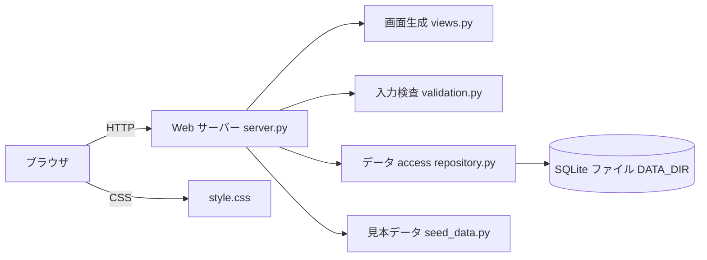
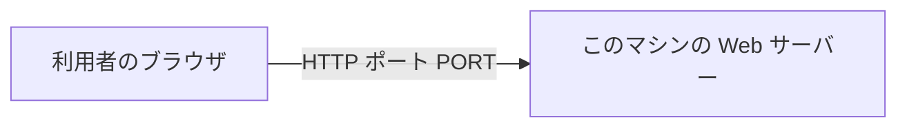
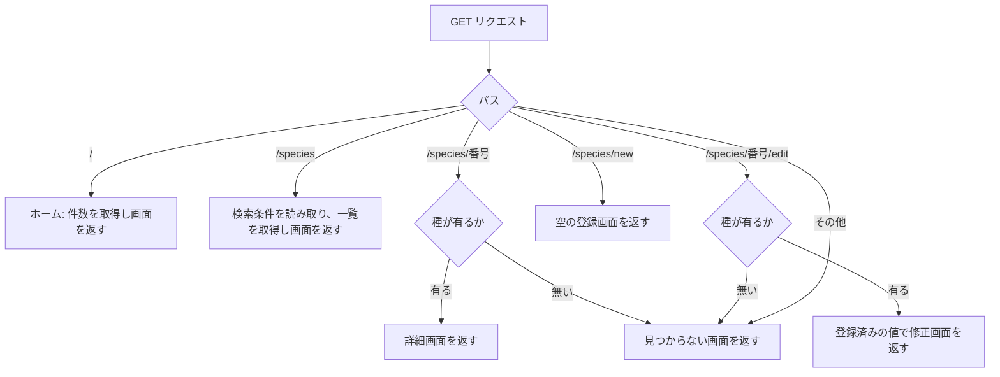
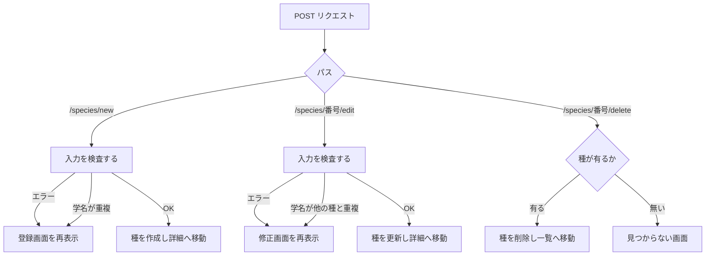
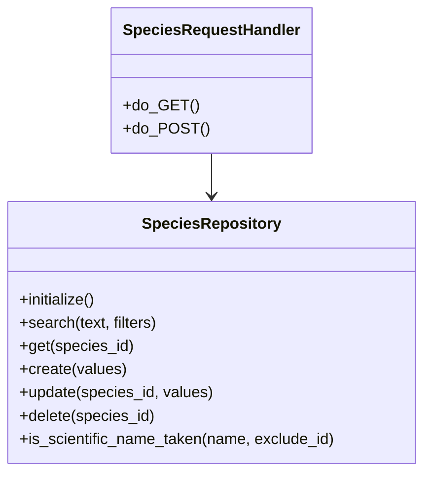
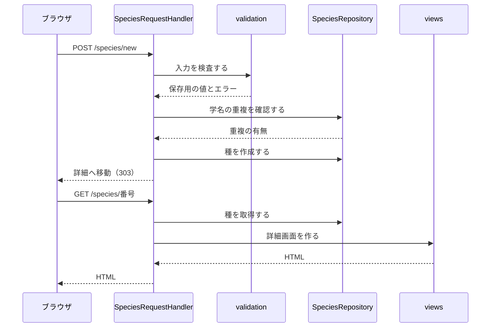

# 詳細設計書: 生物種情報データベース（Species Information Database）

## 1. 言語・フレームワーク・アーキテクチャの選定

### 判定の記録

- 判定日時: 2026-11-05
- 技術制約の要約（要件定義書 1-1 より）: 既存コードは無い。ローカルマシンまたは社内ネットワークの Web サーバーで動かす。コンテナは使わない。無料のライブラリのみ。Python 3.12（`python3`）と Node.js 24 が使える環境。画面は英語。
- 要件からの条件: 画面は 7 種（ホーム、一覧、詳細、登録、修正、見つからない、案内メニュー）。データは種 1,000 件以下の 1 テーブル。同時接続 5 人程度。画面は HTML で表示し、Web API は作らない。

### 判断軸

| 判断軸 | 見るもの | この案件での評価 |
|---|---|---|
| 既存資産との整合 | 既存コード | 無し。判断軸は効かない |
| チームの技術 | 扱える言語、禁止技術 | 制約無し。Python 3.12 が使える |
| 配備先 | OS、コンテナ可否 | macOS とその他 Python 3.12 が動く環境。コンテナは使わない。外部のライブラリ取得は setup.sh の時だけ |
| 認証と認可の境界 | 認証、権限 | 無し。フロントとバックを分ける理由が無い |
| 画面の規模 | 画面数、遷移 | 7 画面。サーバーで HTML を生成すれば足りる |
| データの規模と構造 | 件数、検索 | 1,000 件以下、1 テーブル、部分一致検索と 4 項目の絞り込み。ファイル形式の DB で足りる |
| 外部連携 | 連携先 | 無し |
| ライセンスとコスト | 有償、OSS | 無料のみ。標準ライブラリは追加の取得が要らない |
| 保守性 | 保守状況 | 標準ライブラリは Python と共に保守される。外部フレームワークは PyPI の最新版を確認するだけにとどめる |

### 候補の比較

| 候補 | 判断軸ごとの評価 | 出典 URL | 確認日 |
|---|---|---|---|
| A. Python 3.12 標準ライブラリ（http.server の ThreadingHTTPServer、sqlite3、html） | 追加の取得が不要。5 人程度の同時利用に足りる。画面は HTML 文字列で生成する | Python 標準ライブラリの公式ドキュメント（https://docs.python.org/3.12/library/http.server.html、https://docs.python.org/3.12/library/sqlite3.html）。公式ページは本環境から取得できず、未調査 | 2026-11-05（ローカルの `python3.12 --version` が 3.12.13 を返すことで確認） |
| B. Flask 3.1.3 + sqlite3 | ルーティングとテンプレートが書きやすい。依存が 1 つ増える。setup.sh で取得が必要 | PyPI の索引（`pip index versions flask` の最新版 3.1.3） | 2026-11-05（公式ドキュメントは未調査） |
| C. Node.js 24 の標準 http | 実行環境は揃っている。SQLite の扱いと HTML 生成を別途確認する必要がある | 未調査 | 未調査 |

### 最終選定

- 言語: Python 3.12（契約書で指定された `python3`）
- フレームワーク: 無し（標準ライブラリの ThreadingHTTPServer と BaseHTTPRequestHandler）
- DB: SQLite（標準ライブラリの sqlite3。ファイルは DATA_DIR の下）
- 実行形態: `server`（サーバー。コンテナは使わない）
- 選定理由: 外部の取得が要らず、起動がもっとも単純で、要件の画面数と件数に足りる（業務要件との対応: RQ-OP-START-SCRIPTS、RQ-NF-CONCURRENT-USERS、RQ-DT-SPECIES-STORAGE）。候補 B は依存が増える割に得られるものが少ないため採らない。候補 C は契約書の環境で動くが、SQLite と HTML の扱いを新たに確認する手間が要るため採らない。
- 画面の構成: 1 つのサーバーが HTML を返す形（フロントとバックを分けない）。認証の境界が無いため、フロントとバックを分ける利点が無い。
- E2E の実行手段（8-3）: Playwright（Python）と Chromium。PyPI の最新版は 1.64.1（2026-11-05 に `pip index versions playwright` で確認。公式ドキュメントは未調査）。
- ユーザー承認: 未確認。公式情報の取得ができなかったため、比較表の出典は「未調査」を含む。承認が得られるまで、この選定を確定扱いにしない。

## 2. システム構成

### コンポーネント一覧

| コンポーネント | 役割 | 対応する要件 |
|---|---|---|
| Web サーバー（src/server.py） | HTTP の受付、画面の振り分け、フォームの処理 | 画面、登録・修正・削除、同時接続 |
| 画面生成（src/views.py） | HTML の組み立て。利用者の入力をエスケープする | 画面一覧、案内メニュー、英語表示 |
| 入力検査（src/validation.py） | 入力の検査、検索条件の読み取り、固定リスト | 入力検査、検索、絞り込み |
| データ access（src/repository.py） | SQLite の読み書き、学名の重複確認、初期化 | 保存、検索、保持 |
| 見本データ（src/seed_data.py） | 初回起動時の見本の種 | 初期データ |
| 静的ファイル（src/static/style.css） | 配色（リネン、マルーン）と見た目 | 配色 |
| 起動スクリプト（setup.sh、run.sh） | 初回の準備と起動 | 起動 |

### システム全体構成図



### 各コンポーネントの役割と機能

- Web サーバー: GET と POST を受けて、画面の種類を決める。POST の結果は画面へのリダイレクト（再読み込みで二重登録しないため）。
- 画面生成: 各画面の HTML を返す。すべての利用者の入力は表示の前に HTML エスケープする。
- 入力検査: フォームの値を検査し、保存用の値と項目ごとのエラーを返す。
- データ access: 種の読み書きと検索。すべて 1 操作 1 トランザクション。
- 見本データ: 初回起動時に一度だけ投入する。

### コンポーネント間インターフェースとデータフロー

- ブラウザ → Web サーバー: GET（画面）、POST（登録・修正・削除）。フォームは `application/x-www-form-urlencoded`。
- Web サーバー → データ access: 種の取得・検索・作成・更新・削除、学名の重複確認、件数の取得。
- Web サーバー → 入力検査: フォームの値。検査結果（保存用の値、エラーの一覧）。
- Web サーバー → 画面生成: 表示する値。HTML の文字列。

### ネットワーク構成図

ブラウザと Web サーバーの間が HTTP で通信する。外部システムとは通信しない。



## 3. データ設計

### 3-1. データモデル

DB が必要。種は件数が 1,000 件以下で、検索と絞り込みを行うため、SQLite を使う。DB 製品は第 1 章で選んだ SQLite だけ。

- 種テーブル（DS-SC-SPECIES-TABLE）: 次の列を持つ。

  | 列 | 型 | 制約 | 対応する項目（要件 4-2） |
  |---|---|---|---|
  | id | 整数 | 主キー、自動採番 | ― |
  | scientific_name | 文字列 | 必須。大文字小文字を区別しない一意インデックス | 学名 |
  | common_name | 文字列 | 必須 | 一般名 |
  | class_name | 文字列 | 必須。固定リストの値 | 綱 |
  | family | 文字列 | 任意（空文字を許す） | 科 |
  | habitat | 文字列 | 必須。固定リストの値 | 生息環境 |
  | diet | 文字列 | 必須。固定リストの値 | 食性 |
  | conservation_status | 文字列 | 必須。固定リストの値 | 保全状況 |
  | average_lifespan_years | 整数 | 任意（NULL を許す） | 平均寿命（年） |
  | average_adult_mass_kg | 実数 | 任意（NULL を許す）。小数点以下 2 桁に丸める | 成体の平均体重（kg） |
  | description | 文字列 | 任意（空文字を許す） | 説明 |

- メタテーブル（DS-SC-META-TABLE）: キーと値の 2 列。見本データを投入済みかを記録する 1 行だけを使う。

- 固定リスト（DS-SC-CODE-LISTS）: 綱、生息環境、食性、保全状況の値と表示名。`validation.py` の定数として持つ。DB には値（コード）を保存する。

- リレーション: 無し（テーブルは 1 つ）。
- 学名の一意性は、一意インデックス（小文字に揃えた学名）で保証する。アプリでも登録の前に確認し、重複時は画面に文言を出す。

### 3-2. トランザクションと排他制御

- 登録・修正・削除: 1 操作を 1 トランザクションで行い、成功したら確定、失敗したら取り消す。複数操作の一体完了は無い。
- 排他制御: 行わない（要件 1-2 の決め事）。後から保存した内容が有効になる。
- 学名の重複: 登録・修正の直前に確認し、一意インデックスでも守る。両方が同時に通った場合は一意インデックスの違反を失敗として扱い、「This scientific name is already registered.」を表示する。

### 3-3. 状態遷移

状態を持つエンティティは無い。

## 4. アーキテクチャ設計

### 4-1. 外部設計

#### 利用者向けインターフェース（画面）

| DS-IF | 画面 | 要素と機能 |
|---|---|---|
| DS-IF-NAVIGATION-MENU | 案内メニュー（全画面共通） | 「Species Database」（ホームへ）、「Home」、「Browse species」、「Add species」 |
| DS-IF-HOME-SCREEN | ホーム画面（/） | 見出し、件数（Total species、Threatened species）、ボタン「Browse species」「Add species」 |
| DS-IF-SPECIES-LIST-SCREEN | 種の一覧・検索画面（/species） | 検索欄（Search by name）、絞り込みの選択 4 つ（Class、Habitat、Diet、Conservation status。先頭「All」）、ボタン「Search」「Clear」、件数表示、表（Common name、Scientific name、Class、Habitat、Diet、Conservation status）、ボタン「Add species」。行は詳細へのリンク |
| DS-IF-SPECIES-DETAIL-SCREEN | 種の詳細画面（/species/番号） | 一般名、学名、全項目、「Back to results」「Edit」「Delete」（確認ダイアログ付き） |
| DS-IF-SPECIES-CREATE-SCREEN | 種の登録画面（/species/new） | 入力欄（4-2 の項目）、「Save」「Cancel」。エラーは上部の一覧と各欄の下に表示 |
| DS-IF-SPECIES-EDIT-SCREEN | 種の修正画面（/species/番号/edit） | 登録画面と同じ。値は登録済みの内容を初期値にする |
| DS-IF-NOT-FOUND-SCREEN | 見つからない種の画面（存在しない番号） | 「Species not found.」、「Back to species list」 |

画面の見た目は、共通の CSS（src/static/style.css）で作る。背景はリネン（#FAF0E6）、ナビゲーション・ボタン・表の見出し・リンク・フォーカス枠などはマルーン（#800000）、本文は #2B1D1D。

#### 画面の操作と応答

| 操作 | 入力 | 検査 | 出力 | エラー時の応答 |
|---|---|---|---|---|
| 一覧表示（GET /species） | 検索文字列、綱、生息環境、食性、保全状況（空または All は無視） | 検索文字列は前後の空白を除く。選択値が固定リストに無ければ無視 | 絞り込み後の一覧と件数 | 無し（不正な値は無視して全件扱い） |
| 詳細表示（GET /species/番号） | 番号 | 番号が整数で、該当が無い → 見つからない画面 | 全項目 | 見つからない画面（404） |
| 登録（POST /species/new） | 4-2 の全項目 | 項目ごとの検査（validation.py）と学名の重複確認 | 成功: 詳細画面へ移動し「Species saved.」 | 登録画面を再表示。エラー一覧と入力内容を保持 |
| 修正（POST /species/番号/edit） | 4-2 の全項目 | 登録と同じ。自分自身の学名は重複扱いしない | 成功: 詳細画面へ移動し「Species saved.」 | 修正画面を再表示。エラー一覧と入力内容を保持 |
| 削除（POST /species/番号/delete） | 番号 | 該当が無ければ見つからない画面 | 一覧へ移動し「Species deleted.」 | 見つからない画面（404） |

#### 入力の検査（DS-FN-VALIDATE-SPECIES-FIELDS の仕様）

| 項目 | 必須 | 検査 | 表示するエラー文言 |
|---|---|---|---|
| 学名 | 必須 | 前後の空白を除いて 2〜100 文字 | 「Scientific name is required (2 to 100 characters).」 |
| 一般名 | 必須 | 1〜100 文字 | 「Common name is required (up to 100 characters).」 |
| 綱 | 必須 | 固定リストの値 | 「Choose a class.」 |
| 科 | 任意 | 100 文字以下 | 「Family must be 100 characters or fewer.」 |
| 生息環境 | 必須 | 固定リストの値 | 「Choose a habitat.」 |
| 食性 | 必須 | 固定リストの値 | 「Choose a diet.」 |
| 保全状況 | 必須 | 固定リストの値 | 「Choose a conservation status.」 |
| 平均寿命（年） | 任意 | 空、または 1〜300 の整数 | 「Average lifespan must be a whole number from 1 to 300.」 |
| 成体の平均体重（kg） | 任意 | 空、または 0 より大きく 200000 以下の数（小数点以下 2 桁まで） | 「Average adult mass must be a number greater than 0 and at most 200000 (up to 2 decimals).」 |
| 説明 | 任意 | 1000 文字以下 | 「Description must be 1000 characters or fewer.」 |
| 学名の重複 | ― | 小文字に揃えて既存の種と同じなら保存しない | 「This scientific name is already registered.」（学名の欄） |

- 検査は全項目を行い、エラーを項目ごとに集める（最初の 1 件で止めない）。
- 空欄の任意項目は、平均寿命と平均体重は NULL、説明と科は空文字で保存する。

#### 検索条件の読み取り（DS-FN-PARSE-SEARCH-QUERY の仕様）

- 検索文字列: 前後の空白を除き、英字を小文字にして比べる。
- 絞り込み: 綱、生息環境、食性、保全状況。固定リストに無い値と「All」は無視する。
- 件数表示: 絞り込み後の件数と全件数を「Showing N of M species」と書く。

#### 外部連携

無し。

### 4-2. 内部設計

#### 処理フロー（GET）



#### 処理フロー（POST）



#### 各処理の役割

- 起動時の処理: DATA_DIR を作る。DB を開き、テーブルが無ければ作る。メタテーブルで見本データを投入済みか確かめ、未投入なら見本データを入れて記録する。その後 Web サーバーを起動する。
- 一覧の検索: 検索文字列は学名と一般名のどちらかに含まれるか（小文字に揃えて比べる）、絞り込みは AND。並びは一般名の昇順（小文字に揃えて比べ、同じなら学名の昇順）。
- 件数: 全件数、VU・EN・CR の件数。ホーム画面で使う。
- 例外: DB への書き込みに失敗したら、画面に「Something went wrong. Please try again.」を表示し、HTTP 500 を返す（詳細は第 6 章）。

#### バッチ

無し。

## 5. クラス設計

### 全クラス一覧

| クラス | 所在 | 責務（1 文） |
|---|---|---|
| SpeciesRequestHandler | src/server.py | HTTP のリクエストを受け、適切な処理と画面に振り分ける |
| SpeciesRepository | src/repository.py | 種のテーブルを読み書きする |

### クラスの責務と主要メソッド

- SpeciesRequestHandler（DS-CL-SPECIES-REQUEST-HANDLER）
  - 主要メソッド: do_GET（GET の振り分け）、do_POST（POST の振り分け）
  - 属性: 共有の SpeciesRepository（サーバー起動時に作り、全スレッドで共有する。各操作は独自の接続を開く）
- SpeciesRepository（DS-CL-SPECIES-REPOSITORY）
  - 主要メソッド: initialize、search、count_species、count_threatened_species、get、create、update、delete、is_scientific_name_taken
  - 属性: DB のファイルの場所

### クラス図



### システム内メッセージ一覧

| メッセージ | 送信元 → 受信元 | 役割 |
|---|---|---|
| 画面要求 | SpeciesRequestHandler → views | 表示する値を渡し HTML を受け取る |
| 検査要求 | SpeciesRequestHandler → validation | フォームの値を検査させる |
| 検索要求 | SpeciesRequestHandler → SpeciesRepository | 検索条件で種を取る |
| 保存要求 | SpeciesRequestHandler → SpeciesRepository | 種を作成・更新・削除する |

### メッセージフロー図



## 6. エラーハンドリングとセキュリティ設計

### エラーハンドリング

| 想定エラー | 利用者への見え方 | ログ | 処理 |
|---|---|---|---|
| 入力の不正（空欄、範囲外、固定リスト外） | 登録・修正画面にエラー一覧と各欄の文言。入力は保持 | 出さない | 保存せず画面を再表示（HTTP 200） |
| 学名の重複 | 学名の欄に文言 | 出さない | 保存せず画面を再表示（HTTP 200） |
| 存在しない種（番号が無い、整数でない） | 見つからない画面 | 標準の動作ログ | HTTP 404 |
| 存在しないパス | 見つからない画面 | 標準の動作ログ | HTTP 404 |
| DB の書き込み失敗（ファイル権限、ディスク不足） | 「Something went wrong. Please try again.」 | 標準のエラーログに例外を出す | HTTP 500。トランザクションは取り消す |
| 初回の DB 作成失敗 | 起動失敗。サーバーは起動せず、エラーを標準エラーに出す | 標準エラー | 終了（終了コード 1） |

### 認証

認証は無い（要件 1-2）。

### 認可

認可は無い（要件 1-2）。誰でも登録・修正・削除できる。

### 監査ログ

無し（要件の運用要件に監査ログが無いため）。

### その他のセキュリティ対策

- HTML エスケープ: 利用者の入力は、画面に出すときに必ず HTML エスケープする（標準ライブラリの html.escape）。
- 入力の長さと形式の検査（第 4 章 4-1）。
- フォームの値をそのまま SQL に埋め込まず、パラメータで渡す。
- 利用者の入力はファイルパスとして使わない。

## 7. コード設計

### ソースコードのディレクトリ構成

```
src
├── static
└── （Python モジュール群。下の表を参照）
```

### ファイル一覧

| ディレクトリ | ファイル | 役割 | 含まれるクラス | 実現する設計 ID（対応表に載せる） |
|---|---|---|---|---|
| src | server.py | 起動、HTTP の受付と振り分け | SpeciesRequestHandler | DS-MD-SERVER-ENTRY。DS-FN-MAIN、DS-FN-HANDLE-GET、DS-FN-HANDLE-POST、DS-CL-SPECIES-REQUEST-HANDLER |
| src | repository.py | SQLite の読み書き | SpeciesRepository | DS-MD-REPOSITORY。DS-CL-SPECIES-REPOSITORY、DS-FN-INITIALIZE-DATABASE、DS-FN-SEARCH-SPECIES、DS-FN-COUNT-SPECIES、DS-FN-COUNT-THREATENED-SPECIES、DS-FN-GET-SPECIES、DS-FN-CREATE-SPECIES、DS-FN-UPDATE-SPECIES、DS-FN-DELETE-SPECIES、DS-FN-IS-SCIENTIFIC-NAME-TAKEN |
| src | validation.py | 入力の検査、検索条件、固定リスト | 無し | DS-MD-VALIDATION。DS-FN-VALIDATE-SPECIES-FIELDS、DS-FN-PARSE-SEARCH-QUERY |
| src | seed_data.py | 見本データ | 無し | DS-MD-SEED-DATA。DS-FN-SAMPLE-SPECIES-DATA |
| src | views.py | HTML の組み立て | 無し | DS-MD-VIEWS。DS-FN-RENDER-LAYOUT、DS-FN-RENDER-HOME、DS-FN-RENDER-SPECIES-LIST、DS-FN-RENDER-SPECIES-DETAIL、DS-FN-RENDER-SPECIES-FORM、DS-FN-RENDER-NOT-FOUND、DS-IF-NAVIGATION-MENU、DS-IF-HOME-SCREEN、DS-IF-SPECIES-LIST-SCREEN、DS-IF-SPECIES-DETAIL-SCREEN、DS-IF-SPECIES-CREATE-SCREEN、DS-IF-SPECIES-EDIT-SCREEN、DS-IF-NOT-FOUND-SCREEN |
| src/static | style.css | 配色と見た目 | 無し | 対応表の対象外（CSS）。DS-IF の説明に含む |
| 直下 | setup.sh、run.sh | 準備と起動 | 無し | 対応表の対象外（起動スクリプト）。DS-OP-SETUP-SCRIPT、DS-OP-START-SCRIPT |
| tests | test_*.py | 単体・結合テスト | 無し | テストファイル（対応表の対象外） |
| e2e | test_species_e2e.py | E2E テスト | 無し | テストファイル（DS-TS の行でだけ載せる） |

- 対応表の粒度: function（既定）。
- 依存の規則: 無し（ソースは 1 つのディレクトリに置く。モジュール間の依存は第 5 章の構成に従う）。外部連携が無いため、外部 API の規則は書かない。
- 言語・フレームワーク別のコーディング規約（Python 3.12 標準ライブラリのみ）:
  - 外部パッケージを import しない（setup.sh の取得物は E2E テストのみが使う）
  - 関数の引数と戻り値を型注釈で書く（任意）
  - 公開関数と公開メソッドには処理の説明の docstring を書く
  - コードに要件 ID・設計 ID を書かない

## 8. テスト設計

### 8-1. テストの種類と方針

- 単体テスト（tests/）: 入力の検査（validation）、固定リスト、検索条件、リポジトリ（作成・更新・削除・検索・絞り込み・学名の重複・初期投入）、画面の HTML エスケープ（views）。標準ライブラリの unittest。
- 結合テスト（tests/）: 実際にサーバーを起動し（一時の DATA_DIR）、HTTP で一覧・登録・修正・削除・見つからない画面を確かめる。
- 総合テスト（E2E）: 8-2 のすべてのシナリオ。ブラウザ自動化（Playwright）で操作する。
- 単体テストと結合テストの実行コマンド: `python3 -m unittest discover -s tests -p "test_*.py" -v`
- 非機能要件の検証: 応答時間（DS-TS-RESPONSE-TIME）、同時接続（DS-TS-CONCURRENT-ACCESS）、配色（DS-TS-COLOR-THEME）、英語表示（DS-TS-ENGLISH-UI）を E2E で確かめる。

### 8-2. E2E テストのシナリオ

要件定義書 第 7 章の 14 本（RQ-TS）を 100% 網羅する。非機能要件を確かめる 4 本を加える。

| DS-ID | 目的 | 前提条件 | 手順 | 期待結果 |
|---|---|---|---|---|
| DS-TS-OPEN-HOME-AND-MENU | ホームと案内メニューを開けること | 空の DATA_DIR で起動 | ルートを開く。メニューの Browse species、Add species、Home を順に押す | 各画面が開き、ホームに Total species と Threatened species が出る |
| DS-TS-SAMPLE-DATA-ON-FIRST-RUN | 初回起動で見本データが入ること | DATA_DIR が空 | 起動し、一覧を開く | 12 件表示、「Showing 12 of 12 species」 |
| DS-TS-BROWSE-SPECIES-LIST | 一覧に全件が一般名の昇順で出ること | 見本データあり | 一覧を開く | 12 件が一般名の昇順 |
| DS-TS-SEARCH-SPECIES-BY-NAME | 学名・一般名の部分一致検索 | 見本データあり | 「lion」で検索。「Panthera」で検索 | Lion が出る。Panthera leo が出る |
| DS-TS-FILTER-SPECIES | 絞り込みが AND で働くこと | 見本データあり | Class を Aves にして検索。Habitat を Forest にして検索。Clear | 3 件。1 件（Japanese bush warbler）。12 件に戻る |
| DS-TS-NO-MATCH-MESSAGE | 該当が無いときの案内 | 見本データあり | 「zzzz」で検索 | 「No species match your search.」、「Showing 0 of 12 species」 |
| DS-TS-VIEW-SPECIES-DETAIL | 詳細の全項目と一覧への戻り | 絞り込み済みの一覧 | 行を押す。Back to results を押す | 詳細に全項目。戻ると同じ絞り込みの一覧 |
| DS-TS-CREATE-SPECIES | 新しい種の登録 | 見本データあり | Add species で必須と任意の項目を入力し Save | 「Species saved.」、詳細に内容、件数 13 |
| DS-TS-VALIDATE-SPECIES-INPUT | 空欄・範囲外が保存されないこと | 登録画面 | 学名を空、寿命 0、体重 -1 で Save | 保存されず、各欄にエラー。入力は保持 |
| DS-TS-UNIQUE-SCIENTIFIC-NAME | 学名の重複が拒否されること | Panthera leo が登録済み | 登録画面で「panthera LEO」を Save | 保存されず、「This scientific name is already registered.」 |
| DS-TS-UPDATE-SPECIES | 種の修正 | 見本データあり | Lion の Edit で説明を変えて Save | 「Species saved.」、詳細に新しい説明 |
| DS-TS-DELETE-SPECIES | 確認の後に削除 | 見本データあり | Delete を押して確認を取り消す。再度 Delete で確認 | 1 回目は残る。2 回目で「Species deleted.」、件数 11 |
| DS-TS-UNKNOWN-SPECIES | 存在しない種の案内 | 存在しない番号 | /species/99999 を開く | 「Species not found.」と一覧へのリンク |
| DS-TS-ESCAPE-USER-INPUT | HTML として解釈されないこと | 見本データあり | 説明に「<b>bold</b>」を入れて保存し詳細を開く | 文字がそのまま表示され太字にならない |
| DS-TS-COLOR-THEME | 配色（リネンとマルーン） | 見本データあり | ホームと一覧の背景、案内メニュー、ボタン、表の見出しの色を取得する | 背景が #FAF0E6、メニューとボタンと表の見出しが #800000 |
| DS-TS-ENGLISH-UI | 画面が英語であること | 見本データあり | 主要画面の本文を取得する | 日本語の文字が含まれない |
| DS-TS-RESPONSE-TIME | 一覧・検索の応答時間 | 種 1,000 件（テストで投入） | 一覧と検索を HTTP で各 10 回実行する | 各応答が 1 秒以内 |
| DS-TS-CONCURRENT-ACCESS | 同時接続 | 見本データあり | 5 本の並列リクエストで一覧を取得する | すべて HTTP 200 で応答 |

### 8-3. E2E の実行手段

- 種類: Web の GUI のためブラウザ自動化を使う。Playwright（Python）1.64.1 と Chromium。
- テストの枠組み: 標準ライブラリの unittest（JUnit XML を出すため `scripts/isdd/unittest_junit.py` を使う）。
- 各テストは、一時の DATA_DIR とテスト用のポートでサーバーを起動し、テストの終了時に自分が起動したプロセスだけを止める。

### 8-4. E2E の実行コマンドと運用

- 実行コマンド: `.venv/bin/python scripts/isdd/unittest_junit.py -s e2e -t . -o e2e/results/e2e.xml`
- テスト資産: プロジェクトルートの `e2e/` 配下（test_species_e2e.py）。
- 結果: `e2e/results/` に JUnit XML を出す。`e2e/results/` は git 管理外（isdd-setup が .gitignore に足す）。
- 外部連携が無いため、モックとモードの切り替えは無い。
- テストが失敗したら修正と再実行を繰り返し、全件成功まで続ける。
- 環境の準備: `bash setup.sh` が `.venv` を作り Playwright と Chromium を入れる。

## 9. 運用設計

### 起動方式

- 準備: `bash setup.sh`（DS-OP-SETUP-SCRIPT）。Python の仮想環境 `.venv` を作り、E2E テストの取得物（Playwright と Chromium）を入れる。アプリ本体は標準ライブラリのみで動くため、setup.sh が無くても起動する。何度実行しても同じ状態になる。
- 起動: `PORT=任意 bash run.sh`（DS-OP-START-SCRIPT）。`python3 src/server.py` をそのまま前面で実行する（終了は Ctrl+C）。
- コンテナは使わない。

### 設定値・環境変数

| 名前 | 用途 | 既定値 | 必須か |
|---|---|---|---|
| PORT | 待ち受けポート | 8000 | 任意 |
| DATA_DIR | データの保存先（SQLite ファイル `species.sqlite3` を置く） | プロジェクトの `data` ディレクトリ | 任意 |

- 秘密情報は無い。外部連携も無いため `.env` は使わない。

### 初期化

- 起動時に DATA_DIR が無ければ作る（DS-OP-FIRST-RUN-SEED）。
- テーブルが無ければ作る。メタテーブルに見本データ投入済みの記録が無ければ、見本の種 12 件を投入し記録する。記録が有れば投入しない。
- 初期ユーザー: 無い（認証が無いため）。

### バックアップと復旧

バックアップは必要ない（要件 6）。利用者が DATA_DIR のファイルを手動で複製してよい。

### データ移行

移行は無い。

### 可用性

可用性の要求は無い。止める作業（更新など）は、サーバーを止めて `run.sh` を再実行する。

### 起動方法の記載

起動方法（setup.sh、run.sh、PORT、DATA_DIR）と、見本データの注意（保全状況などは例示用）を README.md に書く。

## 10. ログ・監視・アラート・障害対応設計

### ログ

- 要件に従い、動作ログとエラーログのみ。標準エラーに出す（リクエストごとの行と、例外の内容）。保存期間の設計は無い。

### 監視・アラート

監視・アラートの設計は必須ではないため、監視・アラートの内容と対応方法の記述は行わない。

### 障害対応

| 想定する障害 | 検知の方法 | 対応手順 | 復旧の確認方法 |
|---|---|---|---|
| ポートが使用中で起動できない | 起動時の標準エラー | PORT を変えて `PORT=別の番号 bash run.sh` を実行する | ブラウザでホームが開く |
| DATA_DIR に書き込めない | 起動時または保存時のエラー、画面の 500 文言 | DATA_DIR の権限を直し、サーバーを再起動する | 登録が成功する |
| DB ファイルが壊れた | 起動時のエラー | 利用者が手動で複製した DB を戻す。無ければ DATA_DIR を別の場所にして起動する（見本データが入る） | 一覧が表示される |

## 11. 要件と設計の対応表

| DS-ID | 対応要件ID |
|---|---|
| `DS-MD-SERVER-ENTRY` | `RQ-NF-USER-ACCESS`, `RQ-NF-CONCURRENT-USERS` |
| `DS-MD-REPOSITORY` | `RQ-DT-SPECIES-STORAGE` |
| `DS-MD-VALIDATION` | `RQ-FT-CREATE-SPECIES`, `RQ-FT-UPDATE-SPECIES` |
| `DS-MD-SEED-DATA` | `RQ-OP-SAMPLE-DATA-ON-FIRST-RUN` |
| `DS-MD-VIEWS` | `RQ-UI-HOME-SCREEN`, `RQ-UI-SPECIES-LIST-SCREEN`, `RQ-UI-SPECIES-DETAIL-SCREEN`, `RQ-UI-SPECIES-CREATE-SCREEN`, `RQ-UI-SPECIES-EDIT-SCREEN`, `RQ-UI-NOT-FOUND-SCREEN`, `RQ-UI-NAVIGATION-MENU` |
| `DS-CL-SPECIES-REQUEST-HANDLER` | `RQ-FT-BROWSE-SPECIES`, `RQ-FT-VIEW-SPECIES-DETAIL`, `RQ-FT-CREATE-SPECIES`, `RQ-FT-UPDATE-SPECIES`, `RQ-FT-DELETE-SPECIES` |
| `DS-CL-SPECIES-REPOSITORY` | `RQ-FT-SEARCH-SPECIES`, `RQ-FT-FILTER-SPECIES`, `RQ-FT-UNIQUE-SCIENTIFIC-NAME`, `RQ-DT-SPECIES-STORAGE` |
| `DS-FN-MAIN` | `RQ-NF-USER-ACCESS`, `RQ-NF-CONCURRENT-USERS`, `RQ-OP-START-SCRIPTS` |
| `DS-FN-HANDLE-GET` | `RQ-FT-BROWSE-SPECIES`, `RQ-FT-VIEW-SPECIES-DETAIL`, `RQ-UI-NOT-FOUND-SCREEN` |
| `DS-FN-HANDLE-POST` | `RQ-FT-CREATE-SPECIES`, `RQ-FT-UPDATE-SPECIES`, `RQ-FT-DELETE-SPECIES`, `RQ-FT-UNIQUE-SCIENTIFIC-NAME` |
| `DS-FN-INITIALIZE-DATABASE` | `RQ-OP-SAMPLE-DATA-ON-FIRST-RUN`, `RQ-DT-SPECIES-STORAGE` |
| `DS-FN-SEARCH-SPECIES` | `RQ-FT-BROWSE-SPECIES`, `RQ-FT-SEARCH-SPECIES`, `RQ-FT-FILTER-SPECIES` |
| `DS-FN-COUNT-SPECIES` | `RQ-UI-HOME-SCREEN` |
| `DS-FN-COUNT-THREATENED-SPECIES` | `RQ-UI-HOME-SCREEN` |
| `DS-FN-GET-SPECIES` | `RQ-FT-VIEW-SPECIES-DETAIL`, `RQ-FT-UPDATE-SPECIES`, `RQ-FT-DELETE-SPECIES` |
| `DS-FN-CREATE-SPECIES` | `RQ-FT-CREATE-SPECIES` |
| `DS-FN-UPDATE-SPECIES` | `RQ-FT-UPDATE-SPECIES` |
| `DS-FN-DELETE-SPECIES` | `RQ-FT-DELETE-SPECIES` |
| `DS-FN-IS-SCIENTIFIC-NAME-TAKEN` | `RQ-FT-UNIQUE-SCIENTIFIC-NAME` |
| `DS-FN-VALIDATE-SPECIES-FIELDS` | `RQ-FT-CREATE-SPECIES`, `RQ-FT-UPDATE-SPECIES`, `RQ-DT-SPECIES-ENTITY` |
| `DS-FN-PARSE-SEARCH-QUERY` | `RQ-FT-SEARCH-SPECIES`, `RQ-FT-FILTER-SPECIES` |
| `DS-FN-SAMPLE-SPECIES-DATA` | `RQ-OP-SAMPLE-DATA-ON-FIRST-RUN` |
| `DS-FN-RENDER-LAYOUT` | `RQ-UI-NAVIGATION-MENU` |
| `DS-FN-RENDER-HOME` | `RQ-UI-HOME-SCREEN` |
| `DS-FN-RENDER-SPECIES-LIST` | `RQ-UI-SPECIES-LIST-SCREEN`, `RQ-FT-BROWSE-SPECIES` |
| `DS-FN-RENDER-SPECIES-DETAIL` | `RQ-UI-SPECIES-DETAIL-SCREEN`, `RQ-FT-VIEW-SPECIES-DETAIL`, `RQ-NF-ESCAPE-USER-INPUT` |
| `DS-FN-RENDER-SPECIES-FORM` | `RQ-UI-SPECIES-CREATE-SCREEN`, `RQ-UI-SPECIES-EDIT-SCREEN` |
| `DS-FN-RENDER-NOT-FOUND` | `RQ-UI-NOT-FOUND-SCREEN` |
| `DS-IF-NAVIGATION-MENU` | `RQ-UI-NAVIGATION-MENU` |
| `DS-IF-HOME-SCREEN` | `RQ-UI-HOME-SCREEN` |
| `DS-IF-SPECIES-LIST-SCREEN` | `RQ-UI-SPECIES-LIST-SCREEN` |
| `DS-IF-SPECIES-DETAIL-SCREEN` | `RQ-UI-SPECIES-DETAIL-SCREEN` |
| `DS-IF-SPECIES-CREATE-SCREEN` | `RQ-UI-SPECIES-CREATE-SCREEN` |
| `DS-IF-SPECIES-EDIT-SCREEN` | `RQ-UI-SPECIES-EDIT-SCREEN` |
| `DS-IF-NOT-FOUND-SCREEN` | `RQ-UI-NOT-FOUND-SCREEN` |
| `DS-SC-SPECIES-TABLE` | `RQ-DT-SPECIES-ENTITY`, `RQ-DT-SPECIES-RETENTION` |
| `DS-SC-META-TABLE` | `RQ-DT-SPECIES-STORAGE`, `RQ-OP-SAMPLE-DATA-ON-FIRST-RUN` |
| `DS-SC-CODE-LISTS` | `RQ-DT-SPECIES-ENTITY` |
| `DS-OP-SETUP-SCRIPT` | `RQ-OP-START-SCRIPTS` |
| `DS-OP-START-SCRIPT` | `RQ-OP-START-SCRIPTS` |
| `DS-OP-FIRST-RUN-SEED` | `RQ-OP-SAMPLE-DATA-ON-FIRST-RUN` |
| `DS-TS-OPEN-HOME-AND-MENU` | `RQ-TS-OPEN-HOME-AND-MENU` |
| `DS-TS-SAMPLE-DATA-ON-FIRST-RUN` | `RQ-TS-SAMPLE-DATA-ON-FIRST-RUN` |
| `DS-TS-BROWSE-SPECIES-LIST` | `RQ-TS-BROWSE-SPECIES-LIST` |
| `DS-TS-SEARCH-SPECIES-BY-NAME` | `RQ-TS-SEARCH-SPECIES-BY-NAME` |
| `DS-TS-FILTER-SPECIES` | `RQ-TS-FILTER-SPECIES` |
| `DS-TS-NO-MATCH-MESSAGE` | `RQ-TS-NO-MATCH-MESSAGE` |
| `DS-TS-VIEW-SPECIES-DETAIL` | `RQ-TS-VIEW-SPECIES-DETAIL` |
| `DS-TS-CREATE-SPECIES` | `RQ-TS-CREATE-SPECIES` |
| `DS-TS-VALIDATE-SPECIES-INPUT` | `RQ-TS-VALIDATE-SPECIES-INPUT` |
| `DS-TS-UNIQUE-SCIENTIFIC-NAME` | `RQ-TS-UNIQUE-SCIENTIFIC-NAME` |
| `DS-TS-UPDATE-SPECIES` | `RQ-TS-UPDATE-SPECIES` |
| `DS-TS-DELETE-SPECIES` | `RQ-TS-DELETE-SPECIES` |
| `DS-TS-UNKNOWN-SPECIES` | `RQ-TS-UNKNOWN-SPECIES` |
| `DS-TS-ESCAPE-USER-INPUT` | `RQ-TS-ESCAPE-USER-INPUT` |
| `DS-TS-COLOR-THEME` | `RQ-NF-COLOR-THEME` |
| `DS-TS-ENGLISH-UI` | `RQ-NF-ENGLISH-UI` |
| `DS-TS-RESPONSE-TIME` | `RQ-NF-RESPONSE-TIME` |
| `DS-TS-CONCURRENT-ACCESS` | `RQ-NF-CONCURRENT-USERS` |

### 11-1. 除外要件

除外要件は無い。

## 補足: 見本データの扱い

見本データの値（保全状況、平均寿命、平均体重）は、画面の動作を確かめるための例示であり、公式の統計として扱わない。利用者が業務で使う前に、各種の情報源で確認して修正する（要件 1-2 の決め事）。
