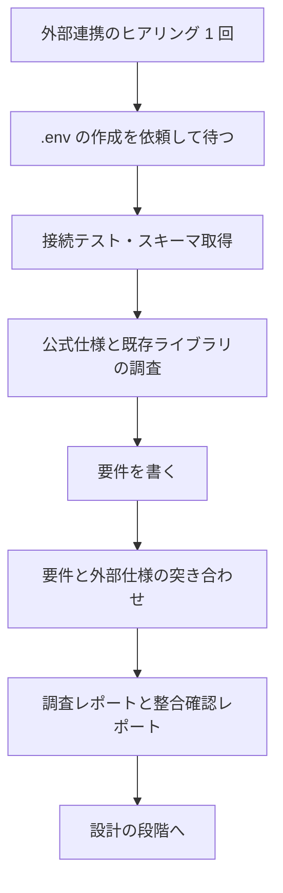

# 外部連携の段階（isdd-spec）

外部連携がある場合に、要件を書く前と書いた後で行う。ヒアリングは 1 回にまとめ、接続テスト・スキーマ取得・仕様の調査はエージェントが進める。
この段階では、コード（連携ライブラリ・モック・E2E）を作らない。連携ライブラリの採否とモック方式は設計の段階（spec-design.md）で決め、コードは `isdd-build` が作って対応表に載せる。設計 ID の無いコードを先に作ると、要件・設計から追跡できなくなるため。



## 1. ヒアリング（1 回）

業務課題が決まった後、連携先ごとに次の問いを番号付きでまとめて出す（hearing-rules.md）。答えが既にある項目は聞かない。答えの無い項目は次の応答でもう一度出す。

1. 基本情報: システム名（ディレクトリ名に使うので英語名も）、役割と機能の概要、公式ドキュメントの URL、API の種類（REST / GraphQL / SOAP / gRPC / SDK / DB 直結 / その他）
2. 接続と認証: 接続先が利用できるか、接続経路の制約（IP 制限、VPN など）、認証方式（API キー / OAuth2 / Basic 認証 / mTLS / その他）、トークンの更新や失効の制約、認可の手続きが要るか
3. 利用するオペレーション: 行う操作（読み取り / 書き込み / イベント受信など）、主なエンドポイントやテーブル
4. 主な制限: レート制限、タイムアウト、利用時間帯や契約上の制限、法務・ライセンス上の制約
5. 連携先のデータ構造: DB（またはそれに類するデータ構造）を持つか
6. プロジェクトの技術: 使用言語とテストフレームワーク、使えないライブラリ（未定なら「未定」でよい）
7. 既存ライブラリの候補: ユーザーが持っている・使ったことのある候補、組織で推奨または禁止されているもの、過去に見送ったものとその理由

## 2. 接続情報と接続テスト

接続情報は external-credentials.md に従って扱う。要点:

- `.env` が無ければ、接続テストを始めずにユーザーへ作成を依頼し、作成の報告を受けてから再開する。エージェントは `.env` を作らない。
- 接続テストの前に、必要な環境変数名と用途を `external/[システム名]/.env.example`（値はダミー）に書く。`.env` の作成を依頼するときは、これを示す。
- `.gitignore` に `.env` が入っているかを確かめ、入っていなければ追加を依頼する（接続テストは止めない）。
- できる限り実際に接続して確かめる。推測で判定すると、要件を書いた後で実現できないとわかるため。使い捨ての実行環境で接続し、終わったら片付ける。
- DB 系の連携先では、接続してテーブル一覧・カラム・制約・リレーションを取る。取れなければ公開仕様か、ユーザーの説明で確かめる。
- 接続の結果に間違いが無いか、ユーザーに確認する。

接続テストが終わったら、調査レポート（下の「5. 成果物」の research.md）の 1〜3、5、6 を書く。要件を書く前に、わかった制約を文書に残すため。残りの節は調査と突き合わせの後に書き足す。

接続できない、認証方式が業務で使えない、制限で業務課題を満たせないなど、実現できないとわかったら、要件を書き進めずにユーザーへ報告して判断を仰ぐ。

## 3. 調査

公式仕様と既存ライブラリの候補を調べる。読む量が多いので subagent-delegation.md に従って委譲する。指示文の例:

> 外部システム [システム名]（API 種類 [種類]、認証方式 [方式]）の公式仕様から、オペレーション一覧（エンドポイント、メソッド、主要パラメータ、レスポンス概要）、レート制限、ページネーション、タイムアウトの推奨値を抜き出す。あわせて、プロジェクトの技術 [言語・テストフレームワーク] 向けの既存ライブラリ候補をインターネットで調べ、ユーザーが挙げた候補 [候補一覧] も含めて、7 項目（メンテナンス状況、スター数・ダウンロード数、ライセンス、対象 API のカバレッジ、認証方式サポート、型定義の有無、テスタビリティ）で評価した比較表を Markdown で返す。出典 URL と確認日を付ける。採用の決定はしない。接続情報の値は出力しない。

## 4. 要件との突き合わせ

要件（spec-requirements.md）を書いたら、外部仕様と突き合わせて次を確かめる。

1. 要件に足りない外部の制約が無いか
2. 要件が外部仕様と矛盾していないか
3. 要件に過剰な外部連携の仕様が書かれていないか
4. DB 系の連携では、必要なテーブルとカラムが要件に反映されているか

不整合があれば修正案を示し、ユーザーの確認を得てから要件定義書（変更フローでは変更要件定義書）に反映する。連携は「3-3. 外部連携」に `RQ-EX-*` で書く。

## 5. 成果物

`external/[システム名]/` に次を作る。書き方は document-rules.md に従う。

```
external/
  [システム名]/
    docs/
      research.md          # 調査レポート
      alignment_report.md  # 要件整合確認レポート
    .env.example           # 環境変数名の一覧（値はダミー、用途をコメントで書く）
```

### 調査レポート（research.md）

1. システム概要: システム名と役割、API の種類、公式ドキュメントの URL
2. 接続と認証: 認証方式の詳細、ベース URL、必要な環境変数の一覧（変数名だけ）
3. 接続テストの結果: 実行日時、接続できたか、確認方法、接続して取れたスキーマ（エンティティ一覧）、実現できるか（要件に進めるか）の判定
4. オペレーション一覧: 次の表

   | オペレーション名 | エンドポイント | メソッド | 主要パラメータ | レスポンス概要 |
   |---|---|---|---|---|

5. 連携先のデータ構造
   - DB 系: 全テーブルのカラム名・型・制約（NOT NULL / PK / FK / UNIQUE など）の表と、全テーブルのリレーション図（mermaid の erDiagram）
   - 非 DB 系: 全業務エンティティの一覧と、requirements-chapters.md の 4-3 の形式の CRUD テーブル（全エンティティ分）
6. 制限事項: レート制限、ページネーション方式、タイムアウトの推奨値、その他の制約
7. 既存ライブラリの候補: 比較表（7 項目）と出典。採否は設計の段階で決める

### 整合確認レポート（alignment_report.md）

1. 入力した要件の識別情報（requirements か change_requirements か）
2. 一致している要件の一覧
3. 不整合な要件の一覧（不足・矛盾・過剰）
4. 修正方針
5. 修正後の確認結果
6. 設計に進めるかの判定

## 6. セルフレビュー

1. 調査レポートに接続テストの結果、オペレーション一覧、認証方式、制限事項、連携先のデータ構造があるか
2. 整合確認レポートに不整合の一覧と解消結果があり、未解消の不整合を残したまま設計へ進めていないか
3. 接続情報の値が `.env` 以外（会話、レポート、`.env.example`）に書かれていないか
4. コード（連携ライブラリ・モック・E2E）を作っていないか
