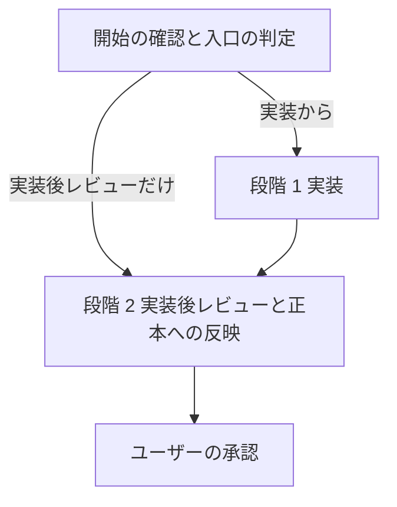

# isdd-build — トレーサブル実装と実装後レビューのスキル

承認された設計の設計要素だけを実装し、設計 ID とコードの対応を対応表に記録する。実装が終わったら実装後レビューで正本（`docs/requirements.md`・`docs/detail_design.md`・`docs/trace_map.md`）を実装済みの状態に揃える。

## このスキルのファイル

参照ファイルはこのスキルの `references/`、チェッカーは `scripts/` にある。下のコマンドは `.agents/skills/` に入れた場合のパスで書いている。別の場所（`.claude/skills/`、`.github/skills/`、ホーム配下など）に入れた場合は、この SKILL.md があるディレクトリに読み替える。
段階ごとの手順は `references/build-*.md` にある。その段階に入るときに読む。

| ファイル | 使う場面 |
|---|---|
| `references/build-implement.md` | 段階 1: 実装、外部連携のコード、テスト、実装完了の確認 |
| `references/build-review.md` | 段階 2: 実装後レビュー（変更の正本への反映、未マッピング一覧、再チェック） |
| `references/trace-map-rules.md` | 対応表の書式・粒度・チェッカーの意味 |
| `references/id-definitions.md` | 要件 ID・設計 ID と変更管理 |
| `references/requirements-chapters.md` | 要件定義書の章立て（段階 2 で正本の該当章へ反映するとき） |
| `references/design-chapters.md` | 詳細設計書の章立て（同上。第 7 章の粒度と依存の規則） |
| `references/document-rules.md` | 正本を書き換えるときの書き方 |
| `scripts/rq_integrity_checker.py` | 要件 ID の整合チェック（段階 2 で正本の要件定義書にかける） |
| `scripts/rq_ds_link_checker.py` | 要件 ID と設計 ID の対応チェック |

受け入れ判定（`scripts/isdd/acceptance_checker.py`。E2E の結果の JUnit XML を対応表の `DS-TS` 行と突き合わせ、要件ごとの実装済み判定の表を出す）は `check.sh` が呼ぶ。

対応表チェックと実装完了チェックは、`isdd-setup` がプロジェクトに入れた `scripts/isdd/` のものを使う（pre-commit と同じものを動かすため）。

## 流れ



## 開始の確認

1. 次を bash で確かめる。

   ```bash
   ls scripts/isdd/check.sh scripts/isdd/trace_map_checker.py scripts/isdd/implementation_completeness_checker.py
   cat scripts/isdd/VERSION
   ```

   ほかの作業（テスト、対応表、コードの読み書き）より先に、ここで版を比べ終える。古いチェッカーで作業を進めると、規則の変更を見落としたまま結果を出すため。

   - ファイルが無い場合は、`isdd-setup` を実行してから進める。導入時は詳細設計書の実行形態・認証の有無・外部連携の有無・対応表の粒度（第 7 章）を渡し、第 7 章の依存の規則を書き写す。チェッカーが無いと完了条件を確かめられないため。
   - `isdd-setup` を実行しても、その報告で応答を終えない。同じ応答の中で続けて入口の判定と段階の作業に進み、`isdd-setup` の結果（複製・生成したファイル、フックの可否）は最終報告の中に書く。ユーザーが頼んだのは実装や実装後レビューであり、セットアップはその準備にすぎないため。
   - 版を比べる。`cat scripts/isdd/VERSION` の出力と、この SKILL.md の先頭（frontmatter）にある `metadata.version` の値（`v` で始まる版番号）を、1 文字ずつ同じか比べる。同じなら次へ進む。VERSION が無いか違う場合は、「scripts/isdd/VERSION（読んだ値）とスキルの版（metadata.version の値）が違うため、isdd-setup を再実行します」と報告し、`isdd-setup` を再実行してから進める。古いチェッカーで判定すると、規則の変更を見落とすため。比べた結果（両方の値、一致したか、再実行したか）は、最初の応答と最終報告の両方に書く。
2. 入口を決める。
   - 実装から（既定）: `docs/requirements.md` と `docs/detail_design.md`（変更フローでは `docs/active_change` が指す変更文書も）があり、整合チェックに合格すること。無い、または合格しない場合は、`isdd-spec` で仕様を作るよう案内して止まる。
   - 実装後レビューだけ: ユーザーが「レビューだけ」「実装差分を反映して」などと頼んだ場合や、スキルを使わずに直されたコードを取り込む場合は、段階 2 から始める。
   - 実装だけ: ユーザーが「実装だけ」「レビューはまだ」などと頼んだ場合は、段階 1 で止め、実装後レビュー（正本への反映）を次に行うよう案内する。コードを確かめてから正本を確定したい場合のため。
   どちらの入口で始めるかと、その根拠を最初の応答で報告する。

## 段階 1: 実装

`references/build-implement.md` に従う。tasks.md があれば上から順に進める。

- 設計に無い設計要素が要るとわかったら、コーディングを止めて `docs/proposals.md` に提案を書き、ユーザーが `isdd-spec` で設計を直すのを待つ。このスキルの中で要件・設計の文書や `docs/active_change` を作らない。「進めてください」と言われても、それは `isdd-spec` の起動ではない。
- コードに要件 ID・設計 ID を書かない。

終わりの条件: `bash scripts/isdd/check.sh --strict` がエラー 0 件・警告 0 件（対応表チェック、依存チェック、受け入れ判定。受け入れ判定は 8-4 の実行コマンドで E2E を回して `e2e/results/` に JUnit XML を出してから実行する）、`rq_ds_link_checker.py` が問題 0 件、`implementation_completeness_checker.py` が全項目 OK、テストが全件通過（build-implement.md の完了条件）。

## 段階 2: 実装後レビューと正本への反映

段階 1 の後に進む前に、ユーザーが「実装だけ」「実装後レビュー（正本への反映）はまだ」と頼んでいないかを確かめる。頼まれていれば、段階 2 に入らずに止まる。正本の書き換え、`docs/active_change` の削除をしない。段階 1 の結果を報告し、次に実装後レビューを行うよう案内する。
いったん「実装だけ」と頼まれたら、ユーザーが実装後レビュー（正本への反映）をはっきり頼むまで段階 2 に入らない。「進めてください」「規則どおりに」のような一般的な返事は、レビューの依頼とみなさない。正本の反映は取り消しにくく、ユーザーが止めた理由（コードを確かめてから確定したいなど）を損なうため。

`references/build-review.md` に従う。変更フローでは、変更要件定義書と変更設計書を正本へ反映し、`docs/active_change` を消す。未マッピングは 1 件ずつユーザーに聞いて決める。

未マッピング一覧は、最終報告に次の形でそのまま出す。見出しは行頭に `#` を 3 つ置いた Markdown の見出し `### 未マッピング一覧` にする。`**未マッピング一覧**` のような太字の行、`## ` や `#### ` の別の階層、番号付きの行は見出しとみなされず、この一覧を探す処理に拾われない。その直下に 6 列の表を置き、列名は省略も言い換えもしない。該当が無いときも、見出しと表を出して「該当なし」の行を書く。ユーザーが表で 1 件ずつ判断できるようにするため。

```markdown
### 未マッピング一覧

| 実装要素（修飾名） | 対応表の DS-ID | 設計書に DS-ID があるか | 対応する RQ-ID | 要件定義書に RQ-ID があるか | 状態 |
|---|---|---|---|---|---|
| 該当なし | ― | ― | ― | ― | ― |

要件なし（作りすぎ）: 0 件
```

状態「要件なし（作りすぎ）」は、対応表に無く、設計書にも無く、どの要件にも結びつかない実装要素。表の下に件数（公開関数・クラス・ファイル）を書く。

要件ごとの実装済み判定も、最終報告に `### 要件ごとの実装済み判定` の見出し（`#` 3 つ）で出し、その直下に `bash scripts/isdd/check.sh --strict` の受け入れ判定が出した表（列: RQ-ID、RQ-TS、DS-TS、テスト、結果）をそのまま載せる。

終わりの条件: build-review.md の完了条件（未整合ゼロ、未マッピング一覧の表と作りすぎの件数、要件ごとの実装済み判定の表、`docs/proposals.md` と `docs/active_change` が無い）。

## 守ること

- 正本を書き換えるのは段階 2 だけ。段階 1 では正本、変更要件定義書・変更設計書、`docs/active_change` を書き換えない。
- `.history/` 配下の変更要件定義書と変更設計書は、正本へ反映した後も書き換えない。
- 既存コードがある場合、設計の範囲外のロジックは変えない。

## 報告と引き渡し

完了したら、次を報告し、実装と正本の確定の承認を求める。

- 段階 1: 実装したファイル・クラス・関数、対応表、各チェッカーとテストの実行ログ、`scripts/isdd/VERSION` と `metadata.version` を比べた結果
- 段階 2: build-review.md の「報告」の項目（正本へ反映した ID、未整合ゼロかどうか、未マッピング一覧と作りすぎの件数、要件ごとの実装済み判定、要件の更新結果）。見出しは `### 未マッピング一覧` と `### 要件ごとの実装済み判定`（`#` 3 つの Markdown 見出し。太字にしない）
- `isdd-setup` を途中で実行した場合は、その結果もここにまとめる（セットアップの報告だけで応答を終えない）

新しい要求や仕様の誤りは `isdd-spec` から始める（要件定義書があるので変更フローになる）。

段階の区切り（実装の完了、実装後レビューの完了）では、新しいセッションに切り替えて成果物から再開することを勧める。長いセッションでは初期の制約を忘れやすいため。再開に要るものは正本（`docs/requirements.md`・`docs/detail_design.md`・`docs/trace_map.md`）とコード、変更フローなら `docs/active_change` が指すディレクトリの文書と `tasks.md` だけで、途中の会話は要らない。
