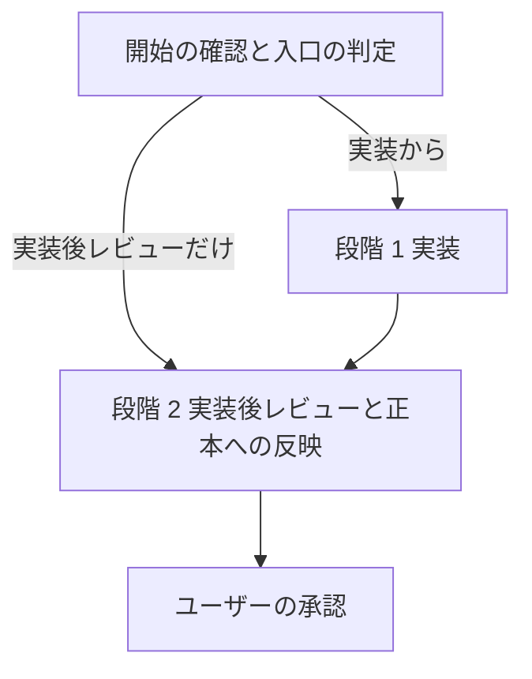

# isdd-build — トレーサブル実装と実装後レビューのスキル

承認された設計の設計要素だけを実装し、設計 ID とコードの対応を対応表に記録する。実装が終わったら実装後レビューで正本（`docs/requirements.md`・`docs/detail_design.md`・`docs/trace_map.md`）を実装済みの状態に揃える。

## このスキルのファイル

参照ファイルはこのスキルの `references/`、チェッカーは `scripts/` にある。下のコマンドは `.agents/skills/` に入れた場合のパスで書いている。別の場所（`.claude/skills/`、`.github/skills/`、ホーム配下など）に入れた場合は、この SKILL.md があるディレクトリに読み替える。
段階ごとの手順は `references/build-*.md` にある。その段階に入るときに読む。

| ファイル | 使う場面 |
|---|---|
| `references/build-implement.md` | 段階 1: 実装、外部連携のコード、テスト、実装完了の確認 |
| `references/build-review.md` | 段階 2: 実装後レビュー（変更の正本への反映、未マッピング一覧、再チェック） |
| `references/trace-map-rules.md` | 対応表の書式・粒度・チェッカーの意味 |
| `references/id-definitions.md` | 要件 ID・設計 ID と変更管理 |
| `references/document-rules.md` | 正本を書き換えるときの書き方 |
| `scripts/rq_ds_link_checker.py` | 要件 ID と設計 ID の対応チェック |

対応表チェックと実装完了チェックは、`isdd-setup` がプロジェクトに入れた `scripts/isdd/` のものを使う（pre-commit と同じものを動かすため）。

## 流れ



## 開始の確認

1. 次を bash で確かめる。

   ```bash
   ls scripts/isdd/check.sh scripts/isdd/trace_map_checker.py scripts/isdd/implementation_completeness_checker.py
   cat scripts/isdd/VERSION
   ```

   - ファイルが無い場合は、`isdd-setup` を実行してから進める。導入時は詳細設計書の実行形態・認証の有無・外部連携の有無を渡す。チェッカーが無いと完了条件を確かめられないため。
   - 版を比べる。`cat scripts/isdd/VERSION` の出力と、この SKILL.md の先頭（frontmatter）にある `metadata.version` の値（`v` で始まる版番号）を、1 文字ずつ同じか比べる。同じなら次へ進む。VERSION が無いか違う場合は、「scripts/isdd/VERSION（読んだ値）とスキルの版（metadata.version の値）が違うため、isdd-setup を再実行します」と報告し、`isdd-setup` を再実行してから進める。古いチェッカーで判定すると、規則の変更を見落とすため。比べた結果（両方の値と、再実行したか）を最終報告に書く。
2. 入口を決める。
   - 実装から（既定）: `docs/requirements.md` と `docs/detail_design.md`（変更フローでは `docs/active_change` が指す変更文書も）があり、整合チェックに合格すること。無い、または合格しない場合は、`isdd-spec` で仕様を作るよう案内して止まる。
   - 実装後レビューだけ: ユーザーが「レビューだけ」「実装差分を反映して」などと頼んだ場合や、スキルを使わずに直されたコードを取り込む場合は、段階 2 から始める。
   - 実装だけ: ユーザーが「実装だけ」「レビューはまだ」などと頼んだ場合は、段階 1 で止め、実装後レビュー（正本への反映）を次に行うよう案内する。コードを確かめてから正本を確定したい場合のため。
   どちらの入口で始めるかと、その根拠を最初の応答で報告する。

## 段階 1: 実装

`references/build-implement.md` に従う。tasks.md があれば上から順に進める。

- 設計に無い設計要素が要るとわかったら、コーディングを止めて `docs/proposals.md` に提案を書き、ユーザーが `isdd-spec` で設計を直すのを待つ。このスキルの中で要件・設計の文書や `docs/active_change` を作らない。「進めてください」と言われても、それは `isdd-spec` の起動ではない。
- コードに要件 ID・設計 ID を書かない。

終わりの条件: `bash scripts/isdd/check.sh --strict` がエラー 0 件・警告 0 件、`rq_ds_link_checker.py` が問題 0 件、`implementation_completeness_checker.py` が全項目 OK、テストが全件通過（build-implement.md の完了条件）。

## 段階 2: 実装後レビューと正本への反映

`references/build-review.md` に従う。変更フローでは、変更要件定義書と変更設計書を正本へ反映し、`docs/active_change` を消す。未マッピングは 1 件ずつユーザーに聞いて決める。

終わりの条件: build-review.md の完了条件（未整合ゼロ、未マッピング一覧の表、`docs/proposals.md` と `docs/active_change` が無い）。

## 守ること

- 正本を書き換えるのは段階 2 だけ。段階 1 では正本、変更要件定義書・変更設計書、`docs/active_change` を書き換えない。
- `.history/` 配下の変更要件定義書と変更設計書は、正本へ反映した後も書き換えない。
- 既存コードがある場合、設計の範囲外のロジックは変えない。

## 報告と引き渡し

完了したら、次を報告し、実装と正本の確定の承認を求める。

- 段階 1: 実装したファイル・クラス・関数、対応表、各チェッカーとテストの実行ログ、`scripts/isdd/VERSION` と `metadata.version` を比べた結果
- 段階 2: build-review.md の「報告」の項目（正本へ反映した ID、未整合ゼロかどうか、未マッピング一覧、要件の更新結果）

新しい要求や仕様の誤りは `isdd-spec` から始める（要件定義書があるので変更フローになる）。
