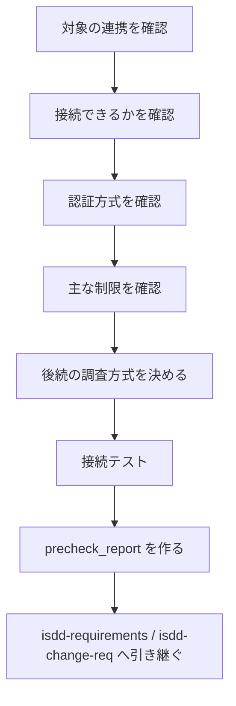

# isdd-external-precheck — 外部連携 軽量事前確認スキル

要件定義に入る前に、実現できるかどうかに直結する論点だけを確かめ、要件定義の前提を確定する。詳細な仕様の調査はしない。

## このスキルのファイル

参照ファイルはこのスキルの `references/` にある。

| ファイル | 使う場面 |
|---|---|
| `references/hearing-rules.md` | すべての質問 |
| `references/external-credentials.md` | `.env` と接続情報の扱い、接続テスト |

## 進め方

- 確認項目のヒアリングは `references/hearing-rules.md` に従い、1 問ずつ聞く。選択肢を伴う質問は、案・内容・メリット・デメリット・複雑さ（C=1〜5）・根拠の表と「推奨: 〇〇（理由を一文）」の形で、最初に出すときから示す。判定が確定するまで質問を続ける。
- 接続できるかは、できる限り実際に接続して確かめる。推測で判定すると、要件定義の後で実現できないとわかるため。
- 接続情報は `references/external-credentials.md` に従って扱う。成果物には環境変数名だけを書き、値は書かない。
- 集めた情報は、要件定義でそのまま使える形にまとめる。

## 確認項目

1. 接続できるか
   - 接続先が利用できるか
   - 接続経路に制約があるか
   - 認可の手続きが要るか
2. 認証方式
   - API キー / OAuth2 / Basic 認証 / mTLS / その他
   - トークンの更新や失効に運用上の制約があるか
   - 接続元の制約（IP 制限、VPN、Private Link など）があるか
   - 必要な環境変数名（値は除く）
3. 主な制限
   - レート制限
   - タイムアウトの制限
   - 利用時間帯や契約上の制限
   - 法務・ライセンス上の制約
4. 後続の調査方式
   - 公開リファレンスを中心に進めるか
   - 連携先 DB のスキーマ取得が要るか
   - `.env.example` の整備が要るか
5. 接続テスト
   - ユーザーに `.env` を作ってもらい、接続先情報と認証情報を保存してもらう
   - 使い捨ての実行環境で実際に接続する（必要ならサブエージェントに任せる）
   - 接続の結果に間違いが無いか、ユーザーに確認する
   - 接続できたら、取得できるスキーマ（エンティティ一覧）を確かめる

## 成果物

`external/[システム名]/docs/precheck_report.md` に次を書く。

1. 連携先の概要
2. 接続できるかの判定
3. 認証方式
4. 主な制限
5. 後続の `isdd-external-research` で調べる範囲
6. 要件定義に進んでよいかの判定
7. 必要な環境変数名の一覧（値は書かない）
8. 実接続テストの結果（実行日時、接続できたか、確認方法）
9. 取得できるスキーマ（エンティティ一覧）

## 引き継ぎ

`isdd-requirements` / `isdd-change-req` へ次を渡す。

- precheck_report のパス
- 要件定義に盛り込む制約事項
- 詳細な調査が要る論点の一覧

## セルフレビュー

次を確認してユーザーに報告する。

1. 接続できるか・認証方式・主な制限の 3 点が書いてあるか
2. 詳細調査の範囲がはっきりしているか
3. 接続情報の値が書かれていないか
4. 要件定義に進んでよいかの判定が書いてあるか
5. 実接続テストの結果とスキーマの確認結果が書いてあるか

## 次のステップ

完了を報告するときに、次のスキルを提案する。

- 新規開発の場合: `isdd-requirements` で要件定義を始める
- 変更開発の場合: `isdd-change-req` で変更要件定義を始める
