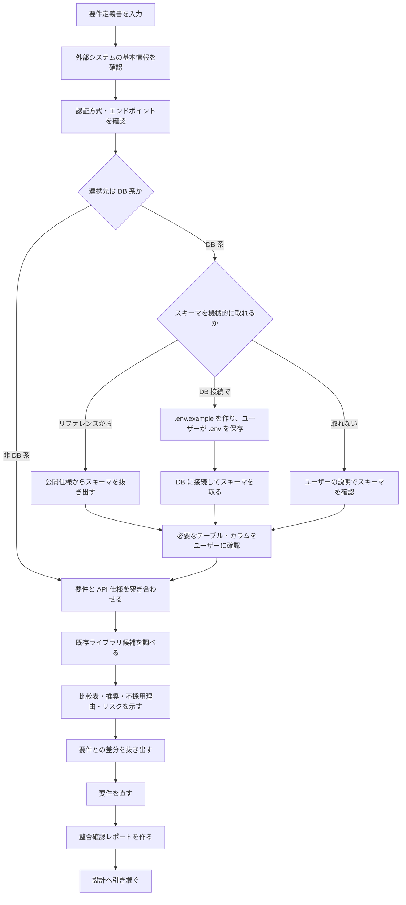

# isdd-external-research — 外部連携 要件整合調査スキル

要件定義書を入力に外部仕様を調べ、要件との不整合を見つけて直し、設計に進める状態を作る。

## このスキルのファイル

参照ファイルはこのスキルの `references/` にある。

| ファイル | 使う場面 |
|---|---|
| `references/hearing-rules.md` | すべての質問 |
| `references/external-credentials.md` | `.env` と接続情報の扱い |
| `references/subagent-delegation.md` | ライブラリ調査や DB スキーマ取得を委譲するとき |
| `references/requirements-chapters.md` | CRUD テーブルの形式（4-3） |
| `references/design-chapters.md` | E2E の 2 モード運用（第 8 章 8-2〜8-4） |
| `references/id-definitions.md` | モック方式の ID |
| `references/document-rules.md` | レポートの書き方 |

## 方針

- 要件を書いた後に実行し、要件との整合確認を最優先にする。
- 不整合（不足・矛盾・過剰）があれば、要件定義書を直してから終える。
- 連携ライブラリは、外部 API のエンドポイントを 1 対 1 でメソッドにする薄いラッパーにする。業務ロジックを混ぜると、外部仕様の変更と業務の変更が同じコードに影響するため。
- 接続情報は `references/external-credentials.md` に従って扱う。
- 既存ライブラリの候補は、インターネットで調べるだけでなく、ユーザーが持っている・使ったことのある候補も聞く。採用するかはユーザーが最終的に決める。
- 分からない点が残る限り質問を続け、成果物ができるまで終えない。



## 入力

- `docs/requirements.md` または `.history/[YYYYMMDD]-[タスク名]/change_requirements.md`
- `isdd-external-precheck` の結果（あれば）

## インタビュー項目

`references/hearing-rules.md` に従い、1 問ずつ確認する。選択肢を伴う質問は、案・内容・メリット・デメリット・複雑さ（C=1〜5）・根拠の表と「推奨: 〇〇（理由を一文）」の形で、最初に出すときから示す。情報が既にある項目は飛ばす。

1. 外部システムの基本情報: システム名（ディレクトリ名に使うので英語名も）、役割と機能の概要、公式ドキュメントの URL、API の種類（REST / GraphQL / SOAP / gRPC / SDK / その他）
2. 認証・接続方式: 認証方式（API キー / OAuth2 / Basic 認証 / mTLS / その他）、ベース URL とエンドポイント一覧、リクエスト・レスポンスの形式
3. 利用するオペレーション: 行う操作の一覧（読み取り / 書き込み / イベント受信など）、各操作のエンドポイント・パラメータ・レスポンス、レート制限・ページネーション・タイムアウト
4. プロジェクトの技術: 使用言語とテストフレームワーク（モックの形式を合わせるため）、企業ポリシーなどで使えないライブラリ
5. 既存ライブラリの候補: ユーザーが持っている・使ったことのある候補、組織で推奨または禁止されているもの、過去に見送ったものとその理由
6. 連携先のデータ構造: DB（またはそれに類するデータ構造: RDB / NoSQL / KVS / ファイルストアなど）を持つか。判断が曖昧ならここでユーザーに確かめてから進む
   - DB 系: テーブル一覧、各カラムの名前・型・制約、テーブル間のリレーション
   - 非 DB 系: 扱うエンティティの一覧と、各エンティティの Create・Read・Update・Delete の可否

DB 接続でスキーマを取る場合は、`references/external-credentials.md` に従ってユーザーに `.env` を用意してもらう。

## 要件との整合チェック

要件定義書と外部仕様を突き合わせ、次を確認する。

1. 要件に足りない外部の制約が無いか
2. 要件が外部仕様と矛盾していないか
3. 要件に過剰な外部連携の仕様が書かれていないか
4. DB 系の連携では、必要なテーブルとカラムが要件に反映されているか

不整合があれば修正案を示し、ユーザーの確認を得てから要件定義書に反映する。

## 既存ライブラリの調査

インタビュー項目が終わったら、既存ライブラリの候補を調べる。結果が多くなるので、`references/subagent-delegation.md` に従って委譲する。指示文の例:

> 外部システム [システム名]（API 種類 [種類]、認証方式 [方式]）に接続するための既存ライブラリ候補を、プロジェクトの技術スタック [言語・テストフレームワーク] 向けにインターネットで調査する。ユーザーが挙げた候補 [候補一覧] も含める。各候補を 7 項目（メンテナンス状況、スター数・ダウンロード数、ライセンス、対象 API のカバレッジ、認証方式サポート、型定義の有無、テスタビリティ）で評価した比較表、推奨理由、不採用理由、リスク評価（運用・法務・保守）を Markdown で返す。出典 URL と確認日を付ける。採用の決定はしない。

| 確認項目 | 確認内容 |
|---|---|
| メンテナンス状況 | 最終更新日、issue への対応状況 |
| スター数・ダウンロード数 | 利用実績の規模 |
| ライセンス | プロジェクトの利用条件と合うか |
| 対象 API のカバレッジ | 必要なエンドポイントを網羅しているか |
| 認証方式サポート | 必要な認証方式に対応しているか |
| 型定義の有無 | 型安全に使えるか |
| テスタビリティ | モックへの差し替えやテストのしやすさ |

結果は、比較表・推奨理由・不採用理由・リスク評価（運用/法務/保守）の形でユーザーに示す。候補が 1 件でもこの形にする。調査結果だけで採用を決めず、ユーザーの最終確認で採否を決める。採用しない場合は、独自の薄いラッパーにする理由を記録する。

## 成果物

```
external/
  [システム名]/
    docs/
      research.md          # 調査レポート
      alignment_report.md  # 要件整合確認レポート
    src/                   # 連携ライブラリ（薄いラッパー）
    mock/                  # 外部システムのモック
    e2e/                   # 外部連携 E2E 関連の設定
    .env.example           # 認証情報のテンプレート（値はダミー）
```

レポートの書き方は `references/document-rules.md` に従う。

### 調査レポート（research.md）

次の節をすべて書く。

1. システム概要: システム名と役割、API の種類、公式ドキュメントの URL
2. 認証・接続情報: 認証方式の詳細、ベース URL、必要な環境変数の一覧（変数名だけ）
3. オペレーション一覧: 次の表

   | オペレーション名 | エンドポイント | メソッド | 主要パラメータ | レスポンス概要 |
   |---|---|---|---|---|

4. 連携先のデータ構造
   - DB 系: 全テーブルのカラム名・型・制約（NOT NULL / PK / FK / UNIQUE など）の表と、全テーブルのリレーション図（mermaid の erDiagram）
   - 非 DB 系: 全業務エンティティの一覧と、`references/requirements-chapters.md` の 4-3 の形式の CRUD テーブル（全エンティティ分）
5. 制限事項: レート制限、ページネーション方式、タイムアウトの推奨値、その他の制約
6. モックの説明: 設計方針、各モックの役割、使い方（コードは書かず日本語で手順を説明する）
7. 既存ライブラリの選定結果: 候補一覧、比較表（7 項目）、推奨理由、不採用理由、リスク評価、ユーザーの最終決定
8. E2E の 2 モード運用: mock モードと real モードの切り替え方法、実装時・CI では mock モードの全件通過をゴールにすること、real モードは手動実行だけを必須にすること

### 整合確認レポート（alignment_report.md）

1. 入力した要件の識別情報（requirements か change_requirements か）
2. 一致している要件の一覧
3. 不整合な要件の一覧（不足・矛盾・過剰）
4. 修正方針
5. 修正後の確認結果
6. 設計に進めるかの判定

### 連携ライブラリ（src/）

- 外部 API のエンドポイントを 1 対 1 でメソッドにする。
- 外部との接続だけを担い、業務ロジックは入れない。
- 独自実装でも既存ライブラリを使う場合でも、公開インターフェースを明示する。
- コードには要件 ID・設計 ID を書かず、言語の流儀に従った通常のドキュメントコメントだけを付ける。設計 ID との対応は、実装スキルが `docs/trace_map.md` に登録する（`external/[システム名]/src` も `isdd-setup` の `--src` に含める）。

### モック（mock/）

モック方式は外部システムの性質で A / B / C から選ぶ。方式の ID は `references/id-definitions.md` の「isdd-external-research スキル固有 ID」に従う。

| 外部システムの特性 | 推奨方式 |
|---|---|
| レスポンスが静的でパターンが少ない | B（固定レスポンスファイル） |
| 状態を持つ、CRUD 操作がある | A（ローカル HTTP サーバー） |
| 認証フローが複雑 | A |
| 複数の外部システムを同時に扱う | C（既存モックサーバーツール） |
| 調査・プロトタイプの段階 | B |
| エラー・遅延・障害の注入が要る | C |

- 選んだ方式の ID を、要件定義書（または変更要件定義書）の「3-3. 外部連携」の表に、対応する `RQ-BK-*` と一緒に 1 行で書く。設計スキルは、モックを使う E2E の設計（`DS-TS-*`）でこの ID を受ける。
- モックは `external/[システム名]/mock/` に置く。
- E2E 側からはシンボリックリンクで参照し、リンクも Git で管理する（モックの正本を 1 か所にするため）。

### E2E 基盤（e2e/）

E2E の 2 モード運用は `references/design-chapters.md` 第 8 章（8-2〜8-4）に従う。要点:

- mock モードと real モードを定義し、設計上はすべてのシナリオを両モードで実行対象にする。
- 実装時・CI の必須ゴールは mock モードの全件通過。real モードは手動実行だけを必須にする。
- モードの切り替えはテスト実行コマンドで行う（実行形態がコンテナなら docker compose のプロファイルも）。
- テスト環境を作るスクリプトは bash を基本にし、複雑な処理はプロジェクトの言語か Python で書く。

### .env.example

接続に必要な環境変数名をすべて並べ、値はダミーにし、各変数の用途をコメントで書く。

## 設計への引き継ぎ

調査が終わったら、設計スキル（`isdd-design` / `isdd-change-design`）で使えるように次をユーザーに伝える。

- 調査レポート、整合確認レポート、連携ライブラリ、モック、E2E 基盤のパス
- ライブラリの採用方針（既存を採用 / 独自実装）と理由
- 要件定義書または変更要件定義書で直した内容（不足・矛盾・過剰の解消結果）

## セルフレビュー

次を確認してユーザーに報告する。

1. 調査レポートにオペレーション一覧・認証方式・制限事項があるか
2. 既存ライブラリの比較表・推奨理由・不採用理由・リスク評価があり、採否をユーザーの最終確認で決めたか
3. 連携ライブラリが薄いラッパー（1 対 1）になっていて、コードに要件 ID・設計 ID のコメントが無いか
4. モック方式の選定理由が上の表と合っているか
5. E2E の 2 モードの運用方針と切り替え方法、シンボリックリンクの Git 管理、テスト環境スクリプトの方針が書いてあるか
6. 接続情報の値が `.env.example` 以外に書かれていないか
7. 連携先のデータ構造の節があるか（DB 系はテーブル設計とリレーション図、非 DB 系はエンティティ一覧と CRUD テーブル）
8. 整合確認レポートに不整合の一覧と解消結果があり、未解消の不整合を残したまま設計へ進めていないか

## 次のステップ

完了を報告するときに、次のスキルを提案する。

- 新規開発の場合: `isdd-design` で詳細設計書を作る
- 変更開発の場合: `isdd-change-design` で変更詳細設計書を作る
