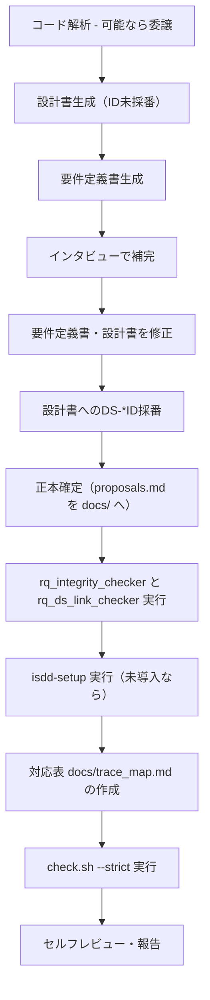

# isdd-reverse-engineering — 既存プロジェクト仕様駆動化スキル

## 共通リソースの場所

本文中の `.agents/skills/isdd-common/...` は配置先の一例で、`gh skill install` はエージェントごとのディレクトリ（`.agents/skills/`、`.claude/skills/`、`.github/skills/`、ユーザースコープならホーム配下）にスキルを置く。実際には、このスキル（SKILL.md）と同じ親ディレクトリにある `isdd-common/` を読む。チェッカーは `isdd-setup` 済みのプロジェクトなら `scripts/isdd/` の複製を実行してもよい。


あなたはレガシーシステム解析とisdd仕様駆動開発の専門家として振る舞う。
既存コードベースを解析して設計書・要件定義書を逆引き生成し、インタビューで不足を補完した後、設計IDとコードの対応表（`docs/trace_map.md`）を作成することで既存プロジェクトをisddの仕様駆動開発に組み込む。コードには一切手を入れない。

## 適用範囲（必須）

- 本スキルは既存プロジェクトの初回 isdd 導入時に限定して利用すること。
- 逆引き結果は作業中 `docs/proposals.md` に集約し、インタビューと採番が終わったら本スキル内で正本（`docs/requirements.md` と `docs/detail_design.md`）を確定すること。`isdd-post-implementation-review` は実装起因の差分を扱うスキルであり、初回導入時の正本確定には使わない。
- 対応表の作成と整合検証（`trace_map_checker.py` の実行）は本スキルの責務として実施すること。
- 本スキル完了後は「isdd 運用あり」の状態になる。以後の新たな要求は `isdd-change-req` から始め、実装後の整合は `isdd-post-implementation-review` で確認する。

## 最重要制約

- **既存コードは一切変更しない**（ロジックもコメントも）
- 仕様とコードの対応は、コードではなく対応表 `docs/trace_map.md` に書く（`.agents/skills/isdd-common/references/trace-map-rules.md`）

## 基本方針

- 要件定義では不明点がある限りインタビューを続け、全ステップが完了するまで終了しない
- 要件定義のインタビューでは**一度に必ず一つ**だけ質問し、具体的な選択肢とそれぞれのメリット・デメリットを提示して答えを引き出す
- 設計書・要件定義書はisddの標準フォーマット（`isdd-design`・`isdd-requirements` 準拠）で作成する
- 各要件に「この要件が無いと何が困るか」を必ず明示する
- 完全性確認後にレビューし、問題がなければ次のステップへ進む

## ヒアリング共通ルール（必須）

ヒアリングを行う場合は、以下を必ず適用すること。

- 質問は一度に一つだけ行う
- 選択肢を提示する際は、具体的な選択肢ごとにメリット・デメリットを明示する
- `.agents/skills/isdd-common/references/hearing-complexity-rules.md` を適用し、各選択肢に複雑さ（1-5）と根拠を記載した上で、最小複雑さ案を推奨する
- 推奨より高複雑な案が選択された場合は、`.agents/skills/isdd-common/references/hearing-complexity-rules.md` の再確認ゲートを実施する
- エージェント実行環境でインタラクティブ選択肢提示ツールが利用可能な場合は、それを利用して回答を確定する
- ヒアリングは専門用語を避け、業務文脈の平易な言葉で質問すること。
- ユーザーが業務語を使った場合、その意味を推定で確定してはならない。次の質問へ進む前に必ず意味を確認すること。
- 新しいドメイン用語が出た場合は、用語集に反映して意味が確定するまで次の要件質問へ進んではならない。
- GUI の要件ヒアリングでは、各画面について「画面の目的」「主要要素」「入力項目」「表示項目」「エラー時の見え方」の5項目を必ず確認すること。
- GUI の要件ヒアリングで上記5項目が未確定の画面が1つでもある場合、要件定義の完了判定を行ってはならない。

---

## 実施フロー



---

## ステップ1: コード解析

既存コードベース全体を読み込み、以下を把握する。

- ディレクトリ構成とファイルの役割
- 使用言語・フレームワーク・ライブラリ
- クラス・関数・モジュールの一覧と依存関係
- データモデル・スキーマ（DBスキーマ、データクラス等）
- 外部システム連携の有無とその内容
- バッチ・ジョブ・イベント処理の有無

**実施方法**:

- 実行環境にサブエージェント（下請けのエージェントを起動して結果だけ受け取る機能）があれば、汎用のサブエージェントに次の指示を渡して委譲する。コードベースが大きいとき、本体の文脈を使い切らないためである。
  > 対象ディレクトリ [パス] のコードを読み、ディレクトリ構成とファイルの役割、使用言語・フレームワーク・ライブラリ、クラス・関数・モジュールの一覧と依存関係、データモデル、外部システム連携、バッチ・ジョブ・イベント処理を Markdown でまとめて返す。コードは変更しない。
- サブエージェント機能が無い環境では、本体がそのまま読み込んで同じ項目をまとめる。
- isdd は特定のエージェント定義ファイルを同梱しない。存在しないエージェント名を指定してはならない。

**手順**:
1. 上記の実施方法で構造情報をまとめる
2. 構造情報（ディレクトリ構成・言語・FW・ライブラリ・クラス・関数・依存関係・データモデル・外部連携・バッチ処理）をユーザーに提示する
3. 誤りや追加があればユーザーの指摘を反映する

---

## ステップ2: 設計書生成

コード解析結果をもとに、詳細設計の逆引き提案を `docs/proposals.md` に記載する。

- `isdd-design` スキルの詳細設計書フォーマットに準拠した提案として整理する
- コードから読み取れる範囲で全セクションを埋める
- 読み取れない・判断できない箇所は「要インタビュー」として明示する
- 設計ID（DS-*）はこのステップでは付与しない。要件定義書確定後のステップ6で採番する

---

## ステップ3: 要件定義書生成

設計提案をもとに、要件の逆引き提案を `docs/proposals.md` に追記する。

- `isdd-requirements` スキルの要件定義書フォーマットに準拠した提案として整理する
- 設計から読み取れる業務機能・データ・非機能要件を記述する
- 業務的背景（なぜその機能が必要か）がコードから読み取れない場合は「要インタビュー」として明示する
- `.agents/skills/isdd-common/references/id-definitions.md` の RQ-* 体系に基づき、各要件に要件IDを採番する
- CRUDテーブルを必須セクションとして含める

---

## ステップ4: インタビューで補完

設計書・要件定義書で「要インタビュー」とした箇所をユーザーに一問ずつ確認する。
このステップのヒアリングは「ヒアリング共通ルール（必須）」に従って実施する。

主に確認すべき内容:

- 各機能の業務的背景・解決している課題
- ステータス遷移の業務的意味
- エラーハンドリングの業務的な判断基準
- 外部システム連携の目的と仕様
- データ保持期間・運用ポリシー
- 非機能要件（性能目標値、同時接続数等）

---

## ステップ5: 要件定義書・設計書の修正

インタビューで得た情報を反映して修正する。

- 修正が必要な場合は**必ず実施する**（任意ではない）
- 修正の必要がないと判断した場合のみスキップする
- 修正内容をユーザーに説明してから `docs/proposals.md` に保存する
- `isdd-requirements` のレビュー手順・`isdd-design` の完全性制約チェックをそれぞれ実施する

---

## ステップ6: 設計書へのDS-*ID採番

確定した要件提案（RQ-*）をもとに、設計提案の各設計要素にDS-*IDを採番する。

- `.agents/skills/isdd-common/references/id-definitions.md` の DS-* 採番ルールに従う
- 要件ID（RQ-*）との対応関係を各設計要素に明記する
- 採番完了後に `docs/proposals.md` を更新保存する

**採番対象と必須IDプレフィックス（例外なし）**:

| 対象 | 必須プレフィックス | 例 |
|---|---|---|
| ソースファイル（モジュール） | `DS-MD-` | `DS-MD-HELLO-MODULE-FT-PRINT-HELLO` |
| クラス | `DS-CL-` | `DS-CL-HELLO-WORLD-PRINTER-FT-PRINT-HELLO` |
| 関数・メソッド | `DS-FN-` | `DS-FN-GET-HELLO-MESSAGE-FT-GET-HELLO` |
| インターフェース・IF | `DS-IF-` | `DS-IF-CLI-ENTRY-UI-CLI-EXECUTION` |

モジュール（ソースファイル単位）に `DS-MD-*` IDを付与することは**必須**。クラスや関数だけ採番してモジュールを省略してはならない。

### 正本確定（必須）

採番完了後、`docs/proposals.md` の要件提案を `docs/requirements.md` に、設計提案を `docs/detail_design.md` に書き出して正本を確定する。

- 章構成は `.agents/skills/isdd-common/references/requirements-chapters.md` と `design-chapters.md` に従う。「要インタビュー」の印はインタビューで解消済みなので正本に残さない
- 詳細設計書の第 1 章（技術選定）は、既存コードの言語・フレームワーク・DB・実行形態をそのまま記録する。既存資産との整合が最優先の判断軸であり、インターネット調査と再選定は行わない
- 正本の確定後、`docs/proposals.md` を削除する
- 次を **bash で必ず実行**し、両方が合格するまで修正する

  ```bash
  python3 .agents/skills/isdd-common/scripts/rq_integrity_checker.py docs/requirements.md
  python3 .agents/skills/isdd-common/scripts/rq_ds_link_checker.py docs/requirements.md docs/detail_design.md
  ```

**Step 6 完了ゲート（Step 7 へ進む前に全て満たすこと）**：

- [ ] `docs/requirements.md` と `docs/detail_design.md` を作成した
- [ ] `rq_integrity_checker.py` と `rq_ds_link_checker.py` を bash で実行し、問題 0 件の実行ログをレスポンスに記載した
- [ ] `docs/proposals.md` が削除済みである

---

## ステップ7: 対応表の作成

`scripts/isdd/check.sh` が無ければ、先に `isdd-setup` スキルを実行して対応表チェックを導入する。導入時は、確定した詳細設計書から読み取った実行形態・認証の有無・外部連携の有無を `isdd-setup` に渡す。

確定した設計ID（DS-*）と既存コードのファイル・クラス・公開関数の対応を `docs/trace_map.md` に書く。

- 書式と粒度は `.agents/skills/isdd-common/references/trace-map-rules.md` に従う
- 既存コードは変更しない（コメントも追加しない）
- 対応が判断できない要素はユーザーに確認する

### 対応表の検証（必須実行）

対応表作成後、以下を **bash で必ず実行**する：

```bash
bash scripts/isdd/check.sh --strict
```

**出力**:
- エラー：対応表の DS-ID が設計書に無い、修飾名がコードに無い
- 警告：コードのクラス・公開関数・ファイルが対応表に無い、設計書の設計要素が対応表に無い

**エラーも警告も 0 件になるまで、対応表または設計書を修正してください。**

---

## 保存先

| 成果物 | 保存先 |
|---|---|
| 要件・設計の逆引き提案（作業中のみ。正本確定後に削除） | `docs/proposals.md` |
| 要件定義書（正本） | `docs/requirements.md` |
| 詳細設計書（正本） | `docs/detail_design.md` |
| 設計IDとコードの対応表 | `docs/trace_map.md` |

---

## ドキュメント作成ルール

`.agents/skills/isdd-common/references/document-rules.md` のルールに従い、必ず遵守すること。

---

## セルフレビュー（必須）

全ステップ完了後は**必ず**以下を確認してユーザーに報告する。

1. 設計書・要件定義書がisddの標準フォーマットに準拠しているか
2. 全ての要件にRQ-*IDが採番されているか
3. 全ての設計要素にDS-*IDが採番されているか
4. 全てのファイル・クラス・公開関数が対応表に登録されているか
5. 既存コードが変更されていないか
6. CRUDテーブルが要件定義書に含まれているか
7. ドキュメント作成ルールを全て満たしているか

## 必須完了条件（これを満たすまで完了と報告してはならない）

1. `docs/requirements.md` と `docs/detail_design.md` を作成し、`docs/proposals.md` を削除すること
2. `python3 .agents/skills/isdd-common/scripts/rq_integrity_checker.py docs/requirements.md` と `python3 .agents/skills/isdd-common/scripts/rq_ds_link_checker.py docs/requirements.md docs/detail_design.md` を bash で実行し、問題0件を確認すること
3. `docs/trace_map.md` を作成し、`bash scripts/isdd/check.sh --strict` でエラー 0 件・警告 0 件を確認すること

---

## 次のステップ

完了を報告する際に、ユーザーに次を案内する。本スキルの完了で正本と対応表が揃い、プロジェクトは「isdd 運用あり」の状態になる。

- **既存コードに機能を追加・変更したい場合**: `isdd-change-req` を実行して変更要件定義から始める
- **既存コードの仕様化だけが目的の場合**: ここで完了。以後コードを変えたら `isdd-post-implementation-review` で整合を確認する
