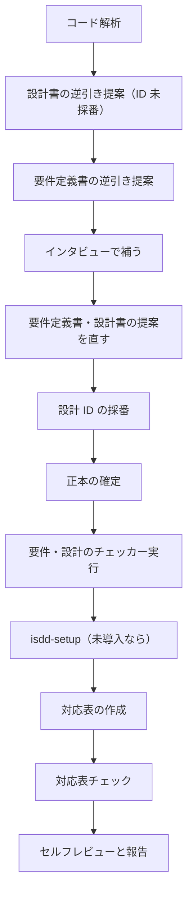

# isdd-reverse-engineering — 既存プロジェクト仕様駆動化スキル

既存コードを解析して設計書と要件定義書を書き起こし、インタビューで不足を補って正本を確定し、対応表を作る。完了するとプロジェクトは「isdd で運用している」状態になる。

## このスキルのファイル

参照ファイルはこのスキルの `references/`、チェッカーは `scripts/` にある。下のコマンドは `.agents/skills/` に入れた場合のパスで書いている。別の場所（`.claude/skills/`、`.github/skills/`、ホーム配下など）に入れた場合は、この SKILL.md があるディレクトリに読み替える。

| ファイル | 使う場面 |
|---|---|
| `references/subagent-delegation.md` | ステップ 1 のコード解析を委譲するとき |
| `references/hearing-rules.md` | ステップ 4 のインタビュー |
| `references/requirements-chapters.md` | 要件定義書の章立て |
| `references/design-chapters.md` | 詳細設計書の章立て |
| `references/design-completeness.md` | 設計書の網羅性チェック |
| `references/id-definitions.md` | 要件 ID・設計 ID の採番 |
| `references/trace-map-rules.md` | 対応表の書式と粒度 |
| `references/document-rules.md` | 文書の書き方と、作成後のレビュー |
| `scripts/rq_integrity_checker.py` | 要件 ID の整合チェック |
| `scripts/rq_ds_link_checker.py` | 要件 ID と設計 ID の対応チェック |

## 守ること

- 既存コードは変更しない（ロジックもコメントも）。このスキルの目的は現状を文書にすることで、コードを変えると文書の根拠が動くため。
- 仕様とコードの対応は、コードではなく対応表 `docs/trace_map.md` に書く。
- 作業中の逆引き結果は `docs/proposals.md` にまとめ、インタビューと採番が終わったら、このスキルの中で正本を確定する。実装後レビュー（`isdd-post-implementation-review`）は実装が原因の差分を扱うスキルなので、初回の正本確定には使わない。
- インタビューで分からない点が残る限り質問を続け、全ステップが終わるまで終了しない。

## 実施フロー



## ステップ 1: コード解析

既存コードベースを読み、次をまとめる。

- ディレクトリ構成とファイルの役割
- 使用言語・フレームワーク・ライブラリ
- クラス・関数・モジュールの一覧と依存関係
- データモデル・スキーマ（DB スキーマ、データクラスなど）
- 外部システム連携の有無と内容
- バッチ・ジョブ・イベント処理の有無

コードベースが大きい場合は `references/subagent-delegation.md` に従って委譲する。指示文の例:

> 対象ディレクトリ [パス] のコードを読み、ディレクトリ構成とファイルの役割、使用言語・フレームワーク・ライブラリ、クラス・関数・モジュールの一覧と依存関係、データモデル、外部システム連携、バッチ・ジョブ・イベント処理を Markdown でまとめて返す。コードは変更しない。

まとめた構造をユーザーに示し、誤りや追加の指摘を反映する。

## ステップ 2: 設計書の逆引き提案

解析結果から、詳細設計の逆引き提案を `docs/proposals.md` に書く。

- 章立ては `references/design-chapters.md` に従い、コードから読み取れる範囲ですべての章を埋める。
- 読み取れない・判断できない箇所は「要インタビュー」と書く。
- 設計 ID はまだ付けない。要件が確定した後のステップ 6 で採番する（要件 ID が決まらないと設計 ID の末尾を決められないため）。

## ステップ 3: 要件定義書の逆引き提案

設計の提案から、要件の逆引き提案を `docs/proposals.md` に追記する。

- 章立ては `references/requirements-chapters.md` に従う。CRUD テーブルも書く。
- 設計から読み取れる業務機能・データ・非機能要件を書く。
- 業務上の背景（なぜその機能が要るか）がコードから読み取れない場合は「要インタビュー」と書く。
- `references/id-definitions.md` に従って要件 ID を採番する。

## ステップ 4: インタビューで補う

「要インタビュー」とした箇所を、`references/hearing-rules.md` に従って 1 問ずつ確認する。選択肢を伴う質問は、案・内容・メリット・デメリット・複雑さ（C=1〜5）・根拠の表と「推奨: 〇〇（理由を一文）」の形で、最初に出すときから示す。主に確認すること:

- 各機能の業務上の背景と、解決している課題
- 状態遷移の業務上の意味
- エラー処理の業務上の判断基準
- 外部システム連携の目的と仕様
- データ保持期間と運用の方針
- 非機能要件（性能目標値、同時接続数など）

## ステップ 5: 提案を直す

インタビューで得た情報を `docs/proposals.md` に反映し、修正内容をユーザーに説明する。そのうえで次を確認する。

- 要件: すべての要件に `RQ-*` があり、`RQ-BK` 以外の要件に対応する `RQ-BK-*` があるか。業務エンティティと CRUD テーブルが揃っているか。
- 設計: `references/design-completeness.md` の項目を満たしているか。

## ステップ 6: 設計 ID の採番と正本の確定

確定した要件をもとに、設計提案の各設計要素に `references/id-definitions.md` に従って設計 ID を付け、対応する要件 ID を書く。

| 対象 | プレフィックス | 例 |
|---|---|---|
| ソースファイル（モジュール） | `DS-MD-` | `DS-MD-HELLO-MODULE-FT-PRINT-HELLO` |
| クラス | `DS-CL-` | `DS-CL-HELLO-WORLD-PRINTER-FT-PRINT-HELLO` |
| 関数・メソッド | `DS-FN-` | `DS-FN-GET-HELLO-MESSAGE-FT-GET-HELLO` |
| インターフェース | `DS-IF-` | `DS-IF-CLI-ENTRY-UI-CLI-EXECUTION` |

ソースファイルにも `DS-MD-*` を付ける。対応表はファイル単位の行を `DS-MD-*` で持つので、省くと対応表を作れないため。

採番が終わったら正本を確定する。

1. `docs/proposals.md` の要件提案を `docs/requirements.md` に、設計提案を `docs/detail_design.md` に書き出す。「要インタビュー」の印は解消済みなので残さない。
2. 詳細設計書の第 1 章（技術選定）には、既存コードの言語・フレームワーク・DB・実行形態をそのまま記録する。既存資産との整合が最優先の判断軸なので、インターネット調査と選び直しは行わない。
3. `docs/proposals.md` を削除する。
4. 次を bash で実行し、両方が合格するまで正本を直す。実行ログは応答に載せる。

   ```bash
   python3 .agents/skills/isdd-reverse-engineering/scripts/rq_integrity_checker.py docs/requirements.md
   python3 .agents/skills/isdd-reverse-engineering/scripts/rq_ds_link_checker.py docs/requirements.md docs/detail_design.md
   ```

## ステップ 7: 対応表の作成

`scripts/isdd/check.sh` が無ければ、先に `isdd-setup` を実行する。そのとき、確定した詳細設計書から読み取った実行形態・認証の有無・外部連携の有無を渡す。

確定した設計 ID と既存コードのファイル・クラス・公開関数の対応を `docs/trace_map.md` に書く。

- 書式と粒度は `references/trace-map-rules.md` に従う。
- 既存コードは変更しない（コメントも足さない）。
- 対応がわからない要素はユーザーに確認する。

対応表ができたら次を bash で実行し、エラーも警告も 0 件になるまで対応表か設計書を直す。

```bash
bash scripts/isdd/check.sh --strict
```

エラーは「対応表の DS-ID が設計書に無い」「修飾名がコードに無い」、警告は「コードのクラス・公開関数・ファイルが対応表に無い」「設計書の設計要素が対応表に無い」を表す。

## 保存先

| 成果物 | 保存先 |
|---|---|
| 要件・設計の逆引き提案（作業中だけ。正本の確定後に削除） | `docs/proposals.md` |
| 要件定義書（正本） | `docs/requirements.md` |
| 詳細設計書（正本） | `docs/detail_design.md` |
| 設計 ID とコードの対応表 | `docs/trace_map.md` |

文書の書き方は `references/document-rules.md` に従う。

## セルフレビュー

`references/document-rules.md` のレビュー項目に加えて、次を確認してユーザーに報告する。

1. 要件定義書と設計書が章立てに沿っているか
2. すべての要件に要件 ID、すべての設計要素に設計 ID があるか
3. すべてのファイル・クラス・公開関数が対応表にあるか
4. 既存コードが変更されていないか
5. 要件定義書に CRUD テーブルがあるか

## 完了条件

- `docs/requirements.md` と `docs/detail_design.md` があり、`docs/proposals.md` が無い
- `rq_integrity_checker.py` と `rq_ds_link_checker.py` が問題 0 件で、実行ログを応答に載せた
- `docs/trace_map.md` があり、`bash scripts/isdd/check.sh --strict` がエラー 0 件・警告 0 件

## 次のステップ

完了を報告するときに、次を案内する。正本と対応表が揃ったので、プロジェクトは「isdd で運用している」状態になった。

- 既存コードに機能を追加・変更したい場合: `isdd-change-req` で変更要件定義から始める
- 既存コードの仕様化だけが目的の場合: ここで完了。以後コードを変えたら `isdd-post-implementation-review` で整合を確かめる
