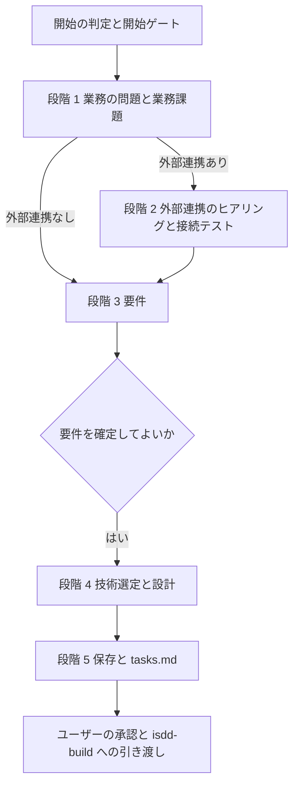

# isdd-spec — インタビュー駆動 仕様スキル

ユーザーから必要な情報を聞き出し、矛盾が無く業務課題を満たす最小の要件と、要件をすべて満たす最小の設計を作る。
実装の段階（isdd-build）はこの文書だけを根拠に実装するので、推測で埋めた箇所を残さない。コードは書かない。

## このスキルのファイル

参照ファイルはこのスキルの `references/`、チェッカーは `scripts/` にある。下のコマンドは `.agents/skills/` に入れた場合のパスで書いている。別の場所（`.claude/skills/`、`.github/skills/`、ホーム配下など）に入れた場合は、この SKILL.md があるディレクトリに読み替える。
段階ごとの手順は `references/spec-*.md` にある。その段階に入るときに読む。

| ファイル | 使う場面 |
|---|---|
| `references/spec-requirements.md` | 段階 1・3: 業務課題、ヒアリング、要件の書き方、網羅性チェック |
| `references/spec-external.md` | 段階 2: 外部連携のヒアリング、接続テスト、調査、要件との突き合わせ |
| `references/spec-design.md` | 段階 4・5: 技術選定、外部連携の設計、設計の書き方、保存と tasks.md |
| `references/hearing-rules.md` | すべての質問（まとめ方、選択肢の表、複雑さの算定、用語の確定、形態ごとの確認項目） |
| `references/requirements-chapters.md` | 要件定義書の章立て |
| `references/design-chapters.md` | 詳細設計書の章立てと技術選定の手順 |
| `references/design-completeness.md` | 設計の網羅性チェック |
| `references/requirement-exclusion.md` | 最小設計の意味、要件を外すときの手順 |
| `references/design-tasks-rules.md` | tasks.md の書き方 |
| `references/id-definitions.md` | 要件 ID・設計 ID の採番と変更管理 |
| `references/trace-map-rules.md` | 対応表（設計のコード設計章で触れる） |
| `references/document-rules.md` | 文書の書き方と、作成後のレビュー |
| `references/external-credentials.md` | `.env` と接続情報の扱い |
| `references/subagent-delegation.md` | 外部仕様やライブラリの調査を委譲するとき |
| `scripts/rq_integrity_checker.py` | 要件 ID の整合チェック |
| `scripts/rq_ds_link_checker.py` | 要件 ID と設計 ID の対応チェック |

## 流れ

各段階は、終わりの条件（チェッカーの合格など）を満たしてから次へ進む。条件を満たさないまま次の段階へ進まない。

## 開始の判定

1. フローを決める。
   - `docs/requirements.md` と `docs/detail_design.md` の両方がある → 変更フロー（実装済みの仕様がある）。変更の記録は `.history/[YYYYMMDD]-[タスク名]/` に書く。
   - それ以外 → 新規フロー。`docs/requirements.md` だけがあるのは、新規フローの途中（要件まで書いた）とみなす。
   - ユーザーがフローを指定したら、それに従う。
   - 変更フローでは `docs/active_change` を確かめる。別の変更のディレクトリを指していれば、先にその変更を `isdd-build` で実装して正本へ反映するよう案内して止まる（変更を重ねると、どの差分がどの変更のものか分からなくなるため）。ヒアリングを始めてから気づくと、聞いた内容が無駄になるので、ここで確かめる。今回の変更を指している（途中再開）なら進む。
2. 途中から再開できるかを確かめる。ユーザーが段階を指定した（「変更設計から」「この変更要件定義書から設計して」など）か、成果物が既にあれば、次のとおり再開する。
   - 要件の文書（新規は `docs/requirements.md`、変更は `change_requirements.md`）があり、整合チェックに合格する → 段階 4 から。ただし要件の「3-3. 外部連携」に連携先があるのに `external/[システム名]/docs/alignment_report.md` が無ければ、外部連携の確認が済んでいないので段階 2 から（業務課題は要件の文書から読む）。
   - 設計の文書もあり、整合チェックに合格する → 段階 5 から。
   - 要件の文書を書き換えずに使う場合も、読んで内容を把握してから進む。
   再開する段階と、その根拠（どの成果物がどの状態か）を最初の応答で報告する。
3. 開始ゲート: 新しく要件から始める場合は、次の問いを番号付きでまとめて出す（互いに独立しているため）。答えが揃うまで要件の本編を聞かない。
   1. 外部連携の有無: A. ある / B. ない / C. 不明
   2. 既存ソースコードと isdd の運用（新規フローのときだけ）: A. 既存ソースコードはない / B. 既存ソースコードがあり、isdd で運用している / C. 既存ソースコードがあり、isdd で運用していない / D. 既存ソースコードがあり、isdd の運用は不明
   - 必要なら「isdd とは、要件定義書と詳細設計書を先に確定し、要件 ID と設計 ID で仕様と実装の対応を追跡する開発方式です」と補足する。
   - 2 が B → `docs/requirements.md` の場所を確かめ、変更フローで進める。
   - 2 が C か D → `isdd-reverse-engineering` を先に実行するよう案内して止まる（既存コードと食い違う仕様を新しく作らないため）。
   - ゲートの答えを受けた次の応答は、段階 1 の最初の問い（「一言で言うとどのようなアプリですか」、変更なら「一言で言うと今回どのような変更ですか」）だけを出す。外部連携が「ある」と答えられても、連携先の名前・種類・接続方法は段階 2 で聞くので、ここでは聞かない。機能や変更内容の詳細も業務課題が決まってから聞く。これらは段階 1 の答えで変わる依存のある問いなので、ゲートの答えと一緒にまとめない。

## 段階 1: 業務の問題と業務課題

`references/spec-requirements.md` の「1. 業務の問題と業務課題」に従う。業務課題が決まる前に、機能・画面・外部連携・非機能の質問を始めない。

終わりの条件: 業務の問題、業務課題（`RQ-BK-*`）、見込み経営効果（`RQ-EF-*`）が確定している。

## 段階 2: 外部連携（ある場合だけ）

`references/spec-external.md` に従う。ヒアリングは連携先ごとに 1 回にまとめ、`.env` の作成だけはユーザーの作業として待つ。接続テスト、スキーマ取得、仕様と既存ライブラリの調査はエージェントが進める。この段階ではコードを作らない。

終わりの条件: 接続テストの結果があり、実現できると判定できた。実現できないとわかったら、ユーザーに報告して判断を仰ぐ。

## 段階 3: 要件

`references/spec-requirements.md` の「2. ヒアリング」から「6. レビュー」に従う。外部連携がある場合は、要件を書いた後に `references/spec-external.md` の「4. 要件との突き合わせ」と「5. 成果物」を行う。

終わりの条件:

- `rq_integrity_checker.py` が問題 0 件（実行ログを応答に載せる）
- 外部連携がある場合、整合確認レポートで未解消の不整合が無い
- 網羅性チェックとレビューが終わっている

条件を満たしたら、要件の要約（業務課題、要件の件数と主な要件）を示し、「要件を確定して設計に進んでよいか」をユーザーに確かめる。確定の返事を受けてから段階 4 に進む。設計の途中で要件を直すことになっても、要件の文書を直してから設計に伝えればよい。

## 段階 4: 技術選定と設計

`references/spec-design.md` の「1」から「7」に従う。承認が要るのは、技術選定、E2E の実行手段、連携ライブラリの採否、モック方式、要件の除外の 5 つ。技術選定だけ先に 1 回で承認を得て（他の判断がその結果で変わるため）、残りの 4 つは互いに独立なので番号を付けて 1 回の応答にまとめて承認を求める。

終わりの条件:

- `rq_ds_link_checker.py` が問題 0 件（変更フローは `--base docs/requirements.md` 付きで、変更要件定義書と変更設計書に対して実行。実行ログを応答に載せる）
- 網羅性チェックとレビューが終わっている

## 段階 5: 保存と tasks.md

`references/spec-design.md` の「8. 保存と引き渡しの準備」に従う。変更フローでは `docs/active_change` を書く。

## 守ること

- 成果物としてのコードを書かない。連携ライブラリ・モック・E2E のコードも `isdd-build` が作る（段階 2 の接続テストで使う使い捨てのスクリプトは、終わったら消す）。
- 変更フローでは、正本（`docs/requirements.md`・`docs/detail_design.md`）を書き換えない。正本への反映は実装の後に `isdd-build` が行う。正本は実装済みの仕様だけを持つので、実装の前に書き換えると、作っていない仕様が正本に残るため。
- `.history/` 配下の変更要件定義書と変更設計書は、変更の記録として残す。
- 質問は `references/hearing-rules.md` に従う。依存のある問いは 1 問ずつ、独立した問いは番号を付けてまとめて出し、選択肢には表と推奨を付ける。
- 推測で埋めない。分からない点が残る限り質問を続ける。ユーザーの選択の理由を、エージェントが作って書かない。

## 完了条件

- 段階 1〜5 の終わりの条件をすべて満たした
- 新規フロー: `docs/requirements.md`、`docs/detail_design.md`、`.history/[YYYYMMDD]-[タスク名]/tasks.md` がある
- 変更フロー: `change_requirements.md`、`change_detail_design.md`、`tasks.md` があり、`docs/active_change` に変更のディレクトリが書いてあり、正本を書き換えていない
- 設計書の第 7 章に、対応表の粒度と依存の規則（無ければ「無い」）が書いてある
- 外部連携がある場合: `external/[システム名]/docs/research.md`、`alignment_report.md`、`.env.example` があり、接続情報の値が `.env` 以外に書かれていない

## 報告と引き渡し

完了したら、次を報告し、仕様の承認を求める。

- 作った文書のパスと、要件・設計の要約（業務課題、要件の件数、主な設計の判断）
- チェッカーの実行ログ
- 承認を得た判断（技術選定、連携ライブラリ、モック方式、除外要件）
- 残っている確認事項（あれば）

承認を得たら、`isdd-build` で実装と実装後レビュー（正本への反映）を行うよう案内する。
